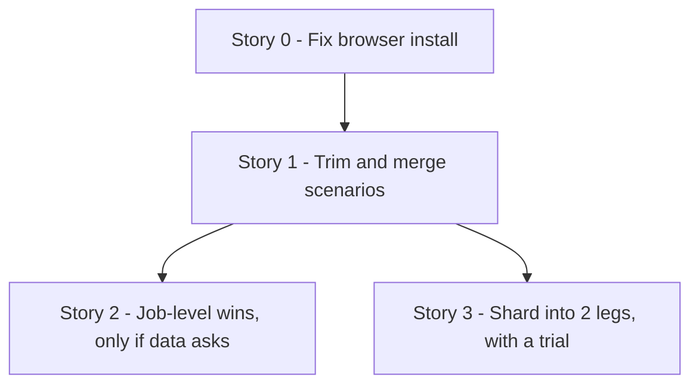

# TD59 — Playwright E2E Suite Duration (CI)

## Status
- **Type**: Technical Debt / CI performance and test-suite hygiene
- **Priority**: Medium (no wrong behavior and no failing spec, but the `Playwright E2E` job outgrew its cap three times and was cancelled on every TD58 PR, each costing a manual re-run and 20+ minutes of wall clock; the cap was at a stopgap 45 minutes when this TD was written; Story 0 set it to 35)
- **Context**: `.github/workflows/pr-tests.yml` (job `e2e`), `apps/web/playwright.config.ts`, `apps/web/e2e/**`, `docs/TESTING_STRATEGY.md`, `docs/CI_TRAPS.md`. No product code, backend, BFF or migration change.
- **Created**: 2026-11-06
- **Discovered**: TD58 PRs #721, #722 and #723 (2026-11-05/06). The `Playwright E2E` job was cancelled at the 30-minute cap on a first attempt with every spec that ran passing, and a re-run passed. Earlier the same failure drove the 20 → 30 raise (M23-S13, PR #613).
- **Decision status**: Ready for discovery in the dependency order below; every story still begins with `/story-discovery`. The sequence was confirmed with the user on 2026-11-06 and reordered the same day after the CI-log measurements in "Measured baseline" (install fix, trim, job-level wins, and sharding only as a last resort). After Story 1 the user chose to shard into 2 legs right away (2026-11-06), so Story 3 no longer waits for Story 2. Stories 0, 1 and 3 have been discovered; Story 2 has not, so its "Pattern" is a starting decision `/story-discovery` Step 4q may refine.
- **Related**: `docs/CI_TRAPS.md` rows on the Playwright cap (lines ~124-125); `docs/TESTING_STRATEGY.md` § Running Playwright locally and the CI-sequential note (~lines 446, 801-803); TD08 AUD-015 (the original Playwright CI job); TD58 (the PRs that exposed this).

---

## Problem

The `Playwright E2E` job takes 19-23 minutes on a clean run and the whole PR workflow 28-33 minutes. Three TD58 PRs were cancelled at the 30-minute cap on a first attempt with nothing failing, and the cap was raised again to 45 minutes in PR #723 as a stopgap. `docs/CI_TRAPS.md` already says the next step is to shard or trim rather than raise the cap, and nothing tracks that work.

Verified facts (repo read, 2026-11-06):

- **The suite is much larger than documented** (state when this TD was written, before Story 0). There are 63 spec files and 445 tests (15,491 lines of spec; an earlier count of 546 was wrong). The comment in `pr-tests.yml` and the `docs/CI_TRAPS.md` row still say "~330 tests", and `docs/TESTING_STRATEGY.md:447` still says "maximum 5-8 E2E scenarios for MVP". Largest: `hotsite-editor.spec.ts` (57 tests, 1,795 lines), then `schedule.spec.ts` and `services-resource-config.spec.ts` (19 each), `schedule-resource-columns.spec.ts` and `booking-journey-basket.spec.ts` (17 each).
- **CI runs one test at a time.** `playwright.config.ts` sets `workers: process.env.CI ? 1 : undefined`, `retries: 2` in CI, `fullyParallel: true`, and no sharding anywhere. `docs/TESTING_STRATEGY.md:803` says `workers: 1` is what prevents cross-file races on the shared seeded tenants (for example `hotsite-editor.spec.ts` and `settings.spec.ts` both mutate `autospa-premium`). More workers or shards are therefore unsafe until tenants are isolated.
- **The stack runs in dev mode.** The job starts `next dev` for the web app (no production build), the backend and BFF in dev, then waits with `wait-on`. Only pnpm is cached: there is no Playwright browser cache and no Next.js build cache, so the browser install (then `playwright install chromium --with-deps`, which Story 0 changed to the browser alone) and the first-compile of every route happen on every run.
- **Login is per test.** There is no `globalSetup` and no `storageState`. 56 spec files call the dev-login helper (`loginAsStaff`, `customer-login`), a BFF round trip each time.
- **Retries can hide slowness.** With 2 retries, a flaky or slow test can run three times without any signal in the job result.
- **No timing data is kept.** The job prints a list reporter and uploads artifacts only on failure with 1-day retention. The split was recovered from raw logs (see "Measured baseline"); the CI logs keep per-test durations for 90 days, which is enough, so no separate instrumentation story is planned. Method: parse the list reporter's `(<duration>)` suffix on each `✓` line.
- **Stale references.** `playwright.config.ts:35` points to a `pr-e2e.yml` that does not exist (the job lives in `pr-tests.yml`).

### Why this matters
Every app-touching PR pays the job's wall clock, and a cancellation costs a manual re-run. As the suite grows (445 tests today against 330 in the last comment) a larger cap only postpones the next cancellation and slows every merge. The 45-minute cap also lets a hung stack burn a runner for 45 minutes before failing.

## Measured baseline (2026-11-06, from CI logs of real runs)

Source: the `Playwright E2E` job logs of PR #723's runs and the 40 most recent `PR — Quality And Security` runs (Nov 3-6). Reproducible with `gh run view <id> --log --job <job-id>`; the list reporter prints every test's duration.

**Job phases, normal run (run 42175124272, 22.8 min total):** checkout + pnpm install 0.7 min, infra start 0.3 min, migrate + seed + GCS upload + services 0.5 min, `playwright install` 0.3 min, **Run Playwright E2E 20.7 min (about 91%)**. Setup is about 2 min and is not the bottleneck.

**The test phase is death by many small serial tests, not a hot spot.**

| | run 42175124272 | run 42139927129 |
|---|---|---|
| Tests executed | 445 passed | 445 passed |
| Test phase | 20.7 min | 20.9 min |
| Sum of per-test durations | 20.3 min | 20.6 min |
| Tests that needed a retry | 0 | 0 |
| Median / p90 test | 2.4 s / 4.9 s | 2.0 s / 6.9 s |
| Tests over 10 s | 3 | 3 |

- Per-test durations add up to the wall clock (about 0.03 s of gap per test): no hidden overhead between tests.
- No dominant spec. `hotsite-editor.spec.ts` (55 tests) takes 2.1-2.5 min (about 11%); the next specs take 1.0-1.5 min each. The slowest single test is 14-18 s.
- 445 tests execute: 437 `test(` calls plus 8 generated by loops. The "546 test() calls" figure first written in this TD was a miscount.
- Run-to-run variance of the same suite on a green run is 15-27 min (40 runs sampled), so one serial worker is also what makes the time unpredictable.

**The one real cap timeout was not the tests.** Of the 40 sampled runs, a single one (42092698239, 2026-11-05) hit the 30-minute cap. Most other "cancelled" runs lasted 3-17 minutes and were superseded by a newer push (`cancel-in-progress: true`), not timed out. In that run `playwright install chromium --with-deps` took **9.5 min instead of about 20 s**: apt fetched font packages from `azure.archive.ubuntu.com` at 43 kB/s ("Fetched 21.9 MB in 8min 23s"). The tests then ran their usual 18 min and the job reached 30 min. Raising the cap to 45 hides this; it does not fix it.

**Consequence for the plan.** Trimming alone can cut perhaps 10-20% (no outlier exists) and will not make the time predictable. The first lever is making the install step fast and bounded. After that, merging redundant scenarios into full flows, and then running the suite in parallel by sharding across 2 jobs (each with its own stack and database, keeping `workers: 1` inside each shard), at the cost of repeating the setup per shard. The user chose to do this right after Story 1 (2026-11-06), with a trial and a rollback rule.

## Chosen approach (decided 2026-11-06, reordered the same day after the measurements above)
Fix the install step first (it caused the only observed timeout), then trim and merge redundant scenarios, then take cheap job-level wins only if the data asks. Sharding was first meant as the last resort (it multiplies the per-job downloads and runner queueing that GitHub-side slowness already makes unpredictable), but after Story 1 the user chose to shard into 2 legs and measure it, with a trial and a rollback rule (Story 3). Per-file tenant isolation with several workers on one runner is rejected for now (invasive, touches many specs and the seed).

Target: the `Playwright E2E` job under about 20 minutes in the worst observed case with no cap timeout, the cap lowered from 45 to about 35 after Story 0, and the job split into 2 shards (Story 3) to bring it near 11 minutes. Expected from Stories 1-3 alone: about 22 min down to about 16-19 min with much better predictability.

---

### Story 0 — Make the browser install fast and bounded ✅ Done

**Agent:** devops
**Complexity:** S
**Docs to load:** `docs/CI_TRAPS.md` (the Playwright rows); `docs/GITHUB_WORKFLOWS_GUIDELINES.md`
**Dependencies:** none (do this first)
**Pattern:** plain composition — no named pattern applies

**Description:** `pnpm --filter @ikaro/web exec playwright install chromium --with-deps` runs `apt-get` against the runner's mirror and downloads the browser on every run. In run 42092698239 the apt font download alone took 8 min 23 s at 43 kB/s and caused the only observed cap timeout. Decided in `/story-discovery` (2026-11-06): drop `--with-deps` and run `playwright install chromium` alone, with `timeout-minutes: 3` on the step. In a normal run `--with-deps` installs exactly nine font packages (every library Chromium needs is already on the runner), and the browser download itself takes about 15 s, so the apt call is the only slow part and removing it removes the dependency instead of retrying around it. Rejected: a browser cache (the download is not the slow part) and the `mcr.microsoft.com/playwright` container (it breaks `docker compose` networking to `localhost` and is far more machinery than this needs). Pre-decided fallback: if the first PR run fails on missing system libraries, install just those packages in a bounded step (timeout plus one retry); two layout specs (`booking-journey-basket`, `hotsite-templates`) check for horizontal overflow, not font metrics, and are the ones to watch. Also lower `timeout-minutes` from 45 to about 35 once the install is bounded, so a hung stack fails sooner; revisit the value after Story 1 using the job logs.

New migration / i18n keys / env vars / feature flags: none. Backend HTTP surface: none.

**Files to create/modify:**
- `.github/workflows/pr-tests.yml` (modify: install step without `--with-deps`, step timeout, job cap 35, stale test-count comment)
- `docs/CI_TRAPS.md` (modify: record the apt-mirror stall — doc gate)

**Acceptance criteria — product:**
- [ ] The install step takes well under a minute (about 15 s) and cannot run past its own 3-minute timeout. The timeout is a platform guarantee and no test pins it.

**Acceptance criteria — technical:**
- [ ] `actionlint` clean; the job cap is 35 and the comment above it states 445 tests
- [ ] The step's duration is shown for two consecutive real runs

**Live-verification check:** two consecutive green real PR runs with the install step's duration in the log.

---

### Story 1 — Trim and merge redundant scenarios (Tier 1: verified duplicates and move-downs) ✅ Done

**Agent:** web-ts
**Complexity:** L
**Docs to load:** `docs/TESTING_STRATEGY.md` § Layer 5 and § Mandatory Patterns; `docs/ENGINEERING_RULES_TESTING.md` (the E2E sections); `docs/ANTI_PATTERNS.md`; `archive/td/TD59-S01-TRIM-CANDIDATES.md`
**Dependencies:** Story 0
**Pattern:** plain composition — no named pattern applies. A merged flow is one test with named `test.step` blocks; a moved assertion goes to the Vitest spec that already holds it.

**Description:** The measurements show no outlier, so this story is about redundancy, never about a time target chosen up front. Five read-only reviews of the whole suite (2026-11-06, one per cluster: hotsite and settings, recurring and alerts, booking flows, schedule and bookings, services/team/leads/rest) produced a candidate list in `archive/td/TD59-S01-TRIM-CANDIDATES.md`: about 229 of the 445 tests removable or mergeable, an optimistic estimate of 7 minutes that assumes 1-1.5 s of setup per merged test and must be measured (a realistic expectation is 4-5 minutes). The list is unverified agent output; every entry is re-read before use.

**Locked at `/story-discovery` (2026-11-06): this story is Tier 1 only.**
- **In Tier 1:** (a) a test that asserts nothing its survivor does not (DUPLICATE), after reading both; (b) a MOVE-DOWN whose covering Vitest assertion is cited, read and break-it checked (below); (c) a rule-violating edge/error test that has such a covering assertion; (d) a 2-test merge with identical setup, where every assertion of the absorbed test becomes a named `test.step` of the survivor, and the merged test stays under about 12 s.
- **Out of Tier 1:** merges of three or more tests into one flow; any test that needs more than about 2 new unit cases before it can be deleted (it stays, with a note); viewport, CSS-geometry and axe-contrast checks that need a real browser (jsdom cannot prove them); and every test whose backend proof was not confirmed: the real `LEG_UNAVAILABLE` race, `STAFF_ALREADY_EXISTS` and `STAFF_SELF_DEACTIVATION` reaching the UI, the recurring-by-staff phone-not-set path, and the cap of 10 active alerts. Those stay untouched here. Out-of-scope merges become one follow-up story per cluster (`/create-story`), sized from this story's measured saving.
- **Translated strings:** where a touched test asserts a translated string, it is converted to a `data-testid` assertion (`docs/TESTING_STRATEGY.md` § Translated strings). Untouched tests are left alone.
- **Out of scope:** `helpers/booking/slot-seed.spec.ts` (1.5 s; moving it needs a `vitest.config.ts` change) and any retry or quarantine work (no test needed a retry in the sampled runs).

**Coverage-safety protocol (how "no coverage lost" is proved, since E2E coverage is not measured in CI).** The baseline is commit `c42e5700cb` (445 tests in 63 specs, CI run 42220584040, 19.0 min of test time); the inventory is always re-derived from that commit with `git show`, never from memory.
1. **Assertion inventory.** A script lists every `data-testid` and every `expect(...)` matcher of every E2E test at the baseline and again after the change. Every baseline entry must reappear in a surviving test, or sit on the list of entries moved down with a cited Vitest assertion. An entry on neither list is a gap and blocks the PR.
2. **Mapping table in the PR:** one row per removed or merged test: the behaviour it asserted, the surviving test or the Vitest `file:line`, and a note that the line was read.
3. **Break-it check on every move-down:** break the asserted behaviour in the source, run only the covering Vitest spec, and confirm it fails. A spec that passes without the feature is not coverage.
4. **Route check:** every `app/**/page.tsx` that had an E2E scenario still has one; re-verified by grepping the surviving specs for each route.
5. **No verifiable cover, no removal.** A test whose cover cannot be read and checked stays.

New migration / i18n keys / env vars / feature flags: none. Backend HTTP surface: none.

**Files to create/modify:**
- `apps/web/e2e/**/*.spec.ts` (modify/delete: the Tier 1 specs, final list in the PR's mapping table)
- `apps/web/**/*.spec.tsx` (modify: a Vitest spec that needs a missing small case before its E2E duplicate goes)
- `docs/TESTING_STRATEGY.md` (modify: the E2E scenario guidance and the stale "5-8 scenarios" line — doc gate)
- `archive/td/TD59-E2E-SUITE-DURATION.md` (modify: the "546 tests" miscount is 445, record the measured result)

**Acceptance criteria — product:**
- [ ] No user flow loses its only E2E coverage; every route that had an E2E scenario still has one.
- [ ] Every behaviour asserted by the 445 baseline tests is still asserted somewhere: in a surviving E2E test or in a named Vitest assertion.

**Acceptance criteria — technical:**
- Unit:
  - [ ] every assertion moved down from an E2E test exists in a named Vitest spec, and that spec fails when the behaviour is broken (break-it check recorded in the PR)
- E2E:
  - [ ] the assertion inventory of the baseline commit and of the branch shows no unaccounted entry (output in the PR)
  - [ ] a table in the PR maps each removed or merged scenario to the test that still covers it
  - [ ] the suite passes on two consecutive real runs with no retry used
- [ ] The CI test phase is at least 3 minutes below the 19.0-minute baseline on two consecutive runs and the test count falls from 445 to about 345; if either is missed the PR states why
- [ ] Coverage ≥80% on changed code; `tsc --noEmit` clean, lint clean

**Result (2026-11-06, PR #727):** the suite went from 445 tests in 63 files to 321 in 62 (123 `test()` calls removed or merged, one mapping row each in the PR body). Three consecutive green CI runs with no retry used: 318, 321 and 321 tests, test phase 16.4, 14.4 and 16.5 minutes (job total 18.3, 16.2 and 18.3) against 20.7-20.9 minutes (22.7-22.8 total) at the baseline, so 4-6 minutes faster. About 75 break-it checks (all failing as required) and an independent audit of the removals backed the "nothing lost" claim; the audit's six weaker rows and three bot-flagged tests were put back in the E2E suite. Left for follow-up stories, if the numbers ever ask for them: the merges of three or more tests and every test whose backend proof was not confirmed (`archive/td/TD59-S01-TRIM-CANDIDATES.md`). The merge savings were smaller than estimated (about 4-6 minutes against 7): merging tests that share no setup saves almost nothing, so Tier 1 kept merges to tests with identical setup.

---

### Story 2 — Job-level wins (only if the data still asks) ✅ Done

**Agent:** devops + web-ts
**Complexity:** M
**Docs to load:** `docs/TESTING_STRATEGY.md` § Mandatory Patterns and § Running Playwright locally; `docs/CI_TRAPS.md` (the Playwright rows and § Stale local state); `docs/GITHUB_WORKFLOWS_GUIDELINES.md`; `docs/ENGINEERING_RULES_TESTING.md` (E2E helper and dev-login conventions)
**Dependencies:** Story 0
**Pattern:** plain composition — no named pattern applies

**Description:** Setup measured about 2 minutes, so these wins are small and kept only if the job logs show they move the number. Take only what the data shows is large, (with Story 3's two legs each repeating the setup, anything saved here is saved twice): Docker image caching for the emulators, a Next.js build cache or a production build instead of `next dev` (only if first-compile of routes is a large share of test time; keep dev-login enabled through its flag), and reusing the login through `globalSetup` + `storageState` (keep the helper API; a spec logging in as a different role must still get that role). Fix the stale references: `playwright.config.ts:35` (`pr-e2e.yml`), the "~330 tests" comments. Each change is measured against the numbers before it, and a change that does not move the number is not kept. If the job is already inside the target, close this story as not needed.

New migration / i18n keys / env vars / feature flags: none expected.

**Files to create/modify:** decided from the data (`pr-tests.yml`, `playwright.config.ts`, `e2e/global-setup.ts`, docs).

**Acceptance criteria — product:**
- [ ] Each kept change is measurably faster than before the change, stated per phase in the PR.

**Acceptance criteria — technical:**
- [ ] The full suite passes unchanged in count on two consecutive runs
- [ ] A negative guarantee is pinned if login reuse is taken: a spec that logs in as a different role than the stored state still gets that role
- [ ] `actionlint`, `tsc --noEmit` and lint clean

**Result (2026-11-07): closed as not needed, by the story's own rule ("if the job is already inside the target, close this story as not needed").** The target was the job under about 20 minutes in the worst observed case. After Stories 0, 1 and 3 the final five-run trial (PR #730) shows the slower leg at 10.4 to 12.1 minutes (median 11.4), with 1.4 to 2.2 minutes of setup per leg against the 16-18 minute single job, and `timeout-minutes` is 20. A job-level win would have to beat about 2 minutes of setup (saved once per leg), and the login-reuse option touches 56 spec files and puts the role-isolation guarantee at risk, for a gain under a minute per leg. No change from this story was kept. The two stale references it listed were fixed on `main` without a story: the `pr-e2e.yml` comment in `playwright.config.ts` (the job is `e2e` in `pr-tests.yml`) and the "about 330 tests" figure in the `docs/CI_TRAPS.md` cap row, now marked as the historical numbers of M23-S13. Reopen only if the legs drift back above about 15 minutes.

---

### Story 3 — Shard the Playwright job into 2 parallel legs ✅ Done

**Agent:** devops
**Complexity:** M
**Docs to load:** `docs/TESTING_STRATEGY.md` § Layer 5 and § Test Parallelism; `docs/CI_TRAPS.md` (the Playwright rows); `docs/GITHUB_WORKFLOWS_GUIDELINES.md`; `docs/ENGINEERING_RULES_TESTING.md` (shared-tenant fixtures, a fixed-time-slot booking fixture)
**Dependencies:** Stories 0 and 1
**Pattern:** plain composition — Playwright's own `--shard` plus a GitHub job matrix; the shard total comes from `strategy.job-total`, so it is written once and cannot disagree with the matrix.

**Description:** Decided at `/story-discovery` with the user (2026-11-06): shard now, with 2 legs, and measure it with a trial and a rollback rule. The earlier "only if the data asks" gate and the Story 2 caches prerequisite are dropped: setup is about 2 minutes, the repo is public (runner minutes are free) and the account is on the Free plan (20 concurrent jobs; one PR peaks at 17, so a second E2E leg makes 18).

Measured before the change: the job takes 16-18 minutes (test phase 14-17) and Playwright splits the 321 tests by file into 161 and 160. From the last CI run's per-test times the slower leg is about 7.7 of 14.4 minutes of per-test time, so expect about 11 minutes (11-12 once each dev server compiles its own routes). Three shards were rejected: lopsided (140, 76 and 105 tests) and only about 2 minutes better.

- `.github/workflows/pr-tests.yml`: `strategy: { fail-fast: true, matrix: { shard: [1, 2] } }`; leg name `Playwright E2E (${{ matrix.shard }}/${{ strategy.job-total }})`; run `pnpm --filter @ikaro/web e2e:ci --shard=${{ matrix.shard }}/${{ strategy.job-total }}` (no `--` before the flag: it makes Playwright ignore the flag and run every test); failure artifacts named per leg (`playwright-report-N`, `playwright-traces-N`, `server-logs-N`, because upload-artifact names must be unique); `timeout-minutes` lowered from 35 to 20. `fail-fast: true` is the user's choice: once one leg has failed the PR needs fixing locally, so finishing the other leg is wasted time. The cost is that a round shows only the first failing leg's failures.
- `apps/web/playwright.config.ts`: `fullyParallel: !process.env.CI`. With it on, Playwright splits tests one by one, which would break the serial `hotsite-editor` group; off in CI it splits by file and keeps a file's tests together. Local runs keep today's behaviour.
- Each leg is a full job with its own Postgres, Pub/Sub, GCS, MailHog, backend, BFF and web app, the same migrations and the same seed, and keeps `workers: 1`. No spec change and no per-shard data: any file can run in any shard, so a spec must not depend on another file's data or run order (the shared-tenant rules already say so).
- `test-suite-passed` is unchanged: its allow-list on `needs.e2e.result` is `success` only when every leg succeeded, and `SonarCloud Analysis` (a required check) sits behind it. Nothing partitions by hand: Playwright's split is exact (checked with `--list`: 161 + 160 = 321, none in both, none in neither) and an empty leg fails.
- **Trial and rollback:** five sharded runs on the PR (re-runs count). Keep sharding only if the median job is at most 12 minutes, the worst at most 14, no leg waits more than 2 minutes for a runner and no retry is used. Otherwise revert the workflow change (the single-job version stays in git history).
- Rejected: per-file tenant isolation with several workers on one runner (invasive, touches many specs and the seed); 3 shards; a separate partition-guard job (the matrix-derived total and the gate cover it).

New migration / i18n keys / env vars / feature flags: none. Backend HTTP surface: none.

**Files to create/modify:**
- `.github/workflows/pr-tests.yml` (modify: matrix, shard flag, leg and artifact names, lowered cap and its comment)
- `apps/web/playwright.config.ts` (modify: `fullyParallel` off in CI)
- `docs/TESTING_STRATEGY.md` (modify: the "CI is effectively sequential" note, the `--` pitfall, "any file can land in any shard"), `docs/CI_TRAPS.md` (modify: the cap row) — doc gate

**Acceptance criteria — product:**
- [ ] Over the trial the `Playwright E2E` job's median is at most 12 minutes and its worst at most 14 (it is 16-18 today), and `timeout-minutes` is 20.
- [ ] No leg waits more than 2 minutes for a runner and no retry is used in the trial runs.

**Acceptance criteria — technical:**
- E2E:
  - [ ] on the first sharded run the two legs execute 161 and 160 tests and the sum equals the full 321 (read from each leg's `passed` plus `flaky` lines: Playwright reports a test that failed once and passed on retry as `flaky`, not `passed`)
  - [ ] five sharded runs are green with the numbers above; otherwise the workflow change is reverted
- [ ] Negative guarantee pinned: a deliberately failing leg makes `test-suite-passed` fail, and with `fail-fast: true` the cancelled sibling leg fails it too (shown on a throwaway commit in the PR, then removed)
- [ ] `actionlint` and `zizmor` clean; the docs above and the cap comment updated

**Live-verification check:** five green sharded PR runs under the new cap, plus the throwaway failing-leg run.

**Result (2026-11-07, PR #730):** the job runs as 2 legs of 161 and 160 tests, and the partition was exact in every run. The trial had to be restarted three times, because each change to what it measured restarted it (18 runs in all, on five heads). The first five runs met the timing targets (slower leg median 11.7 min, worst 12.9) but 3 of 5 retried a test; the user chose to keep sharding and fix the flakes. Two flaky tests were fixed: `select-staff-tenant` asserted the transient `/dashboard` URL that redirects at once to `/dashboard/bookings`, and the `hotsite-editor` drag test clicked Publicar 30 ms after a drop, inside the 50 ms window in which dnd-kit (`@dnd-kit/core` 6.3.1) swallows the next click, so no publish request was sent (found from a saved trace of a failed first attempt; fixed with `waitForDragToSettle`). Final trial on the merged test code: 5 of 5 runs with no retried test, 321 tests each, runner wait at most 2 s, slower leg 12.0, 11.4, 10.4, 10.4 and 12.1 min (median 11.4, worst 12.1) against 16-18 min for the single job. The throwaway failing leg (run 42329037401) failed leg 1, cancelled leg 2 through fail-fast, failed `Test Suite Passed` and skipped SonarCloud. Not in the story's file list, added on the way: the three Dockerfile base-image digests (a repo-wide Trivy failure on the patched musl and zlib, in its own commit), the per-leg report and trace upload on every non-cancelled leg, and the artifact names in `docs/ENGINEERING_RULES_TESTING.md`. Tried and reverted: `trace: 'retain-on-first-failure'`, which made the slower leg 14 min (about 2 min more than `on-first-retry`). Worth knowing for the next flake: re-running a workflow replaces its same-named artifacts, so download a failed attempt's `playwright-traces-N` before re-running.

---

## Out of scope
- Rewriting specs to a different test framework, or moving E2E to a different runner.
- Adding new E2E scenarios (this TD only measures, speeds up and trims).
- Backend and BFF integration-test duration (a separate suite with its own job).
