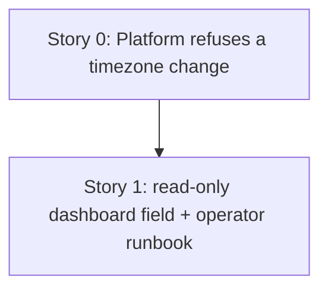

# TD61 — BILLING-TIMEZONE-FOLLOWS-TENANT

## Status

- **Type**: Technical Debt / Invariant not enforced
- **Priority**: Medium (a manager can change the tenant's timezone today, which the product says must not happen; the effect is a Billing date boundary, today only the BOOKING `bookableUntil` cap, off by the offset between the two zones, up to several hours)
- **Context**: Platform (the settings invariant), BFF and web (the settings form), docs (runbook)
- **Created**: 2026-11-26 (rewritten twice the same day: the first draft missed decision 47, the second assumed the timezone is editable by design)
- **Discovered**: M26-S18b PR #847 review: CodeRabbit's finding on `apps/backend/src/contexts/booking/application/use-cases/update-availability-alert.use-case.ts` (the `bookableUntil` cap date is derived in the subscription's timezone, the alert check reads the tenant's). Declined in that PR with a documented limitation in `docs/BUSINESS_LOGIC_REFERENCE.md` § The billing `bookableUntil` cap.
- **Decision status**: ✅ Done: Story 0 (#849) and Story 1 (#850) are merged. The product rule was decided (owner, 2026-11-26): **the tenant's timezone is set at signup and a manager can never change it; only an operator can correct it, as a rare, documented action.**
- **Related**: `docs/discovery/tenant-billing/tenant-billing.md` decision 47 and decision 119; `docs/DOMAIN_MODEL.md` § Aggregate: Subscription (`timezone`: "snapshot of the tenant timezone, IMMUTABLE"); `docs/TENANTS_SETTINGS_SCHEMA.md` ("Timezone is configured once per tenant and applies globally"); `docs/BUSINESS_LOGIC_REFERENCE.md` § The billing `bookableUntil` cap; `docs/RUNBOOKS.md`; M26-S18a, M26-S18b (PR #847)

## Problem

*This section describes the state before Story 0. Story 0 ships the aggregate guard described under "Chosen approach"; the dashboard field and the operator runbook are Story 1.*

Billing's `Subscription.timezone` is a snapshot of the tenant's timezone taken at provisioning and is immutable on purpose (`subscription.aggregate.ts:76`; decision 47: "copied from `TenantProvisioned` at creation and is immutable; period boundaries are local midnight in it; Billing never reads Platform settings"). That is only safe if the tenant's own timezone never changes. The docs say so (`docs/TENANTS_SETTINGS_SCHEMA.md`: "Timezone is configured once per tenant"), and the owner confirms the rule: a manager can never change it; only an operator can, as a rare correction.

**The code does not enforce it.** The dashboard's settings form has an enabled timezone select (`apps/web/features/platform/components/settings/SettingsHoursSection.tsx:42-47`, `data-testid="settings-timezone-select"`), the settings update sends `businessHours.timezone`, and nothing in the backend rejects a changed value: `Tenant.updateSettings()` (`apps/backend/src/contexts/platform/domain/tenant.aggregate.ts:104`) replaces the whole settings object and the validator only checks that the value is a real IANA zone (`business-hours.validator.ts`). Platform also publishes no event when it changes.

Until M26-S18b every Billing date stayed inside Billing, so the gap was invisible. The `bookableUntil` cap is the first Billing date another context compares in its own calendar: Billing derives a `YYYY-MM-DD` in the subscription's zone, Booking turns it into a boundary at the local midnight of the tenant's **current** zone. After a manager changes the timezone, the boundary sits up to the offset difference away from the instant Billing meant, and a commitment ending in that gap could later block the removal. The same drift would hit every other Billing date the moment another context reads one.

### Why this matters

The invariant that keeps Billing's snapshot correct is documented but not enforced, so it is one settings save away from silent drift on money and entitlement dates. Enforcing it where it is owned (Platform) makes decision 47 true by construction, with no event, consumer, migration or infrastructure rollout.

## Chosen approach (decided in this session, 2026-11-26)

1. **Enforce the invariant in Platform's aggregate.** `Tenant.updateSettings()` refuses a settings object whose `businessHours.timezone` differs from the current one, with a typed domain error (`PLATFORM_TENANT_TIMEZONE_IMMUTABLE`, a `422` through the existing error mapper) and both locale messages. Every path that updates settings goes through the aggregate, so none can bypass it.
2. **Show it read-only in the dashboard** after signup, with a short explanation that an operator corrects it.
3. **The operator correction is a documented runbook, not a feature.** An operator changes four things **together** in one reviewed transaction: the tenant's `settings.businessHours.timezone`, `billing.subscriptions.timezone`, `trial_ends_at` (an instant: the old zone's local midnight, so it is recomputed from `next_due_date` in the new zone; `next_due_date` and `anchor_day` are local dates and stay) and the `subscription_items` rows that start at the old `trial_ends_at`. Changing only the two timezone values would leave `trial_ends_at` on the wrong local day. The pre-checks (decided at Story 1 discovery, 2026-11-26): the subscription is `TRIALING`, the tenant has no `billing.charges` row, and no bookings, availability alerts or schedule closures (data written under the old zone keeps its old local meaning); otherwise stop and decide with the owner. There is no cache eviction an operator can run: the tenant read cache is in-process with a 60 s TTL (`CachingTenantRepository`), so the runbook says to wait about 60 s after the commit (the hotsite and booking manifests lag up to 300 s). It is expected to be rare. If it ever stops being rare, `/create-story` adds an operator endpoint that updates both through an event, and that is the point to revisit.
4. **Record the invariant once** in `docs/TENANTS_SETTINGS_SCHEMA.md` and remove the "can drift" notes S18b added (`docs/BUSINESS_LOGIC_REFERENCE.md` § The billing `bookableUntil` cap, `docs/TENANTS_SETTINGS_SCHEMA.md`, `docs/DOMAIN_MODEL.md`).

**Rejected:** a Platform event plus a Billing consumer that re-points the subscription's timezone (reverses decision 47, needs a new Pub/Sub topic and subscription, the playbook's Foundation rollout and a policy for dates and charges already computed, for a case the product says never happens); carrying the cap as an instant (fixes the cap only, and leaves the invariant unenforced for every future cross-context date); deriving Billing dates in the tenant's zone at read time (Billing would read Platform settings on every money-date computation, against decision 47).

**First discovery step (read-only, by someone with database access):** count the tenants in staging and production whose `settings.businessHours.timezone` already differs from their `billing.subscriptions.timezone`. A non-zero count means some tenants already drifted before the guard, and the runbook's correction is applied to them once.

## Stories

### Story 0 — Platform refuses a timezone change from the settings route 🟡 ✅ Done

**Agent:** backend-ts + bff-ts
**Complexity:** S
**Docs to load:** `docs/TENANTS_SETTINGS_SCHEMA.md` § 3. Business Hours, `docs/ENGINEERING_RULES_SHARED.md` § Adding a new error — checklist (step 2: both locale files), `docs/ERROR_CATALOG.md` § Code Origins, `docs/CODE_STANDARDS.md`, `docs/API_CONTRACTS.md` § Tenant Settings (Admin — UC-026)
**Dependencies:** none
**Pattern:** aggregate invariant with a typed domain error (the `TenantInactiveError` precedent in the same `updateSettings()`): the rule lives in the aggregate, the controller's `mapPlatformError` maps it.

**Description:**
`Tenant.updateSettings(settings)` compares `settings.businessHours.timezone` with the current value (an exact string match) and throws `TenantTimezoneImmutableError` (`PLATFORM_TENANT_TIMEZONE_IMMUTABLE`, `field: 'settings.businessHours.timezone'`) when they differ, before replacing anything. A save that keeps the same timezone is unchanged. The error is added to `PlatformErrorCode`, to `platform-error.mapper.ts` (`422`) and to both locale `errors.json` files in the same change (the web's exhaustiveness test fails CI otherwise). The BFF forwards the typed error unchanged. `docs/TENANTS_SETTINGS_SCHEMA.md` states the invariant once and the S18b "can drift" notes are removed.

**Decided at `/story-discovery` (2026-11-26):**
- Status `422` (not the `409` of `TENANT_INACTIVE`: the request is well formed and the rule refuses it, as `SIGNUP_SLUG_RESERVED` does); `field` is `settings.businessHours.timezone`, the same shape as the other settings violations in `docs/API_CONTRACTS.md`.
- Messages: pt-BR "O fuso horário do negócio é definido no cadastro e não pode ser alterado. Para corrigi-lo, fale com o suporte." · en "The business timezone is set at signup and cannot be changed. Contact support to correct it."
- The comparison is an exact string match. An IANA alias of the same zone (`Brazil/East` for `America/Sao_Paulo`) counts as a change; the web form cannot produce one.
- Raw SQL (the operator runbook, Story 1) bypasses the aggregate on purpose; there is no aggregate method for a correction until an operator endpoint exists.
- The read-only count of tenants whose `settings.businessHours.timezone` already differs from `billing.subscriptions.timezone` is tracked into Story 1's runbook work, not a gate on this story.
- `UpdateTenantSettingsUseCase` is the only production caller of `Tenant.updateSettings` (grep), and its deep merge keeps the stored timezone when the body omits it, so a PATCH that does not mention the timezone is never refused.

**Backend use case steps:**
1. `Tenant.updateSettings`: after the inactive check, refuse a changed `businessHours.timezone` with the typed error.
2. `UpdateTenantSettingsUseCase` is unchanged in behavior (it saves through the aggregate); its spec's "updates businessHours timezone" case is rewritten to expect the refusal.
3. `mapPlatformError` was already at the 40-line `max-lines-per-function` cap: the `422` went into `mapTenantRuleError`, a wrapper that also calls `mapSlugError` and replaced that call, so the function did not grow and no lint suppression was needed.

**Backend HTTP surface:** extends the existing tenant settings `PATCH` route: a new `422 PLATFORM_TENANT_TIMEZONE_IMMUTABLE` outcome.
**BFF endpoint spec:** the same route forwards the typed error unchanged; no new route and no BFF code, only a component-spec case that pins the pass-through.
**New migration / i18n keys / env vars / feature flags:** one error code (`PLATFORM_TENANT_TIMEZONE_IMMUTABLE`) with its pt-BR and en messages; no migration, env var or flag.

**Files to create/modify:**
- `apps/backend/src/contexts/platform/domain/tenant.aggregate.ts` and `tenant.spec.ts` (modify; the existing "replaces the settings value object" case swaps the timezone to `America/Manaus` and must be rewritten)
- `apps/backend/src/contexts/platform/domain/errors/platform-domain.error.ts` (+ spec) (modify)
- `apps/backend/src/contexts/platform/infrastructure/http/platform-error.mapper.ts` (+ spec) (modify: a helper for the `422`)
- `apps/backend/src/contexts/platform/application/use-cases/update-tenant-settings.use-case.spec.ts` (modify: rewrite the timezone case, add the negative-guarantee case)
- `apps/backend/src/contexts/platform/infrastructure/controllers/tenant-settings.controller.spec.ts` and `tenant-settings.controller.integration.spec.ts` (modify)
- `apps/bff/src/features/platform/tenant-settings.controller.component.spec.ts` (modify: the `422` and its code pass through)
- `packages/types/src/error-codes.ts`, `packages/i18n/locales/en/errors.json`, `packages/i18n/locales/pt-BR/errors.json` (modify)
- `apps/backend/http/platform/tenant-settings.http`, `apps/bff/http/platform/tenant-settings.http` (modify — the new error case)
- `docs/TENANTS_SETTINGS_SCHEMA.md`, `docs/API_CONTRACTS.md` (§ Tenant Settings: the new `422` line), `docs/BUSINESS_LOGIC_REFERENCE.md`, `docs/DOMAIN_MODEL.md` (modify). `docs/ERROR_CATALOG.md` gets a Code Origins bullet for the new code (discovery had dropped it; it already lists newer codes there, so review restored it). The sweep also updated `docs/ANTI_PATTERNS.md`, `docs/USE_CASES.md` (UC-026 A4), `docs/TENANT_ISOLATION_STRATEGY.md` and `docs/discovery/tenant-billing/tenant-billing.md`.
- Stale-reference sweep: grep `docs/USE_CASES.md` (UC-026), `docs/*.md` and `.claude/**` for text that describes the timezone as manager-editable and fix it; the journey and prototype text is Story 1's.

**Acceptance criteria — product:**
- [ ] A manager saving settings with a different timezone is refused with a clear message, and nothing is saved; saving with the same timezone, or changing any other setting, works as before.

**Acceptance criteria — technical:**
- Unit:
  - [ ] `Tenant.updateSettings`: a changed timezone throws `TenantTimezoneImmutableError` and leaves the settings untouched; the same timezone with other changes is accepted; an inactive tenant still throws `TenantInactiveError` first
  - [ ] the existing `tenant.spec.ts` and use-case spec cases that change the timezone are rewritten to expect the refusal (none left asserting a changed timezone is stored)
  - [ ] the error mapper returns `422` with the new code and `field`; `mapPlatformError` stays within the function-length cap
- BFF component:
  - [ ] the `PATCH /v1/tenants/settings` `422 PLATFORM_TENANT_TIMEZONE_IMMUTABLE` from the backend reaches the caller with the same status and code
- Integration:
  - [ ] the settings `PATCH` with a new timezone returns `422 PLATFORM_TENANT_TIMEZONE_IMMUTABLE` and the stored timezone is unchanged; with the same timezone and a changed buffer it succeeds; a body that omits the timezone succeeds
- Tenant isolation:
  - [ ] two tenants: tenant A's refused change leaves tenant B's stored timezone untouched, and tenant B can still save its own other settings
- E2E: none — covered by integration (the web side is Story 1)
- [ ] Negative guarantee pinned: no settings path other than provisioning can change the timezone (a test that updates settings through the use case with a different timezone and expects the refusal)
- [ ] Coverage ≥80% on changed code
- [ ] `tsc --noEmit` clean, lint clean, `pnpm architecture-check` clean

### Story 1 — The dashboard shows the timezone read-only, and the operator runbook 🟡 ✅ Done

**Agent:** frontend-ts
**Complexity:** S
**Docs to load:** `docs/ENGINEERING_RULES_FRONTEND.md` § UI layer model and § Reuse the repo's UI primitives, `docs/DASHBOARD_FRONTEND_ARCHITECTURE.md`, `journeys/manager/configuracoes.md`, `journeys/manager/prototypes/configuracoes/dev-notes.md`, `docs/RUNBOOKS.md`
**Dependencies:** TD61 Story 0
**Pattern:** plain composition: `SettingsHoursSection` renders the stored zone with the existing `ReadOnlyField` (the precedent is `SettingsLocalizationSection`'s country code, currency and language) instead of the select; no new component. The timezone leaves the form's state, validation and save request entirely: it is optional in `BusinessHoursSettingsSchema` and the backend's deep merge keeps the stored value, so a read-only value can never block a save (a disabled select that stayed in the validated state would lock every save for a tenant an operator corrected to a zone outside the country's list).
**Prototype references:** `journeys/manager/prototypes/configuracoes/` (`01-settings-form.html`, `dev-notes.md` § timezone); the journey `journeys/manager/configuracoes.md` and the prototype note change in the same commit (CLAUDE.md §15's light-sync rule applies: a one-sentence factual sync of an existing journey file needs only the normal doc-gate yes).

**Description:**
`SettingsHoursSection` shows the stored timezone through `ReadOnlyField` (`data-testid="settings-timezone"`) with a short hint line instead of the enabled select. The section takes the stored zone as a prop from the loaded settings (`initial.settings.businessHours.timezone`); the form's values, validation (`timezones.includes(...)`) and save request no longer carry a timezone, so `businessHours` is sent with the day hours only. A stale client that still sends one gets Story 0's typed error (`field: settings.businessHours.timezone`, not in `SERVER_FIELD_TO_FORM_FIELD`), which falls through to `setFromApiError` and shows its locale message in the action pane. `docs/RUNBOOKS.md` gains a section, **Correct a tenant's timezone (operator)**: the read-only drift count (tenants whose `settings.businessHours.timezone` differs from `billing.subscriptions.timezone`, one cross-schema `SELECT` run by an operator), the pre-checks (see "Chosen approach" item 3), the statements that change the four things together in one transaction, the 60 s wait, and the verification query.

**Decided at `/story-discovery` (2026-11-26):**
- Form: option B, `ReadOnlyField` and the timezone removed from the form's state, validation and payload (not a disabled select).
- Copy: label pt-BR "Fuso horário" / en "Timezone" (no required `*`); hint pt-BR "O fuso horário é definido no cadastro. Para corrigi-lo, fale com o suporte." / en "The timezone is set at signup. Contact support to correct it."; `actionHint` pt-BR "As configurações afetam novos agendamentos. Horários de funcionamento entram em vigor imediatamente." / en "Settings affect new bookings. Business hours take effect immediately." The `errors.timezoneInvalid` key is removed from both locales; `timezoneBrasilia` stays (the display label of the zone).
- Runbook pre-check is strict (see "Chosen approach" item 3); correcting a tenant that already has bookings, alerts or closures is not supported by the runbook.
- The runbook SQL is executed against the local E2E stack (`pnpm infra:e2e`, worktree only, `pnpm infra:e2e:down` after) as the story's live check, and the result is noted in the PR body. The drift count against staging and production needs database access the agent does not have: it is the runbook's own first step, run by the operator after the merge, and does not gate the PR.
- `resolveSettingsLocalization().timezones` has no other web consumer, so it is dropped from `SettingsLocalization` (nothing exported without a consumer).
- E2E: one `test.step` in the existing "loads the settings page pre-filled" test asserts the zone is shown and `settings-timezone-select` is absent. Saving another field is already proven by the existing "edits fields across sections" test, and the `afterEach` restore sends the unchanged zone, so the guard does not affect it.
- Prototype pages `01`, `01b`, `01c` and `01d` draw the select and the old `actionHint`; they, `dev-notes.md`, `index.html` and the journey line are factual syncs in the same commit (no new journey or prototype, so no `/docs-audit` baseline).

**New migration / i18n keys / env vars / feature flags:** `dashboard.settingsPage.timezoneHint` added, `timezoneLabel` and `actionHint` reworded, `errors.timezoneInvalid` removed, in `packages/i18n/locales/{pt-BR,en}/web.json`; no migration, env var or flag.

**Files to create/modify:**
- `apps/web/features/platform/components/settings/SettingsHoursSection.tsx` (+ `.spec.tsx`) (modify: `ReadOnlyField` and a `timezone` display prop; no `timezones`, no change handler)
- `apps/web/features/platform/components/settings/SettingsForm.tsx` (+ spec) (modify: pass the stored zone, drop the timezone setter)
- `apps/web/features/platform/settings-form-types.ts`, `settings-form.ts`, `settings-form-shared.ts`, `settings-form-validation.ts`, `settings-form-localization.ts` (+ `settings-form.spec.ts`) (modify: the timezone leaves the values, the errors, `buildBusinessHours`, the validation and `SettingsLocalization`; the three timezone-validation cases are removed)
- `packages/i18n/locales/en/web.json`, `packages/i18n/locales/pt-BR/web.json` (modify)
- `journeys/manager/configuracoes.md` (line 46), `journeys/manager/prototypes/configuracoes/dev-notes.md` (the field list and the validation row), `index.html` (line 88), `01-settings-form.html`, `01b-validation-error.html`, `01c-saved-success.html`, `01d-chatbot-section.html` (modify: factual sync of the select and the `actionHint`)
- `docs/RUNBOOKS.md` (modify: new `## Correct a tenant's timezone (operator)` section before "Billing (planned)")
- `docs/TENANTS_SETTINGS_SCHEMA.md` (lines 139 and 142), `docs/BUSINESS_LOGIC_REFERENCE.md` (line 287) (modify: point at the runbook instead of "written by / tracked in TD61 Story 1"); stale-reference sweep of `docs/*.md` for the same wording
- the settings E2E spec `apps/web/e2e/settings.spec.ts` (modify: a `test.step` in "loads the settings page pre-filled", no new test)

**Acceptance criteria — product:**
- [ ] A manager sees the business timezone as read-only text with the explanation, and cannot change it; every other settings field still saves.
- [ ] An operator has a documented, reviewed way to correct a wrong timezone that updates the tenant, the subscription, the trial end and its items together, and that refuses (tells the operator to stop) a tenant that is past its trial or already has bookings, alerts or closures.

**Acceptance criteria — technical:**
- Unit:
  - [ ] the section renders the stored timezone through `ReadOnlyField` (`data-testid="settings-timezone"`, no `select`), with the hint text in both locales
  - [ ] the form's values carry no timezone and the save request's `businessHours` has no `timezone` key; the timezone-validation cases are gone and a tenant whose stored zone is outside the country's list can still save
  - [ ] a stale `422 PLATFORM_TENANT_TIMEZONE_IMMUTABLE` from the save shows its locale message in the action pane
- E2E:
  - [ ] a `test.step` in the existing "loads the settings page pre-filled" test: the zone is displayed and `settings-timezone-select` is absent (saving another field is already covered by the existing edit test)
- Runbook live check:
  - [ ] the runbook's statements are executed against the local E2E stack's real schema on a freshly provisioned tenant (zone changed, `trial_ends_at` and the item `starts_at` moved, the verification query returns zero differences); the result is noted in the PR body
- [ ] Negative guarantee pinned: the timezone control is absent (a unit test asserting no element with `data-testid="settings-timezone-select"`)
- [ ] Coverage ≥80% on changed code
- [ ] `tsc --noEmit` clean, lint clean, `pnpm architecture-check` clean

## Sequencing

