# Ikaro — Business Logic Reference (Visual)

> **When to load:** implementing or changing a complex rule that spans several use cases or aggregates (resource-scoped scheduling, booking window, recurring reservations, the worklist, availability alerts, no-show, hotsite template application); read the one section for your context. Aggregate shapes are in `docs/DOMAIN_MODEL.md`, flows in `docs/USE_CASES.md`.
> **Tags:** backend

**Audience:** developers and AI agents who need to understand a genuinely complex, cross-cutting piece of business logic without re-deriving it from prose scattered across several docs.

**Scope:** algorithms, state machines, and formulas that span multiple use cases or aggregates within one bounded context — the kind of logic that's easy to get subtly wrong from memory and expensive to re-verify from scratch. This doc does **not** duplicate the canonical sources:
- Aggregate shapes/invariants → `docs/DOMAIN_MODEL.md`
- Event payloads → `docs/DOMAIN_EVENTS.md`
- Use-case flows/alternative flows → `docs/USE_CASES.md`
- Schema DDL/constraints → `docs/DATABASE_SCHEMA.md`

Everything below cross-references those instead of restating them.

**Structure:** one section per bounded context, added **incrementally** — a section is written the first time a story in that context introduces business logic complex enough to earn it, not upfront for every context. `/story-discovery`'s own checklist flags when a new story likely needs a new/updated section here; `/mark-done`'s stale-reference sweep checks existing sections against what actually shipped. A bounded context with no section below simply hasn't had complex-enough logic land yet — that's not staleness, it's "not written yet."

---

## Booking — Resource-Scoped Scheduling & Availability (M21–M22)

### Why this exists

Through M21, "is the tenant free at this time" was answerable from one `Booking` row's own `scheduledAt`/`totalDurationMins` — one exclusion constraint (`EX_booking_bookings_approved_slot`, retired by M22-S03) protected the whole tenant as a single unit. Starting with M22, a `Service` can require a specific resource (or a bundle of several, or a different resource per leg of a multi-stage service), so "is this booking possible" became "is every resource this booking needs simultaneously free for its own sub-window" — a materially different algorithm, described below.

### Resource requirement shapes

A `Service`'s `resourceRequirements`/`legs` fields (M22-S01) determine which shape applies:

| Shape | Service configuration | Meaning | Example |
|---|---|---|---|
| **Degenerate** | `resourceRequirements: []` (the default — no service starts with one configured), or exactly one `{ type: LOCATION, resourcePoolIds: null/[] }` requirement, and no `legs` | Falls back to the tenant's single backfilled `LOCATION` resource — byte-identical to the pre-M21 whole-tenant booking model. Exact check: `isDegenerateService()` in `availability-resource-scope.helpers.ts`. | Car wash's original "Lavagem Simples" |
| **Flat, single requirement** | One entry in `resourceRequirements`, no `legs` | The resolved resource(s) block the line's *whole* duration | A single hairdresser's chair |
| **Flat, bundle** | 2+ entries in `resourceRequirements`, no `legs` | **Every** requirement must have its own free candidate *simultaneously* — intersection | A service needing a ROOM **and** an EQUIPMENT unit together |
| **Legged** | `legs: [{ legIndex, durationMinutes, resourceRequirements, transitionGapAfterMinutes }, ...]` | Each leg has its own duration, own resource requirement(s), and own resource — sequenced by `AvailabilityService.computeLegSpans()`, not the flat model | A multi-stage spa treatment |

Recurring reservations (UC-070) accept the degenerate shape (no requirement, or the stored unrestricted `{ LOCATION, NONE }` row), the "flat, single requirement" shape with one explicit `CUSTOMER_CHOICE`/`AUTO_*` requirement of quantity 1, and, since TD49 Story 0, a **bundle**: several such requirements (staff + room, an older location + staff service). A legged service and a requirement of quantity above 1 are refused (`assertServiceEligible()`). Every service runs through its list of "effective requirements" — its explicit requirements, or the same `{ LOCATION, NONE }` default a one-off booking falls back to — so the conflict check, the lock and the occurrence plan hold every requirement's resource exactly as a one-off booking does. The assignment policy is derived from the service: `FIXED_ASSIGNMENT` when any requirement is `CUSTOMER_CHOICE` (a mixed bundle included: only the picks get an assignment row, the automatic requirements are resolved per occurrence), otherwise `RESOLVE_PER_OCCURRENCE`, which writes no row and counts against the per-service cap. An occurrence is refused when **any** requirement is unsatisfied, and the whole request with it; the plan never gives one resource to two requirements of an occurrence. Approval repeats the eligibility check against the current service, so an edit made while the request waited refuses it.

A requirement's `resourcePoolIds` (when set) restricts candidates to that explicit list; when unset, candidates are every active resource of the requirement's `type` for the tenant. `requiredQuantity` (default 1) is how many *distinct* resources that one requirement needs simultaneously — this is what makes a requirement "fungible pool" shaped (`requiredQuantity > 1`) versus "single resource" shaped (`requiredQuantity === 1`), independent of the `selectionMode` field. A requirement is only saveable when its candidate set (the explicit non-empty `resourcePoolIds`, otherwise every active resource of the `type`) holds at least `requiredQuantity` resources — enforced by `assertResourceRequirementsAvailable()` at write time (`quantity-exceeds-candidates`, 422) because neither availability nor occupancy resolution could ever satisfy it. `selectionMode` (`NONE` / `CUSTOMER_CHOICE` / `AUTO_ANY` / `AUTO_FUNGIBLE_POOL`) is carried on the `ResourceRequirement` value object; through M22 it was a UX/booking-flow signal not yet branched on by resolution — **as of M23-S01, the write path (only) is selectionMode-aware**, per its own subsection below. The read/availability path (the algorithm immediately below) never auto-selects anything and takes the union of every eligible candidate for a requirement — with one exception, added by M23-S29: a customer's validated pick for a `CUSTOMER_CHOICE` requirement *pins* that requirement's candidate set to the chosen resource(s) (see "Pinned selections and a chosen duration" below); an unpinned `CUSTOMER_CHOICE` requirement keeps the union.

### Availability computation algorithm

Three read paths exist, chosen by `GetAvailabilityUseCase.computeSlots()`/`GetAvailabilitySummaryUseCase.execute()`:

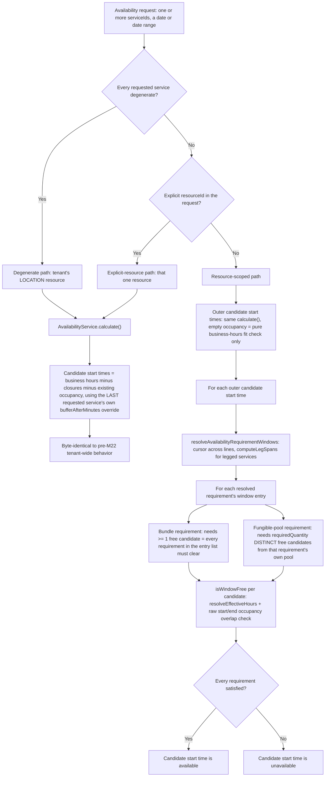

Key files: `availability-query.service.ts` (single day), `availability-summary.helpers.ts` (date range — batches each distinct resource's schedule/occupancy once for the whole range, not once per day), `resource-scoped-availability.helpers.ts` (shared outer-slot orchestration), `availability-window-resolution.helpers.ts` (per-line/per-leg window resolution + the intersect/union combinator), `availability-window-candidates.helpers.ts` (the shared per-calculation `WindowResolutionContext` and promise-cached candidate loading), `availability-lines.helpers.ts` (the per-request `AvailabilityLine`s — quoted duration + validated pins — built once up front, M23-S29), `resource-pool.helpers.ts` (the one pool rule shared by the write path, the read path and the public resource-options read), `resource-occupancy.helpers.ts` (the write-path orchestrator — same cursor/leg-span shape, delegates per-shape candidate building to `resource-occupancy-candidate-builders.helpers.ts` and per-requirement resolution to `resource-requirement-resolution.helpers.ts`, split out M23-S01 for file length).

### Pinned selections and a chosen duration (M23-S29)

`GET /schedule/availability` and `/summary` accept the customer's `CUSTOMER_CHOICE` picks (`resourceSelections`) and the chosen duration of the one `CUSTOMER_SELECTED` service (`durationMinutes`). Both are resolved **once, up front**, into `AvailabilityLine`s (`availability-lines.helpers.ts`) — each line is a requested service plus its quoted duration plus its validated pins — which the three read paths then consume. The write-path `ResolutionContext` helpers are not reused (a separate engine that throws instead of degrading); only the pure pool rule (`isInResourcePool`, `resource-pool.helpers.ts`) is shared between the write path, the read path and the public resource-options read.

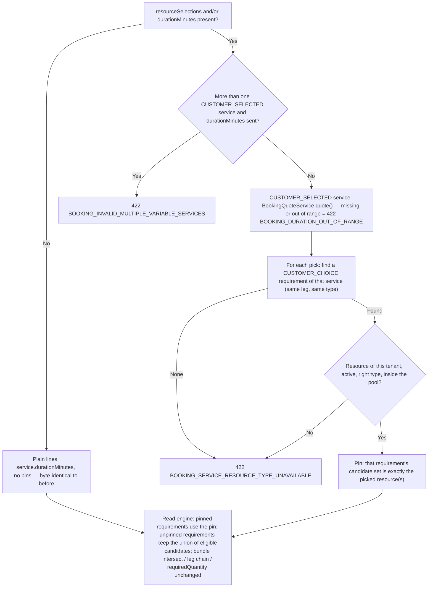

Rules that are easy to get wrong:
- **Stricter than the write path on purpose.** `POST /bookings` ignores a selection entry that matches no `CUSTOMER_CHOICE` requirement (its replay of existing assignments depends on that); the read path rejects it, because a silently ignored pick would show the customer availability for a resource they never constrained.
- **A pin replaces the candidate set, it does not add to it.** With `requiredQuantity > 1` and fewer distinct picks than the quantity, the requirement can never be satisfied and no slot is offered — the read path never over-promises.
- **Unpinned `CUSTOMER_CHOICE` requirements keep the union** so the UI can show availability progressively before every pick is made; `POST /bookings` still requires the full selection.
- **A pinned service takes the resource-scoped path even if it is otherwise degenerate** (`LOCATION`-only) — a pin is meaningless to the tenant-wide model. A degenerate `CUSTOMER_SELECTED` service with only a duration stays on the degenerate path, using the quoted duration.
- **The duration threads through every read site** — the outer fit-check, flat-line windows, the degenerate path and the summary's per-day slots all read `line.durationMinutes`, never `service.durationMinutes`.
- **A legged service's windows never depend on a chosen duration.** Its length is the sum of its legs (UC-052), and the aggregate forbids combining `legs` with `durationPolicy = CUSTOMER_SELECTED` in both directions (`BOOKING_SERVICE_LEGS_CUSTOM_DURATION_CONFLICT`, 409). For data that predates that rule, the read path still validates a chosen duration (exactly as `POST /bookings` does) but builds a legged line's windows from the legs alone — the same as the write path, so the two never disagree. **A legged service's persisted `durationMinutes` is always that span** (M23-S11b: `Service.setLegs()` writes it, `Service.update()` recomputes it, migration `1748500000024` backfilled the older rows) — it matters because every booking line copies `durationMinutes` and the line-to-line cursor below advances by it, while only the legs' own windows come from the legs: were the two to differ, the line after a journey would overlap or leave a gap.
- **One `WindowResolutionContext` per calculation** (promise-cached candidate sets and resource rows, `availability-window-resolution.helpers.ts`) is shared by every candidate start time — and by every day of a summary — so a requirement's candidates are loaded once, not once per slot per day; slots, days and lines are then evaluated concurrently without duplicating a load.
- `resourceId` together with `resourceSelections` is a `400`: the explicit-resource view is a single resource's own schedule, not the service's requirements.

**Write path vs. read path divergence (M22 gap, closed by M23-S01 and M23-S32):** the read path unions across *every* free pool member, regardless of `selectionMode` — except that a `CUSTOMER_CHOICE` requirement pinned by the customer's pick (M23-S29, below) is narrowed to that resource. The write path's behavior now depends on `selectionMode` — see the subsection immediately below. For `AUTO_FUNGIBLE_POOL` the gap is closed as of M23-S32: the write path narrows the pool to units free for the exact window (each with its own trailing gap) and takes the first `requiredQuantity` of them by `resourceId` ascending, so a slot the read path advertises because *some* unit is free books onto that unit; the unit stays anonymous to the customer (UC-062), and a pool needs no workload balancing, so its tie-break is the id alone. `NONE` (a plain `LOCATION`) keeps the original first-eligible pick. The same holds for simultaneous requests: automatic selection reads occupancy while holding the lock on every unit it might pick (`lockCandidateResources()`, `resource-candidate-locking.helpers.ts`, called by `resolveBookingLinesResourceCandidates()` before the first line is resolved), so two requests on an empty pool queue behind each other, the second reads the first's committed row, and picks the other unit instead of colliding on the same one.

### selectionMode resolution algorithm (M23-S01)

Real, `selectionMode`-aware resolution — choosing *which* resource gets assigned — only exists on the **write path** (`resource-requirement-resolution.helpers.ts`'s `resolveCandidateIds()`), triggered from `RequestBookingUseCase`/`RequestAuthenticatedBookingUseCase` (fresh customer input) and replayed by `ApproveBookingUseCase`/`RescheduleBookingUseCase` (no fresh input available at those points — see below):

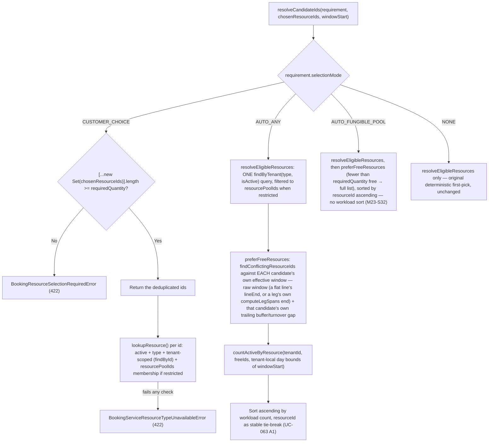

- **AUTO_ANY's tie-break only applies among candidates already free for the exact requested window** (UC-063 A1's own wording — "more than one staff member is free... System selects the one with the least already-locked workload"). `preferFreeResources()` narrows to the conflict-free subset (via `findConflictingResourceIds`, the same method the final `assertSlotFree()` backstop uses) *before* the workload sort runs — otherwise a candidate with lower total day-workload but a real conflict at the exact window could be preferred over a busier-overall candidate that's genuinely free, incorrectly 409ing a bookable slot. Applies equally to flat **and legged** requirements: a leg's own raw `[startsAt, endsAtWithTurnover)` span is knowable from the service's static leg definitions alone (`computeLegSpans`, called with zero turnover, is independent of which resource ends up chosen for the leg — only that resource's own trailing turnover extension isn't known yet), so `resolveLeggedLineCandidates` computes every leg's span *before* resolving resources and feeds each leg's own span into the identical pre-filter flat lines get. If every eligible candidate appears busy, the filter (for a multi-unit requirement: when fewer than `requiredQuantity` units are free) falls back to the unfiltered list so the normal `requiredQuantity`/`assertSlotFree` error paths still fire correctly — this is what preserves UC-065 A1's atomic all-or-nothing design: preferring a free candidate up front only reduces needless 409s, it never substitutes for the final cross-line `assertSlotFree()` check.
- **The pre-filter checks each candidate's own TRUE effective window, not a shared raw window.** The window actually persisted/checked for a chosen resource extends past its raw window by that specific resource's own trailing buffer/turnover gap (`effectiveFlatGapMinutes(bufferAfterMinutes, resource.turnoverMinutes)` for a flat line, or the resource's own `turnoverMinutes` for a leg) — a resource with a longer turnover can be busy only during that trailing extension while still appearing "free" against the raw window alone. `preferFreeResources()` takes an `effectiveGapMinutes(resource)` callback and builds one conflict-check window per candidate rather than one shared window for all of them. Both `resolveFlatLineCandidates()` and `resolveLeggedLineCandidates()` (`resource-occupancy-candidate-builders.helpers.ts`) define this gap function once and pass the identical closure into both the pre-filter and the final candidate build, so the two can never compute a different answer for the same resource.
- **`resolveEligibleResources()` always loads the tenant's full active set of the requirement's type in ONE `findByTenant()` query, populating `ctx.resourceCache` from it** — never a per-candidate `findById()` loop. A `resourcePoolIds`-restricted requirement filters that same loaded set down to the configured pool ids, rather than returning the raw pool ids unfiltered: a pool is a fixed, curated list that can drift out of date (a member deactivated since it was configured), and returning it unfiltered let a since-deactivated pool member reach the workload sort, possibly win the tie-break over a genuinely eligible member, and then fail the *entire* requirement at the final `lookupResource()` check — even though an active, free pool member existed. Both fixes (the N+1 query and the stale-pool-membership correctness gap) share this one function because they share the same root cause: eligibility was previously computed from bare ids without ever loading (or filtering by) the actual `Resource` rows.
- **`resourceSelections`** (`POST /bookings` body, `ResourceSelectionInput[]`) is keyed by `(serviceId, legIndex, resourceType)` — `legIndex: null` for a flat requirement. Deduplicated before the `requiredQuantity` check — a client submitting the same resourceId twice can't satisfy a multi-unit requirement with one physical resource. An entry that doesn't match any `CUSTOMER_CHOICE` requirement on the booking is simply unused, never an error — this is what makes replay-based re-resolution (next bullet) safe.
- **Duplicate-service disambiguation:** two lines booking the *same* service (`docs/API_CONTRACTS.md`'s "duplicates are allowed — two Basic Wash lines = two cars") share one `(serviceId, legIndex, resourceType)` key, so a plain `Map.get(key)` can't tell which occurrence a submitted selection belongs to — the first version of this algorithm resolved every occurrence against the SAME first-submitted entry, silently discarding a customer's second choice with no error at all (worse than a 409, since sequential same-basket lines never actually overlap in time). `consumeSelections()` (`resource-resolution-context.helpers.ts`) instead shifts the next `requirement.requiredQuantity` ids off the front of that key's own queue and mutates it in place, so the Nth line-occurrence of a duplicated service consumes the Nth batch, in the client's own submission order — the same "order is preserved" guarantee the API contract already makes for `serviceIds`, extended to `resourceSelections`.
- **Approval/reschedule re-resolution replay:** `ApproveBookingUseCase`/`RescheduleBookingUseCase`/`RescheduleBookingAsCustomerUseCase` re-run the *entire* resolution (not just a re-check) every time, to stay the single source of truth for "what resources does this booking occupy". `ApproveBookingUseCase` has no HTTP body carrying a fresh `resourceSelections` at all. `deriveResourceSelectionsFromAssignments()` (`resource-occupancy.helpers.ts`) replays the booking's existing picks as `resourceSelections`, so a `CUSTOMER_CHOICE` pick survives re-resolution unchanged (the customer's confirmed staff member doesn't silently change at approval time) while `AUTO_ANY`/`AUTO_FUNGIBLE_POOL` requirements simply ignore the replayed entries and re-derive fresh, exactly as before M23-S01. Reads via the **live `resource_occupancy` projection** (joined to `booking_line_resource_assignments` for `resourceType`/`legIndex`), not the audit table directly — that table is append-only and never deletes a superseded row, so a booking rescheduled to a different resource more than once would otherwise resurface stale, no-longer-occupying resource ids. **Ordered by each row's own `booking_line_id`'s position within the caller-supplied line-id list** (`array_position()` in the TypeORM adapter's SQL), not just `quantity_position` — Postgres gives no defined secondary order among rows tied on `quantity_position` alone (`NULL` for every single-unit requirement, the common case), so without this a duplicate-service booking's two lines could replay with their assignments swapped, defeating the consume-in-order disambiguation above at approval/reschedule time specifically. **Reschedule-only override (M23-S03, UC-069):** unlike approval, both reschedule use cases *do* have an optional fresh `resourceSelections` in their request body — `mergeResourceSelections()` (`resource-occupancy.helpers.ts`) lets a body-supplied entry override the replayed pick for its exact `(serviceId, legIndex, resourceType)` key (a customer picking a different staff member on reschedule, or a staff A3 override), while every other key still replays unchanged; an override entry with no matching `CUSTOMER_CHOICE` requirement is simply unused, never an error, same safety property as `POST /bookings`'s own `resourceSelections` handling.
- **AUTO_ANY workload counting excludes the booking's own existing occupancy** (`countActiveByResource(..., excludeBookingLineIds)`, mirroring `findConflictingResourceIds`'s identical self-exclusion) — `resolveBookingLinesResourceCandidates()` always passes the resolution's own line ids as the exclusion set. A no-op at creation time (the lines are brand new); at approval/reschedule, without this a booking's own already-held `HOLD`/`COMMITTED` row would count as workload *against itself*, biasing the tie-break away from the resource it's already holding for no real reason.
- **Tenant isolation** falls out of `lookupResource()`'s existing `findById(id, tenantId)` call — a `resourceSelections` entry naming another tenant's resource id resolves to nothing and fails the same `BookingServiceResourceTypeUnavailableError` check as an inactive/wrong-type resource; no separate tenant check was needed.
- **`resourcePoolIds: []` (a real, empty, non-null array) means unrestricted, identically to `null`** — the same convention `isDegenerateService()`, `resolveEligibleResources()`, and `availability-window-resolution.helpers.ts`'s own pool check all already use. `lookupResource()`'s `poolRestricted` check must use `.length > 0`, never a bare truthiness check on the array itself — an empty array is truthy in JS, so a bare check would treat an intentionally-unrestricted `CUSTOMER_CHOICE` requirement (`ResourceRequirementSchema` has no `.min(1)` on `resourcePoolIds`, so `[]` is a real, saveable config) as "restricted to nothing," rejecting every selection.
- **Response identity fields:** `ResourceOccupancyCandidate.selectionMode` (stamped from the originating requirement) lets `toBookingResult()` (`booking-request.helpers.ts`) decide what to reveal — a flat `AUTO_ANY` candidate's `resourceName` (UC-063), or every legged candidate's full `itinerary` entry regardless of its own `selectionMode` (UC-065 — schedule disclosure isn't identity disclosure). `AUTO_FUNGIBLE_POOL`/`CUSTOMER_CHOICE` flat candidates reveal nothing (UC-062: pool identity must stay hidden; `CUSTOMER_CHOICE`: the customer already knows their own pick).
- **Conflict-error granularity:** `BookingSlotConflictService.assertSlotFree()` classifies a genuine submit-time conflict (UC-064 A2, UC-065 A1) using `ResourceOccupancyCandidate.isBundleMember` — stamped per-candidate at resolution time from its own line's requirement count (`resourceRequirements.length >= 2`, the story's own bundle definition), not inferred from the flattened conflict list's candidate count. Any conflicting candidate with a non-null `legIndex` → `BookingLegUnavailableError`; else any conflicting candidate with `isBundleMember` → `BookingBundlePartiallyUnavailableError`; else the original generic `BookingSlotUnavailableError`. An ordinary multi-service basket (two independent single-resource services, neither itself a bundle) correctly falls through to the generic message — inferring "bundle" from flat-candidate-count alone would mislabel that case.

### `resource_occupancy.lock_state` lifecycle

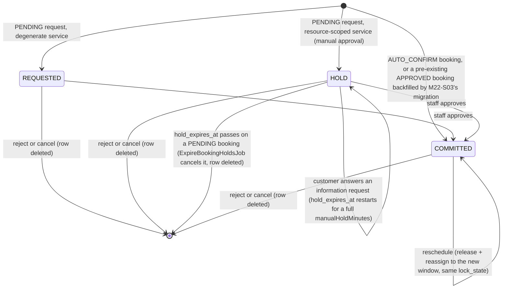

- **`REQUESTED`** exists so a degenerate (LOCATION-fallback) service's PENDING request never blocks a *concurrent* PENDING request for the same popular slot — it's structurally excluded from the GIST exclusion constraint's own `WHERE` clause (`lock_state IN ('HOLD','COMMITTED')`), preserving car-wash-vertical byte-identical behavior. It still blocks against an existing `COMMITTED`/`HOLD` row (the pre-check in `BookingSlotConflictService` isn't scoped by `lock_state`) — only REQUESTED-vs-REQUESTED is deliberately unguarded. `REQUESTED`'s only *read* consumer is M22-S05's manager day grid (`IBookingAvailabilityPort.findDayGridOccupancy()`) — every other read path (availability computation, conflict checking) queries `lock_state IN ('HOLD','COMMITTED')` only and never sees these rows.
- **`HOLD`** is the resource-scoped-service equivalent of a manual-approval pending booking — it *is* included in the GIST exclusion (two customers can't both hold the same real resource), and carries a `hold_expires_at`. **`hold_expires_at` is enforced by `ExpireBookingHoldsJob` (TD51), never by a query or the constraint:** it is set at request time to the longest `Service.bookingPolicy.manualHoldMinutes` among the booking's services (default 30) from now. The exclusion constraint cannot depend on `now()` and no read query treats an expired `HOLD` as free, so an unanswered request keeps blocking its slot until the job runs (every 30 minutes on `cron-reminders`, its own consumer `booking-hold-expiry`). Per tenant it finds the `PENDING` bookings with a `HOLD` row at or past its deadline (the partial `(tenant_id, hold_expires_at) WHERE lock_state = 'HOLD'` index), and for each one, in its own transaction: reloads the booking, skips it unless it is still `PENDING` and still past its deadline, calls `Booking.expireApproval()` (`PENDING → CANCELLED` by the `SYSTEM` actor, `cancelledBy` null, `cancellationReason = 'APPROVAL_EXPIRED'`) and persists through `saveTerminalBookingsInTransaction` (resource locks, saves, deletes the `HOLD` rows, dismisses the booking's open worklist entries). It raises `BookingCancelled` with `cancelledByHoldExpiry = true` and `cancelledBy = null`: the customer gets the dedicated `BOOKING_APPROVAL_EXPIRED_CUSTOMER` email, managers get none, and the availability-alert matcher still offers the freed slot.
  - **Only `PENDING` expires.** An `INFO_REQUESTED` booking keeps its hold while the customer has the question (waiting on the customer is not staff silence); the cost, accepted, is that a customer who never answers leaves it blocking the slot. When the customer answers (`INFO_REQUESTED → PENDING`) the hold restarts for a full `manualHoldMinutes`, so the job never expires a booking the moment its customer replies.
  - **Races are settled by the locks and the version check, not the clock.** Approve, reject, cancel and a customer's answer all change the booking; the job saves through the same optimistic version check, so exactly one wins and the loser sees `BookingConcurrentModificationError` (the job skips it; the use cases surface their usual 409).
  - **Approve refuses a passed deadline even if the job has not run** (`409 BOOKING_APPROVAL_HOLD_EXPIRED`, for `PENDING` and `INFO_REQUESTED` alike), so the 30-minute schedule only delays the cleanup. Reject and cancel still work in that gap.
  - **A degenerate (`REQUESTED`) booking and an `AUTO_CONFIRM` (`COMMITTED`) booking are never touched:** they carry no deadline.
  - (`RecurringBookingSchedule.approvalHoldExpiresAt` is a different mechanism with its own job, `ExpireRecurringBookingScheduleApprovalsJob`.)
- **`COMMITTED`** backs every approved booking, whether it arrived via `AUTO_CONFIRM`, staff approval, or the historical backfill.
- `booking_line_resource_assignments` (a *separate* table) is the immutable audit record of which resource a line was ever assigned to — `release()` only ever deletes `resource_occupancy` rows, never assignment rows; re-resolving the same `(line, resource, leg, quantity)` tuple (a reschedule back to the same resource, or an approval that reuses the request-time resolution) reuses the existing assignment row via an idempotent upsert rather than duplicating it.

### Buffer / turnover / transition-gap formulas

| Scenario | Formula | Where computed |
|---|---|---|
| Flat service, the line's own **last** position in a multi-service booking | `max(service.bufferAfterMinutes, resource.turnoverMinutes)` added once, after the line's own duration | `AvailabilityService.effectiveFlatGapMinutes()` — write path: `resource-occupancy-candidate-builders.helpers.ts`; read path: `availability-window-resolution.helpers.ts` |
| Flat service, a **non-last** line in a multi-service booking | No gap — the next line starts exactly when this one ends | same |
| Legged service, **each leg's own** `endsAt` | That leg's resolved resource's own `turnoverMinutes`, added only to that leg's own occupied window | `AvailabilityService.computeLegSpans()` is called once with **zero** turnover for every leg (turnover never affects leg *sequencing* — verified directly against its implementation); each resolved candidate then adds its own resource's turnover to its own raw span independently, so two different pool members for the same leg can carry different gaps |
| Legged service, **between** two legs | `leg.transitionGapAfterMinutes` — a static, per-leg, service-configured value, entirely independent of any resource's turnover | `computeLegSpans()`'s own cursor advance |
| Outer/coarse candidate-start-time generation (all three read paths) | The **last** requested service's own `bufferAfterMinutes`, falling back to the tenant-wide default only when the service has none set — never the tenant default when a smaller override exists | `resource-scoped-availability.helpers.ts`, `availability-query.service.ts`, `availability-summary.helpers.ts` |

**Which rule held a resource, and why it is persisted (M18-S10).** The same formula is also stored *with its origin* on each `resource_occupancy` row at write time — `gap_minutes` + `gap_source` (`SERVICE_BUFFER` or `RESOURCE_TURNOVER`; NULL = no gap, or a row written before the columns existed) — so the manager's schedule can say who is held and why without recomputing from current config (which is wrong after any later edit). One rule, `resolveGap()` (`resource-gap-source.ts`, exposed as `AvailabilityService.resolveFlatGap()`): the larger of buffer and turnover wins, a **tie goes to the service buffer**, none when both are 0; only the booking's last line carries the service buffer, and a legged line's gap is its resource's turnover alone. Writers: create, reschedule and recurring materialization record it; a **resource reassignment recomputes it from the target resource** (the leg's work interval stays the persisted one — end minus recorded gap — never the current leg definition) and checks the recomputed window for conflicts. Views: the columns board draws one strip per held resource; the merged Day timeline and Week view draw one strip per booking (longest hold, resources named, cause = a service buffer if any held-longest resource has it, else the turnover, else "origin not recorded"), MANAGER only.

The non-obvious correctness point worth remembering: turnover is a **per-resource, per-leg-position-independent** quantity. Because it never influences a *later* leg's start time, a fungible pool's individual members can each keep their own turnover instead of the whole pool being forced onto its slowest member's value — this was a real bug (pool-wide max turnover applied to every candidate) found and fixed during M22-S03's review cycle.

### Why one shared GIST exclusion table, not one per family

`booking.resource_occupancy` is the *only* DB-level structural guarantee against double-booking a resource — the query-time conflict check (`BookingSlotConflictService`) is a companion to it, not a replacement (per `docs/ENGINEERING_RULES_BACKEND.md`'s "companion to the DB constraint" rule). A Postgres exclusion constraint cannot span two tables, so once a resource can be contended for by more than one *family* of commitment — an APPOINTMENT `Booking` line today, a `ClassSession` once M24 ships — every family that can ever contend for that resource has to write into the *same* table. `source_type` (`BOOKING_LINE` / `CLASS_SESSION`) discriminates which family a row belongs to; only `BOOKING_LINE` is reachable until M24. Full rationale: `docs/DOMAIN_MODEL.md` § Aggregate: Booking, `docs/ENGINEERING_RULES_BACKEND.md` § "A single exclusion constraint stops generalizing".

### Migration sequencing (historical — fully executed)

M22-S03 (PR #483, merged 2026-09-17) executed the documented expand → backfill → dual-write → validate → contract sequence in one story:

| Phase | Migration / mechanism | Outcome |
|---|---|---|
| 1. Expand | `1748500000012-CreateResourceOccupancy.ts` | Creates `booking_line_resource_assignments`, `resource_occupancy` (with the GIST exclusion), `UNIQUE(tenant_id, line_id)` on `booking_lines`. Old constraint not yet dropped. |
| 2. Backfill | `1748500000013-BackfillResourceOccupancy.ts` | Every pre-existing `APPROVED` booking line gets an assignment + `COMMITTED` occupancy row against the tenant's `LOCATION` resource, with correct per-line sequential sub-windows and buffer/turnover on the last line. |
| 3. Dual-read/write | Shipped in the same PR's use-case changes | New booking creation/approval/reschedule/reject/cancel all read/write `resource_occupancy`; the old tenant-wide constraint stayed live as a safety net through this window. |
| 4. Validate | Integration test suite (`typeorm-resource-occupancy.repository.integration.spec.ts`) | Confirms GIST exclusion behavior and tenant scoping against real Postgres. |
| 5. Contract | `1748500000014-DropTenantWideExclusion.ts` | Drops `EX_booking_bookings_approved_slot` — mechanically fails closed first: a `DO $$ ... RAISE EXCEPTION` block verifies every `APPROVED` booking line already has a `COMMITTED` `resource_occupancy` row before the `DROP CONSTRAINT` runs, rather than relying only on the originally-planned manual pre-deploy check. |

---

## Booking — Duration, Intake, Attendees and Reschedule (M23-S02, S03, S30)

### Why this exists

A booking is no longer always "this service, its fixed length, a name and a time". A service can let the customer pick the length (UC-067), collect versioned answers and named participants (UC-068), and a booking can be moved with a price change recorded (UC-069). These rules are small but spread across the quote service, the intake validator and the reschedule use cases, so they are described once here. Resource resolution and the exclusivity engine they feed are in the first section.

### Customer-selected duration (UC-067)

`BookingQuoteService.quote(service, requestedDurationMinutes)` is pure (no I/O). A service whose `bookingPolicy.durationPolicy` is not `CUSTOMER_SELECTED` returns its own `durationMinutes` and `price` unchanged. For `CUSTOMER_SELECTED`:

1. **Validation.** The request must carry a duration (there is **no fallback** to `Service.durationMinutes`, which is not authoritative for that policy), `durationMinMinutes <= d <= durationMaxMinutes`, and `(d - durationMinMinutes) % durationIncrementMinutes == 0`. Otherwise `BOOKING_DURATION_OUT_OF_RANGE`.
2. **Price.** With `pricingPolicy = PER_TIME_INCREMENT`: `ceil(d / pricingIncrementMinutes) × pricePerIncrementAmount`, then floored at `minimumChargeAmount` when set. `pricingIncrementMinutes` is independent of `durationIncrementMinutes`. Any other pricing policy keeps the service price.
3. **Where it is used.** `GET /services/:id/quote?durationMinutes=` (`QuoteServiceDurationUseCase`) returns what booking creation would persist; booking creation, the staff create and a reschedule all call the same `quote()`.
4. **Invariants.** At most one line of a basket may be `CUSTOMER_SELECTED` (`BOOKING_INVALID_MULTIPLE_VARIABLE_SERVICES`); a legged service cannot also be custom-duration (`BOOKING_SERVICE_LEGS_CUSTOM_DURATION_CONFLICT`), because its length is the sum of its legs.

### Intake answers and attendees (UC-068)

`BookingIntakeValidationService.resolve()` runs at request time against the service's intake schema (`service_booking_intake_schema`, versioned append-only; a new version never edits an old one).

- **No active schema:** any intake fields sent are ignored (no error); the booking stores no intake.
- **Version:** the client may echo the version it displayed; that version is used if it exists (never rejected merely for not being the latest). A version the service never published → `BOOKING_INTAKE_ANSWER_MISSING` naming `intakeSchemaVersion`.
- **Answers:** every required question must be answered; a whitespace-only string counts as missing; a submitted answer must match its type (`FREE_TEXT` string, `BOOLEAN` boolean) and is never coerced. `participantCount` is required when the schema says so. Consent must be accepted. All failures are one `BOOKING_INTAKE_ANSWER_MISSING` listing the field keys.
- **Snapshot:** `intakeSchemaVersion`, `intakeAnswers`, `consentAcceptedAt`, `consentVersion` are stored on the booking and never change. The booking detail (S47) resolves labels from the **booked** version.
- **Attendees:** only when the schema has `requiresNamedAttendees`; each needs a non-blank name (`BOOKING_ATTENDEE_NAME_REQUIRED`) and an `isMinor` flag. `customerId` is always null: an attendee is not linked to a customer record.
- **Staff-created bookings (UC-108):** `intakeOptional` — no required answer, count or consent is demanded; blank answers are dropped; if staff entered nothing the booking has no intake (the detail says "Não coletado — reserva da equipe").

### Reschedule and quote revisions (UC-069, S03, S30)

Two use cases share their helpers: `RescheduleBookingUseCase` (staff) and `RescheduleBookingAsCustomerUseCase` (the customer's own booking; `BOOKING_FORBIDDEN` for anyone else's).

1. **Only an `APPROVED` booking can be rescheduled** (`Booking.reschedule()`), and the new start must be in the future.
2. **Customer window.** The notice required is the **largest** `rescheduleWindowHoursOverride` among the basket's lines, else the tenant's cancellation window (`BOOKING_RESCHEDULE_WINDOW_EXPIRED`). The largest is a conservative reading for divergent per-service overrides; it was never confirmed as a business rule. The booking window (next section) also applies to the new start for customers, not for staff.
3. **Duration change.** An optional `durationMinutes` applies to the one `CUSTOMER_SELECTED` line; with none, it is silently ignored (the same "unused, never an error" convention as a mismatched intake).
4. **Resolution replays.** The new window's resources are resolved again (every line, every `selectionMode`), a body-supplied `resourceSelections` entry overriding the default for its key; the booking's own current occupancy is excluded from the conflict check, so it never conflicts with itself. Resource locks (old resources included) come first, then the booking's open future-commitment entries, then the booking row (`docs/LOCK_CATALOG` §2); the occupancy rows move in the same transaction with their `COMMITTED` state.
5. **Quote revision.** If the total price changed (a variable-duration re-quote), one append-only `booking_quote_revisions` row is written (`reason = RESCHEDULE_DURATION_CHANGE`, actor type and id, `revision_no` = previous + 1); a time-only move writes nothing. The customer's result carries `quoteRevision` when one was written.
6. **Events.** `BookingRescheduled` carries the previous and new slot; the alert matcher listens for the freed slot and the worklist closes the booking's stale entries in the same transaction (S48).

## Booking — Booking Window (M23-S33)

### Why this exists

How far ahead and how soon a booking may be made used to be a UI rule only: the calendar hid dates and nothing on the backend read `maxBookingAdvanceDays` or `minBookingAdvanceHours`, so a direct API call booked any date. The backend is now the authority, and a service can tighten the tenant's window with its own overrides.

### The effective window

The tenant window (`settings.booking`) is the **ceiling** for every service. A service override can only tighten it:

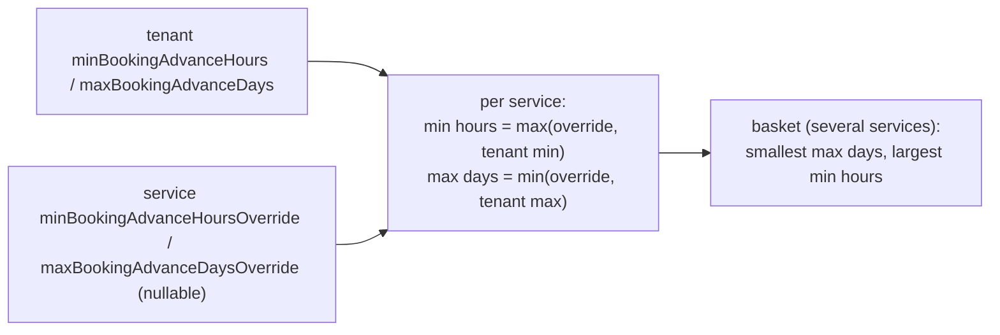

The clamp is applied on **every read**, never persisted, so a tenant that shrinks its window later wins over a stale looser override with no cascade or migration (`resolveEffectiveBookingWindow()`). The same resolved values ride on every service read (`bookingPolicy.effectiveMinBookingAdvanceHours` / `effectiveMaxBookingAdvanceDays`) so the booking page never recomputes them. This is deliberately **not** the MAX-override rule of `resolveEffectiveRescheduleWindowHours()`: a basket's window is the strictest of its services.

### The check

`assertWithinBookingWindow()` runs, in this order, on the requested start:

1. `startsAt <= now` → `422 BOOKING_SCHEDULED_IN_PAST` (the creation path had no past check before this).
2. `startsAt < now + minAdvanceHours` → `422 BOOKING_TOO_SOON` (an instant comparison — no timezone).
3. tenant-local date of `startsAt` `> today + maxAdvanceDays − 1` (today also tenant-local) → `422 BOOKING_TOO_FAR_AHEAD`.

It is called by `POST /bookings`, `POST /bookings/authenticated` and the **customer** reschedule (the new start), before any transaction opens. **`POST /bookings/staff`** (UC-108, M23-S39) calls it too, with `ignoreMinAdvance`: step 2 is skipped (the minimum notice is zero, so a same-day phone booking works) while steps 1 and 3 still apply — a past start and a start beyond the maximum advance are refused for staff as for anyone. The option exists only on `assertWithinEffectiveBookingWindow()`; no customer-facing entry point passes it. Staff and manager reschedules (including the M23-S08 worklist) are exempt, like they are from the cancellation and reschedule windows (UC-069 A3). Existing bookings are never re-checked. A recurring schedule is checked on its **first occurrence only** (M23-S35, below under Recurring Reservations); the rest of its term is bounded by its own `recurringHorizonDays`.

**Availability reads are deliberately not trimmed.** Staff use the same endpoints, and a read that threw would also stop the alert sweep's per-group read. The public booking page instead hides what the backend would reject: its calendar and carousel use the basket's effective maximum and disable the days before the first one the minimum notice leaves, and the slot picker hides a slot that has already started or starts inside the minimum notice.

### Tenant-local "today"

"Today" for the availability reads (`GetAvailabilityUseCase`, `GetAvailabilitySummaryUseCase`), `OpenScheduleUseCase`, the alert sweep and the public calendar/carousel is the **tenant-local calendar day** — the same boundary as the window rule. It was the UTC date before M23-S33, which for a UTC−3 tenant flipped "today" to tomorrow at 21:00 local.

### Saving a service policy

`UpdateServiceBookingPolicyUseCase` rejects (`422 BOOKING_SERVICE_BOOKING_POLICY_INVALID`, field named) a *changed* override that is looser than the tenant window, and one that leaves `effective min hours / 24 >= effective max days` (nothing bookable). An override left unchanged is not re-validated, so one that went stale after the tenant shrank its window does not block saving the rest of the policy. The tenant settings validator enforces the same cross-field rule on the tenant's own two values (`minBookingAdvanceHours / 24 < maxBookingAdvanceDays`, ceilings 8760 h / 365 days).

### Known limitations

- **After business hours the tenant's today stays an enabled day with no slots left.** The summary marks a day available when the business hours leave slots, without looking at the clock, and the availability read is deliberately untrimmed (above), so the carousel and calendar show today enabled; the page then hides every elapsed slot and says there is none. Decided on 2026-10-07 to leave it, and to make the E2E helpers clock-aware instead (`docs/ENGINEERING_RULES_TESTING.md`): trimming the read would change what staff and the alert sweep see.

---

## Booking — Recurring Reservations (M23-S04, M23-S05)

### Why this exists

`RecurringBookingSchedule` (UC-070) is a fixed-term WEEKLY-only pattern (MVP scope, locked in during story-discovery) — one shared time-of-day across a set of weekdays, no per-day override, no other frequency value. A schedule is checked over its whole term up front and its occurrences are materialized **once** as ordinary linked `Booking` rows: at creation for an `AUTO_CONFIRM` service, at staff approval for a `MANUAL_APPROVAL` one (M23-S05). There is no rolling generation. `apps/backend/src/contexts/booking/domain/recurrence-rule.helpers.ts` is a domain-layer, zero-framework-deps pure-function module shared unchanged by the creation-time checks, the approval-time re-check and the materialization — all import the exact same `enumerateRecurrenceOccurrences()` function so they can never silently disagree about what "conflict-free" or "in the term" means. Skip and reschedule of one occurrence are the linked booking's ordinary cancel and reschedule (M23-S08).

### Term validation and occurrence enumeration

`resolveHorizonEndDate(startsOn, horizonDays)` adds `horizonDays` calendar days to `startsOn` (via `shared/utils/calendar-date.ts`'s `addDaysUTC` — UTC-string arithmetic, safe for calendar dates since a date string's weekday is timezone-invariant). `horizonDays` is `Service.bookingPolicy.recurringHorizonDays` (nullable; `null` inherits the 90-day platform default `DEFAULT_RECURRING_HORIZON_DAYS`, exported by `@ikaro/types` next to the cap so the customer's creation form (M23-S17) limits its end date by the same number), capped at 180 (`MAX_RECURRING_HORIZON_DAYS` in `@ikaro/types`, enforced by the shared Zod schema — every occurrence of the term is materialized at creation, so the ceiling bounds one request's work). It is the schedule's **maximum term**: `endsOn` is required and `resolveHorizonEndDate(startsOn, horizonDays)` is the latest date it may take (`RecurringBookingScheduleTermExceededError`, `422`, `BOOKING_RECURRING_SCHEDULE_TERM_EXCEEDED` with `maxTermDays` and `latestEndsOn`, otherwise; a range reversed the other way, `endsOn` before `startsOn`, is `RecurringBookingScheduleInvalidDateRangeError`, `422`).

`enumerateRecurrenceOccurrences(recurrence, startsOn, endsOn, timezone)` walks every calendar date from `startsOn` to `endsOn` inclusive (the term was already validated by `assertValidTerm()`: `startsOn <= endsOn <= startsOn + the maximum term`), keeping the ones matching `recurrence.daysOfWeek` (via `getUtcWeekDayName`), and converts each matching local date + `recurrence.startTime` to a UTC instant via `localDateTimeToUTCIso`. Returns both the UTC instant and the tenant-local calendar date string (the latter is the key for the working-hours check's per-date lookup).

### Creation-time checks — hours and closures, occupancy

An occurrence that cannot be honored blocks the whole request atomically, before either the `ACTIVE` or `PENDING_APPROVAL` status branch commits (UC-070 A1) — no partial schedule ever exists. The refusal is one `409` listing every affected occurrence as `{ occurrenceStart, reason }`, `reason` being `OCCUPIED`, `CLOSED` or `OUTSIDE_HOURS`, with hours and occupancy violations merged into one list.

0. **Working hours and closures (M23-S18)** — runs inside the same transaction, once the considered resources are resolved (the cap check has already taken the resource/service lock), as one exported pure in-memory pass over the occurrences that calls `AvailabilityService.windowHoursVerdict()` — the hours-and-closures half that `isWindowFree()` itself delegates to, which also says whether a refusal is `CLOSED` or `OUTSIDE_HOURS` — so creation and availability apply literally the same rule (business hours, the resource's own hours, full and partial closures, tenant-wide and resource-scoped openings). The window checked is the one the occupancy check uses, `occurrenceStart → start + durationMinutes + max(service.bufferAfterMinutes, resource.turnoverMinutes)`, because that is what availability offers a slot against. Closures and openings for the whole term are loaded once per pattern (batched over the considered resources), then grouped by tenant-local date in memory. Per policy: `FIXED_ASSIGNMENT` — the chosen resource must be open; `AUTO_ANY` and `AUTO_FUNGIBLE_POOL` — at least one eligible resource must be open (M23-S32 aligned the pool with a one-off booking, which takes any free unit). M23-S05 runs the same pass, and the occupancy layer below, again at approval, for a `MANUAL_APPROVAL` schedule, since a closure or booking may have appeared while it waited; see § Approval, expiry and end of term.

Then the occupancy layer:

**`assertPatternConflictFree()`** (`recurring-booking-schedule-request.helpers.ts`) — checks every enumerated occurrence against `resource_occupancy` in a number of queries independent of the occurrence count: the resources that decide the outcome are resolved once, locked once (`lockResources()`), every (resource × occurrence) window — each extended by that resource's own trailing gap, `max(service.bufferAfterMinutes, resource.turnoverMinutes)` — goes into a single `IResourceOccupancyRepository.findConflictingWindows()` query, and the verdict is decided per occurrence in memory. Which resources decide it follows the requirement's `selectionMode`, mirroring what `resolveRequirementResources()` does for a one-off booking: `CUSTOMER_CHOICE` (`FIXED_ASSIGNMENT`) — the caller's pick, validated by the same rules, must be free in every occurrence; `AUTO_ANY` — an occurrence is blocked only when **every** eligible resource is busy in it (the workload tie-break never affects accept/reject), where busy and closed count together: `findCombinedRefusals()` refuses an occurrence when each considered resource is busy or closed in it, whichever mix, so a closed free resource and an open busy one never satisfy the two checks separately; `AUTO_FUNGIBLE_POOL` — like `AUTO_ANY`, an occurrence is blocked only when **every** eligible unit is busy, since a one-off booking now assigns any free unit (M23-S32); only the pick differs (below). Zero occurrences make no queries at all. It sees every already-materialized `Booking` row — a one-off booking or another schedule's materialized occurrence — so two recurring schedules colliding on the same resource are reported here as ordinary `OCCUPIED` entries in the one `conflicts` list (there is no separate schedule-versus-schedule check: M23-S05 removed it, because once every `ACTIVE` schedule holds its occurrences this check alone catches the collision).

### Cap + locking protocol

Every request and every approval first locks on `serviceId` (`lockService()`), then resolves the resources that decide each requirement — the pick for a `CUSTOMER_CHOICE` one, every eligible resource for `AUTO_ANY`, `AUTO_FUNGIBLE_POOL` and `NONE` — and locks the union in one `ITenantLockPort.lockResources()` call (canonical order, each resource once; TD49 Story 0). The resource lock is taken before the cap is read, so a request for another service that picks the same resource cannot race the per-resource cap. Both locks, acquired inside the same transaction, atomically cover two things in one critical section: the `MAX_ACTIVE_SCHEDULES_PER_RESOURCE`/`MAX_ACTIVE_RESOLVE_PER_OCCURRENCE_SCHEDULES_PER_SERVICE` cap check (both 50, app-enforced), and — inside `prepareRequest()` — a `findByIdForUpdate()` re-read of the `Service` row itself, so a concurrent `UpdateServiceBookingPolicyUseCase`/resource-requirements write can never be based on a stale eligibility/approval-policy read (both use cases lock the same `Service` row).

### Optimistic concurrency on mutation

`RecurringBookingScheduleEntity.version` (`@VersionColumn`, default 1) protects `end()`, `reassignResource()`, `approve()`, `reject()`, `expire()` and `markEnded()` (M23-S08 removed `skipOccurrence()`/`rescheduleOccurrence()`: an occurrence is its linked booking) — each loads the schedule outside any transaction, mutates in memory, then saves inside one. `TypeOrmRecurringBookingScheduleRepository.persist()`'s update path is a version-checked `UPDATE ... WHERE version = :version`, incrementing via a raw SQL literal (`version: () => '"version" + 1'`); a mismatch throws `BookingConcurrentModificationError` (409, the same generic error `Booking`'s own optimistic-concurrency path uses). This exactly mirrors `TypeOrmBookingRepository`'s own `persistBooking()` shape — a brand-new aggregate (`version === undefined`) inserts and lets the DB default apply; every subsequent save re-checks and re-increments.

### Approval, expiry and end of term (M23-S05)

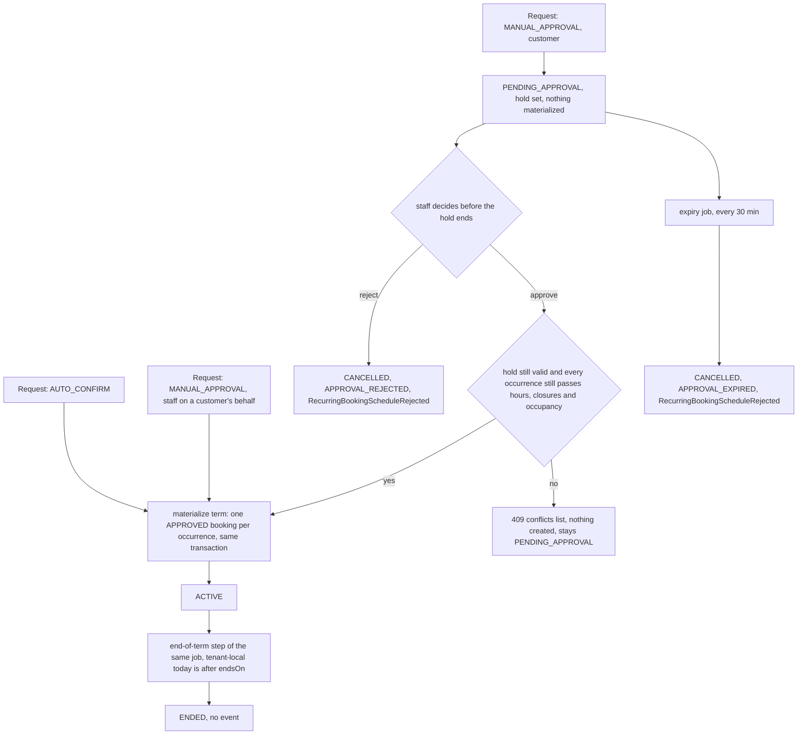

**A staff actor is the approver (M23-S19).** `resolveApprovalStatus(policy, actorType)` gives a STAFF actor `ACTIVE` for a `MANUAL_APPROVAL` service too (no hold, `approvedByStaffId` = the actor, `approvedAt` set), and the use case then materializes the term in the same transaction exactly as for `AUTO_CONFIRM` — the same rule as UC-108's one-off booking, where nothing waits for approval because the staff member is the approver. The event is `RecurringBookingScheduleCreated` (the customer's e-mail of M23-S28 goes out), never `…ApprovalRequested` (no manager alert). A customer's request, and an `AUTO_CONFIRM` service for anyone, are unchanged; for an `AUTO_CONFIRM` service nobody approved anything, so `approvedByStaffId` stays null even when staff created it.

**Approval is atomic, like creation.** The approve use case takes the same locks as the request path (`lockService()`, then the union of the considered resources through `lockResources()`), re-reads the schedule and requires `PENDING_APPROVAL` with a hold still in the future, re-checks that the service is still eligible and still yields the schedule's assignment policy, then re-runs the hours-and-closures pass and the occupancy check over the whole term for every requirement. One failing occurrence refuses the whole approval with the creation-time `409` conflicts list; nothing is created, the schedule stays pending and staff can reject it or let it expire. There is deliberately no UC-073 worklist entry for this: an entry needs an existing booking (`affectedType = 'BOOKING'`), and no occurrence was created. A conflict discovered after the schedule is `ACTIVE` concerns a real booking and is UC-073's (today: a resource deactivation).

**Booking window and past occurrences (M23-S35).** Before anything is checked for conflicts, `RequestRecurringBookingScheduleUseCase.prepareRequest()` (after it loads the service under `findByIdForUpdate()`) takes the enumeration: an empty one is refused (`422 BOOKING_RECURRING_SCHEDULE_NO_OCCURRENCES`). For a **new schedule** the first occurrence — an instant, the first start the recurrence yields, never the `startsOn` date — goes through `assertWithinBookingWindow()` with the effective window of the service (the tenant is the ceiling, an override can only tighten it), so a customer gets `BOOKING_SCHEDULED_IN_PAST`, `BOOKING_TOO_SOON` or `BOOKING_TOO_FAR_AHEAD`; staff are exempt from the window but not from the past rule, and later occurrences are never window-checked (the term stays bounded by `recurringHorizonDays`, not by the maximum days ahead). A **renewal** is the request that names a previous schedule of the same customer in `renewsScheduleId` (unknown or someone else's → `404`, never an exemption) *and* keeps its `serviceId`, `daysOfWeek` (as a set), `startTime` and `durationMinutes` *and* starts no later than that schedule's `endsOn` plus one day; anything else is simply a new schedule, so the field can never be used to buy an exemption. A renewal skips the window; it keeps only the occurrences that start after `now` (one `now` per request), and fails with `BOOKING_SCHEDULED_IN_PAST` when none remain. The field is not stored. At **approval** the same drop of past occurrences happens first — before the conflict check, so a past occurrence on a since-closed day cannot refuse the whole approval, and so the resource plan (indexed by occurrence) stays aligned with what is materialized — and an approval with nothing left in the future fails with `BOOKING_SCHEDULED_IN_PAST` and leaves the schedule `PENDING_APPROVAL`. The window is not re-checked at approval (the manager's decision is theirs), and the stored `startsOn`/`endsOn` are never rewritten.

**Materialization** creates one booking per occurrence of `enumerateRecurrenceOccurrences()`, directly `APPROVED` (`Booking.materializeRecurringOccurrence()`), with `recurringScheduleId` set, in the same transaction as the status change. The resource of each occurrence is not resolved again: the same pass that accepted the term (`assertPatternConflictFree()`) returns a plan — `recurring-occurrence-resource-plan.helpers.ts` — with the chosen resource per occurrence (the customer's pick for `FIXED_ASSIGNMENT`, the first open and free unit by `resourceId` for `AUTO_FUNGIBLE_POOL` (no day-load sort), and for `AUTO_ANY` the least-loaded resource among those open (hours, closures) and free (occupancy) at that exact window, resourceId as the tie-break, where load is the `HOLD`/`COMMITTED` occupancy on the tenant-local day). Occurrences fall on different days, so none changes another's free set or day load and the whole term is planned from the state before anything is written. The plan costs at most one extra query (the day windows, `findActiveWindows()`, only when `AUTO_ANY` has more than one eligible resource). Persisting is three statements whatever the term length: `IBookingRepository.insertMany()` (bookings and lines), then `IResourceOccupancyRepository.assignMany()` (assignment rows and `COMMITTED` occupancy rows). `assignMany()` (and `assign()` for one line) write with one `INSERT ... SELECT FROM unnest(...)` per table — one array per column, a fixed number of bound parameters whatever the row count, guarded by a unit test that compares each statement's column list with its entity; the bookings insert is entity-driven and bounded by the term cap (at most 180 occurrences), far inside PostgreSQL's bound-parameter limit. A rerun cannot duplicate occurrences: approving an already-`ACTIVE` schedule is refused first, and the `(tenant_id, recurring_schedule_id, scheduled_at)` unique index is the database-level backstop. The bookings raise no `BookingRequested`/`BookingApproved`: the notification context sends one email per such event, so a term would send one pair per occurrence. The number of queries does not grow with the length of the term (measured against a local Postgres with no network latency: a 64-occurrence term, including the whole-term conflict check and the HTTP round trip, took about 550 ms when each occurrence was resolved and saved on its own and about 160 ms batched; with real database latency the gap widens, because the statement count is constant instead of roughly ten per occurrence).

**Expiry and end of term share one job** on the existing 30-minute `cron-reminders` trigger. It iterates active tenants and queries each tenant-scoped (the `(tenant_id, status, approval_hold_expires_at)` index is enough; there is no cross-tenant index). Step 1 cancels `PENDING_APPROVAL` schedules past their hold (`APPROVAL_EXPIRED`), one transaction per schedule. Step 2 moves `ACTIVE` schedules whose `endsOn` is before the tenant-local date to `ENDED`, which is what keeps the `status = 'ACTIVE'` caps and list filter from counting an expired schedule; it raises no event and touches no booking. The 30-minute granularity affects only when cleanup happens: approve itself refuses a request whose hold has passed.

**Between the deadline and the job (M23-S13).** The job runs every 30 minutes, so a request can sit `PENDING_APPROVAL` past its hold for up to that long — and for good where the trigger does not run, such as local development. In that gap `approve()` is already refused (`409 BOOKING_RECURRING_SCHEDULE_NOT_PENDING_APPROVAL`: it checks the hold, not just the status), but `reject()` checks the status only and still works. The staff Agenda therefore marks such a request "Prazo encerrado", and its detail screen offers only **Recusar** instead of reading the refusal as someone else having decided. The hold length is the service's `bookingPolicy.manualHoldMinutes` (30 by default), so screens must not hard-code it.

**A bundle schedule after approval (TD49 Story 1).** Every occurrence is one linked booking whose single line holds one `resource_occupancy` row per requirement (`isBundleMember` set), so the booking's own operations act on all of them: cancelling one occurrence (skip) and ending the schedule release every row of the line, and rescheduling one occurrence re-resolves the bundle with the pinned `CUSTOMER_CHOICE` pick and moves all rows together. The schedule's assignment row follows a bulk REASSIGN of its pick (UC-073) once **every** future occurrence's line holds the new resource; the other resources of a bundle booking (the room, an `AUTO_*` pick) are ignored by that comparison. A schedule read lists the stored picks as `resourceAssignments` (`{ resourceType, resourceId }`); an `AUTO_*` requirement has no schedule-level resource because it varies per occurrence, so it is read from the occurrence bookings.

### Ending a schedule and the emails around it (M23-S28)

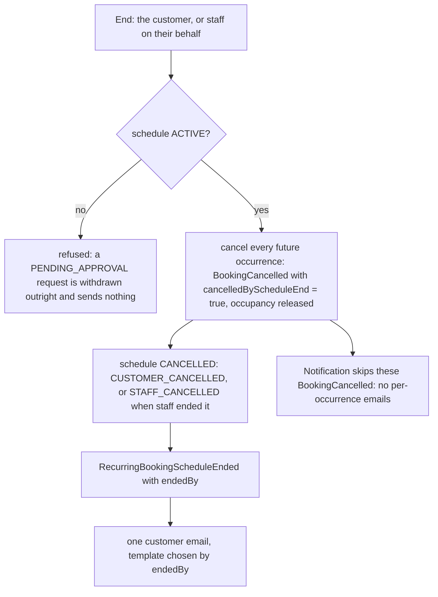

Ending is one transaction in `EndRecurringBookingScheduleUseCase`: the occurrences are cancelled through the same `Booking.cancel()` as any cancellation (so the audit rows and the availability-alert handler still see them), with `cancelledByScheduleEnd` set, and the schedule's `end()` raises the single `Ended` event. `SendBookingCancelledNotificationUseCase` returns before sending anything when that flag is set (the skip is in the use case, not the handler, so the handler stays one call). A single occurrence cancelled on its own is an ordinary cancellation and still emails the customer and the managers.

| Event | Recipient | Template (`NotificationTemplateKey`) |
| --- | --- | --- |
| `RecurringBookingScheduleCreated` (at creation for `AUTO_CONFIRM`, at approval for `MANUAL_APPROVAL`) | the schedule's customer, also when staff created it | `RECURRING_SCHEDULE_CREATED_CUSTOMER` |
| `RecurringBookingScheduleApprovalRequested` | the tenant's managers, never the customer | `RECURRING_SCHEDULE_APPROVAL_REQUESTED_ADMIN` |
| `RecurringBookingScheduleRejected`, `APPROVAL_REJECTED` | the customer | `RECURRING_SCHEDULE_REJECTED_CUSTOMER` |
| `RecurringBookingScheduleRejected`, `APPROVAL_EXPIRED` | the customer | `RECURRING_SCHEDULE_EXPIRED_CUSTOMER` |
| `RecurringBookingScheduleEnded`, `endedBy = CUSTOMER` | the customer | `RECURRING_SCHEDULE_ENDED_CUSTOMER` |
| `RecurringBookingScheduleEnded`, `endedBy = STAFF` | the customer | `RECURRING_SCHEDULE_ENDED_BY_STAFF_CUSTOMER` |

Two templates share an event when the copy differs (rejected/expired, ended by whom): `trigger_event` stores the enum value, so they are told apart by the `recipientType` label in `notifications.json`. The language is the tenant's (`settings.localization.language`), never the customer's. It is set once at provisioning from the tenant's country and is read-only in Settings, so it is always `pt-BR` or `en` (`docs/TENANTS_SETTINGS_SCHEMA.md` § Localization Settings); a tenant's template rows are one per `(tenant_id, trigger_event, channel)` in that language, and the migration that introduced these keys copied them to existing tenants by it. The copy is chosen at send time through `resolveSupportedLocale()` (`@ikaro/i18n`, shared with the web app). No email carries a staff name or an internal id; a customer or service that no longer exists is skipped with a warning, never retried.

### Renewal window and reminder (M23-S21)

One number, `settings.booking.recurringRenewalReminderDays` (N, default 7, `0` = off), drives two things that must agree: the single reminder e-mail and the `renewable` flag on the schedule list.

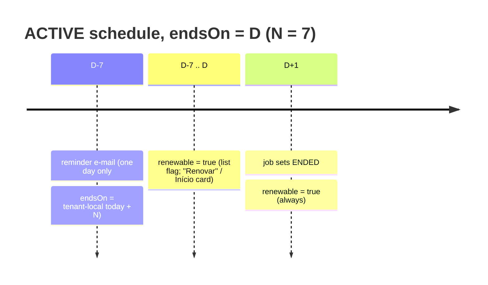

- **Reminder:** `RecurringScheduleRenewalReminderJob` runs on the `CRON_REMINDERS_TRIGGER` tick in each tenant's 06:00–06:29 local window and picks `ACTIVE` schedules with `endsOn = localToday + N` and `startsOn < endsOn − N` (a term not longer than N is never reminded). Exact-date matching is what makes it idempotent: the Command's dedup key is `(tenantId, scheduleId, localDate)`, so no "sent" column exists. A tenant's window holds exactly one cron tick a day, so a missed tick loses that day's reminder (same as booking reminders); a failure inside the run is not swallowed: every tenant is processed, then the run fails so the message is redelivered (the retry checks the window at redelivery time, so it can still miss a tenant if it arrives late; dedup keys keep a retry from double-sending).
- **Successor:** a schedule is skipped, and is not `renewable`, when the same customer already has an `ACTIVE` or `PENDING_APPROVAL` schedule for the same service starting on or after its `endsOn`. Detected by that heuristic; `renewsScheduleId` is not stored.
- **`renewable` (list item):** `ACTIVE` with `localToday ≤ endsOn ≤ localToday + N` (empty window when N = 0), or `ENDED`, and no successor; never for `PENDING_APPROVAL` or `CANCELLED`. Computed server-side because a customer cannot read tenant settings.
- **Link:** the e-mail opens `/{slug}/my-account/recurring-schedules/new?renewFrom=<id>`, built by a shared builder/parser pair in `@ikaro/types` that the web page also parses.

---

## Booking — Future-Commitment Worklist (M23-S08)

### Why this exists

Deactivating a resource (directly, or by deactivating the staff member behind it) can leave future bookings on something that no longer exists. Nothing may move a booking silently, so the system only **records** the impact and a manager decides. The algorithm spans the two deactivation use cases, the occupancy repository, the resolver, and the recurring-schedule aggregate, so it is described once here.

### Raise

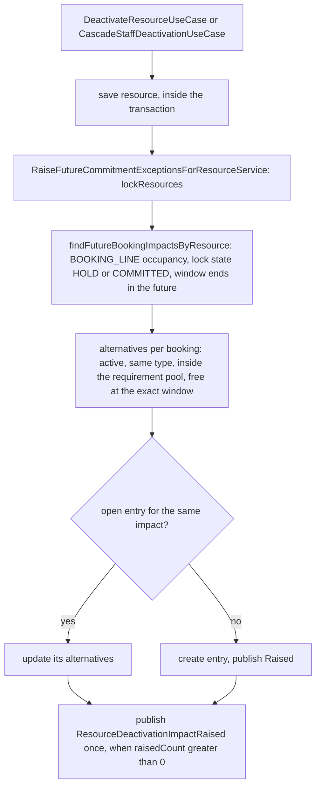

One entry per affected booking, whatever its status (`PENDING`, `INFO_REQUESTED`, `APPROVED`); a `REQUESTED` lock state is never a real commitment. The `(tenant_id, source_type, source_id, affected_type, affected_id) WHERE status = 'OPEN'` partial unique index is the DB-level guarantee that a repeat trigger updates instead of duplicating. Recurring schedules get no entry of their own: each materialized occurrence is a booking and is covered like any other. A resource with no future bookings raises nothing.

**Manager alert (M23-S23).** The raise step also publishes one `ResourceDeactivationImpactRaised` (`{resourceId, resourceName, affectedCount}`, `affectedCount` = `raisedCount`, so a refreshed open entry counts) through `OUTBOX_PUBLISHER` inside the caller's transaction, only when `raisedCount > 0`. The Notification context consumes it and emails every manager once, the deactivating manager included, with a link to `${FRONTEND_URL}/dashboard` in the tenant's language. The per-entry `Raised` events keep the audit-log consumer only, so 11 affected bookings are one email, not 11.

### Read (the worklist and its badge, M23-S14)

`GET /scheduling-exceptions` returns the entries with a booking summary (`contactName`, `scheduledAt`, `serviceNames`, `resourceName`, `isCustomer`, `totalPrice`) built from the Booking context alone. For an **`OPEN`** entry the `alternatives` are **recomputed on every read**, not read from the stored snapshot: one `computeBookingAlternatives` call per deactivated resource (the same helper the raise step uses, in one read-only transaction), so a resource reactivated, or a slot freed by a cancellation, since the entry was raised shows up. A `RESOLVED`/`DISMISSED` entry keeps what was stored. A booking with no live occupancy left on the source gets no alternatives. The UI disables **Reatribuir** for an entry with none (the bulk bar, when no selected entry has one); Reagendar and Cancelar stay.

`findConflictingWindows` (the batched "which of these resource/time windows are taken" check behind the alternatives, REASSIGN and recurring-pattern checks) probes `EX_booking_resource_occupancy_locked_window` once per window through a `LATERAL ... LIMIT 1` subquery. As a plain join the planner could pick a sequential scan over every retained row: on 70k occupancy rows that took 0.3 s for 300 windows and 12 s for 6000, against 6 ms and 0.12 s with the per-window probe.

`GET /scheduling-exceptions/count` (`{ count }`, `OPEN` entries of the tenant, MANAGER only) feeds the sidebar badge and is served by the partial unique index over the `OPEN` rows (an Index Only Scan, pinned by an `EXPLAIN` test); the badge query never computes alternatives. The web client refreshes the list and the count after a resolve and after a resource or staff deactivation.

### Read — the marker on a booking, and the booking's own entries (M23-S46)

A booking that is the `affected_id` of an `OPEN` entry is **marked**: `GET /bookings` (staff items) and `GET /bookings/:id` (staff response) carry `hasOpenException`, looked up in one batched query per page (`findOpenAffectedBookingIds`, `WHERE tenant_id = $1 AND status = 'OPEN' AND affected_type = 'BOOKING' AND affected_id IN (…)`, answered from an index by an `EXPLAIN` test; none for an empty page and none for a customer-scoped list). The flag is a view of current data and is never stored. The booking stays in the staff queue with an orange "Precisa de decisão" pill and none of its normal quick actions (the queue and the Agenda share `GET /bookings`, so hiding it would have hidden a real commitment from STAFF, who cannot open the manager-only worklist).

On the booking detail the same marker shows a banner for every staff actor. A **manager** also gets a decision panel instead of the normal actions: **Reatribuir** (one button per open entry, each with its own resource, because a reassign target is valid for one source resource only), **Reagendar** (only for an `APPROVED` booking, since `RESCHEDULE` is refused otherwise) and **Cancelar** (every entry id of the booking in one `CANCEL` request). The panel reads `GET /scheduling-exceptions/by-booking/:bookingId` — that booking's `OPEN` entries with their alternatives recomputed, never the whole worklist, because the list is unpaginated and recomputes the alternatives of every open entry — and resolves through the same `POST /scheduling-exceptions/resolve` as the worklist. After a resolve the page refetches the booking (`GET /bookings/:id`) and shows what the server says; it never patches its own copy.

### Close with the booking change (M23-S48)

An entry means "this booking has a problem with this resource". It is obsolete the moment the booking no longer occupies that resource, so every change that releases or moves a booking's occupancy closes the booking's open entries **in the same transaction**, with one rule: dismiss every `OPEN` entry of the booking whose source resource the booking no longer occupies.

| Booking change | Entries closed |
|---|---|
| Cancel (customer, staff), reject, end of a recurring schedule, the worklist's CANCEL | Every entry, `BOOKING_NO_LONGER_ACTIVE`. The entry the manager selected in the worklist is **resolved** by that manager; only its siblings are dismissed |
| Reschedule (staff or customer), approve | The entries whose source resource the booking no longer occupies afterwards, `RESOURCE_NO_LONGER_USED`; an entry whose resource it still holds stays `OPEN` |
| Reassign of one resource (worklist) | Only the entry being resolved; the booking still holds the other resources, so their entries stay `OPEN` |

The dismissals are system actions (`resolvedByStaffId` is `null`; a customer cancelling has no staff id). Two helpers hold the rule, so a new path cannot skip it: `saveTerminalBookingsInTransaction` (cancel, reject, end-recurring, the worklist's CANCEL) and `dismissStaleExceptionsAfterMove` (approve and both reschedules). An `architecture-check` detector fails CI when `releaseBookingOccupancy` is called from anywhere else.

**Lock order** (`docs/LOCK_CATALOG.md` § 2): the resource locks of everything the booking occupies, in one sorted call (re-read and extended if the booking's resources changed in between) → the booking's open entries, one batched `FOR UPDATE` ordered by id → the booking row (`save`) → the occupancy rows. A deactivation's raise takes the resource lock first and inserts the entries, so a cancel that takes the same lock either sees the new entry and closes it, or the raise sees a booking that no longer occupies the resource. The worklist's own resolve takes the same order: CANCEL locks the booking's resources, then the entry; RESCHEDULE locks the booking's resources, the entry's source and the candidates for the new time in one call, then the entry, and resolves the new time from the set of resources it just locked, so a resource that becomes eligible in between is never locked after the entry.

A bulk CANCEL ticking several entries of one booking: the first id cancels the booking and dismisses its siblings, so a later id finds its entry closed on a cancelled booking; that is reported `RESOLVED` (nothing is left to do), not `STILL_OPEN`. A closed entry on a booking that is **not** cancelled is still `STILL_OPEN` with the already-resolved error.

When a booking moves (reschedule or approve), only an entry whose source type the code knows is closed by the occupancy rule; an entry of an unknown source type is left open. The rule is a table keyed by the source type (`ENDS_WHEN_SOURCE_RESOURCE_IS_FREE`), so a new source type does not compile until it is added there. A cancel or reject closes every entry whatever its source.

Not affected: complete and no-show (the staff queue hides those buttons while an entry is open), the worklist grouping, the badge count, and the manual `dismiss`. A reschedule that cannot re-resolve a `CUSTOMER_CHOICE` pinned to a deactivated resource still fails and leaves the entry `OPEN`.

### Resolve (best-effort per booking)

`resolve` takes 1–100 entry ids and one choice. **Each entry runs in its own transaction**, so a booking whose alternative was taken in the meantime stays `OPEN` and is reported (`STILL_OPEN`) while the rest resolve.

| Choice | Effect |
|---|---|
| KEEP | Entry resolved, booking unchanged |
| REASSIGN | Same window, another resource: validated (active, same type, inside the pool, free excluding the booking's own lines) then released and re-assigned; `AUTO` takes the least-loaded free candidate; a bundle's other resources are untouched; no `BookingRescheduled`. Each moved booking records `BookingResourceReassigned` (M23-S23) on the same `save()`, and the customer gets one email per booking saying the time is unchanged. The new resource's name is included only when **every** affected requirement is `CUSTOMER_CHOICE` or `AUTO_ANY` (`AUTO_FUNGIBLE_POOL` and `NONE` give `null`); the manager's reason is never included |
| RESCHEDULE | One entry only, `APPROVED` booking only; `RescheduleBookingUseCase`'s logic (`rescheduleBookingInTransaction`) composed in the same transaction, the resource re-resolved fresh at the new time. A `CUSTOMER_CHOICE` booking whose chosen resource is the deactivated one cannot re-resolve and stays `OPEN` — REASSIGN or CANCEL it instead |
| CANCEL | The same staff cancellation `CancelBookingAsAdminUseCase` performs (`Booking.cancel` as staff, then `saveTerminalBookingsInTransaction`, which frees the occupancy and dismisses the booking's other open entries), in the entry's own transaction; the selected entry is resolved |

After a REASSIGN batch, a `FIXED_ASSIGNMENT` schedule's assignment row is swapped to the new resource only when no future non-terminal linked booking is left on the old one **and** every moved occurrence landed on the same new resource (an `AUTO` batch can scatter them); otherwise it stays as the record of what was requested. This step is best-effort and runs after the reassigns have committed — a failure is logged, never turned into a failed resolve.

### Close on reactivation (M23-S45)

Reactivating the resource (UC-049) closes the entries its deactivation raised, so a deactivation made by mistake leaves nothing to clear by hand. In the reactivation's transaction, after the STAFF-wrapper re-check: `lockResources([resourceId])` (the same primitive the raise step takes, so reactivate and a concurrent deactivate are ordered), then one `FOR UPDATE` read of the `OPEN` entries with `sourceType = 'RESOURCE_DEACTIVATION'` and that `sourceId`, ordered by `id`, then `dismiss(<reactivating manager>, 'RESOURCE_REACTIVATED')` and `save()` on each, then the resource `save()`.

- Entries already `RESOLVED` or `DISMISSED` are untouched; bookings are never changed.
- A reactivation rejected for an inactive Staff row closes nothing.
- No notification: the manager was alerted at deactivation and the badge simply drops. Each close records `FutureCommitmentExceptionDismissed`, which only the audit-log consumer reads.
- A later deactivation raises fresh entries, since the partial unique index covers `OPEN` only.

### Known limitation

A booking whose resolver read the resource as active just before its deactivation commits, and which inserts after the raise step ran, is not caught. `lockResources` narrows the window; it does not close it.

---

## Booking — Availability Alerts (M23-S06, M23-S07)

### Why this exists

An `AvailabilityAlert` is an expiring, non-reserving intent: "tell me when something I can book matches this". Capacity can open up in two different ways, and a notification is only useful when the customer can **act on it**, so the matching has three rules that are easy to get subtly wrong: what counts as "bookable", which dates a customer can actually select, and how a customer is kept from being told twice. The aggregate (`docs/DOMAIN_MODEL.md` § `AvailabilityAlert`), the table (`docs/DATABASE_SCHEMA.md`) and the event (`docs/DOMAIN_EVENTS.md` § `AvailabilityAlertMatched`) are canonical; this section is the algorithm that connects them.

### Two triggers, one use case

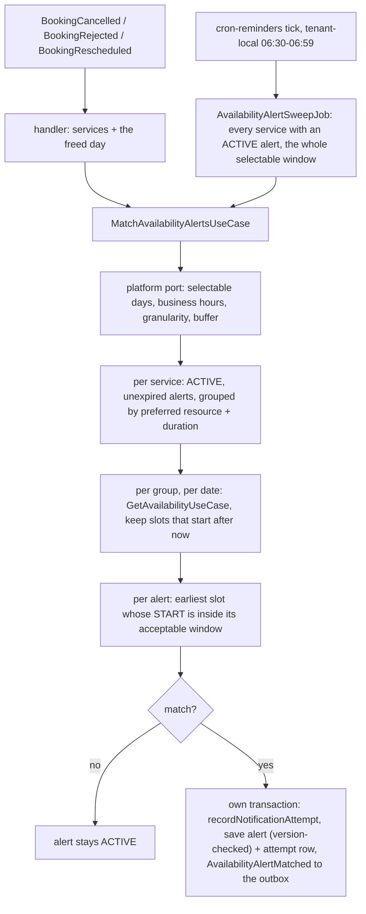

- **Fast path (event handlers).** A cancelled, rejected or rescheduled booking released a slot, so the handler re-checks only **that tenant-local day** for **that booking's services**. `BookingCancelled` carries `scheduledAt` and the line services; `BookingRescheduled` carries `previousSlot.startTime` (an ISO instant, whatever its name suggests); `BookingRejected` carries neither, so its handler resolves the booking and delegates (`MatchAvailabilityAlertsForBookingUseCase`). A freed day outside the selectable window is skipped — the sweep picks it up when the date enters the window.
- **Slow path (daily sweep).** Capacity can also appear with **no booking event at all**: the booking window rolls forward a day, a manager extends hours, adds an opening, or adds or reactivates a resource. Once a day per tenant the sweep re-checks every service that has an `ACTIVE` alert over the whole selectable window. It rides the existing 30-minute `cron-reminders` trigger as its own consumer (`availability-alert-sweep`) and gates itself to the tenant-local 06:30–06:59 window (after `booking-reminder`'s 06:00–06:29), so exactly one tick per day lands in it and no "last run" state is stored. A tenant that fails never stops the others; after the last tenant the job throws so the message is nacked and redelivered while the window is still open (a re-run is a no-op for alerts already notified) — a swallowed error would otherwise wait a whole day.
- **Cost.** Alerts of one service that share a preferred resource and a duration share one availability read per day; the sweep never runs one availability query per alert. The `(tenant_id, service_id, status)` index serves the alert read.

### What "bookable" means

The use case does not compare an alert with a raw "freed window". It asks the **real availability engine** (`GetAvailabilityUseCase` — working hours, closures, openings, occupancy, resource rules — see § Availability computation algorithm) for the service on the date (at the alert's chosen duration for a `CUSTOMER_SELECTED` service). An alert's **preferred resource is only a further filter** on that result: the slot must also be free for that resource. The explicit-resource read is never used on its own, because it ignores the service's other requirements — used alone it would offer a bundle's slot while another required resource is occupied. A slot that has **already started** (the read still lists the earlier slots of today) is dropped. A domain error from the read (service or resource deactivated, duration no longer valid) means "nothing bookable"; it ends that group's read after one warning and never fails the run.

### What the customer can actually select

Only dates a customer can pick on the public booking page are considered, so an email is never sent about something the screen would not let them choose:

The window starts on the **tenant-local date** of the run (M23-S33; it was the UTC date before) and is at most `selectableDays` long — the contract of the availability read itself (it rejects any date before the tenant's today) and of the public calendar, so the three never disagree. Each service's own effective window narrows it further (see *Booking — Booking Window*): the sweep never looks past the service's own maximum, and it drops a slot that starts inside the service's minimum notice. A freed booking contributes the tenant-local day its slot is listed under; if that day is already behind the window it is left to the next sweep.

| Hotsite `BOOKING_CTA` date picker | Selectable window (days ahead, today included) |
|---|---|
| carousel (the default) | `min(carouselDays, maxBookingAdvanceDays)` — `carouselDays` defaults to 14 |
| calendar | `maxBookingAdvanceDays` |

The hotsite's `BOOKING_CTA` module is read whether or not it is enabled (the public page does the same), and a tenant with no hotsite config gets the carousel/14 default. The per-service `maxBookingAdvanceDaysOverride` narrows it for that service's alerts, as it does for booking (M23-S33). An alert for a date beyond the window simply waits — the sweep matches it the day it enters the window, which is why an alert may live up to 365 days (`ALERT_MAX_EXPIRY_DAYS`, the highest value `maxBookingAdvanceDays` can take; the default stays 30).

### Criteria matching

The customer states when they can **start**, so the slot's *start* is what is compared (a slot's own end includes the service buffer, which is not the customer's concern):

- `ONE_TIME_RANGE` — `acceptableStartAt <= slot start < acceptableEndAt`.
- `WEEKLY_PREFERENCE` — the slot's start date **in the alert's timezone** (always the tenant's) is one of the weekdays, and its local start time is in `[localStartTime, localEndTime)`.

Of the slots that match, the **earliest** becomes the alert's `matching_window`. `participantCount` is stored on the alert but is not part of matching: the availability engine has no notion of participants.

### One notification per alert

`recordNotificationAttempt()` moves the alert `ACTIVE → NOTIFIED`, so a notified alert is never matched again — one notification per alert, however many triggers see the same slot. The aggregate also refuses an alert that is cancelled, expired or already past its `expiresAt` (the expiry job runs on a coarse schedule). Two triggers racing on the same alert are serialized by the aggregate's **optimistic version check**: the loser gets `BookingConcurrentModificationError`, which the use case treats as "already handled" — the same primitive and outcome as `ExpireAvailabilityAlertsJob`, so no row lock is needed. The attempt row is inserted `ON CONFLICT (tenant_id, alert_id, matching_window, channel) DO NOTHING` in the same transaction as the status change and the outbox event, so a replayed event is a no-op. `outcome` is written as `PENDING`: `NOTIFIED` means "a match was found and handed off", not "an email was delivered".

### The email and its outcome (M23-S38)

The match event reaches Pub/Sub through the outbox relay, so the email follows the match by the relay's next run. The Notification consumer sends one email to the alert's customer (the service, the start of the window that opened, and a link to the hotsite booking page, `/{slug}/booking?serviceId=…&date=YYYY-MM-DD`, plus `durationMinutes` and `resourceId` when the alert has them; the date is the tenant-local day of the window, and the booking page seeds the service, duration, date and resource from it — M23-S44) and reports the result to the Booking context through a port, not an event: `PENDING → SENT`, or `FAILED` when a send throws. On a failure the consumer records it and rethrows, so Pub/Sub redelivers (5 deliveries, 10 s to 600 s backoff); every try increments `attempt_count`, a later success sets `SENT` and clears `last_error`, and the alert stays `NOTIFIED` throughout, so a failed email never causes a second match. `FAILED` with a count below 5 means still retrying; at 5 it was dead-lettered. A customer or service that no longer exists is logged and acknowledged, leaving the row `PENDING`.

### The customer's view of an alert (M23-S43)

The customer's "Meus avisos" pages (`/{slug}/my-account/alerts`) and the Agendamentos entry row follow three rules that the status column alone does not give:

- **A cancelled alert is gone.** The list, the Agendamentos row and its active count never show it, and its detail page is a `404`. The server keeps the row for 90 days like any finished alert.
- **`notifiedAt` is the match moment.** The backend sets it to the `attempted_at` of the alert's `SENT` EMAIL attempt (the latest one), `null` when there is none. That row is written when the match is recorded, so it is not the exact send time. A `NOTIFIED` alert with no `SENT` attempt shows "Avisado" without a time, never "Expirado".
- **An `ACTIVE` alert past its `expiresAt` reads as expired.** The aggregate refuses to cancel or edit it (`409 BOOKING_ALERT_NOT_EDITABLE`) while its stored status is still `ACTIVE`, until the expiry job runs. The web read resolves it to `EXPIRED` up front (`withEffectiveStatus`), so it sits under "Histórico" and offers no "Cancelar aviso". A `409` on cancel still sends the customer to the list, where the alert already shows as finished.

The list is the caller's 100 most recent alerts (`docs/API_CONTRACTS.md`). Service and resource names are read in one batched, tenant-scoped query per response (never per row).

### Known limitations

- A booking window shortened *after* an alert was created never un-notifies anything; an alert simply waits for the new, smaller window.
- Participant criteria are not matched (see above); the alert page does not send `participantCount` at all (M23-S31).
- An alert is for **one service**: there is no basket alert, so a multi-service booking attempt cannot create one. A legged or bundled service is matched as a whole (the service-level availability read applies every requirement), and the one `preferredResourceId` is only a further filter on it — an alert cannot carry per-leg resource picks (M23-S31 sends none for such services).
- The sweep applies the same effective window the backend enforces on booking (M23-S33), so it never notifies about a slot booking would reject.
- **A duration is required on a customer-selected-duration service (M23-S34).** Create and update apply `BookingQuoteService`'s rule — the same one `POST /bookings` and the availability read use, with no fallback to `Service.durationMinutes` — so a `CUSTOMER_SELECTED` alert is only ever stored with a duration inside the service's min/max/increment (`422 BOOKING_DURATION_OUT_OF_RANGE` otherwise, also when an update clears it). Not covered: a service whose duration policy or min/max/increment is edited *after* an alert exists can leave that alert unmatchable; the matching logs one warning per run and skips it.

---

## Booking — No-Show and Its Correction (M23-S09, S25, S26, S27)

### Why this exists

An appointment the customer never showed up for must not stay `APPROVED` forever, must not award loyalty points, and must be fixable when staff marked it by mistake. `NO_SHOW` is a terminal status with exactly one way out: a manager's correction to `COMPLETED`. UC-074 (`docs/USE_CASES.md`) holds the scenario; this section holds the rules the code enforces, so they need not be re-derived from `Booking.markNoShow()` / `correctNoShow()` (`booking.aggregate.ts`).

### Marking a no-show — `markNoShow(actor, correlationId, reason?, now)`

Checks run in this order, which fixes the error precedence:

1. The booking is already terminal (`COMPLETED`, `REJECTED`, `CANCELLED`, `NO_SHOW`) → `409` `BOOKING_ALREADY_TERMINAL`.
2. It is not `APPROVED` (`PENDING`, `INFO_REQUESTED`) → `422` `BOOKING_INVALID_TRANSITION`.
3. `now` is before the appointment's end, `scheduledAt + totalDurationMins` → `422` `BOOKING_NOT_YET_ENDED` (the error carries the end time).

On success the status moves to `NO_SHOW`, a `booking_status_transitions` row is appended (actor, optional free-text reason — M23-S26), and `BookingNoShow` is published. `STAFF` and `MANAGER` may mark; the optional `reason` is normalized (trimmed, blank → `null`) and is **never shown to the customer**.

### What the event does and does not trigger

- **Notification** (`notification` consumer, M23-S25): one retryable customer email in the tenant's locale. The payload carries what the email needs (`customerId`, `contactEmail`, `contactName`, `scheduledAt`, `lineSummary`).
- **Audit log** (shared `audit-log` consumer, M23-S36).
- **Loyalty: nothing.** No points are awarded for a no-show; `BookingNoShow` is not a `BookingCompleted`.
- **Availability alerts: nothing.** A no-show happens after the appointment's end, so no future window is released (only cancel, reject and reschedule feed `availability-alert-matching`).

### Correcting a no-show — `correctNoShow(actor, correlationId, reason)`

`MANAGER` only, and only to `COMPLETED`. The booking must currently be `NO_SHOW` (anything else → `InvalidBookingTransition`). It reuses the normal completion path (`applyCompletion`) with the **booked** prices, no after-photos, no admin notes and no loyalty discount, so the published `BookingCompleted` is a valid payload for Loyalty, which awards the service points **exactly once, here** (idempotent on the booking line). The correction appends its own transition row with the required reason; the earlier `NO_SHOW` row is never edited.

### The history the UI shows

`booking_status_transitions` is append-only; the dashboard's `BookingStatusHistory` card and the customer's no-show detail read it (`statusHistory` on the booking read). It is written for **every** status transition from M23-S26 on, with no backfill, so bookings that changed status earlier have no rows.

### Known limitations

- A no-show cannot be reverted to `APPROVED`; the only correction is to `COMPLETED`.
- Because the reason is staff-entered free text it is excluded from the customer email by design — do not add it to the template.

---

## Booking — Full Booking Detail (M23-S47)

**Why this section exists:** the detail read answers "which resource did this booking have, and who did what to it" from two tables with different lifetimes. Reading the wrong one shows a stale resource or nothing at all.

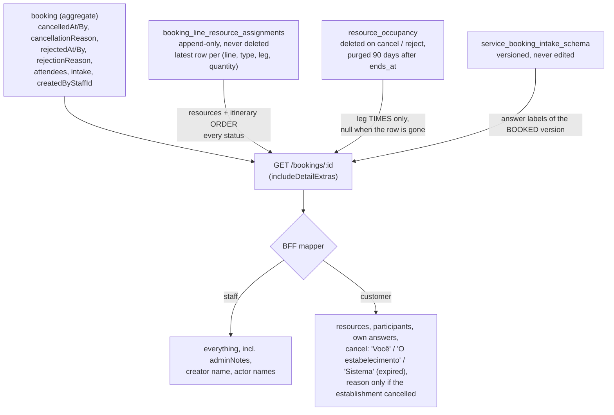

### Rules

- **Resources and itinerary order: the latest assignment per slot.** The assignment table is append-only (a reassign or a reschedule onto another resource adds a row), so a raw read shows stale resources; the latest row per `(line, resource type, leg, quantity position)` is the resource the booking is on now, or was on when it ended. It is not deduplicated by resource: one van on legs 1 and 3 is two itinerary entries.
- **Leg times: only while the occupancy row exists.** A cancel or reject deletes the rows at once; a completed or no-show booking keeps them until the 90-day purge. A leg without a live row has `startsAt`/`endsAt` = `null` and the UI shows the order and the resource only. Times are never derived from the service's current leg durations, which may have changed.
- **Origin tag** (`CUSTOMER_CHOICE` / `SYSTEM_ASSIGNED`) comes from the service's *current* requirement for that resource type; a service that no longer declares it carries no tag. A `NONE` requirement, or the implicit `LOCATION` of a service that declares no requirement at all (the default single-location shape), shows nothing. For the customer, a named resource that carries no origin tag is hidden too (the service no longer declares that requirement), following the disclosure rule of UC-062/063: a customer sees a resource's identity only when they chose it or the system's automatic pick is shown. A fungible pool shows a quantity and never the unit.
- **Cancel and reject facts come from the aggregate**, not the status history (no backfill). A customer's own cancel stores no reason, so only a business cancel has one; the customer sees *who* only as "Você", "O estabelecimento" or, for a request the system cancelled after its hold ran out (TD51), "Sistema" with the card "Solicitação expirada". The BFF recognises that expiry by a null `cancelledBy` together with the `APPROVAL_EXPIRED` marker (`BookingTerminationDetail.byExpiry`), never by the free-text reason alone, and shows neither party's name nor the marker text.
- **Cost:** the extra reads sit behind `includeDetailExtras`, off by default (the loyalty adapter also calls this use case); staff names are resolved only for the staff-facing read.

### Known limitations

- A completed charge is not part of this section: it ships in the completed banner (`BookingCompletionSummary`).
- A booking cancelled by a recurring schedule ending has no reason of its own.

---

## Platform — Hotsite Template Catalogue (TD56-S04)

### Why this exists

A manager used to reach a different public site only by configuring modules one field at a time. The catalogue gives them six platform-owned compositions to start from. Applying one has to replace the **presentation** (palette, typography, module order, variants, images, sample copy) while keeping everything that is real tenant data, and it has to do so without a second set of rules for what "real tenant data" means. That rule is written down once, below, and implemented in one pure class (`HotsiteTemplateMaterializer`). The catalogue itself (definitions, per-locale copy, the asset manifest) lives in `packages/hotsite-templates/`; its day-to-day guide is that package's `README.md`.

### Hotsite template application

`POST /v1/tenants/hotsite/templates/:templateId/apply` is a **pure function** of three inputs: the request body (the manager's current draft, possibly unsaved), the tenant from the JWT and that tenant's own `tenants.settings.localization.language`. It persists nothing, never sets `isPublished`, creates no Service and calls no storage method other than the string-building `getPublicUrl`. The manager sees the returned draft as the live draft and publishes through the existing flow.

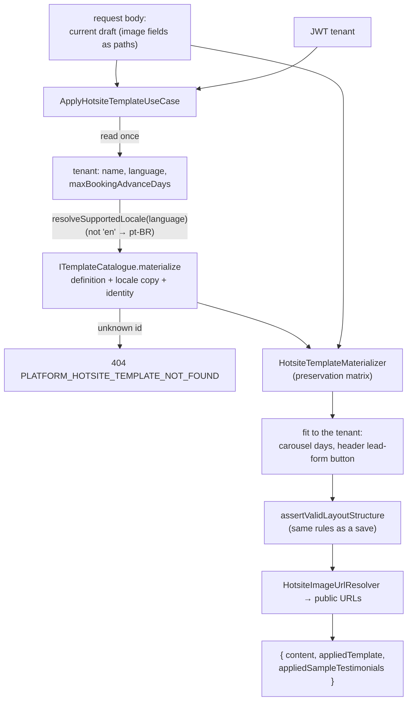

**Preservation matrix — what the draft keeps, what the template supplies:**

| Part | From | Rule |
|---|---|---|
| `brandName`, `brandTagline`, `logoUrl` | the draft | identity is never part of a template |
| Palette, fonts, shape, spacing, shadow, `heroBgStyle`, `alternateSectionBg`, `dividerStyle`, button colours | the template | presentation |
| SEO (`title`, `description`, `ogImageUrl`) | the draft, entirely | a definition carries no SEO |
| Module order, `enabled`, variants, `presentation`, copy, images | the template | the draft's layout is replaced, not merged |
| `LEAD_FORM` and `CHATBOT` `data` **and** `enabled` | the draft when it has the module | operational availability is the tenant's; with no such module in the draft the template's own default is used. The module's `presentation` stays the template's |
| `GALLERY.images` | the draft when it has any | the template still supplies the module's layout, title and `enabled`; with none, the template's sample images are used |
| `TESTIMONIALS.items` | the draft when it has any | with none, the template's sample testimonials are used and `appliedSampleTestimonials` is `true` |
| Services, booking model/policy/intake/resources, address, contacts, staff | untouched | they never live in the manifest; the `SERVICE_LIST`/`CONTACT` modules only hold display settings |

**Copy and identity.** Copy is chosen by the **tenant's** language (`en` and region-qualified `en-*` give English; anything else, Portuguese), not by the manager's UI language. The two placeholders `{{brandName}}` and `{{tagline}}` are filled from the draft's `brandName`/`brandTagline`; when the draft has no brand name the tenant's name fills `{{brandName}}` in the copy, and the returned branding still carries whatever the draft had (nothing is invented). No interpolation language is left in the result.

**Two fittings, because a template must never produce a draft the manager cannot save.**

- A booking carousel can show at most `maxBookingAdvanceDays`, a tenant setting. A template's `carouselDays` above it is lowered to it (the save would otherwise fail with `PLATFORM_HOTSITE_CAROUSEL_DAYS_EXCEEDS_MAX_ADVANCE`).
- The header button may point at the lead form only while `LEAD_FORM` is enabled. Enabling the lead form is the tenant's choice (preserved above), so when a template's button targets it and the tenant keeps it off, the button is pointed at `booking-form` instead (otherwise the save would fail with `PLATFORM_HOTSITE_NAVIGATION_TARGET_NOT_ENABLED`).

### Catalogue images

Images are platform-owned, public, immutable and versioned: `shared/hotsite-templates/<templateId>/v<n>/<file>.webp`. A manifest references the shared path directly; nothing is copied per tenant, so applying a template needs no rollback and leaves no orphan.

- **Saving accepts them by exact registration.** `HotsiteImagePromotionService` accepts a path only if it is in the catalogue's append-only `asset-manifest.json` (every released version, not just the current definitions, so a tenant that applied `v1` keeps saving after `v2` ships). There is **no** `shared/` wildcard and no storage existence call for these paths. Any other `shared/…` path is rejected like any unknown path.
- **They can never be deleted by a tenant.** `computeDeletions` only returns `tenants/<tenantId>/…` paths and `DeleteHotsiteImageUseCase` rejects anything whose path does not belong to the caller's tenant, so a shared object cannot go through a tenant save.
- **Applying replaces tenant-owned section images.** Hero, About, booking and lead images (and `presentation.background`) become the template's shared ones; a later save then deletes the tenant's superseded `tenants/<id>/…` uploads (irreversible once saved; the web warns before applying). Gallery images and testimonials the tenant already has are kept, so they are not deleted.
- **The web recovers the path before saving.** `GET /tenants/hotsite` returns every image as a public URL and a save sends paths, so `stripResolvedImageUrls` recovers `shared/hotsite-templates/…` from a resolved catalogue URL exactly as it recovers `tenants/<id>/…`; an applied draft cannot be saved without it.

### Delivery of the files

The image binaries reach the public bucket through the deploy pipelines, not Terraform: `sync-hotsite-template-assets` (`packages/infra-scripts`) runs in both `migrate-and-deploy` jobs before the migration. Per manifest entry: absent → upload create-only; present with the same bytes → skip; present with different bytes → fail the job ("a changed image must ship as a new `v<n>`"). `--verify` then fetches every path anonymously and compares status, content type, cache header and hash. Immutability is enforced by IAM (the deployer holds only a conditional `roles/storage.objectCreator` on the `shared/` prefix of its own environment's public bucket, which cannot overwrite or delete), and the staging job proves it each deploy with `--check-immutability`. The local emulator is seeded by `pnpm infra:up` / `pnpm hotsite-templates:seed` and by a step in the PR E2E job.

### Known limitations

- Applying has no per-change undo on the server: it persists nothing, so the editor's one-step "Undo template" (TD56-S05) is client-side and only works before Save.
- A template's sample testimonials are ordinary manifest data once applied; the sample-content label and the apply-time notice are the editor's (TD56-S05), driven by `appliedSampleTestimonials`.
- `capabilities` are derived from the enabled modules and their variants (a closed token set in `@ikaro/types`), not authored; a variant that no rule maps contributes no token.

---

## Other bounded contexts

Not yet written as sections in this doc. **Loyalty is not logic-free** — points earning on `BookingCompleted`, the expiry cron, the weekly expiring-points warning and manual redemption are implemented; until a section is written here, read them from `docs/BOUNDED_CONTEXTS.md` § 2. Loyalty Context, `docs/DOMAIN_MODEL.md` § Loyalty Context (and § Expiration window), `docs/USE_CASES.md` UC-009 / UC-016 / UC-016b, and the code under `apps/backend/src/contexts/loyalty/`. Likewise there is no booking status-machine section here: the transition table is CLAUDE.md §5 / `.copilot/context.md` §5 and the aggregate (`booking-status-transition.ts`). Platform has one section above (the hotsite template catalogue); add another here the next time a story in Customer, Staff, Loyalty, Notification, or Platform introduces business logic complex enough to earn one — see this doc's own header for the "incremental, not upfront" rule, and `/story-discovery`'s checklist item that flags the decision at discovery time.
