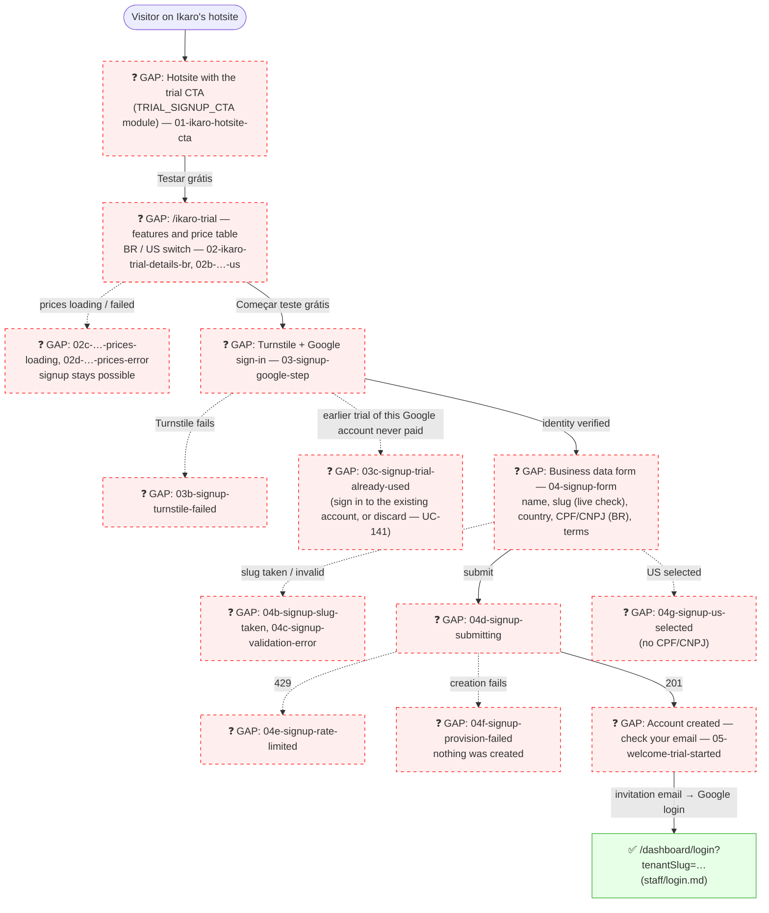

# GUEST — Teste Grátis da Ikaro (Self-Service Trial Signup)

**Actor(s):** GUEST (any visitor; no account yet)
**Goal:** A business owner opens Ikaro's own hotsite, reads what the platform offers and what it costs, signs in with Google, creates a tenant in a few fields and is told to check their email — without a human on Ikaro's side
**UCs covered:** UC-127 (visitor signs up for a trial), UC-128 (public prices and slug check); the call to action that starts the flow is configured by UC-131 (`manager/hotsite.md`); the optional first-run checklist after the first login is UC-129 (`manager/onboarding.md`)
**Status:** Draft (planned Billing milestone)

> Self-signup is the **default** way to create a tenant; the operator route (UC-024) is the exception path for exempt and partner tenants. The pages are served at `/ikaro-trial` and are **branded as the Ikaro tenant** (they take the platform-owner tenant's hotsite branding), so the prototype uses the shared hotsite look. They do not depend on the owner hotsite being published (`docs/HOTSITE_DYNAMIC_ARCHITECTURE.md` § The `/ikaro-trial` pages). This journey ends at the account-created page; what happens after the invitation email is `staff/login.md`.

## Flow

## Pages referenced

| Page / Route | Component | Story | Status |
|---|---|---|---|
| Ikaro's own hotsite, section with the trial CTA | `TrialSignupCtaModule` (planned 13th module type, platform-owner tenant only) | planned Billing milestone | ❓ Gap |
| `/ikaro-trial` — details and price table | `IkaroTrialDetailsPage`, `PriceTable` | planned Billing milestone | ❓ Gap |
| `/ikaro-trial/entrar` — Turnstile and Google | `SignupGoogleStep` | planned Billing milestone | ❓ Gap |
| `/ikaro-trial/…` — business data form | `SignupForm`, `SlugInput` | planned Billing milestone | ❓ Gap |
| `/ikaro-trial/conta-criada` — account created | `SignupAccountCreatedPage` | planned Billing milestone | ❓ Gap |

## BFF calls (contract: `docs/API_CONTRACTS.md` § Billing — Public Signup API)

| Call | Used by |
|---|---|
| `GET /v1/public/billing/prices?country=` | details / price table (UC-128) |
| `GET /v1/public/signup/slug-availability?slug=` | the slug field, debounced (UC-128) |
| `GET /v1/public/signup/session` | after the Google callback: `{ email, name, trialAvailable, existingTenantSlug? }` |
| `POST /v1/public/signup/tenant` | the submit (UC-127) |
| `POST /v1/public/signup/resend` | "Reenviar e-mail" on the account-created page |

## Open questions / gaps

- [ ] **Routing mechanism:** the public URL `/ikaro-trial` is a rewrite to the owner tenant's `app/[slug]/…` tree so the pages get `--ba-*` branding; the mechanism is decided at story discovery.
- [ ] **CSP for Turnstile** on the `/ikaro-trial` pages (the same trap as the lead-form page — `docs/ENGINEERING_RULES_FRONTEND.md`); exact wording decided at story discovery.
- [ ] **Signup session cookie name** and the status of `GET /v1/public/signup/session` / `resend` outside the documented cases: decided at story discovery.
- [ ] **Discard link on `03c`** points at the discard-confirm screen (`manager/prototypes/billing/10-discard-trial-confirm.html`); until the purge participants ship the screen shows the honest interim message ("contact Ikaro") and an operator runs the offboarding runbook (M17-S51).
- [ ] **US variant gate:** the United States option (`02b`, `04g`) exists only while `FEATURE_FLAG_SIGNUP_US` is on; with the flag off the country list offers Brasil only and a crafted US request is refused with `US_NOT_AVAILABLE` (`docs/ERROR_CATALOG.md`).
- [ ] **Slug suggestions (`04b`):** the "try another" suggestions are generated by the client (for example the typed slug plus a suffix) and each one is checked through the same availability call; the backend returns only the status (`available`/`taken`/`reserved`/`invalid`), never suggestions.
- [ ] **Copy:** all strings need pt-BR and en entries; the language of each page derives from the country the visitor picks.

## Prototype

Folder: `guest/prototypes/ikaro-trial/` — hub: `index.html`. The prototype was built inside the billing discovery and moved here as-is; the screens carry a "DRAFT PROTOTYPE" header.

| File | Screen | UC | Status |
|---|---|---|---|
| `index.html` | Navigation hub + dry-run checklist | — | ❓ Draft |
| `01-ikaro-hotsite-cta.html` | Ikaro's hotsite with the trial CTA | UC-131 / UC-127 | ❓ Draft |
| `02-ikaro-trial-details-br.html` | Details and price table, Brazil | UC-127 / UC-128 | ❓ Draft |
| `02b-ikaro-trial-details-us.html` | Details and price table, United States | UC-127 / UC-128 | ❓ Draft |
| `02c-ikaro-trial-prices-loading.html` | Prices loading (skeleton) | UC-128 A1 | ❓ Draft |
| `02d-ikaro-trial-prices-error.html` | Prices failed to load (signup still possible) | UC-128 A1 | ❓ Draft |
| `03-signup-google-step.html` | Turnstile + Google sign-in | UC-127 | ❓ Draft |
| `03b-signup-turnstile-failed.html` | Turnstile failed | UC-127 A2 | ❓ Draft |
| `03c-signup-trial-already-used.html` | Trial already used by this Google account | UC-127 A3 | ❓ Draft |
| `04-signup-form.html` | Business data form | UC-127 | ❓ Draft |
| `04b-signup-slug-taken.html` | Slug taken, with suggestions | UC-127 A1 | ❓ Draft |
| `04c-signup-validation-error.html` | Validation errors (whole form) | UC-127 A1 / A5 / A9 | ❓ Draft |
| `04d-signup-submitting.html` | Creating the account | UC-127 | ❓ Draft |
| `04e-signup-rate-limited.html` | Too many attempts | UC-127 A4 | ❓ Draft |
| `04f-signup-provision-failed.html` | Tenant creation failed, nothing created | UC-127 A6 | ❓ Draft |
| `04g-signup-us-selected.html` | Country United States selected (no CPF/CNPJ) | UC-127 A7 | ❓ Draft |
| `05-welcome-trial-started.html` | Account created — check your email (resend, sign in with Google) | UC-127 A10 | ❓ Draft |
| `dev-notes.md` | Implementation handoff (moved as-is from the billing discovery; reshape at story discovery) | — | ❓ Draft |

The hub links to `../book-a-service/01-service-selection.html` for the published hotsite look the owner tenant shares with every tenant.
