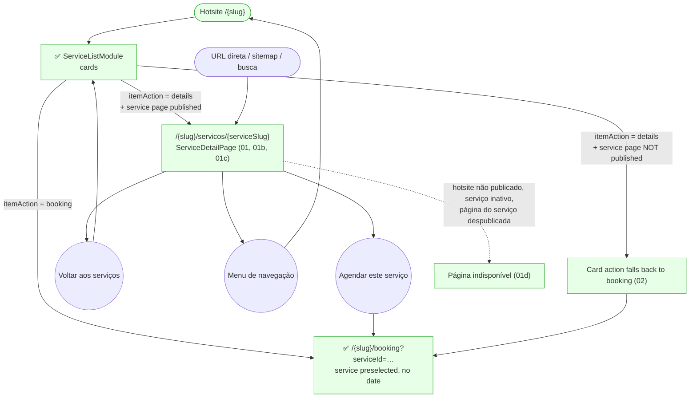

# GUEST — Página do Serviço (Service Detail)

**Actor(s):** GUEST (an authenticated CUSTOMER sees the same page, with the logged-in auth bar)
**Goal:** Read a service's full description, photos and preparation notes on a branded page, then start booking with that exact service preselected
**UCs covered:** UC-109 (visitor opens a service page) · UC-013 A5 (manager publishes it — see `staff/servicos.md`)
**Status:** Built — `TD56-S03`

## Flow

## Pages referenced

| Page / Route | Component | Story | Status |
|---|---|---|---|
| `/{slug}/servicos/{serviceSlug}` | `ServiceDetailPage` (`app/[slug]/servicos/[serviceSlug]/page.tsx`) | TD56-S03 | ✅ Built |
| Service List card action `details` | `ServiceListModule` | TD56-S03 (renders `details`; `booking`/`none` shipped in TD56-S02) | ✅ Built |
| `/{slug}/booking?serviceId=…` | existing booking page + deep-link seed | M23 | ✅ Existing |

## Open questions / gaps

- [x] **Where does the page get its look?** — Resolved (TD56 decisions): `SERVICE_LIST.data.detailPage` (hero style, gallery layout, price/duration/points visibility, CTA label); content comes from the service's own public profile.
- [x] **Dead links** — Resolved: a card set to `details` whose service's page is not published renders its booking action instead.
- [x] **Unavailable URL** — Resolved: same not-found treatment as other missing public pages, `noindex`; unpublishing makes the URL unavailable at once and republishing restores the same URL, so no redirect in this version.
- [ ] **Reachability until TD56-S05 (open, by design):** the "Ver detalhes" action needs the Story 5 editor control (or manifest JSON); until then the page is reachable by URL and sitemap.

## Prototype

Folder: `guest/prototypes/service-detail/` — hub: `index.html`.

| File | Screen | UC | Status |
|---|---|---|---|
| `index.html` | Navigation hub + dry-run checklist | — | ✅ Built |
| `00-hotsite.html` | Redirect → `shared/hotsite.html` | — | ✅ Built |
| `02-service-list-details-action.html` | Service List with "Ver detalhes" and the booking fallback | UC-109 | ✅ Built |
| `01-service-detail.html` | Service page, default look, every optional field filled | UC-109 | ✅ Built |
| `01b-service-detail-compact-featured.html` | Compact cover, featured gallery, price/points hidden, custom CTA | UC-109 | ✅ Built |
| `01c-service-detail-minimal.html` | Only name and short description — no empty blocks | UC-109 | ✅ Built |
| `01d-service-detail-unavailable.html` | Page unavailable | UC-109 | ✅ Built |
| `dev-notes.md` | Implementation handoff | — | ✅ Built |
