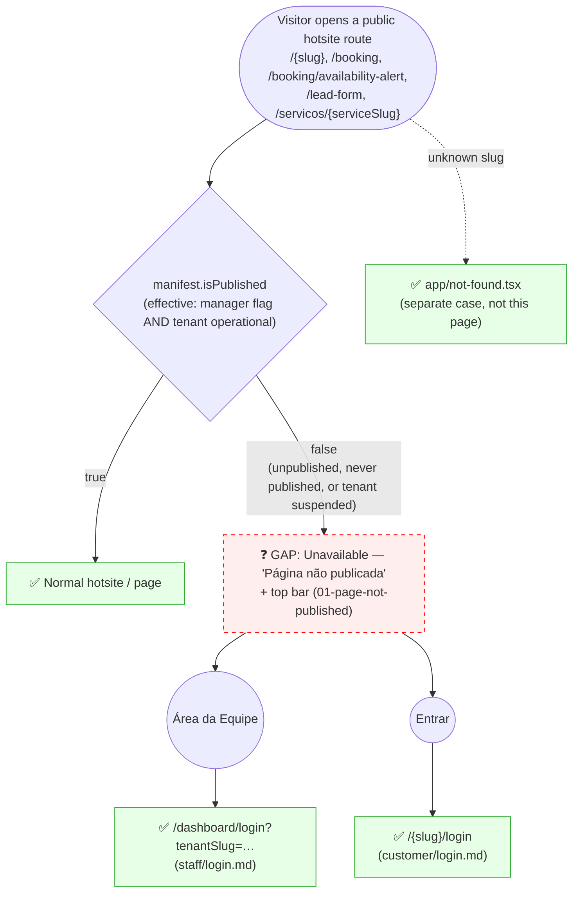

# GUEST — Hotsite Não Publicada (Unpublished Hotsite)

**Actor(s):** GUEST (any visitor — an authenticated CUSTOMER or STAFF member who opens the public site sees the same page)
**Goal:** A visitor who opens a tenant's public hotsite while it is not published lands on one neutral page that says so, never reveals why, and still offers the team login and the customer login
**UCs covered:** UC-122 (hotsite is effectively unpublished when suspended); also the existing unpublished-hotsite placeholder (M12-S08), which this page replaces
**Status:** Draft (planned Billing milestone)

> The page is shared by **every** unpublished hotsite — the manager unpublished it, the tenant has not published yet, or the tenant is `SUSPENDED` (UC-121) — so it can never reveal the reason. It is the root state for **all** public hotsite routes, not specific to the lead form or the service page. It is a different case from an **unknown slug**, which keeps the root-level `app/not-found.tsx` (static Ikaro styling, no tenant branding).

## Flow

## Pages referenced

| Page / Route | Component | Story | Status |
|---|---|---|---|
| every public hotsite route (`/{slug}`, `/booking`, `/booking/availability-alert`, `/lead-form`, `/servicos/{serviceSlug}`) | `Unavailable` (`apps/web/shells/hotsite/components/Unavailable.tsx`) | M12-S08 (placeholder) | ✅ Existing — today a bare "Em breve" placeholder with no top bar |
| the same routes, with the top bar and the neutral copy | `Unavailable` + `HotsiteAuthBar`, copy variant "Página não publicada" | planned Billing milestone | ❓ Gap — `Unavailable` takes no props and renders no bar today |
| unknown slug | `app/not-found.tsx` | M12-S08 | ✅ Existing — a different case, unchanged |

## Open questions / gaps

- [ ] **Top-bar label:** the real `HotsiteAuthBar` says "Área da Equipe"; the prototype keeps the real label (the discovery spec called it "Login da equipe"). Verify the bar renders in the story.
- [ ] **Customer sign-in on an unpublished hotsite:** `[slug]/login` and `[slug]/my-account` never check `isPublished`, so customers and the team keep a working sign-in path — intentional, it is what makes the customer "Empresa inativa" badge (`customer/minha-conta.md`) and the staff notice (`staff/login.md`) reachable.
- [ ] **Copy scope:** the planned "Página não publicada" copy applies only when the hotsite is not (effectively) published (`!manifest.isPublished`). `/lead-form` has no `isPublished` check of its own: for an unpublished hotsite it reaches `Unavailable` through the manifest's stubbed empty `layout`, and it also renders `Unavailable` on a **published** hotsite whose lead-form module is disabled (UC-039 A6) — that case keeps today's "Em breve" copy.
- [ ] **Copy:** "Página não publicada" and the neutral line are new; today's placeholder says "Em breve" / "Estamos preparando algo especial". Both need pt-BR and en entries.
- [ ] **Existing journey lines:** `guest/submit-lead-form.md` and `guest/service-detail.md` already point at the generic `Unavailable` for a hotsite that is not published; they now also point here.

## Prototype

Folder: `guest/prototypes/unpublished-hotsite/` — hub: `index.html`.

| File | Screen | UC | Status |
|---|---|---|---|
| `index.html` | Navigation hub + dry-run checklist | — | ❓ Draft |
| `01-page-not-published.html` | "Página não publicada" with the top bar (team login + customer login) | UC-122 | ❓ Draft |
| `dev-notes.md` | Implementation handoff (moved as-is from the billing discovery; reshape at story discovery) | — | ❓ Draft |

The page is reached from any published-looking hotsite link, so the hub links to `../../../shared/hotsite.html` for the published look; there is no `00-hotsite.html` because the journey does not start on a working hotsite.
