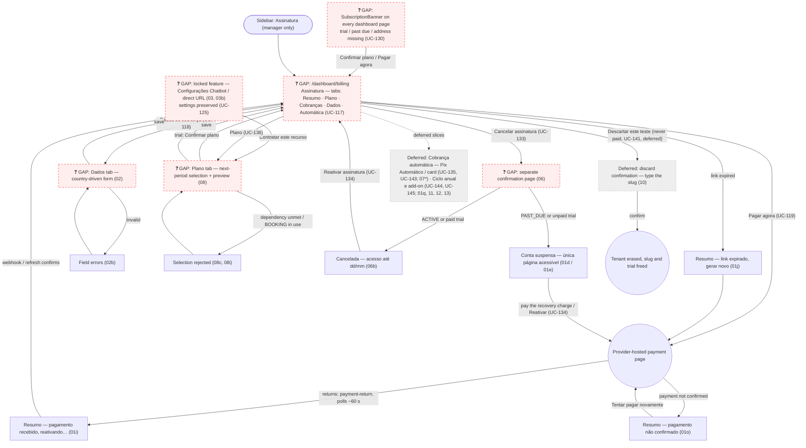

# MANAGER — Assinatura (Billing, Plan & Payment)

**Actor(s):** MANAGER
**Goal:** See what the tenant pays Ikaro and why, pay an open charge in one click, keep the billing identity valid, choose the plan for the next paid period, cancel or reactivate — all self-service, without contacting Ikaro
**UCs covered:** UC-117 (billing page), UC-118 (billing identity), UC-119 (pay an open charge), UC-130 (trial banner and first charge), UC-133 (cancel), UC-134 (reactivate), UC-136 (change plan), UC-125 (locked features: upsell to the Plano tab); deferred: UC-141 (discard a never-paid tenant, slice G), UC-135 (Pix Automático), UC-143 (automatic card collection, slice F2), UC-144 (billing cycle, slice H), UC-145 (annual add-on, slice H)
**Status:** Draft — not yet shipped (planned Billing milestone; nothing under `contexts/billing` exists yet). Every screen is a ❓ GAP until its story ships.

> Promoted from `docs/discovery/tenant-billing/` via `/discovery-to-milestone`. The permanent *why* (research, decisions, operating model) stays in `docs/discovery/tenant-billing/tenant-billing.md`. The prototype is **illustrative**: prices, dates, tier names and the Ikaro URL are invented (fictional tenants Lavacar BeloAuto — BR — and Sunrise Auto Spa — US). Where a screen and the docs differ, the docs win. The other billing screens — locked features and the suspended experience of staff, customers and the public hotsite (UC-120–UC-125), the self-signup flow (UC-127–UC-131) and the discard / purge screens (UC-132, UC-141, UC-142) — are promoted with their own journeys: locked features (`03`, `03b`) and the discard page (`10`) are in this folder; the staff, customer, public-hotsite and signup screens are in `staff/prototypes/login`, `customer/prototypes/minha-conta`, `guest/prototypes/unpublished-hotsite` and `guest/prototypes/ikaro-trial`.

## Flow

## Pages referenced

| Page / Route | Component | Story | Status |
|---|---|---|---|
| `/dashboard/billing` (tabs, `?tab=`) | `BillingPage`, `BillingTabs`, `ResumoTab`, `PlanoTab`, `CobrancasTab`, `DadosCobrancaTab` (`BillingIdentityForm`), `CobrancaAutomaticaTab` | — | ❓ GAP |
| Cancel confirmation (a separate page; route decided at story discovery) | `CancelSubscriptionConfirm` | — | ❓ GAP |
| A feature the tenant has not bought (its settings section, or its route opened by URL) | `FeatureLockedCard`, `FeatureLockedPage` (HTTP 200 with the upsell; the API answers `403 BILLING_FEATURE_NOT_ENTITLED`) | — | ❓ GAP |
| Every `/dashboard/**` page | `SubscriptionBanner` (manager-only; trial, past due, address missing) | — | ❓ GAP |
| `Sidebar` / `BottomNav` / `MoreSheet` | New manager-only "Assinatura" item | — | ❓ GAP |

## BFF calls in this flow

| Call | When | Roles |
|---|---|---|
| `GET /v1/billing/summary`, `GET /v1/billing/charges` | Open the page / Cobranças tab | MANAGER |
| `GET` / `PUT /v1/billing/identity` | Dados tab | MANAGER |
| `POST /v1/billing/charges/{chargeId}/payment-link`, `…/payment-return` | Pagar agora / return from the hosted page | MANAGER |
| `GET /v1/billing/plan`, `POST /plan/preview`, `PUT /plan`, `POST /plan/confirm` | Plano tab | MANAGER |
| `POST /v1/billing/cancel`, `POST /v1/billing/reactivate` | Cancel page / Reativar assinatura | MANAGER |
| `POST` / `DELETE /v1/billing/auto-billing` *(deferred)* | Cobrança automática tab | MANAGER |

Full shapes: `docs/API_CONTRACTS.md` § Billing — Manager API (BFF, role MANAGER). A manager of a `SUSPENDED` tenant can reach only these routes (plus access, logout and tenant switch).

## Prototype

Folder: `manager/prototypes/billing/` — relocated from `docs/discovery/tenant-billing/prototype/manager-*.html` (the `manager-` prefix was dropped; letter variants are unchanged). There is no `01p` file: the letter was never used. 49 screens:

| Files | Screens | UC | Status |
|---|---|---|---|
| `01-billing-active`, `01b`–`01e`, `01h`, `01k`, `01l`, `01m`, `01n` | Resumo by state: ACTIVE, trial (not confirmed), past due, suspended (non-payment / cancelled / payment reversed / by Ikaro), trial with the first invoice issued, price-change notice, exempt | UC-117, UC-119, UC-130, UC-134 | ❓ GAP |
| `01f`, `01g`, `01i`, `01j`, `01o` | Loading, load error, payment received (reactivating), link expired, payment not confirmed | UC-117, UC-119 | ❓ GAP |
| `02`, `02b`, `02c`, `02d`, `02e`, `02f` | Dados de cobrança: BR, validation errors, US, saved, US / BR address required | UC-118 | ❓ GAP |
| `03`, `03b` | Locked feature: Configurações → Chatbot not contracted (padlocked nav entries, "Contratar este recurso" → `08`), and a locked route opened by URL | UC-125 | ❓ GAP |
| `04`, `04b` | Agenda with the trial banner / the past-due banner | UC-130 | ❓ GAP |
| `06`, `06b`–`06e` | Cancel: confirm, scheduled, error, immediate (trial or past due), trial with the first invoice paid | UC-133 | ❓ GAP |
| `07`, `07b`–`07d` | Cobrança automática (preview only, "prévia – ainda não disponível"): activate, active, pending, error | UC-135 | ❓ Deferred |
| `08`, `08b`–`08i`, `09` | Plano: edit with preview, trial review, dependency error, saved, read-only (suspended / past due), scheduled changes, save error, BOOKING in use, trial "Confirme seu plano" | UC-136, UC-130 | ❓ GAP |
| `10` | Discard a never-paid tenant: what is erased, irreversible, type the slug to confirm | UC-141 | ❓ Deferred (slice G) |
| `11`, `12`, `13`, `01q` | Annual subscription (slice H): summary, mid-year add-on, cancel, suspended recovery | UC-144, UC-145, UC-133, UC-134 | ❓ Deferred |

No screen of the Billing promotion stays in `docs/discovery/tenant-billing/prototype/` (which now holds only an index and the discovery dev-notes). The hotsite trial CTA panel is in `manager/prototypes/hotsite/01g`/`01h`, the public signup screens are in `guest/prototypes/ikaro-trial/`, and flows that cross over are linked by relative path.

## Open questions / gaps

- [ ] Stories do not exist yet — the Billing milestone is drafted after this promotion; each story needs `/story-discovery` before implementation.
- [ ] `dev-notes.md` was moved as-is from the discovery and is **not** in the `journeys/README.md` template (file map, props, BFF call, validation table, states): reshape it at story discovery.
- [ ] Where `SubscriptionBanner` mounts: there is no single shared `/dashboard/**` layout (`docs/DASHBOARD_FRONTEND_ARCHITECTURE.md` § 1), so each section layout must render it, or a shared layout must be introduced.
- [ ] Not drawn, specified in the dev-notes ("Specified but not drawn"): US banner and Plano warning when the billing address is missing, US Plano preview total with tax label, a revoked Pix Automático authorization, the annual Plano / Cobranças / past-due states, receipts ("Recibo" link), and the billing emails (templates, not screens).
- [ ] Plan-change HTTP statuses (`BILLING_FEATURE_*`, `BILLING_PLAN_*`) are decided at story discovery.
- [ ] Removing `BOOKING` must also count M24 class-session bookings, enrolments and waitlists in the in-use guard once M24 ships (UC-136 A11).
- [ ] The M24 routes must declare their entitlement and suspension metadata (`@RequiresFeature` / `@SuspensionAccess`) once enforcement is on.
