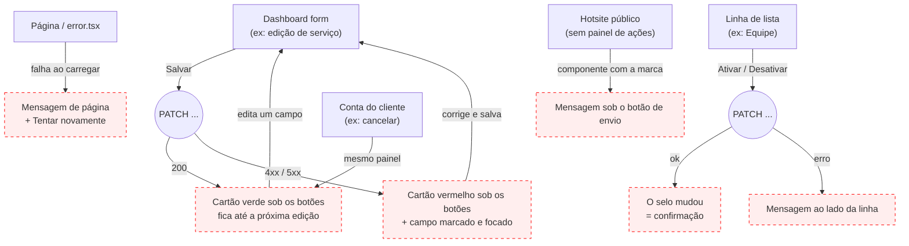

# MANAGER — Feedback e painel de ações

**Actor(s):** MANAGER (dashboard), CUSTOMER (conta do cliente), GUEST/CUSTOMER (hotsite público)
**Goal:** When a save, action or load fails or succeeds, the user sees the result next to the action they just took, with the offending field marked — on every surface of `apps/web`.
**UCs covered:** none — a cross-cutting UI pattern. Source of truth: `td/TD57-INLINE-FEEDBACK-AND-ACTION-PANE-PATTERN.md`. Lives under `manager/` because the dashboard is its main surface. The customer-account and public-hotsite screens live in their own actor folders, as the folder convention requires: `customer/prototypes/minha-conta/03c`–`03d` and `guest/prototypes/lead-form/01j`–`01k`; the hub `index.html` here links to them.
**Status:** In progress (TD57) — the shared components shipped with TD57-S01 and the service edit screen uses them since TD57-S02; the other screens below still use their own boxes until their stories land. The service-edit error that triggered it is real: a 422 rendered below four cards, out of view.

## Flow

Every node in red is a gap: the screens do not use the shared components yet (`TD57-S02` onward; the branded counterpart is `TD57-S06`). The shared components themselves exist since `TD57-S01`.

## Pages referenced

| Page / Route | Component | Story | Status |
|---|---|---|---|
| `/dashboard/services/[id]/edit` (all five tabs) | `ServiceEditPanels` + `ActionPane` | TD57-S02 | ✅ Feedback in the pane; per-reason policy errors; pre-send validation |
| `/dashboard/services/[id]/edit` (Recursos, Políticas, Formulário) | `ServiceResourceModePicker`, `PolicyDurationPricingCard`, `IntakeQuestionsCard` | TD57-S03 | ✅ First box level with the pane on all five tabs (intro inside the first card; the mode picker in a card) |
| `/dashboard/team` | `MemberRow` | TD57-S04 | ⚠ Exists, success message never visible |
| `/dashboard/resources` | `ResourceListPage` | TD57-S07 | ⚠ Exists, hand-rolled error box |
| `/[slug]/my-account/bookings/[id]/cancel` | `CancelConfirmPage` | TD57-S11 | ⚠ Exists, error above the content |
| `/[slug]` (lead form) | public lead form + branded feedback component | TD57-S06, S16 | ⚠ Exists, hand-rolled box |
| Shared components | `FeedbackMessage`, `ActionPane`, `FieldFeedback`, `useFormFeedback` | TD57-S01 | ✅ EXISTS |

## Open questions / gaps

- [ ] Customer screens: fixed mobile bar, or keep the in-flow layout they have today? `ActionPane` ships only the fixed bar; decided in TD57-S11
- [ ] Branded error colour: fixed semantic red or derived from tenant tokens, and how contrast is guaranteed (TD57-S06)
- [x] Window-narrowing hint: resolved in TD57-S02 discovery (2026-10-30) — the catch-all `BOOKING_SERVICE_BOOKING_POLICY_INVALID` is split into seven per-reason codes; the window codes carry the business limit in their text; no static hint
