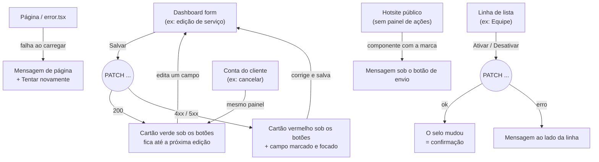

# MANAGER — Feedback e painel de ações

**Actor(s):** MANAGER (dashboard), CUSTOMER (conta do cliente), GUEST/CUSTOMER (hotsite público)
**Goal:** When a save, action or load fails or succeeds, the user sees the result next to the action they just took, with the offending field marked — on every surface of `apps/web`.
**UCs covered:** none — a cross-cutting UI pattern. Source of truth: `archive/td/TD57-INLINE-FEEDBACK-AND-ACTION-PANE-PATTERN.md`. Lives under `manager/` because the dashboard is its main surface. The customer-account and public-hotsite screens live in their own actor folders, as the folder convention requires: `customer/prototypes/minha-conta/03c`–`03d` and `guest/prototypes/lead-form/01j`–`01k`; the hub `index.html` here links to them.
**Status:** Complete (TD57, stories 0–17 done; S05, the lint guard, merged in #718 and S17 plus the TD close in #719). The shared components shipped with TD57-S01 and every screen listed below uses them. The service-edit error that triggered it is real: a 422 rendered below four cards, out of view.

## Flow

Every node is built: the shared components exist since `TD57-S01`, the area stories `TD57-S02`–`TD57-S16` migrated their screens, and the branded counterpart for the public hotsite exists since `TD57-S06`, used by every public form since `TD57-S16`.

## Pages referenced

| Page / Route | Component | Story | Status |
|---|---|---|---|
| `/dashboard/services/[id]/edit` (all five tabs) | `ServiceEditPanels` + `ActionPane` | TD57-S02 | ✅ Feedback in the pane; per-reason policy errors; pre-send validation |
| `/dashboard/services/[id]/edit` (Recursos, Políticas, Formulário) | `ServiceResourceModePicker`, `PolicyDurationPricingCard`, `IntakeQuestionsCard` | TD57-S03 | ✅ First box level with the pane on all five tabs (intro inside the first card; the mode picker in a card) |
| `/dashboard/team` | `MemberRow` | TD57-S04 | ✅ The changed badge/button is the confirmation; failures show inline beside the row |
| `/dashboard/resources` | `ResourceListPage` | TD57-S07 | ✅ Feedback in the pane / shared components |
| `/[slug]/my-account/bookings/[id]/cancel` | `CancelConfirmPage` | TD57-S11 | ✅ Error under the buttons, in the pane |
| `/dashboard/bookings/[id]` | `BookingDetailPage` + `BookingDetailAsideCard` | TD57-S12 | ✅ Failure under the buttons of the shared `ActionPane` — drawn in `staff/prototypes/agenda/01`, `01e` |
| `/dashboard/bookings/[id]/complete`, `/reschedule` | `MarkCompleteActionRail`, `RescheduleActionRail` | TD57-S12 | ✅ Rail error under the buttons of the shared `ActionPane` — `staff/prototypes/agenda/04c`, `05d` |
| `/dashboard/schedule` | `SchedulePage`, `ScheduleResourceColumnsBoard`, `ResourceFilterMenu` | TD57-S12 | ✅ Page-level `FeedbackMessage` with retry; field-level message on the resource select — `staff/prototypes/horarios/11` |
| `/dashboard/scheduling-exceptions` | `SchedulingExceptionWorklistPage`, `BulkResultList`, the sheets | TD57-S12 | ✅ Shared `FeedbackMessage` / sheet message — `manager/prototypes/scheduling-exceptions/01d`, `01j`, `01k` |
| `/dashboard/services/new`, `/dashboard/services/[id]/edit` (Detalhes) | `ServiceCreatePage`, `ServiceFormFields`, `ServiceEditDetailsTab` | TD57-S13 | ✅ Field marked and focused from a server `field`; created success in the Detalhes pane — `staff/prototypes/servicos/02b`, `02c` |
| `/dashboard/services/[id]/deactivate` | `ServiceDeactivatePage` | TD57-S13 | ✅ Failure under the buttons of the shared `ActionPane` — `staff/prototypes/servicos/03b`, `03j` |
| `/dashboard/services` | `ServiceListPage` | TD57-S13 | ✅ Load failure with retry, chips inside the list card — `staff/prototypes/servicos/01`, `01b` |
| `/dashboard/loyalty` | `LoyaltySearchPage`, `LoyaltySearchResults` | TD57-S15 | ✅ Search failure is a page-level `FeedbackMessage` with retry — `staff/prototypes/fidelidade/00c` |
| `/dashboard/loyalty/[customerId]` | `CustomerLoyaltyEntriesTab`, `CustomerLoyaltyRedemptionsTab`, `error.tsx` | TD57-S15 | ✅ "Carregar mais" failure under the count line, route error with retry — `staff/prototypes/fidelidade/01d`, `01e` |
| `/[slug]` and the public booking, submit-info, chatbot and login screens | `LeadFormWidget`, `BookingForm` steps, `SubmitInfoForm`, `ChatbotPanel`, `app/[slug]/login/page.tsx` | TD57-S16 | ✅ Branded message under the action; a server `field` marks and focuses the input through `useFormFeedback`; `ErrorAlert` removed — `guest/prototypes/{book-a-service,submit-info,lead-form,ask-chatbot}`, `customer/prototypes/{book-a-service,login}` |
| Shared components | `FeedbackMessage`, `ActionPane`, `FieldFeedback`, `useFormFeedback` | TD57-S01 | ✅ EXISTS |

## Open questions / gaps

- [x] Customer screens: resolved in TD57-S11 discovery (2026-11-02) — they adopt the shared fixed bottom bar at `bottom-0` (drill-down routes hide the customer bottom nav)
- [x] Branded error colour: resolved in TD57-S06 — a fixed semantic red/green on the box's own white surface with a dark 1px ring, so the white surface or the ring always reaches 3:1 against any tenant background; only radius and fonts follow the tenant
- [x] Window-narrowing hint: resolved in TD57-S02 discovery (2026-10-30) — the catch-all `BOOKING_SERVICE_BOOKING_POLICY_INVALID` is split into seven per-reason codes; the window codes carry the business limit in their text; no static hint
