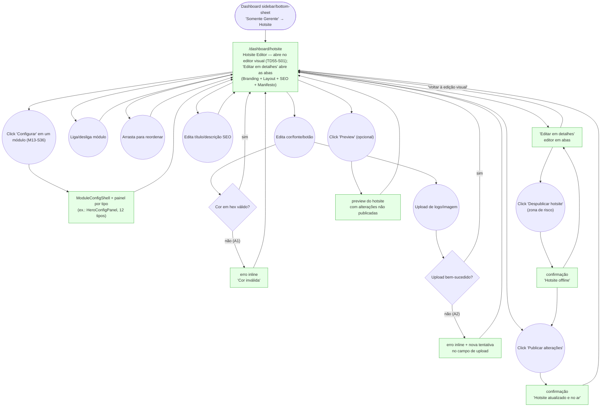

# MANAGER — Hotsite (Branding & Content)

**Actor(s):** MANAGER
**Goal:** Customize the public hotsite's branding (colors, fonts, button style) and content modules (toggle/reorder/configure), set SEO overrides, and publish changes live
**UCs covered:** UC-027
**Status:** ✅ Built — all pages ✅ Done (M13-S35, S36, S37; see "Pages referenced")

## Flow

**Also drifted from the prototype's documented shape (2026-07-31 docs audit):** the real branding editor has 5 sections/18 fields (adds `heroBgStyle`/`alternateSectionBg`/`dividerStyle`/`brandName`/`brandTagline` — already correctly described in `manager/prototypes/hotsite/dev-notes.md`, just not in the HTML screen itself) vs. the 13-field/4-section prototype; module count is 8 (`FOOTER` added during `M13-S36`) vs. the documented 7; SEO limits are 60/158 chars (real-world Google truncation points) vs. the documented 70/160, and there's an OG-image field the prototype doesn't show. **Resolved** — `01-hotsite-editor.html` was already updated the same day (2026-07-31) to add all of this (see its inline "adicionado 2026-07-31" comments). **Module count updated again 2026-08-08:** now 9 (`CHATBOT` added — promoted from `docs/USE_CASES.md` UC-033–UC-036 via `/discovery-to-milestone`, UC-027 Section B, `docs/HOTSITE_DYNAMIC_ARCHITECTURE.md` § CHATBOT). **Shipped 2026-08-18 (`M19-S12`):** `ChatbotConfigPanel.tsx` completes the 9th module type's config panel — see "Open questions / gaps" below. **Module count updated again 2026-08-23:** now 10 (`LEAD_FORM` added — promoted from `docs/USE_CASES.md` UC-037–UC-043 via `/discovery-to-milestone`, UC-037, `docs/HOTSITE_DYNAMIC_ARCHITECTURE.md` § LEAD_FORM). Shipped (`M20-S07` teaser module, `M20-S08` config panel). Its own config panel and prototype screens are documented in a separate journey file, not this one: `manager/lead-form-config.md` / `manager/prototypes/lead-form/` — cross-referenced here rather than duplicated, since UC-037 is a standalone use case, unlike CHATBOT's UC-027 Section B. **Controls added 2026-10-24 (`TD56-S06`):** the Branding tab now also edits soft corners, button corners, heading weight and uppercase headings (21 controls in total), the Service List panel edits the numbered and feature-cards layouts plus card columns and tone, and the About panel edits its section style (split, editorial, bleed). **Controls added 2026-10-24 (`TD56-S05`):** the Navigation and Content Block panels now edit the Navigation links and header button, every Content Block variant (trust-grid tiles, ruled-step labels, callout facts placement), and a shared "Aparência da seção" control edits each section's `presentation`; the Footer edits its surface. Nothing in the manifest is Manifesto-tab-only any more.

## Pages referenced

| Page / Route | Component | Story | Status |
|---|---|---|---|
| `/dashboard/hotsite` | `HotsitePage` → `HotsiteEditor` (abre em `VisualHotsiteEditorView`; as abas ficam em `HotsiteEditorMainView`, atrás de "Editar em detalhes") | M13-S35/S36/S37, TD55-S01 | ✅ Done |
| Preview pane | `HotsitePreview` (draft-state render; a prévia persistente do editor visual usa o mesmo `HotsitePreviewCanvas`) | M13-S37, TD55-S01 | ✅ Done |

## Open questions / gaps

- [x] **Branding field set expanded** — per `/uc-audit UC-026,UC-027,UC-028,UC-029` (2026-06-16) and your decision to cover the full set, `docs/USE_CASES.md` UC-027 Section A lists 13 branding fields (colors, fonts, logo, border radius, button style, spacing, shadow style, button colors), not just the original 4. Resolved further during M13-S35 discovery (2026-07-07): the real `HotsiteBrandingResponse` type carries 5 more fields beyond those 13 (`heroBgStyle`, `alternateSectionBg`, `dividerStyle`, `brandName`, `brandTagline`) — all 18 are in scope for M13-S35, grouped into 5 sub-sections ("Cores" / "Logo e identidade" / "Tipografia" / "Forma e estilo" / "Ritmo visual"). See `journeys/manager/prototypes/hotsite/dev-notes.md` and `plan/M13-DASHBOARD-FRONTEND.md` § M13-S35.
- [x] **Per-module configuration** — **Resolved/shipped (`M13-S36`).** Each module type has its own drill-down config panel (e.g. `FooterConfigPanel.tsx` for the `FOOTER` module type, added in the same story). The prototype's `01d-module-config-hero.html` shows only the HERO case; the other 7 module types' panels were built directly from the real types without new UX prototypes (an explicit `M13-S36` decision) — candidate for the next prototype touch-up pass if more panels are wanted for review.
- [x] **Preview semantics** — resolved — client-side live preview, confirmed shipped. `HotsiteEditor` passes a `draft: HotsiteAdminContentResponse` prop directly into `apps/web/features/platform/components/hotsite/HotsitePreview.tsx`, which renders the module tree client-side from that prop. No BFF preview-mode parameter/token exists or is needed.
- [x] **Unpublish action** — resolved: the editor exposes "Despublicar hotsite" in a danger-zone section (per `01-hotsite-editor.html`), with its own confirmation screen (`03b-unpublish-success.html`). See the `Unpublish`/`UnpublishSuccess` nodes in the flow above.
- [x] **CHATBOT config panel** — **Resolved/shipped (`M19-S12`, 2026-08-18).** `ChatbotConfigPanel.tsx` (`apps/web/features/platform/components/hotsite/modules/`) follows the same drill-down pattern as the other module panels, plus a standing AI-provider-credit disclosure note and a conditional daily-cap-reached banner (`GET /v1/tenants/chatbot/cap-status`, UC-027 A5) that no other module panel has. `default-layout.ts`'s `MODULE_ORDER`/`DEFAULT_MODULE_DATA` also updated so the Layout tab and Manifesto tab both reach the 9th module type. See `manager/prototypes/hotsite/01e-module-config-chatbot.html` and its `dev-notes.md` entry.

## Prototype

Folder: `manager/prototypes/hotsite/`

| File | Screen | UC | Status |
|---|---|---|---|
| `index.html` | Navigation hub + dry-run checklist | — | ✅ Criado |
| `01-hotsite-editor.html` | Editor — Branding (18 fields) / Layout (12 module types) / SEO / Manifesto | UC-027 | ✅ Criado |
| `01b-color-error.html` | Invalid hex color error | UC-027 A1 | ✅ Criado |
| `01c-image-upload-fallback.html` | Image upload failure → inline error and retry | UC-027 A2 | ✅ Criado |
| `01d-module-config-hero.html` | Per-module config drill-down (HERO, complete shipped field set) | — | ✅ Criado |
| `01e-module-config-chatbot.html` | Per-module config drill-down (CHATBOT, 9º tipo — implementado `M19-S12`) | UC-027 Section B | ✅ Criado |
| `01f-module-config.html` | Per-module config drill-down for the seven remaining module types | UC-027 Section B | ✅ Criado |
| `02-preview.html` | Draft preview mock | — | ✅ Criado |
| `03-publish-success.html` | Publish confirmation | UC-027 | ✅ Criado |
| `03b-unpublish-success.html` | Unpublish confirmation (zona de risco) | UC-027 | ✅ Criado |
| `dev-notes.md` | Implementation handoff (preview semantics + per-module config flagged as open) | — | ✅ Criado |
| `editor-vision/index.html` | Editor visual (entregue, TD55): prévia persistente, comandos globais e inspetor contextual; `09` e `11` são as referências de layout e de Compartilhamento | UC-027 | ✅ Entregue |

## Editor visual (entregue — TD55)

`/dashboard/hotsite` abre no editor visual (`td/TD55-HOTSITE-VISUAL-EDITOR-UX.md`, Stories 1–4). Nenhum módulo ou campo de manifesto foi acrescentado: é uma mudança de apresentação e de navegação sobre o mesmo rascunho.

- **Quadro:** barra de comandos (Templates, Branding e estilo, Organizar módulos, Compartilhamento, Editar em detalhes, Publicar, Ver site publicado), prévia persistente do rascunho com seções selecionáveis (a seleção nunca segue um CTA, envia um formulário nem abre o Chatbot) e inspetor lateral fixo — abaixo da prévia em telas estreitas, com a barra de ações fixa no rodapé.
- **Organizar módulos:** lista dos doze módulos (a Navegação sempre no topo, com cadeado) com ordenação, ativar/desativar e "Configurar" (também para módulos desativados). Os campos são os dos mesmos painéis do editor em abas, na mesma ordem, com "Aplicar" / "Cancelar"; a prévia muda enquanto o gerente edita. Sair de uma edição não aplicada (outra seção, voltar à lista, Editar em detalhes) pede a confirmação de descarte, e "Publicar" fica desabilitado até aplicar ou cancelar.
- **Branding e estilo / Compartilhamento:** os mesmos campos das abas Branding e SEO; a prévia da página muda ao editar, e Compartilhamento mostra uma simulação aproximada do resultado no Google e do cartão no WhatsApp (texto automático do site quando título ou descrição estão vazios).
- **Editar em detalhes:** abre o editor em abas (Templates, Branding, Layout, SEO, Manifesto), com Preview, a tela "Configurar" e "Despublicar hotsite" como antes. "Voltar à edição visual" na barra superior volta sem recarregar, com o rascunho e a seção selecionada preservados. O Manifesto continua só nesse caminho.
- **Publicar:** salva o rascunho completo e publica, sem sair do editor visual; um módulo aberto sem edições é recarregado a partir do rascunho salvo.
- **Acessibilidade:** a seção selecionada é anunciada (região `status`); abrir um módulo move o foco para o título do inspetor e voltar à lista devolve o foco ao botão "Configurar" do módulo.

## Templates (entregue — TD56)

Templates é o primeiro comando do editor visual (abre a galeria no inspetor) e a primeira aba do editor em detalhes; as duas mostram a mesma galeria sobre o mesmo rascunho (`td/TD56-HOTSITE-TEMPLATE-CATALOG-AND-SERVICE-PAGES.md`, Story 5; protótipo em `editor-vision/09-inline-realistic-editor.html`).

- **Galeria:** seis cards — BeloAuto, Casa47, Mimo Pet, Origem, Clínica Lume e Lume Studio — com miniatura, nome, descrição e até quatro chips de capacidades.
- **Aplicar é também pré-visualizar:** clicar num card aplica o template ao rascunho e a prévia muda na hora. Nada é publicado; a publicação segue o fluxo único do editor. Nome, logo, slogan, serviços, contatos e a configuração de agendamento continuam os do negócio; a galeria, os depoimentos, o formulário de captura e o chatbot do gerente são mantidos.
- **Selecionado só na sessão:** o manifesto não guarda qual template foi aplicado, então depois de recarregar nenhum card aparece marcado.
- **Imagens enviadas pelo gerente:** se a aplicação apagaria imagens que ele mesmo enviou (hero, sobre, fundos de agendamento e de seção, colagem), uma confirmação avisa que elas são substituídas e removidas quando salvar. Sem imagens próprias, aplica direto.
- **Depoimentos de exemplo:** um aviso pede para editar ou remover os depoimentos do template antes de publicar.
- **Desfazer template:** volta um passo (o rascunho de antes da última aplicação), pergunta antes se houve edições depois e some ao publicar. Uma nova aplicação substitui o passo guardado.
- **Falhas:** se a lista ou a aplicação falham, um alerta com "Tentar novamente" aparece na galeria e o rascunho não muda.
- **Edição depois:** todos os campos continuam editáveis nos dois editores (Branding, módulos e Compartilhamento); salvar funciona com as imagens compartilhadas do template.
