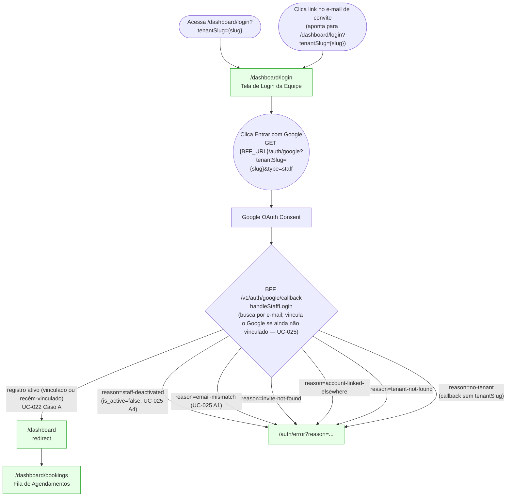
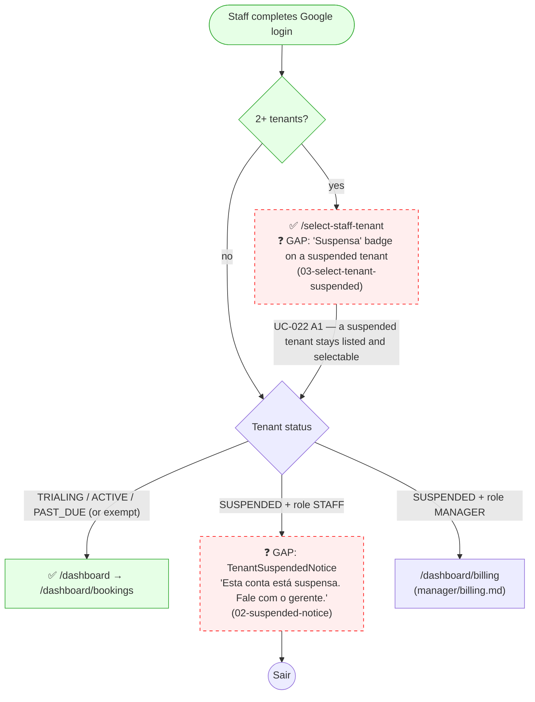

# STAFF — Login (UC-022 + UC-025)

**Actor(s):** STAFF | MANAGER  
**Goal:** Staff member authenticates with Google OAuth and lands on the dashboard booking queue; an invited staff member links their Google account on the first login  
**UCs covered:** UC-022, UC-025; planned Billing extension: UC-121  
**Status:** Shipped (M13-S13)

## Flow

The `/auth/error` page can also render `not-a-staff-member` and `tenant-deactivated`, but the BFF staff flow does **not** emit either today (render-only copy; see `dev-notes.md`'s reason table).

## Pages referenced

| Page / Route | Component | Story | Status |
|---|---|---|---|
| `/dashboard/login` | `StaffLoginPage` | M13-S13 | ✅ Existing |
| `/auth/first-login` | `FirstLoginPage` | M13-S13 | ⛔ Not built by design — superseded; the BFF redirects an inactive staff record to `/auth/error?reason=staff-deactivated` (see `dev-notes.md`) |
| `/auth/error` | `AuthErrorPage` | M13-S13 | ✅ Existing — 8 reason codes rendered (6 emitted by the staff flow), see `dev-notes.md`'s reason table |
| `/dashboard` | redirects to `/dashboard/bookings` | M13-S13 | ✅ Existing — the BFF sends the browser here after login |
| `/dashboard/bookings` | `BookingQueuePage` | M13-S17 | ✅ Existing |
| `/select-staff-tenant` | tenant switch after login (UC-022 A1) | M13-S13 | ✅ Existing — not drawn in this journey's prototype |

## BFF calls in this flow

| Call | When |
|---|---|
| `GET {BFF_URL}/auth/google?tenantSlug={slug}&type=staff` | Staff clicks "Entrar com Google" on `/dashboard/login` (the invite email links to the login page, so the invitee clicks the same button) |
| `GET /internal/tenants/by-slug/:slug` | BFF callback — resolves the tenant (`tenant-not-found` when unknown) |
| `GET /internal/staff/by-email?email=...&tenantId=...` | BFF callback — the one staff lookup for both regular login and first login |
| `POST /internal/staff/:staffId/link-google` | BFF callback — only when the record is not yet linked to this Google account (UC-025); not a separate "activate" endpoint |

## Open questions / gaps

- [x] **Route for staff login:** — **Resolved.** `/dashboard/login` is canonical, confirmed shipped (`apps/web/app/dashboard/login/page.tsx`, reads `?tenantSlug` as a query param rather than a URL segment).
- [x] **"Bem-vindo(a)!" banner on first login (UC-025 step 8):** — **Resolved: not built.** First login lands directly on the dashboard (see `dev-notes.md` § Known limitations).
- [x] **Deactivated staff (UC-025 A4):** — **Resolved.** `reason=staff-deactivated` is emitted with its own message — see `dev-notes.md`'s reason-code table. `reason=tenant-deactivated` has copy on the error page, but the BFF does not emit it today.
- [x] **JWT expiry / re-login:** — **Resolved.** The BFF has a public `GET /auth/logout` and no refresh endpoint. Unauthenticated `/dashboard/*` requests are redirected to `/dashboard/login`, preserving `?tenantSlug` (`apps/web/proxy.ts`).

## Prototype

Folder: `staff/prototypes/login/`

| File | Screen | UC | Story | Status |
|---|---|---|---|---|
| `index.html` | Navigation hub | — | — | ✅ Criado |
| `00-staff-login.html` | Login page (redirect → shared/staff-login.html) | UC-022, UC-025 | M13-S13 | ✅ Criado |
| `01-first-login.html` | Invite not accepted — "use the invite email link" | early proposal | M13-S13 | ⛔ Superseded — prototype kept as a record; `/auth/first-login` is not built by design (see the Pages table above) |
| `01b-error.html` | Auth error — reason=not-a-staff-member (render-only; the BFF does not emit it) | UC-022 | M13-S13 | ✅ Criado |
| `00b-no-tenant-slug.html` | Login page, no `?tenantSlug` — message only, no Google button | — | M13-S13 | ✅ Criado |
| `01c-error-email-mismatch.html` | Auth error — reason=email-mismatch | UC-025 A1 | M13-S13 | ✅ Criado |
| `01d-error-tenant-deactivated.html` | Auth error — reason=tenant-deactivated (render-only; the BFF does not emit it) | UC-025 A3 | M13-S13 | ✅ Criado |
| `01e-error-staff-deactivated.html` | Auth error — reason=staff-deactivated | UC-025 A4 | M13-S13 | ✅ Criado |
| `01f-error-invite-not-found.html` | Auth error — reason=invite-not-found | UC-022 | M13-S13 | ✅ Criado |
| `01g-error-account-linked-elsewhere.html` | Auth error — reason=account-linked-elsewhere | UC-022 | M13-S13 | ✅ Criado |
| `01h-error-tenant-not-found.html` | Auth error — reason=tenant-not-found | UC-022 | M13-S13 | ✅ Criado |
| `dev-notes.md` | Implementation handoff | — | M13-S13 | ✅ Criado |

## Billing — tenant suspended (planned, UC-121)

> Added for the planned Billing milestone (`docs/USE_CASES.md` UC-121). The shipped login flow above is unchanged. **Status: Draft — not yet built.** The screens were drawn during the tenant-billing discovery (`docs/discovery/tenant-billing/`) and moved here; login itself is never blocked while a tenant is `SUSPENDED`.

| Page / Route | Component | Story | Status |
|---|---|---|---|
| `/dashboard` (role `STAFF`, tenant `SUSPENDED`) | `TenantSuspendedNotice`, rendered by `app/dashboard/layout.tsx`; no nav, no data fetch | planned Billing milestone | ❓ Gap |
| `/select-staff-tenant` | `SelectStaffTenantClient` (exists) + amber "Suspensa" badge when `operational === false` | planned Billing milestone | ❓ Gap (badge only) |

**BFF calls.** `GET /v1/billing/access` decides the notice (`docs/API_CONTRACTS.md` § Billing — Access Resolution and Suspended-State Effects). `GET /auth/staff-tenants` gains a per-tenant `operational` flag and never filters a suspended tenant out; `POST /auth/switch-staff-tenant` is unchanged and must accept one. The API answers `BILLING_TENANT_SUSPENDED` for any other route the staff member calls. The notice is reason-neutral and offers only "Sair"; staff never see a reason or payment information.

| File | Screen | UC | Story | Status |
|---|---|---|---|---|
| `02-suspended-notice.html` | Suspended-account notice for a staff member | UC-121 | planned Billing milestone | ❓ Draft |
| `03-select-tenant-suspended.html` | Tenant selection with a suspended tenant marked "Suspensa" | UC-121 A4 | planned Billing milestone | ❓ Draft |

