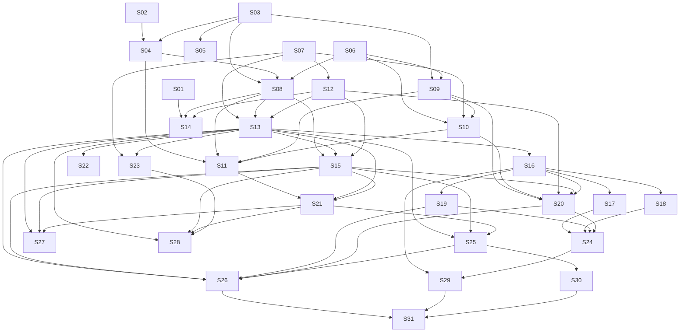

# M25 — Tenant Billing: Foundation & Dark Enforcement

**Phase:** Local Development
**Goal:** Lay the Billing foundation without changing anything a tenant, staff member, customer or visitor can see: the `billing` schema and the pricing catalog, the `Subscription` / `BillingAccount` aggregates, the shared `TenantAccessPort`, the clock and the provider port (with a fake), the operator touchpoints — and, behind a kill switch, the whole **enforcement** machinery (gating framework, route annotation, gated event subscriptions and crons, the notification gate, the effective-published hotsite, the suspended experience for staff, customers and visitors). Every existing tenant is backfilled `exempt`, so enforcement ships **dark**: it is fully wired and tested, and it denies nobody until a tenant is actually suspended or a trial actually lapses (M26 introduces the status sweep that does that).
**Depends on:** none. Does **not** depend on M24 (the Billing release deploys before M24; see `## Billing interaction` in `plan/M24-MULTIVERTICAL-CLASSES-SESSIONS.md` for what M24's own stories must do once enforcement is live).
**Blocks:** M26 (BR collection, self-signup and launch) — its charge issuing, webhooks, status sweep, signup and real-provider stories all need this milestone's schema, aggregates, access port, clock and provider port. M27–M30 (purge/discard/deactivation, Stripe/US, automatic collection, annual billing) follow M26 and are reserved, not drafted (see `## Reserved follow-ups`).
**Design rationale:** `docs/discovery/tenant-billing/tenant-billing.md` (promoted via `/discovery-to-milestone` on 2026-10-29) — kept as the permanent *why*; this file and the canonical docs it cites (`docs/USE_CASES.md` UC-110–145, `docs/DOMAIN_MODEL.md` § Context 7: Billing Context, `docs/DOMAIN_EVENTS.md` § Billing Context Events, `docs/DATABASE_SCHEMA.md` § Schema: `billing`, `docs/API_CONTRACTS.md` § Billing — …, `docs/ENGINEERING_RULES_SHARED.md` § Tenant access enforcement — the declarative choke points (planned), `docs/LOCK_CATALOG.md`, `journeys/manager/billing.md`) are the implementation source. Where a canonical doc and the discovery doc differ, the canonical doc wins.

---

## Non-Goals

- **Charging anyone.** No charge is issued, no payment link, webhook, status sweep, reconcile, dunning, billing email or real provider adapter exists in M25 — that is M26. M25 builds the *interface* to the provider (`BillingProviderPort` + `FakeBillingProvider` + contract-suite skeleton) so M26 can build the money loop against it, and verifies the real provider's behaviour once (S01).
- **Self-signup, the manager billing page and the public price page.** UC-113–119, 124, 127–131, 133, 134, 136, 139, 140 and the percentage-adjust half of UC-112 are M26. The `Charge` aggregate, `provider_events` inbox and `ChargeLine` snapshot are *tables* created in S03 (the first schema is created once) but have no aggregate, repository or entity in M25.
- **Purge, discard, deactivation (UC-132, 141, 142), automatic collection (UC-135, 143), annual billing (UC-144, 145), Stripe / US (no UC of its own).** M27–M30. Their tables (`tenant_purge_jobs`/`steps`) are created by the first migration where the canonical schema puts them in it; the US tax tables (`charge_tax_lines`) are **not** — they arrive with the Stripe slice.
- **Follow-up milestones M27–M30 are not drafted yet.** Which one to write when, and what each needs first, is in `plan/M26-TENANT-BILLING-COLLECTION-LAUNCH.md` § Follow-up milestones to write.
- **UC-129 (onboarding checklist).** Delivered only if M24's onboarding wizard (UC-075) ships; recorded as an M24 follow-up, not a story here or in M26.
- **Self-service data export and the per-context deletion rules of the purge pipeline.** No use case yet; M27 outline only.
- **Promoted-but-unused concepts (3b check).** The `Charge` / `ChargeLine` / `provider_events` / `tenant_purge_*` / `provider_health` tables are created by S03 and touched by no M25 story beyond DDL; `UC-112`'s price-change endpoints, `UC-114`'s webhook route and the seven cron triggers are documented but unbuilt. They stay promoted for fidelity of the first schema and are owned by M26/M27 (see the Coverage check).
- **Changing `tenants.is_active`, `hotsite_configs.is_published` or any manager preference.** Billing never mutates them; the effective values are computed (S25).

## Known open items

- **O-L1 — loyalty expiry while suspended (DEFERRABLE, default accepted):** points do not expire while the tenant is suspended (the expiry clock pauses), because a suspended business cannot let its customers earn or redeem. Carried into **M25-S27** as an acceptance criterion with an explicit "revisit" note — not a hidden default.
- **O-B1 — customer email when a tenant becomes unavailable (DEFERRABLE, default accepted):** customers with upcoming bookings get one reason-neutral "this business is temporarily unavailable" email (never saying why). Carried into **M25-S28**.
- **M24 interaction (recorded, not a story):** once the route detector is enforcing (S24), every M24 route must be annotated; M24's class-session bookings, enrollments and waitlist entries must be counted by the BOOKING-removal guard (UC-136 A11, built in M26). Both are written into `plan/M24-…` (§ Billing interaction); S17/S18 annotate whatever M24 routes exist when they run.
- **M17-S51 (recorded, not a story):** the manual offboarding runbook is the interim path for erasing a tenant (UC-141 A3, `docs/RUNBOOKS.md` § Billing "Interim" entry); the automated pipeline is M27. M25 neither depends on S51 nor changes it.
- **Suspended manager in M25 (interim, recorded):** UC-121 routes a suspended manager to the billing page, which is M26's. Until M26, S29 sends a suspended manager to `/dashboard/suspended` (the notice built by S31); M26 repoints that route to the billing page. Nothing else changes for the manager.
- **S21 ordering:** the explicit-declaration detector fails CI from the start, so every story that adds a `subscribe()` call site after S21 (S25, S27, S28) declares its own options in that story; none relies on a later one.
- **Statuses and shapes "decided at story discovery":** the HTTP status of each typed denial (`BILLING_FEATURE_NOT_ENTITLED`, `BILLING_TENANT_SUSPENDED`), the exact per-role reduction of `GET /v1/billing/access`, the route and shape of the customer-safe `tenantOperational` flag, the page/limit shape of `GET /internal/billing/tenants`, the response shape of `GET /internal/billing/suspended-tenant-ids`, and the error code/`violations[]` shape for a non-owner using `TRIAL_SIGNUP_CTA` (M26). Each is flagged in the story that implements it.
- **The Asaas spike (S01) is a GATE** needing an Asaas sandbox account and its API key from the owner. Nothing in S14 (provider port) can be finalised before S01 reports. The Asaas **production** PJ account (KYC lead time unknown) is requested by the owner now and gates M26's launch story, not M25.

---

## Build order

| Wave | Story | Theme |
|---|---|---|
| 0 | M25-S01 | Asaas sandbox spike — verified provider facts **[GATE]** |
| 0 | M25-S02 | Commercial catalog — Plus model, caps and OpenRouter validation |
| 0 | M25-S03 | `billing` schema, `btree_gist`, first-schema DDL, `BillingModule` skeleton |
| 0 | M25-S04 | `FeaturePrice` aggregate, `FeatureKey` / `ChatbotTier`, BR catalog seed (UC-112 seed) |
| 0 | M25-S05 | Backfill existing tenants as `exempt` (UC-126) |
| 0 | M25-S06 | `TaxId` VO, `CountrySpec` tax-ID entry, `BillingErrorCode` / `SignupErrorCode` plumbing |
| 0 | M25-S07 | Billing env contract — flags and owner-tenant slug (devops) |
| 1 | M25-S08 | `Subscription` + `BillingAccount` aggregates and repositories |
| 1 | M25-S09 | Provisioning registrations — `POST /internal/billing/registrations` (UC-110) |
| 1 | M25-S10 | Provisioning side — `POST /internal/tenants`, `TenantProvisioned` fields, `provision-tenant.sh` (UC-110, UC-024) |
| 1 | M25-S11 | `create-trial-subscription` handler on `TenantProvisioned` + its subscription (UC-110) |
| 1 | M25-S12 | `IClock` + system clock + dev clock-advance (UC-138) |
| 1 | M25-S13 | `TenantAccessPort`, caching adapter, access endpoints, kill switch (UC-120) |
| 1 | M25-S14 | `BillingProviderPort`, `FakeBillingProvider`, contract-suite skeleton, live-adapter guard (UC-138) |
| 1 | M25-S15 | Operator touchpoints + `PlatformAdminGuard` move (UC-111, UC-137) |
| 2 | M25-S16 | Gating framework — decorators, guards, route detector in warn mode (UC-125) |
| 2 | M25-S17 | Annotate Platform routes (backend + BFF) (UC-125) |
| 2 | M25-S18 | Annotate Booking routes (backend + BFF) (UC-125) |
| 2 | M25-S19 | Annotate Loyalty, Customer and Staff routes (backend + BFF) (UC-125) |
| 2 | M25-S20 | Annotate cross-cutting routes — auth, internal, cron, pubsub, health (UC-125) |
| 2 | M25-S21 | Event dispatcher opt-in gate, explicit-declaration detector, pub/sub catalog scanner (UC-125) |
| 2 | M25-S22 | Shared tenant-scoped job helper (extracted from Booking's `WindowedTenantJob`) (UC-125) |
| 2 | M25-S23 | Notification send gate, `SKIPPED_TENANT_SUSPENDED`, status CHECK replacement (UC-123) |
| 2 | M25-S24 | Flip the route detector to enforcing (UC-125) |
| 2 | M25-S25 | Hotsite effective-published — manifest, published list, module filtering, revalidation (UC-122) |
| 2 | M25-S26 | Suspended experience backend/BFF — staff-tenants, tenant switching, customer flag (UC-121) |
| 2 | M25-S27 | Loyalty — pause point expiry while suspended (O-L1) |
| 2 | M25-S28 | Booking — reason-neutral customer email (O-B1) |
| 3 | M25-S29 | Web enforcement — feature registry, `<FeatureGate>`, `proxy.ts` role routing (UC-125, UC-121) |
| 3 | M25-S30 | `Unavailable` page and hotsite login bar (UC-122) |
| 3 | M25-S31 | Staff notice, "Suspensa" tenant list, customer "Empresa inativa" + suspended-experience E2E (UC-121) |

Wave notes (a wave is a sequencing guarantee, not a concurrency one — see `## Run-batch preview`): Wave 0 is migration/backfill safety plus the two decisions the rest cannot be written without (provider facts, Plus model/caps). Wave 1 is backend/BFF only. Wave 2 is backend/BFF only; it contains all of the enforcement code and is deliberately split so the route detector is only flipped to enforcing (S24) after every existing route has been annotated, in a PR that touches no other behaviour. Wave 3 is frontend only and starts after the backend stories it reads from.

---

## Design & test strategy (milestone-level)

**Shared patterns (decided once; every story cites them).**
- **M25-D1 — Ports and adapters, one context.** Billing is the 7th backend context (`contexts/billing/{domain,application,infrastructure}`), a BFF `features/billing/` slice and a web `features/billing/` slice (CLAUDE.md §11). Cross-context reads go through exact-path `permittedEdges` entries in `architecture-policy.json`, never SQL joins (`docs/BOUNDED_CONTEXTS.md` § 7. Billing Context, "Dependencies").
- **M25-D2 — Access reads state, not events.** Every caller asks the shared `TenantAccessPort` (`src/shared/ports/`); no handler or use case contains an access `if`. Enforcement is declarative at the choke points in `docs/ENGINEERING_RULES_SHARED.md` § Tenant access enforcement — the declarative choke points (planned).
- **M25-D3 — Kill switch semantics.** `FEATURE_FLAG_BILLING_ENFORCEMENT` defaults `true` and is read in exactly one place (S13). "Dark" means **every existing tenant is `exempt`**, not that the switch is off: enforcement code is live, and a tenant is simply entitled to everything. `false` is the emergency fail-open for every choke point, never normal policy.
- **M25-D4 — Billing money is integer minor units + ISO currency** (`amount_minor` bigint, never a float). Whether a Billing-local minor-units value object reuses or sits beside the Decimal-based shared `Money` is settled by S04 (**DEFERRABLE**, default: a Billing-local `MinorAmount` VO, shared `Money` untouched).
- **M25-D5 — Typed denials.** `BILLING_FEATURE_NOT_ENTITLED` / `BILLING_TENANT_SUSPENDED` (planned origins in `docs/ERROR_CATALOG.md`); status code decided at story discovery of S16.
- **M25-D6 — Migrations are expand-only here.** M25 adds a schema, new tables, a seed, an idempotent backfill and one widened CHECK on an existing table (S23). Nothing is dropped or renamed.
- **M25-D7 — CI-enforced registrations are owned by the story that creates the thing registered** (so no story relies on a later one for its own CI pass): the `testDataHarnessRegistrations` entry and `billing-integration-app.ts` (S03; every entity story adds its entities to `integration-global-setup.ts`); `contexts/billing/infrastructure/http/billing-error.mapper.ts` (created in S06, extended by S08/S15/S16 — `error-mapper-coverage`, `shared-vo-error-mapper-coverage`); the `closedEnumRegistry` entries for `FeatureKey`/`ChatbotTier` with their canonical constant arrays in `packages/validation` (S04 — the backend may not import the `@ikaro/types` root barrel, `backendTypesContract`); entity builders next to every entity (`test-builder-coverage`); and an exact-path `contextDependencyMatrix.permittedEdges` entry (path, rationale, owner, review date) for **every** new cross-context import — S11 (Billing handler ← Platform `TenantProvisioned`), S13 (Billing → Platform tenant-info read), S25 (Platform handlers ← Billing suspension events), S27 (Loyalty handler ← Billing `SubscriptionReactivated`), S28 (Notification handler ← Billing `SubscriptionSuspended`; its Booking read). `PlatformAdminGuard` moves to `src/shared/guards/` (S15), so it needs no edge.

**Aggregates and boundaries (named pass).**
- `Subscription` (root, 1 per tenant): owns status ladder, items, periods, `exempt`, `graceUntil`, `cancelAt`, `suspendedAt`, `hasEverPaid`, `version`. Invariants live in the aggregate: item dependency graph, "plan keeps at least one feature", `exempt` rules (the platform-owner tenant can never be un-exempted), suspension reason non-null iff `SUSPENDED`. Entitlement is a **computed** formula (`docs/DOMAIN_MODEL.md`), not stored.
- `BillingAccount` (root, 1 per tenant): tax identity, billing email, address, provider customer id, accepted terms. Separate aggregate (edited by a different actor for different reasons); never in `tenants.settings`.
- `FeaturePrice` (root, platform-wide, **no `tenant_id`** — the documented tenant-id exemption): versions are dated amounts.
- `Charge` (M26) is deliberately **not** a child of `Subscription` (one per period forever = unbounded). Paying a `Charge` may move the `Subscription` back to `ACTIVE` — two aggregates, one use case, one transaction, with `findByIdForUpdate` on the subscription (lock B-R1). No M25 story needs that pair; S08's repository exposes `findByIdForUpdate` so M26 does not have to change the aggregate.
- Cross-aggregate check: no M25 story requires two separate aggregates to stay consistent inside one transaction except `exempt` clear (creates a fresh trial window and replaces items — all inside `Subscription`).

**Locks and constraints (all catalogued in `docs/LOCK_CATALOG.md`; each needs a named test).**
- `UQ_billing_charges_open_recovery` — the unique constraint on open recovery charges (created by S03, catalogued in `docs/LOCK_CATALOG.md`; exercised in M26). It is **not** the lock-catalog id B-Q1, which is the purge-job unique owned by M27.
- **B-A1** `pg_advisory_xact_lock(hashtextextended('signup:'||googleSub, 0))` serialises the trial-eligibility check in `POST /internal/billing/registrations` (S09) — concurrency test: two simultaneous self-signup registrations for one Google account → exactly one eligible.
- **B-R1** `Subscription` row lock via `findByIdForUpdate()` (S08) — concurrency test: operator `suspend` racing a (simulated) payment confirmation on the same subscription serialises, no lost update.
- **GIST exclusion** `subscription_items` (no two overlapping items per feature) created by S03; integration test in S08 inserts overlapping items and expects rejection.
- Every lock port method added is catalogued in `docs/LOCK_CATALOG.md` (CI: `lock-catalog-coverage`).

**`TenantAccessPort`: caching, fail-open, missing subscription (S13).** The port has a single-tenant method, a **suspended-ids batch** (ids only) and a **per-feature batch** (`findTenantIdsNotEntitledTo(feature)`, ids only — what a cron needs to skip tenants lacking a feature, UC-125 A4). The 15-minute provisioning window needs the tenant's `created_at`, which Billing reads from Platform through **one read-only tenant-info port** registered as an exact-path edge (precedent: `INotificationPlatformPort.getTenantInfo`, `docs/BOUNDED_CONTEXTS.md` § 7. Billing Context). Asymmetric TTLs (an operational answer 60 s in the shared port and 30 s in the BFF guard; a `SUSPENDED` answer 10 s in both), best-effort invalidation on the instance that runs the state-changing use case (a method on the adapter, called **after commit**; `CachePort` has no cross-instance broadcast, so other instances rely on the TTL). The canonical docs word this as "the instance that handles the event"; S13 corrects that wording. A **transient lookup error fails open**; a **successfully read missing subscription** denies except for a tenant younger than `PROVISIONING_GRACE_MINUTES` (15). Each path has its own named test; the two are never conflated.

**Detector rollout (S16 → S24).** The route-completeness detector starts in **warn** mode (S16), so it cannot fail any open branch while the annotation stories (S17–S20) land one context group at a time; S24 flips it to **enforcing** in its own PR after every group is annotated. `FEATURE_FLAG_BILLING_ENFORCEMENT` is a different thing and is not touched by S24. The event-declaration detector (S21) fails CI from the start (no warn phase; there is no existing handler without a declaration once S21 declares them in the same story).

**Migration ordering (expand/contract).** S03 (schema + all first-schema tables) → S04 (seed) → S05 (backfill exempt) → S23 (widen `notification_logs.status` + replace `CHK_notification_logs_status`, using `NOT VALID` + `VALIDATE` because it is an existing table with live rows, `docs/ANTI_PATTERNS.md` § A plain `ALTER TABLE`). Code that reads `subscriptions` ships after S05 so no read can find an unbackfilled tenant; the publisher change (S10) and its consumer (S11) ship in the **same release** (the bus does not version-route; S11's handler tolerates a legacy payload without `countryCode`).

**Performance.** (1) `TenantAccessPort` is on the hot path of every authenticated request; it is cached (above) and its lookup is one indexed read by `tenant_id` (UNIQUE). (2) Cross-tenant, unscoped system jobs (the tenant-job helper S22 and the batch `suspended-tenant-ids` read S13) need a **standalone index** matching their filter column — the standalone partial index on `suspended_at WHERE status = 'SUSPENDED'` already exists in the canonical schema (`docs/DATABASE_SCHEMA.md` § `billing.subscriptions`) and serves the batch read; S13 verifies it before shipping the batch method (CLAUDE.md §7 "cross-tenant, unscoped system job"). (3) `@Public()` hotsite routes gain a cached tenant-access lookup in the global guard (S16) — cached so a public page does not add a DB hit per request.

**Backward compatibility (the existing behaviour M25 changes).** Existing behaviour that changes: (a) every tenant-scoped route becomes gate-aware; (b) the event dispatcher gains an opt-in gate; (c) notifications gain a gate; (d) the manifest's `isPublished` becomes the *effective* value; (e) tenant switching accepts a suspended tenant. **Non-regression contract:** with `FEATURE_FLAG_BILLING_ENFORCEMENT=true` and every tenant backfilled `exempt`/entitled, every existing route, handler, cron, notification and public page behaves exactly as before. **Owned by S24** (the suite that runs the whole existing integration/E2E set with enforcement enforcing) and re-asserted by each annotation story's "exempt tenant is unaffected" test.

**Test pyramid.** Unit (`.spec.ts`) for aggregates, VOs, use cases, guards; integration (`.integration.spec.ts`) per use case with tenant-isolation scenarios and the three concurrency tests above; contract-suite *skeleton* (S14) with one implementation (the fake) running on every PR — the Asaas implementation and the nightly sandbox job are M26's (S01's spike facts are the input). E2E (Playwright) in S31 only; every backend story states "E2E: none — covered by unit/integration".

**Spanning scenario (golden path), owned by S26 (backend integration) and S31 (Playwright):** provision a non-exempt tenant → `TenantProvisioned` creates a `TRIALING` subscription → `GET /v1/billing/access` returns operational + all features → the operator suspends the tenant (reason `OPERATOR`) → staff sees the suspended notice, a customer sees "Empresa inativa" with readable history and a cancellable future booking, the hotsite renders `Unavailable` ("Página não publicada"), a gated route returns the typed denial, outbound notifications are skipped with `SKIPPED_TENANT_SUSPENDED` → the operator unsuspends → everything is restored with the manager's preferences untouched. **Observation side confirmed:** operator status read (S15 `GET /internal/billing/tenants`), staff notice (S31), customer badge + history (S26 flag + S31), hotsite page (S30 reading S25), denial (S16/S29), skip log (S23) — every actor-visible state has a supplying read.

**Nightly sandbox contract job ownership.** M26 (the first story that has a real adapter). M25's S14 ships the suite so the job can be added without changing the suite.

**Interim / infra.** Per-story devops halves where a story adds infra (S11's subscription); one shared env-contract story (S07). Terraform sequencing cites `infra/terraform/README.md` § New-resource PR-sequencing playbook and each infra story names its live-verification check (CLAUDE.md §9). No cron or secret is added in M25 — those are M26.

---

## Reserved follow-ups (not drafted until their gates open)

- **M26 — BR collection, self-signup and launch** (`Depends on: M25`; M26 extends three M25 files in place — S08 adds `listTenantsCreatedBefore` to `BillingPlatformPort` (S13), S18 adds `bookableUntil` to the access answer (S13) and S20 fills the exempt hook (S15)): webhook + `provider_events` inbox (UC-114), charge issue job and recovery-charge factory (UC-113), status sweep (UC-115), reconcile (UC-116), self-heal + provider health (UC-140), dunning reminders (UC-139), billing emails (UC-124), simulate endpoint (UC-138), manager backend/BFF (UC-117–119, 130, 133, 134, 136), chatbot tier → model/caps mapping, signup (UC-127, 128, 131), price-change endpoints (UC-112), the real `AsaasBillingProvider` + nightly contract job, billing UI, `/ikaro-trial`, alerts/runbooks/KPIs, launch readiness; last wave: percentage-adjust.
- **M27 — Purge, discard, deactivation** (UC-132, 141, 142). First because the first possible erasure is 90 days after the first suspension. Cron stays disabled until all nine participants ship.
- **M28 — Stripe / US** (no UC of its own; cross-cuts UC-113, 114, 118, 127, 128; adds `charge_tax_lines`). **M29 — Automatic collection** (UC-135 Pix Automático, UC-143 hosted card). **M30 — Annual billing** (UC-144, UC-145).
- Numbers M27–M30 are reserved; M115 is reserved by CLAUDE.md and skipped.

---

## Wave 0 — Migration safety and the two decisions everything else needs

### M25-S01 — Asaas sandbox spike — verified provider facts

**Agent:** `backend-ts`
**Complexity:** S
**Docs to load:** `docs/discovery/tenant-billing/tenant-billing_PROVIDERS.md` (the Asaas rows and the open verification items), `docs/TECH_STACK_DECISIONS.md` § 10. PAYMENT PROVIDERS, `docs/USE_CASES.md` UC-113, UC-114, UC-116, UC-135, UC-143, `docs/ENGINEERING_RULES_INFRA.md` § Billing configuration (planned)
**Dependencies:** none (needs the owner's **Asaas sandbox account and API key** — free and auto-approved; the owner creates it, this story never commits the key)
**Pattern:** plain composition — no named pattern applies (a time-boxed verification with a written result; no production code)

**Description:**
**This story is a GATE** (it needs the owner's sandbox key; S14 cannot be finalised without it). The provider port (S14) and every M26 story that talks to Asaas are written from verified behaviour, not from documentation reading. This story runs the Asaas sandbox flow once with a throwaway script (kept out of the repo, or under `scripts/` only if it is useful as a runbook) and writes the **observed** answers into the provider doc so the port is built from facts. It also records which of the documented slices stay viable. **Checks, each with its observed result (request, response excerpt, timestamp):** (1) create a customer with `cpfCnpj`; (2) create a charge with `billingType: UNDEFINED` and read the hosted payment URL; (3) pay it with the sandbox confirm call and receive the webhook; (4) re-read the charge by id after the webhook (the webhook is a hint, the re-read is the truth); (5) re-enable a paused webhook queue through the API — if the API cannot, record that the provider-health job can only alert; (6) cancel a charge that was paid in the meantime (the "provider refuses to cancel because it is already paid" case in `docs/DOMAIN_MODEL.md` § Aggregate: Subscription, the Reactivation rule); (7) which `billingType` the charge reports after the payer picks a method (settlement); (8) the **hosted recurring-card checkout** (slice F2): a future `nextDueDate`, card typed only on Asaas's page, subscription value `PUT`, behaviour on a refused attempt; (9) the annual-billing check (slice H) that the doc lists. Where Asaas behaves differently from the doc, the story fixes the doc in the same change.

**Backend use case steps:** none (no production code).
**Backend HTTP surface:** none.
**New migration / i18n keys / env vars / feature flags:** none (the sandbox key is supplied locally; real secret entries are M26).

**Files to create/modify:**
- `docs/discovery/tenant-billing/tenant-billing_PROVIDERS.md` (modify — add an "Observed in the sandbox (date)" result per check)
- `docs/TECH_STACK_DECISIONS.md` (modify — § 10. PAYMENT PROVIDERS only if a verified fact contradicts it)
- `docs/USE_CASES.md` (modify — UC-113/114/116/135/143 only where an observed fact contradicts a line; otherwise untouched)

**Acceptance criteria — product:**
- [ ] The provider doc lists, for each of the nine checks, the observed request/response shape and date; any contradicted claim in a canonical doc is corrected in this change.
- [ ] The doc states plainly whether slice F2 (hosted recurring card) and the webhook re-enable stay viable, and what the provider-health job does if re-enable is impossible.
- [ ] Nothing about this story changes behaviour for any tenant.

**Acceptance criteria — technical:**
- Unit: none — no production code.
- Integration: none — the verification is a manual sandbox run recorded in the doc.
- Tenant isolation: none — no tenant data.
- E2E: none.
- [ ] No API key, token or webhook secret is committed (Gitleaks clean); the script, if kept, reads the key from the environment.
- [ ] `docs-audit` of the touched docs is clean.
- [ ] Coverage and `tsc`/lint: not applicable (documentation only, no production code).

---

### M25-S02 — Commercial catalog — Plus model, caps and OpenRouter validation

**Agent:** `backend-ts`
**Complexity:** S
**Docs to load:** `docs/TENANTS_SETTINGS_SCHEMA.md` § Settings by Category, 7. Chatbot Settings (tier source), `docs/ENGINEERING_RULES_BACKEND.md` § OpenRouter chatbot, `docs/DOMAIN_MODEL.md` § FeatureKey / ChatbotTier, `docs/USE_CASES.md` UC-112
**Dependencies:** none
**Pattern:** plain composition — no named pattern applies (a decision record plus a validation run)

**Description:**
The BR launch list is decided (HOTSITE R$ 49, BOOKING R$ 109 with recurrence and availability alerts included, LOYALTY R$ 29, CHATBOT Basic R$ 39 / Plus R$ 79, LEAD_FORM R$ 19; monthly, tax-inclusive) and the tier display names are final (Básico / Plus). What is still open is the `PLUS` tier's **definition by caps and behaviour, not by model name**, and the model it runs on: the owner wants a better model than the `BASIC` default for Plus (a Kimi-family model on OpenRouter is the candidate). This story settles the exact OpenRouter model id and the Plus caps (daily message cap, per-session cap, `maxOutputTokens`, `knowledgeText` length) by running the candidate against real OpenRouter cost/latency data and **validating the OpenRouter settings the repo has already learned the hard way**: an explicit retry config (undici excludes `POST` and connect-timeout errors from its retry defaults), the shared `AbortSignal.timeout()` capping total time across retries, `provider.ignore` for a provider caught ignoring `reasoning: { effort: 'none' }`, `provider.sort: 'throughput'` for a fixed-time-budget request, and a backend per-attempt timeout kept below the BFF's own (`docs/ENGINEERING_RULES_BACKEND.md` § OpenRouter chatbot). It also re-checks the price against the measured cost per conversation. `BASIC` keeps today's code defaults exactly. The US list stays staging-only. The result is recorded in the canonical docs; the code constants (`chatbot.constants.ts` tier → model + caps mapping) are written by M26's tier-mapping story, which must precede the Plano tab.

**Backend use case steps:** none (decision record + validation).
**Backend HTTP surface:** none.
**New migration / i18n keys / env vars / feature flags:** none.

**Files to create/modify:**
- `docs/TENANTS_SETTINGS_SCHEMA.md` (modify — chatbot tier source: the settled Plus model id and caps)
- `docs/DOMAIN_MODEL.md` (modify — § FeatureKey / ChatbotTier: only if a caps field is added to the description)
- `docs/discovery/tenant-billing/tenant-billing.md` (modify — record the settled catalog values in the "commercial catalog" thread so the permanent *why* matches)

**Acceptance criteria — product:**
- [ ] The Plus tier is defined by caps and behaviour (a table of cap values), with the chosen OpenRouter model id as an implementation detail that can change without repricing.
- [ ] The measured cost per conversation at the Plus caps is recorded with the model id and date, and the R$ 79 price is either confirmed or flagged for the owner (this story never silently changes a price).
- [ ] The OpenRouter settings listed above are validated against the chosen model (retry config, total-timeout semantics, `provider.ignore`, `reasoning` behaviour, `provider.sort`, per-attempt vs BFF timeout) with the result recorded; any model that fails a rule is rejected in favour of the next candidate.
- [ ] `BASIC` is documented as unchanged (today's `DEFAULT_X` caps and current OpenRouter model).

**Acceptance criteria — technical:**
- Unit: none — no production code.
- Integration: none — validation is a recorded manual run against OpenRouter.
- Tenant isolation: none.
- E2E: none.
- [ ] No OpenRouter API key committed; the run reads it from the environment.
- [ ] `docs-audit` of the touched docs is clean.
- [ ] Coverage and `tsc`/lint: not applicable (documentation only, no production code).

---

### M25-S03 — `billing` schema, `btree_gist`, first-schema DDL, `BillingModule` skeleton

**Agent:** `backend-ts`
**Complexity:** L
**Docs to load:** `docs/DATABASE_SCHEMA.md` § Schema: `billing` (every table) and § Billing migration ordering, `docs/DOMAIN_MODEL.md` § Context 7: Billing Context, `docs/LOCK_CATALOG.md` § Billing locks, `docs/TENANT_ISOLATION_STRATEGY.md` (documented exemptions), `docs/BOUNDED_CONTEXTS.md` § 7. Billing Context, `docs/ENGINEERING_RULES_BACKEND.md` § Migration backfills, `docs/ANTI_PATTERNS.md` (plain `ALTER TABLE`)
**Dependencies:** none
**Pattern:** Repository + Adapter (the module skeleton registers no repository yet; the first ones arrive with their aggregates). The migration is a single expand-only step.

**Description:**
Create the 7th backend context's persistence foundation: the `billing` schema, `CREATE EXTENSION IF NOT EXISTS btree_gist`, and **all first-schema tables in one migration** per `docs/DATABASE_SCHEMA.md` § Schema: `billing` — `feature_prices`, `feature_price_versions` (no `tenant_id`, the documented exemption), `billing_accounts`, `subscriptions`, `subscription_items`, `charges`, `charge_lines`, `provider_events`, `signup_registrations`, `tenant_purge_jobs`, `tenant_purge_steps`, `provider_health` (no `tenant_id`), `operator_audit` — with their constraints, composite FKs `(tenant_id, id)`, `tenant_id`-first composite indexes, the **GIST exclusion** on `subscription_items` (no two overlapping items per feature per subscription), the unique constraint on open recovery charges (`UQ_billing_charges_open_recovery`), and the standalone partial indexes the cross-tenant jobs need (`subscriptions` on `next_due_date` / `trial_ends_at` / `cancel_at` / `suspended_at WHERE status = 'SUSPENDED'`, `charges` on open status and on provider creation status, `provider_events` on `received_at`, `signup_registrations` on `google_sub`). US-only columns/tables (`charge_tax_lines`, tax columns) are **not** in this migration (the first schema is BR-only). It also creates the empty `BillingModule` and registers the context: the CI-enforced test-harness registrations (a new `apps/backend/src/test/utils/billing-integration-app.ts`, a `testDataHarnessRegistrations` entry for it in `architecture-policy.json`, and the new schema in `integration-global-setup.ts` and, as entities arrive, in `test-datasource.ts`). The context dependency matrix needs **no** entry yet: each later story that introduces a cross-context import adds its own exact-path `permittedEdges` entry (M25-D7). The `docs/BOUNDED_CONTEXTS.md`/`LOCK_CATALOG.md` lock rows already exist. No entities, repositories or use cases yet — each arrives with its aggregate story, so the `test-builder-coverage` and `entity-builder-pk-uuidv7-default` detectors see an entity and its builder together.

**Backend use case steps:** none.
**Backend HTTP surface:** none.
**New migration / i18n keys / env vars / feature flags:** migration `apps/backend/src/contexts/billing/infrastructure/migrations/<timestamp>-CreateBillingSchema.ts` (verify the current highest migration timestamp at implementation; `data-source.ts` globs `contexts/**/infrastructure/migrations`).

**Files to create/modify:**
- `apps/backend/src/contexts/billing/infrastructure/migrations/<timestamp>-CreateBillingSchema.ts` (new)
- `apps/backend/src/contexts/billing/billing.module.ts` (new — empty module, registered in `app.module.ts`)
- `apps/backend/src/app.module.ts` (modify — import `BillingModule`)
- `apps/backend/src/test/integration-global-setup.ts` (modify — register the `billing` schema and migration)
- `apps/backend/src/test/utils/billing-integration-app.ts` (new — the per-context integration app, modelled on `platform-integration-app.ts`)
- `apps/backend/src/test/test-datasource.ts` (modify — Billing entities are added here by the story that creates each one, S04/S08/S09/S15)
- `packages/architecture-check/architecture-policy.json` (modify — a `testDataHarnessRegistrations` entry for `billing-integration-app.ts` (`completeness: partial`, with its entities, rationale); no `contextDependencyMatrix` change in this story)
- `docs/DATABASE_SCHEMA.md` (modify only if the implemented DDL differs from the doc — the doc wins; otherwise untouched)

**Acceptance criteria — product:**
- [ ] No existing table is touched; no tenant sees any change (expand only).
- [ ] The schema matches `docs/DATABASE_SCHEMA.md` § Schema: `billing` column for column.

**Acceptance criteria — technical:**
- Unit: none — DDL only (no domain code).
- Integration:
  - [ ] Migration up/down runs against Testcontainers Postgres; `billing.*` tables exist with the documented columns, indexes and constraints.
  - [ ] Two overlapping `subscription_items` rows for one feature and subscription are rejected by the GIST exclusion; adjacent (touching) periods are accepted.
  - [ ] A second open recovery charge for one subscription is rejected by the unique constraint (`UQ_billing_charges_open_recovery`); a cancelled one is ignored by it.
  - [ ] A composite FK `(tenant_id, id)` rejects a cross-tenant reference.
- Tenant isolation: [ ] every tenant-scoped billing table has `tenant_id NOT NULL` and a leading-`tenant_id` composite index; `feature_prices`, `feature_price_versions` and `provider_health` are the only tables without one and are listed as exemptions in `docs/TENANT_ISOLATION_STRATEGY.md`; the two documented partial cases are asserted as such: `signup_registrations.tenant_id` is NULLABLE until the registration is completed (S11), and `provider_events` is keyed `(provider, event_id)` (`docs/DATABASE_SCHEMA.md`, `docs/BOUNDED_CONTEXTS.md` § 7. Billing Context).
- E2E: none — covered by integration.
- [ ] `architecture-check` passes (`test-harness-registration`, `doc-link-integrity`, `lock-catalog-coverage`).
- [ ] Coverage ≥80% on changed code
- [ ] `tsc --noEmit` clean, lint clean

---

### M25-S04 — `FeaturePrice` aggregate, `FeatureKey` / `ChatbotTier`, BR catalog seed

**Agent:** `backend-ts`
**Complexity:** M
**Docs to load:** `docs/DOMAIN_MODEL.md` § FeatureKey / ChatbotTier and § Aggregate: FeaturePrice, `docs/DATABASE_SCHEMA.md` § `billing.feature_prices` / `feature_price_versions`, `docs/USE_CASES.md` UC-112 (the seeded catalog; the price-change endpoints are M26), `docs/ENGINEERING_RULES_SHARED.md` § Option A — aggregate props, `docs/VALUE_OBJECTS_REFERENCE.md`, `docs/ENGINEERING_RULES_TESTING.md` § Shared test-builder date defaults
**Dependencies:** M25-S02 (settled Plus values for the seed), M25-S03
**Pattern:** Repository + Adapter (`IFeaturePriceRepository`); value objects for `FeatureKey`, `Tier`, `MinorAmount`.

**Description:**
Create the platform-wide `FeaturePrice` aggregate (root; **no `tenant_id`**, the documented exemption) with its dated `FeaturePriceVersion` children, plus the closed enums `FeatureKey` (`HOTSITE | BOOKING | LOYALTY | CHATBOT | LEAD_FORM`) and `ChatbotTier` (`BASIC | PLUS`; every other feature has the single tier `STANDARD`). **Where they live (the exact shape, so `closed-enum-registry` and `backendTypesContract` pass):** the backend and BFF may not import the `@ikaro/types` root barrel, so the **canonical** constants are `FEATURE_KEYS` and `CHATBOT_TIERS` (`as const` arrays) in a new `packages/validation/src/billing.ts` (what the backend imports, as it does `HOTSITE_MODULE_TYPES`), and `packages/types/src/enums.ts` carries the **mirror** unions `FeatureKey` / `ChatbotTier` (what the web imports). Two `closedEnumRegistry` entries in `architecture-policy.json` (canonical `constArray` + mirror `union`, rationale, owner `billing`, review date) keep them identical in the same change, exactly like the existing `HotsiteModuleType` entry. Amounts are **integer minor units + ISO currency** (M25-D4). **DEFERRABLE decision carried here:** whether a minor-units money VO reuses the Decimal-based shared `Money` or sits beside it — default: a Billing-local `MinorAmount` VO in `contexts/billing/domain/value-objects/`, shared `Money` untouched; revisit only if M26 finds a concrete reason. A seed migration inserts the BR catalog and one `feature_price_versions` row per price with `effective_from` = the release date; the US list is inserted **only in non-production** (staging) and is flagged as such. The repository exposes reads by `(featureKey, countryCode, tier, cycle)` for a given date (the version selected by a service-period start, `effective_from <= period_start`). Price *changes* (operator endpoints, announcement fan-out) are M26 (UC-112); this story builds the aggregate and the read side they will use.

**Backend use case steps:**
1. **`GetFeaturePriceAtUseCase`** (internal, used by M26's issuer): returns the version in force for a feature × country × tier × cycle at a given date.
2. **`ListSelectablePricesUseCase`** (internal, used by M26's price page): lists selectable prices for a country at a date.

**Backend HTTP surface:** none in M25 (the read use cases are consumed in-process by M26 stories; the operator write endpoints are M26's UC-112). State: "no new endpoint".
**New migration / i18n keys / env vars / feature flags:** migration `…/<timestamp>-SeedFeaturePrices.ts` (idempotent upsert on the natural key; US rows guarded to non-production).

**Files to create/modify:**
- `packages/validation/src/billing.ts` (+ `.spec.ts`) (new — canonical `FEATURE_KEYS`, `CHATBOT_TIERS`) and `packages/validation/src/index.ts` (modify — export)
- `packages/types/src/enums.ts` (modify — mirror unions `FeatureKey`, `ChatbotTier`)
- `packages/architecture-check/architecture-policy.json` (modify — two `closedEnumRegistry` entries)
- `apps/backend/src/contexts/billing/domain/feature-price.aggregate.ts` (+ `.spec.ts`) (new)
- `apps/backend/src/contexts/billing/domain/value-objects/minor-amount.vo.ts` (+ `.spec.ts`) (new)
- `apps/backend/src/contexts/billing/application/ports/feature-price-repository.port.ts` (new)
- `apps/backend/src/contexts/billing/application/use-cases/get-feature-price-at.use-case.ts` (+ `.spec.ts`) (new)
- `apps/backend/src/contexts/billing/application/use-cases/list-selectable-prices.use-case.ts` (+ `.spec.ts`) (new)
- `apps/backend/src/contexts/billing/infrastructure/entities/feature-price.entity.ts` (+ version entity) (new)
- `apps/backend/src/contexts/billing/infrastructure/repositories/typeorm-feature-price.repository.ts` (+ `.spec.ts`, `.integration.spec.ts`) (new)
- `apps/backend/src/contexts/billing/infrastructure/migrations/<timestamp>-SeedFeaturePrices.ts` (new)
- `apps/backend/src/test/builders/billing/feature-price.builder.ts` + `feature-price-entity.builder.ts` + `feature-price-version-entity.builder.ts` + `index.ts` (new — every entity has a builder, `test-builder-coverage`)
- `apps/backend/src/test/integration-global-setup.ts` and `apps/backend/src/test/test-datasource.ts` (modify — register `FeaturePriceEntity` and its version entity)
- `apps/backend/src/contexts/billing/billing.module.ts` (modify)

**Acceptance criteria — product:**
- [ ] The BR catalog (HOTSITE 49, BOOKING 109, LOYALTY 29, CHATBOT Basic 39 / Plus 79, LEAD_FORM 19 reais per month, tax-inclusive) is seeded with the values settled in M25-S02; the US list exists only outside production.
- [ ] A price asked for at a date returns the version whose `effective_from` is the latest one not after that date; an unknown feature/country/tier yields a typed domain error, never a zero price.
- [ ] No tenant-visible change.

**Acceptance criteria — technical:**
- Unit:
  - [ ] `FeaturePrice` rejects a version with a non-positive amount and an `effective_from` earlier than an existing version.
  - [ ] `MinorAmount` rejects a fractional input and a non-ISO currency.
  - [ ] Lookup returns the right version across a future-dated change.
- Integration:
  - [ ] Seed migration is idempotent (run twice → same rows); US rows absent when `APP_ENV=production`.
  - [ ] Repository reads by natural key and date against Testcontainers.
- Tenant isolation: [ ] none — the aggregate is platform-wide by design (documented exemption); a test asserts no tenant column exists and no read takes a `tenantId`.
- E2E: none — covered by unit/integration.
- [ ] `architecture-check` passes (`closed-enum-registry`, `test-builder-coverage`, `entity-builder-pk-uuidv7-default`, backend-types contract)
- [ ] Coverage ≥80% on changed code
- [ ] `tsc --noEmit` clean, lint clean

---

### M25-S05 — Backfill existing tenants as `exempt` (UC-126)

**Agent:** `backend-ts`
**Complexity:** S
**Docs to load:** `docs/USE_CASES.md` UC-126, `docs/DATABASE_SCHEMA.md` § Billing migration ordering (step 3) and § `billing.subscriptions` / `subscription_items`, `docs/ENGINEERING_RULES_BACKEND.md` § Migration backfills, `docs/DOMAIN_MODEL.md` § Aggregate: Subscription (the `exempt` invariants)
**Dependencies:** M25-S03
**Pattern:** plain composition — a single idempotent data migration (no named pattern applies).

**Description:**
**Why this is Wave 0.** Every later story reads `subscriptions`; a tenant with no row must never be possible once code that reads it ships. This migration inserts, for **every tenant that has no subscription**, an `ACTIVE`, `exempt = true` subscription with open-ended items for all five features (`CHATBOT` at tier `BASIC`) and a `billing_accounts` shell, idempotently (`INSERT … ON CONFLICT (tenant_id) DO NOTHING` semantics). **There is no production yet**, so this covers local and staging tenants only; the tenant for `PLATFORM_OWNER_TENANT_SLUG` (Ikaro's own) is created later by the normal provisioning path and is exempt there. The `country_code`, `timezone` and `created_at` come from `platform.tenants` read **in the migration SQL** (a data migration, not an application port). `merchant_profile_key` is derived from the environment (`BRL_FAKE` locally; sandbox key in staging) — never a live key. The checked endpoint-already-merged rule (CLAUDE.md "before skipping a backfill") is satisfied: `POST /internal/tenants` is live and creates tenants today, so the backfill is required and the handler in S11 covers tenants created after it.

**Backend use case steps:** none (data migration).
**Backend HTTP surface:** none.
**New migration / i18n keys / env vars / feature flags:** migration `…/<timestamp>-BackfillExemptSubscriptions.ts`.

**Files to create/modify:**
- `apps/backend/src/contexts/billing/infrastructure/migrations/<timestamp>-BackfillExemptSubscriptions.ts` (new)
- `apps/backend/src/test/factories/` (modify — only if a helper is needed to seed a legacy tenant for the integration test)

**Acceptance criteria — product:**
- [ ] After the migration every existing tenant is `ACTIVE`, `exempt`, entitled to all five features (`CHATBOT` Basic), and nothing changes for any user.
- [ ] Running the migration twice, or on a tenant that already has a subscription, changes nothing.

**Acceptance criteria — technical:**
- Unit: none — SQL only.
- Integration:
  - [ ] Given N seeded tenants without subscriptions, the migration creates exactly N subscriptions with 5 open-ended items each and N billing-account shells.
  - [ ] A tenant that already has a subscription is untouched (idempotent re-run).
  - [ ] The inserted `timezone` and `country_code` equal the tenant's.
- Tenant isolation: [ ] each inserted row carries the owning tenant's id; a test with two tenants of different countries asserts no cross-copy.
- E2E: none — covered by integration.
- [ ] Coverage ≥80% on changed code (migration helper logic, if any)
- [ ] `tsc --noEmit` clean, lint clean

---

### M25-S06 — `TaxId` VO, `CountrySpec` tax-ID entry, error-code plumbing

**Agent:** `fullstack-ts`
**Complexity:** M
**Docs to load:** `docs/DOMAIN_MODEL.md` § TaxId (value objects) and § Aggregate: BillingAccount, `docs/VALUE_OBJECTS_REFERENCE.md`, `docs/ENGINEERING_RULES_SHARED.md` § Adding a new error — checklist and § Authoring new i18n UI copy keys, `docs/ERROR_CATALOG.md` § Planned origins: `BILLING_*` and `SIGNUP_*`, `docs/USE_CASES.md` UC-110 (A-flows on tax id), UC-127
**Dependencies:** none
**Pattern:** Value Object (`TaxId.create()` / `reconstitute()`, typed domain error), per CLAUDE.md "Value objects".

**Description:**
Add the shared `TaxId` value object (Brazilian **CPF** and **CNPJ** with check-digit validation; a US EIN/ITIN-optional shape per the canonical doc) in `src/shared/value-objects/` with a typed domain error (`TaxIdInvalid…`, not a bare `Error`, per the `vo-bare-error` detector) and an entry in the per-country `CountrySpec` so a country's tax-id requirement lives with the country (BR: required from signup; US: optional). Then add the **error-code plumbing for the two new origins** end to end so later stories only *use* codes: the closed `BillingErrorCode` / `SignupErrorCode` groups in `packages/types/src/error-codes.ts`, `AnyErrorCode`, `BffThrowableCode`, the `CATALOGS` list in the web exhaustiveness spec, and a translation entry in **both** `packages/i18n/locales/{pt-BR,en}/errors.json` for every planned code listed in `docs/ERROR_CATALOG.md` § Planned origins. HTTP statuses are not set here (decided where each code is thrown). It also creates the Billing context's **domain-error-to-HTTP mapper** `contexts/billing/infrastructure/http/billing-error.mapper.ts` (every other context has one; `error-mapper-coverage` and `shared-vo-error-mapper-coverage` require it, and the shared `TaxId` error needs an `instanceof` branch in every mapper that can surface it); S08, S15 and S16 extend it with their own domain errors.

**Backend use case steps:** none.
**Backend HTTP surface:** none.
**New migration / i18n keys / env vars / feature flags:** i18n error keys for every planned `BILLING_*` / `SIGNUP_*` code, both locales.

**Files to create/modify:**
- `apps/backend/src/shared/value-objects/tax-id.vo.ts` (+ `.spec.ts`) (new)
- `apps/backend/src/shared/value-objects/country-code.vo.ts` (modify — only if the `CountrySpec` lives here; verify at implementation, otherwise `packages/i18n/src/country-defaults.ts`)
- `packages/types/src/error-codes.ts` (modify — `BillingErrorCode`, `SignupErrorCode`, `AnyErrorCode`, `BffThrowableCode`)
- `packages/i18n/locales/pt-BR/errors.json` + `packages/i18n/locales/en/errors.json` (modify)
- `apps/web/shared/lib/i18n/error-codes-exhaustiveness.spec.ts` (modify — add the two new catalogs to `CATALOGS`)
- `apps/backend/src/contexts/billing/infrastructure/http/billing-error.mapper.ts` (+ `.spec.ts`) (new — maps the `TaxId` error now; extended by S08/S15/S16)
- `apps/backend/src/contexts/platform/infrastructure/http/platform-error.mapper.ts` and the other mappers that can surface a `TaxId` error (modify — `instanceof` branch, only where the error can reach them; `shared-vo-error-mapper-coverage` tells which)
- `docs/VALUE_OBJECTS_REFERENCE.md` (modify — add the `TaxId` entry)
- `packages/architecture-check/architecture-policy.json` (modify — only if `vo-construction-validation` / `aggregate-primitive-vo` require a registry entry for `TaxId`; the detectors say)
- `docs/ERROR_CATALOG.md` (modify — move the "Planned origins" codes' status only if the catalog distinguishes planned from active; otherwise untouched)

**Acceptance criteria — product:**
- [ ] A CPF/CNPJ with a bad check digit is rejected with a typed error; a valid one is accepted with or without punctuation and stored normalised.
- [ ] Every planned Billing/Signup error code has a translation in both locales (no code can reach the UI untranslated).

**Acceptance criteria — technical:**
- Unit:
  - [ ] `TaxId` accepts known-valid and rejects known-invalid CPF/CNPJ, repeated-digit values and wrong lengths.
  - [ ] `TaxId.reconstitute()` skips validation; `create()` normalises.
  - [ ] `CountrySpec` marks BR tax id required, US optional.
- Integration: none — no persistence.
- Tenant isolation: none — no tenant data.
- E2E: none.
- [ ] The web exhaustiveness test fails if a planned code lacks a translation (both locales) and passes with this story.
- [ ] `architecture-check` passes (`vo-bare-error`, `closed-enum-registry`, `error-mapper-coverage`, `shared-vo-error-mapper-coverage`, `vo-construction-validation`).
- [ ] Coverage ≥80% on changed code
- [ ] `tsc --noEmit` clean, lint clean

---

### M25-S07 — Billing env contract — kill switch, owner-tenant slug, staging allowlist

**Agent:** `devops`
**Complexity:** S
**Docs to load:** `docs/ENGINEERING_RULES_INFRA.md` § Billing configuration (planned), `infra/terraform/README.md` § New-resource PR-sequencing playbook (row: "A new plain env var (no secret)"), `docs/TESTING_STRATEGY.md` § Testing the billing provider — fake, sandbox, contract suite and clock, `docs/ENGINEERING_RULES_SHARED.md` § Tenant access enforcement (kill switch)
**Dependencies:** none
**Pattern:** plain composition — no named pattern applies (config schema + Terraform `env_vars`)

**Description:**
The one shared env/config story for M25 (per-story devops halves cover pub/sub only). Adds the four **plain, non-secret** env vars M25 needs, through the backend `env.validation.ts`, the BFF `env.validation.ts` and the `packages/infra-scripts` env contract in the same change, plus `env_vars` in both environment roots: `FEATURE_FLAG_BILLING_ENFORCEMENT` (boolean, default `true`; **`FEATURE_FLAG_*` is a new convention** — the schema entry sets the pattern), `PLATFORM_OWNER_TENANT_SLUG` (the slug whose subscription is permanently exempt; optional locally), `FEATURE_FLAG_SIGNUP_US` (boolean, **default `false`**; while off, a non-exempt US tenant is rejected by `POST /internal/tenants`, S10/S11 A4, and M26's public signup hides the US option), and `EMAIL_RECIPIENT_ALLOWLIST` (required when `APP_ENV=staging`, ignored in production and local; a recipient outside it is dropped and logged — behaviour lands in S23; **the staging value is decided at story discovery** with the owner). The `APP_ENV` guards for the dev-only clock/simulate/seed routes and the live-adapter refusal are validated here as env rules (they have no effect until S12/S14 use them). Provider secrets (`ASAAS_*`) are **M26** (`STRIPE_*` are **M28**, the Stripe/US slice) (a secret needs the safe 3-PR sequence, rule 3, and nothing in M25 reads one).

**PR sequence:** 1 PR — matches the playbook row "A new plain env var (no secret)": `env.validation.ts` (backend + BFF) + env-contract + `env_vars` in `cloudrun_<app>`, **both** environment roots together (no IAM, no Foundation coupling).
- PR1: `apps/backend/src/config/env.validation.ts`, `apps/bff/src/config/env.validation.ts`, `packages/infra-scripts/src/env-contract.ts`, `infra/terraform/envs/{staging,prod}/main.tf` (the `env_vars` blocks of `cloudrun_backend` and `cloudrun_bff`, both roots), with the `infra-app-mix-ok` label because `infra/terraform/**` and `apps/**` change together.

**IAM / permissions:** none.
**Live-verification check:** after the staging apply, `gcloud run services describe ikaro-backend --region=southamerica-east1 --project=<staging>` **and the same for `ikaro-bff`** show the four vars in the revision (the BFF validates the same variables), and each new revision becomes ready (a bad schema entry fails startup — a failed deploy is the signal); then `curl <backend>/health/ready` returns 200. Pass = the revision serving 100% traffic is the new one (`spec.traffic` still `latestRevision: true`).

**Backend HTTP surface:** none.
**New migration / i18n keys / env vars / feature flags:** `FEATURE_FLAG_BILLING_ENFORCEMENT`, `PLATFORM_OWNER_TENANT_SLUG`, `FEATURE_FLAG_SIGNUP_US`, `EMAIL_RECIPIENT_ALLOWLIST` (all non-secret).

**Files to create/modify:**
- `apps/backend/src/config/env.validation.ts` (+ its spec) (modify)
- `apps/bff/src/config/env.validation.ts` (+ its spec) (modify)
- `packages/infra-scripts/src/env-contract.ts` (modify)
- `infra/terraform/envs/staging/main.tf` and `infra/terraform/envs/prod/main.tf` (modify — the Cloud Run `env_vars` blocks for the backend and BFF services; the existing `EMAIL_ADAPTER`-style entries are the pattern)

**Acceptance criteria — product:**
- [ ] With the defaults, behaviour is unchanged (the flag defaults `true` but nothing reads it until S13; the others are optional locally).
- [ ] A staging deploy without `EMAIL_RECIPIENT_ALLOWLIST` fails startup validation; production and local ignore it.

**Acceptance criteria — technical:**
- [ ] Checkov / Tfsec clean
- Unit:
  - [ ] Backend and BFF `env.validation.ts` specs: `FEATURE_FLAG_BILLING_ENFORCEMENT` default `true`, `false` accepted; `FEATURE_FLAG_SIGNUP_US` default `false`, staging requires the allowlist, production ignores it, live `merchant_profile_key` outside production rejected (the rule is declared here, enforced when the adapters exist).
  - [ ] The env-contract spec fails if a var is in the schema but not in Terraform `env_vars` (and vice versa).
- [ ] `terraform validate`/`plan` clean for both roots.

---

## Wave 1 — Backend / BFF core

### M25-S08 — `Subscription` and `BillingAccount` aggregates and repositories

**Agent:** `backend-ts`
**Complexity:** L
**Docs to load:** `docs/DOMAIN_MODEL.md` § Context 7: Billing Context (Aggregate: Subscription — status ladder, transitions, invariants, entitlement formula; Aggregate: BillingAccount), `docs/DATABASE_SCHEMA.md` § `billing.subscriptions` / `subscription_items` / `billing_accounts`, `docs/LOCK_CATALOG.md` § Billing locks (B-R1), `docs/ENGINEERING_RULES_BACKEND.md` § Choosing a race-condition primitive and § Transactions, `docs/ENGINEERING_RULES_SHARED.md` § Option A — aggregate props, `docs/ENGINEERING_RULES_TESTING.md` § Shared test-builder date defaults, `docs/USE_CASES.md` UC-110, UC-111, UC-137
**Dependencies:** M25-S03, M25-S04 (`FeatureKey`/`ChatbotTier`, `MinorAmount`), M25-S06 (`TaxId`)
**Pattern:** Repository + Adapter (`ISubscriptionRepository`, `IBillingAccountRepository`) with aggregate roots owning their invariants; a pure `entitledAt(now)` function on the aggregate (no persistence of entitlement).

**Description:**
Create the two Billing roots exactly as `docs/DOMAIN_MODEL.md` specifies. **`Subscription`** (1 per tenant, `UNIQUE(tenant_id)`): status ladder `TRIALING → ACTIVE → PAST_DUE → SUSPENDED` with reason (`NON_PAYMENT | CANCELED | PAYMENT_REVERSED | OPERATOR`, non-null iff `SUSPENDED`), `countryCode`, `currency`, an **immutable `timezone` snapshot** (every period boundary is local midnight in it), `merchantProfileKey`, `cycle` (`MONTHLY` only in the first schema), `anchorDay`, `trialEndsAt`, `currentPeriodStart/End`, `nextDueDate`, `pastDueSince`, `graceUntil`, `cancelAt`, `planConfirmedAt`, `suspendedAt`, `hasEverPaid`, `exempt`, `version` (optimistic lock) and `SubscriptionItem[]` (`featureKey`, `tier`, `startsAt`, `endsAt?` — the *selected plan*, no price). **Entitlement is computed, never stored:** `SUSPENDED ? none : TRIALING ? every sellable feature (chatbot at BASIC) : the items active now (startsAt <= now AND (endsAt IS NULL OR endsAt > now))`; `operational = status != SUSPENDED`. **Invariants in the aggregate (not just the DB):** feature-dependency graph (`HOTSITE` root and never removable; `BOOKING` requires it; `LOYALTY` requires `BOOKING`; `CHATBOT` and `LEAD_FORM` require `HOTSITE`), the plan always keeps at least one feature, item periods of one feature never overlap (DB GIST exclusion is the backstop), `exempt` can be cleared for everyone except the tenant whose slug is `PLATFORM_OWNER_TENANT_SLUG`, clearing it starts a fresh 14-day trial window and replaces the open-ended items with default paid items. This story builds the **state-changing methods M25 needs** — `startTrial`, `startExempt`, `suspendByOperator`, `unsuspendOperator`, `extendGrace`, `setExempt`/`clearExempt` — and the pure helpers; the payment-driven transitions are M26's and are not stubbed; each is owned by the first M26 story that needs it, under these names: M26-S04 `markPeriodPaid`, `reactivateOnPayment`, `suspend(reason)`; M26-S06 `markPastDue`, `activateAfterTrial`; M26-S19 `scheduleItems`, `confirmPlan`; M26-S20 `scheduleCancel`, `clearCancel`. **`BillingAccount`** (1 per tenant): tax identity (`TaxId`), `legalName`, `billingEmail` (falls back to the tenant's managers), `address` (shared `Address` VO), `provider`/`providerCustomerId`, `autoBilling`/`autoBillingStatus`, `acceptedTerms`. Tax identity is financial data: never in `tenants.settings`. The repository exposes `findByTenantId`, `findByIdForUpdate()` (row lock **B-R1**, catalogued) and `save()` inside `ITransactionManager.run()` with optimistic `version` checks. `Charge` is **not** a child (M26). The aggregate never reads a clock: every state-changing method takes `now` (or the event's `occurredAt`) as an argument, and callers pass `IClock.now()` (S12) or `event.occurredAt` (S11).

**Backend use case steps:** none (aggregates + repositories; use cases arrive in S11, S13, S15).
**Backend HTTP surface:** none.
**New migration / i18n keys / env vars / feature flags:** none (tables exist from S03).

**Files to create/modify:**
- `apps/backend/src/contexts/billing/domain/subscription.aggregate.ts` (+ `.spec.ts`) (new)
- `apps/backend/src/contexts/billing/domain/subscription-item.ts` (+ `.spec.ts`) (new)
- `apps/backend/src/contexts/billing/domain/billing-account.aggregate.ts` (+ `.spec.ts`) (new)
- `apps/backend/src/contexts/billing/domain/errors/*.error.ts` (new — one per new invariant error)
- `apps/backend/src/contexts/billing/application/ports/subscription-repository.port.ts` + `billing-account-repository.port.ts` (new)
- `apps/backend/src/contexts/billing/infrastructure/entities/subscription.entity.ts`, `subscription-item.entity.ts`, `billing-account.entity.ts` (new)
- `apps/backend/src/contexts/billing/infrastructure/repositories/typeorm-subscription.repository.ts`, `typeorm-billing-account.repository.ts` (+ `.spec.ts`, `.integration.spec.ts`) (new)
- `apps/backend/src/test/builders/billing/subscription.builder.ts`, `subscription-entity.builder.ts`, `subscription-item-entity.builder.ts`, `billing-account.builder.ts`, `billing-account-entity.builder.ts` (new — builders default `uuidv7()` and `Date.now()`-relative dates; one builder per entity, `test-builder-coverage`)
- `apps/backend/src/test/integration-global-setup.ts` and `apps/backend/src/test/test-datasource.ts` (modify — register the three new entities)
- `apps/backend/src/contexts/billing/infrastructure/http/billing-error.mapper.ts` (modify — the new invariant errors)
- `apps/backend/src/contexts/billing/billing.module.ts` (modify)
- `docs/LOCK_CATALOG.md` (modify — only if the implemented lock port method differs from the planned row)

**Acceptance criteria — product:**
- [ ] A trial subscription is entitled to every feature (chatbot Basic) with no items needed; an `ACTIVE` one only to its active items; a `SUSPENDED` one to nothing.
- [ ] Removing `HOTSITE`, adding `BOOKING` without `HOTSITE`, or emptying a plan is rejected with a typed domain error.
- [ ] The platform-owner tenant's subscription can never be un-exempted; clearing `exempt` elsewhere starts a fresh 14-day window.

**Acceptance criteria — technical:**
- Unit:
  - [ ] Entitlement formula for each status, including an item ending at `now` and an item starting at `now`
  - [ ] Dependency-graph validation (all five features, add/remove/replace), "at least one feature", `HOTSITE` unremovable
  - [ ] `exempt` set/clear, owner-tenant protection, fresh trial window
  - [ ] `suspendByOperator` sets reason `OPERATOR`; `unsuspendOperator` is valid only for that reason
  - [ ] Timezone snapshot is immutable; `trialEndsAt` is the local midnight closing day 14 across a DST-observing zone
- Integration:
  - [ ] Overlapping items for one feature are rejected by the GIST exclusion; touching periods are accepted
  - [ ] **Concurrency (B-R1):** two concurrent transactions each calling `findByIdForUpdate` on one subscription serialise — the second sees the first's committed state, no lost update
  - [ ] Optimistic `version` conflict returns the typed error
- Tenant isolation: [ ] a repository read with another tenant's id returns nothing; `UNIQUE(tenant_id)` prevents a second subscription
- E2E: none — covered by unit/integration
- [ ] Coverage ≥80% on changed code
- [ ] `tsc --noEmit` clean, lint clean

---

### M25-S09 — Provisioning registrations — `POST /internal/billing/registrations` (UC-110)

**Agent:** `backend-ts`
**Complexity:** M
**Docs to load:** `docs/API_CONTRACTS.md` § Billing — Provider Webhooks and Internal API (the registrations row), `docs/DATABASE_SCHEMA.md` § `billing.signup_registrations`, `docs/LOCK_CATALOG.md` § Billing locks (B-A1), `docs/ENGINEERING_RULES_BACKEND.md` § Choosing a race-condition primitive, `docs/USE_CASES.md` UC-110 and UC-127 (the eligibility rule), `docs/TENANT_ISOLATION_STRATEGY.md` (tenant-less internal routes)
**Dependencies:** M25-S03, M25-S06 (`TaxId`)
**Pattern:** Repository + Adapter (`ISignupRegistrationRepository`) behind one use case; an advisory-lock port in the Billing application layer (precedent: the Booking-local lock ports catalogued in `docs/LOCK_CATALOG.md`).

**Description:**
A non-exempt provisioning path first **reserves a registration** so that the Google `sub`, the tax id and the accepted terms never travel through Pub/Sub or the audit log — the later `TenantProvisioned` event carries only the `registrationId`. This story creates `POST /internal/billing/registrations` `{ source: 'SELF_SIGNUP' | 'OPERATOR', googleSub?, taxId?, terms? }` → `{ registrationId, trialAvailable }`, used by the BFF (self-signup, M26) and by `scripts/provision-tenant.sh` (`source = OPERATOR`, S10). For `SELF_SIGNUP` it runs the **trial-eligibility check under `pg_advisory_xact_lock(hashtextextended('signup:'||googleSub, 0))`** (lock **B-A1**: no row exists yet to lock, so the advisory primitive is the right one, `docs/ENGINEERING_RULES_BACKEND.md` § Choosing a race-condition primitive): a Google account whose earlier self-signup tenant **never paid** is not eligible for a second trial; one whose earlier tenants all paid is eligible. The registration row is `RESERVED` until the `TenantProvisioned` handler completes it (S11); a `RESERVED` row older than one hour is released by the self-heal sweep (**M26-S08 step 1b**, `releaseExpiredReservations` — **not built here**, noted so the row's lifecycle is not mistaken for complete). `source = SELF_SIGNUP` requires `googleSub` and accepted `terms`; `OPERATOR` accepts neither as required. The route is `InternalApiGuard`-protected, sits under `/internal/*` (the `RequestInterceptor` skips it, so a tenant-less route is correct), and the tax id is validated by `TaxId` (BR required for non-exempt per `CountrySpec`).

**Backend use case steps:**
1. **`ReserveSignupRegistrationUseCase`**: validates input (`TaxId`, terms), for `SELF_SIGNUP` acquires B-A1 inside the transaction and evaluates eligibility, inserts the `RESERVED` row, returns `{ registrationId, trialAvailable }`.

**Backend HTTP surface:** new controller `apps/backend/src/contexts/billing/infrastructure/controllers/internal-billing-registration.controller.ts` — `POST /internal/billing/registrations` (`InternalApiGuard`; exact status codes and the shape of validation errors decided at story discovery against the nearest precedent, `internal-tenant.controller.ts`).
**New migration / i18n keys / env vars / feature flags:** none (table exists from S03; error codes from S06).

**Files to create/modify:**
- `apps/backend/src/contexts/billing/domain/signup-registration.ts` (+ `.spec.ts`) (new — thin record, not a rich aggregate)
- `apps/backend/src/contexts/billing/application/ports/signup-registration-repository.port.ts` + `signup-registration-lock.port.ts` (new)
- `apps/backend/src/contexts/billing/application/use-cases/reserve-signup-registration.use-case.ts` (+ `.spec.ts`) (new)
- `apps/backend/src/contexts/billing/infrastructure/entities/signup-registration.entity.ts` (new)
- `apps/backend/src/contexts/billing/infrastructure/repositories/typeorm-signup-registration.repository.ts` (+ `.spec.ts`, `.integration.spec.ts`) (new)
- `apps/backend/src/contexts/billing/infrastructure/locks/` advisory-lock adapter (+ spec) (new)
- `apps/backend/src/contexts/billing/infrastructure/controllers/internal-billing-registration.controller.ts` (+ `.spec.ts`, `.integration.spec.ts`) (new)
- `apps/backend/src/test/builders/billing/signup-registration.builder.ts` + `signup-registration-entity.builder.ts` (new)
- `apps/backend/http/billing/registrations.http` (new)
- `apps/backend/src/contexts/billing/billing.module.ts` (modify)
- `apps/backend/src/test/integration-global-setup.ts` and `apps/backend/src/test/test-datasource.ts` (modify — register `SignupRegistrationEntity`)
- `apps/backend/src/contexts/billing/infrastructure/http/billing-error.mapper.ts` (modify — the registration errors)
- `docs/LOCK_CATALOG.md` (modify — the B-A1 row's port method name)

**Acceptance criteria — product:**
- [ ] The operator script and the BFF can reserve a registration and receive an id.
- [ ] A Google account whose earlier self-signup tenant never paid gets `trialAvailable: false`; one with no earlier tenant, or only paying ones, gets `true`.
- [ ] The Google `sub`, tax id and terms are stored only in this table and are absent from every event payload.

**Acceptance criteria — technical:**
- Unit:
  - [ ] Eligibility rule across no-history / unpaid-history / paid-history
  - [ ] `SELF_SIGNUP` without `googleSub` or terms rejected; invalid CPF/CNPJ rejected with `SIGNUP_TAX_ID_INVALID`
- Integration:
  - [ ] `POST /internal/billing/registrations` persists a `RESERVED` row and returns the id
  - [ ] **Concurrency (B-A1):** two simultaneous `SELF_SIGNUP` reservations for one Google account — exactly one wins when history makes the second ineligible; both succeed deterministically when both are eligible and no tenant exists yet (documented, tested outcome)
  - [ ] Missing/invalid `InternalApiGuard` key → `401`
  - [ ] Lock-catalog mutation check: the B-A1 port method is catalogued in `docs/LOCK_CATALOG.md` (`lock-catalog-coverage` passes) and the concurrency test fails when the lock call is removed
- Tenant isolation: [ ] the route is tenant-less by design (documented exemption under `/internal/*`); the registration row has no `tenant_id` until S11 completes it (S11 asserts the completion sets exactly the owning tenant id); a test asserts no read here returns another registration's `googleSub` or tax id
- E2E: none — covered by integration
- [ ] Coverage ≥80% on changed code
- [ ] `tsc --noEmit` clean, lint clean

---

### M25-S10 — Provisioning side — `POST /internal/tenants`, `TenantProvisioned` fields, `provision-tenant.sh`

**Agent:** `backend-ts`
**Complexity:** M
**Docs to load:** `docs/USE_CASES.md` UC-024 (as edited: `exempt`, `registrationId`, `taxId`, tenant-locale invitation) and UC-110, `docs/DOMAIN_EVENTS.md` § TenantProvisioned, `docs/API_CONTRACTS.md` § Billing — Provider Webhooks and Internal API (the `POST /internal/tenants` row), `docs/ENGINEERING_RULES_BACKEND.md` § Event Handlers (the bus does not version-route), `docs/DOMAIN_MODEL.md` § Tenant
**Dependencies:** M25-S06 (`TaxId`, error codes), M25-S07 (`FEATURE_FLAG_SIGNUP_US`), M25-S09 (the registrations endpoint the script calls)
**Pattern:** plain composition — extends the existing provisioning use case and event payload (no named pattern applies).

**Description:**
Extend the existing operator provisioning path so every non-exempt tenant is born with a billing identity and a registration. `POST /internal/tenants` (UC-024) gains optional `exempt: boolean` and `registrationId`, and — for a non-exempt Brazilian tenant — a **required, valid `taxId`** (CPF/CNPJ via `TaxId`; `422 SIGNUP_TAX_ID_REQUIRED` / `SIGNUP_TAX_ID_INVALID`), and rejects a non-exempt US tenant while the US flag is off (`422 BILLING_US_NOT_AVAILABLE`). The published `TenantProvisioned` event gains **additive** fields — `countryCode`, `timezone` and a nested optional `billingHint { exempt, features?, registrationId? }` — and nothing is removed, so every existing consumer (Booking, Staff) keeps working untouched. The invitation email (UC-024 step 9) is sent in the tenant's locale (`tenant.locale ?? DEFAULT_LOCALE`), not a hard-coded one. `scripts/provision-tenant.sh` gains the same inputs (`--exempt`, a tax id, and it calls `POST /internal/billing/registrations` with `source = OPERATOR` first, then passes the returned `registrationId`). **Exactly how `taxId` reaches the registration vs the tenant request is fixed at story discovery** against `docs/API_CONTRACTS.md` and UC-024 (the registration holds the tax id; the tenants request carries it so a missing id is rejected up front). The bus does not version-route, so the publisher change and the consumer (S11) ship in the **same release**.

**Backend use case steps:**
1. **`ProvisionTenantUseCase` (modify):** validate `exempt`/`registrationId`/`taxId` per country and exemption, create the tenant as today, publish `TenantProvisioned` with the new fields via the outbox in the same transaction.

**Backend HTTP surface:** reuses and extends `POST /internal/tenants` in `apps/backend/src/contexts/platform/infrastructure/controllers/internal-tenant.controller.ts`. **No new endpoint.**
**New migration / i18n keys / env vars / feature flags:** none.

**Files to create/modify:**
- `apps/backend/src/contexts/platform/domain/events/tenant-provisioned.event.ts` (+ spec) (modify — additive fields)
- `apps/backend/src/contexts/platform/domain/tenant.aggregate.ts` (modify — only if the event is raised from the aggregate; verify at implementation)
- `apps/backend/src/contexts/platform/application/use-cases/` the provisioning use case and its spec (modify — locate with `grep -rn "TenantProvisioned" apps/backend/src/contexts/platform`)
- `apps/backend/src/contexts/platform/infrastructure/controllers/internal-tenant.controller.ts` (+ `.spec.ts`, `.integration.spec.ts`) (modify)
- `apps/backend/src/contexts/platform/application/` request DTO/schema for `POST /internal/tenants` (modify)
- `scripts/provision-tenant.sh` (modify)
- the staff invitation use case (`send-staff-invitation.use-case.ts`, located with `grep -rn "send-staff-invitation" apps/backend/src/contexts/staff`) and its spec (modify — a pinning test only; the use case already localizes with `tenant.locale ?? DEFAULT_LOCALE`)
- `apps/backend/src/contexts/platform/infrastructure/http/platform-error.mapper.ts` (modify — `TaxId` / `BILLING_US_NOT_AVAILABLE` mapping if the provisioning errors surface through it)
- `apps/backend/http/platform/internal-tenants.http` (modify — new body fields)
- `docs/DOMAIN_EVENTS.md` (modify only if the implemented payload differs from the doc)

**Acceptance criteria — product:**
- [ ] An operator can provision an exempt tenant (no tax id needed) or a non-exempt BR tenant (valid tax id required) through the script and the endpoint; a missing/invalid tax id is rejected before the tenant exists.
- [ ] A US non-exempt tenant is rejected while the US flag is off; an exempt US tenant (test tenant) is allowed.
- [ ] The invitation email goes out in the tenant's locale.
- [ ] Existing consumers (Booking bootstraps its location resource, Staff creates the initial manager) behave exactly as before.

**Acceptance criteria — technical:**
- Unit:
  - [ ] Validation matrix: BR non-exempt requires `taxId`; BR exempt does not; US non-exempt rejected with flag off
  - [ ] Event payload contains `countryCode`, `timezone`, `billingHint`, plus every pre-existing field unchanged
  - [ ] Invitation locale pin: a tenant with locale `en` is invited in English, a `pt-BR` tenant in Portuguese (a pinning test of today's behaviour, not new logic)
- Integration:
  - [ ] `POST /internal/tenants` with `exempt: true` publishes the event with `billingHint.exempt = true`
  - [ ] A tenant provisioned **without** the new fields (legacy caller) still succeeds and publishes a payload the Billing handler tolerates (S11 A5)
  - [ ] The Booking and Staff `TenantProvisioned` handlers still pass their existing integration specs unchanged
- Tenant isolation: [ ] provisioning creates exactly one tenant and one event with that tenant's id; the event carries no tax id, Google `sub` or terms
- E2E: none — covered by unit/integration; the script is exercised by a documented manual run
- [ ] Coverage ≥80% on changed code
- [ ] `tsc --noEmit` clean, lint clean

---

### M25-S11 — Billing `create-trial-subscription` handler on `TenantProvisioned` (UC-110)

**Agent:** `backend-ts + devops`
**Complexity:** M
**Docs to load:** `docs/USE_CASES.md` UC-110 (all alternative flows A1–A7), `docs/DOMAIN_EVENTS.md` § TenantProvisioned, `docs/ENGINEERING_RULES_BACKEND.md` § Event Handlers (handler calls exactly one use case, rethrows, passes `correlationId`; unique class name across the codebase), `docs/ANTI_PATTERNS.md` § A domain event is drained, `docs/DOMAIN_MODEL.md` § Aggregate: Subscription and § Aggregate: BillingAccount, `docs/DATABASE_SCHEMA.md` § `billing.signup_registrations`, `infra/terraform/README.md` § New-resource PR-sequencing playbook (row: "A new Pub/Sub topic … + its app code")
**Dependencies:** M25-S04 (prices for the country), M25-S08 (aggregates), M25-S09 (registrations), M25-S10 (the event payload)
**Pattern:** Event handler → one use case (`CreateTrialSubscriptionUseCase`), idempotent on `UNIQUE(tenant_id)`; Repository + Adapter.

**Description:**
When a tenant is provisioned, Billing starts its subscription. A handler class `TenantProvisionedBillingHandler` (class name unique across the whole codebase — the Pub/Sub generator keys by bare class name) subscribes with consumer name `create-trial-subscription` and calls exactly one use case, passing `event.correlationId`. **Flow (UC-110):** create the `Subscription` — `TRIALING`, `trialEndsAt` = the tenant-local midnight closing day 14, `timezone` snapshot, `nextDueDate` = the trial-end date, currency from the country's price rows, `cycle MONTHLY`, `merchantProfileKey` taken from the environment (never per tenant); create a **default paid item** `[trialEndsAt, ∞)` for every feature (chatbot `BASIC`; there are no trial items — trial access is computed from the status); the tenant whose slug equals `PLATFORM_OWNER_TENANT_SLUG`, and any tenant with the `exempt` hint, gets `ACTIVE` + `exempt = true` + open-ended items; create the `BillingAccount` from the registration named by `registrationId` (tax id, accepted terms, Google `sub` — none of it is in the event), complete the registration (`tenant_id` set, tax id cleared), all in one `txManager.run()`, then invalidate the access cache **after** commit. **Alternatives (each a test):** A1 redelivery → no-op; A2 no `FeaturePrice` rows for the country → fail loudly and retry (logged; denied-not-granted after the provisioning window); A3 explicit feature subset → defines the default paid items (trial still grants everything; an exempt tenant gets only the subset); A4 non-exempt US while the flag is off → fail loudly; A5 **legacy payload without `countryCode`** → skip and log (the self-heal job in M26 repairs it); A6 access read before the handler ran → covered by the provisioning window in S13; A7 no `registrationId` for a non-exempt tenant → create without a tax id (the BR charge hold applies in M26). **The audit-log requirement:** the handler *is* the `TenantProvisioned` consumer for audit (UC-110 "Events Triggered: none").

**Devops half (new subscription on the existing `TenantProvisioned` topic).** The `subscribe()` call site needs its subscription in `infra/terraform/pubsub-catalog.json` (regenerated with `pnpm --filter @ikaro/infra-scripts run pubsub-catalog`; push mode requires `PUBSUB_AUTO_CREATE=false`).

**PR sequence:** 1 PR + 1 Foundation apply — matches the playbook row "A new Pub/Sub topic … + its app code" (here a new *subscription* on an existing topic; confirm at story discovery that no new topic or secret is involved, so the secret rules do not apply).
- PR1 (`infra-app-mix-ok` label — the `subscribe()` call site and the Terraform that provisions its subscription are one coupled change): handler + use case + `pubsub-catalog.json` regenerated + `infra/terraform/envs/*` subscription wiring.
- Then: run the Foundation apply (manual `workflow_dispatch`, `apply=true`, from `main`) so the new subscription's grants exist; a catalog-only change does not trigger it (`infra/terraform/README.md` Gotchas).

**IAM / permissions:** the push-subscription's OIDC invoker for the backend service — same principal and role as the existing `TenantProvisioned` consumers (verify against `pubsub-catalog.json` at story discovery); no new principal.
**Live-verification check:** on staging after the Foundation apply: (1) `gcloud pubsub subscriptions describe <create-trial-subscription subscription>` shows the push endpoint and OIDC token; (2) provision a test tenant through `scripts/provision-tenant.sh` and confirm a `billing.subscriptions` row appears within a minute (backend log line from the handler with the `correlationId`); (3) `gcloud pubsub topics get-iam-policy` on the topic returns the expected bindings (not just `{"etag": …}`). Pass = all three observed.

**Backend use case steps:**
1. **`CreateTrialSubscriptionUseCase`**: as the Description's flow, idempotent, one transaction, cache invalidation after commit. The trial window is computed from `event.occurredAt` (the tenant's provisioning instant), **not** the wall clock, so a redelivery or a late delivery produces the same `trialEndsAt`.
**Backend HTTP surface:** none — event-driven.
**New migration / i18n keys / env vars / feature flags:** none.

**Files to create/modify:**
- `apps/backend/src/contexts/billing/application/use-cases/create-trial-subscription.use-case.ts` (+ `.spec.ts`, `.integration.spec.ts`) (new)
- `apps/backend/src/contexts/billing/infrastructure/events/tenant-provisioned-billing.handler.ts` (+ `.spec.ts`) (new)
- `apps/backend/src/contexts/billing/billing.module.ts` (modify)
- `packages/architecture-check/architecture-policy.json` (modify — `contextDependencyMatrix.permittedEdges`: source `apps/backend/src/contexts/billing/infrastructure/events/tenant-provisioned-billing.handler.ts` → target `platform`, `targetPaths` `["apps/backend/src/contexts/platform/domain/events/tenant-provisioned.event.ts"]`, rationale "Billing starts the trial when a tenant is provisioned", owner `billing`, a review date; mirrors the Booking/Staff/Notification entries for the same import)
- `apps/backend/src/test/integration-global-setup.ts` (modify only if a not-yet-registered entity is touched)
- `infra/terraform/pubsub-catalog.json` (modify — regenerated)
- `infra/terraform/envs/staging/` and `infra/terraform/envs/prod/` subscription wiring (modify — files located with `grep -rn "create-trial\|tenant-provisioned" infra/terraform/envs`)
- `docs/BOUNDED_CONTEXTS.md` (modify only if the implemented consumer name differs from the doc)

**Acceptance criteria — product:**
- [ ] A newly provisioned non-exempt tenant has a `TRIALING` subscription whose access is every feature (chatbot Basic) with no card, ending at the tenant-local midnight closing day 14.
- [ ] Ikaro's own tenant (slug = `PLATFORM_OWNER_TENANT_SLUG`) and any tenant provisioned `exempt` is `ACTIVE` and exempt.
- [ ] Redelivering the event creates nothing new; a legacy event (no `countryCode`) is skipped and logged, never crashes the consumer.

**Acceptance criteria — technical:**
- Unit:
  - [ ] Each alternative flow A1–A7 (one named test each)
  - [ ] `trialEndsAt` correct for a UTC-3 tenant and a DST zone
  - [ ] Handler calls exactly one use case, rethrows, passes `correlationId`
- Integration:
  - [ ] End to end through the in-memory bus: publish `TenantProvisioned` → subscription, items, billing account and a completed registration exist
  - [ ] Redelivery is idempotent (`UNIQUE(tenant_id)`)
  - [ ] A tenant without a matching `FeaturePrice` set leaves no partial rows (transaction rollback)
- Tenant isolation: [ ] two tenants provisioned concurrently get their own subscriptions; the registration completion cannot attach to another tenant
- E2E: none — covered by integration; live check above
- [ ] Checkov / Tfsec clean
- [ ] `architecture-check` passes (the new `permittedEdges` entry; `domain-event-audit-coverage` unaffected — S11 consumes an existing event)
- [ ] Coverage ≥80% on changed code
- [ ] `tsc --noEmit` clean, lint clean

---

### M25-S12 — `IClock` port, system clock, dev clock-advance (UC-138)

**Agent:** `backend-ts`
**Complexity:** S
**Docs to load:** `docs/USE_CASES.md` UC-138 (clock part), `docs/TESTING_STRATEGY.md` § Testing the billing provider — fake, sandbox, contract suite and clock, `docs/ENGINEERING_RULES_INFRA.md` § Billing configuration (planned) (the `APP_ENV` rule), `docs/ANTI_PATTERNS.md` (the `useExisting` row — register adapters with `useClass`) and `docs/TESTING_STRATEGY.md` § Mandatory Patterns
**Dependencies:** M25-S07 (`APP_ENV` rules)
**Pattern:** Port + Adapter — `IClock` (`src/shared/ports/clock.port.ts`) with a `SystemClock` adapter and a `AdvanceableClock` used only in `local`/`staging`.

**Description:**
Every date rule in Billing (trial end, due dates, grace, purge age) must be testable without waiting. There is **no clock port today** (`new Date()` is called directly); this story adds `IClock { now(): Date }` and a system adapter, registered with `useClass` (never `useExisting` — the `di-alias` detector), and a **dev-only advanceable clock**: `POST /internal/dev/clock/advance` `{ by: <duration> }` moves the clock forward, and a small script wraps it. The route is **registered only when `APP_ENV` is `local` or `staging`**; in production it does not exist (404) — enforced in module wiring and by the env rule from S07. Existing code is **not** migrated to `IClock` here (that would be a repo-wide refactor); new Billing code uses it (S13's access answer, S15's operator actions), and adoption elsewhere is incremental. The aggregates (S08) take `now` as an argument and S11 computes the trial window from `event.occurredAt`, so neither depends on this story. The `simulate` and `seed` dev endpoints are M26 (they need the webhook and charge code).

**Backend use case steps:**
1. **`AdvanceClockUseCase`** (dev only): sets the offset on the advanceable clock; rejects negative durations.

**Backend HTTP surface:** new controller `apps/backend/src/contexts/billing/infrastructure/controllers/internal-dev-clock.controller.ts` — `POST /internal/dev/clock/advance` (**interim guard, stated explicitly:** `InternalApiGuard` only, because `PlatformAdminGuard` still lives in Platform until S15 moves it to `src/shared/guards/`; S15, which depends on this story, adds `PlatformAdminGuard` to this controller in the same change that moves it). The route moves time, so the interim is acceptable only because it exists **solely** in `local` and `staging` (never production) and lasts one wave. Registered only when `APP_ENV ∈ {local, staging}`.
**New migration / i18n keys / env vars / feature flags:** none.

**Files to create/modify:**
- `apps/backend/src/shared/ports/clock.port.ts` (new)
- `apps/backend/src/shared/infrastructure/clock/system-clock.adapter.ts` + `advanceable-clock.adapter.ts` (+ `.spec.ts`) (new)
- `apps/backend/src/contexts/billing/application/use-cases/advance-clock.use-case.ts` (+ `.spec.ts`) (new)
- `apps/backend/src/contexts/billing/infrastructure/controllers/internal-dev-clock.controller.ts` (+ `.spec.ts`, `.integration.spec.ts`) (new)
- `apps/backend/http/billing/dev-clock.http` (new)
- `scripts/billing-clock-advance.sh` (new — wraps the route)
- `apps/backend/src/contexts/billing/billing.module.ts` (modify)

**Acceptance criteria — product:**
- [ ] A developer on `local` or `staging` can move time forward and every Billing date rule sees it; production cannot.

**Acceptance criteria — technical:**
- Unit:
  - [ ] `SystemClock.now()` returns real time; `AdvanceableClock` returns `base + offset` and rejects a negative advance
  - [ ] The controller is not registered when `APP_ENV=production`
- Integration:
  - [ ] `POST /internal/dev/clock/advance` shifts `IClock.now()` for a subsequent use case call
  - [ ] Missing key → `401`; in a production-configured app context the route is `404`
  - [ ] The interim-guard state is asserted: the route carries `InternalApiGuard` only until S15 (S15's AC flips this assertion to both guards)
- Tenant isolation: none — no tenant data
- E2E: none — covered by integration
- [ ] Coverage ≥80% on changed code
- [ ] `tsc --noEmit` clean, lint clean

---

### M25-S13 — `TenantAccessPort`, caching adapter, access endpoints, kill switch (UC-120)

**Agent:** `backend-ts + bff-ts`
**Complexity:** M
**Docs to load:** `docs/DOMAIN_MODEL.md` § Entry point: `TenantAccessPort`, `docs/USE_CASES.md` UC-120, `docs/API_CONTRACTS.md` § Billing — Access Resolution and Suspended-State Effects and § Billing — Provider Webhooks and Internal API (the access and `suspended-tenant-ids` rows), `docs/ENGINEERING_RULES_SHARED.md` § Tenant access enforcement (items 1 and 7), `docs/ENGINEERING_RULES_BACKEND.md` § Billing (planned) (the access-port bullet), `docs/BOUNDED_CONTEXTS.md` § Communication Patterns (pattern 4), `docs/ENGINEERING_RULES_TESTING.md` § Standalone index for a cross-tenant system job
**Dependencies:** M25-S07 (the kill-switch var), M25-S08 (aggregates and repositories), M25-S12 (`IClock`)
**Pattern:** Port + Adapter with a caching decorator — `TenantAccessPort` in `src/shared/ports/` (shared, because every context asks it), implemented by Billing as `CachingTenantAccessAdapter` over `CachePort` (precedent: `CachingTenantRepository` over `CachePort`, CLAUDE.md "Platform tenant cache").

**Description:**
Create the one synchronous contract the rest of the system uses to ask "is this tenant operational, and is feature X entitled?". The port takes an **explicit `tenantId`** (never `RequestContext` — a cron has none) and returns `{ status, suspensionReason, operational, features: [{ key, tier }] }`; it also exposes two **batch methods** for the rare cross-tenant scan (a cron never calls the single method once per tenant): `listSuspendedTenantIds()` (ids of suspended tenants) and `findTenantIdsNotEntitledTo(feature)` (ids of operational tenants that lack one feature — what a cron needs to skip tenants without the entitlement, UC-125 A4; ids only, never another tenant's state). The caching adapter applies the **asymmetric TTLs**: an operational answer 60 s in the shared port (30 s in the BFF guard's own cache), a `SUSPENDED` answer 10 s in both, so a paying tenant comes back fast; invalidation is a method on the adapter that the use case changing a tenant's state calls on its own instance, best-effort and **after commit** (`CachePort` has no cross-instance broadcast, so other instances rely on the TTL — there is no instant global invalidation, and no story may assume one). No event subscription is needed for it. **Failure semantics (separately tested):** a transient lookup error **fails open**; a successfully read *missing* subscription **denies**, except for a tenant younger than `PROVISIONING_GRACE_MINUTES` (15) — the tenant's `created_at` comes from a **read-only tenant-info port** `BillingPlatformPort` (`contexts/billing/application/ports/`) implemented by `BillingPlatformAdapter` in `contexts/billing/infrastructure/cross-context/` over the existing Platform tenant read use case (precedent: `INotificationPlatformPort.getTenantInfo` / `booking-platform.adapter.ts`), registered as an exact-path `permittedEdges` entry — which is treated as a pending trial (allowed, no alert) until the self-heal job creates the missing trial (M26). `FEATURE_FLAG_BILLING_ENFORCEMENT=false` makes every answer fail open; it is **read in exactly one place** (this adapter's config read) so every choke point honours it. Endpoints: backend `GET /internal/tenants/{tenantId}/access` (the answer the BFF guards read) and `GET /internal/billing/suspended-tenant-ids` (batch; unpaginated by design, shape decided at story discovery); BFF `GET /v1/billing/access` returning a **role-reduced** view `{ status, operational, features }` to any authenticated role (the exact per-role reduction — what staff and customers may see — is decided at story discovery; staff must never receive a suspension *reason*). No enforcement happens in this story — nothing calls the port yet except these routes.

**Backend use case steps:**
1. **`GetTenantAccessUseCase`**: loads the subscription, computes `entitledAt(now)` with `IClock.now()` (S12), applies the provisioning-window and fail-open rules.
2. **`ListSuspendedTenantIdsUseCase`**: the batch read, served by the standalone partial index on `suspended_at WHERE status = 'SUSPENDED'` (verify the index exists from S03 before shipping). 3. **`ListTenantIdsNotEntitledToUseCase`**: the per-feature batch — operational tenants that are not `TRIALING` (a trial grants every feature) and have no active item for that feature; it reads Billing's own tables only, and its `EXPLAIN` must not seq-scan `subscription_items` (if no suitable standalone index exists from S03, this story adds one in a small expand-only migration, stated in the PR).

**Backend HTTP surface:** new controller `apps/backend/src/contexts/billing/infrastructure/controllers/internal-billing-access.controller.ts` — `GET /internal/tenants/{tenantId}/access`, `GET /internal/billing/suspended-tenant-ids` (`InternalApiGuard`).
**BFF endpoint spec:** new `apps/bff/src/features/billing/billing.controller.ts` + `billing.schemas.ts` + `billing.types.ts` + `billing.mapper.ts` — `GET /v1/billing/access`, any authenticated role (`@NoFeatureGate()` once S16 exists; the route is reachable while suspended by definition). Register a `BillingModule` in `apps/bff/src/features/billing/`.
**New migration / i18n keys / env vars / feature flags:** none new (the flag was added in S07).

**Files to create/modify:**
- `apps/backend/src/shared/ports/tenant-access.port.ts` (new — `getAccess(tenantId)`, `listSuspendedTenantIds()`, `findTenantIdsNotEntitledTo(feature)`)
- `apps/backend/src/contexts/billing/application/ports/billing-platform.port.ts` (new — read-only tenant info: `createdAt`, `countryCode`, `timezone`, `slug`) and `apps/backend/src/contexts/billing/infrastructure/cross-context/billing-platform.adapter.ts` (+ `.spec.ts`, `.integration.spec.ts`) (new)
- `apps/backend/src/contexts/billing/application/use-cases/get-tenant-access.use-case.ts` + `list-suspended-tenant-ids.use-case.ts` (+ `.spec.ts`) (new)
- `apps/backend/src/contexts/billing/infrastructure/adapters/caching-tenant-access.adapter.ts` (+ `.spec.ts`, `.integration.spec.ts`) (new)
- `apps/backend/src/contexts/billing/infrastructure/controllers/internal-billing-access.controller.ts` (+ `.spec.ts`, `.integration.spec.ts`) (new)
- `apps/backend/http/billing/access.http` (new)
- `apps/bff/src/features/billing/billing.controller.ts`, `billing.schemas.ts`, `billing.types.ts`, `billing.mapper.ts`, `billing.module.ts` (+ specs) (new)
- `apps/bff/http/billing/access.http` (new)
- `apps/bff/src/app.module.ts` (modify — import the billing module)
- `packages/types/src/billing.dto.ts` (new) and `packages/types/src/index.ts` (modify)
- `apps/backend/src/contexts/billing/billing.module.ts` (modify)
- `packages/architecture-check/architecture-policy.json` (modify — one exact-path `permittedEdges` entry: source `apps/backend/src/contexts/billing/infrastructure/cross-context/billing-platform.adapter.ts` → target `platform`, `targetPaths` the Platform tenant read use case the adapter calls (the same one the Booking/Notification adapters use — confirm at implementation), rationale, owner `billing`, review date)
- `docs/DOMAIN_MODEL.md` (modify — § Entry point: `TenantAccessPort`: add the per-feature batch method, and say the cache is invalidated by the state-changing use case on its own instance after commit, not by an event handler), `docs/USE_CASES.md` (modify — UC-120 A3 same wording) and `docs/DOMAIN_EVENTS.md` (modify — `SubscriptionSuspended` / `SubscriptionReactivated` consumers: drop "access-cache invalidation" as an event consumer)

**Acceptance criteria — product:**
- [ ] A trial tenant is operational with every feature; a suspended tenant is not operational and has no features; an exempt tenant is operational with its items.
- [ ] A staff or customer calling `GET /v1/billing/access` never receives a suspension reason.
- [ ] A brand-new tenant whose subscription does not exist yet is treated as a pending trial for 15 minutes (measured from the tenant's own `created_at`, read through the tenant-info port), then denied.
- [ ] A cron can ask for the tenants lacking one feature and gets ids only; a tenant on a trial is never in that list.
- [ ] With the kill switch `false` every answer is operational and entitled; with `true` (default) the real answer is returned.

**Acceptance criteria — technical:**
- Unit:
  - [ ] Cache TTLs: operational answer cached 60 s, suspended 10 s (fake clock)
  - [ ] **Transient lookup error fails open**; **missing subscription denies** (after the window) — two separate tests
  - [ ] Provisioning window: tenant 14 minutes old allowed, 16 minutes old denied (the age comes from a faked `BillingPlatformPort`, no real Platform call)
  - [ ] `findTenantIdsNotEntitledTo`: an `ACTIVE` tenant without the item is listed; one with the item, a `TRIALING` one and a `SUSPENDED` one are not
  - [ ] Kill switch false → fail open; the flag is read in one place (a test greps the module for a second read)
  - [ ] `invalidate(tenantId)` evicts the cached answer; the calling use cases invoke it only after commit (asserted in S15)
- Integration:
  - [ ] `GET /internal/tenants/{id}/access` returns the documented shape for each status
  - [ ] `GET /internal/billing/suspended-tenant-ids` returns exactly the suspended tenants
  - [ ] Missing `InternalApiGuard` key → `401`
  - [ ] `EXPLAIN` of the suspended-ids batch query uses the partial index, and `EXPLAIN` of the per-feature batch does not seq-scan (a test asserts the plan, not just the result)
  - [ ] `BillingPlatformAdapter` returns the real tenant's `created_at` against Testcontainers
  - [ ] `architecture-check` passes with the new `permittedEdges` entry
- Tenant isolation: [ ] asking for tenant A returns only A's subscription state; the batch method returns ids only, never another tenant's features
- E2E: none — covered by integration
- [ ] Coverage ≥80% on changed code
- [ ] `tsc --noEmit` clean, lint clean

---

### M25-S14 — `BillingProviderPort`, `FakeBillingProvider`, contract-suite skeleton, live-adapter guard

**Agent:** `backend-ts`
**Complexity:** M
**Docs to load:** `docs/discovery/tenant-billing/tenant-billing_PROVIDERS.md` (as corrected by M25-S01), `docs/TESTING_STRATEGY.md` § Testing the billing provider — fake, sandbox, contract suite and clock, `docs/ENGINEERING_RULES_TESTING.md` § Billing provider tests (planned), `docs/ENGINEERING_RULES_INFRA.md` § Billing configuration (planned), `docs/TECH_STACK_DECISIONS.md` § 10. PAYMENT PROVIDERS, `docs/USE_CASES.md` UC-114, UC-138, `docs/ENGINEERING_RULES_BACKEND.md` § Billing (planned) (provider webhooks)
**Dependencies:** M25-S01 (verified provider facts), M25-S08 (aggregates), M25-S12 (`IClock`)
**Pattern:** Port + Adapter (Hexagonal) with a **Strategy-per-provider** shape: `BillingProviderPort` implemented by `FakeBillingProvider` now and `AsaasBillingProvider` (M26) / `StripeBillingProvider` (M28) later; one **contract suite** runs against every implementation.

**Description:**
Define the single seam to payment providers, built from S01's *observed* behaviour, and its in-process fake. **`BillingProviderPort`** (in `contexts/billing/application/ports/`; named `BillingProviderPort` as the canonical docs name it — no `I` prefix, like `CachePort`. The `no-jest-fn-for-repository-or-port` detector matches an `I*Repository` / `I*Port` **name or any interface declared under a `/ports/` directory** (`jest-fn-port-mock.ts`), so declaring it under `application/ports/` is what puts it under the detector; the same holds for `TenantAccessPort` in `src/shared/ports/`): create/update customer, create a charge (returns a hosted payment URL with an expiry), cancel a charge, fetch a charge's status by id (`fetchChargeStatus` — the webhook is a hint, the re-read is the truth), verify and normalise a webhook, re-enable a paused webhook queue (if S01 found the API allows it), and a method to read the provider's account health. The **`FakeBillingProvider`** is both the unit-test double and a **real local adapter** (so it is not a `jest.fn()` stub): it builds signed webhooks with the verified per-method event sequences (Pix emits only `RECEIVED`; boleto `CONFIRMED` → `RECEIVED`; card `CONFIRMED` and `RECEIVED` later) and can duplicate, delay, reorder them or fail the next call (5xx, expired link, invalid location). The **contract suite skeleton** (`billing-provider.contract.ts`) is a function that takes a provider factory and asserts the port's behaviour; it runs against the fake on every PR. **Live-adapter startup guard:** a live adapter must refuse to start unless `APP_ENV=production`, and a `*_FAKE` / `*_SANDBOX` `merchant_profile_key` is rejected in production (the rule is wired to the env validation from S07; per-environment keys are `BRL_FAKE`, `USD_FAKE`, `BRL_ASAAS_SANDBOX`, `USD_STRIPE_TEST`). Nothing calls the port in M25 beyond its own tests; M26 builds the money loop on it.

**Backend use case steps:** none (port, fake and suite).
**Backend HTTP surface:** none (the webhook route and `simulate` endpoint are M26).
**New migration / i18n keys / env vars / feature flags:** none.

**Files to create/modify:**
- `apps/backend/src/contexts/billing/application/ports/billing-provider.port.ts` (new)
- `apps/backend/src/contexts/billing/domain/provider-events.ts` (+ spec) (new — the normalised event model)
- `apps/backend/src/contexts/billing/infrastructure/providers/fake-billing.provider.ts` (+ `.spec.ts`) (new)
- `apps/backend/src/contexts/billing/infrastructure/providers/billing-provider.contract.ts` (new — the shared suite)
- `apps/backend/src/contexts/billing/infrastructure/providers/fake-billing.provider.contract.spec.ts` (new — runs the suite on the fake)
- `apps/backend/src/contexts/billing/infrastructure/providers/provider-config.guard.ts` (+ `.spec.ts`) (new — live-adapter / profile-key refusal)
- `apps/backend/src/contexts/billing/billing.module.ts` (modify — token + `useClass` provider)
- `apps/backend/src/test/infrastructure/` (modify only if a shared in-memory provider token helper is needed)

**Acceptance criteria — product:**
- [ ] No tenant-visible change.
- [ ] A developer can drive any provider scenario locally without a provider account.

**Acceptance criteria — technical:**
- Unit:
  - [ ] Fake emits the documented per-method sequences; duplicate/delayed/out-of-order/failing-next-call options work
  - [ ] Config guard: a live adapter outside `production` refuses to start; `*_FAKE`/`*_SANDBOX` keys are rejected in `production`
  - [ ] Normalised-event mapping covers the Asaas event names S01 observed (table-driven)
- Integration:
  - [ ] The contract suite passes on `FakeBillingProvider` against the real DI wiring (`useClass`, token override in tests)
- Tenant isolation: none — no tenant data in the port (a customer reference carries only provider ids)
- E2E: none — covered by unit/integration
- [ ] The port is never stubbed with `jest.fn()` in this milestone's specs (an `InMemory`/fake implementation is used)
- [ ] Coverage ≥80% on changed code
- [ ] `tsc --noEmit` clean, lint clean

---

### M25-S15 — Operator touchpoints and the `PlatformAdminGuard` move (UC-111, UC-137)

**Agent:** `backend-ts`
**Complexity:** L
**Docs to load:** `docs/USE_CASES.md` UC-111 and UC-137, `docs/API_CONTRACTS.md` § Billing — Provider Webhooks and Internal API (the operator rows) and § Internal Platform API (Operator Only), `docs/BOUNDED_CONTEXTS.md` § 7. Billing Context ("Operator endpoints (planned)" — where `PlatformAdminGuard` lives), `docs/DOMAIN_MODEL.md` § Aggregate: Subscription (exempt, `graceUntil`, `OPERATOR` suspension), `docs/DATABASE_SCHEMA.md` § `billing.operator_audit`, `docs/DOMAIN_EVENTS.md` § SubscriptionSuspended and § SubscriptionReactivated, `docs/ANTI_PATTERNS.md` § A domain event is drained, `infra/terraform/README.md` § New-resource PR-sequencing playbook
**Dependencies:** M25-S08 (aggregates and repositories), M25-S13 (the access port and its `invalidate`), M25-S12 (the dev-clock controller adopts the shared guard)
**Pattern:** Command use cases with an **audited write** (`operator_audit` in the same transaction); events published through the outbox; Repository + Adapter. The guard move is a pure refactor commit inside this story.

**Description:**
**Step 1 — move `PlatformAdminGuard` to shared (its own commit).** Today it lives only in `contexts/platform/infrastructure/guards/` and nothing outside Platform imports it, so a Billing controller cannot use it without an exact-path `permittedEdges` exception. Decision: move it to `apps/backend/src/shared/guards/platform-admin.guard.ts` (next to `InternalApiGuard`), update every Platform import, and move its spec; behaviour is unchanged (a refactor commit with the existing specs green before any Billing code is added). The dev-clock controller from S12 then adopts it. **Step 2 — the mapped operator edge cases, nothing more** (`InternalApiGuard` + `PlatformAdminGuard`, every action audited): `POST /internal/tenants/{tenantId}/billing/suspend` (reason `OPERATOR`: no recovery charge is issued and payment does not lift it), `…/unsuspend` (valid for the `OPERATOR` reason alone), `…/grace` (sets `graceUntil`; rejected unless the tenant is `PAST_DUE`), `PUT /internal/tenants/{tenantId}/billing/exempt` `{ exempt, reason }` (set → `ACTIVE`, exempt, all features open-ended; clear → fresh `TRIALING` window with `planConfirmedAt` null and default paid items replacing the open-ended ones; `403 BILLING_EXEMPT_PROTECTED` for Ikaro's own tenant; setting it on a `SUSPENDED` tenant reactivates it without payment and raises `SubscriptionReactivated`), and the read-only `GET /internal/billing/tenants?status=` investigation list (status, overdue age, last charge — a lookup, not a daily worklist; offset-paginated, limits decided at story discovery). There is **no operator payment override**. The exempt-set path "cancels any open charge locally and at the provider" — **in M25 no charge can exist**, so this is a no-op hook that **M26-S20** fills in (`CancelOpenChargesUseCase` called from `set-tenant-exempt.use-case.ts`); the AC says so rather than implying it works. `SubscriptionSuspended` / `SubscriptionReactivated` are new domain events published through the outbox (**`SubscriptionReactivated` also carries `suspendedAt`** — the start of the span just ended, because the subscription clears it on reactivation and Loyalty needs it, S27); a `BillingAuditLogHandler` subscribes each (the `domain-event-audit-coverage` detector requires the line); the access cache is invalidated after commit.

**Devops half (two new topics).** `SubscriptionSuspended` and `SubscriptionReactivated` are new domain events, so each needs a topic and the audit-log subscription.
**PR sequence:** 1 PR + 1 Foundation apply per the playbook row "A new Pub/Sub topic (domain event …) + its app code" — PR1 (`infra-app-mix-ok`): events, publisher call sites, `BillingAuditLogHandler` lines, `pubsub-catalog.json` regenerated, `envs/*` topic wiring; then the Foundation apply. Both topics land in the same PR and the same apply.
**IAM / permissions:** publisher = the backend service account (same as every other domain-event topic); subscriber = the audit-log push subscription's invoker. No new principals.
**Live-verification check:** after the Foundation apply, `gcloud pubsub topics get-iam-policy projects/<staging>/topics/<SubscriptionSuspended topic>` (and `…Reactivated`) show the publisher and subscriber bindings (**not** just `{"etag": …}`, the M23-S04 failure mode); then call `…/billing/suspend` on a test tenant in staging and confirm the audit-log consumer logged the event. Pass = both policies populated and the consumer log observed.

**Backend use case steps:**
1. **`SuspendTenantByOperatorUseCase`**, 2. **`UnsuspendTenantUseCase`**, 3. **`ExtendGraceUseCase`**, 4. **`SetTenantExemptUseCase`** — each loads the subscription with `findByIdForUpdate` (B-R1), applies the aggregate method, writes the `operator_audit` row and publishes the event(s) in one `txManager.run()`, invalidates the cache after commit; 5. **`ListTenantBillingStatusUseCase`** (read-only).
**Backend HTTP surface:** new controller `apps/backend/src/contexts/billing/infrastructure/controllers/internal-billing-operator.controller.ts` — the four writes above plus `GET /internal/billing/tenants`. Exact paths per `docs/API_CONTRACTS.md`.
**New migration / i18n keys / env vars / feature flags:** none.

**Files to create/modify:**
- `apps/backend/src/shared/guards/platform-admin.guard.ts` (+ `.spec.ts`) (new location — moved from `contexts/platform/infrastructure/guards/`, which is deleted)
- `apps/backend/src/contexts/platform/**` modules/controllers importing the guard (modify — import path only; located with `grep -rn "platform-admin.guard" apps/backend/src`)
- `apps/backend/src/contexts/billing/application/use-cases/suspend-tenant-by-operator.use-case.ts`, `unsuspend-tenant.use-case.ts`, `extend-grace.use-case.ts`, `set-tenant-exempt.use-case.ts`, `list-tenant-billing-status.use-case.ts` (+ `.spec.ts`, `.integration.spec.ts` each) (new)
- `apps/backend/src/contexts/billing/domain/events/subscription-suspended.event.ts` + `subscription-reactivated.event.ts` (+ specs) (new)
- `apps/backend/src/contexts/billing/domain/operator-audit.ts` (new) and `…/infrastructure/entities/operator-audit.entity.ts`, `…/repositories/typeorm-operator-audit.repository.ts` (+ spec) (new)
- `apps/backend/src/contexts/billing/infrastructure/events/billing-audit-log.handler.ts` (+ spec) (new)
- `apps/backend/src/contexts/billing/infrastructure/controllers/internal-billing-operator.controller.ts` (+ `.spec.ts`, `.integration.spec.ts`) (new)
- `apps/backend/src/contexts/billing/infrastructure/controllers/internal-dev-clock.controller.ts` (modify — add `PlatformAdminGuard`, ending the interim guard stated in S12)
- `apps/backend/src/contexts/billing/billing.module.ts` (modify — use cases, controller, audit handler, repositories)
- `apps/backend/src/contexts/billing/infrastructure/http/billing-error.mapper.ts` (modify — `BILLING_EXEMPT_PROTECTED` and the operator invariant errors)
- `apps/backend/src/test/integration-global-setup.ts` and `apps/backend/src/test/test-datasource.ts` (modify — register `OperatorAuditEntity`)
- `docs/DOMAIN_EVENTS.md` (modify — `SubscriptionReactivated` data gains `suspendedAt`; consumers add the Loyalty expiry resume)
- `apps/backend/http/billing/operator.http` (new)
- `apps/backend/src/test/builders/billing/operator-audit.builder.ts` + entity builder (new)
- `infra/terraform/pubsub-catalog.json` and `infra/terraform/envs/{staging,prod}/` topic wiring (modify — regenerated)
- `packages/architecture-check/architecture-policy.json` (modify only if the guard move needs an entry)
- `docs/BOUNDED_CONTEXTS.md` (modify — replace the "Operator endpoints (planned)" guard-placement caveat with the final location)

**Acceptance criteria — product:**
- [ ] An operator can suspend (abuse/takedown), unsuspend, extend grace, and set/clear `exempt` for a tenant, and every action leaves an audit row naming who and why.
- [ ] Payment cannot lift an `OPERATOR` suspension; only `unsuspend` (or making the tenant `exempt`) does.
- [ ] Clearing `exempt` on Ikaro's own tenant is refused; clearing it elsewhere puts the tenant on a fresh 14-day trial with nothing charged.
- [ ] The investigation list shows each tenant's status; it is never a worklist.

**Acceptance criteria — technical:**
- Unit:
  - [ ] Each use case: success, already-in-state no-op (no audit row), reason validation
  - [ ] Grace on a non-`PAST_DUE` tenant rejected (UC-111 A1); reactivating a payment-based suspension rejected (A2)
  - [ ] `exempt` set on a `SUSPENDED` tenant reactivates and raises `SubscriptionReactivated` (UC-137 A3); clear on the owner tenant → `BILLING_EXEMPT_PROTECTED`
- Integration:
  - [ ] **Concurrency (B-R1):** operator `suspend` racing a concurrent state change on the same subscription serialises with no lost update
  - [ ] Each write persists the subscription change, the audit row and the outbox row in one transaction; a rollback leaves none
  - [ ] Missing or wrong `InternalApiGuard`/`PlatformAdminGuard` credentials → `401`
  - [ ] The shared guard still protects every Platform operator route (the existing Platform operator integration specs pass unchanged after the move)
  - [ ] The dev clock route now requires both guards (S12's interim-guard assertion is flipped to `InternalApiGuard` + `PlatformAdminGuard`)
  - [ ] `SubscriptionReactivated` carries `suspendedAt` equal to the span's start for an `unsuspend` and for an `exempt` set on a suspended tenant
  - [ ] `architecture-check` passes (`domain-event-audit-coverage` with the `BillingAuditLogHandler` lines, `lock-catalog-coverage`, `test-builder-coverage`)
- Tenant isolation: [ ] an action on tenant A never touches B's subscription or audit rows; the list endpoint is operator-only and paginated
- E2E: none — covered by unit/integration
- [ ] Checkov / Tfsec clean
- [ ] Coverage ≥80% on changed code
- [ ] `tsc --noEmit` clean, lint clean

---

## Wave 2 — Enforcement, backend / BFF (merged dark)

**Shared route-annotation rules (decided once; S17–S20 cite them).** `docs/ENGINEERING_RULES_SHARED.md` § Tenant access enforcement — the declarative choke points (planned) item 1 defines the three decorators and the six suspension policies. For this milestone:
1. A route that belongs to a sellable feature declares `@RequiresFeature(FeatureKey.X)` (`HOTSITE`, `BOOKING`, `LOYALTY`, `CHATBOT`, `LEAD_FORM`; recurring reservations and availability alerts are part of `BOOKING`).
2. A tenant-scoped route that belongs to **no** sellable feature (tenant settings, tenant rename, staff, customer account) declares `@RequiresFeature(FeatureKey.HOTSITE)` — the root dependency every plan keeps and that can never be removed — so it is explicit without inventing a sixth key. `@NoFeatureGate()` is **only** for health, auth, webhooks and the internal/operator/cron/pubsub surface (S20).
3. Every route also declares its suspension policy via `@SuspensionAccess(...)` **when it is exceptional**; an unannotated route defaults to *suspension-denied*. The exceptional set: `MANAGER_BILLING` (the manager billing page and its routes — M26), `STAFF_NOTICE` (the read that renders the staff suspended notice), `CUSTOMER_HISTORY` (customer reads of their own history, loyalty reads, and cancelling a future booking), `AUTH_TENANT_SWITCH` (staff-tenants and both switch endpoints), `PUBLIC_NONE` (public hotsite and booking endpoints refuse), `DEFAULT_DENY` (stated explicitly when it helps a reader).
4. Record-level policy (e.g. "this booking is in the past") stays in the owning context's use case; the guard decides feature + suspension only.
5. The detector (S16) reports a missing annotation as a **warning** until S24.
6. Where a route's exact feature or policy is ambiguous, the annotation story records the choice in its own PR description and the route's `.http` comment; it never invents a new decorator or policy.

---

### M25-S16 — Gating framework — decorators, guards, route-completeness detector in warn mode (UC-125)

**Agent:** `backend-ts + bff-ts`
**Complexity:** L
**Docs to load:** `docs/ENGINEERING_RULES_SHARED.md` § Tenant access enforcement — the declarative choke points (planned) (items 1, 2, 7), `docs/USE_CASES.md` UC-125, `docs/API_CONTRACTS.md` § Billing — Access Resolution and Suspended-State Effects (typed denials), `docs/BFF_ARCHITECTURE.md` (guard chain), `docs/ENGINEERING_RULES_SHARED.md` § RequestContext (a Guard-rejected request never reaches an Interceptor) and § `no-restricted-syntax` selectors, `docs/ERROR_CATALOG.md` § Planned origins, `docs/ENGINEERING_RULES_BACKEND.md` § Layering inside `application/`
**Dependencies:** M25-S13 (the access port and the BFF route)
**Pattern:** Decorator metadata + a single global Guard per app (`Reflector`), the Chain-of-Responsibility already used by the BFF guard chain; the completeness check is an `architecture-check` detector (the repo's mechanical-gate pattern).

**Description:**
Build the declarative enforcement mechanism and **wire it dark** — it decides nothing until a tenant is actually suspended or lacks a feature, and an unannotated route behaves as before for an entitled tenant. **Decorators** in `src/shared/decorators/` (backend) and `apps/bff/src/shared/decorators/` (BFF): `@RequiresFeature(FeatureKey)`, `@SuspensionAccess(policy)`, `@NoFeatureGate()`. **One global `TenantAccessGuard` per app** that reads the metadata with `Reflector`, asks `TenantAccessPort` (backend: the shared port; BFF: the internal route from S13 with its 30 s cache) and throws the typed errors `BILLING_FEATURE_NOT_ENTITLED` / `BILLING_TENANT_SUSPENDED` (RFC 9457; **HTTP status decided at story discovery**). The backend guard reads `x-tenant-id` itself because guards run before `RequestInterceptor`; the BFF guard sits after `TenantGuard` and `RolesGuard` (its position relative to `ActiveStaffGuard` is decided at story discovery) and is a **Guard, never an Interceptor** (an Interceptor never runs for a Guard-rejected request). It honours the kill switch through the port (S13). A route without metadata defaults to **entitlement-allowed, suspension-denied**. **The completeness detector** `tenant-access-route-metadata` in `packages/architecture-check/src/detectors/` requires explicit entitlement and suspension metadata (or `@NoFeatureGate`) on every tenant-scoped route; it starts in **warn mode** (a policy-file `mode` setting reports findings without failing CI) because it would otherwise fail every open branch while S17–S20 annotate; S24 flips the mode. The detector is checked against the three documented `no-restricted-syntax` bypass classes before being considered complete. **`@Public()` routes (assigned here, so S17/S18's `PUBLIC_NONE` behaviour is built by the framework, not by a later story):** a public route carries a slug, not a tenant id, so the global guard resolves slug → tenant id through the existing cached tenant-by-slug read (the BFF already calls `GET /internal/tenants/by-slug/{slug}`; the lookup is cached so a public page adds no DB hit per request — the exact reuse point is decided at story discovery against the nearest precedent) and then asks the access port; a route declared `PUBLIC_NONE` refuses a non-operational tenant, an unknown slug is passed through untouched to the route's own `notFound` handling, and a lookup error **fails open**.

**Backend use case steps:** none (guards and decorators).
**Backend HTTP surface:** none (the guard has no route of its own).
**New migration / i18n keys / env vars / feature flags:** none new (error translations exist from S06).

**Files to create/modify:**
- `apps/backend/src/shared/decorators/requires-feature.decorator.ts`, `suspension-access.decorator.ts`, `no-feature-gate.decorator.ts` (+ specs) (new)
- `apps/backend/src/shared/guards/tenant-access.guard.ts` (+ `.spec.ts`) (new)
- `apps/backend/src/shared/domain/errors/` billing denial errors and the filter mapping (the shared denial errors are mapped by the shared filter; `billing-error.mapper.ts` is extended only for Billing-owned errors) (new/modify — located with `grep -rn "DomainErrorFilter\|error.filter" apps/backend/src/shared/filters`)
- `apps/backend/src/app.module.ts` (modify — `APP_GUARD` after `InternalApiGuard`)
- `apps/bff/src/shared/decorators/requires-feature.decorator.ts`, `suspension-access.decorator.ts`, `no-feature-gate.decorator.ts` (+ specs) (new)
- `apps/bff/src/shared/guards/tenant-access.guard.ts` (+ `.spec.ts`) (new)
- `apps/bff/src/app.module.ts` (modify — `APP_GUARD`)
- `apps/bff/src/shared/` error-to-Problem-Details mapping for the two codes (modify)
- `packages/architecture-check/src/detectors/tenant-access-route-metadata.ts` (+ `.spec.ts`) (new)
- `packages/architecture-check/src/index.ts` and `packages/architecture-check/src/cli.ts` (modify — register the detector)
- `packages/architecture-check/architecture-policy.json` (modify — detector `mode: "warn"`)
- `docs/ENGINEERING_RULES_SHARED.md` (modify only if the implemented decorator/policy names differ from the doc)

**Acceptance criteria — product:**
- [ ] No existing request is rejected: every existing tenant is entitled (exempt/trial) so the guard allows everything; the whole existing integration suite passes unchanged.
- [ ] A test tenant without a feature gets the typed `BILLING_FEATURE_NOT_ENTITLED` on a route annotated for it; a suspended test tenant gets `BILLING_TENANT_SUSPENDED` on a route with the default policy and is allowed on a route declared with an exceptional policy.

**Acceptance criteria — technical:**
- Unit:
  - [ ] Guard matrix: {no metadata, `@NoFeatureGate`, `@RequiresFeature` entitled / not entitled} × {operational, suspended, each exceptional policy} × {kill switch on/off}
  - [ ] Unannotated route: entitlement-allowed, suspension-denied
  - [ ] Backend guard reads `x-tenant-id` itself; BFF guard denies before the controller runs (the controller never executes for a rejected request)
  - [ ] Detector reports a missing annotation as a warning in warn mode and as a failure in enforcing mode (both asserted); the three documented bypass classes are covered
  - [ ] `@Public()` route with a slug: operational tenant passes, `PUBLIC_NONE` refuses a suspended one, unknown slug is untouched, lookup error fails open; the slug lookup is cached (second request makes no second lookup)
- Integration:
  - [ ] A real route annotated for a feature allows an entitled tenant and denies a non-entitled one with the Problem Details body and no leaked identifiers
  - [ ] A Guard-rejected request still produces a logged, traced error response (the Interceptor-vs-Guard rule)
- Tenant isolation: [ ] the guard evaluates the request's own tenant only; a request for tenant A never consults B's state (cross-tenant header mismatch is rejected earlier by `TenantGuard`)
- E2E: none — covered by unit/integration; the suspended-experience E2E is S31
- [ ] Coverage ≥80% on changed code
- [ ] `tsc --noEmit` clean, lint clean, `architecture-check` passes (warn mode reports, does not fail)

---

### M25-S17 — Annotate Platform routes — backend + BFF (UC-125)

**Agent:** `backend-ts + bff-ts`
**Complexity:** M
**Docs to load:** `docs/ENGINEERING_RULES_SHARED.md` § Tenant access enforcement (items 1–2 and the gate-points table), the shared route-annotation rules above, `docs/API_CONTRACTS.md` (the hotsite, lead-form, chatbot, tenant-settings and tenant sections), `docs/USE_CASES.md` UC-125
**Dependencies:** M25-S16
**Pattern:** plain composition — decorator application, no new logic (the framework is S16).

**Description:**
Annotate every existing **Platform** HTTP route with explicit entitlement and suspension metadata, per the shared rules. Pre-decided mapping: hotsite config / manifest / publish / template routes and the public hotsite routes → `HOTSITE` (public ones `PUBLIC_NONE`); chatbot routes (the public chat endpoints and status, the settings panel, the cap status) → `CHATBOT`; lead-form config, public submission/config, manager list routes → `LEAD_FORM` (public ones `PUBLIC_NONE`); tenant settings and tenant rename → `HOTSITE` (the root every plan keeps) with the default suspension policy. The exact route list is whatever the detector reports in warn mode when this story starts (run it first and count); if it exceeds what one PR can hold, this story splits at story discovery along the controller boundary (hotsite+templates / chatbot / lead-form / tenant+settings). A route the framework cannot classify is recorded in the PR, never given an invented decorator.

**Backend use case steps:** none.
**Backend HTTP surface:** none — annotates existing controllers; no new route.
**New migration / i18n keys / env vars / feature flags:** none.

**Files to create/modify:**
- `apps/backend/src/contexts/platform/infrastructure/controllers/hotsite-admin.controller.ts`, `hotsite.controller.ts`, `chatbot.controller.ts`, `lead-form.controller.ts`, `lead-form-public.controller.ts`, `tenant-settings.controller.ts`, `tenant.controller.ts` (modify)
- `apps/bff/src/features/platform/hotsite-admin.controller.ts`, `hotsite-templates.controller.ts`, `lead-form.controller.ts`, `platform.public.controller.ts`, `tenant-settings.controller.ts`, `tenant.controller.ts` (modify)
- the matching `.spec.ts` / `.integration.spec.ts` / `.component.spec.ts` of each controller (modify — add the gate assertions)

**Acceptance criteria — product:**
- [ ] No Platform behaviour changes for an entitled or exempt tenant.
- [ ] A tenant without `CHATBOT` (test subscription) cannot use the chatbot routes and keeps its `knowledgeText`; the same for `LEAD_FORM`; regaining the entitlement resumes exactly as left.

**Acceptance criteria — technical:**
- Unit:
  - [ ] A table-driven spec over the controllers' metadata asserts every route carries explicit metadata and the mapping above
- Integration:
  - [ ] For each feature group: entitled tenant → 200, non-entitled → typed denial, suspended → `BILLING_TENANT_SUSPENDED` (public routes refuse)
  - [ ] **Non-regression:** an `exempt` tenant's existing Platform integration specs pass unchanged
- Tenant isolation: [ ] each denial concerns the caller's tenant only
- E2E: none — covered by integration
- [ ] The detector reports zero Platform-route warnings
- [ ] Coverage ≥80% on changed code
- [ ] `tsc --noEmit` clean, lint clean

---

### M25-S18 — Annotate Booking routes — backend + BFF (UC-125)

**Agent:** `backend-ts + bff-ts`
**Complexity:** L
**Docs to load:** same as M25-S17, plus `docs/API_CONTRACTS.md` (booking, schedule, service, resource, recurring-schedule, availability-alert and scheduling-exception sections)
**Dependencies:** M25-S16
**Pattern:** plain composition — decorator application, no new logic.

**Description:**
Annotate every existing **Booking** HTTP route (17 backend controllers, 15 BFF controllers at the time of writing — **re-count with the detector at story start**; M24 routes added meanwhile are annotated here too, as recorded in `plan/M24-…` § Billing interaction). Pre-decided mapping: bookings, services, resources, schedule (availability, summary, day grid, closures, openings), guest booking, recurring-booking-schedule controllers and the availability-alert controller → `BOOKING` (recurring reservations and availability alerts are part of `BOOKING`, not separate keys); public service pages → `BOOKING` + `PUBLIC_NONE`; a customer's own history reads and **cancelling a future booking** → `CUSTOMER_HISTORY` (allowed while suspended); everything else default-denied while suspended. The record-level rule (a *past* booking cannot be cancelled) stays in the use case. The scheduling-exception (worklist) controllers → `BOOKING`, manager-only as today. If the route count makes one PR too large, this story splits at story discovery along the controller boundary (bookings+attachments+lifecycle / schedule+availability / services+resources / recurring+alerts+exceptions).

**Backend use case steps:** none.
**Backend HTTP surface:** none — annotates existing controllers.
**New migration / i18n keys / env vars / feature flags:** none.

**Files to create/modify:**
- `apps/backend/src/contexts/booking/infrastructure/controllers/availability-alert.controller.ts`, `booking-attachments.controller.ts`, `booking-completion.controller.ts`, `booking-lifecycle.controller.ts`, `booking.controller.ts`, `recurring-booking-schedule.controller.ts`, `resource.controller.ts`, `schedule-availability-summary.controller.ts`, `schedule-availability.controller.ts`, `schedule-closure.controller.ts`, `schedule-day-grid.controller.ts`, `schedule-opening.controller.ts`, `scheduling-exception.controller.ts`, `service-public-page.controller.ts`, `service-public.controller.ts`, `service.controller.ts` (modify)
- `apps/bff/src/features/booking/availability-alerts.controller.ts`, `bookings-attachments.controller.ts`, `bookings-guest.controller.ts`, `bookings-no-show.controller.ts`, `bookings.controller.ts`, `recurring-booking-schedules.controller.ts`, `resource.controller.ts`, `schedule-availability-summary.controller.ts`, `schedule-availability.controller.ts`, `schedule-day-grid.controller.ts`, `schedule-opening.controller.ts`, `schedule.controller.ts`, `scheduling-exceptions.controller.ts`, `services.controller.ts`, `services.public.controller.ts` (modify)
- the matching spec files of each controller (modify — add the gate assertions)

**Acceptance criteria — product:**
- [ ] No Booking behaviour changes for an entitled or exempt tenant.
- [ ] A tenant without `BOOKING` (test subscription) is denied on every booking route; regaining it resumes exactly as left.
- [ ] A suspended tenant's customer can still read their history and cancel a future booking; every other booking route is denied.

**Acceptance criteria — technical:**
- Unit:
  - [ ] Table-driven metadata spec over all Booking controllers (explicit metadata on every route)
- Integration:
  - [ ] Entitled → 200, non-entitled → typed denial, suspended → denial except the `CUSTOMER_HISTORY` routes
  - [ ] **Non-regression:** an `exempt` tenant's existing Booking integration specs pass unchanged
  - [ ] A past booking cancel attempt is still refused by the use case (the guard does not decide record-level rules)
  - [ ] Suspended tenant, customer role: `GET` of their own booking detail (history, read-only) → `200` (`CUSTOMER_HISTORY`); `PATCH` reschedule / submit-info and creating a booking → `BILLING_TENANT_SUSPENDED` (UC-121: opening a booking for actions, rescheduling and new bookings are refused; the web, S31, blocks the actions in the UI as well)
- Tenant isolation: [ ] denials concern the caller's tenant only
- E2E: none — covered by integration
- [ ] The detector reports zero Booking-route warnings
- [ ] Coverage ≥80% on changed code
- [ ] `tsc --noEmit` clean, lint clean

---

### M25-S19 — Annotate Loyalty, Customer and Staff routes — backend + BFF (UC-125)

**Agent:** `backend-ts + bff-ts`
**Complexity:** M
**Docs to load:** same as M25-S17, plus `docs/API_CONTRACTS.md` (loyalty, customer and staff sections), `docs/USE_CASES.md` UC-121
**Dependencies:** M25-S16
**Pattern:** plain composition — decorator application, no new logic.

**Description:**
Annotate every existing **Loyalty**, **Customer** and **Staff** HTTP route (backend: `loyalty.controller.ts`, `customer.controller.ts`, `staff.controller.ts`; BFF: `loyalty.controller.ts`, `customers.controller.ts`, `staff.controller.ts`). Pre-decided mapping: loyalty earn/redeem/balance/history → `LOYALTY` (balance and history **reads** declare `CUSTOMER_HISTORY` so a suspended tenant's customers can still read; `POST /v1/loyalty/redeem` is denied while suspended — earning and redemption stop); customer account routes → `HOTSITE` (root) with the default policy and the customer's own-history reads `CUSTOMER_HISTORY`; staff management routes → `HOTSITE` (root) default-deny while suspended, except the single read that renders the staff suspended notice, declared `STAFF_NOTICE`: the existing BFF `GET /v1/staff/me` (S26 extends its response with `tenantOperational`; it must return no suspension reason). The **loyalty earn handler** on `BookingCompleted` is an event subscription, so it is gated in S21 (`requires: FeatureKey.LOYALTY`, `skipWhenSuspended: true`), not by a route annotation here.

**Backend use case steps:** none.
**Backend HTTP surface:** none — annotates existing controllers.
**New migration / i18n keys / env vars / feature flags:** none.

**Files to create/modify:**
- `apps/backend/src/contexts/loyalty/infrastructure/controllers/loyalty.controller.ts`, `apps/backend/src/contexts/customer/infrastructure/controllers/customer.controller.ts`, `apps/backend/src/contexts/staff/infrastructure/controllers/staff.controller.ts` (modify)
- `apps/bff/src/features/loyalty/loyalty.controller.ts`, `apps/bff/src/features/customer/customers.controller.ts`, `apps/bff/src/features/staff/staff.controller.ts` (modify)
- the matching spec files (modify)

**Acceptance criteria — product:**
- [ ] No behaviour change for an entitled or exempt tenant.
- [ ] A suspended tenant: customers can still read their balance and history; redemption is refused (earning is refused by the S21 event gate); staff see only the suspended notice read.

**Acceptance criteria — technical:**
- Unit:
  - [ ] Table-driven metadata spec over the six controllers
- Integration:
  - [ ] Loyalty redeem: entitled → 200; suspended → `BILLING_TENANT_SUSPENDED`; balance read while suspended → 200
  - [ ] **Non-regression:** an `exempt` tenant's existing Loyalty, Customer and Staff integration specs pass unchanged
  - [ ] The staff-notice read returns no suspension reason
- Tenant isolation: [ ] denials concern the caller's tenant only
- E2E: none — covered by integration
- [ ] The detector reports zero warnings for these routes
- [ ] Coverage ≥80% on changed code
- [ ] `tsc --noEmit` clean, lint clean

---

### M25-S20 — Annotate cross-cutting routes — auth, internal, cron, pubsub, health (UC-125)

**Agent:** `backend-ts + bff-ts`
**Complexity:** M
**Docs to load:** same as M25-S17, plus `docs/API_CONTRACTS.md` § Billing — Access Resolution and Suspended-State Effects (routes the interceptor skips), `docs/TENANT_ISOLATION_STRATEGY.md`, `docs/ENGINEERING_RULES_SHARED.md` § RequestContext
**Dependencies:** M25-S09, M25-S10, M25-S12, M25-S15, M25-S16 (it annotates controllers those stories create or edit: the registrations, dev-clock and operator controllers, and `internal-tenant.controller.ts`)
**Pattern:** plain composition — decorator application, no new logic.

**Description:**
Annotate the surface that is **not** a sellable feature: the BFF `auth.controller.ts` (login, callbacks, logout, session, and the staff-tenants / switch endpoints, the last declared `AUTH_TENANT_SWITCH` so a suspended tenant stays selectable and switchable), every `/internal/*` controller (Platform `internal-tenant*`, Customer, Staff, and the Billing controllers from S09, S13, S12, S15), every `/cron/*` controller (Booking, Loyalty, Platform chatbot, Platform lead-form), the Pub/Sub push controller and the outbox relay controller, and both `health` controllers — all `@NoFeatureGate()` (which, by the rule, is allowed for exactly this set). `/internal/*`, `/cron/*`, `/pubsub/*` and `/health` also bypass `RequestInterceptor`, so these routes are tenant-less by design; the tenant-looping behaviour of the crons is handled by S22, not here. The BFF billing controller from S13 (`GET /v1/billing/access`) is `@NoFeatureGate()` too.

**Backend use case steps:** none.
**Backend HTTP surface:** none — annotates existing controllers.
**New migration / i18n keys / env vars / feature flags:** none.

**Files to create/modify:**
- `apps/bff/src/features/auth/auth.controller.ts` (modify)
- `apps/backend/src/contexts/platform/infrastructure/controllers/internal-tenant.controller.ts`, `internal-tenant-read.controller.ts`, `cron-chatbot.controller.ts`, `cron-lead-form.controller.ts` (modify)
- `apps/backend/src/contexts/customer/infrastructure/controllers/internal-customer.controller.ts`, `apps/backend/src/contexts/staff/infrastructure/controllers/internal-staff.controller.ts` (modify)
- `apps/backend/src/contexts/booking/infrastructure/controllers/cron-booking.controller.ts`, `apps/backend/src/contexts/loyalty/infrastructure/controllers/cron-loyalty.controller.ts` (modify)
- `apps/backend/src/shared/infrastructure/event-bus/pubsub-push.controller.ts`, `apps/backend/src/shared/infrastructure/outbox/outbox-relay.controller.ts`, `apps/backend/src/health/health.controller.ts`, `apps/bff/src/health/health.controller.ts` (modify)
- `apps/backend/src/contexts/billing/infrastructure/controllers/*.controller.ts` and `apps/bff/src/features/billing/billing.controller.ts` (modify — the controllers created by S09, S13, S12, S15)
- the matching spec files (modify)

**Acceptance criteria — product:**
- [ ] No behaviour change: login, health checks, crons, the outbox relay and Pub/Sub delivery all work for every tenant state, including a suspended one.
- [ ] A suspended staff member or customer can still sign in, switch tenant and sign out.

**Acceptance criteria — technical:**
- Unit:
  - [ ] Table-driven metadata spec: every route in this set carries `@NoFeatureGate()` or `AUTH_TENANT_SWITCH`
- Integration:
  - [ ] Login, tenant switch and health work for a suspended test tenant
  - [ ] A cron route and a Pub/Sub push still execute with no tenant context
- Tenant isolation: [ ] tenant-less routes derive no tenant from the request; authenticated ones are bound to the JWT tenant
- E2E: none — covered by integration
- [ ] The detector reports zero warnings across the whole repo after S17–S20
- [ ] Coverage ≥80% on changed code
- [ ] `tsc --noEmit` clean, lint clean

---

### M25-S21 — Event dispatcher opt-in gate, explicit-declaration detector, pub/sub catalog scanner (UC-125)

**Agent:** `backend-ts`
**Complexity:** L
**Docs to load:** `docs/ENGINEERING_RULES_BACKEND.md` § Billing (planned) — provider webhooks, the access port, gated subscriptions and trigger jobs and § Event Handlers, `docs/ENGINEERING_RULES_SHARED.md` § Tenant access enforcement (items 3 and 4), `docs/ENGINEERING_RULES_INFRA.md` § Billing configuration (planned) (the catalog scanner), `docs/DOMAIN_EVENTS.md` § Event Publishing & Consumption, `docs/ANTI_PATTERNS.md` § A domain event is drained, `docs/BOUNDED_CONTEXTS.md` § Communication Patterns
**Dependencies:** M25-S11 and M25-S15 (it declares their Billing handlers), M25-S13 (the access port and the batch method)
**Pattern:** Decorator over the dispatcher (the opt-in gate wraps handler invocation inside the Pub/Sub adapter, so a handler contains no access logic) + a detector for the explicit declaration. This touches the **shared event bus**; review with that in mind.

**Description:**
`IEventBus.subscribe` gains an **optional fourth `options` argument** `{ requires?: FeatureKey; skipWhenSuspended?: boolean }` (today it takes three: event name, handler, consumer name). The default is to **run** — the gate is strictly opt-in, so no existing subscription changes behaviour. The Pub/Sub adapter (`gcp-pubsub-event-bus.adapter.ts`) and the in-memory test bus apply it before invoking the handler: if `skipWhenSuspended` and the event's tenant is not operational, or `requires` names a feature the tenant is not entitled to, the message is acknowledged and the skip is logged with `tenantId`/`eventId`; the lookup uses the access port with the event's explicit `tenantId`, and a lookup error **fails open** (the handler runs). **Audit-log, state-sync and Billing's own handlers always run** (they pass `skipWhenSuspended: false`). **The explicit-declaration detector** (`event-handler-suspension-declaration`) requires every `subscribe()` call site, except the audit-log consumer, to pass an options object with an explicit boolean `skipWhenSuspended` — `true` or `false` — so a forgotten flag fails CI **from the start** (no warn phase; this story declares all existing call sites in the same change). Pre-decided declarations: every handler that sends something outbound to a customer/staff (the Notification context's send handlers, booking reminder and expiry notifications) is `skipWhenSuspended: true`; every audit-log, booking state-change and Billing handler (S11, S15) is `false`; the **loyalty earn handler on `BookingCompleted` declares `{ requires: FeatureKey.LOYALTY, skipWhenSuspended: true }`** (UC-121: earning stops while suspended; UC-125: a tenant without LOYALTY earns nothing) — the one declaration in M25 that uses `requires`. Handlers added later by S25, S27 and S28 declare their own options in their own stories (the detector fails CI otherwise). **Catalog scanner:** `packages/infra-scripts/src/pubsub-catalog.ts` matches `subscribe` on `eventBus` by receiver; it must learn the optional fourth argument without changing how it reads the first three, and the regenerated `pubsub-catalog.json` must be byte-identical for the existing set.

**Backend use case steps:** none (infrastructure).
**Backend HTTP surface:** none.
**New migration / i18n keys / env vars / feature flags:** none.

**Files to create/modify:**
- `apps/backend/src/shared/ports/event-bus.port.ts` (modify — the optional `options` argument and its type)
- `apps/backend/src/shared/infrastructure/event-bus/gcp-pubsub-event-bus.adapter.ts` (+ spec) (modify)
- `apps/backend/src/shared/infrastructure/event-bus/` in-memory/test bus implementation(s) (modify — located with `grep -rln "implements IEventBus" apps/backend/src`)
- every `eventBus.subscribe(...)` call site (≈70 across `contexts/booking`, `contexts/notification`, `contexts/platform`, `contexts/loyalty`, `contexts/staff`, `contexts/billing` (the S11 and S15 handlers), `shared`) (modify — add the explicit options; list re-generated with `grep -rn "eventBus.subscribe" apps/backend/src`)
- `packages/architecture-check/src/detectors/event-handler-suspension-declaration.ts` (+ `.spec.ts`) (new) and `packages/architecture-check/src/index.ts` / `cli.ts` (modify)
- `packages/infra-scripts/src/pubsub-catalog.ts` (+ `.spec.ts`) (modify)
- `infra/terraform/pubsub-catalog.json` (modify — regenerated, expected unchanged)

**Acceptance criteria — product:**
- [ ] With every tenant entitled/exempt, no event is skipped and no handler behaves differently.
- [ ] For a suspended test tenant, outbound-sending handlers are skipped and logged; audit-log, state-sync and Billing handlers still run.

**Acceptance criteria — technical:**
- Unit:
  - [ ] Adapter: default (no options) runs; `skipWhenSuspended` skips a suspended tenant; `requires` skips a non-entitled one; lookup error → runs (fail open); audit handler always runs
  - [ ] Detector: a `subscribe` without the explicit flag fails; `true`/`false` pass; the audit-log consumer is exempt
  - [ ] Catalog scanner: 3-argument and 4-argument call sites produce the same topic/subscription entries
- Integration:
  - [ ] End to end through the in-memory bus: a suspended tenant's `BookingApproved` is not notified but is audit-logged; an entitled tenant's is notified
  - [ ] The loyalty earn handler is skipped for a suspended tenant and for a tenant without `LOYALTY`, and runs for an entitled one (the only `requires` use)
  - [ ] `pnpm --filter @ikaro/infra-scripts run pubsub-catalog` leaves `pubsub-catalog.json` unchanged
- Tenant isolation: [ ] the gate reads the event's own `tenantId`; a skip for tenant A never affects B's delivery
- E2E: none — covered by integration
- [ ] Coverage ≥80% on changed code
- [ ] `tsc --noEmit` clean, lint clean, `architecture-check` passes

---

### M25-S22 — Shared tenant-scoped job helper, extracted from Booking's `WindowedTenantJob` (UC-125)

**Agent:** `backend-ts`
**Complexity:** M
**Docs to load:** `docs/ENGINEERING_RULES_SHARED.md` § Tenant access enforcement (item 4), `docs/ENGINEERING_RULES_BACKEND.md` § Billing (planned) (trigger jobs), `docs/ENGINEERING_RULES_TESTING.md` § Standalone index for a cross-tenant system job, `docs/BOUNDED_CONTEXTS.md` § Communication Patterns (pattern 4)
**Dependencies:** M25-S13 (the batch access method)
**Pattern:** Template Method — an abstract shared job base (extracted from `WindowedTenantJob` / `forEachTenantInWindow`, which are Booking-local and active-tenants-only today); the existing Booking jobs become subclasses of the shared helper with unchanged behaviour.

**Description:**
Tenant-looping crons must not each re-implement "skip suspended and unentitled tenants". Extract the loop into a shared helper in `src/shared/` (`TenantScopedJob`, with `forEachTenant`): one method **iterates the tenants and already excludes suspended and unentitled ones using the single batch query** (never the access port once per tenant), with an explicit **`includeSuspended` option** for data-maintenance crons (e.g. retention purge), an optional **`requires: FeatureKey`** that also excludes tenants lacking that feature using the per-feature batch (`findTenantIdsNotEntitledTo`, S13 — UC-125 A4: the recurring-renewal reminder is skipped for a tenant without `BOOKING`), and the existing time-window semantics preserved; individual crons do not check. System-wide **single-pass sweeps that do not loop over tenants** (loyalty expiry, lead-form retention) are left alone — their gate is the notification gate (S23) and, for loyalty expiry, S27. Re-point Booking's `WindowedTenantJob` jobs (`booking-day-reminder-job.base.ts`, `recurring-schedule-renewal-reminder.job.ts`, the others that extend it) at the shared helper **without changing their behaviour**, and make the Platform per-tenant crons use it where they loop. The batch read uses the standalone partial index (S13); a cross-tenant unscoped job needs a standalone index matching its filter column — verify, do not assume.

**Backend use case steps:**
1. **Extract** the loop and the tenant source into the shared helper; 2. **migrate** each Booking job to it (one commit per job family, green after each); 3. add `includeSuspended`.

**Backend HTTP surface:** none.
**New migration / i18n keys / env vars / feature flags:** none.

**Files to create/modify:**
- `apps/backend/src/shared/application/jobs/tenant-scoped-job.base.ts` (+ `.spec.ts`) (new)
- `apps/backend/src/contexts/booking/application/jobs/windowed-tenant-job.base.ts` (modify — becomes a thin subclass/adapter of the shared helper)
- `apps/backend/src/contexts/booking/application/jobs/tenant-local-window.helpers.ts` (modify only if the window helper moves)
- `apps/backend/src/contexts/booking/application/jobs/booking-day-reminder-job.base.ts`, `recurring-schedule-renewal-reminder.job.ts` and the other `WindowedTenantJob` subclasses (modify — located with `grep -rln "extends WindowedTenantJob" apps/backend/src`)
- `apps/backend/src/contexts/booking/application/ports/booking-platform.port.ts` and `…/infrastructure/cross-context/booking-platform.adapter.ts` (modify — `findAllActive` replaced or complemented by the shared tenant source)
- `apps/backend/src/contexts/platform/` per-tenant cron jobs that loop tenants (modify — located with `grep -rn "findAllActive" apps/backend/src`)
- `docs/ENGINEERING_RULES_BACKEND.md` (modify — the "planned" wording for the helper becomes the final name)

**Acceptance criteria — product:**
- [ ] No Booking or Platform cron behaves differently for an entitled/exempt tenant: the same tenants are processed at the same times.
- [ ] A suspended or non-entitled tenant is skipped by every tenant-looping cron, with a log line; a data-maintenance cron passing `includeSuspended` still processes it.

**Acceptance criteria — technical:**
- Unit:
  - [ ] Helper: iterates operational+entitled tenants only; `includeSuspended` includes the rest; one tenant's failure does not stop the others and the run fails after all were tried (the existing semantics)
  - [ ] Every migrated Booking job keeps its original specs green without edits to their assertions
- Integration:
  - [ ] A tenant-looping job run with a suspended and an active tenant processes only the active one (Testcontainers)
  - [ ] The recurring-renewal reminder job (declares `requires: BOOKING`) skips an active tenant that lacks `BOOKING` and processes one that has it
  - [ ] `EXPLAIN` of the batch query shows the standalone partial index
- Tenant isolation: [ ] per-tenant work receives only its own tenant's data; the batch query returns ids, not state
- E2E: none — covered by unit/integration
- [ ] Coverage ≥80% on changed code
- [ ] `tsc --noEmit` clean, lint clean

---

### M25-S23 — Notification send gate, `SKIPPED_TENANT_SUSPENDED`, status CHECK replacement (UC-123)

**Agent:** `backend-ts`
**Complexity:** M
**Docs to load:** `docs/USE_CASES.md` UC-123, `docs/DATABASE_SCHEMA.md` § Schema: `notification` (the `status` column and `CHK_notification_logs_status`) and § Modified existing tables (Billing release), `docs/ENGINEERING_RULES_INFRA.md` § Billing configuration (planned) (the staging allowlist), `docs/ANTI_PATTERNS.md` § A plain `ALTER TABLE` (the `NOT VALID` + `VALIDATE` split), `docs/ENGINEERING_RULES_BACKEND.md` § Adding a new notification type
**Dependencies:** M25-S07 (`EMAIL_RECIPIENT_ALLOWLIST`), M25-S13 (the access port)
**Pattern:** a single gate in the one send path (`BaseNotificationUseCase`), Template Method — every notification use case inherits it, so no per-notification code changes.

**Description:**
Every outbound email passes through `BaseNotificationUseCase`; the gate goes **there, before dispatch**, so one place decides for every template. **Behaviour:** for a tenant that is not operational the send is skipped and recorded as `SKIPPED_TENANT_SUSPENDED` in `notification_logs`; **Billing's own templates are exempt** (they are platform-level, `tenant_id IS NULL`, M26) and an exempt tenant is never gated; a skipped message is **not replayed** when the tenant is reactivated; a lookup error fails open. **Allowlist (staging):** when `APP_ENV=staging`, a recipient outside `EMAIL_RECIPIENT_ALLOWLIST` is dropped and logged `SKIPPED_NOT_ALLOWLISTED` for every template, so a sandbox charge on staging can never email a real address; ignored in production and local (Mailhog). **Schema:** the two new statuses do not fit `VARCHAR(20)` (24 and 23 characters), so the migration **widens the column** (e.g. `VARCHAR(40)`) and **replaces `CHK_notification_logs_status`** — the one change to an *existing* table with live rows, so the new constraint is added `NOT VALID` then `VALIDATE`d in a separate statement (`docs/ANTI_PATTERNS.md`); the `NotificationLog` aggregate and entity change together. **The parallel availability-alert email path** (`SendAvailabilityAlertMatchedEmailService`, which does not go through `BaseNotificationUseCase` and always marks the log `SENT`) is gated too. The suspended-tenant skip uses the explicit `tenantId` on the log, never `RequestContext`. As UC-123 specifies, the gate **writes the `SKIPPED_*` log row and the inbox row itself** (a skip is recorded the way a sent message is), so a skipped message appears in the same places a sent one would.

**Backend use case steps:**
1. **Gate** in `BaseNotificationUseCase` before dispatch (suspension, then allowlist); 2. **same gate** in the availability-alert send service; 3. `saveLog` records the skip status instead of `markSent()`.

**Backend HTTP surface:** none.
**New migration / i18n keys / env vars / feature flags:** migration `apps/backend/src/contexts/notification/infrastructure/migrations/<timestamp>-WidenNotificationLogStatus.ts` (widen column; `NOT VALID` + `VALIDATE` CHECK replacement); no new env var (S07 added the allowlist).

**Files to create/modify:**
- `apps/backend/src/contexts/notification/application/use-cases/base-notification.use-case.ts` (+ `.spec.ts`) (modify)
- `apps/backend/src/contexts/notification/application/use-cases/send-availability-alert-matched-notification/` send service (+ spec) (modify — located with `grep -rn "SendAvailabilityAlertMatchedEmailService" apps/backend/src`)
- `apps/backend/src/contexts/notification/domain/notification-log.aggregate.ts` (+ spec) (modify — new statuses)
- `apps/backend/src/contexts/notification/infrastructure/entities/notification-log.entity.ts` (modify)
- `apps/backend/src/contexts/notification/infrastructure/migrations/<timestamp>-WidenNotificationLogStatus.ts` (new)
- `apps/backend/src/contexts/notification/application/ports/` a tenant-access read in the Notification context via the shared port (modify/new — **no new cross-context adapter**; the shared `TenantAccessPort` is the contract)
- `apps/backend/src/test/builders/notification/` log builders (modify — new statuses)

**Acceptance criteria — product:**
- [ ] For an entitled/exempt tenant every notification is sent exactly as before.
- [ ] For a suspended tenant no customer or staff email is sent; each is recorded as skipped and not replayed on reactivation.
- [ ] On staging, mail to an address outside the allowlist never leaves; in production and local the allowlist has no effect.

**Acceptance criteria — technical:**
- Unit:
  - [ ] Gate: operational → sent; suspended → `SKIPPED_TENANT_SUSPENDED`; exempt → sent; lookup error → sent (fail open); Billing template → sent while suspended
  - [ ] Allowlist: staging drops an outside recipient with `SKIPPED_NOT_ALLOWLISTED`; production ignores the list
  - [ ] The availability-alert path honours both gates (it no longer always marks `SENT`)
  - [ ] A skip persists both the log row and the inbox row with the skip status
- Integration:
  - [ ] Migration up/down on a table with existing rows: values preserved, new statuses accepted, an unknown status rejected, no long lock (the two-statement CHECK)
  - [ ] A real notification use case run with a suspended test tenant persists a skipped log row and sends nothing (fake mailer asserts zero calls)
- Tenant isolation: [ ] a skip for tenant A never suppresses B's email; the log row carries the right `tenant_id`
- E2E: none — covered by integration
- [ ] Coverage ≥80% on changed code
- [ ] `tsc --noEmit` clean, lint clean

---

### M25-S24 — Flip the route-completeness detector to enforcing (UC-125)

**Agent:** `backend-ts`
**Complexity:** S
**Docs to load:** `docs/ENGINEERING_RULES_SHARED.md` § Tenant access enforcement (item 2), `docs/TESTING_STRATEGY.md` § Mandatory Patterns, `packages/architecture-check/architecture-policy.json` (the detector `mode` setting), `plan/M24-MULTIVERTICAL-CLASSES-SESSIONS.md` § Billing interaction
**Dependencies:** M25-S17, M25-S18, M25-S19, M25-S20
**Pattern:** plain composition — a one-line policy change plus the non-regression sweep. Deliberately its own story so the flip can be reverted alone; it is **not** the `FEATURE_FLAG_BILLING_ENFORCEMENT` kill switch.

**Description:**
After S17–S20 the detector reports zero warnings across the repo. This story changes its policy `mode` from `warn` to **enforcing** — from now on a tenant-scoped route without explicit entitlement and suspension metadata fails CI — and runs the **whole existing backend, BFF and web test suite plus the existing Playwright smoke set with enforcement enforcing** as the non-regression proof for the milestone's behaviour changes (every tenant-scoped route is gate-aware, with every existing tenant exempt). Any route the detector still flags (added by a branch merged since S17–S20, including M24 routes) is annotated here under the shared rules, not in a separate story. It also records, in `plan/M24-…` § Billing interaction, that the detector is now enforcing (the note says it "warns until" the flip) — a one-sentence factual sync.

**Backend use case steps:** none.
**Backend HTTP surface:** none.
**New migration / i18n keys / env vars / feature flags:** none.

**Files to create/modify:**
- `packages/architecture-check/architecture-policy.json` (modify — detector `mode: "enforcing"`)
- any controller the detector still flags (modify — annotation only)
- `plan/M24-MULTIVERTICAL-CLASSES-SESSIONS.md` (modify — § Billing interaction: one sentence)

**Acceptance criteria — product:**
- [ ] No behaviour change for any existing user or tenant.
- [ ] A newly added unannotated tenant-scoped route fails CI.

**Acceptance criteria — technical:**
- Unit:
  - [ ] The detector's enforcing-mode test fails on a fixture route with no metadata and passes with it
- Integration:
  - [ ] The full existing integration suite passes unchanged with enforcement enforcing (this story's evidence, run in CI)
- Tenant isolation: [ ] the existing tenant-isolation specs pass unchanged
- E2E:
  - [ ] The existing Playwright smoke set (login, dashboard, booking flow) passes unchanged
- [ ] `architecture-check` passes in enforcing mode with zero findings
- [ ] Coverage ≥80% on changed code
- [ ] `tsc --noEmit` clean, lint clean

---

### M25-S25 — Hotsite effective-published — manifest, published list, module filtering, revalidation (UC-122)

**Agent:** `backend-ts + bff-ts + devops`
**Complexity:** M
**Docs to load:** `docs/USE_CASES.md` UC-122, `infra/terraform/README.md` § New-resource PR-sequencing playbook, `docs/API_CONTRACTS.md` § Billing — Access Resolution and Suspended-State Effects (manifest, `published-hotsites`) and § Tenant Hotsite Manifest, `docs/HOTSITE_DYNAMIC_ARCHITECTURE.md` (the effective-published rule, § Unpublished state, sitemap and robots), `docs/ENGINEERING_RULES_TESTING.md` § Platform tenant cache — adapter boundary and invalidation timing, `docs/DOMAIN_MODEL.md` § Context 7 (Billing never mutates `isPublished`)
**Dependencies:** M25-S13 (the access port), M25-S15 (the `SubscriptionSuspended` / `SubscriptionReactivated` events it revalidates on), M25-S21 (the explicit-declaration detector its new subscriptions must satisfy)
**Pattern:** a computed read over the manager's preference (`effective = isPublished && operational`) in the manifest use case; revalidation through the existing `IFrontendRevalidationPort`; no mutation of the manager's flag.

**Description:**
Billing never mutates a manager's `isPublished`; the *effective* value is computed. **Manifest** (`GET /v1/public/platform/manifest/{slug}`): `isPublished` becomes `manager flag && operational`; a suspended tenant keeps its `branding` and otherwise returns the same minimal payload as today's `isPublished: false` — **still a `200`, never a `404`**, so the unknown-slug case (`notFound()`) stays distinct. **Published list** (`GET /v1/public/platform/published-hotsites`): excludes non-operational tenants (today only `is_active` is filtered) — the use case filters the repository result with the suspended-ids batch from the access port (S13), **never a SQL join into `billing`**. **Module filtering by entitlement:** a module of a feature the tenant is not entitled to is omitted from the manifest layout; its settings are preserved and it reappears when the entitlement returns (losing an entitlement never deletes or rewrites a preference). **Cache and revalidation:** the lookup uses the cached access port (60 s) so a public page adds no DB hit per request; on `SubscriptionSuspended` / `SubscriptionReactivated` the hotsite is revalidated through `IFrontendRevalidationPort.revalidate(slug)` **after commit** (best effort; the cache TTL bounds staleness). Two handlers in Platform's `infrastructure/events/`, each calling exactly one use case: `SubscriptionSuspendedHotsiteRevalidationHandler` (consumer name `revalidate-hotsite-on-suspension`) and `SubscriptionReactivatedHotsiteRevalidationHandler` (`revalidate-hotsite-on-reactivation`), both calling `RevalidateTenantHotsiteUseCase` (loads the tenant's slug, calls `IFrontendRevalidationPort.revalidate(slug)`, never throws into the bus). Both declare `{ skipWhenSuspended: false }` (they exist *because* of the suspension) and both class names are unique across the whole codebase (the Pub/Sub generator keys by bare class name; verify with grep). `[slug]/login` and `[slug]/my-account` never check `isPublished` and stay reachable by design, which is what keeps the staff notice and the customer badge reachable. The customer-safe `tenantOperational` flag is **not** here (S26).

**Devops half (new consumer subscriptions).** The revalidation handler is a new consumer of two existing topics (`SubscriptionSuspended`, `SubscriptionReactivated` — created in S15), so each needs a push subscription in `infra/terraform/pubsub-catalog.json`.
**PR sequence:** 1 PR + 1 Foundation apply — playbook row "A new Pub/Sub topic … + its app code" (new subscriptions on existing topics; confirm at story discovery that no new topic or secret is involved).
- PR1 (`infra-app-mix-ok`): handler + `pubsub-catalog.json` regenerated + `envs/*` subscription wiring; then the Foundation apply.
**IAM / permissions:** push-subscription OIDC invoker for the backend service, same principal and role as every other consumer; no new principal.
**Live-verification check:** after the Foundation apply on staging, `gcloud pubsub subscriptions describe` for both subscriptions shows the push endpoint; suspend then unsuspend a test tenant through the S15 operator routes and confirm the revalidation log line for each. Pass = both subscriptions exist and both events were consumed.

**Backend use case steps:**
1. **`GetHotsiteManifestUseCase` (modify):** effective `isPublished` and entitlement-based module filtering; 2. **published-hotsites query (modify):** operational filter; 3. **`RevalidateTenantHotsiteUseCase`**, called by the two revalidation handlers above.

**Backend HTTP surface:** reuses and modifies `GET /public/platform/manifest/:slug` and `GET /public/platform/published-hotsites` (existing Platform controllers). **No new endpoint.**
**BFF endpoint spec:** `apps/bff/src/features/platform/platform.public.controller.ts` — same routes, pass-through of the effective value (no BFF logic).
**New migration / i18n keys / env vars / feature flags:** none.

**Files to create/modify:**
- `apps/backend/src/contexts/platform/application/use-cases/get-hotsite-manifest.use-case.ts` (+ `.spec.ts`) (modify)
- `apps/backend/src/contexts/platform/application/ports/tenant-repository.port.ts` and its adapter (modify — published-hotsites operational filter; located with `grep -rn "published-hotsites\|findPublished" apps/backend/src/contexts/platform`)
- `apps/backend/src/contexts/platform/application/use-cases/revalidate-tenant-hotsite.use-case.ts` (+ `.spec.ts`) (new)
- `apps/backend/src/contexts/platform/infrastructure/events/subscription-suspended-hotsite-revalidation.handler.ts` and `subscription-reactivated-hotsite-revalidation.handler.ts` (+ specs) (new)
- `apps/backend/src/contexts/platform/infrastructure/controllers/hotsite.controller.ts` (+ `.integration.spec.ts`) (modify)
- `apps/bff/src/features/platform/platform.public.controller.ts` (+ spec) (modify)
- `apps/backend/http/platform/` and `apps/bff/http/platform/` manifest `.http` files (modify)
- `infra/terraform/pubsub-catalog.json` and `infra/terraform/envs/{staging,prod}/` subscription wiring (modify — regenerated)
- `packages/architecture-check/architecture-policy.json` (modify — two exact-path `permittedEdges` entries: each handler above → target `billing`, `targetPaths` `apps/backend/src/contexts/billing/domain/events/subscription-suspended.event.ts` / `subscription-reactivated.event.ts`, rationale "Platform revalidates the hotsite when its tenant is suspended or reactivated", owner `platform`, review date)

**Acceptance criteria — product:**
- [ ] An entitled, published tenant's hotsite is unchanged; a suspended tenant's manifest reports `isPublished: false` with `200` and keeps its branding; the published list omits it.
- [ ] A tenant without `LEAD_FORM` shows no lead-form module and its settings return untouched when the entitlement does.
- [ ] The manager's own `isPublished` flag is never changed by any of this.

**Acceptance criteria — technical:**
- Unit:
  - [ ] Effective published = flag && operational (4 combinations); module filtering preserves settings
  - [ ] The unknown-slug path is unchanged (not conflated with unpublished)
  - [ ] Revalidation is called after commit only, and never throws into the caller
- Integration:
  - [ ] Suspended test tenant: manifest `200` + `isPublished:false`, published list excludes it; reactivate → restored
  - [ ] A lookup error fails open (the page still renders as today)
  - [ ] **Non-regression:** every existing manifest integration spec passes unchanged for an exempt tenant
- Tenant isolation: [ ] a suspended tenant A never hides tenant B's hotsite
- E2E: none — covered by integration; the visual page is S30/S31
- [ ] Checkov / Tfsec clean
- [ ] `architecture-check` passes (the two `permittedEdges` entries; both handlers declare `skipWhenSuspended` explicitly)
- [ ] Coverage ≥80% on changed code
- [ ] `tsc --noEmit` clean, lint clean

---

### M25-S26 — Suspended experience, backend / BFF — staff-tenants, tenant switching, customer flag (UC-121)

**Agent:** `backend-ts + bff-ts`
**Complexity:** M
**Docs to load:** `docs/USE_CASES.md` UC-121, `docs/API_CONTRACTS.md` § Billing — Access Resolution and Suspended-State Effects (`GET /auth/staff-tenants`, switch endpoints, `tenantOperational`), `docs/BFF_ARCHITECTURE.md` (orchestration reads, the `Request.user` typing), `docs/ENGINEERING_RULES_BACKEND.md` § Backend read use cases for cross-context access, `docs/TENANT_ISOLATION_STRATEGY.md` (staff multi-tenant selection), `journeys/staff/login.md` (the appended suspended section)
**Dependencies:** M25-S13 (access), M25-S15 (the operator suspend/unsuspend the golden path drives), M25-S19 and M25-S20 (it edits the staff and auth controllers they annotate), M25-S25 (the effective-hotsite read it shares)
**Pattern:** BFF orchestration for synchronous cross-context reads (preferred over a new Port+Adapter, CLAUDE.md "cross-context data access"); the access port is the single source of truth.

**Description:**
Make a suspended tenant **reachable** (so the notice and badge can render) without letting it operate. **Staff multi-tenant selection:** `GET /auth/staff-tenants` gains a per-tenant `operational: boolean` (the list has no status field today) — a suspended tenant stays listed and is never filtered; `POST /auth/switch-staff-tenant` and the customer `POST /auth/switch-tenant` **must accept a suspended tenant**; login itself is never blocked (managers are routed to the billing page only — the redirect itself is S29, the route they land on is M26's). **Customer-safe flag:** the BFF exposes a customer-safe `tenantOperational` boolean for the "Empresa inativa" badge and the read-only history; its **route and response shape are decided at story discovery** (candidates: a field on the existing customer-bookings and loyalty reads, or a tiny dedicated read) — it must never expose a suspension reason or any billing detail. **Staff notice read (owned here, so S31's supplying endpoint is backed):** the BFF `GET /v1/staff/me` that S19 annotated `STAFF_NOTICE` gains a `tenantOperational: boolean` field — orchestrated from the access port in the BFF mapper, never a suspension reason — and nothing else changes in that response. **Golden-path integration test owner:** this story owns the backend half of the spanning scenario (provision → trial → access → operator suspend → gated denial / skipped notification / effective-unpublished manifest / notice read → unsuspend → restored). **Record-level rules stay in Booking/Loyalty** (cancelling a *future* booking is allowed while suspended; earning/redemption are blocked); the O-L1 and O-B1 product defaults are S27 and S28.

**Backend use case steps:** none new in Billing; the reads orchestrate the access port.
**Backend HTTP surface:** extends the BFF-owned auth endpoints; the backend exposes a staff-tenants lookup reusing the existing internal staff/tenant reads plus the access batch/single read (no new backend route unless story discovery shows the existing reads cannot supply `operational` — then a minimal extension of `internal-staff.controller.ts` is stated in that PR).
**BFF endpoint spec:** `GET /auth/staff-tenants` (extended response: `operational` per tenant); `POST /auth/switch-staff-tenant` and `POST /auth/switch-tenant` accept suspended tenants; the `tenantOperational` read (shape decided at story discovery).
**New migration / i18n keys / env vars / feature flags:** none.

**Files to create/modify:**
- `apps/bff/src/features/auth/auth.controller.ts` (+ specs) (modify)
- `apps/bff/src/features/auth/auth-controller-flow.service.ts` and `auth-login-shared.ts` (modify — only if the tenant-list assembly lives there)
- `apps/bff/src/features/auth/dtos/` staff-tenants response DTO (modify)
- `packages/types/src/auth.dto.ts` (modify — `StaffTenantOption.operational`)
- `apps/bff/src/features/customer/customers.controller.ts` or the loyalty/booking BFF read chosen for `tenantOperational` (modify — decided at story discovery)
- `packages/types/src/customer.dto.ts` (modify — the flag)
- `apps/bff/src/features/staff/staff.controller.ts`, `staff.mapper.ts`, `staff.types.ts` (modify — `GET /v1/staff/me` returns `tenantOperational`) and `packages/types/src/staff.dto.ts` (modify — the field on the staff-me response)
- `apps/bff/http/auth/` and the affected `.http` files (modify)
- `apps/backend/src/contexts/billing/` golden-path integration spec (new — `suspended-experience.golden-path.integration.spec.ts`)

**Acceptance criteria — product:**
- [ ] A multi-tenant staff member sees a suspended tenant in the picker marked not operational and can still select and switch into it.
- [ ] A customer of a suspended tenant keeps a working sign-in and tenant switch; the BFF tells the web the tenant is not operational (no reason).
- [ ] No suspension reason is ever returned to staff or customers.
- [ ] `GET /v1/staff/me` tells a staff member whether their tenant is operational (and nothing about why), so the web can render the suspended notice.

**Acceptance criteria — technical:**
- Unit:
  - [ ] `operational` mapped per tenant; a suspended tenant is never filtered out of the list
  - [ ] Both switch endpoints accept a suspended tenant
- Integration:
  - [ ] **Golden path:** the full backend scenario above passes end to end (operator suspend → denial, skipped email, effective-unpublished, notice read → unsuspend → restored, preferences untouched)
  - [ ] `StaffTenantOption` change is backward compatible (existing consumers unaffected)
- Tenant isolation: [ ] `staff-tenants` lists only the caller's tenants; `operational` reflects each tenant's own state
- E2E: none — Playwright is S31
- [ ] Coverage ≥80% on changed code
- [ ] `tsc --noEmit` clean, lint clean

---

### M25-S27 — Loyalty — pause point expiry while suspended (O-L1)

**Agent:** `backend-ts + devops`
**Complexity:** M
**Docs to load:** `docs/USE_CASES.md` UC-121 (open item O-L1), `docs/BUSINESS_LOGIC_REFERENCE.md` (the loyalty points-expiry section), `docs/BOUNDED_CONTEXTS.md` § 2. Loyalty Context, `docs/ENGINEERING_RULES_BACKEND.md` § Billing (planned) (system-wide sweeps) and § Event Handlers, `docs/DOMAIN_MODEL.md` § Aggregate: LoyaltyEntry and § Aggregate: LoyaltyBalance, `docs/DOMAIN_EVENTS.md` § SubscriptionReactivated (as extended by S15), `infra/terraform/README.md` § New-resource PR-sequencing playbook
**Dependencies:** M25-S13 (the suspended-ids batch), M25-S15 (the `SubscriptionReactivated` event and its `suspendedAt`), M25-S21 (the explicit-declaration detector this story's new subscription must satisfy)
**Pattern:** plain composition for the sweep exclusion (one batch read per run, no per-tenant access call) + Event handler → one use case for the resumption, per the repo's handler rule.

**Description:**
**Product default, accepted and carried here as an explicit criterion (DEFERRABLE — revisit if the owner changes it):** while a tenant is suspended, its customers' loyalty points **do not expire** — a suspended business cannot let customers earn or redeem, so letting points lapse during the suspension would punish them for the business's non-payment. **Two parts.** (1) *Hold:* the loyalty expiry job is a **system-wide single-pass sweep** (it does not loop over tenants), so the gate is a filter, not the tenant-job helper: the sweep reads the suspended-tenant id batch (S13, once per run) and excludes those tenants' entries. (2) *Resume:* Loyalty consumes `SubscriptionReactivated` (which carries `suspendedAt` and `reactivatedAt`) through a handler `SubscriptionReactivatedLoyaltyHandler` (consumer name `resume-loyalty-expiry-after-suspension`; class name unique across the whole codebase) that calls exactly one use case, `ResumePointExpiryAfterSuspensionUseCase`, which shifts the tenant's still-open entries' expiry forward by the suspension span so nothing expires early or twice; it is idempotent on `eventId` and declares `{ skipWhenSuspended: false }` (it is a state-sync, and it runs because of the reactivation). The precise window arithmetic (entries that would have expired inside the span, rounding to the tenant-local day, the idempotency record) is **decided at story discovery against the `ExpirePoints` rules**. The expiry-**warning** emails are already suppressed by the notification gate (S23).

**Devops half (new consumer subscription).** The handler is a new consumer of the existing `SubscriptionReactivated` topic (created in S15), so it needs a push subscription in `infra/terraform/pubsub-catalog.json`.
**PR sequence:** 1 PR + 1 Foundation apply — playbook row "A new Pub/Sub topic … + its app code" (a new subscription on an existing topic; no new topic or secret).
- PR1 (`infra-app-mix-ok`): handler + use case + `pubsub-catalog.json` regenerated + `envs/*` subscription wiring; then the Foundation apply.
**IAM / permissions:** push-subscription OIDC invoker for the backend service, same principal and role as every other consumer; no new principal.
**Live-verification check:** after the Foundation apply on staging, `gcloud pubsub subscriptions describe` for the new subscription shows the push endpoint and OIDC token; operator-suspend then unsuspend a test tenant (S15 routes) and confirm the handler log line and the shifted expiry on a seeded entry. Pass = subscription exists and the event was consumed with the expected shift.

**Backend use case steps:**
1. **`ExpirePointsUseCase` (modify):** exclude suspended tenants using the batch; 2. **`ResumePointExpiryAfterSuspensionUseCase` (new):** shift the tenant's open entries' expiry by the span, idempotent on `eventId`.

**Backend HTTP surface:** none.
**New migration / i18n keys / env vars / feature flags:** none, unless the idempotency/paused-span bookkeeping needs a column or table — then a migration in the Loyalty context, stated at story discovery.

**Files to create/modify:**
- `apps/backend/src/contexts/loyalty/application/use-cases/` the expire-points use case (+ `.spec.ts`, `.integration.spec.ts`) (modify — located with `ls apps/backend/src/contexts/loyalty/application/use-cases | grep -i expir`)
- `apps/backend/src/contexts/loyalty/application/use-cases/resume-point-expiry-after-suspension/` use case (+ spec) (new)
- `apps/backend/src/contexts/loyalty/infrastructure/events/subscription-reactivated-loyalty.handler.ts` (+ `.spec.ts`) (new)
- `apps/backend/src/contexts/loyalty/application/ports/` a suspended-tenants read via the shared access port (modify/new)
- `apps/backend/src/contexts/loyalty/loyalty.module.ts` (modify)
- `packages/architecture-check/architecture-policy.json` (modify — one exact-path `permittedEdges` entry: the handler → target `billing`, `targetPaths` `apps/backend/src/contexts/billing/domain/events/subscription-reactivated.event.ts`, rationale "Loyalty resumes point expiry when its tenant is reactivated", owner `loyalty`, review date)
- `infra/terraform/pubsub-catalog.json` and `infra/terraform/envs/{staging,prod}/` subscription wiring (modify — regenerated)
- `docs/USE_CASES.md` (modify — UC-121 open item: record the accepted default)

**Acceptance criteria — product:**
- [ ] **Assumes points do not expire while suspended (O-L1 default — not a hidden default; revisit if the owner decides otherwise).**
- [ ] A suspended tenant's customers keep their points through the suspension; after reactivation expiry resumes without loss or double-expiry.

**Acceptance criteria — technical:**
- Unit:
  - [ ] Expiry excludes a suspended tenant's entries and includes everyone else's
  - [ ] Resumption shifts the expiry by the suspension span; a redelivered event shifts nothing the second time
  - [ ] Handler calls exactly one use case, rethrows, passes `correlationId`
- Integration:
  - [ ] Sweep with one suspended and one active tenant expires only the active one's due points
  - [ ] Suspend → wait past an entry's original expiry → reactivate: the entry is intact and its expiry has moved by the span
  - [ ] **Non-regression:** with no suspended tenant the existing expiry integration specs pass unchanged
- Tenant isolation: [ ] only the suspended tenant's entries are held back or shifted; ids only cross the boundary
- E2E: none — covered by integration
- [ ] Checkov / Tfsec clean
- [ ] `architecture-check` passes (the new `permittedEdges` entry; the subscription declares `skipWhenSuspended`)
- [ ] Coverage ≥80% on changed code
- [ ] `tsc --noEmit` clean, lint clean

---

### M25-S28 — Booking — reason-neutral customer email when a tenant becomes unavailable (O-B1)

**Agent:** `backend-ts + devops`
**Complexity:** S
**Docs to load:** `docs/USE_CASES.md` UC-121 (open item O-B1), UC-123, `infra/terraform/README.md` § New-resource PR-sequencing playbook, `docs/ENGINEERING_RULES_BACKEND.md` § Adding a new notification type, `docs/BOUNDED_CONTEXTS.md` § 7. Billing Context and § Notification (the event-to-email map), `docs/DOMAIN_EVENTS.md` § SubscriptionSuspended
**Dependencies:** M25-S13 (access), M25-S15 (the `SubscriptionSuspended` event it consumes), M25-S21 (the explicit-declaration detector its new subscription must satisfy), M25-S23 (the notification gate and the allowlist it must respect)
**Pattern:** Event handler → one use case, per the repo's Notification pattern (`BaseNotificationUseCase` subclass); the handler subscribes to Billing's `SubscriptionSuspended`.

**Description:**
**Product default, accepted and carried as an explicit criterion (DEFERRABLE — revisit if the owner decides otherwise):** when a tenant becomes unavailable, customers with **upcoming approved bookings** receive **one** reason-neutral email ("this business is temporarily unavailable; contact them for details") that **never says why** — the reason (non-payment vs takedown) is not the customer's business. A Notification handler `SubscriptionSuspendedCustomerNoticeHandler` (consumer name `notify-customers-tenant-unavailable`; class name unique across the whole codebase) subscribes to `SubscriptionSuspended` and calls exactly one use case, `NotifyCustomersTenantUnavailableUseCase`, which finds the tenant's affected customers through Booking's own read (never a SQL join into Billing) and sends one email per customer through the normal notification path. The subscription declares `{ skipWhenSuspended: false }` (it runs *because of* the suspension). Because the notification gate (S23) skips suspended tenants, this one notice is the **documented exception**: it is sent *because of* the suspension event, carries a template flagged exempt from the suspended-tenant skip (like Billing's platform templates), and still honours the staging allowlist. A customer with several bookings gets one email, not several; it is not re-sent on a later suspension within a defined quiet window (the window value is decided at story discovery). Templates in `packages/i18n/locales/{pt-BR,en}/notifications.json`, seeded by migration per the repo's template pattern.

**Devops half (new consumer subscription).** The handler is a new consumer of the existing `SubscriptionSuspended` topic (created in S15), so it needs a push subscription in `infra/terraform/pubsub-catalog.json`.
**PR sequence:** 1 PR + 1 Foundation apply — playbook row "A new Pub/Sub topic … + its app code" (a new subscription on an existing topic; no new topic or secret).
- PR1 (`infra-app-mix-ok`): handler + catalog regenerated + `envs/*` subscription wiring; then the Foundation apply.
**IAM / permissions:** push-subscription OIDC invoker for the backend service; no new principal.
**Live-verification check:** after the Foundation apply on staging, `gcloud pubsub subscriptions describe` shows the push endpoint; operator-suspend a test tenant that has an upcoming approved booking and confirm one reason-neutral email reaches the Mailhog/allowlisted inbox. Pass = subscription exists and exactly one email observed.

**Backend use case steps:**
1. **`NotifyCustomersTenantUnavailableUseCase`:** loads affected customers with upcoming approved bookings (Booking read), de-duplicates per customer, sends via the notification base with the gate-exempt template.

**Backend HTTP surface:** none.
**New migration / i18n keys / env vars / feature flags:** new notification template rows (migration), i18n keys in both locales' `notifications.json`.

**Files to create/modify:**
- `apps/backend/src/contexts/notification/application/use-cases/send-tenant-unavailable-notification/` use case, handler, spec (new — follow a sibling folder such as `send-booking-cancelled-notification`)
- `apps/backend/src/contexts/notification/application/use-cases/base-notification.use-case.ts` (modify — the exempt-template flag, if S23 did not already add it)
- `apps/backend/src/contexts/notification/infrastructure/migrations/<timestamp>-AddTenantUnavailableTemplate.ts` (new)
- `packages/i18n/locales/pt-BR/notifications.json` + `packages/i18n/locales/en/notifications.json` (modify)
- `apps/backend/src/contexts/booking/application/ports/` + adapter for "customers with upcoming bookings" (modify/new, following `INotificationPlatformPort`-style ports — decided at story discovery; the Notification → Booking read is a cross-context edge)
- `packages/architecture-check/architecture-policy.json` (modify — exact-path `permittedEdges` entries: the handler → target `billing` (`apps/backend/src/contexts/billing/domain/events/subscription-suspended.event.ts`), and the Notification → Booking read adapter → target `booking` if the read lives behind a Notification-side port; rationale, owner `notification`, review date)
- `infra/terraform/pubsub-catalog.json` and `infra/terraform/envs/{staging,prod}/` subscription wiring (modify — regenerated)
- `docs/BOUNDED_CONTEXTS.md` (modify — the Notification consumer line, if the final consumer name differs)

**Acceptance criteria — product:**
- [ ] **Assumes one reason-neutral email per affected customer (O-B1 default — not a hidden default; revisit if the owner decides otherwise).**
- [ ] The email never mentions why the business is unavailable; a customer with several bookings gets one; a customer with none gets none.

**Acceptance criteria — technical:**
- Unit:
  - [ ] De-duplication per customer; no email for a customer without upcoming approved bookings
  - [ ] The template renders in both locales and contains no reason text
- Integration:
  - [ ] Operator suspend of a test tenant sends the notice despite the suspended-tenant gate; staging allowlist still applies
  - [ ] An exempt tenant is never suspended-by-payment, so no notice is sent for it
- Tenant isolation: [ ] only the suspended tenant's customers are emailed
- E2E: none — covered by integration
- [ ] Checkov / Tfsec clean
- [ ] `architecture-check` passes (the new `permittedEdges` entries; the subscription declares `skipWhenSuspended`)
- [ ] Coverage ≥80% on changed code
- [ ] `tsc --noEmit` clean, lint clean

---

## Wave 3 — Enforcement, frontend

### M25-S29 — Web enforcement — feature registry, `<FeatureGate>`, `proxy.ts` role routing (UC-125, UC-121)

**Agent:** `frontend-ts`
**Complexity:** M
**Docs to load:** `docs/ENGINEERING_RULES_SHARED.md` § Tenant access enforcement (item 6), `docs/DASHBOARD_FRONTEND_ARCHITECTURE.md` (§1 Staff/Manager Shell and the planned locked-nav paragraph), `docs/ENGINEERING_RULES_FRONTEND.md` § Reuse the repo's UI primitives, `docs/CODE_STANDARDS.md`, `docs/ENGINEERING_RULES_SHARED.md` § Authoring new i18n UI copy keys, `journeys/manager/prototypes/billing/03-locked-feature.html`, `03b-locked-feature-direct-url.html`
**Dependencies:** M25-S16 (the typed denials), M25-S24 (enforcement is enforcing; the registry mirrors the annotated routes)
**Pattern:** a single route-to-feature registry (data) feeding nav, layouts and `proxy.ts`; a `<FeatureGate feature>` wrapper component (composition) for the locked state.

**Description:**
The web has no concept of entitlement today. Add **one route-to-feature registry** (`apps/web/shared/lib/billing/feature-registry.ts`, `node` Vitest env) mapping each dashboard route to its `FeatureKey`; it feeds (1) the **dashboard nav**, which renders a feature the tenant lacks as a **locked item** (visible, not hidden, with an explanatory state — the manager's settings are preserved and it resumes when entitled), (2) the page **layouts**, and (3) `proxy.ts` (role routing while suspended: a `MANAGER` is sent to `/dashboard/suspended` and nothing else — in M25 that page is the suspended notice built by S31; **M26 repoints the manager to the billing page**; `STAFF`/`CUSTOMER` get their notice/badge flows, S31). A `<FeatureGate feature>` wrapper renders the locked state (`03-locked-feature.html`) and the direct-URL variant (`03b-locked-feature-direct-url.html`) when a route is opened without the entitlement. Entitlement comes from `GET /v1/billing/access` (S13) fetched with `bffServerFetch` (server-only) in the layout and exposed to client components through the existing context pattern; **never** a raw `fetch()`. Every new component ships its `.spec.tsx` in the same commit and uses `useTranslations()` with keys in **both** `pt-BR` and `en`. Existing shared UI primitives (`apps/web/shared/components/ui/`) are reused, not hand-rolled. **A lookup failure fails open** (the page renders as today).

**Backend use case steps:** none.
**Backend HTTP surface:** none — consumes `GET /v1/billing/access` (S13).
**BFF endpoint spec:** none new.
**Prototype references:** `journeys/manager/prototypes/billing/03-locked-feature.html`, `03b-locked-feature-direct-url.html`; `journeys/manager/billing.md`.
**New migration / i18n keys / env vars / feature flags:** i18n keys for the locked item/page copy, both locales.

**Files to create/modify:**
- `apps/web/shared/lib/billing/feature-registry.ts` (+ `.spec.ts`) (new)
- `apps/web/shared/lib/billing/access.server.ts` (+ spec) (new — `bffServerFetch` wrapper)
- `apps/web/features/billing/components/FeatureGate.tsx` + `LockedFeaturePage.tsx` (+ `.spec.tsx`) (new)
- `apps/web/shells/dashboard/components/Sidebar.tsx`, `BottomNav.tsx`, `MoreSheet.tsx`, `DashboardLayoutShell.tsx` (+ specs) (modify — locked-item rendering)
- `apps/web/proxy.ts` (+ spec) (modify — role routing while suspended)
- `apps/web/app/dashboard/layout.tsx` (modify — load the access answer once per request; thin, logic lives in `shared/lib`)
- `packages/i18n/locales/pt-BR/web.json` + `packages/i18n/locales/en/web.json` (modify)
- `apps/web/e2e/` helper only if an existing helper must change (modify)

**Acceptance criteria — product:**
- [ ] An entitled/exempt tenant's dashboard looks and works exactly as before.
- [ ] A tenant without a feature sees that feature's nav item locked with an explanation; opening its URL directly shows the locked page, not an error or blank; the manager's settings are untouched.
- [ ] A suspended manager is routed to the suspended-notice route only (the billing page replaces it in M26); a lookup failure leaves the dashboard rendering as today.

**Acceptance criteria — technical:**
- Unit:
  - [ ] Registry maps every dashboard route (a spec lists `apps/web/app/dashboard/**/page.tsx` and asserts each is mapped or deliberately ungated)
  - [ ] `<FeatureGate>` renders children when entitled, the locked state when not, children on lookup failure
  - [ ] `proxy.ts` routing matrix by role × status
  - [ ] Sidebar/BottomNav/MoreSheet render locked items; a11y (axe) clean on the locked page
- Integration: omitted (web)
- Tenant isolation: [ ] the entitlement shown is the caller's own tenant's
- E2E:
  - [ ] Playwright: a test tenant without `LEAD_FORM` sees it locked and the direct URL shows the locked page (covered in S31's spanning spec; no separate spec here)
- [ ] Coverage ≥80% on changed code
- [ ] `tsc --noEmit` clean, lint clean

---

### M25-S30 — `Unavailable` page and hotsite login bar (UC-122)

**Agent:** `frontend-ts`
**Complexity:** S
**Docs to load:** `docs/USE_CASES.md` UC-122, `docs/HOTSITE_DYNAMIC_ARCHITECTURE.md` (§ Unpublished state — `Unavailable`; the auth bar), `docs/ENGINEERING_RULES_FRONTEND.md` § Hotsite full-page components must explicitly paint `--ba-background`, `docs/ENGINEERING_RULES_SHARED.md` § Authoring new i18n UI copy keys, `journeys/guest/unpublished-hotsite.md`, `journeys/guest/prototypes/unpublished-hotsite/01-page-not-published.html`
**Dependencies:** M25-S25 (the effective-published manifest)
**Pattern:** plain composition — extends one existing component; the branded surface is inherited.

**Description:**
Today every public hotsite route renders a bare `Unavailable` ("Em breve") with **no props and no top bar** when `!manifest.isPublished`. Make it the reason-neutral **"Página não publicada"** page with the **top bar** (team login and customer login links) and the tenant name/logo, kept **identical for every unpublished hotsite** (a different page for suspended tenants would leak the reason). Branding (`--ba-*`) is already inherited from `app/[slug]/layout.tsx`; the page must explicitly paint `backgroundColor: 'var(--ba-background)'` (CLAUDE.md "full-page hotsite component"). `[slug]/login` and `[slug]/my-account` never check `isPublished` and stay reachable — that is what makes the staff notice and customer badge reachable. **The copy variant applies only when `!isPublished`:** the lead-form route also renders `Unavailable` when its module is simply disabled on a **published** hotsite (UC-039 A6) and for an unpublished one only because the manifest stubs an empty layout — a published site with the module disabled **keeps** the "Em breve" variant. The unknown-slug case (`app/not-found.tsx`) is separate and unchanged. Robots/`noindex` follows the effective value through the existing metadata path; `robots.txt` itself is static and does not change. New copy goes through `useTranslations()` with keys in both locales; the component ships its `.spec.tsx`.

**Backend use case steps:** none.
**Backend HTTP surface:** none — consumes the manifest (S25).
**BFF endpoint spec:** none new.
**Prototype references:** `journeys/guest/prototypes/unpublished-hotsite/01-page-not-published.html`; `journeys/guest/unpublished-hotsite.md`.
**New migration / i18n keys / env vars / feature flags:** i18n keys (both locales) for the new copy variant.

**Files to create/modify:**
- `apps/web/shells/hotsite/components/Unavailable.tsx` (+ `.spec.tsx`) (modify)
- `apps/web/app/[slug]/page.tsx`, `apps/web/app/[slug]/booking/page.tsx`, `apps/web/app/[slug]/booking/availability-alert/page.tsx`, `apps/web/app/[slug]/lead-form/page.tsx`, `apps/web/app/[slug]/servicos/[serviceSlug]/page.tsx` (modify — pass the variant/tenant context; pages stay thin)
- `apps/web/shells/hotsite/components/HotsiteAuthBar*.tsx` (modify only to reuse the existing bar component; do not duplicate it)
- `packages/i18n/locales/pt-BR/web.json` + `packages/i18n/locales/en/web.json` (modify)

**Acceptance criteria — product:**
- [ ] A published tenant's pages are unchanged. An unpublished or suspended hotsite shows "Página não publicada" with the top bar, never saying why; the team and customer login links work.
- [ ] A published hotsite whose lead-form module is disabled still shows the old "Em breve" variant.
- [ ] An unknown slug still shows the root not-found page.

**Acceptance criteria — technical:**
- Unit:
  - [ ] `Unavailable` renders the unpublished variant with the bar and tenant name; renders the legacy variant when told the module is disabled on a published site
  - [ ] a11y (axe) clean; background painted explicitly
- Integration: omitted (web)
- Tenant isolation: [ ] the page shows only the requested slug's tenant name
- E2E:
  - [ ] Covered in S31's spanning Playwright spec (suspended tenant → "Página não publicada" with working login links)
- [ ] Coverage ≥80% on changed code
- [ ] `tsc --noEmit` clean, lint clean

---

### M25-S31 — Staff notice, "Suspensa" tenant list, customer "Empresa inativa" + the suspended-experience E2E (UC-121)

**Agent:** `frontend-ts`
**Complexity:** L
**Docs to load:** `docs/USE_CASES.md` UC-121, `journeys/staff/login.md` and `journeys/customer/minha-conta.md` (the appended "Billing — tenant suspended (planned)" sections), `journeys/staff/prototypes/login/02-suspended-notice.html` and `03-select-tenant-suspended.html`, `journeys/customer/prototypes/minha-conta/16-agendamentos-empresa-inativa.html`, `16b-detalhe-bloqueado.html`, `16c-novo-agendamento-bloqueado.html`, `docs/TESTING_STRATEGY.md` § Running Playwright locally and § apps/web Testing Infrastructure, `docs/ENGINEERING_RULES_TESTING.md` § An integration test seeding fixtures and § An E2E test that computes "today", `docs/ENGINEERING_RULES_FRONTEND.md`, `docs/ENGINEERING_RULES_SHARED.md` § Authoring new i18n UI copy keys
**Dependencies:** M25-S26 (staff-tenants `operational` and the customer flag), M25-S29 (the web registry and `proxy.ts`), M25-S30 (the hotsite page)
**Pattern:** plain composition over existing components; the E2E follows the repo's helper-and-spec split (`apps/web/e2e/helpers/<feature>/**` for flows, specs for cases only).

**Description:**
Build the three suspended-experience surfaces and own the milestone's **Playwright spanning spec**. **Staff:** a suspended notice screen (copy: "Esta conta está suspensa. Fale com o gerente." and a "Sair" action; **never** a reason) rendered when the staff-notice read (S19/S26) reports the tenant suspended; and the multi-tenant picker (`/select-staff-tenant`) marks a suspended tenant "Suspensa" while keeping it selectable (the `SelectStaffTenantClient` is not documented in any journey today — the staff journey section is the spec). **Customer ("Empresa inativa"):** a badge on the customer's booking area for a suspended tenant, history still readable, **cancelling a future booking allowed**, and the blocked states — opening a booking detail for actions, rescheduling and starting a new booking are refused with the neutral copy in `16b`/`16c`. Loyalty is read-only. All copy via `useTranslations()` in both locales; every new component ships its `.spec.tsx`; existing UI primitives are reused. **E2E (Playwright, in the story's worktree via the repo's compose flow; never start the stack without the autonomous-chain authorization):** one spanning scenario using dev-login for roles and the operator route to suspend/unsuspend the seeded tenant: staff sees the notice; a multi-tenant staff sees "Suspensa" and can switch; a customer sees "Empresa inativa", reads history and cancels a future booking but cannot book/reschedule; the hotsite shows "Página não publicada" with working login links; a tenant without `LEAD_FORM` sees it locked (S29); unsuspend restores everything with preferences untouched.

**Backend use case steps:** none.
**Backend HTTP surface:** none — consumes S19/S26 reads.
**BFF endpoint spec:** none new.
**Prototype references:** `journeys/staff/prototypes/login/02-suspended-notice.html`, `03-select-tenant-suspended.html`; `journeys/customer/prototypes/minha-conta/16-agendamentos-empresa-inativa.html`, `16b-detalhe-bloqueado.html`, `16c-novo-agendamento-bloqueado.html`.
**New migration / i18n keys / env vars / feature flags:** i18n keys for the staff notice, the "Suspensa" badge and the customer copy, both locales.

**Files to create/modify:**
- `apps/web/features/billing/components/StaffSuspendedNotice.tsx` (+ `.spec.tsx`) (new)
- `apps/web/app/dashboard/suspended/page.tsx` (or the route chosen by `proxy.ts` in S29) (new — thin)
- `apps/web/app/select-staff-tenant/` page and its client component (+ spec) (modify — "Suspensa" marker)
- `apps/web/features/customer/components/my-account/` booking-area badge and blocked-state components (+ `.spec.tsx`) (modify/new — keep the `my-account` pages together per CLAUDE.md §11)
- `apps/web/app/[slug]/my-account/` pages for the blocked states (modify — thin)
- `packages/i18n/locales/pt-BR/web.json` + `packages/i18n/locales/en/web.json` (modify)
- `apps/web/e2e/helpers/billing/suspension.ts` (new — operator suspend/unsuspend + seeding helpers)
- `apps/web/e2e/billing-suspended-experience.spec.ts` (new)
- `journeys/staff/prototypes/login/dev-notes.md` and `journeys/customer/prototypes/minha-conta/dev-notes.md` (modify — one-sentence factual sync of the moved sections once built)

**Acceptance criteria — product:**
- [ ] A suspended tenant's staff see the suspended notice and can sign out; a multi-tenant staff sees it marked "Suspensa" and can still select it; no reason is ever shown.
- [ ] A suspended tenant's customers see "Empresa inativa", can read history and cancel a future booking, and cannot book, reschedule or open actions; loyalty is read-only.
- [ ] Everything is restored on unsuspend with all preferences untouched; for an entitled/exempt tenant nothing looks different.

**Acceptance criteria — technical:**
- Unit:
  - [ ] Notice, badge, blocked-state components and the picker marker render per state; a11y (axe) clean; every key exists in both locales
- Integration: omitted (web)
- Tenant isolation: [ ] each surface shows the signed-in tenant's state only
- E2E:
  - [ ] **Spanning Playwright spec** `billing-suspended-experience.spec.ts` covering the scenario above (staff, multi-tenant staff, customer, hotsite, locked feature, unsuspend), with "today"/dates computed in the tenant timezone, not the runner's, and fixtures with symmetric setup/teardown
- [ ] Coverage ≥80% on changed code
- [ ] `tsc --noEmit` clean, lint clean

---

## Coverage check — every UC-110–145 addressed

UC-110 (S09, S10, S11) · UC-111 (S15) · UC-112 (S04 seed and read side; the operator price-change endpoints, announcement fan-out and percentage-adjust are M26) · UC-113 (M26) · UC-114 (M26; its provider seam is S14) · UC-115 (M26) · UC-116 (M26) · UC-117–119 (M26) · UC-120 (S13; consumed by S16, S21, S22, S23, S25) · UC-121 (S19 staff-notice read, S26, S27 and S28 for the two accepted defaults, S29 `proxy.ts`, S31) · UC-122 (S25, S30) · UC-123 (S23) · UC-124 (M26; S28's reason-neutral notice is a separate, gate-exempt template) · UC-125 (S16–S24 backend/BFF, S29 web) · UC-126 (S05) · UC-127 (M26) · UC-128 (M26) · UC-129 (**not scheduled** — an M24 follow-up, delivered only if UC-075 ships) · UC-130 (M26) · UC-131 (M26) · UC-132 (M27) · UC-133, 134 (M26) · UC-135 (M29) · UC-136 (M26) · UC-137 (S15) · UC-138 (S12 clock, S14 fake provider; `simulate` and `seed` are M26) · UC-139, 140 (M26) · UC-141, 142 (M27) · UC-143 (M29) · UC-144, 145 (M30).

Every UC is either in M25, in a named reserved milestone, or explicitly not scheduled (UC-129). No UC is silently dropped.

---

## Run-batch preview (not authoritative)

> **A preview, not a green light.** `/run-batch` re-derives independence live against the real plan file and repo state at the moment a batch is requested; a pair that looks independent here can stop being so once an earlier wave's real implementation touches a file this draft did not anticipate (the `Files to create/modify` lists are best-effort snapshots for later waves). Computed mechanically from each story's `Dependencies:` and the literal `Files to create/modify` lists: a pair is listed only if neither depends on the other and their file lists share no path.

**Wave 0:** S01+S02, S01+S03, S01+S04, S01+S05, S01+S06, S01+S07, S02+S03, S02+S05, S02+S06, S02+S07, S03+S07, S04+S05, S04+S07, S05+S06, S05+S07, S06+S07

**Wave 1:** S08+S10, S10+S12, S10+S14

**Wave 2:** S16+S22, S16+S23, S17+S18, S17+S19, S17+S20, S17+S22, S17+S23, S17+S26, S17+S27, S17+S28, S18+S19, S18+S20, S18+S22, S18+S23, S18+S25, S18+S26, S18+S27, S18+S28, S19+S20, S19+S22, S19+S23, S19+S25, S19+S27, S19+S28, S20+S22, S20+S23, S20+S25, S20+S27, S20+S28, S22+S23, S22+S24, S22+S25, S22+S26, S22+S27, S22+S28, S23+S24, S23+S25, S23+S26, S23+S27, S24+S26, S26+S27, S26+S28

**Wave 3:** none

**Same-wave pairs with no dependency edge but a shared file (not batchable):** S03+S06 (shared: `packages/architecture-check/architecture-policy.json`); S04+S06 (shared: `packages/architecture-check/architecture-policy.json`); S08+S09 (shared: `apps/backend/src/contexts/billing/billing.module.ts`, `apps/backend/src/contexts/billing/domain/.spec.ts`, `apps/backend/src/contexts/billing/infrastructure/http/billing-error.mapper.ts`, …); S08+S12 (shared: `apps/backend/src/contexts/billing/billing.module.ts`); S09+S12 (shared: `apps/backend/src/contexts/billing/application/use-cases/.spec.ts`, `apps/backend/src/contexts/billing/billing.module.ts`, `apps/backend/src/contexts/billing/infrastructure/controllers/.integration.spec.ts`, …); S09+S13 (shared: `apps/backend/src/contexts/billing/application/use-cases/.spec.ts`, `apps/backend/src/contexts/billing/billing.module.ts`, `apps/backend/src/contexts/billing/infrastructure/controllers/.integration.spec.ts`, …); S09+S14 (shared: `apps/backend/src/contexts/billing/billing.module.ts`); S09+S15 (shared: `apps/backend/src/contexts/billing/application/use-cases/.spec.ts`, `apps/backend/src/contexts/billing/billing.module.ts`, `apps/backend/src/contexts/billing/infrastructure/controllers/.integration.spec.ts`, …); S10+S13 (shared: `docs/DOMAIN_EVENTS.md`); S10+S15 (shared: `docs/DOMAIN_EVENTS.md`); S11+S12 (shared: `apps/backend/src/contexts/billing/application/use-cases/.spec.ts`, `apps/backend/src/contexts/billing/billing.module.ts`); S11+S13 (shared: `apps/backend/src/contexts/billing/application/use-cases/.spec.ts`, `apps/backend/src/contexts/billing/billing.module.ts`, `packages/architecture-check/architecture-policy.json`); S11+S14 (shared: `apps/backend/src/contexts/billing/billing.module.ts`); S11+S15 (shared: `apps/backend/src/contexts/billing/application/use-cases/.integration.spec.ts`, `apps/backend/src/contexts/billing/application/use-cases/.spec.ts`, `apps/backend/src/contexts/billing/billing.module.ts`, …); S13+S14 (shared: `apps/backend/src/contexts/billing/billing.module.ts`); S14+S15 (shared: `apps/backend/src/contexts/billing/billing.module.ts`); S16+S21 (shared: `(S21 edits ~70 handler files)`); S16+S25 (shared: `packages/architecture-check/architecture-policy.json`); S16+S27 (shared: `packages/architecture-check/architecture-policy.json`); S16+S28 (shared: `packages/architecture-check/architecture-policy.json`); S17+S21 (shared: `(S21 edits ~70 handler files)`); S17+S25 (shared: `apps/backend/src/contexts/platform/infrastructure/controllers/hotsite.controller.ts`, `apps/bff/src/features/platform/platform.public.controller.ts`); S18+S21 (shared: `(S21 edits ~70 handler files)`); S19+S21 (shared: `(S21 edits ~70 handler files)`); S20+S21 (shared: `(S21 edits ~70 handler files)`); S21+S22 (shared: `(S21 edits ~70 handler files)`); S21+S23 (shared: `(S21 edits ~70 handler files)`); S21+S24 (shared: `(S21 edits ~70 handler files)`); S24+S25 (shared: `packages/architecture-check/architecture-policy.json`); S24+S27 (shared: `packages/architecture-check/architecture-policy.json`); S24+S28 (shared: `packages/architecture-check/architecture-policy.json`); S25+S27 (shared: `apps/backend/src/contexts/billing/domain/events/subscription-reactivated.event.ts`, `infra/terraform/envs/{staging,prod}/`, `infra/terraform/pubsub-catalog.json`, …); S25+S28 (shared: `apps/backend/src/contexts/billing/domain/events/subscription-suspended.event.ts`, `infra/terraform/envs/{staging,prod}/`, `infra/terraform/pubsub-catalog.json`, …); S27+S28 (shared: `infra/terraform/envs/{staging,prod}/`, `infra/terraform/pubsub-catalog.json`, `packages/architecture-check/architecture-policy.json`); S29+S30 (shared: `packages/i18n/locales/en/web.json`, `packages/i18n/locales/pt-BR/web.json`).

**Caveat on the literal computation.** Recomputed after the audit fixes (the CI-registration files — `architecture-policy.json`, `integration-global-setup.ts`, `test-datasource.ts`, `billing.module.ts`, `pubsub-catalog.json` — are now listed literally and remove many Wave 0/1 pairs). S21 edits every `eventBus.subscribe(...)` call site (≈70 handler files across Booking, Notification, Platform, Loyalty, Staff and Billing) and that file list is not enumerated literally, so the computation cannot see its real overlaps: treat S21 as **not batchable** with S22, S23, S25, S27 and S28 (and with anything touching handlers) until `/story-discovery` expands its list. The Wave 2 annotation stories (S17–S20) modify controllers and their specs and are only batchable after S16 has merged. Wave 1 and Wave 3 are effectively sequential: most Wave 1 stories register providers in `billing.module.ts`, and the Wave 3 stories share the dashboard shell and the locale files.

---

## Self-dry-run findings

Mechanical checks run over the draft (all clean after the fixes below): every story has the ten required schema fields (Agent, Complexity, Docs to load, Dependencies, Pattern, Description, Backend HTTP surface, Files to create/modify, product AC, technical AC); every `Dependencies:` edge points at an earlier-numbered story in the same file or an earlier wave; every "modify" path that is not created by another M25 story exists on disk; every cited `docs/…` `§ heading` resolves (loosely — CLAUDE.md-style row labels in `docs/ANTI_PATTERNS.md` are used as the repo already cites them); no discovery-doc labels (candidate ids, decision numbers, rule ids) appear.

Judgement findings from reading each story as `/story-discovery` would, **fixed in this draft**:
- **IClock ordering.** The access-port story first leaned on a clock story that came after it. Fixed by numbering the clock first (S12) and making the access port (S13) depend on it; no story carries a "takes `now` from…" workaround.
- **Cache invalidation by event subscription would have needed extra infra.** The first draft subscribed to the suspension events just to invalidate a cache. Fixed: `invalidate(tenantId)` is a method of the adapter, called by the use case that changes state, after commit; no subscription, no extra topic.
- **New consumers need subscriptions.** The hotsite revalidation handler (S25) and the reason-neutral customer email handler (S28) consume `SubscriptionSuspended` / `SubscriptionReactivated`, so each gained a devops half (PR sequence from the playbook row, IAM table, live-verification check) and a dependency on S15, which creates those events and their topics.
- **Trial window determinism.** `create-trial-subscription` computes the trial from `event.occurredAt`, not the wall clock, so redelivery cannot move `trialEndsAt`.
- **Suspended manager before the billing page exists.** UC-121 routes a suspended manager to the billing page (M26). S29 now routes to `/dashboard/suspended` (the notice, S31) and M26 repoints it; recorded under Known open items.
- **Wrong doc homes.** The "Platform tenant cache" rule lives in `ENGINEERING_RULES_TESTING.md`, not Backend; the "dependency injection / `useClass`" pointer is the `ANTI_PATTERNS.md` row plus `TESTING_STRATEGY.md`; split headings ("Subscription / BillingAccount", "SubscriptionSuspended / SubscriptionReactivated") are cited as two sections each.
- **Notification annotation group dropped.** The Notification context has no HTTP controllers, so the research report's "annotate Notification routes" story became "annotate cross-cutting routes" (auth, `/internal`, `/cron`, pubsub, outbox relay, health), which is the surface that actually needs `@NoFeatureGate`.
- **Detector warn mode does not exist yet.** `architecture-check` has no warn/enforcing concept today; S16 builds it as a policy-file `mode`, S24 flips it.

Judgement findings carried as **explicit open items** (not guessed): route counts for S17–S19 (measured by the detector in warn mode at story start; each may split along its listed controller boundary); the HTTP status of typed denials; the exact per-role reduction of `GET /v1/billing/access`; the route/shape of the customer-safe `tenantOperational` flag; the page/limit shape of `GET /internal/billing/tenants` and of `suspended-tenant-ids`; the precise loyalty-expiry resumption arithmetic (S27); the quiet window for repeat unavailability emails (S28); how `taxId` is split between the registration and the `POST /internal/tenants` body (S10); the Plus model id and caps (S02); the Asaas facts (S01). The `Files to create/modify` lists for Wave 2 and 3 are best-effort snapshots — `/story-discovery` Step 1 re-verifies each against the live repo.

Supplying-endpoint check (every frontend story): S29 reads `GET /v1/billing/access` (S13); S30 reads the manifest's effective `isPublished` (S25); S31 reads `staff-tenants.operational` and the `tenantOperational` flag (S26) and the staff-notice read (S19/S26). No frontend read lacks a supplying endpoint.

Anti-pattern table cross-check (CLAUDE.md §8): adapters registered with `useClass` (S12, S14); no cross-context SQL join (S28 uses a Booking-owned read; S13/S25/S27 use the shared access port); BFF controllers have sibling `.types.ts`/`.schemas.ts`/`.mapper.ts` and no inline types (S13); no new `--ba-*` use in dashboard components (S29, S31); error codes added with translations in both locales (S06); entities have builders (S08, S09, S15).

### Audit-fix pass (independent structural audit of this draft, 29 findings — all addressed here, story ids S01–S31 unchanged)

- **CI-enforced registrations now owned by the story that needs them (M25-D7):** `permittedEdges` entries in S11, S13, S25, S27, S28 (plus the Notification → Booking read in S28); `testDataHarnessRegistrations` + `billing-integration-app.ts` in S03 and entity registration in S04/S08/S09/S15; `billing-error.mapper.ts` created in S06 and extended in S08/S15/S16; `FeatureKey`/`ChatbotTier` canonical constants in `packages/validation` with `closedEnumRegistry` entries and `@ikaro/types` mirrors (S04); entity builders for `subscription_items`, the price-version entity and the operator-audit entity.
- **Provisioning window and US flag:** S13 reads the tenant's `created_at` through a read-only tenant-info port (exact-path edge); `FEATURE_FLAG_SIGNUP_US` (default `false`) moved into S07 so S10/S11 A4 work in M25.
- **Loyalty:** the earn handler is gated in S21 with `requires: LOYALTY` and `skipWhenSuspended: true`; S27 now also resumes expiry through a `SubscriptionReactivated` consumer (new devops half), and S15 adds `suspendedAt` to that event.
- **Per-feature batch:** `TenantAccessPort.findTenantIdsNotEntitledTo(feature)` (S13) lets the shared job helper skip tenants lacking a feature (S22, UC-125 A4); `suspended-tenant-ids` stays ids-only.
- **Ordering:** S20 now depends on S09, S10, S12, S15; S21 on S11 and S15; S25/S27/S28 on S21; S26 on S19 and S20; S10 on S07. The dev-clock route's interim `InternalApiGuard`-only state is explicit (S12) and ended by S15. Run-batch preview recomputed.
- **Ownership gaps closed:** global-guard `@Public()` slug resolution (S16); staff-notice read (`GET /v1/staff/me` gains `tenantOperational`, S26); published-hotsites filter through the access batch, not a SQL join (S25); handler class names, consumer names and the single use case each calls (S25, S27, S28).
- **Smaller:** S03 isolation AC aligned with the canonical schema; S14 naming justification corrected (the detector matches `I*Port` names **or** any interface under `/ports/`); exact web exhaustiveness spec path and the `TaxId` reference-doc entry (S06); exact Terraform files and the BFF live check (S07); invitation-locale pinning test (S10); lock-catalog mutation check (S09); inbox row for skipped notifications (S23); booking-detail GET under suspension (S18); typo S13 → S14; S01 header marker removed and coverage lines added to S01/S02.
