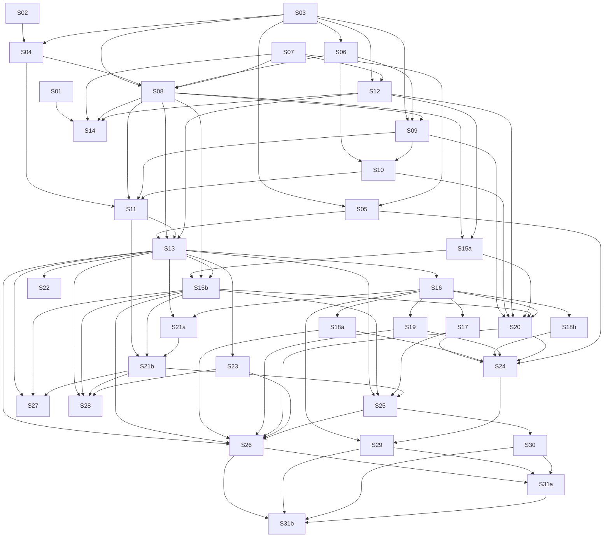

# M25 — Tenant Billing: Foundation & Dark Enforcement

**Phase:** Local Development
**Goal:** Lay the Billing foundation without changing anything a tenant, staff member, customer or visitor can see: the `billing` schema and the pricing catalog, the `Subscription` / `BillingAccount` aggregates, the shared `TenantAccessPort`, the clock and the provider port (with a fake), the operator touchpoints — and the whole **enforcement** machinery (gating framework, route annotation, gated event subscriptions and crons, the notification gate, the effective-published hotsite, the suspended experience for staff, customers and visitors). Every existing tenant is backfilled `exempt`, so enforcement ships **dark**: it is fully wired and tested, and it denies nobody until a tenant is actually suspended or a trial actually lapses (M26 introduces the status sweep that does that).
**Depends on:** none. Does **not** depend on M24 (the Billing release deploys before M24; see `## Billing interaction` in `plan/M24-MULTIVERTICAL-CLASSES-SESSIONS.md` for what M24's own stories must do once enforcement is live).
**Blocks:** M26 (BR collection, self-signup and launch) — its charge issuing, webhooks, status sweep, signup and real-provider stories all need this milestone's schema, aggregates, access port, clock and provider port. M27 (purge/discard/deactivation) is a **launch condition for M26's launch story (M26-S39**, see `plan/M26-TENANT-BILLING-COLLECTION-LAUNCH.md` § Follow-up milestones to write); M28–M30 (Stripe/US, automatic collection, annual billing) follow M26. All four are reserved, not drafted (see `## Reserved follow-ups`).
**Design rationale:** `docs/discovery/tenant-billing/tenant-billing.md` (promoted via `/discovery-to-milestone` on 2026-10-29) — kept as the permanent *why*; this file and the canonical docs it cites (`docs/USE_CASES.md` UC-110–145, `docs/DOMAIN_MODEL.md` § Context 7: Billing Context, `docs/DOMAIN_EVENTS.md` § Billing Context Events, `docs/DATABASE_SCHEMA.md` § Schema: `billing`, `docs/API_CONTRACTS.md` § Billing — …, `docs/ENGINEERING_RULES_SHARED.md` § Tenant access enforcement — the declarative choke points (planned), `docs/LOCK_CATALOG.md`, `journeys/manager/billing.md`) are the implementation source. Where a canonical doc and the discovery doc differ, the canonical doc wins.

---

## Non-Goals

- **Charging anyone.** No charge is issued, no payment link, webhook, status sweep, reconcile, dunning, billing email or real provider adapter exists in M25 — that is M26. M25 builds the *interface* to the provider (`BillingProviderPort` + `FakeBillingProvider` + contract-suite skeleton) so M26 can build the money loop against it, and verifies the real provider's behaviour once (S01).
- **Self-signup, the manager billing page and the public price page.** UC-113–119, 124, 127, 128, 130, 131, 133, 134, 136, 139, 140 (UC-129 is not an M26 story either; see the bullet below) and the percentage-adjust half of UC-112 are M26. The `Charge` aggregate, `provider_events` inbox and `ChargeLine` snapshot are *tables* created in S03 (the first schema is created once) but have no aggregate, repository or entity in M25.
- **Purge, discard, deactivation (UC-132, 141, 142), automatic collection (UC-135, 143), annual billing (UC-144, 145), Stripe / US (no UC of its own).** M27–M30. Their tables (`tenant_purge_jobs`/`steps`, and `provider_health`) are created by **S03** as DDL only — the canonical schema puts them in the first migration (decision recorded in S03) — and have no aggregate, entity or repository in M25; the US tax tables (`charge_tax_lines`) are **not** — they arrive with the Stripe slice.
- **Follow-up milestones M27–M30 are not drafted yet.** Which one to write when, and what each needs first, is in `plan/M26-TENANT-BILLING-COLLECTION-LAUNCH.md` § Follow-up milestones to write.
- **UC-129 (onboarding checklist).** Delivered only if M24's onboarding wizard (UC-075) ships; recorded as an M24 follow-up, not a story here or in M26.
- **Self-service data export and the per-context deletion rules of the purge pipeline.** No use case yet; M27 outline only.
- **Promoted-but-unused concepts (3b check).** The `Charge` / `ChargeLine` / `provider_events` / `tenant_purge_*` / `provider_health` tables are created by S03 and touched by no M25 story beyond DDL; `UC-112`'s price-change endpoints, `UC-114`'s webhook route and the seven cron triggers are documented but unbuilt. They stay promoted for fidelity of the first schema and are owned by M26/M27 (see the Coverage check).
- **Changing `tenants.is_active`, `hotsite_configs.is_published` or any manager preference.** Billing never mutates them; the effective values are computed (S25).

## Known open items

- **O-L1 — loyalty expiry while suspended (DEFERRABLE, default accepted):** points do not expire while the tenant is suspended (the expiry clock pauses), because a suspended business cannot let its customers earn or redeem. Carried into **M25-S27** as an acceptance criterion with an explicit "revisit" note — not a hidden default.
- **O-B1 — customer email when a tenant becomes unavailable (DEFERRABLE, default accepted):** customers with upcoming bookings get one reason-neutral "this business is temporarily unavailable" email (never saying why). Carried into **M25-S28**.
- **M24 interaction (recorded, not a story):** once the route detector is enforcing (S24), every M24 route must be annotated; M24's class-session bookings, enrollments and waitlist entries must be counted by the BOOKING-removal guard (UC-136 A11, built in M26). Both are written into `plan/M24-…` (§ Billing interaction); S17/S18a/S18b annotate whatever M24 routes exist when they run.
- **M17-S51 (recorded, not a story):** the manual offboarding runbook is the interim path for erasing a tenant (UC-141 A3, `docs/RUNBOOKS.md` § Billing "Interim" entry); the automated pipeline is M27. M25 neither depends on S51 nor changes it.
- **Suspended manager in M25 (interim, recorded):** UC-121 routes a suspended manager to the billing page, which is M26's. Until M26, S29 sends a suspended manager to `/dashboard/suspended` (the manager notice S29 builds; S31a adds the staff variant on the same page); M26 repoints that route to the billing page. Nothing else changes for the manager.
- **S21 ordering:** S21a ships the gate and the detector in WARN mode; S21b declares every existing `subscribe()` site and flips the detector to fail CI. Every story that adds a `subscribe()` call site after S21b (S25, S27, S28) declares its own options in that story; none relies on a later one.
- **Statuses and shapes "decided at story discovery":** the HTTP status of each typed denial (`BILLING_FEATURE_NOT_ENTITLED`, `BILLING_TENANT_SUSPENDED`), the exact per-role reduction of `GET /v1/billing/access`, the customer-role reduction of `GET /v1/billing/access` (it must expose `operational`, S26), the page/limit shape of `GET /internal/billing/tenants`, the response shape of `GET /internal/billing/suspended-tenant-ids`, and the error code/`violations[]` shape for a non-owner using `TRIAL_SIGNUP_CTA` (M26). Each is flagged in the story that implements it.
- **S27 design decision (recorded):** `LoyaltyEntry` stays append-only; expiry-while-suspended is a Loyalty-owned `loyalty.tenant_expiry_pauses` table written by the suspend/reactivate handlers and consulted by the expiry job — `expires_at` is never rewritten (S27; design confirmed at its story discovery).
- **No legacy `TenantProvisioned` payload (decided 2026-11-12, S11 discovery):** there is no production data, so no outbox row without `countryCode` or `registrationId` can exist. S11 makes both **required** on the event and the handler carries no skip branch (UC-110 A5 removed).
- **The Asaas spike (S01) is a GATE** needing an Asaas sandbox account and its API key from the owner. Nothing in S14 (provider port) can be finalised before S01 reports. The Asaas **production** PJ account (KYC lead time unknown) is requested by the owner now and gates M26's launch story, not M25.

---

## Build order

| Wave | Story | Theme |
|---|---|---|
| 0 | M25-S01 | Asaas sandbox spike — verified provider facts **[GATE]** |
| 0 | M25-S02 | Commercial catalog — Plus model, caps and OpenRouter validation |
| 0 | M25-S03 | `billing` schema, `btree_gist`, first-schema DDL, `BillingModule` skeleton |
| 0 | M25-S04 | `FeaturePrice` aggregate, `FeatureKey` / `ChatbotTier`, BR catalog seed (UC-112 seed) |
| 0 | M25-S05 | Backfill existing tenants as `exempt` (UC-126) |
| 0 | M25-S06 | `TaxId` VO, `CountrySpec` tax-ID entry, `BillingErrorCode` / `SignupErrorCode` plumbing |
| 0 | M25-S07 | Billing env contract — owner-tenant slug and the merchant-profile-key function (devops + backend) |
| 1 | M25-S08 | `Subscription` + `BillingAccount` aggregates and repositories |
| 1 | M25-S09 | Provisioning registrations — `POST /internal/billing/registrations` (UC-110) |
| 1 | M25-S10 | Provisioning side — `POST /internal/tenants`, `TenantProvisioned` fields, `provision-tenant.sh` (UC-110, UC-024) |
| 1 | M25-S11 | `create-trial-subscription` handler on `TenantProvisioned` + its subscription (UC-110) |
| 1 | M25-S12 | `IClock` + system clock + dev clock-advance (UC-138) |
| 1 | M25-S13 | `TenantAccessPort`, caching adapter, access endpoints (UC-120) — complexity L |
| 1 | M25-S14 | `BillingProviderPort`, `FakeBillingProvider`, contract-suite skeleton, live-adapter guard (UC-138) |
| 1 | M25-S15a | `PlatformAdminGuard` move, dev-clock adoption, `operator_audit` entity (UC-111, UC-137) |
| 1 | M25-S15b | Operator use cases, events and topics (UC-111, UC-137) |
| 2 | M25-S16 | Gating framework — decorators, guards, route detector in warn mode (UC-125) |
| 2 | M25-S17 | Annotate Platform routes (backend + BFF) (UC-125) |
| 2 | M25-S18a | Annotate Booking routes — bookings and lifecycle (backend + BFF) (UC-125) |
| 2 | M25-S18b | Annotate Booking routes — schedule, resources, services, recurring schedules, alerts (backend + BFF) (UC-125) |
| 2 | M25-S19 | Annotate Loyalty, Customer and Staff routes (backend + BFF) (UC-125) |
| 2 | M25-S20 | Annotate cross-cutting routes — auth, internal, cron, pubsub, health (UC-125) |
| 2 | M25-S21a | Event dispatcher opt-in gate, `subscribe()` options, pub/sub catalog scanner, declaration detector in WARN mode (UC-125) |
| 2 | M25-S21b | Declare every existing `subscribe()` site, flip the detector to fail (UC-125) |
| 2 | M25-S22 | Shared tenant-scoped job helper (extracted from Booking's `WindowedTenantJob`) (UC-125) |
| 2 | M25-S23 | Notification send gate, `SKIPPED_TENANT_SUSPENDED`, status CHECK replacement (UC-123) |
| 2 | M25-S24 | Flip the route detector to enforcing (UC-125) |
| 2 | M25-S25 | Hotsite effective-published — manifest, published list, module filtering, revalidation (UC-122) |
| 2 | M25-S26 | Suspended experience backend/BFF — staff-tenants, tenant switching, customer flag (UC-121) |
| 2 | M25-S27 | Loyalty — pause point expiry while suspended (O-L1) |
| 2 | M25-S28 | Booking — reason-neutral customer email (O-B1) |
| 3 | M25-S29 | Web enforcement — feature registry, `<FeatureGate>`, suspended-manager redirect (UC-125, UC-121) |
| 3 | M25-S30 | `Unavailable` page and hotsite login bar (UC-122) |
| 3 | M25-S31a | Staff notice, "Suspensa" tenant list, customer "Empresa inativa" — components (UC-121) |
| 3 | M25-S31b | Suspended-experience spanning Playwright E2E (UC-121) |

Wave notes (a wave is a sequencing guarantee, not a concurrency one — see `## Run-batch preview`): Wave 0 is migration/backfill safety plus the two decisions the rest cannot be written without (provider facts, Plus model/caps). Within Wave 0, **S07 lands before S05** despite the numbering: S05's backfill reads `resolveMerchantProfileKey` and the `APP_ENV` semantics that S07 defines. Wave 1 is backend/BFF only. Wave 2 is backend/BFF only; it contains all of the enforcement code and is deliberately split so the route detector is only flipped to enforcing (S24) after every existing route has been annotated, in a PR that touches no other behaviour. Wave 3 is frontend only and starts after the backend stories it reads from.

---

## Design & test strategy (milestone-level)

**Shared patterns (decided once; every story cites them).**
- **M25-D1 — Ports and adapters, one context.** Billing is the 7th backend context (`contexts/billing/{domain,application,infrastructure}`), a BFF `features/billing/` slice and a web `features/billing/` slice (CLAUDE.md §11). Cross-context reads go through exact-path `permittedEdges` entries in `architecture-policy.json`, never SQL joins (`docs/BOUNDED_CONTEXTS.md` § 7. Billing Context, "Dependencies").
- **M25-D2 — Access reads state, not events.** Every caller asks the shared `TenantAccessPort` (`src/shared/ports/`); no handler or use case contains an access `if`. Enforcement is declarative at the choke points in `docs/ENGINEERING_RULES_SHARED.md` § Tenant access enforcement — the declarative choke points (planned).
- **M25-D3 — Dark means exempt; there is no global enforcement flag.** "Dark" means **every existing tenant is `exempt`** (S05): enforcement code is live, and a tenant is simply entitled to everything. A `FEATURE_FLAG_BILLING_ENFORCEMENT` kill switch was considered and dropped at S07 discovery (2026-11-09): no production customers, and the emergency lever is a reviewed one-off SQL update that gives the affected tenants the end state `startExempt` produces (`exempt = true`, status `ACTIVE`, suspension fields cleared, open-ended items; `exempt = true` alone would leave a `SUSPENDED` tenant suspended), effective within the 60 s access-cache TTL (S13). The exact statement belongs in `docs/RUNBOOKS.md` § Billing (planned); pending charges are not touched by it.
- **M25-D4 — Billing money is integer minor units + ISO currency** (`amount_minor` bigint, never a float). Whether a Billing-local minor-units value object reuses or sits beside the Decimal-based shared `Money` is settled by S04 (**DEFERRABLE**, default: a Billing-local `MinorAmount` VO, shared `Money` untouched).
- **M25-D5 — Typed denials.** `BILLING_FEATURE_NOT_ENTITLED` / `BILLING_TENANT_SUSPENDED` (planned origins in `docs/ERROR_CATALOG.md`); status code decided at story discovery of S16.
- **M25-D6 — Migrations are expand-only here.** M25 adds a schema, new tables, a seed, an idempotent backfill and one CHECK replaced on an existing table (S23, via `NOT VALID` + `VALIDATE`). No table, column or row is dropped or renamed.
- **M25-D7 — CI-enforced registrations are owned by the story that creates the thing registered** (so no story relies on a later one for its own CI pass): the `testDataHarnessRegistrations` entry and `billing-integration-app.ts` (S04, the first entity story; every entity story adds its entities to `integration-global-setup.ts` **and** extends the partial `testDataHarnessRegistrations` entries in `architecture-policy.json` for `test-datasource.ts` and `billing-integration-app.ts`; **every migration class is also registered in `integration-global-setup.ts`**); `contexts/billing/infrastructure/http/billing-error.mapper.ts` (created in S06, extended by S08/S15b/S16 — `error-mapper-coverage`, `shared-vo-error-mapper-coverage`); the `closedEnumRegistry` entries for `FeatureKey`/`ChatbotTier` with their canonical constant arrays in `packages/validation` (S04 — the backend may not import the `@ikaro/types` root barrel, `backendTypesContract`); entity builders next to every entity (`test-builder-coverage`); and an exact-path `contextDependencyMatrix.permittedEdges` entry (path, rationale, owner, review date) for **every** new cross-context import — S11 (Billing handler ← Platform `TenantProvisioned`), S13 (Billing → Platform tenant-info read), S25 (Platform handlers ← Billing suspension events), S27 (Loyalty handler ← Billing `SubscriptionReactivated`), S28 (Notification handler ← Billing `SubscriptionSuspended`; its Booking read). `PlatformAdminGuard` moves to `src/shared/guards/` (S15a), so it needs no edge. Two more registrations follow the same ownership rule: **(a)** every migration that uses a `QueryRunner` (S03, S04, S05, S23, S27, S28) adds its exact file name to `PERSISTENCE_BYPASS_IGNORES` in `apps/backend/eslint.config.js` (the `src/contexts/<ctx>/infrastructure/migrations/<timestamp>-<Name>.ts` form the Booking entries use), or the persistence-bypass lint rule fails the PR; **(b)** the network methods of `BillingProviderPort` are registered in `externalSideEffectPorts` in `architecture-policy.json` by S14 (one entry per method, adapter path `…/providers/fake-billing.provider.ts`; M26-S37 appends the Asaas adapter path and M28 the Stripe one), so the `transactional-io` detector treats each as provider I/O that may never run inside `txManager.run()`.

**Aggregates and boundaries (named pass).**
- `Subscription` (root, 1 per tenant): owns status ladder, items, periods, `exempt`, `graceUntil`, `cancelAt`, `suspendedAt`, `hasEverPaid`, `version`. Invariants live in the aggregate: item dependency graph, "plan keeps at least one feature", `exempt` rules (the platform-owner tenant can never be un-exempted), suspension reason non-null iff `SUSPENDED`. Entitlement is a **computed** formula (`docs/DOMAIN_MODEL.md`), not stored.
- `BillingAccount` (root, 1 per tenant): tax identity, billing email, address, provider customer id, accepted terms. Separate aggregate (edited by a different actor for different reasons); never in `tenants.settings`.
- `FeaturePrice` (root, platform-wide, **no `tenant_id`** — the documented tenant-id exemption): versions are dated amounts.
- `Charge` (M26) is deliberately **not** a child of `Subscription` (one per period forever = unbounded). Paying a `Charge` may move the `Subscription` back to `ACTIVE` — two aggregates, one use case, one transaction, with `findByTenantIdForUpdate` on the subscription (lock B-R1). No M25 story needs that pair; S08's repository exposes `findByTenantIdForUpdate` so M26 does not have to change the aggregate.
- Cross-aggregate check: no M25 story requires two separate aggregates to stay consistent inside one transaction except `exempt` clear (creates a fresh trial window and replaces items — all inside `Subscription`).

**Locks and constraints (all catalogued in `docs/LOCK_CATALOG.md`; each needs a named test).**
- `UQ_billing_charges_open_recovery` — the partial unique index on open recovery charges (created by S03, catalogued in `docs/LOCK_CATALOG.md`; exercised in M26). It is **not** the lock-catalog id B-Q1, which is the purge-job unique owned by M27.
- **B-A1** `pg_advisory_xact_lock(hashtextextended('signup:'||googleSub, 0))` serialises the trial-eligibility check in `POST /internal/billing/registrations` (S09) — concurrency test: two simultaneous self-signup registrations for one Google account → exactly one eligible.
- **B-R1** `Subscription` row lock via `findByTenantIdForUpdate()` (S08) — M25 test: two concurrent `findByTenantIdForUpdate` callers serialise, no lost update. The suspend-vs-payment race (operator `suspend` racing a payment confirmation) lands in M26, where payment confirmation exists.
- **GIST exclusion** `subscription_items` (no two overlapping items per feature) created by S03; integration test in S08 inserts overlapping items and expects rejection.
- Every lock port method added is catalogued in `docs/LOCK_CATALOG.md` (CI: `lock-catalog-coverage`).

**`TenantAccessPort`: caching, fail-open, missing subscription (S13).** The port has a single-tenant method, a **suspended-ids batch** (ids only) and a **per-feature batch** (`findTenantIdsNotEntitledTo(feature)`, ids only — what a cron needs to skip tenants lacking a feature, UC-125 A4). The 15-minute provisioning window needs the tenant's `created_at`, which Billing reads from Platform through **one read-only tenant-info port** registered as an exact-path edge (precedent: `INotificationPlatformPort.getTenantInfo`, `docs/BOUNDED_CONTEXTS.md` § 7. Billing Context). Asymmetric TTLs (an operational answer 60 s in the shared port and 30 s in the BFF guard; a `SUSPENDED` answer 10 s in both), best-effort invalidation on the instance that runs the state-changing use case (through a Billing **application port**, `TenantAccessCacheInvalidator`, called **after commit**; `CachePort` has no cross-instance broadcast, so other instances rely on the TTL — worst-case staleness there is about **90 s** for a suspension (the BFF guard's 30 s cache sits on top of the backend's 60 s) and about 20 s for a lifting (10 s + 10 s), and no story or live check may assume less). A **transient lookup error fails open**; a **successfully read missing subscription** denies except for a tenant younger than `PROVISIONING_GRACE_MINUTES` (15). Each path has its own named test; the two are never conflated.

**Detector rollout (S16 → S24).** The route-completeness detector starts in **warn** mode (S16), so it cannot fail any open branch while the annotation stories (S17–S20) land one context group at a time; S24 flips it to **enforcing** in its own PR after every group is annotated. The event-declaration detector ships in **WARN** mode in S21a and is flipped to fail CI by S21b in the same change that declares every existing `subscribe()` site (so no open branch fails in between, and no handler is ever undeclared once it is enforcing).

**Migration ordering (expand/contract).** S03 (schema + all first-schema tables) → S04 (seed) → S05 (backfill exempt) → S23 (widen `notification_logs.status` + replace `CHK_notification_logs_status`, using `NOT VALID` + `VALIDATE` because it is an existing table with live rows, `docs/ANTI_PATTERNS.md` § A plain `ALTER TABLE`) → S27 (Loyalty: `loyalty.tenant_expiry_pauses`, a new table in an existing schema, expand-only) → S28 (Notification: the tenant-unavailable template rows, idempotent `ON CONFLICT DO NOTHING`). Code that reads `subscriptions` ships after S05 so no read can find an unbackfilled tenant; the publisher change (S10) and its consumer (S11) ship in the **same release** (the bus does not version-route; S11 makes `countryCode` and `registrationId` required on the event, since no legacy payload exists).

**Performance.** (1) `TenantAccessPort` is on the hot path of every authenticated request; it is cached (above) and its lookup is one indexed read by `tenant_id` (UNIQUE). (2) Cross-tenant, unscoped system jobs (the tenant-job helper S22 and the batch `suspended-tenant-ids` read S13) need a **standalone index** matching their filter column — the standalone partial index on `suspended_at WHERE status = 'SUSPENDED'` already exists in the canonical schema (`docs/DATABASE_SCHEMA.md` § `billing.subscriptions`) and serves the batch read; S13 verifies it before shipping the batch method (CLAUDE.md §7 "cross-tenant, unscoped system job"). (3) `@Public()` hotsite routes gain a cached tenant-access lookup in the global guard (S16) — cached so a public page does not add a DB hit per request.

**Backward compatibility (the existing behaviour M25 changes).** Existing behaviour that changes: (a) every tenant-scoped route becomes gate-aware; (b) the event dispatcher gains an opt-in gate; (c) notifications gain a gate; (d) the manifest's `isPublished` becomes the *effective* value; (e) tenant switching accepts a suspended tenant. **Non-regression contract:** with every tenant backfilled `exempt`/entitled, every existing route, handler, cron, notification and public page behaves exactly as before. **Ownership:** S24 owns route gating (the whole existing integration/E2E set runs with the route detector enforcing); each of S21b, S23, S25 and S26 owns the "exempt tenant unaffected" non-regression test for its own mechanism (event gate, notification gate, hotsite, suspended experience), and each annotation story (S17–S20) re-asserts it for its routes.

**Test pyramid.** Unit (`.spec.ts`) for aggregates, VOs, use cases, guards; integration (`.integration.spec.ts`) per use case with tenant-isolation scenarios and the three concurrency tests above; contract-suite *skeleton* (S14) with one implementation (the fake) running on every PR — the Asaas implementation and the nightly sandbox job are M26's (S01's spike facts are the input). E2E (Playwright) in S31b only; every backend story states "E2E: none — covered by unit/integration".

**Spanning scenario (golden path), owned by S26 (backend integration) and S31b (Playwright):** provision a non-exempt tenant (an `OPERATOR` registration reserved first, then `POST /internal/tenants` with its `registrationId`, M25-S10) → `TenantProvisioned` creates a `TRIALING` subscription → `GET /v1/billing/access` returns operational + all features → the operator suspends the tenant (reason `OPERATOR`) → staff sees the suspended notice, a customer sees "Empresa inativa" with readable history and a cancellable future booking, the hotsite renders `Unavailable` ("Página não publicada"), a gated route returns the typed denial, outbound notifications are skipped with `SKIPPED_TENANT_SUSPENDED` → the operator unsuspends → everything is restored with the manager's preferences untouched. **Observation side confirmed:** operator status read (S15b `GET /internal/billing/tenants`), staff notice (S31a), customer badge + history (S26 flag + S31a), hotsite page (S30 reading S25), denial (S16/S29), skip log (S23) — every actor-visible state has a supplying read.

**Nightly sandbox contract job ownership.** M26 (the first story that has a real adapter). M25's S14 ships the suite so the job can be added without changing the suite.

**Interim / infra.** Per-story devops halves where a story adds infra (S11's subscription); one shared env-contract story (S07). Terraform sequencing cites `infra/terraform/README.md` § New-resource PR-sequencing playbook and each infra story names its live-verification check (CLAUDE.md §9). No cron or secret is added in M25 — those are M26.

---

## Reserved follow-ups (not drafted until their gates open)

- **M26 — BR collection, self-signup and launch** (`Depends on: M25`; M26 extends M25 files in place — each M26 story lists them: `get-tenant-access.use-case`, `caching-tenant-access.adapter`, `billing-platform.port` / `.adapter` (+ `GetTenantBillingInfoUseCase`), `set-tenant-exempt.use-case`, `subscription.aggregate`, `billing-error.mapper`, `billing-integration-app`, `fake-billing.provider`, the event files, `billing-audit-log.handler` and the BFF billing controller / mapper / types; e.g. M26-S05 adds `isActive` to the tenant-info port (M25-S13), M26-S08 adds `listTenantsCreatedBefore` to it, M26-S18 adds `bookableUntil` to the access answer (M25-S13) and M26-S20 fills the exempt hook (M25-S15b)): webhook + `provider_events` inbox (UC-114), charge issue job and recovery-charge factory (UC-113), status sweep (UC-115), reconcile (UC-116), self-heal + provider health (UC-140), dunning reminders (UC-139), billing emails (UC-124), simulate endpoint (UC-138), manager backend/BFF (UC-117–119, 130, 133, 134, 136), chatbot tier → model/caps mapping, signup (UC-127, 128, 131), price-change endpoints (UC-112), the real `AsaasBillingProvider` + nightly contract job, billing UI, `/ikaro-trial`, alerts/runbooks/KPIs, launch readiness; last wave: percentage-adjust.
- **M27 — Purge, discard, deactivation** (UC-132, 141, 142). First because the first possible erasure is 90 days after the first suspension. Cron stays disabled until all nine participants ship.
- **M28 — Stripe / US** (no UC of its own; cross-cuts UC-113, 114, 118, 127, 128; adds `charge_tax_lines`). **M29 — Automatic collection** (UC-135 Pix Automático, UC-143 hosted card). **M30 — Annual billing** (UC-144, UC-145).
- Numbers M27–M30 are reserved; M115 is an existing completed milestone, so M27–M30 do not collide with it.

---

## Wave 0 — Migration safety and the two decisions everything else needs

### M25-S01 — Asaas sandbox spike — verified provider facts ✅ Done

**Agent:** `backend-ts`
**Complexity:** S
**Docs to load:** `docs/ASAAS_PROVIDER.md` (the verified Asaas facts this story writes) and `docs/discovery/tenant-billing/tenant-billing_PROVIDERS.md` § 5 (the original open verification items this story closes), `docs/TECH_STACK_DECISIONS.md` § 10. PAYMENT PROVIDERS, `docs/USE_CASES.md` UC-113, UC-114, UC-116, UC-135, UC-143, `docs/ENGINEERING_RULES_INFRA.md` § Billing configuration (planned)
**Dependencies:** none (needs the owner's **Asaas sandbox account and API key** — free and auto-approved; the owner creates it, this story never commits the key)
**Pattern:** plain composition — no named pattern applies (a time-boxed verification with a written result; no production code)

**Description:**
**This story is a GATE** (it needs the owner's sandbox key; S14 cannot be finalised without it). The provider port (S14) and every M26 story that talks to Asaas are written from verified behaviour, not from documentation reading. This story runs the Asaas sandbox flow once with throwaway scripts and a local webhook listener behind a `cloudflared` quick tunnel (all kept **out of the repo**, in the session scratchpad; the doc records the request sequence instead) and writes the **observed** answers into a new canonical doc, `docs/ASAAS_PROVIDER.md`, so the port is built from facts. The discovery folder (`docs/discovery/tenant-billing/`) is a research record that will be deleted later and is not the home of the result; it gets a pointer line only. The new doc defines a label **O** ("observed in the sandbox on <date>") next to V, I and NF, because sandbox behaviour is not production confirmation. Stripe is out of scope: M28's own discovery produces its canonical doc. It also records which of the documented slices stay viable. **Checks, each with its observed result (request, response excerpt, timestamp):** (1) create a customer with `cpfCnpj`; (2) create a charge with `billingType: UNDEFINED` and read the hosted payment URL; (3) pay it with the sandbox confirm call and receive the webhook; (4) re-read the charge by id after the webhook (the webhook is a hint, the re-read is the truth); (5) re-enable a paused webhook queue through the API — if the API cannot, record that the provider-health job can only alert; (6) cancel a charge that was paid in the meantime (the "provider refuses to cancel because it is already paid" case in `docs/DOMAIN_MODEL.md` § Aggregate: Subscription, the Reactivation rule); (7) which `billingType` the charge reports after the payer picks a method (settlement); (8) the **hosted recurring-card checkout** (slice F2): a future `nextDueDate`, card typed only on Asaas's page, subscription value `PUT`, behaviour on a refused attempt; (9) the annual-billing check (slice H, `tenant-billing_PROVIDERS.md` §5 item 10); and the launch gates of §5 items 1–7 that shape S14 and M26: (10) `invoiceUrl` validity after the due date, after cancel and after paid (§5 item 1); (11) the webhook payment-object fields and the retry-interval schedule (§5 item 2 — **not deferrable**, it shapes S14's webhook parsing); (12) `externalReference` maximum length (§5 item 3 — **not deferrable**, it shapes how the Ikaro charge id is sent); (13) whether `notificationDisabled = true` also silences paid receipts (§5 item 4); (14) the minimum charge per method (§5 item 7). **Deferred to the real production account (M26 launch), per gate, not silently dropped:** §5 item 5 (which event finalizes a *lost* chargeback — the sandbox cannot produce one) and §5 item 6 (Pix Automático eligibility of the real account — M29's gate). Where Asaas behaves differently from the doc, the story fixes the doc in the same change. **Extra scope (agreed at discovery):** the §5 sub-items outside the 14 checks that the sandbox can answer are also run and recorded: item 0 (NFS-e automatic-emission setup and payer-data requirements), item 1 (boleto auto-cancel days; whether a card can pay after the due date), item 2 (the official IP list), item 5 (boleto refund via API) and item 8 (checkout enablement, how an existing customer attaches, whether the first charge can be created later than 40 days ahead, the event that signals a revoked card, the state after the fifth refused attempt). Anything the sandbox cannot reproduce (for example a charge past its due date, or the retry schedule) is recorded as "not reproducible in the sandbox" with the reason and stays an explicit production gate; it does not block the story. Checks 7, 8 and part of 10 need a browser: the owner opens the hosted `invoiceUrl` and checkout page and reports what is seen; everything else is scripted. Recorded excerpts never contain the API key, the webhook `authToken`, a tunnel URL or a real CPF/CNPJ (a synthetic CPF is used). **Stale-reference sweep:** a verified fact is corrected in every canonical doc that restates it, in the same change: `docs/TECH_STACK_DECISIONS.md` § 10, `docs/API_CONTRACTS.md` (`externalReference`, the provider port), `docs/DATABASE_SCHEMA.md` (`provider_charge_id`), `docs/TESTING_STRATEGY.md` § billing provider, `docs/USE_CASES.md` and `tenant-billing_API.md` §7; plan-file text (M25-S14, M26) only where it states a now-false fact.

**Backend use case steps:** none (no production code).
**Backend HTTP surface:** none.
**New migration / i18n keys / env vars / feature flags:** none (the sandbox key is supplied locally; real secret entries are M26).

**Files to create/modify:**
- `docs/ASAAS_PROVIDER.md` (create — the canonical Asaas provider doc: the verified fact table, the observed result per check with request, response excerpt and date, the Asaas launch gates still open for the real account, the Asaas testing mechanics, the label legend V/I/NF/O; opens with the `When to load` / `Tags` header the `doc-orientation` check enforces)
- `docs/README.md` (modify — add the new doc to the reading list)
- `docs/discovery/tenant-billing/tenant-billing_PROVIDERS.md` (modify — a pointer line to `docs/ASAAS_PROVIDER.md` only)
- `docs/TECH_STACK_DECISIONS.md` (modify — § 10 repointed to the new doc; content only if a verified fact contradicts it)
- `docs/API_CONTRACTS.md` (modify — repoint the provider-doc references; `externalReference` and webhook fields as observed)
- `docs/USE_CASES.md` (modify — repoint the references; UC-113/114/116/135/143 only where an observed fact contradicts a line)
- `docs/DATABASE_SCHEMA.md`, `docs/TESTING_STRATEGY.md`, `docs/discovery/tenant-billing/tenant-billing_API.md` (modify — only where a verified fact makes a restated line false)
- `journeys/manager/prototypes/billing/dev-notes.md`, `plan/M25-TENANT-BILLING-FOUNDATION.md` (S14) and `plan/M26-TENANT-BILLING-COLLECTION-LAUNCH.md` (modify — point at the new doc where they named the discovery doc as the home of the corrected Asaas facts)

**Acceptance criteria — product:**
- [ ] `docs/ASAAS_PROVIDER.md` lists, for each of checks (1)–(14) and the extra §5 items agreed at discovery, the observed request/response shape and date (or "not reproducible in the sandbox" with the reason), and for the two deferred gates (§5 items 5 and 6) why they wait for the real account; any contradicted claim in a canonical doc is corrected in this change.
- [ ] The doc states plainly whether slice F2 (hosted recurring card) and the webhook re-enable stay viable, and what the provider-health job does if re-enable is impossible.
- [ ] Nothing about this story changes behaviour for any tenant.

**Acceptance criteria — technical:**
- Unit: none — no production code.
- Integration: none — the verification is a manual sandbox run recorded in the doc.
- Tenant isolation: none — no tenant data.
- E2E: none.
- [ ] No API key, token, webhook secret or tunnel URL is committed (Gitleaks clean); the throwaway scripts and the webhook listener stay out of the repo and read the key from the environment.
- [ ] `docs-audit` of the touched docs is clean, including `doc-orientation` and `doc-link-integrity` for the new doc, which is found through `docs-for` (its `backend, testing` tags) because `.copilot/context.md` is at its enforced size budget and takes no new §10 row.
- [ ] Coverage and `tsc`/lint: not applicable (documentation only, no production code).

---

### M25-S02 — Commercial catalog — Plus model, caps and OpenRouter validation ✅ Done

**Agent:** `backend-ts`
**Complexity:** S
**Docs to load:** `docs/TENANTS_SETTINGS_SCHEMA.md` § Settings by Category, 7. Chatbot Settings (tier source), `docs/ENGINEERING_RULES_BACKEND.md` § OpenRouter chatbot, `docs/DOMAIN_MODEL.md` § FeatureKey / ChatbotTier, `docs/USE_CASES.md` UC-112
**Dependencies:** none
**Pattern:** plain composition — no named pattern applies (a decision record plus a validation run)

**Description:**
The BR launch list is decided (HOTSITE R$ 49, BOOKING R$ 109 with recurrence and availability alerts included, LOYALTY R$ 29, CHATBOT Basic R$ 39 / Plus R$ 79, LEAD_FORM R$ 19; monthly, tax-inclusive) and the tier display names are final (Básico / Plus). **Locked at discovery (2026-11-09, the owner's call): `BASIC` stays exactly as today (the `DEFAULT_X` caps and `deepseek/deepseek-v4-flash-0731`); `PLUS` is a more capable model on the same caps.** The candidate is **`anthropic/claude-haiku-5.5`** (OpenRouter list price US$ 0.10 / 0.50 per million input / output tokens). It replaces the Kimi family that the discovery record first named (decision 79) because Kimi cannot carry the R$ 79 price at Basic's caps: at list prices and the discovery-time estimate of 10 exchanges per conversation, about 2,500 input and 200 output tokens per call and R$ 5,52 per US$, the worst-case model cost per tenant per month (30 conversations every day) is about R$ 99 for `kimi-k2-0905`, R$ 115 for `kimi-k2.6` and R$ 183 for `kimi-k3`, against about R$ 17 for Haiku 5.5 (22% of R$ 79) and about R$ 8 for Basic's model (discovery-time estimates; the measured results and the bounds are in `docs/TENANTS_SETTINGS_SCHEMA.md` § 7, Chatbot Settings). Kimi is recorded as **rejected on cost, untested** (the owner confirmed Haiku after reading the comparison, so no fallback run was needed). **The purpose of this story is to set the Plus price from measured cost, with a good margin.** The rule: the worst-case monthly model cost (every day at the daily conversation cap, every conversation at the message cap) is at most **35% of the monthly price**, converted at the exchange rate of the run date, with the rate and the date recorded; "worst case" means the run's token counts priced at the observed routing and at the highest endpoint the adapter may route to, over a 31-day month with the carried-over conversations, and a theoretical ceiling (every message at the maximum length, every answer at the maximum tokens) is recorded for information and is not part of the rule (the owner's decision, 2026-11-09). The run replaces the estimates above with measurements; the price is then confirmed, or flagged for the owner with the number that would meet the rule. This story never silently changes a price, and it applies the same rule to the Basic price (R$ 39) and only flags. Plus is defined by caps and behaviour, not by model name, so the model id is an implementation detail that can change without repricing: the Plus caps table lists the same values as Basic (`maxConversationsPerDay`, `maxConversationsPerIpPerDay`, `maxConcurrentConversations`, `maxMessagesPerConversation`, `maxMessageLengthChars`, `maxHistoryMessagesSentToLlm`, `maxOutputTokensPerResponse`); `knowledgeText` and its length limit are not tier-dependent and stay unchanged. **The run** is a throwaway script kept outside the repo (it reads `OPENROUTER_API_KEY` from the environment, with a hard spend ceiling of about US$ 3 for the whole story): the same 10 realistic visitor questions, built from a seeded tenant's FAQ text (no real personal data), go to `deepseek/deepseek-v4-flash-0731` and `anthropic/claude-haiku-5.5` with the adapter's exact request body (`reasoning.effort: 'none'`, `provider.sort: 'throughput'`, `ignore`, `require_parameters`, `max_price`, the same `max_tokens`). Per call it records the provider that served it, input, output and reasoning tokens, `usage.cost`, latency and throughput. The owner reads the answers side by side and gives a verdict; the doc records the question topics, the numbers and the verdict, not the raw text. It also **validates the OpenRouter settings the repo learned the hard way against Haiku** (`docs/ENGINEERING_RULES_BACKEND.md` § OpenRouter chatbot): the explicit retry config (undici excludes `POST` and connect-timeout errors from its defaults), the shared `AbortSignal.timeout()` capping total time across retries, `provider.ignore` for a provider that ignores `reasoning: { effort: 'none' }` (Haiku 5.5 is a reasoning-capable model, so zero reasoning tokens must be observed for every provider that serves it), `provider.sort: 'throughput'` for a fixed-time-budget request, and the backend per-attempt timeout (8 s) kept below the BFF's (12 s), which Haiku's measured latency at the Plus `maxOutputTokensPerResponse` must fit. A model that fails a rule is rejected in favour of the next candidate. **Ripple recorded, not decided here:** `CHATBOT_GLOBAL_DAILY_SPEND_LIMIT_USD` (US$ 1 a day, platform-wide) is sized for Basic's cost; at Haiku's measured cost it is reached after about that many conversations a day across all tenants, so M26-S21 (the tier mapping) decides whether the value changes. The code constants (`chatbot.constants.ts` tier → model + caps) are written by M26-S21, which must precede the Plano tab. The US list stays staging-only.

**Backend use case steps:** none (decision record + validation).
**Backend HTTP surface:** none.
**New migration / i18n keys / env vars / feature flags:** none.

**Files to create/modify:**
- `docs/TENANTS_SETTINGS_SCHEMA.md` (modify — § 7 Chatbot Settings, the tier source: the Plus caps table, the settled model id, `BASIC` unchanged)
- `docs/ENGINEERING_RULES_BACKEND.md` (modify — § OpenRouter chatbot: the validation result for the Plus model, with the provider behaviour observed, the model id and the date)
- `docs/DOMAIN_MODEL.md` (modify — § FeatureKey / ChatbotTier: only if a line states a now-false Plus model or caps)
- `docs/discovery/tenant-billing/tenant-billing.md` (modify — decision 79 and the commercial-catalog thread: a superseded note pointing at the canonical docs above; the discovery folder will be deleted, so the permanent *why* (Kimi rejected on cost, Haiku chosen, the 35% rule) is carried into `docs/TENANTS_SETTINGS_SCHEMA.md`)
- Any other doc that states the Plus model or the Kimi candidate (`docs/USE_CASES.md` UC-033–UC-036, the M26 plan, other `docs/discovery/tenant-billing/*` files): grep and fix only where a line is now false, as in the stale-reference sweep of `docs/DEFINITION_OF_DONE.md`, which covers `docs/discovery/**`

**Acceptance criteria — product:**
- [ ] The Plus tier is defined by caps and behaviour (a table of cap values, the same as Basic), with `anthropic/claude-haiku-5.5` as the model id recorded as an implementation detail that can change without repricing.
- [ ] The measured cost per conversation for Basic's model and for Plus's model is recorded with the model ids, the provider that served each call and the date; the worst-case monthly cost at the caps is computed with the exchange rate and its date at the observed routing and at the highest eligible endpoint (with the theoretical ceiling shown for information), and the 35% rule is applied to R$ 79 (and to R$ 39 as a flag only): the price is confirmed, or flagged for the owner with the figure that would meet the rule. No price is changed in this story.
- [ ] The owner's verdict on the 10-question comparison and the model choice is recorded: the owner read the answers side by side on 2026-11-09 and decided `BASIC` stays on `deepseek-v4-flash-0731` and `PLUS` runs `claude-haiku-5.5`, prices kept. The Kimi fallback run was therefore not needed. The public Artificial Analysis index (secondary reports) was consulted instead of a second round of own tests, and the models considered and rejected are listed with their costs.
- [ ] The OpenRouter settings listed above are validated against Haiku 5.5 (retry config, total-timeout semantics, `provider.ignore`, `reasoning` behaviour, `provider.sort`, per-attempt vs BFF timeout) with the result recorded.
- [ ] `BASIC` is documented as unchanged (today's `DEFAULT_X` caps and `deepseek/deepseek-v4-flash-0731`).
- [ ] Kimi is documented as rejected on cost at list prices and not tested, with the reason (it exceeds or nearly reaches the R$ 79 price at Basic's caps).
- [ ] The `CHATBOT_GLOBAL_DAILY_SPEND_LIMIT_USD` ripple is recorded for M26-S21, with the break-even conversation count at the measured cost.

**Acceptance criteria — technical:**
- Unit: none — no production code.
- Integration: none — validation is a recorded manual run against OpenRouter.
- Tenant isolation: none.
- E2E: none.
- [ ] No OpenRouter API key committed; the run reads it from the environment, the throwaway script and the raw answers stay out of the repo, and a secret and personal-data scan over every changed file finds nothing.
- [ ] Every doc that stated the Kimi candidate or an older Plus value is corrected in the same change, including `docs/discovery/**`.
- [ ] `docs-audit` of the touched docs is clean.
- [ ] Coverage and `tsc`/lint: not applicable (documentation only, no production code).

---

### M25-S03 — `billing` schema, `btree_gist`, first-schema DDL, `BillingModule` skeleton ✅ Done

**Agent:** `backend-ts`
**Complexity:** L
**Docs to load:** `docs/DATABASE_SCHEMA.md` § Schema: `billing` (every table) and § Billing migration ordering, `docs/DOMAIN_MODEL.md` § Context 7: Billing Context, `docs/LOCK_CATALOG.md` § Billing locks, `docs/TENANT_ISOLATION_STRATEGY.md` (documented exemptions), `docs/BOUNDED_CONTEXTS.md` § 7. Billing Context, `docs/ENGINEERING_RULES_BACKEND.md` § Migration backfills and § Migration-driven privilege grants to infrastructure-created roles (provisioning order), `docs/ANTI_PATTERNS.md` (plain `ALTER TABLE`)
**Dependencies:** none
**Pattern:** plain composition — no named pattern applies (an empty module registers no repository yet; the first ones arrive with their aggregates). The migration is a single expand-only step.

**Description:**
Create the 7th backend context's persistence foundation: the `billing` schema, `CREATE EXTENSION IF NOT EXISTS btree_gist`, and **all first-schema tables in one migration** per `docs/DATABASE_SCHEMA.md` § Schema: `billing` — `feature_prices`, `feature_price_versions` (no `tenant_id`, the documented exemption), `billing_accounts`, `subscriptions`, `subscription_items`, `charges`, `charge_lines`, `provider_events`, `signup_registrations`, `tenant_purge_jobs`, `tenant_purge_steps`, `provider_health` (no `tenant_id`), `operator_audit` — with **every named index and constraint in `docs/DATABASE_SCHEMA.md` § Schema: `billing`** (the ones easy to omit are named below), composite FKs `(tenant_id, id)`, `tenant_id`-first composite indexes, the **GIST exclusion** on `subscription_items` (no two overlapping items per feature per subscription), the partial unique **index** `UQ_billing_charges_open_recovery` (`WHERE kind = 'RECOVERY' AND status IN ('PENDING','OVERDUE')` — an index, not a constraint), `UQ_billing_billing_accounts_provider_customer`, `UQ_billing_charges_provider_charge`, `UQ_billing_charges_period`, the `subscriptions (status, past_due_since)` index, the `feature_price_versions` UNIQUE + INDEX, every CHECK in `docs/DATABASE_SCHEMA.md` § Billing constraint naming and closed-value CHECKs (named `CHK_billing_<table>_<rule>`; FKs `FK_billing_<table>_<ref>`): the closed value sets (`subscriptions.status`, `charges.kind`/`status`/`method`/`provider_creation_status`, `provider`, `tax_id_type`, `auto_billing*`, `signup_registrations.source`/`status`, `operator_audit.action`, `cycle = 'MONTHLY'`), the `feature_key` mirror of the closed enum on `feature_prices`, `subscription_items` and `charge_lines`, `amount_minor >= 0`, `anchor_day` 1..28, `suspension_reason` non-null iff `SUSPENDED`, `provider_creation_status = 'READY'` ⇒ `provider_charge_id` present, `charges.period_start`/`period_end` NOT NULL for `PERIOD` and NULL for `RECOVERY`, `signup_registrations.google_sub` and `terms_version` / `terms_accepted_at` NOT NULL for `SELF_SIGNUP`, the `tenant_purge_*` value sets and the `provider_health` CHECKs (`webhook_status`, `freeze_active = (freeze_since IS NOT NULL)`), and the standalone partial indexes the cross-tenant jobs need (`subscriptions` on `next_due_date` / `trial_ends_at` / `cancel_at` / `suspended_at WHERE status = 'SUSPENDED'`, `charges` on open status and on provider creation status, **on `(paid_at) WHERE status = 'PAID'` (`IDX_billing_charges_paid_recent`, M26's "recently changed charge" reconcile scope) and on `(status, due_date) WHERE provider_cancel_pending`**, `provider_events` on `received_at`, `signup_registrations` on `google_sub`, **and `billing_accounts` on `(tax_id) WHERE tax_id IS NOT NULL` (`IDX_billing_billing_accounts_tax_id`, the trial-farming lookup of UC-127 A3; `tax_id` is stored digits-only, so no extra lookup column or secret is needed)**). `charges` also carries the **`provider_cancel_pending BOOLEAN NOT NULL DEFAULT false`** column (M26 sets it before the post-commit provider cancel and reconcile retries every flagged charge). `provider_health` also carries a nullable **`last_full_reconcile_at TIMESTAMPTZ`** (M26-S07's daily full-pass marker, so a redelivery after the full-pass hour cannot skip the day's pass). US-only columns/tables (`charge_tax_lines`, tax columns) are **not** in this migration (the first schema is BR-only). **Decision — tables with no M25 use:** S03 creates `tenant_purge_jobs`, `tenant_purge_steps` and `provider_health` as DDL (the first schema is created once, `docs/DATABASE_SCHEMA.md` § Billing migration ordering, step 1), and `docs/DATABASE_SCHEMA.md` (~lines 1430–1466) already carries the DDL-level column/constraint spec for the three tables (columns, the `reason`/`status`/participant value sets as CHECKs, the partial unique `UQ_billing_tenant_purge_jobs_in_flight`, the composite FK between steps and jobs). This story therefore implements the spec already in `docs/DATABASE_SCHEMA.md`, so the "column for column" acceptance criterion is testable against it. It also creates the empty `BillingModule` and registers the context: the CI-enforced test-harness registration: the new migration class is imported into the explicit `migrations` array of `apps/backend/src/test/integration-global-setup.ts` (the `test-harness-registration` detector checks that array; the schema itself comes from the migration, as `BootstrapSchemas` has a fixed list). `billing-integration-app.ts`, its `testDataHarnessRegistrations` entry and the `test-datasource.ts` entities are **not** in this story: with no entity yet they would be an empty, unused harness, so S04 (the first entity) creates them; S03 adds no harness file. **Migration shape:** `up()` runs in this order — `CREATE SCHEMA`, `CREATE EXTENSION IF NOT EXISTS btree_gist`, the role-guarded grants (below), **then** the `CREATE TABLE`s, so default privileges exist before the tables do. `down()` drops the `billing` schema with `CASCADE` and **never** drops `btree_gist` (`CreateBookingBookings1748000000014` relies on it). **Role grants (the part that fails only on a real deploy):** the same migration grants the application role the access it needs on the new schema, mirroring `apps/backend/src/contexts/platform/infrastructure/migrations/1700000000000-BootstrapSchemas.ts` exactly — inside a `DO $$ … IF EXISTS (SELECT FROM pg_catalog.pg_roles WHERE rolname = 'ikaro') …` block: `GRANT USAGE ON SCHEMA billing TO ikaro`, `ALTER DEFAULT PRIVILEGES IN SCHEMA billing GRANT SELECT, INSERT, UPDATE, DELETE ON TABLES TO ikaro` and `GRANT USAGE ON SEQUENCES`. The relay VM role is a separate matter: `shared/…/1748400000008-GrantRelayReadAccess.ts` hard-codes its schema list (`platform … notification, shared`), and Billing events travel through `shared.outbox`, so the relay needs nothing on `billing` **unless** the relay or any other reader (read replica, reporting role) is found to query a `billing` table; if so, this story adds a **new** migration that repeats that grant loop for `billing` (never an edit of the old migration, which has already run). The finding (does anything outside the app role read `billing`?) is stated in the PR. The context dependency matrix needs **no** entry yet: each later story that introduces a cross-context import adds its own exact-path `permittedEdges` entry (M25-D7). The `docs/BOUNDED_CONTEXTS.md`/`LOCK_CATALOG.md` lock rows already exist. No entities, repositories or use cases yet — each arrives with its aggregate story, so the `test-builder-coverage` and `entity-builder-pk-uuidv7-default` detectors see an entity and its builder together.

**Backend use case steps:** none.
**Backend HTTP surface:** none.
**New migration / i18n keys / env vars / feature flags:** migration `apps/backend/src/contexts/billing/infrastructure/migrations/<timestamp>-CreateBillingSchema.ts` (verify the current highest migration timestamp at implementation; `data-source.ts` globs `contexts/**/infrastructure/migrations`).

**Files to create/modify:**
- `apps/backend/src/contexts/billing/infrastructure/migrations/<timestamp>-CreateBillingSchema.ts` (new)
- `apps/backend/src/contexts/billing/billing.module.ts` (new — empty module, registered in `app.module.ts`)
- `apps/backend/src/app.module.ts` (modify — import `BillingModule`)
- `apps/backend/src/test/integration-global-setup.ts` (modify — import the `CreateBillingSchema` class into the `migrations` array; its timestamp must sort after the current highest, `1748500000038`)
- `apps/backend/eslint.config.js` (modify — add the migration's full repo-relative path, `src/contexts/billing/infrastructure/migrations/<timestamp>-CreateBillingSchema.ts`, to `PERSISTENCE_BYPASS_IGNORES`)
- `apps/backend/src/contexts/billing/infrastructure/billing-schema-grants.ts` (+ `.spec.ts`) (new — the role-guarded grant SQL; outside `migrations/` because TypeORM treats every export of a migration file as a migration class)
- `docs/DATABASE_SCHEMA.md` (modify — flip the "PLANNED, NOT YET BUILT" banner of § Schema: `billing`; the other lines only if the implemented DDL differs from the spec — the doc wins)
- `docs/REPOSITORY_STRUCTURE.md` (modify — line ~53, `billing/` no longer "planned")
- `docs/BOUNDED_CONTEXTS.md` (modify — line ~139, the "planned, not yet built" note for the Billing context)
- **Stale-reference sweep (Definition of Done):** grep `docs/*.md`, `plan/*_IMPLEMENTATION_DETAILS_*.md`, `.claude/commands/**` and `scripts/**` for "billing … planned / not yet built / no table or migration exists" wording that this story makes false, and fix it in the same change.
- No `architecture-policy.json` change in this story (no harness entry, no `contextDependencyMatrix` entry).

**Acceptance criteria — product:**
- [ ] No existing table is touched; no tenant sees any change (expand only).
- [ ] The schema matches `docs/DATABASE_SCHEMA.md` § Schema: `billing` column for column — including the DDL-level spec already in the doc for `tenant_purge_jobs` / `tenant_purge_steps` / `provider_health` — and creates every named index and constraint listed there (verified against the catalog (`pg_indexes` / `pg_constraint`) in the migration verification recorded in the PR).
- [ ] The application role (`ikaro`) can read and write every `billing` table on a real deploy: the migration grants `USAGE` on the schema and default `SELECT, INSERT, UPDATE, DELETE` privileges to it (as `BootstrapSchemas` does for every other schema); relay read access is added only if a non-app reader of `billing` exists (see the Description). The grant is guarded by the role-existence check, which only avoids a failure when the role is absent; it is not convergent, so the role must be provisioned before the migrate job runs, exactly as for every existing schema (`docs/ENGINEERING_RULES_BACKEND.md` § Migration-driven privilege grants to infrastructure-created roles; recovery recipe: `docs/RUNBOOKS.md` § Debugging a permission-denied-shaped 500); the PR states the provisioning order verified.

**Acceptance criteria — technical:**
- Integration: none as a committed spec. The rule is not to write an integration spec for a migration (`docs/ENGINEERING_RULES_TESTING.md` § Migration specs); the migration is exercised by every integration suite that builds its schema through `integration-global-setup.ts` (the new class is registered in its `migrations` array), and it is verified once against a real database with the result recorded in the PR. The verification run covers:
  - [ ] The `billing.*` tables exist with exactly the documented columns, and every named index and constraint exists in `pg_indexes` / `pg_constraint`.
  - [ ] Two overlapping `subscription_items` rows for one feature and subscription are rejected by the GIST exclusion; adjacent (touching) periods are accepted.
  - [ ] A second open recovery charge (`PENDING`/`OVERDUE`) for one subscription is rejected by the partial unique index `UQ_billing_charges_open_recovery`; a cancelled one is ignored by it. Every CHECK rejects a bad row and every closed value set accepts each documented value.
  - [ ] A composite FK `(tenant_id, id)` rejects a cross-tenant reference.
  - [ ] Grants: `has_schema_privilege('ikaro','billing','USAGE')` is true, existing and later tables are readable and writable by `ikaro`, and the absent-role case is a no-op. `docker/init-db.sh` creates `ikaro` before the migrations run, so the privilege assertion is not vacuous.
  - [ ] `down()` drops the schema and leaves `btree_gist` installed; `up()` recreates every table.
- Unit: `billing-schema-grants.spec.ts` pins the role-guarded grant SQL (the guard, schema usage, default table and sequence privileges).
- Tenant isolation: [ ] every tenant-scoped billing table has `tenant_id NOT NULL` and a leading-`tenant_id` composite index; `feature_prices`, `feature_price_versions` and `provider_health` are the only tables without one and are listed as exemptions in `docs/TENANT_ISOLATION_STRATEGY.md`; the two documented partial cases are asserted as such: `signup_registrations.tenant_id` is NULLABLE until the registration is completed (S11), and `provider_events` is keyed `(provider, event_id)` (`docs/DATABASE_SCHEMA.md`, `docs/BOUNDED_CONTEXTS.md` § 7. Billing Context).
- E2E: none — covered by integration.
- [ ] `architecture-check` passes (`test-harness-registration`, `doc-link-integrity`, `lock-catalog-coverage`).
- [ ] The PR states that no non-app role reads `billing` (relay reads `shared.outbox` only; checked `infra/`, `docker/`, `scripts/`), so no relay-grant migration is added.
- [ ] The stale-reference sweep above found no remaining "planned / not yet built" Billing wording the migration makes false.
- [ ] Coverage ≥80% on changed code
- [ ] `tsc --noEmit` clean, lint clean (the persistence-bypass rule passes because the migration is in `PERSISTENCE_BYPASS_IGNORES`)

---

### M25-S04 — `FeaturePrice` aggregate, `FeatureKey` / `ChatbotTier`, BR catalog seed ✅ Done

**Agent:** `backend-ts`
**Complexity:** M
**Docs to load:** `docs/DOMAIN_MODEL.md` § FeatureKey / ChatbotTier and § Aggregate: FeaturePrice, `docs/DATABASE_SCHEMA.md` § `billing.feature_prices` / `feature_price_versions`, `docs/USE_CASES.md` UC-112 (the seeded catalog; the price-change endpoints are M26), `docs/ENGINEERING_RULES_SHARED.md` § Option A — aggregate props, `docs/VALUE_OBJECTS_REFERENCE.md`, `docs/ENGINEERING_RULES_TESTING.md` § Shared test-builder date defaults
**Dependencies:** M25-S02 (settled Plus values for the seed), M25-S03
**Pattern:** Repository + Adapter (`IFeaturePriceRepository`); value objects for `FeatureKey`, `Tier`, `MinorAmount`.

**Description:**
Create the platform-wide `FeaturePrice` aggregate (root; **no `tenant_id`**, the documented exemption) with its dated `FeaturePriceVersion` children, plus the closed enums `FeatureKey` (`HOTSITE | BOOKING | LOYALTY | CHATBOT | LEAD_FORM`) and `ChatbotTier` (`BASIC | PLUS`; every other feature has the single tier `STANDARD`). **Where they live (the exact shape, so `closed-enum-registry` and `backendTypesContract` pass):** the backend and BFF may not import the `@ikaro/types` root barrel, so the **canonical** constants are `FEATURE_KEYS` and `CHATBOT_TIERS` (`as const` arrays) in a new `packages/validation/src/billing.ts` (what the backend imports, as it does `HOTSITE_MODULE_TYPES`), and `packages/types/src/enums.ts` carries the **mirror** unions `FeatureKey` / `ChatbotTier` (what the web imports). Two `closedEnumRegistry` entries in `architecture-policy.json` (canonical `constArray` + mirror `union`, rationale, owner `billing`, review date) keep them identical in the same change, exactly like the existing `HotsiteModuleType` entry. Amounts are **integer minor units + ISO currency** (M25-D4). **DEFERRABLE decision carried here:** whether a minor-units money VO reuses the Decimal-based shared `Money` or sits beside it — default: a Billing-local `MinorAmount` VO in `contexts/billing/domain/value-objects/`, shared `Money` untouched; revisit only if M26 finds a concrete reason. A seed migration inserts the BR catalog and one `feature_price_versions` row per price with `effective_from` = the **fixed constant `2026-01-01`** (locked at discovery 2026-11-10: identical in every environment, not the run date, so the seed is deterministic and a re-run can never add a second version) and every NOT NULL column of the canonical tables filled explicitly (`docs/DATABASE_SCHEMA.md` § `billing.feature_prices` / `feature_price_versions`): `feature_prices.selectable = true`, `feature_price_versions.created_by = 'SYSTEM'`, `reason = 'Initial catalog (M25-S02)'`, `announced_at` and `batch_id` NULL; the US list (the BR amounts plus 40%, the owner's call at discovery, 2026-11-10) is inserted in **every environment**, production included, so the migration reads no environment variable. **Repository is read-only in S04** (locked at discovery): `findByNaturalKey` and `listSelectableByCountry` only; `save()` and its transaction wiring arrive with M26's operator endpoints (UC-112). The aggregate still carries `addVersion` with its invariants (domain-only here). The repository exposes reads by `(featureKey, countryCode, tier, cycle)` for a given date (the version selected by a service-period start, `effective_from <= period_start`). Price *changes* (operator endpoints, announcement fan-out) are M26 (UC-112); this story builds the aggregate and the read side they will use.

**Backend use case steps:**
1. **`GetFeaturePriceAtUseCase`** (`GetFeaturePriceAtUseCaseInput` / `…Result`) (internal, used by M26's issuer): returns the version in force for a feature × country × tier × cycle at a given date.
2. **`ListSelectablePricesUseCase`** (internal, used by M26's price page): for a country at a date, one item per **selectable** price that has a version in force on that date, `{featureKey, tier, cycle, currency, amountMinor, effectiveFrom}`; a price whose versions are all in the future is omitted, never shown at zero.

**Backend HTTP surface:** none in M25 (the read use cases are consumed in-process by M26 stories; the operator write endpoints are M26's UC-112). State: "no new endpoint".
**New migration / i18n keys / env vars / feature flags:** migration `…/<timestamp>-SeedFeaturePrices.ts` (idempotent: upsert the price on its natural key, insert the version only when that price has none; both lists seeded in every environment, no `APP_ENV` read); it uses `QueryRunner`, so its file name is added to `PERSISTENCE_BYPASS_IGNORES` (M25-D7).

**Files to create/modify:**
- `packages/validation/src/billing.ts` (+ `.spec.ts`) (new — canonical `FEATURE_KEYS`, `CHATBOT_TIERS`) and `packages/validation/src/index.ts` (modify — export)
- `packages/types/src/enums.ts` (modify — mirror unions `FeatureKey`, `ChatbotTier`)
- `packages/architecture-check/architecture-policy.json` (modify — two `closedEnumRegistry` entries)
- `apps/backend/src/contexts/billing/domain/feature-price.aggregate.ts` (+ `.spec.ts`) (new)
- `apps/backend/src/contexts/billing/domain/value-objects/minor-amount.vo.ts` (+ `.spec.ts`) (new)
- `apps/backend/src/contexts/billing/domain/errors/billing-domain.error.ts` (+ `.spec.ts`) (new — typed `FeaturePriceNotFoundError` and the aggregate's invariant errors, plain classes with a working prototype chain; S06 adds the HTTP mapping)
- `packages/architecture-check/architecture-policy.json` (modify — an `error-mapper-coverage` exception entry for the billing domain errors **only if the detector demands one** before S06's mapper exists: rationale, owner `billing`, review date; remove it when S06 maps them)
- `docs/DOMAIN_MODEL.md` (modify — § FeatureKey / ChatbotTier: `billing.ts` no longer "planned", `MinorAmount` decision recorded)
- `apps/backend/src/contexts/billing/application/ports/feature-price-repository.port.ts` (new)
- `apps/backend/src/contexts/billing/application/use-cases/get-feature-price-at.use-case.ts` (+ `.spec.ts`) (new)
- `apps/backend/src/contexts/billing/application/use-cases/list-selectable-prices.use-case.ts` (+ `.spec.ts`) (new)
- `apps/backend/src/contexts/billing/infrastructure/entities/feature-price.entity.ts` (+ version entity) (new)
- `apps/backend/src/contexts/billing/infrastructure/repositories/typeorm-feature-price.repository.ts` (+ `.spec.ts`, `.integration.spec.ts`) (new)
- `apps/backend/src/contexts/billing/infrastructure/migrations/<timestamp>-SeedFeaturePrices.ts` (new)
- `apps/backend/eslint.config.js` (modify — add the `SeedFeaturePrices` migration's file name to `PERSISTENCE_BYPASS_IGNORES`)
- `apps/backend/src/test/builders/billing/feature-price.builder.ts` + `feature-price-entity.builder.ts` + `feature-price-version-entity.builder.ts` + `index.ts` (new — every entity has a builder, `test-builder-coverage`)
- `apps/backend/src/test/integration-global-setup.ts` and `apps/backend/src/test/test-datasource.ts` (modify — register `FeaturePriceEntity` and its version entity, and the `SeedFeaturePrices` migration class)
- `apps/backend/src/test/utils/billing-integration-app.ts` (new — the per-context integration app, modelled on `platform-integration-app.ts`; moved here from S03 because this is the first story with an entity)
- `packages/architecture-check/architecture-policy.json` (modify — extend the partial `testDataHarnessRegistrations` entry for `test-datasource.ts` with the two new entities, and add a new partial entry for `billing-integration-app.ts` (its entities, rationale))
- `apps/backend/src/contexts/billing/billing.module.ts` (modify)

**Acceptance criteria — product:**
- [ ] The BR catalog (HOTSITE 49, BOOKING 109, LOYALTY 29, CHATBOT Basic 39 / Plus 79, LEAD_FORM 19 reais per month, tax-inclusive) is seeded with the values settled in M25-S02; the US list (BR + 40%, the owner's call at S04 discovery) is seeded in every environment.
- [ ] A price asked for at a date returns the version whose `effective_from` is the latest one not after that date, ignoring superseded versions (`superseded_at IS NOT NULL`); an unknown feature/country/tier yields a typed domain error, never a zero price.
- [ ] No tenant-visible change.

**Acceptance criteria — technical:**
- Unit:
  - [ ] `FeaturePrice` rejects a version with a **negative** amount (the canonical column is `CHECK (amount_minor >= 0)`, so zero is allowed) and an `effective_from` earlier than an existing version.
  - [ ] `MinorAmount` rejects a fractional input and a non-ISO currency.
  - [ ] Lookup returns the right version across a future-dated change.
  - [ ] `FeaturePrice` rejects a tier that does not fit the feature (`CHATBOT` → `BASIC`/`PLUS`, every other feature → `STANDARD`), a cycle other than `MONTHLY`, and a currency that does not match the country (BR → `BRL`, US → `USD`); the country is the shared `CountryCode` VO and `effectiveFrom` is the shared `CalendarDate` VO.
  - [ ] A superseded version is never selected by the in-memory lookup.
  - [ ] `ListSelectablePricesUseCase`: omits a non-selectable price and a price with only future versions.
- Integration:
  - [ ] Seed migration is idempotent (run twice → same rows); both lists are seeded even when `APP_ENV=production` (the migration reads no environment variable).
  - [ ] Every seeded row satisfies the NOT NULL columns: `selectable = true`, `created_by = 'SYSTEM'`, a non-empty `reason`; the `amount_minor >= 0` CHECK rejects a negative amount at the database.
  - [ ] Repository reads by natural key and date against Testcontainers; a superseded (`superseded_at` set) version is never returned.
  - [ ] **Test-data plan (locked at discovery):** the seed fills the whole natural-key space and runs in every integration DB, so specs never insert a new `FeaturePrice`. They read the seeded rows and add synthetic versions dated 2099 (and a superseded one), deleting exactly the rows they added in `afterEach`/`afterAll` (symmetric teardown, reused-container safe). A test runs inside a transaction: delete the seeded rows, set `APP_ENV=production`, run `up`, assert all 12 prices (6 BR, 6 US) are seeded, roll back.
  - [ ] The `bigint` amount column is read back as a number through an entity transformer (pg returns a string) and the `date` column as `YYYY-MM-DD`.
  - [ ] The seed migration runs with `APP_ENV` unset (= `local`, the S07 migration rule) and still inserts the BR list and the US list.
- Tenant isolation: [ ] none — the aggregate is platform-wide by design (documented exemption); a test asserts no tenant column exists and no read takes a `tenantId`.
- E2E: none — covered by unit/integration.
- [ ] `architecture-check` passes (`closed-enum-registry`, `test-builder-coverage`, `entity-builder-pk-uuidv7-default`, backend-types contract)
- [ ] Coverage ≥80% on changed code
- [ ] `tsc --noEmit` clean, lint clean

---

### M25-S05 — Backfill existing tenants as `exempt` (UC-126) ✅ Done

**Agent:** `backend-ts`
**Complexity:** S
**Docs to load:** `docs/USE_CASES.md` UC-126, `docs/DATABASE_SCHEMA.md` § Billing migration ordering (step 3) and § `billing.subscriptions` / `subscription_items`, `docs/ENGINEERING_RULES_BACKEND.md` § Migration backfills, `docs/DOMAIN_MODEL.md` § Aggregate: Subscription (the `exempt` invariants)
**Dependencies:** M25-S03, M25-S07 (`resolveMerchantProfileKey` and the `APP_ENV` semantics for migrations: unset ⇒ `local`)
**Pattern:** plain composition — a single idempotent data migration (no named pattern applies).

**Description:**
**Why this is Wave 0.** Every later story reads `subscriptions`; a tenant with no row must never be possible once code that reads it ships. This migration inserts, for **every tenant that has no subscription**, an `ACTIVE`, `exempt = true` subscription with open-ended items for all five features (`CHATBOT` at tier `BASIC`) and a `billing_accounts` shell, idempotently: `INSERT … ON CONFLICT (tenant_id) DO NOTHING` covers the `subscriptions` insert **only**, so the five items and the billing-account shell are inserted **only for the subscriptions this run newly created** (a re-run leaves existing items and accounts intact). **There is no production yet**, so this covers local and staging tenants only; the tenant for `PLATFORM_OWNER_TENANT_SLUG` (Ikaro's own) is created later by the normal provisioning path and is exempt there. **How each NOT NULL column is set (read from `platform.tenants` in the migration SQL — a data migration, not an application port):** `country_code` = `COALESCE(settings->'localization'->>'countryCode', 'BR')` and `timezone` = `COALESCE(settings->'businessHours'->>'timezone', <that country's defaultTimezone>)` (the tenant's own, copied once and immutable; a sparse legacy `settings` blob with no `localization` key still backfills as `BR` / `America/Sao_Paulo`); `currency` = the `CountrySpec` currency of the resolved `countryCode` (`packages/i18n/src/country-defaults.ts`: BR → BRL, US → USD) — **not** `settings.localization.currency`, which is display-only (`docs/TENANTS_SETTINGS_SCHEMA.md`, `docs/DOMAIN_MODEL.md` Context 7); an **exempt** subscription never looks up a `FeaturePrice` row (UC-126 A2: the tenant's country may have no price rows at all); `merchant_profile_key` = `resolveMerchantProfileKey(APP_ENV, countryCode)` — the pure function owned by **S07** (the migration imports it; `APP_ENV` is read when the migration runs), so a backfilled tenant carries the same fake or sandbox key a newly provisioned one would (an unset `APP_ENV` means `local` inside a migration, an unknown value throws — the S07 rule); `anchor_day` = `LEAST(28, day-of-month, in the tenant's timezone, of tenants.created_at + 14 days)` (the same "trial-end day" rule S11 uses for a new tenant, so it is a real day 1–28 and not a placeholder that M26 must special-case; clearing `exempt` later starts a fresh trial and recomputes it); `cycle = 'MONTHLY'`; `status = 'ACTIVE'`, `exempt = true`, `has_ever_paid = false`; `trial_ends_at`, `current_period_*`, `next_due_date`, `past_due_since`, `grace_until`, `cancel_at`, `plan_confirmed_at`, `suspended_at` stay NULL (an exempt subscription is never charged, so no due date exists). **Tenants with `is_active = false` are backfilled too** — the subscription is about billing, not about the platform flag; `tenants.is_active` is neither read for filtering nor changed (a later reactivation of such a tenant must not find it without a subscription). **The seed is a second source of tenants.** `apps/backend/src/shared/database/seed.ts` runs *after* migrations, so the backfill never sees the seeded dev tenants (`tenantIkaro`, `tenantA`, `tenantB`); this story also makes the seed give **every seeded tenant** (`tenantIkaro`, `tenantA`, `tenantB` **and `tenantTeam`**, the "Equipe E2E" tenant the seed also inserts) an exempt `ACTIVE` subscription, its five items and a billing account with the same field rules. **How migration and seed share the logic (locked at discovery 2026-11-10):** the migration file keeps the logic in a private function and exports **only the migration class** (TypeORM's migration loader calls `new` on every exported function in a migration file, so an exported helper function fails `migration:run` with `migrationClass is not a constructor` — found by running the real migration, which the integration harness, registering the class by hand, cannot catch); `up()` runs it with `resolveAppEnv(process.env)`, and `seed.ts` calls `new BackfillExemptSubscriptions1748500000041().up(q)` **once, after all its tenant inserts**, so it covers every seeded tenant and a re-seed is a no-op. The SQL therefore stays frozen with its migration (no separate mutable helper module that a later schema change could break on a fresh-database migration run). Playwright E2E and local dev need no extra work: `pnpm db:seed` (called by `scripts/infra-e2e.sh` and the CI Playwright job) is the same path. Integration-test tenants built by builders bypass both migration and seed; nothing reads `subscriptions` before S13, so subscription fixtures for them are added by the story that first needs one (noted in S13). **Item rows (locked at discovery):** five rows per new subscription, `starts_at` = the tenant's `created_at` (so the start instant matches the one S08's `startExempt` derives `anchorDay` from), `ends_at` NULL, `created_by = 'SYSTEM'`, `tier = 'STANDARD'` except `CHATBOT` = `'BASIC'`. **Bad data aborts loudly (locked at discovery):** a tenant whose resolved `countryCode` is not supported by `resolveMerchantProfileKey` (not BR/US) or whose `timezone` is not a valid IANA zone aborts the whole migration with an error naming the tenant id — it is not supposed to exist, and a silent fallback would hide it (the fallback to `BR` / `America/Sao_Paulo` applies only to a **missing** `localization`/`businessHours` key). The checked endpoint-already-merged rule (CLAUDE.md "before skipping a backfill") is satisfied: `POST /internal/tenants` is live and creates tenants today, so the backfill is required and the handler in S11 covers tenants created after it.

**Backend use case steps:** none (data migration).
**Backend HTTP surface:** none.
**New migration / i18n keys / env vars / feature flags:** migration `…/<timestamp>-BackfillExemptSubscriptions.ts`.

**Files to create/modify:**
- `apps/backend/src/contexts/billing/infrastructure/migrations/<timestamp>-BackfillExemptSubscriptions.ts` (new)
- `apps/backend/eslint.config.js` (modify — add the `BackfillExemptSubscriptions` migration's file name to `PERSISTENCE_BYPASS_IGNORES`)
- `apps/backend/src/test/integration-global-setup.ts` (modify — register the `BackfillExemptSubscriptions` migration class)
- `apps/backend/src/shared/database/seed.ts` (modify — call the migration class's `up()` once after all tenant inserts, so all four seeded tenants get an exempt subscription + items + billing account)

**Acceptance criteria — product:**
- [ ] After the migration every existing tenant is `ACTIVE`, `exempt`, entitled to all five features (`CHATBOT` Basic), and nothing changes for any user.
- [ ] Running the migration twice, or on a tenant that already has a subscription, changes nothing.

**Acceptance criteria — technical:**
- Unit: none — SQL only.
- Integration: none — `docs/ENGINEERING_RULES_TESTING.md` § Migration specs: a migration gets no integration spec; a data-moving migration is verified against real data in a real environment and the result is recorded here. (Found at PR review: the story first listed integration tests here, which that rule forbids; the spec that was written was removed.)
- Real-environment verification (run 2026-11-10 on a fresh local stack: `pnpm infra:e2e`, six legacy-shaped tenants inserted, migration 041 reverted — its `down()` only drops the bookkeeping row — and re-run through `pnpm db:migrate`):
  - [x] Every tenant without a subscription got exactly one `ACTIVE`, `exempt` subscription, five items and one billing-account shell (10 subscriptions / 50 items / 10 accounts across the 4 seeded + 6 legacy tenants); the four seeded tenants' rows were untouched.
  - [x] Items: `starts_at` = the tenant's `created_at`, `ends_at` NULL, `created_by = 'SYSTEM'`, tier `STANDARD` except `CHATBOT` = `BASIC`; `trial_ends_at`, `next_due_date` and `suspended_at` NULL on every row.
  - [x] Country and timezone equal the tenant's (`BR` / `America/Fortaleza`, `US` / `America/New_York`), each with its own currency and merchant key (`local` → `BRL_FAKE` / `USD_FAKE`); the `staging` mapping is covered by S07's unit spec for the pure `resolveMerchantProfileKey`.
  - [x] Sparse settings (`{}`) backfilled as `BR` / `America/Sao_Paulo` / `BRL`.
  - [x] `anchor_day` (always 1–28): created Jan 31 → 14; Jan 15 → 28 (29 clamped); Jan 20 (`US`) → 3; created 02:00 UTC on Feb 1, which is still Jan 31 in São Paulo → 14 (the tenant-local day, not the UTC day 15).
  - [x] An inactive tenant was backfilled and its `is_active` stayed `false`.
  - [x] Idempotent: reverting and re-running the migration left the totals unchanged at 10 / 50 / 10.
  - [x] Bad data aborts and inserts nothing: a tenant with `countryCode` `AR` and, separately, one with timezone `Mars/Olympus_Mons` each failed the run with an error naming the tenant id, while a valid tenant created after the bad one was not inserted either (totals unchanged).
  - [x] No `feature_prices` lookup: the migration SQL references no pricing table (read in review), and the currency comes from the `CountrySpec` of the resolved country.
  - [x] **Seed:** a fresh `pnpm infra:e2e` (migrate + `pnpm db:seed`) gave `ikaro` (`US` / `USD` / `USD_FAKE` / `America/New_York`), `lavacar-beloauto`, `autospa-premium` and `equipe-e2e` each an exempt `ACTIVE` subscription, five items and one account; a second `pnpm db:seed` changed nothing.
- Tenant isolation: [x] every inserted row takes its `tenant_id` from the source tenant row (`WHERE t."id" = $n`); the two-country run above showed each tenant carrying only its own country, timezone and currency.
- E2E: none — covered by the real-environment verification.
- [ ] Coverage: not applicable — migrations are excluded from Jest and Sonar coverage.
- [ ] `tsc --noEmit` clean, lint clean

---

### M25-S06 — `TaxId` VO, `CountrySpec` tax-ID entry, `BillingErrorCode` / `SignupErrorCode` plumbing ✅ Done

**Agent:** `fullstack-ts`
**Complexity:** M
**Docs to load:** `docs/DOMAIN_MODEL.md` § TaxId (value objects) and § Aggregate: BillingAccount, `docs/VALUE_OBJECTS_REFERENCE.md`, `docs/ENGINEERING_RULES_SHARED.md` § Adding a new error — checklist and § Authoring new i18n UI copy keys, `docs/ERROR_CATALOG.md` § Planned origins: `BILLING_*` and `SIGNUP_*`, `docs/USE_CASES.md` UC-110 (A-flows on tax id), UC-127
**Dependencies:** M25-S03 (the `contexts/billing/` tree and `BillingModule` it extends, and the schema the Billing mapper's errors are about)
**Pattern:** Value Object (`TaxId.create()` / `reconstitute()`, typed domain error), per CLAUDE.md "Value objects".

**Description:**
Add the shared `TaxId` value object in `src/shared/value-objects/`: Brazilian **CPF** (11 digits) and **CNPJ** (14 characters, **numeric or alphanumeric** — the Receita Federal issues alphanumeric CNPJs since July 2026: 12 alphanumeric characters + 2 numeric check digits, each character valued as its ASCII code minus 48, same weights and modulo 11, so every existing numeric CNPJ stays valid) with check-digit validation; **US: an optional tax id, either an EIN** (the 9-digit Employer Identification Number, `12-3456789`, stored digits-only as type `EIN` — what Stripe takes as `us_ein`; US sales tax comes from the address, so it is never needed to charge) **or another document the user declares as `OTHER`** (free text, trim, at most 32 characters = the column width, no format check) **; any other country: `OTHER` only**, per `docs/DOMAIN_MODEL.md` § TaxId and `billing_accounts.tax_id_type`. `create(raw, spec, declaredType?)` takes the type the user picked in the identity form (checking the value against that type only, refusing a type the country does not accept) and, when none is given, infers it where the shape tells (BR: 11 digits = CPF, 14 characters = CNPJ; US: an EIN) — free-text `OTHER` is never a silent fallback, so a mistyped EIN is refused rather than stored unchecked (a nine-digit SSN has the shape of an EIN: only the declared type tells them apart); it strips `.`, `/` and `-`, uppercases and stores the normalised value (CPF digits-only; CNPJ digits and uppercase letters); `reconstitute()` skips validation. The rules come from a new `taxId` entry on `CountrySpec` (`packages/i18n/src/country-defaults.ts`, beside `AddressSpec`, never in JSON, not translated like the other labels): `{ required, types, label, placeholders, maxLength }` (`placeholders` holds one example per accepted type: a BR field that takes a CPF or a CNPJ shows both) — BR `{ required: true, types: ['CNPJ','CPF'], label: 'CPF/CNPJ', … }`, US `{ required: false, types: ['EIN', 'OTHER'], label: 'Tax ID', maxLength: 32, … }`, `FALLBACK` `{ required: false, types: ['OTHER'], label: 'Tax ID', maxLength: 32 }`, so a US tenant never sees CPF or CNPJ.

**One typed error, code chosen by the VO (decided at discovery, 2026-11-10 — no later story re-decides it):** the VO follows the repo's pattern (`CountryCodeValidationError`, `EmailValidationError`): a single `TaxIdValidationError implements DomainErrorShape` whose `code` is `SIGNUP_TAX_ID_INVALID` (bad check digits, wrong length or characters, or a free-text value over 32 characters) or `SIGNUP_TAX_ID_REQUIRED` (absent where `CountrySpec.taxId.required` — raised by the VO's country-aware entry point, not by each caller). **Country and type stay consistent:** `create()` can only build a type the country's spec accepts (BR: CPF or CNPJ, US: EIN or OTHER, other: OTHER), and `TaxId.isAllowedFor(spec)` lets an aggregate that holds an id it did not build (one reconstituted from storage, one passed in by another caller) enforce the same rule — S08's `BillingAccount` does. Every M25 caller is provisioning-time (`POST /internal/billing/registrations` S09, `POST /internal/tenants` S10, M26's public signup), so the code is always `SIGNUP_*`. **`BILLING_IDENTITY_TAX_ID_INVALID` is not added here**: its only thrower is M26's `PUT /v1/billing/identity`, which catches `TaxIdValidationError` and throws its own code — added there with its locale entries, per the "added by the story that first throws it" rule. HTTP status: `422` (`docs/API_CONTRACTS.md`), mapped by a new branch in `mapSharedVoError` (`apps/backend/src/shared/http/vo-validation-error.mapper.ts`), so every context mapper that already calls it (Platform included) handles the error with no further change.

**Error-code plumbing for the two new origins** (`docs/ENGINEERING_RULES_SHARED.md` § Adding a new error — checklist, step 4): `SignupErrorCode` (`TAX_ID_INVALID`, `TAX_ID_REQUIRED` — the only members, since the exhaustiveness spec requires a translation for every member) and `BillingErrorCode` (**empty** in this story; S08 and later stories add members as they first throw them) in `packages/types/src/error-codes.ts`, both added to `AnyErrorCode`, to the `CATALOGS` map of the web exhaustiveness spec, and to `docs/ERROR_CATALOG.md` § Code Origins. **Translation policy:** S06 adds locale entries (both `packages/i18n/locales/{pt-BR,en}/errors.json`) **only for the codes it introduces and throws**: `SIGNUP_TAX_ID_REQUIRED` (pt-BR "Informe o documento fiscal." / en "A tax ID is required." — country-neutral on purpose: the same codes are thrown for a US EIN or OTHER, and the field label beside the input names the document) and `SIGNUP_TAX_ID_INVALID` (pt-BR "O documento fiscal informado é inválido." / en "The tax ID provided is invalid."); every other planned code is added by the story that first throws it. `BffThrowableCode` is not touched (it lives in `apps/bff/src/shared/http/problem-detail.ts`; the codes the BFF itself throws are M26's).

**The Billing mapper:** creates `contexts/billing/infrastructure/http/billing-error.mapper.ts` (`mapBillingError`: `mapSharedAddressError`, `mapSharedVoError`, then the `instanceof Error` fall-through like every other context's) — `error-mapper-coverage` and `shared-vo-error-mapper-coverage` require the file to exist. It clears the `shared-vo-error-mapper-coverage` exception for `feature-price.aggregate.ts` (the aggregate constructs `CountryCode` and `CalendarDate`). **It does not map the three S04 Billing errors** (`FeaturePriceNotFoundError`, `FeaturePriceInvariantError`, `MinorAmountValidationError`): no HTTP surface can throw them until M26, and mapping them would fix a wire status and code before an endpoint exists (codes are additive-only once shipped). Their three `error-mapper-coverage` exceptions in `architecture-policy.json` stay, with the rationale and `reviewBy` re-pointed at the first story that has an HTTP surface throwing them (M26 / S08 / S15b — whichever lands first removes each entry). S08, S15b and S16 extend the mapper with their own domain errors.

**Backend use case steps:** none.
**Backend HTTP surface:** none (a mapper branch only).
**New migration / i18n keys / env vars / feature flags:** one expand-only migration, `AllowEinTaxIdType1748500000042` (replaces `CHK_billing_billing_accounts_tax_id_type` and `CHK_billing_signup_registrations_tax_id_type` to allow `EIN`, `NOT VALID` + `VALIDATE`; the S03 migration has already run in staging, so it is not edited); i18n error keys for the two codes S06 throws, both locales; no env var or flag.

**Files to create/modify:**
- `apps/backend/src/shared/value-objects/tax-id.vo.ts` + `tax-id.vo.spec.ts` (new)
- `apps/backend/src/contexts/billing/infrastructure/migrations/1748500000042-AllowEinTaxIdType.ts` (new), registered in `apps/backend/src/test/integration-global-setup.ts` and `PERSISTENCE_BYPASS_IGNORES` in `apps/backend/eslint.config.js` (modify)
- `packages/i18n/src/country-defaults.ts` (modify — `TaxIdSpec` interface, the `taxId` field on `CountrySpec`, the `REGISTRY` BR and US entries and `FALLBACK`; `@ikaro/i18n` has no test runner, so its behavior is pinned in `tax-id.vo.spec.ts`, not a new spec file)
- `packages/types/src/error-codes.ts` (modify — `SignupErrorCode`, empty `BillingErrorCode`, `AnyErrorCode`)
- `packages/i18n/locales/pt-BR/errors.json` + `packages/i18n/locales/en/errors.json` (modify)
- `apps/web/shared/lib/i18n/error-codes-exhaustiveness.spec.ts` (modify — add the two catalogs to `CATALOGS`)
- `apps/backend/src/shared/http/vo-validation-error.mapper.ts` + `.spec.ts` (modify — the `TaxIdValidationError` branch, 422)
- `apps/backend/src/contexts/billing/infrastructure/http/billing-error.mapper.ts` + `.spec.ts` (new)
- `packages/architecture-check/architecture-policy.json` (modify — remove the `shared-vo-error-mapper-coverage` exception for `feature-price.aggregate.ts`; re-point the three S04 `error-mapper-coverage` exceptions; a `TaxId` registry entry only if `vo-construction-validation` / `aggregate-primitive-vo` ask for one)
- Docs (already updated at discovery, 2026-11-10): `docs/DOMAIN_MODEL.md` § TaxId, `docs/DATABASE_SCHEMA.md`, `docs/DATA_RETENTION_AND_PRIVACY.md`, `docs/ERROR_CATALOG.md`, `docs/VALUE_OBJECTS_REFERENCE.md`; implementation re-checks them against the shipped code.

**Acceptance criteria — product:**
- [ ] A CPF or CNPJ (numeric **or alphanumeric**) with a bad check digit is rejected with a typed error; a valid one is accepted with or without punctuation and stored normalised.
- [ ] A US tenant is never asked for a CPF or CNPJ: its tax ID is optional, an EIN (9 digits, `12-3456789`) or another document it declares as `OTHER`, and a BR tenant can only ever hold a CPF or CNPJ.
- [ ] Both new codes have a translation in both locales (no code can reach the UI untranslated).

**Acceptance criteria — technical:**
- Unit:
  - [ ] `TaxId` accepts known-valid and rejects known-invalid CPF/CNPJ, repeated-digit values and wrong lengths; includes a numeric CNPJ and an alphanumeric CNPJ (a published valid example), and a letter in a CPF is rejected.
  - [ ] `TaxId.reconstitute()` skips validation; `create()` strips punctuation, uppercases and infers the type.
  - [ ] `countrySpec('BR').taxId` is required, types `CNPJ` | `CPF`; `countrySpec('US').taxId` is optional with types `EIN` and `OTHER` (an undeclared 9-digit value is an EIN, `12-3456789` stored as `123456789`, 8 and 10 digits and a letter refused; a declared `OTHER` is free text up to 32 characters, 33 refused; an undeclared non-EIN value is refused, never stored as `OTHER`); the fallback is optional `OTHER`, no format check, at most 32 characters (33 rejected); blank means absent; every accepted type has its own placeholder; `isAllowedFor` is true only for the country's own types.
  - [ ] A BR tenant with an absent tax id → `TaxIdValidationError` with `SIGNUP_TAX_ID_REQUIRED`; an invalid one → `SIGNUP_TAX_ID_INVALID`; a US tenant with none → no error.
  - [ ] `mapSharedVoError` maps `TaxIdValidationError` to `422` with its `code`; `mapBillingError` and `mapPlatformError` surface it (through the shared branch) and fall through unknown errors unchanged.
- Integration: none for the VO and mapper (no persistence). The `AllowEinTaxIdType` migration gets no spec (a migration spec is forbidden, `docs/ENGINEERING_RULES_TESTING.md` § Migration specs); it runs on every integration-suite start (global setup) and was verified by hand against a scratch Postgres 17: `EIN` refused before `up()`, accepted after, an unknown type still refused, a second `up()` harmless, `down()` turns an `EIN` row in both tables into `OTHER` (value kept) and restores the narrower constraint, `up()` after `down()` accepts `EIN` again, both constraints validated.
- Tenant isolation: none — no tenant data.
- E2E: none.
- Negative guarantee: the three S04 errors are **not** mapped here — pinned by the retained `error-mapper-coverage` exceptions (CI fails if an entry is stale or missing).
- [ ] The web exhaustiveness test fails if a code in the new groups lacks a translation (both locales) and passes with this story.
- [ ] `architecture-check` passes (`vo-create-no-bare-error`, `error-mapper-coverage`, `shared-vo-error-mapper-coverage`, `vo-construction-validation`, `doc-link-integrity`); `knip` does not flag the not-yet-used `TaxId`.
- [ ] Coverage ≥80% on changed code
- [ ] `tsc --noEmit` clean, lint clean

---

### M25-S07 — Billing env contract — owner-tenant slug and the merchant-profile-key function (devops + backend) ✅ Done

**Agent:** `devops + backend-ts`
**Complexity:** S
**Docs to load:** `docs/ENGINEERING_RULES_INFRA.md` § Billing configuration (planned), `infra/terraform/README.md` § New-resource PR-sequencing playbook (row: "A new plain env var (no secret)"), `docs/TESTING_STRATEGY.md` § Testing the billing provider — fake, sandbox, contract suite and clock, `docs/ENGINEERING_RULES_SHARED.md` § Tenant access enforcement
**Dependencies:** none
**Pattern:** plain composition — no named pattern applies (config schema + Terraform `env_vars`)

**Description:**
The one shared env/config story for M25 (per-story devops halves cover pub/sub only). Adds the one **plain, non-secret** env var M25 needs, through the backend `env.validation.ts` and the `packages/infra-scripts` env contract in the same change, plus `env_vars` in both environment roots. **Which app reads what:** `PLATFORM_OWNER_TENANT_SLUG` (the slug whose subscription is permanently exempt; optional locally) is read by the **backend only** (S08/S11, resolved into the aggregate's `isPlatformOwner` flag); the BFF guard reads the backend's access answer, so the BFF gets no copy and no BFF `env.validation.ts` change. **`APP_ENV` semantics (decided here; S04 and S05 cite them):** the enum is `local | staging | production` (`env.validation.ts`) — there is no `CI` value (CI runs as `local`). Inside **migrations** `data-source.ts` reads `process.env` directly (no Nest config), so an **unset** `APP_ENV` means `local` there (as `build-data-source-options.ts` already treats it) and an unknown value throws. The dev-only route registration (S12) and the live-adapter / live-key refusal (S14) read `APP_ENV` in their own module wiring; no separate env-validation rule is added for them here (the live `merchant_profile_key` guard is a DB-column rule and lives in S14, where the adapters exist). **The env contract:** **`PLATFORM_OWNER_TENANT_SLUG` is deliberately not in `exemptKeys`** (decided at discovery, 2026-11-09): it is optional in the schema (local runs without it) but required in both Terraform roots, set to `ikaro`, so the platform-owner protection can never be silently off in a deployed environment. The schema validates its format (`^[a-z0-9-]+$`, the `Slug` rule). **The migration `APP_ENV` helper (decided at discovery):** a pure `resolveAppEnv(env: NodeJS.ProcessEnv)` in `apps/backend/src/shared/database/resolve-app-env.ts` (unset → `local`, unknown → throws), which `build-data-source-options.ts` now calls too (an unknown `APP_ENV` throws there instead of silently taking the cloud path) and which S04/S05 import. **The merchant-profile-key mapping (owned here, because S05 and S11 both need it and S05 is in Wave 0):** a pure function `resolveMerchantProfileKey(appEnv, countryCode)` in `apps/backend/src/contexts/billing/domain/merchant-profile-key.ts` returning the immutable key a new subscription is created with: `local` → `BRL_FAKE` (BR) / `USD_FAKE` (US); `staging` → `BRL_ASAAS_SANDBOX` / `USD_STRIPE_TEST`; `production` → the two live key names (`BRL_ASAAS_LIVE` / `USD_STRIPE_LIVE`, constants defined here as labels only — the adapters that use them are M26/M28 and the S14 guard refuses a live adapter outside production and a fake/sandbox key inside it). An unknown `appEnv` or country throws a typed error; the key is never chosen per tenant. S05 (backfill) and S11 (new tenants) both call it. Provider secrets (`ASAAS_*`) are **M26** (`STRIPE_*` are **M28**, the Stripe/US slice) (a secret needs the safe 3-PR sequence, rule 3, and nothing in M25 reads one).

**PR sequence:** 1 PR — matches the playbook row "A new plain env var (no secret)": `env.validation.ts` (backend) + env-contract + `env_vars` in `cloudrun_backend`, **both** environment roots together (no IAM, no Foundation coupling).
- PR1: `apps/backend/src/config/env.validation.ts`, `packages/infra-scripts/src/env-contract.ts`, `infra/terraform/envs/{staging,prod}/main.tf` (the `env_vars` block of `cloudrun_backend`, both roots), with the `infra-app-mix-ok` label because `infra/terraform/**` and `apps/**` change together.

**IAM / permissions:** none.
**Live-verification check:** after the staging apply, `gcloud run services describe ikaro-backend --region=southamerica-east1 --project=<staging>` shows the var in the revision, and the new revision becomes ready (a bad schema entry fails startup — a failed deploy is the signal); then `curl <backend>/health/ready` returns 200. Pass = the revision serving 100% traffic is the new one (`spec.traffic` still `latestRevision: true`).

**Backend HTTP surface:** none.
**New migration / i18n keys / env vars / feature flags:** `PLATFORM_OWNER_TENANT_SLUG` (non-secret).

**Files to create/modify:**
- `apps/backend/src/config/env.validation.ts` (+ its spec) (modify)
- `packages/infra-scripts/src/env-contract.ts` (modify)
- `apps/backend/src/contexts/billing/domain/merchant-profile-key.ts` (+ `.spec.ts`) (new — `resolveMerchantProfileKey` and its plain typed error; if the `error-mapper-coverage` detector demands an HTTP mapping, register an `architecture-policy.json` `exceptions` entry with rationale and owner: the error is config-time only and never reaches HTTP)
- `apps/backend/src/shared/database/resolve-app-env.ts` (+ `.spec.ts`) (new — the migration `APP_ENV` helper)
- `apps/backend/src/shared/database/build-data-source-options.ts` (+ `.spec.ts`) (modify — use `resolveAppEnv`; an unknown value throws)
- `.env.example` (modify — the new var)
- `infra/terraform/envs/staging/main.tf` and `infra/terraform/envs/prod/main.tf` (modify — the Cloud Run `env_vars` block for the backend service; the existing `EMAIL_ADAPTER`-style entries are the pattern; both roots set `PLATFORM_OWNER_TENANT_SLUG = "ikaro"`)

**Acceptance criteria — product:**
- [ ] With the defaults, behaviour is unchanged (`PLATFORM_OWNER_TENANT_SLUG` is optional locally and nothing reads it until S08/S11).

**Acceptance criteria — technical:**
- [ ] Checkov / Tfsec clean
- Unit:
  - [ ] Backend `env.validation.ts` spec: `PLATFORM_OWNER_TENANT_SLUG` optional, a malformed slug rejected.
  - [ ] The env-contract spec fails if a non-exempt var is in the schema but not in Terraform `env_vars` (the contract is schema → Terraform by design, `env-contract.ts`'s header: a Terraform-only key is not flagged, and the web module legitimately carries server-only ones); `PLATFORM_OWNER_TENANT_SLUG` is not exempt (a missing value in either root fails the contract).
  - [ ] `resolveMerchantProfileKey` matrix: {`local`, **unset** (resolves as `local`), `staging`, `production`} × {`BR`, `US`} returns the documented key; an unknown environment or country throws; no non-production environment ever resolves to a live key.
  - [ ] `resolveAppEnv` (the migration `APP_ENV` rule): unset → `local`, `staging` / `production` pass through, an unknown value throws; `buildDataSourceOptions` throws on an unknown `APP_ENV` (it no longer falls into the cloud path).
- Integration: none — config and a pure function; the live-adapter guard is tested in S14.
- Tenant isolation: none — no tenant data.
- E2E: none — covered by unit and the live check above.
- [ ] `terraform validate`/`plan` clean for both roots.
- [ ] Coverage ≥80% on changed code
- [ ] `tsc --noEmit` clean, lint clean

---

## Wave 1 — Backend / BFF core

### M25-S08 — `Subscription` and `BillingAccount` aggregates and repositories ✅ Done

**Agent:** `backend-ts`
**Complexity:** L
**Docs to load:** `docs/DOMAIN_MODEL.md` § Context 7: Billing Context (Aggregate: Subscription — status ladder, transitions, invariants, entitlement formula; Aggregate: BillingAccount), `docs/DATABASE_SCHEMA.md` § `billing.subscriptions` / `subscription_items` / `billing_accounts`, `docs/LOCK_CATALOG.md` § Billing locks (B-R1), `docs/ENGINEERING_RULES_BACKEND.md` § Choosing a race-condition primitive and § Transactions, `docs/ENGINEERING_RULES_SHARED.md` § Option A — aggregate props, `docs/ENGINEERING_RULES_TESTING.md` § Shared test-builder date defaults, `docs/USE_CASES.md` UC-110, UC-111, UC-137
**Dependencies:** M25-S03, M25-S04 (`FeatureKey`/`ChatbotTier`, `MinorAmount`), M25-S06 (`TaxId`), M25-S07 (`PLATFORM_OWNER_TENANT_SLUG`, `resolveMerchantProfileKey`)
**Pattern:** Repository + Adapter (`ISubscriptionRepository`, `IBillingAccountRepository`) with aggregate roots owning their invariants; a pure `entitledAt(now)` function on the aggregate (no persistence of entitlement).

**Description:**
Create the two Billing roots exactly as `docs/DOMAIN_MODEL.md` specifies. **`Subscription`** (1 per tenant, `UNIQUE(tenant_id)`): status ladder `TRIALING → ACTIVE → PAST_DUE → SUSPENDED` with reason (`NON_PAYMENT | CANCELED | PAYMENT_REVERSED | OPERATOR`, non-null iff `SUSPENDED`), `countryCode`, `currency`, an **immutable `timezone` snapshot** (every period boundary is local midnight in it), `merchantProfileKey`, `cycle` (`MONTHLY` only in the first schema), `anchorDay`, `trialEndsAt`, `currentPeriodStart/End`, `nextDueDate`, `pastDueSince`, `graceUntil`, `cancelAt`, `planConfirmedAt`, `suspendedAt`, `hasEverPaid`, `exempt`, `version` (optimistic lock) and `SubscriptionItem[]` (`featureKey`, `tier`, `startsAt`, `endsAt?`, `createdBy` — NOT NULL: the operator id, the manager's actor id, or `'SYSTEM'` — the *selected plan*, no price). **Entitlement is computed, never stored:** `SUSPENDED ? none : TRIALING ? every sellable feature (chatbot at BASIC) : the items active now (startsAt <= now AND (endsAt IS NULL OR endsAt > now))`; `operational = status != SUSPENDED`. **Invariants in the aggregate (not just the DB):** feature-dependency graph (`HOTSITE` root and never removable; `BOOKING` requires it; `LOYALTY` requires `BOOKING`; `CHATBOT` and `LEAD_FORM` require `HOTSITE`), the plan always keeps at least one feature, item periods of one feature never overlap (DB GIST exclusion is the backstop), `exempt` can be cleared for everyone except the platform-owner tenant (the aggregate never reads config: it receives an `isPlatformOwner` flag, resolved by the caller from S07's `PLATFORM_OWNER_TENANT_SLUG`), clearing it starts a fresh 14-day trial window and replaces the open-ended items with default paid items. This story builds the **state-changing methods M25 needs** — `startTrial`, `startExempt`, `suspendByOperator`, `unsuspendOperator`, `extendGrace`, `setExempt`/`clearExempt` — and the pure helpers `validateSelection` and `previewSelection` (M26-S17's preview consumes both, M26-S19's save consumes `validateSelection`; no persistence); the aggregate also computes `purgeAt` (= `suspendedAt` + 90 days if `hasEverPaid` is false, + 180 days if true, `docs/DOMAIN_MODEL.md` Context 7) so no caller re-derives it; the payment-driven transitions are M26's and are not stubbed; each is owned by the first M26 story that needs it, under these names: M26-S04 `markPeriodPaid`, `reactivateOnPayment`, `suspend(reason)`; M26-S06 `markPastDue`, `activateAfterTrial`; M26-S19 `scheduleItems`, `confirmPlan`; M26-S20 `scheduleCancel`, `clearCancel`. **`BillingAccount`** (1 per tenant): tax identity (`TaxId`), `legalName`, `billingEmail` (falls back to the tenant's managers), `address` (shared `Address` VO), `provider`/`providerCustomerId`, `autoBilling`/`autoBillingStatus`, `acceptedTerms`. Tax identity is financial data: never in `tenants.settings`. The repository exposes `findByTenantId`, `findByTenantIdForUpdate(tenantId)` (row lock **B-R1**, catalogued; locked at discovery 2026-11-10: by tenant id, not by subscription id) and `save()` inside `ITransactionManager.run()` with optimistic `version` checks. `Charge` is **not** a child (M26). **Creation inputs (so S05 and S11 set the same thing):** `startTrial` and `startExempt` take `countryCode`, `currency`, `timezone`, `merchantProfileKey` (from S07's `resolveMerchantProfileKey`) and the start instant; `anchorDay` is **derived inside the aggregate** as the day-of-month, in the snapshot timezone, of `start + 14 days`, clamped to 28 (the rule S05's backfill SQL mirrors), and is never passed in. The aggregate never reads a clock: every state-changing method takes `now` (or the event's `occurredAt`) as an argument, and callers pass `IClock.now()` (S12) or the event's `occurredAt` (S11 converts the envelope's ISO-8601 string to a `Date` first).

**Locked at discovery (2026-11-10):**
- **Domain errors only, no HTTP mapping yet.** Each new invariant gets one class in `billing-domain.error.ts` (`BillingDomainError` subclasses: dependency unmet, feature has dependents, empty plan, exempt protected, grace not allowed, unsuspend not allowed, concurrent modification, and the like). **No `BillingErrorCode` member, no locale entry and no `billing-error.mapper.ts` change:** no endpoint can throw them, and a wire code is additive-only once shipped (the S04/S06 precedent). Each class gets one `error-mapper-coverage` exception in `packages/architecture-check/architecture-policy.json` (owner `billing`, a `reviewBy` date, rationale as the S04 entries); S15b (operator refusals) and M26-S17/S19 (plan refusals) add the codes, statuses and locale entries and remove the entry for each class they map. The explicit yes for that policy file is given (2026-11-10).
- **`startTrial` creates the plan, not only the status.** Besides `trialEndsAt` (local midnight at the start of local day `start + 14 days`; the same day gives `anchorDay`, clamped to 28), it sets `nextDueDate` to the trial-end date and creates the default paid items `[trialEndsAt, ∞)` (`tier STANDARD`, `CHATBOT` `BASIC`, `createdBy 'SYSTEM'`) for every feature (there is no subset at provisioning, UC-110 A3: S10 removed the optional `features` parameter this story first built, so nothing can reintroduce it; the manager chooses a plan later, UC-136). Every default item's `startsAt` equals the subscription's `trialEndsAt` (pinned by a test): trial access is computed from the status and never reads the items; the dates only keep the future-row rule (`starts_at > now` is the plan not yet in force, replaced by a plan save) and the first invoice's lines consistent.
- **`validateSelection(currentItems, proposedFinal)`** (pure): `FEATURE_DEPENDENCY_UNMET` when a feature in the final selection needs one that is in neither the final selection nor the current plan; `FEATURE_HAS_DEPENDENTS` when the missing dependency is in the current plan and is being removed; `PLAN_EMPTY` for an empty selection. `HOTSITE` removal needs no rule of its own: it falls out of those three. **`previewSelection`** returns only the diff, `{ changes: [{ featureKey, tier, kind: 'ADD' | 'REMOVE' | 'TIER_CHANGE', effectiveFrom }] }`, with `effectiveFrom` from stored fields (`trialEndsAt` while `TRIALING`, otherwise `currentPeriodEnd`); no price totals and no `nextPeriodPaid` (M26-S17 adds both).
- **`BillingAccount`:** `countryCode` is a prop, **hydrated by the repository from the tenant's `billing.subscriptions` row** (immutable there; the repository never writes it and no column or migration is added; an account with no subscription row is a loud repository error). The tax id is built through `TaxId.createOptional(raw, countrySpec(countryCode).taxId, declaredType)` and an existing one is checked with `isAllowedFor`; whether one is **required** is an explicit `requireTaxId` input the caller sets (first rule `!exempt`; **amended by S10, 2026-11-11:** S11 sets it `true` only for a `SELF_SIGNUP` registration, because an operator's tax id is optional, UC-110 A7, so the S05 backfill shells, exempt tenants and operator tenants without one hold none, and `reconstitute()` never validates). The aggregate does not know the subscription's `exempt` flag.
- **Purge-warning props.** `Subscription` also carries `purgeWarning30SentAt` / `purgeWarning7SentAt` (columns exist since S03), cleared by `unsuspendOperator` and by the `setExempt(true)` reactivation.
- **Items are saved by id-diff behind an `itemsDirty` flag.** The aggregate sets the flag only in methods that touch items (`startTrial`, `startExempt`, `setExempt`/`clearExempt`); `reconstitute()` leaves it `false`, so a status-only save (sweep, payment) writes no item row and runs no item query. When dirty, `save()` diffs against the stored rows by id **in an order the GIST exclusion accepts**: delete the removed not-yet-started rows, end-date the changed ones, then insert the new ones. Nothing is replaced wholesale.
- **Lock and events.** B-R1 is `findByTenantIdForUpdate(tenantId)`: `FOR UPDATE` on the subscription row, then its items loaded in the same transaction (every writer takes the row lock first, so the items need none of their own), inside an active transaction (it throws outside one, like the booking and service repositories). `Subscription` extends `AggregateRoot` but raises **no** events in this story (S15b adds them and the audit-handler lines). Optimistic locking follows the booking repository's precedent (`UPDATE … WHERE version = :v`, zero rows affected → a typed concurrent-modification error); new rows start at the schema default `version = 0`.

**Backend use case steps:** none (aggregates + repositories; use cases arrive in S11, S13, S15b).
**Backend HTTP surface:** none.
**New migration / i18n keys / env vars / feature flags:** none (tables exist from S03).

**Files to create/modify:**
- `apps/backend/src/contexts/billing/domain/subscription.aggregate.ts` (+ `.spec.ts`) (new)
- `apps/backend/src/contexts/billing/domain/subscription-item.ts` (+ `.spec.ts`) (new)
- `apps/backend/src/contexts/billing/domain/plan-selection.ts` (+ `.spec.ts`) (new — the dependency graph, `defaultSelection`, `validateSelection`), `subscription.types.ts` and `subscription-trial-window.ts` (new — the props/input/preview types and the trial-window maths moved out of the aggregate, as `booking.types.ts` did)
- `apps/backend/src/contexts/billing/infrastructure/repositories/typeorm-subscription.mapper.ts`, `typeorm-billing-account.mapper.ts` (new — covered through the repository specs)
- `apps/backend/eslint.config.js` (modify — the two new repository adapters on the reviewed `PERSISTENCE_BYPASS_IGNORES` list, as `typeorm-feature-price.repository.ts` is) and `apps/backend/src/test/utils/billing-integration-app.ts` (modify — the Billing integration app's entity list, plus its `testDataHarnessRegistrations` entry in `architecture-policy.json`)
- `apps/backend/src/contexts/billing/domain/billing-account.aggregate.ts` (+ `.spec.ts`) (new)
- `apps/backend/src/contexts/billing/domain/errors/*.error.ts` (new — one per new invariant error, plus the persistence ones the repositories throw: `SubscriptionAlreadyExistsError`, `BillingAccountAlreadyExistsError`, `BillingAccountSubscriptionMissingError`)
- `apps/backend/src/contexts/billing/application/ports/subscription-repository.port.ts` + `billing-account-repository.port.ts` (new)
- `apps/backend/src/contexts/billing/infrastructure/entities/subscription.entity.ts`, `subscription-item.entity.ts`, `billing-account.entity.ts` (new)
- `apps/backend/src/contexts/billing/infrastructure/repositories/typeorm-subscription.repository.ts`, `typeorm-billing-account.repository.ts` (+ `.spec.ts`, `.integration.spec.ts`) (new)
- `apps/backend/src/test/builders/billing/subscription.builder.ts`, `subscription-entity.builder.ts`, `subscription-item-entity.builder.ts`, `billing-account.builder.ts`, `billing-account-entity.builder.ts` and the `index.ts` barrel (new — builders default `uuidv7()` and `Date.now()`-relative dates; one builder per entity, `test-builder-coverage`)
- `apps/backend/src/test/integration-global-setup.ts` and `apps/backend/src/test/test-datasource.ts` (modify — register the three new entities)
- `packages/architecture-check/architecture-policy.json` (modify — one `error-mapper-coverage` exception per new error class, rationale as the S04 entries; explicit yes given at discovery, 2026-11-10)
- `apps/backend/src/contexts/billing/billing.module.ts` (modify)
- `docs/LOCK_CATALOG.md` (modify — §3 B-R1 row with the named concurrency test and its mutation check, §3.1 and §4 as the catalog's own rules require; the method name and the "built by M25-S08" status were already updated at discovery)
- `docs/DOMAIN_MODEL.md` (modify — the Context 7 "PARTLY BUILT" banner: aggregates and repositories for `Subscription` and `BillingAccount` are now implemented; `/mark-done`'s stale-reference sweep re-checks it)

**Acceptance criteria — product:**
- [ ] A trial subscription is entitled to every feature (chatbot Basic) with no items needed; an `ACTIVE` one only to its active items; a `SUSPENDED` one to nothing.
- [ ] Removing `HOTSITE`, adding `BOOKING` without `HOTSITE`, or emptying a plan is rejected with a typed domain error.
- [ ] The platform-owner tenant's subscription can never be un-exempted; clearing `exempt` elsewhere starts a fresh 14-day window.
- [ ] A billing account's tax id always belongs to its country: BR holds only a CPF or CNPJ, the US an EIN or a declared `OTHER`, any other country only `OTHER`; a mismatch is a typed domain error.

**Acceptance criteria — technical:**
- Unit:
  - [ ] Entitlement formula for each status, including an item ending at `now` and an item starting at `now`
  - [ ] Dependency-graph validation (all five features, add/remove/replace), "at least one feature", `HOTSITE` unremovable
  - [ ] `exempt` set/clear, owner-tenant protection, fresh trial window; `setExempt` on a subscription that already holds default paid items removes the not-yet-started ones and end-dates the running ones before adding the open-ended items (no overlap); `suspendByOperator` on an `exempt` subscription is refused
  - [ ] `suspendByOperator` sets reason `OPERATOR` and `suspendedAt = now`; `purgeAt` = `suspendedAt` + 90 days (never paid) / + 180 days (`hasEverPaid`); `unsuspendOperator` is valid only for that reason, and returns to `TRIALING` while `trialEndsAt` is in the future, otherwise to `ACTIVE`, clearing the reason, `suspendedAt` and both purge-warning marks
  - [ ] `extendGrace` is refused unless the subscription is `PAST_DUE`, and refused for a `graceUntil` earlier than `pastDueSince` + 14 days (`GraceNotAllowedError` both ways, a domain error until S15b gives it the `BILLING_GRACE_NOT_ALLOWED` wire code); `setExempt(true)` on a `SUSPENDED` subscription reactivates it (UC-137 A3); an aggregate built with `isPlatformOwner = true` refuses `clearExempt`
  - [ ] `SubscriptionItem.createdBy` is NOT NULL (operator id | manager actor id | `'SYSTEM'`); `validateSelection` and `previewSelection` are pure (no clock, no persistence)
  - [ ] `BillingAccount` builds its tax id through `TaxId.createOptional(raw, countrySpec(country).taxId, declaredType)` and refuses a `TaxId` that is not `isAllowedFor` that spec (a BR account given an `EIN` or `OTHER`, a US account given a `CPF` or `CNPJ`, each refused); a BR account with no tax id is refused where one is required (`SIGNUP_TAX_ID_REQUIRED`), a US one may be empty
  - [ ] `startTrial` creates one default item per feature (chatbot `BASIC`, `createdBy 'SYSTEM'`) with `startsAt` equal to `trialEndsAt` and `endsAt` NULL, and sets `nextDueDate` to the trial-end date; it takes no feature subset (removed by S10), so every trial starts with the full catalogue
  - [ ] `validateSelection`: `FEATURE_DEPENDENCY_UNMET` vs `FEATURE_HAS_DEPENDENTS` by whether the missing dependency is in the current plan, `PLAN_EMPTY` for an empty selection; `previewSelection` returns `ADD` / `REMOVE` / `TIER_CHANGE` with `effectiveFrom` from `trialEndsAt` (`TRIALING`) or `currentPeriodEnd`
  - [ ] **Negative guarantees pinned by name:** the owner tenant cannot be un-exempted; an exempt subscription cannot be suspended by the operator; `unsuspendOperator` is refused for any reason other than `OPERATOR`; `HOTSITE` cannot be removed
  - [ ] `BillingAccount` with `requireTaxId = false`: a BR account with no tax id builds (exempt tenant), a US account's tax id may be empty; with `requireTaxId = true` a BR one without is refused (`SIGNUP_TAX_ID_REQUIRED`); `reconstitute()` of a BR shell with no tax id does not throw
  - [ ] Timezone snapshot is immutable; `trialEndsAt` is the local midnight closing day 14 across a DST-observing zone
  - [ ] `anchorDay` is derived from the trial-end day and clamped to 1–28 (start on the 15th → 29th clamps to 28; start on the 20th of a 31-day month → 3rd); `startExempt` sets the same `anchorDay` rule and leaves every trial/period/due field NULL
  - [ ] **Parity with S05's backfill:** for a tenant created on the 31st and on the 15th, `startExempt(start = tenants.created_at)` yields the same `anchorDay` as S05's backfill computed in SQL (the cases recorded in S05's real-environment verification, run through the aggregate: created Jan 31 → 14, Jan 15 → 28, Jan 20 → 3, and 02:00 UTC on Feb 1 in `America/Sao_Paulo` → 14).
- Integration:
  - [ ] Overlapping items for one feature are rejected by the GIST exclusion; touching periods are accepted
  - [ ] **Concurrency (B-R1):** two concurrent transactions each calling `findByTenantIdForUpdate(tenantId)` on one subscription serialise — the second sees the first's committed state, no lost update (own tenant, deterministic first, mutation-checked: the test fails without the lock; named in `docs/LOCK_CATALOG.md` §3)
  - [ ] Optimistic `version` conflict returns the typed concurrent-modification error; `findByTenantIdForUpdate` outside an active transaction throws
  - [ ] **Item persistence:** a status-only `save()` (`itemsDirty` false) writes no `subscription_items` row; a dirty save runs delete → end-date → insert in an order the GIST exclusion accepts (the exempt-set case: running items end-dated at `now`, open-ended items inserted starting at `now`, touching periods accepted); `endsAt` and removed-future-row changes round-trip
  - [ ] `findByTenantId` for a `BillingAccount` hydrates `countryCode` from the tenant's subscription row; an account with no subscription row is a loud error; `save()` never writes the country
- Tenant isolation: [ ] a repository read with another tenant's id returns nothing; `UNIQUE(tenant_id)` prevents a second subscription
- E2E: none — covered by unit/integration
- [ ] Coverage ≥80% on changed code
- [ ] `tsc --noEmit` clean, lint clean

---

### M25-S09 — Provisioning registrations — `POST /internal/billing/registrations` (UC-110) ✅ Done

**Agent:** `backend-ts`
**Complexity:** M
**Docs to load:** `docs/API_CONTRACTS.md` § Billing — Provider Webhooks and Internal API (the registrations row), `docs/DATABASE_SCHEMA.md` § `billing.signup_registrations`, `docs/LOCK_CATALOG.md` § Billing locks (B-A1), `docs/ENGINEERING_RULES_BACKEND.md` § Choosing a race-condition primitive, `docs/USE_CASES.md` UC-110 and UC-127 (the eligibility rule), `docs/TENANT_ISOLATION_STRATEGY.md` (tenant-less internal routes)
**Dependencies:** M25-S03, M25-S06 (`TaxId`), M25-S08 (the eligibility rule reads `has_ever_paid` through `SubscriptionEntity` and its builders)
**Pattern (locked at discovery):** Repository + Adapter (`ISignupRegistrationRepository`) behind one use case; a pure domain policy `evaluateTrialEligibility` (reused by M26-S24's read-only route); the use case wraps B-A1 → read history → insert in `ITransactionManager.run()` with `save()` textually inside the callback; an advisory-lock port (`lockSignupRegistration(googleSub)`) in the Billing application layer (precedent: the Booking-local lock ports catalogued in `docs/LOCK_CATALOG.md`).

**Description:**
Every provisioning path (since M25-S10; this story built it for the non-exempt ones) first **reserves a registration** so that the Google `sub`, the tax id and the accepted terms never travel through Pub/Sub or the audit log — the later `TenantProvisioned` event carries only the `registrationId`. This story creates `POST /internal/billing/registrations` `{ source: 'SELF_SIGNUP' | 'OPERATOR', googleSub?, taxId?, countryCode?, terms?: { version } }` → `201 { registrationId, trialAvailable }`, used by the BFF (self-signup, M26) and by `scripts/provision-tenant.sh` (`source = OPERATOR`, S10). For `SELF_SIGNUP` it runs the **trial-eligibility check under `pg_advisory_xact_lock(hashtextextended('signup:'||googleSub, 0))`** (lock **B-A1**: no row exists yet to lock, so the advisory primitive is the right one, `docs/ENGINEERING_RULES_BACKEND.md` § Choosing a race-condition primitive): **The eligibility rule, stated once:** the history of a Google `sub` is every earlier `signup_registrations` row for it (`source = SELF_SIGNUP`). A row is *paid* only when it is `COMPLETED` and its tenant's `subscriptions.has_ever_paid` is true (a read inside Billing's own schema, through `SubscriptionEntity` — S08). The account is eligible (`trialAvailable: true`) only when its history is **empty or entirely paid**; any other history makes it ineligible — an earlier tenant that never paid, a `COMPLETED` row whose subscription does not exist yet, **and a `RESERVED` row** (an in-flight signup counts as history, which is what makes exactly one of two concurrent signups win under B-A1). A **mixed** history (at least one paid and at least one unpaid earlier tenant) is therefore ineligible: the rule is "all earlier tenants paid", not "any earlier tenant paid". A discarded never-paid tenant deletes its row and so frees eligibility (M27). A legitimate retry within the hour after a signup that failed before the tenant existed meets its own `RESERVED` row and gets `trialAvailable: false` — M26-S24 removes the limitation by calling an idempotent `POST /internal/billing/registrations/{id}/release` on any failure after the reservation (the one-hour sweep, M26-S08 step 1b, is only the backstop). **The same reservation also applies the tax-id rule:** for `SELF_SIGNUP` a normalised CPF/CNPJ already held by a `billing_accounts` row whose subscription never paid (or by an in-flight `RESERVED` registration) gives `trialAvailable: false` (`IDX_billing_billing_accounts_tax_id`, S03). M26-S24 adds the `release` route and the read-only `GET /internal/billing/registrations/eligibility?googleSub=` route (no lock, no insert); this story's reservation use case exposes the eligibility rule (Google `sub` and tax id) for both to reuse. The registration row is `RESERVED` until the `TenantProvisioned` handler completes it (S11); a `RESERVED` row older than one hour is released by the self-heal sweep (**M26-S08 step 1b**, `releaseExpiredReservations` — **not built here**, noted so the row's lifecycle is not mistaken for complete). `source = SELF_SIGNUP` requires `googleSub` and accepted `terms`; `OPERATOR` accepts neither as required. The route is `InternalApiGuard`-protected, sits under `/internal/*` (the `RequestInterceptor` skips it, so a tenant-less route is correct), and the tax id **format** is validated by `TaxId` here (`SIGNUP_TAX_ID_INVALID`). Whether a tax id is *required* (BR non-exempt, `SIGNUP_TAX_ID_REQUIRED`) is enforced in S10, which knows the tenant's country and exemption — a registration is reserved before the tenant exists.

**Decisions locked at story discovery:** (1) `terms: { version }` (1–20 chars); `terms_accepted_at` is stamped by `IClock`, never client-supplied; the version is not checked against `SIGNUP_TERMS_VERSION` here (Platform's `validate` step does, M26). `SELF_SIGNUP` without `terms` → `422 SIGNUP_TERMS_NOT_ACCEPTED` (new `SignupErrorCode` member, both locale entries); without `googleSub` → `400`. (2) `countryCode` is in the body, only selects the `TaxId` spec, is never stored, and is required whenever `taxId` is present (`400` otherwise); a `SELF_SIGNUP` without `taxId` is accepted and skips the tax-id half (whether a tax id is required is the caller's rule: M26's signup flow requires it for BR, the operator's is optional, S10). (3) An ineligible `SELF_SIGNUP` inserts **no row** and returns `201 { registrationId: null, trialAvailable: false }`. (4) `OPERATOR`: no lock, no eligibility check (neither half), always `trialAvailable: true` with a new `RESERVED` row; a given `taxId` is validated and stored; `googleSub` and `terms` are ignored and never stored. (5) The operator path is the exception path (self-signup is the default), so it gets one integration case, not the heavy tests. **Amended by M25-S10 (2026-11-11):** the operator is no longer an exception to the registration. Every provisioning, operator or self-signup, reserves a registration first (one pattern), and the registration also carries the operator-only `exempt` flag (S10 adds the column and the body field; `--exempt` no longer skips this call). A given operator `taxId` stays optional: the operator is trusted, and a tenant without one has the manager type it later (UC-110 A7).

**Backend use case steps:**
1. **`ReserveSignupRegistrationUseCase`**: validates input (`TaxId`, terms), for `SELF_SIGNUP` acquires B-A1 inside the transaction and evaluates eligibility, inserts the `RESERVED` row, returns `{ registrationId, trialAvailable }`.

**Backend HTTP surface:** new controller `apps/backend/src/contexts/billing/infrastructure/controllers/internal-billing-registration.controller.ts` — `POST /internal/billing/registrations` (`InternalApiGuard`; exact status codes and the shape of validation errors decided at story discovery against the nearest precedent, `internal-tenant.controller.ts`).
**New migration / i18n keys / env vars / feature flags:** none (table exists from S03; error codes from S06).

**Files to create/modify:**
- `apps/backend/src/contexts/billing/domain/signup-registration.ts` (+ `.spec.ts`) (new — thin record, not a rich aggregate)
- `apps/backend/src/contexts/billing/application/ports/signup-registration-repository.port.ts` + `signup-registration-lock.port.ts` (new)
- `apps/backend/src/contexts/billing/application/use-cases/reserve-signup-registration.use-case.ts` (+ `.spec.ts`) (new)
- `apps/backend/src/contexts/billing/infrastructure/entities/signup-registration.entity.ts` (new)
- `apps/backend/src/contexts/billing/infrastructure/repositories/typeorm-signup-registration.repository.ts` (+ `.spec.ts`, `.integration.spec.ts`) (new)
- `apps/backend/src/contexts/billing/infrastructure/locks/` advisory-lock adapter (+ spec) (new)
- `apps/backend/src/contexts/billing/infrastructure/controllers/internal-billing-registration.controller.ts` (+ `.spec.ts`, `.integration.spec.ts`) (new)
- `apps/backend/src/test/builders/billing/signup-registration.builder.ts` + `signup-registration-entity.builder.ts` (new)
- `apps/backend/http/billing/registrations.http` (new)
- `apps/backend/src/contexts/billing/billing.module.ts` (modify)
- `apps/backend/src/test/integration-global-setup.ts` and `apps/backend/src/test/test-datasource.ts` (modify — register `SignupRegistrationEntity`)
- `apps/backend/src/contexts/billing/infrastructure/http/billing-error.mapper.ts` (modify — the registration errors)
- `apps/backend/src/contexts/billing/domain/trial-eligibility.ts` (+ `.spec.ts`) (new — the pure `evaluateTrialEligibility` policy)
- `packages/types/src/error-codes.ts` (modify — `SignupErrorCode.TERMS_NOT_ACCEPTED`) and `packages/i18n/locales/{pt-BR,en}/errors.json` (both entries, same commit)
- `docs/API_CONTRACTS.md` (the registrations row, done at discovery) and `docs/ERROR_CATALOG.md` (the "shipped" notes for `SIGNUP_TERMS_NOT_ACCEPTED`)
- `docs/LOCK_CATALOG.md` (modify — the B-A1 row's port method name)

**Acceptance criteria — product:**
- [ ] The operator script and the BFF can reserve a registration and receive an id.
- [ ] A normalised CPF/CNPJ already held by a `billing_accounts` row whose subscription never paid (or by an in-flight `RESERVED` registration) gives `trialAvailable: false` even for a different Google `sub`; one whose subscription paid does not block (`EXPLAIN` shows `IDX_billing_billing_accounts_tax_id`).
- [ ] A Google account whose earlier self-signup tenant never paid gets `trialAvailable: false`; one with no earlier tenant, or only paying ones, gets `true`; one with a **mixed** history (one paid, one unpaid) or an in-flight `RESERVED` registration gets `false`.
- [ ] The Google `sub`, tax id and terms never appear in any event payload or log line; the registration is their only store until the `TenantProvisioned` handler (S11) copies the tax id and the accepted terms into `billing_accounts` and clears the tax id from the registration on completion (the completed row keeps only `google_sub`, `terms_version` / `terms_accepted_at` and `tenant_id`, which the eligibility rule needs — `docs/DATABASE_SCHEMA.md` § `billing.signup_registrations`).
- [ ] Repeating the operator script does not corrupt anything: each `source = OPERATOR` call creates its own `RESERVED` registration (there is no `googleSub` to deduplicate on); an orphaned one (the script failed before the tenant existed) is harmless and is released by the one-hour sweep (M26-S08). A reservation never reuses or mutates an existing row (a `COMPLETED` row keeps its status and `tenant_id` across further reservations for the same `sub`); refusing an unknown or `COMPLETED` `registrationId` belongs to S11 (Platform validates only its *shape* in S10), and a repeated `SELF_SIGNUP` call for the same `sub` follows the eligibility rule above. **Retention:** a `RESERVED` row has a one-hour TTL (swept in M26); a `COMPLETED` row has **no TTL while its tenant lives** (the eligibility rule needs it) and is deleted by the purge's `BILLING` step or the self-service discard (M27).

**Acceptance criteria — technical:**
- Unit:
  - [ ] Eligibility rule across no-history / unpaid-history / paid-history / **mixed-history (one paid, one unpaid → ineligible)** / in-flight `RESERVED` row (→ ineligible)
  - [ ] `SELF_SIGNUP` without `googleSub` → `400`; without `terms` → `SIGNUP_TERMS_NOT_ACCEPTED`; `taxId` without `countryCode` → `400`; invalid CPF/CNPJ rejected with `SIGNUP_TAX_ID_INVALID`
  - [ ] `OPERATOR` skips the lock and eligibility and always returns `trialAvailable: true`; an ineligible `SELF_SIGNUP` returns `registrationId: null`
  - [ ] Negative guarantee: the use case injects no event bus, and a Logger spy on the controller and use case never sees the `sub`, tax id or terms
- Integration:
  - [ ] `POST /internal/billing/registrations` persists a `RESERVED` row and returns the id
  - [ ] **Concurrency (B-A1):** two simultaneous `SELF_SIGNUP` reservations for one Google account with empty history — exactly one returns `trialAvailable: true` and the other `false`, because the first's `RESERVED` row is ineligible history for the second once the lock serialises them (matches `docs/LOCK_CATALOG.md` B-A1: "two concurrent signups of one Google account must not both pass")
  - [ ] Repeated `OPERATOR` reservations create independent `RESERVED` rows (the one operator case)
  - [ ] An ineligible `SELF_SIGNUP` inserts no row; a `COMPLETED` row survives a later reservation for the same `sub` unchanged
  - [ ] Repository: `SET LOCAL enable_seqscan = off` plus `EXPLAIN` shows `IDX_billing_billing_accounts_tax_id` used by the tax-id lookup
  - [ ] Missing/invalid `InternalApiGuard` key → `401`
  - [ ] Lock-catalog mutation check: the B-A1 port method is catalogued in `docs/LOCK_CATALOG.md` (`lock-catalog-coverage` passes) and the concurrency test fails when the lock call is removed
- Tenant isolation: [ ] the route is tenant-less by design (documented exemption under `/internal/*`); the registration row has no `tenant_id` until S11 completes it (S11 asserts the completion sets exactly the owning tenant id); a test asserts no read here returns another registration's `googleSub` or tax id; after S11 completes a registration the tax id column is NULL (asserted in S11)
- E2E: none — covered by integration
- [ ] Coverage ≥80% on changed code
- [ ] `tsc --noEmit` clean, lint clean

---

### M25-S10 — Provisioning side — one registration pattern: `exempt` on the registration, `registrationId` on `POST /internal/tenants`, `TenantProvisioned` fields, `provision-tenant.sh` ✅ Done

**Agent:** `backend-ts`
**Complexity:** M
**Docs to load:** `docs/USE_CASES.md` UC-024 and UC-110 (as edited: the required `registrationId`, no tax id / `exempt` / features on the tenant route) and UC-137, `docs/DOMAIN_EVENTS.md` § TenantProvisioned, `docs/API_CONTRACTS.md` § Billing — Provider Webhooks and Internal API (the registrations row and the `POST /internal/tenants` row), `docs/DATABASE_SCHEMA.md` § `billing.signup_registrations`, `docs/ENGINEERING_RULES_BACKEND.md` § Event Handlers (the bus does not version-route) and § Migration backfills, `docs/DOMAIN_MODEL.md` § Tenant and `SignupRegistration`
**Dependencies:** M25-S06 (`TaxId`, error codes), M25-S09 (the registrations endpoint this story extends)
**Pattern:** plain composition — one provisioning pattern for both paths: **a Billing registration reserved first is the single holder of the new tenant's billing intent** (the operator-only `exempt` flag, the tax identity, for self-signup the Google `sub` and the terms), and the tenant is created with its `registrationId`. Platform stays out of Billing's rules.

**Description:**
Make provisioning one pattern, for the operator and for self-signup (M26). **Decisions locked at `/story-discovery` and amended 2026-11-11 (the first version of this story put `exempt`, `features`, `taxId` and a `billingHint` on the Platform route; the review of it found Platform applying Billing's rules and replaced that design):**
(a) *The registration holds the intent.* `billing.signup_registrations` gains `exempt BOOLEAN NOT NULL DEFAULT false` (one expand-only migration, no table rewrite). `POST /internal/billing/registrations` accepts `exempt?: boolean`, for `source = OPERATOR` only (`SELF_SIGNUP` with `exempt: true` is `400`). An exempt registration needs no tax id. The operator's `taxId` stays **optional** and is validated by `TaxId` when given (the operator is trusted; a tenant without one has the manager type it in the billing page, UC-110 A7). **The tax id is validated in exactly one place at provisioning: this reservation.**
(b) *Platform takes only the reference.* `POST /internal/tenants` (UC-024, still operator-only) and the use case behind it (`ProvisionTenantUseCase`, which M26-S24's signup-only route reuses) gain a **required** `registrationId` (a UUID; Platform checks the shape only, never reads Billing). The route and the use case have **no** `taxId`, `exempt` or `features` input. A missing or malformed id is `400`; refusing an unknown or `COMPLETED` registration is the Billing handler's job (S11, UC-110 A8).
(c) *No feature subset.* A trial always grants every feature and the default paid items cover all of them, so there is no `features` input anywhere at provisioning (UC-110 A3 now says so), and the dormant optional `features` parameter that S08 built into `StartSubscriptionInput`, `startTrial`, `startExempt` and `defaultSelection` is removed here, so nothing can reintroduce it; the manager chooses a plan afterwards (UC-136).
(d) *The event.* `TenantProvisioned` (which already carries `name`, `slug`, `adminEmail` and `timezone`) gains **additive** `countryCode` (`Tenant.create` already takes it; this story puts it on the event) and `registrationId`. Both are typed **optional** in `TenantProvisionedData`, because a row written before this release is redelivered without them (S11 A5 skips it); new events always carry both. **Amended by M25-S11 discovery (2026-11-12):** there is no production data and so no such row, so S11 makes both fields **required** on the event and removes A5. There is no `billingHint`. Nothing is removed, so Booking and Staff keep working untouched. No billing identity data travels: no tax id, no Google `sub`, no terms (`adminEmail`, the first manager's address, is in the event as it always was).
(e) *The script.* `scripts/provision-tenant.sh` **always** reserves an `OPERATOR` registration first (`POST /internal/billing/registrations`, with `exempt` for `--exempt` and `taxId` + `countryCode` for `--tax-id`), then creates the tenant with the returned `registrationId`. It keeps the four positionals (`<name> <slug> <adminEmail> <country_code> [timezone]`), parses `--exempt` and `--tax-id <id>` after them, validates its own arguments before any network call, and reads the returned id with `grep`/`cut` (no `jq`). **There is no `--registration-id` flag (decided 2026-11-11):** the id always comes from Billing's own response, so it is valid by construction and Platform never needs a Billing read (a Platform port to Billing would also close a dependency cycle, since Billing's handler already depends on Platform's event). A retry after a failed tenant call simply reserves again; the abandoned `RESERVED` row is harmless and is released by the one-hour sweep (M26-S08). The endpoints are the single validators of everything else.
(f) *Invitation locale.* The invitation email (UC-024 step 9) already goes out in the tenant's locale (`tenant.locale ?? DEFAULT_LOCALE`); this story only pins it with a test.
(g) *Public self-signup* does **not** call `POST /internal/tenants` (the BFF never holds `PLATFORM_ADMIN_KEY`); M26-S24's signup-only route calls the same `ProvisionTenantUseCase` with its own `registrationId`. The use case input therefore must not assume the HTTP route that feeds it. The bus does not version-route, so the publisher change and the consumer (S11) ship in the **same release**.

**Backend use case steps:**
1. **`ReserveSignupRegistrationUseCase` (modify, Billing):** accept `exempt` (refuse it for `SELF_SIGNUP`), pass it to `SignupRegistration.reserve`, persist it.
2. **`ProvisionTenantUseCase` (modify, Platform):** take the required `registrationId`, create the tenant as today, publish `TenantProvisioned` with `countryCode` and `registrationId` through the outbox in the same transaction.

**Backend HTTP surface:** extends `POST /internal/billing/registrations` (`internal-billing-registration.controller.ts`, `exempt?` in the body) and `POST /internal/tenants` (`internal-tenant.controller.ts`, required `registrationId`). **No new endpoint.**
**New migration / i18n keys / env vars / feature flags:** one migration `apps/backend/src/contexts/billing/infrastructure/migrations/<timestamp>-AddExemptToSignupRegistrations.ts` (expand-only; registered in the migration list of `apps/backend/src/test/integration-global-setup.ts` and in `PERSISTENCE_BYPASS_IGNORES` as the S03/S06 migrations were); no i18n keys (no new error code: `exempt` on a `SELF_SIGNUP` is a generic validation `400`), no env var, no flag.

**Files to create/modify:**
- `apps/backend/src/contexts/billing/infrastructure/migrations/<timestamp>-AddExemptToSignupRegistrations.ts` (new — `ADD COLUMN exempt BOOLEAN NOT NULL DEFAULT false`; no spec for a migration, the real-environment check is a migration run on an already migrated database)
- `apps/backend/src/contexts/billing/domain/signup-registration.ts` (+ spec) (modify — `exempt`; `reserve` refuses it for `SELF_SIGNUP`)
- `apps/backend/src/contexts/billing/domain/subscription.types.ts`, `subscription.aggregate.ts` (+ spec) and `plan-selection.ts` (+ spec) (modify — remove the optional `features` subset from `StartSubscriptionInput`, `startTrial`, `startExempt` and `defaultSelection`; the dependency-graph rules stay in `validateSelection` for the manager's plan changes, M26)
- `apps/backend/src/contexts/billing/application/dtos/reserve-signup-registration.dto.ts` (+ spec) (modify — `exempt?: boolean`; `SELF_SIGNUP` with `exempt: true` is a `400` issue)
- `apps/backend/src/contexts/billing/application/use-cases/reserve-signup-registration.use-case.ts` (+ spec) (modify)
- `apps/backend/src/contexts/billing/infrastructure/entities/signup-registration.entity.ts` and the repository `typeorm-signup-registration.repository.ts` (+ specs) (modify — the `exempt` column)
- `apps/backend/src/test/builders/billing/signup-registration.builder.ts` and `signup-registration-entity.builder.ts` (modify — `withExempt()`)
- `apps/backend/src/contexts/billing/infrastructure/controllers/internal-billing-registration.controller.ts` (+ `.spec.ts`, `.integration.spec.ts`) (modify)
- `apps/backend/src/test/integration-global-setup.ts` (modify — the new migration), `apps/backend/eslint.config.js` (modify — the migration file name in `PERSISTENCE_BYPASS_IGNORES`)
- `apps/backend/src/contexts/platform/domain/events/tenant-provisioned.event.ts` (+ spec) (modify — optional `countryCode` and `registrationId`)
- `apps/backend/src/contexts/platform/domain/tenant.aggregate.ts` (+ `tenant.spec.ts`) (modify — **required**: `Tenant.create` raises `TenantProvisioned` and **already takes `countryCode`**; it gains an optional `registrationId` argument and puts both on the event)
- `apps/backend/src/test/builders/platform/tenant-provisioned-event.builder.ts` (modify — `withCountryCode()` / `withRegistrationId()`)
- `apps/backend/src/contexts/platform/application/use-cases/provision-tenant.use-case.ts` (+ `.spec.ts`) (modify — required `registrationId`)
- `apps/backend/src/contexts/platform/application/dtos/provision-tenant.dto.ts` (+ `.spec.ts`) (modify — required `registrationId` UUID)
- `apps/backend/src/contexts/platform/infrastructure/controllers/internal-tenant.controller.ts` (+ `.spec.ts`, `.integration.spec.ts`) (modify)
- the integration specs that create tenants through `POST /internal/tenants` (about 33 files) and a shared `apps/backend/src/test/utils/test-registration-id.ts` (new) — each sends the shared placeholder `registrationId` (Platform checks only the shape, and those test apps register no Billing handler)
- `scripts/provision-tenant.sh` (modify — as (e))
- `apps/backend/src/contexts/notification/application/use-cases/send-staff-invitation/send-staff-invitation.use-case.spec.ts` (modify — a pinning test only: an `en` tenant is invited in English, a US tenant gets `en` from `CountrySpec.language`; the use case is driven by the Notification `StaffInvitedHandler`, not by the Notification `TenantProvisioned` handler, which only seeds templates)
- `apps/backend/http/platform/internal-tenants.http` and `apps/backend/http/billing/registrations.http` (modify — the tenant request takes a `registrationId`; the OPERATOR reservation, `exempt` included, lives in Billing's file)
- Docs (updated at this discovery, re-checked at the end): `docs/USE_CASES.md` UC-024 / UC-110 / UC-137, `docs/API_CONTRACTS.md` (the registrations row and the tenants section), `docs/DOMAIN_EVENTS.md` § TenantProvisioned, `docs/DOMAIN_MODEL.md` (`SignupRegistration`, event list), `docs/DATABASE_SCHEMA.md` (the `exempt` column), `docs/RUNBOOKS.md` (script usage), `plan/M26-TENANT-BILLING-COLLECTION-LAUNCH.md` (the carried design notes)
- `infra/terraform/modules/relay-vm/README.md` still shows the positional-only script usage. It is **not** in this PR on purpose: `infra/terraform/**` together with `apps/**` trips the `no-infra-app-mix` gate, so it needs a small docs-only follow-up PR

**Acceptance criteria — product:**
- [ ] An operator can provision a tenant (script and endpoint) only through a reserved registration; an exempt partner tenant is one more flag on that same reservation, and a tenant whose tax id the operator does not know simply has none until the manager adds it.
- [ ] A non-exempt US tenant is not rejected up front by the route (no price check here).
- [ ] The invitation email goes out in the tenant's locale.
- [ ] Existing consumers (Booking bootstraps its location resource, Staff creates the initial manager) behave exactly as before.

**Acceptance criteria — technical:**
- Unit:
  - [ ] `SignupRegistration.reserve`: `exempt` is stored for `OPERATOR`, defaults to `false`, and is refused for `SELF_SIGNUP`
  - [ ] Reserve DTO / use case: `exempt: true` with `SELF_SIGNUP` is `400`; an exempt `OPERATOR` registration needs no `taxId`; a given `taxId` is still validated (`SIGNUP_TAX_ID_INVALID`) and needs `countryCode`
  - [ ] `ProvisionTenantUseCase`: the event carries `countryCode` and `registrationId` plus every pre-existing field unchanged; a missing or malformed `registrationId` is refused before the tenant exists; the use case reads no tax id, no `exempt` and no features; a `registrationId` that is unknown or `COMPLETED` is **not** refused here (a test pins that Platform makes no Billing read)
  - [ ] DTO: `registrationId` is a required UUID (`400` otherwise); the old billing fields are not part of the schema
  - [ ] Invitation locale pin (in `send-staff-invitation.use-case.spec.ts`): a tenant with locale `en` is invited in English, a `pt-BR` tenant in Portuguese (a pinning test of today's behaviour, not new logic)
- Integration:
  - [ ] `POST /internal/billing/registrations` with `source = OPERATOR` and `exempt: true` persists `exempt = true` and returns the id; with `SELF_SIGNUP` it is `400` and nothing is written
  - [ ] `POST /internal/tenants` with a `registrationId` publishes the event with `countryCode` and that `registrationId`; without it `400` and no tenant is created
  - [ ] `POST /internal/tenants` without the admin key is `401` (the operator-only guard is unchanged)
  - [ ] The Booking and Staff `TenantProvisioned` handler integration specs still assert exactly what they asserted before (their fixtures only gain the shared `registrationId`)
- Tenant isolation: [ ] provisioning creates exactly one tenant and one event with that tenant's id; the event carries no tax id, Google `sub` or terms
- E2E: none — covered by unit/integration; the script's happy path is a documented manual run on the relay VM (its argument validation is exercised locally)
- [ ] Coverage ≥80% on changed code
- [ ] `tsc --noEmit` clean, lint clean, `architecture-check` clean

---

### M25-S11 — Billing `create-trial-subscription` handler on `TenantProvisioned` (UC-110) ✅ Done

  - ⚠️ Live check (3) not run: the staging end-to-end provision (`scripts/provision-tenant.sh` from the relay VM, then a `billing.subscriptions` row and the handler's log line with the `correlationId`) was deferred by the user on 2026-11-12. Verified live that day instead: Foundation applied (run 43221775806), and in both `ikaro-staging` and `ikaro-prod` the subscription has `roles/pubsub.subscriber` and its `-dlq` topic has `roles/pubsub.publisher` for the Pub/Sub service agent; the staging push endpoint, OIDC audience, 5 attempts and backoff are as designed. The check is carried to M26-S24's technical AC (that story changes the same script and runs it on the relay VM), 2026-11-12; run it earlier if a story before then needs the handler proven on staging.

**Agent:** `backend-ts + devops`
**Complexity:** M
**Docs to load:** `docs/USE_CASES.md` UC-110 (all alternative flows A1–A7), `docs/DOMAIN_EVENTS.md` § TenantProvisioned, `docs/ENGINEERING_RULES_BACKEND.md` § Event Handlers (handler calls exactly one use case, rethrows, passes `correlationId`; unique class name across the codebase), `docs/ANTI_PATTERNS.md` § A domain event is drained, `docs/DOMAIN_MODEL.md` § Aggregate: Subscription and § Aggregate: BillingAccount, `docs/DATABASE_SCHEMA.md` § `billing.signup_registrations`, `infra/terraform/README.md` § New-resource PR-sequencing playbook (row: "A new Pub/Sub topic … + its app code")
**Dependencies:** M25-S04 (prices for the country), M25-S08 (aggregates), M25-S09 (registrations), M25-S10 (the event payload)
**Pattern (locked at discovery):** Event handler → one use case (`CreateTrialSubscriptionUseCase`), idempotent through the shared inbox (check-then-mark in the same transaction) backed by `UNIQUE(tenant_id)`; Repository + Adapter; registration completion by one conditional `UPDATE` (no lock).

**Description:**
When a tenant is provisioned, Billing starts its subscription. A handler class `TenantProvisionedBillingHandler` (class name unique across the whole codebase — the Pub/Sub generator keys by bare class name) subscribes with consumer name `create-trial-subscription` and calls exactly one use case, passing `event.correlationId`. **Flow (UC-110):** create the `Subscription` — `TRIALING`, `trialEndsAt` = the tenant-local midnight closing day 14, `timezone` snapshot, `nextDueDate` = the trial-end date, `currency` from the country's `FeaturePrice` rows (S04; a country with none is A2), `anchorDay` derived by the aggregate from the trial-end day (clamped to 28, S08), `cycle MONTHLY`, `merchantProfileKey` = `resolveMerchantProfileKey(APP_ENV, countryCode)` (S07 — the environment and the country decide it, never the tenant); create a **default paid item** `[trialEndsAt, ∞)` for every feature (chatbot `BASIC`; there are no trial items — trial access is computed from the status); the tenant whose slug equals `PLATFORM_OWNER_TENANT_SLUG`, and any tenant whose registration has `exempt = true`, gets `ACTIVE` + `exempt = true` + open-ended items — and for an **exempt** subscription (including the owner tenant) the handler **skips the `FeaturePrice` lookup entirely** and takes `currency` from the tenant's own country defaults (`CountryCode.create(countryCode).spec.currency`, which is what a just-provisioned tenant's `localization.currency` equals; UC-126 A2), so an exempt tenant in a country with no price list still gets its subscription, and `trial_ends_at` / `next_due_date` stay NULL as in S05; create the `BillingAccount` from the registration named by `registrationId` — **tax id** (`tax_id_type`, `tax_id`) and the **accepted terms** (`terms_version`, `terms_accepted_at`) — none of it is in the event. The account's `requireTaxId` is `true` only for a `SELF_SIGNUP` registration (self-signup enforces a BR tax id before it reaches Billing); an `OPERATOR` registration's tax id is optional (the operator is trusted, UC-110 A7), so it is built with `requireTaxId = false`, and an exempt one never needs one. The use case's `registrationId` input is optional: the M26 self-heal job runs it without one (a default trial, no tax id, not exempt, UC-140). **The Google `sub` is not copied:** `billing.billing_accounts` has no such column (`docs/DATABASE_SCHEMA.md`); it stays on the registration, where the eligibility rule reads it. `terms_accepted_by` (the signing user's email) comes from `event.data.adminEmail` when the registration's `source` is `SELF_SIGNUP` (the signing user is the first manager, so the invitation address *is* the Google email) and stays NULL for `OPERATOR`; no new registration column is needed. Complete the registration (`tenant_id` set, **tax id and tax id type cleared**, `status = COMPLETED`), all in one `txManager.run()`. (The access-cache invalidation **after** commit is added to this use case by S13, which owns the `TenantAccessCacheInvalidator` port and depends on this story — S11 must not depend forward on it; a just-provisioned tenant has at most a 60 s "pending trial" answer cached until then.) **Alternatives (each a test):** A1 redelivery → no-op; A2 no `FeaturePrice` rows for the country → fail loudly and retry (logged; denied-not-granted after the provisioning window); A3 no feature subset at provisioning → every tenant starts with every feature (the trial grants all and the default paid items cover all; an exempt tenant gets all, open-ended; the manager chooses a plan later, UC-136); A4 non-exempt US before M28 → the US price rows are seeded in every environment (S04), so the trial is created like any other (A2 still covers a country with no price rows); A5 *(removed 2026-11-12: no production data, so no legacy payload; `countryCode` and `registrationId` are required on the event and the handler holds no branch)*; A6 access read before the handler ran → covered by the provisioning window in S13; A7 a registration without a tax id (an operator reserved it without `--tax-id`, or the tenant is exempt) → create the account without a tax id (the BR charge hold applies in M26); **a `registrationId` that is unknown or already `COMPLETED` for another tenant** → the use case fails loudly and never attaches it (the refusal S10 deliberately leaves to this story: the tenant exists, the message goes to the DLQ and is logged, and the operator fixes the cause and replays — a RUNBOOKS § Billing line). **The audit-log requirement:** the handler *is* the `TenantProvisioned` consumer for audit (UC-110 "Events Triggered: none").

**Decisions locked at story discovery (2026-11-12):**
(1) *No legacy path.* There is no production data, so `countryCode` and `registrationId` become **required** in `TenantProvisionedData` (S10 had typed them optional) and `Tenant.create` / the event builder follow; the handler and the use case carry no skip branch. The use case's `registrationId` input stays optional **only** for M26-S08's self-heal repair (a default trial); the event path always passes it.
(2) *Config.* `APP_ENV` and `PLATFORM_OWNER_TENANT_SLUG` are fixed for the life of the process: one typed value `{ appEnv, platformOwnerSlug: string | null }` is provided by a factory provider in `BillingModule` (reads `ConfigService`, `resolveAppEnv`) and injected into the use case. No port or adapter class; the use case never reads `process.env`.
(3) *Idempotency = the shared inbox, check-then-mark (`docs/ENGINEERING_RULES_BACKEND.md` § Event Handlers).* `CreateTrialSubscriptionUseCase.CONSUMER_NAME = 'create-trial-subscription'` is the inbox key (it lives on the use case, which owns the inbox use). On the event path: `hasBeenProcessed(eventId, CONSUMER_NAME)` → skip; otherwise do all the work and `markProcessed` **inside the same transaction**, so the subscription, items, account, registration completion and inbox row commit together or not at all. `eventId` is optional on the use case (the M26 repair has none; the inbox applies only when it is given). The "subscription already exists for this tenant → no-op" check stays too (the repair path, and an event whose inbox row was never written).
(4) *Registration completion needs no lock.* `ISignupRegistrationRepository` gains `findById(id)` and `complete(registration)`; `SignupRegistration.complete(tenantId)` returns the `COMPLETED` record (tenant id set, tax id cleared) and `complete()` on the repository is one **conditional `UPDATE … WHERE id = :id AND status = 'RESERVED'`**: zero rows is the typed A8 error and rolls the transaction back. No `findByIdForUpdate`, no new lock-catalog entry. A8 is guarded **after the fact** only (a second tenant naming a `COMPLETED` registration is refused and attaches nothing): it needs a hand-made call to `POST /internal/tenants` because the script never reuses an id, and a Platform pre-check would need a Billing read (a dependency cycle) or a `registration_id` column on `tenants` (Billing data in Platform). A redelivery for the *same* tenant is never an A8 (it meets the inbox or the existing subscription first).
(5) *Handler.* `TenantProvisionedBillingHandler` is thin (one use case, rethrow, `event.correlationId`, `eventId` passed). The trial window is computed from `event.occurredAt` (converted to a `Date`), never the wall clock.

**Devops half (new subscription on the existing `TenantProvisioned` topic).** The `subscribe()` call site needs its subscription in `infra/terraform/pubsub-catalog.json` (regenerated with `pnpm --filter @ikaro/infra-scripts run pubsub-catalog`; push mode requires `PUBSUB_AUTO_CREATE=false`).

**PR sequence:** 1 PR + 1 Foundation apply — matches the playbook row "A new Pub/Sub topic … + its app code" (here a new *subscription* on an existing topic; confirm at story discovery that no new topic or secret is involved, so the secret rules do not apply).
- PR1 (`infra-app-mix-ok` label — the `subscribe()` call site and the Terraform that provisions its subscription are one coupled change): handler + use case + `pubsub-catalog.json` regenerated (the subscription and its DLQ are derived from the catalog by `modules/pubsub`; no per-subscription `envs/*` edit).
- Step 2 (no code, no PR): **apply Foundation** — dispatch `foundation-deploy.yml` with `apply=true` from `main`, review the two plans, approve the `staging-foundation` and `production-foundation` Environments. A catalog-only change does not trigger it and nothing in CI fails if it is skipped (`infra/terraform/README.md` Gotchas): without it the handler registers but no message is delivered to it.
- Step 3: run the live-verification check below on staging.

**IAM / permissions:**

| Principal | Role | Resource |
|---|---|---|
| Pub/Sub service agent | `roles/pubsub.subscriber` | the new push subscription `ikaro-TenantProvisioned-create-trial-subscription` (Foundation, generated from `pubsub-catalog.json`) |
| Pub/Sub service agent | `roles/pubsub.publisher` | that subscription's `-dlq` topic (Foundation, generated from the catalog) |
| `ikaro-pubsub-invoker@<project>.iam.gserviceaccount.com` (the push OIDC identity) | `roles/run.invoker` | Cloud Run service `ikaro-backend` — **already granted** for every existing consumer; nothing new |

No new principal and no binding targets a resource this story's own Terraform cannot yet reference: the `TenantProvisioned` topic already exists, and the subscription plus its bindings are created by the same Foundation apply. Verify the rows against `pubsub-catalog.json` at story discovery.
**Live-verification check:** on staging after the Foundation apply: (1) `gcloud pubsub subscriptions describe <create-trial-subscription subscription>` shows the push endpoint and OIDC token; (2) provision a test tenant through `scripts/provision-tenant.sh` and confirm a `billing.subscriptions` row appears within a minute (backend log line from the handler with the `correlationId`); (3) `gcloud pubsub subscriptions get-iam-policy` on the new subscription and `gcloud pubsub topics get-iam-policy` on its `-dlq` topic return the expected bindings (not just `{"etag": …}`), in **both** the staging and production projects. Pass = all three observed. (The one-time check carried from S10: this is also the first run of `scripts/provision-tenant.sh` against the real relay VM — it has only ever run against a fake `curl`.)

**Backend use case steps:**
1. **`CreateTrialSubscriptionUseCase`**: as the Description's flow and decisions (1)–(5), idempotent (inbox check-then-mark + existing-subscription check), one transaction (cache invalidation after commit arrives with S13, see above). The trial window is computed from `event.occurredAt` — the envelope carries it as an ISO-8601 string, which the use case converts to a `Date` before calling the aggregate (S08) — (the tenant's provisioning instant), **not** the wall clock, so a redelivery or a late delivery produces the same `trialEndsAt`.
**Backend HTTP surface:** none — event-driven.
**New migration / i18n keys / env vars / feature flags:** none.

**Files to create/modify:**
- `apps/backend/src/contexts/billing/application/use-cases/create-trial-subscription.use-case.ts` (+ `.spec.ts`, `.integration.spec.ts`) (new)
- `apps/backend/src/contexts/billing/infrastructure/events/tenant-provisioned-billing.handler.ts` (+ `.spec.ts`) (new)
- `apps/backend/src/contexts/billing/domain/signup-registration.ts` (+ spec), `apps/backend/src/contexts/billing/application/ports/signup-registration-repository.port.ts` and `apps/backend/src/contexts/billing/infrastructure/repositories/typeorm-signup-registration.repository.ts` (+ integration spec) (modify — S09 only creates a registration; S11 adds loading it by id and completing it: `complete(tenantId)` sets `tenant_id` and `COMPLETED` and clears the tax id, and refuses an unknown or already `COMPLETED` one (UC-110 A8). Decided at discovery: loading takes **no** row lock; `complete()` is a conditional `UPDATE … WHERE status = 'RESERVED'`, so there is no `docs/LOCK_CATALOG.md` entry)
- `apps/backend/src/contexts/billing/billing.module.ts` (modify — the handler, the use case and the config factory provider of decision (2))
- `apps/backend/src/contexts/platform/domain/events/tenant-provisioned.event.ts` (+ spec), `apps/backend/src/contexts/platform/domain/tenant.aggregate.ts` (+ spec) and `apps/backend/src/test/builders/platform/tenant-provisioned-event.builder.ts` (modify — `countryCode` and `registrationId` required, decision (1); `Tenant.create` now takes `registrationId` as its **fifth, required** argument, before the defaulted `timezone` and `countryCode`, so no optional argument sits before a required one; then fix every compile error in specs that build the event or call `Tenant.create`)
- `apps/backend/src/test/repositories/billing/in-memory-signup-registration.repository.ts` (modify — `findById`, `complete`); `apps/backend/src/test/builders/billing/signup-registration.builder.ts` needed no change (`completedFor` and `asOperator` already existed)
- `apps/backend/src/contexts/billing/application/ports/billing-provisioning-config.port.ts` (new — the config value's token and type; it sits in `ports/` because the dependency-cruiser rule only lets a use case import from `ports/`, `dtos/`, `services/` and `helpers/`)
- `apps/backend/src/test/repositories/billing/in-memory-subscription.repository.ts` and `in-memory-billing-account.repository.ts` (new — the `InMemoryXxx` doubles the use case's unit spec needs, since `no-jest-fn-for-repository-or-port` forbids stubbing a port with `jest.fn()`)
- `apps/backend/src/test/utils/billing-integration-app.ts` (modify — adds the event bus, the outbox and the inbox module with the in-process routing bus, and returns it; `InboxRecordEntity` is added to the app's entities and to its `testDataHarnessRegistrations` entry)
- `apps/backend/src/contexts/billing/domain/errors/billing-domain.error.ts` (modify — the typed A8 error); if `error-mapper-coverage` demands a mapping, an `architecture-policy.json` `exceptions` entry (exact path, rationale "config/provisioning-time error that never reaches HTTP", owner, review date), as S07 did
- `packages/architecture-check/architecture-policy.json` (modify — `contextDependencyMatrix.permittedEdges`: source `apps/backend/src/contexts/billing/infrastructure/events/tenant-provisioned-billing.handler.ts` → target `platform`, `targetPaths` `["apps/backend/src/contexts/platform/domain/events/tenant-provisioned.event.ts"]`, rationale "Billing starts the trial when a tenant is provisioned", owner `billing`, a review date; mirrors the Booking/Staff/Notification entries for the same import)
- `apps/backend/src/test/integration-global-setup.ts` (modify only if a not-yet-registered entity is touched)
- `infra/terraform/pubsub-catalog.json` (modify — regenerated)
- `docs/RUNBOOKS.md` (modify — § Billing: the "Provisioned but no subscription" entry already exists; re-check it against the implemented causes)
- `docs/BOUNDED_CONTEXTS.md` (modify only if the implemented consumer name differs from the doc)

**Acceptance criteria — product:**
- [ ] A newly provisioned non-exempt tenant has a `TRIALING` subscription whose access is every feature (chatbot Basic) with no card, ending at the tenant-local midnight closing day 14.
- [ ] Ikaro's own tenant (slug = `PLATFORM_OWNER_TENANT_SLUG`) and any tenant whose registration is `exempt` is `ACTIVE` and exempt.
- [ ] Redelivering the event creates nothing new.
- [ ] A registration already used by another tenant is refused: no second subscription, no re-attached registration (A8, the guard against a hand-made duplicate `POST /internal/tenants`).

**Acceptance criteria — technical:**
- Unit:
  - [ ] Each alternative flow A1–A4, A7 and A8 (one named test each; A5 removed). A6 (an access read before this handler has run) is the 15-minute provisioning window, which the S13 access port owns and tests: nothing in this story acts on it, so it has no S11 test.
  - [ ] Field sourcing: a non-exempt BR tenant gets `currency = BRL` from the price rows, `merchantProfileKey = BRL_FAKE` locally, `anchorDay` from the trial-end day; an **exempt** tenant in a country with no price rows gets its subscription with the country-default currency and performs **no** `FeaturePrice` lookup (the repository is not called); `terms_accepted_by` equals `adminEmail` for `SELF_SIGNUP` and NULL for `OPERATOR`; no Google `sub` is written to `billing_accounts`
  - [ ] `requireTaxId`: a `SELF_SIGNUP` registration with a BR tax id builds the account with it; an `OPERATOR` registration without one builds the account without throwing (BR, non-exempt, UC-110 A7); an exempt registration holds none; the use case called with no `registrationId` (the M26 repair) creates a default trial
  - [ ] `trialEndsAt` correct for a UTC-3 tenant and a DST zone
  - [ ] Handler calls exactly one use case, rethrows, passes `correlationId`
- Integration:
  - [ ] End to end through the in-memory bus: publish `TenantProvisioned` → subscription, items, billing account and a completed registration exist; the registration's `tax_id` / `tax_id_type` are NULL afterwards while `google_sub`, `terms_version`, `terms_accepted_at` and `tenant_id` are kept
  - [ ] Redelivery is idempotent (`UNIQUE(tenant_id)`)
  - [ ] A tenant without a matching `FeaturePrice` set leaves no partial rows (transaction rollback)
  - [ ] An unknown `registrationId`, or one `COMPLETED` for a **different** tenant, makes the use case throw (DLQ path) and attaches nothing: a second tenant naming a completed registration gets no subscription, account or inbox row, and the first tenant's rows are untouched (sequential test; negative guarantee pinned)
  - [ ] Inbox: a redelivered event is skipped via `hasBeenProcessed`; a transaction that fails after the work leaves **no** inbox row, so the retry processes it (rollback test)
  - [ ] Registration `complete()` is a conditional `UPDATE`: a registration already `COMPLETED` matches zero rows (repository integration spec)
  - [ ] Two tenants naming one registration, with both executions loading it as `RESERVED` before either completes it (forced by a barrier in the spec): exactly one keeps it, the loser is rolled back with `SignupRegistrationNotAvailableError`. Mutation-checked: dropping `AND status = 'RESERVED'` from the `UPDATE` lets both win and fails this test. (Added at implementation: the discovery text planned only the sequential test; the deterministic race costs one spec and pins the DB-level guard.)
- Tenant isolation: [ ] two tenants provisioned concurrently get their own subscriptions; the registration completion cannot attach to another tenant
- E2E: none — covered by integration; live check above
- [ ] Checkov / Tfsec clean
- [ ] `architecture-check` passes (the new `permittedEdges` entry; `domain-event-audit-coverage` unaffected — S11 consumes an existing event)
- [ ] Coverage ≥80% on changed code
- [ ] `tsc --noEmit` clean, lint clean

---

### M25-S12 — `IClock` port, system clock, dev clock-advance (UC-138) ✅ Done

**Agent:** `backend-ts`
**Complexity:** S
**Docs to load:** `docs/USE_CASES.md` UC-138 (clock part), `docs/TESTING_STRATEGY.md` § Testing the billing provider — fake, sandbox, contract suite and clock, `docs/ENGINEERING_RULES_INFRA.md` § Billing configuration (planned) (the `APP_ENV` rule), `docs/ANTI_PATTERNS.md` (the `useExisting` row — register adapters with `useClass`) and `docs/TESTING_STRATEGY.md` § Mandatory Patterns
**Dependencies:** M25-S03 (the `contexts/billing/` tree and `BillingModule` the controller registers in), M25-S07 (`APP_ENV` rules)
**Pattern:** Port + Adapter — `IClock` (`src/shared/ports/clock.port.ts`, `now()` only) with a `SystemClock` adapter and an `AdvanceableClock` used only in `local`/`staging`; a second narrow port, `IDevClockControl` (`advance`, `reset`, `offsetMs`), implemented only by `AdvanceableClock`, is what the dev use cases depend on, so the production port never exposes a mutator. A `DevClockModule.register(appEnv)` dynamic module decides what exists per environment (locked at discovery: the repo has no precedent for a controller registered only in some environments, and a dynamic module is the form that stays testable).

**Description:**
Every date rule in Billing (trial end, due dates, grace, purge age) must be testable without waiting. There is **no clock port today** (`new Date()` is called directly); this story adds `IClock { now(): Date }` and a system adapter, registered with `useClass` (never `useExisting` — the `di-alias` detector) in one shared `ClockModule` (`@Global()` and **exporting** the `CLOCK` token — a `@Global()` module still needs `exports:`, CLAUDE.md §8), and a **dev-only advanceable clock**: `POST /internal/dev/clock/advance` `{ days?, hours? }` (`docs/API_CONTRACTS.md`, UC-138, `docs/TESTING_STRATEGY.md`) moves the clock forward, and a small script wraps it. The route is **registered only when `APP_ENV` is `local` or `staging`**; in production it does not exist (404) — enforced in module wiring and by the env rule from S07. **Wiring (locked):** `ClockModule` is `@Global()` and imported once in `AppModule`; it binds `CLOCK` to `AdvanceableClock` in `local`/`staging` and to `SystemClock` in `production`. `DevClockModule.register(appEnv)` returns the controller, the three use cases and the `IDevClockControl` binding for `local`/`staging` and an empty module for `production`; `AppModule` imports it with `resolveAppEnv(process.env)` (not `BillingModule`: see the Files list), and the integration test calls `register('production')` directly to prove the 404. **Advance input (locked):** `{ days?, hours? }` are non-negative **integers** (`days` = 24 h each, `hours` = 1 h each; the step is added to the stored offset in milliseconds, so `{ days: 1, hours: 2 }` moves time forward 26 h); the total must be greater than 0, so a negative, fractional, zero or empty input is `400 GENERIC_VALUE_OUT_OF_RANGE`. Minutes are not expressible; add a `minutes` field only if a later story needs finer steps. **Multi-instance limitation (decided, not discovered later):** the advanceable clock's offset lives **in the process**, so on a deployment with more than one backend instance each instance would hold its own offset and the same request could see different times. The supported topologies are therefore `local` (one process) and `staging` **with the backend Cloud Run service held to a single instance while the clock is in use** (stated in the staging runbook entry; the scripted advance also calls `GET /internal/dev/clock`, which returns `{ offsetMs, instanceId }`, so a response from a different instance is visible instead of silent). Persisting the offset (a one-row dev table or a shared cache) is deliberately **not** built: it would add schema and a cross-instance read to a dev-only feature; if staging ever needs more than one instance, that becomes its own small story. Existing code is **not** migrated to `IClock` here (that would be a repo-wide refactor); new Billing code uses it (S13's access answer, S15b's operator actions), and adoption elsewhere is incremental. The aggregates (S08) take `now` as an argument and S11 computes the trial window from `event.occurredAt`, so neither depends on this story. The `simulate` and `seed` dev endpoints are M26 (they need the webhook and charge code).

**Backend use case steps:**
1. **`AdvanceClockUseCase`** (dev only; `AdvanceClockUseCaseInput` / `AdvanceClockUseCaseResult`, the `use-case-input-naming` / `use-case-result-naming` detectors): adds the step to the offset through `IDevClockControl`; rejects negative, fractional, zero or empty input. 2. **`ResetClockUseCase`** (dev only): sets the offset back to zero (idempotent). 3. **`GetClockUseCase`** (dev only): returns the current offset and the serving `instanceId` (the single-instance check above).

**Backend HTTP surface:** new controller `apps/backend/src/contexts/billing/infrastructure/controllers/internal-dev-clock.controller.ts` — `POST /internal/dev/clock/advance`, `POST /internal/dev/clock/reset` (sets the offset back to zero; the serial Playwright project of M26-S35 calls it in teardown so no other spec observes an advanced clock) and `GET /internal/dev/clock` (**interim guard, stated explicitly:** `InternalApiGuard` only, because `PlatformAdminGuard` still lives in Platform until S15a moves it to `src/shared/guards/`; S15a, which depends on this story, adds `PlatformAdminGuard` to this controller in the same change that moves it). The route moves time, so the interim is acceptable only because it exists **solely** in `local` and `staging` (never production) and lasts one wave. Registered only when `APP_ENV ∈ {local, staging}`.
**New migration / i18n keys / env vars / feature flags:** none.

**Files to create/modify:**
- `apps/backend/src/shared/ports/clock.port.ts` (new)
- `apps/backend/src/shared/ports/dev-clock-control.port.ts` (new — `IDevClockControl`)
- `apps/backend/src/shared/infrastructure/clock/system-clock.adapter.ts` + `advanceable-clock.adapter.ts` + `clock.module.ts` (+ `.spec.ts`) (new)
- `apps/backend/src/app.module.ts` (modify — import `ClockModule`)
- `apps/backend/src/test/infrastructure/fixed-clock.ts` (new — `FixedClock`, an immutable `IClock` test double frozen at the instant it is built with (read-only like the port; moving time is `IDevClockControl`'s job); unit specs never `jest.fn()` the port, `no-jest-fn-for-repository-or-port`)
- `apps/backend/src/contexts/billing/application/use-cases/advance-clock.use-case.ts` + `reset-clock.use-case.ts` + `get-clock.use-case.ts` (+ `.spec.ts` each) (new)
- `apps/backend/src/contexts/billing/infrastructure/dev-clock.module.ts` (+ `.spec.ts`) (new — `DevClockModule.register(appEnv)`)
- `apps/backend/src/contexts/billing/infrastructure/controllers/internal-dev-clock.controller.ts` (+ `.spec.ts`, `.integration.spec.ts`) (new)
- `apps/backend/http/billing/dev-clock.http` (new)
- `scripts/billing-clock-advance.sh` (new — wraps the route)
- `docs/RUNBOOKS.md` (modify — § Billing (planned): the dev-clock single-instance rule for staging)
- `docs/API_CONTRACTS.md` (already documents `{ days?, hours? }` and `GET /internal/dev/clock` with the interim guard; modify only if the implemented shape differs)
- `apps/backend/src/test/utils/billing-integration-app.ts` (modify — an `appEnv` option; registers `ClockModule` and `DevClockModule`)
- `apps/backend/src/contexts/billing/application/dtos/advance-clock.dto.ts` (+ `.spec.ts`) (new)
- `billing.module.ts` is **not** modified (implementation note): both clock modules are registered in `AppModule`, right after `ConfigModule.forRoot()`, so `APP_ENV` is already loaded into `process.env` when they read it (a read inside a context module runs at import time, before that). This also keeps the file clear of S06's edits.

**Acceptance criteria — product:**
- [ ] A developer on `local` or `staging` can move time forward and every Billing date rule sees it; production cannot.

**Acceptance criteria — technical:**
- Unit:
  - [ ] `SystemClock.now()` returns real time; `AdvanceableClock` returns `base + offset` and rejects a negative advance
  - [ ] `GET /internal/dev/clock` returns the offset and an `instanceId` that is stable within a process
  - [ ] `POST /internal/dev/clock/reset` returns the offset to zero and is idempotent
  - [ ] `DevClockModule.register('production')` provides no controller, use case or `IDevClockControl`; `local` and `staging` provide all three
  - [ ] `AdvanceClockUseCase` accepts `{ days: 1, hours: 2 }` as a 26 h step and rejects negative, fractional, zero and empty input with `GENERIC_VALUE_OUT_OF_RANGE` (a negative guarantee, pinned by name)
  - [ ] Specs use `FixedClock` / an in-memory `IDevClockControl` double, never `jest.fn()` for the port
- Integration:
  - [ ] `POST /internal/dev/clock/advance` shifts `IClock.now()` for a subsequent use case call
  - [ ] Missing key → `401`; `POST /internal/dev/clock/advance` with a negative or empty body → `400 GENERIC_VALUE_OUT_OF_RANGE`; with `DevClockModule.register('production')` the route is `404`
  - [ ] `POST /internal/dev/clock/reset` after an advance returns `IClock.now()` to real time, and a second reset is a no-op
  - [ ] The interim-guard state is asserted: the route carries `InternalApiGuard` only until S15a (S15a's AC flips this assertion to both guards)
- Tenant isolation: none — no tenant data
- E2E: none — covered by integration
- [ ] Docs check (not an integration test): the single-instance limitation is written in the staging runbook entry (`docs/RUNBOOKS.md` § Billing (planned)) and in the script's `--help`, and the script prints the `instanceId` it reached
- [ ] Coverage ≥80% on changed code
- [ ] `tsc --noEmit` clean, lint clean

---

### M25-S13 — `TenantAccessPort`, caching adapter, access endpoints (UC-120)

**Agent:** `backend-ts + bff-ts`
**Complexity:** L
**Docs to load:** `docs/DOMAIN_MODEL.md` § Entry point: `TenantAccessPort`, `docs/USE_CASES.md` UC-120, `docs/API_CONTRACTS.md` § Billing — Access Resolution and Suspended-State Effects and § Billing — Provider Webhooks and Internal API (the access and `suspended-tenant-ids` rows), `docs/ENGINEERING_RULES_SHARED.md` § Tenant access enforcement (items 1 and 7), `docs/ENGINEERING_RULES_BACKEND.md` § Billing (planned) (the access-port bullet), `docs/BOUNDED_CONTEXTS.md` § Communication Patterns (pattern 4), `docs/ENGINEERING_RULES_TESTING.md` § Standalone index for a cross-tenant system job
**Dependencies:** M25-S05 (the backfill: no pre-existing tenant may reach the missing-subscription path), M25-S08 (aggregates and repositories), M25-S11 (the trial handler whose absence the provisioning window covers — the window is only meaningful, and only testable end to end, once the handler exists), M25-S12 (`IClock`)
**Pattern:** Port + Adapter with a caching decorator — `TenantAccessPort` in `src/shared/ports/` (shared, because every context asks it), implemented by Billing as `CachingTenantAccessAdapter` over `CachePort` (precedent: `CachingTenantRepository` over `CachePort`, CLAUDE.md "Platform tenant cache").

**Description:**
**Test fixtures (from S05 discovery, 2026-11-10):** S05 backfills migrated and seeded tenants only; tenants that integration tests build through builders have no subscription. This story is the first to read `subscriptions`, so it adds the subscription fixture (builder or `src/test/utils/` helper) its own tests need.

Create the one synchronous contract the rest of the system uses to ask "is this tenant operational, and is feature X entitled?". The port takes an **explicit `tenantId`** (never `RequestContext` — a cron has none) and returns `{ status, suspensionReason, operational, features: [{ key, tier }] }`; it also exposes two **batch methods** for the rare cross-tenant scan (a cron never calls the single method once per tenant): `listSuspendedTenantIds()` (ids of suspended tenants) and `findTenantIdsNotEntitledTo(feature)` (ids of operational tenants that lack one feature — what a cron needs to skip tenants without the entitlement, UC-125 A4; ids only, never another tenant's state). The caching adapter applies the **asymmetric TTLs**: an operational answer 60 s in the shared port (30 s in the BFF guard's own cache), a `SUSPENDED` answer 10 s in both, so a paying tenant comes back fast (this story builds and pins the **backend** 60 s / 10 s caching only; the BFF guard's own cache is created in S16, which also pins the stacked bounds below); invalidation goes through a small **Billing application port** `TenantAccessCacheInvalidator { invalidate(tenantId) }` (`contexts/billing/application/ports/`) that the use case changing a tenant's state calls on its own instance, best-effort and **after commit** — use cases depend on the port, never on the adapter class (CLAUDE.md §8: a non-repository class depends on a port only). A separate `TenantAccessCacheInvalidatorAdapter` over `CachePort` implements it and shares one cache-key builder with `CachingTenantAccessAdapter`; both are registered with `useClass` (never `useExisting`, the `di-alias` detector). `CachePort` has no cross-instance broadcast, so other instances rely on the TTL: **worst-case staleness on another instance is ~90 s for a suspension** (BFF guard cache 30 s over the backend's 60 s operational answer) **and ~20 s for a lifting** (10 s suspended answer in each layer) — there is no instant global invalidation, and no story or live check may assume one. No event subscription is needed for it. **Failure semantics (separately tested):** a transient lookup error **fails open**; a successfully read *missing* subscription **denies**, except for a tenant younger than `PROVISIONING_GRACE_MINUTES` (15) — the tenant's `created_at` comes from a **read-only tenant-info port** `BillingPlatformPort` (`contexts/billing/application/ports/`) implemented by `BillingPlatformAdapter` in `contexts/billing/infrastructure/cross-context/` over a **new** Platform read use case, `GetTenantBillingInfoUseCase` (precedent for the shape: `INotificationPlatformPort.getTenantInfo` / `booking-platform.adapter.ts`), registered as an exact-path `permittedEdges` entry. **Why a new use case:** `GetTenantByIdUseCase` returns the whole `settings` blob (not the two values Billing needs in a stable shape) and neither it nor `GetTenantsUseCase` returns `createdAt` or `isActive`. `GetTenantBillingInfoUseCase` returns exactly `{ tenantId, slug, countryCode (from `settings.localization.countryCode`), timezone (from `settings.businessHours.timezone`), createdAt }` and nothing else (no `isActive`: M26-S05 adds it, M25 does not need it). **This is a live read on the access path, not only a self-heal/backfill read:** the trial handler (S11) stays event-driven and never reads Platform, but the *access resolver* additionally reads `createdAt` through this port, only when the subscription is missing, to apply the 15-minute window — the canonical docs (`docs/BOUNDED_CONTEXTS.md` § 7. Billing Context, `docs/ENGINEERING_RULES_BACKEND.md` § Billing (planned), "Cross-context reads go through one narrow port") already name the access resolver's provisioning-window read; the implementation must match them. A missing subscription is treated as a pending trial (allowed, no alert) until the self-heal job creates the missing trial (M26). **The within-window answer (decided here):** `status` reported as `TRIALING`, `operational: true`, every sellable feature entitled (chatbot at `BASIC`, exactly what `TRIALING` grants, `docs/DOMAIN_MODEL.md` § Aggregate: Subscription), no suspension reason; it carries an internal-only provisional marker that the role-reduced BFF view omits (marker name fixed at S13 discovery), is cached like any operational answer (60 s) and is invalidated by S11's use case after commit.  Endpoints: backend `GET /internal/billing/tenants/{tenantId}/access` (the answer the BFF guards read; **kept under `/internal/billing/` so every Billing route shares one prefix; the `/internal/tenants/...` prefix belongs to Platform's `internal-tenant-read.controller.ts` (`:tenantId`, `by-slug/:slug`, `manifest/:slug`, `published-hotsites`), where `access` would be one more reserved path segment — a naming-hygiene reason, not a technical collision**) and `GET /internal/billing/suspended-tenant-ids` (batch; unpaginated by design, shape decided at story discovery); BFF `GET /v1/billing/access` returning a **role-reduced** view `{ status, operational, features }` to any authenticated role (the exact per-role reduction — what staff and customers may see — is decided at story discovery; staff must never receive a suspension *reason*). **Recorded risk (no repair before M26):** if `create-trial-subscription` fails for a tenant (no price rows, a legacy payload, a bug) the tenant has no subscription, and nothing repairs it until M26's self-heal job; after the 15-minute window this port **denies** that tenant. In M25 every pre-existing tenant is backfilled `exempt` (S05), so only a tenant provisioned after the release can hit it, and the interim repair is the runbook entry above (fix the cause, replay the dead-lettered message). **Module wiring (decided):** the token `TENANT_ACCESS_PORT` (defined in `src/shared/ports/tenant-access.port.ts`) is provided by `BillingModule`, which is `@Global()` **and** lists the token in `exports:` (CLAUDE.md §8: `@Global()` alone exports nothing), so every context injects it without importing Billing. The only module-import edge is `BillingModule → PlatformModule` (for `GetTenantBillingInfoUseCase`, which `PlatformModule` exports); Platform's own handlers (S25) inject the shared token and import only Billing's event classes by path, so there is no `BillingModule ↔ PlatformModule` import cycle and no `forwardRef`. No enforcement happens in this story — nothing calls the port yet except these routes.

**Backend use case steps:**
0. **`GetTenantBillingInfoUseCase`** (Platform, new, read-only — the use case `BillingPlatformAdapter` calls).
1. **`GetTenantAccessUseCase`**: loads the subscription, computes `entitledAt(now)` with `IClock.now()` (S12), applies the provisioning-window and fail-open rules.
2. **`ListSuspendedTenantIdsUseCase`**: the batch read, served by the standalone partial index on `suspended_at WHERE status = 'SUSPENDED'` (verify the index exists from S03 before shipping). 3. **`ListTenantIdsNotEntitledToUseCase`** (`list-tenant-ids-not-entitled-to.use-case.ts`): the per-feature batch — operational tenants that are not `TRIALING` (a trial grants every feature) and have no active item for that feature; it reads Billing's own tables only, and its `EXPLAIN` must not seq-scan `subscription_items` (if no suitable standalone index exists from S03, this story adds one in a small expand-only migration, stated in the PR).

**Backend HTTP surface:** new controller `apps/backend/src/contexts/billing/infrastructure/controllers/internal-billing-access.controller.ts` — `GET /internal/billing/tenants/{tenantId}/access`, `GET /internal/billing/suspended-tenant-ids` (`InternalApiGuard`).
**BFF endpoint spec:** new `apps/bff/src/features/billing/billing.controller.ts` + `billing.schemas.ts` + `billing.types.ts` + `billing.mapper.ts` — `GET /v1/billing/access`, any authenticated role. It is the **canonical** read of operational state for the web (staff notice, customer badge, dashboard); S26 adds no second flag or route. Once S16 exists it is declared `@NoFeatureGate()` (skips the entitlement check only, no feature owns the route) **and** `@SuspensionAccess(ANY_AUTHENTICATED)` (reachable while suspended by every role); the annotation lands in S20. Register a `BillingModule` in `apps/bff/src/features/billing/`.
**New migration / i18n keys / env vars / feature flags:** none.

**Files to create/modify:**
- `apps/backend/src/shared/ports/tenant-access.port.ts` (new — `getAccess(tenantId)`, `listSuspendedTenantIds()`, `findTenantIdsNotEntitledTo(feature)`)
- `apps/backend/src/contexts/platform/application/use-cases/get-tenant-billing-info.use-case.ts` (+ `.spec.ts`) (new — the Platform read use case above) and `apps/backend/src/contexts/platform/platform.module.ts` (modify — provide and export it)
- `apps/backend/src/test/infrastructure/in-memory-cache.port.ts` (modify — honour `ttlMs` against an injectable clock, so the TTL ACs run on a fake clock; today it ignores TTL) and `apps/backend/src/test/infrastructure/in-memory-tenant-access.port.ts` (new — the `InMemory` `TenantAccessPort` the other contexts' specs use)
- `apps/backend/src/contexts/billing/application/ports/billing-platform.port.ts` (new — read-only tenant info: `createdAt`, `countryCode`, `timezone`, `slug`) and `apps/backend/src/contexts/billing/infrastructure/cross-context/billing-platform.adapter.ts` (+ `.spec.ts`, `.integration.spec.ts`) (new); `apps/backend/src/test/infrastructure/in-memory-billing-platform.port.ts` (new — the `InMemory` double the unit specs use)
- `apps/backend/src/contexts/billing/application/ports/tenant-access-cache-invalidator.port.ts` (new — `invalidate(tenantId)`) and `apps/backend/src/contexts/billing/infrastructure/adapters/tenant-access-cache-invalidator.adapter.ts` (+ `.spec.ts`) (new)
- `apps/backend/src/contexts/billing/application/use-cases/create-trial-subscription.use-case.ts` (+ spec) (modify — call `TenantAccessCacheInvalidator.invalidate` after commit)
- `apps/backend/src/contexts/billing/application/use-cases/get-tenant-access.use-case.ts` + `list-suspended-tenant-ids.use-case.ts` + `list-tenant-ids-not-entitled-to.use-case.ts` (+ `.spec.ts`) (new)
- `apps/backend/src/contexts/billing/infrastructure/adapters/caching-tenant-access.adapter.ts` (+ `.spec.ts`, `.integration.spec.ts`) (new)
- `apps/backend/src/contexts/billing/infrastructure/controllers/internal-billing-access.controller.ts` (+ `.spec.ts`, `.integration.spec.ts`) (new)
- `apps/backend/http/billing/access.http` (new)
- `apps/bff/src/features/billing/billing.controller.ts`, `billing.schemas.ts`, `billing.types.ts`, `billing.mapper.ts`, `billing.module.ts` (+ specs) (new)
- `apps/bff/http/billing/access.http` (new)
- `apps/bff/src/app.module.ts` (modify — import the billing module)
- `packages/types/src/billing.dto.ts` (new) and `packages/types/src/index.ts` (modify)
- `apps/backend/src/contexts/billing/billing.module.ts` (modify — `@Global()`, token in `exports:`)
- `packages/architecture-check/architecture-policy.json` (modify — one exact-path `permittedEdges` entry: source `apps/backend/src/contexts/billing/infrastructure/cross-context/billing-platform.adapter.ts` → target `platform`, `targetPaths` exactly `["apps/backend/src/contexts/platform/application/use-cases/get-tenant-billing-info.use-case.ts"]` (the new use case — not `get-tenant-by-id.use-case.ts`, which the Booking/Notification adapters use), rationale "Billing's access resolver reads a tenant's creation time for the 15-minute provisioning window", owner `billing`, review date)
- Docs already updated and only re-verified against the implementation: `docs/BOUNDED_CONTEXTS.md` § 7, `docs/ENGINEERING_RULES_BACKEND.md` § Billing (planned) (the narrow-port bullet), `docs/DOMAIN_MODEL.md` § Entry point: `TenantAccessPort` (invalidation by the use case, the per-feature batch method), UC-120 A3/A4 and `docs/DOMAIN_EVENTS.md` (no access-cache consumer)
- `docs/REPOSITORY_STRUCTURE.md` (modify — the backend shared tree gains `shared/ports/clock.port.ts` (S12) and `shared/ports/tenant-access.port.ts`, and the BFF shared tree `shared/cache/ttl-cache.ts` (S16), each marked planned/delivered per the implemented paths; the BFF billing slice gains `GET /v1/billing/access`)
- `docs/RUNBOOKS.md` (modify — § Billing (planned): a new entry "A tenant was provisioned but has no subscription" — symptom: access denied for a tenant older than 15 minutes and a missing `billing.subscriptions` row; check: the DLQ of `ikaro-TenantProvisioned-create-trial-subscription` and the handler's logged cause (A2 no price rows, A8 unknown or `COMPLETED` registration); action: fix the cause, then replay the dead-lettered message — the handler is idempotent; who: the operator)

**Acceptance criteria — product:**
- [ ] A trial tenant is operational with every feature; a suspended tenant is not operational and has no features; an exempt tenant is operational with its items.
- [ ] A staff or customer calling `GET /v1/billing/access` never receives a suspension reason.
- [ ] A brand-new tenant whose subscription does not exist yet is treated as a pending trial for 15 minutes (measured from the tenant's own `created_at`, read through the tenant-info port), then denied.
- [ ] A cron can ask for the tenants lacking one feature and gets ids only; a tenant on a trial is never in that list.

**Acceptance criteria — technical:**
- Unit:
  - [ ] Backend cache TTLs: operational answer cached 60 s, suspended 10 s (fake clock, TTL-aware `InMemoryCachePort`)
  - [ ] **Transient lookup error fails open**; **missing subscription denies** (after the window) — two separate tests
  - [ ] Provisioning window: tenant 14 minutes old allowed, 16 minutes old denied (the age comes from a faked `BillingPlatformPort`, no real Platform call)
  - [ ] `findTenantIdsNotEntitledTo`: an `ACTIVE` tenant without the item is listed; one with the item, a `TRIALING` one and a `SUSPENDED` one are not
  - [ ] Within the provisioning window the answer is the `TRIALING`-shaped provisional one (every feature, chatbot `BASIC`, no reason); the BFF role reduction omits the marker
  - [ ] `TenantAccessCacheInvalidator.invalidate(tenantId)` evicts the cached answer; the calling use cases depend on the port (never the adapter class) and invoke it only after commit (asserted in S15b)
  - [ ] `CreateTrialSubscriptionUseCase` (S11) invalidates through the port only after commit
- Integration:
  - [ ] `GET /internal/billing/tenants/{id}/access` returns the documented shape for each status
  - [ ] `GET /internal/billing/suspended-tenant-ids` returns exactly the suspended tenants
  - [ ] Missing `InternalApiGuard` key → `401`
  - [ ] `EXPLAIN` of the suspended-ids batch query uses the partial index, and `EXPLAIN` of the per-feature batch does not seq-scan (a test asserts the plan, not just the result; it sets `enable_seqscan = off` for its session or seeds enough rows, so a tiny test table cannot make the planner's choice meaningless)
  - [ ] `BillingPlatformAdapter` returns the real tenant's `createdAt`, `countryCode` (from `settings.localization.countryCode`), `timezone` and `slug` through `GetTenantBillingInfoUseCase` against Testcontainers; an unknown tenant id is a typed not-found, not a fail-open
  - [ ] `architecture-check` passes with the new `permittedEdges` entry
- Tenant isolation: [ ] asking for tenant A returns only A's subscription state; the batch method returns ids only, never another tenant's features
- E2E: none — covered by integration
- [ ] Coverage ≥80% on changed code
- [ ] `tsc --noEmit` clean, lint clean

---

### M25-S14 — `BillingProviderPort`, `FakeBillingProvider`, contract-suite skeleton, live-adapter guard ✅ Done

**Agent:** `backend-ts`
**Complexity:** M
**Docs to load:** `docs/ASAAS_PROVIDER.md` (the verified Asaas facts, written by M25-S01), `docs/TESTING_STRATEGY.md` § Testing the billing provider — fake, sandbox, contract suite and clock, `docs/ENGINEERING_RULES_TESTING.md` § Billing provider tests (planned), `docs/ENGINEERING_RULES_INFRA.md` § Billing configuration (planned), `docs/TECH_STACK_DECISIONS.md` § 10. PAYMENT PROVIDERS, `docs/USE_CASES.md` UC-114, UC-138, `docs/ENGINEERING_RULES_BACKEND.md` § Billing (planned) (provider webhooks)
**Dependencies:** M25-S01 (verified provider facts), M25-S07 (`resolveMerchantProfileKey`, `APP_ENV` rules — the live-adapter / live-key guard), M25-S08 (aggregates), M25-S12 (`IClock`)
**Pattern:** Port + Adapter (Hexagonal) with a **Strategy-per-provider** shape: `BillingProviderPort` implemented by `FakeBillingProvider` now and `AsaasBillingProvider` (M26) / `StripeBillingProvider` (M28) later, selected through a `BillingProviderRegistry` keyed by `merchantProfileKey` (one DI token cannot be strategy-per-provider); one **contract suite** runs against every implementation.

**Description:**
Define the single seam to payment providers, built from S01's *observed* behaviour, and its in-process fake. **`BillingProviderPort`** (in `contexts/billing/application/ports/`; named `BillingProviderPort` as the canonical docs name it — no `I` prefix, like `CachePort`. The `no-jest-fn-for-repository-or-port` detector matches an `I*Repository` / `I*Port` **name or any interface declared under a `/ports/` directory** (`jest-fn-port-mock.ts`), so declaring it under `application/ports/` is what puts it under the detector; the same holds for `TenantAccessPort` in `src/shared/ports/`): **the method list, reconciled with `docs/API_CONTRACTS.md` § Provider port (Ikaro's terms)** (which already lists every method below except `parseWebhook`, a trailing comment that this story promotes into the interface block): `ensureCustomer` (create or update the provider customer), `createCharge` (input as in `docs/API_CONTRACTS.md` § Provider port, **including `returnUrl`**, the web billing page the hosted page returns to; returns a hosted payment URL with an expiry), `regeneratePaymentLink`, `cancelCharge` (throws the **typed `ChargeAlreadyPaidError`** when the provider refuses because the charge was just paid — a typed error, not a new method; the fake can produce it and the contract suite has a case for it), `startAutoBilling` and `revokeAutoBilling` (slice F — the fake implements them; the Asaas adapter throws a typed `NotSupported` until M29), `fetchChargeStatus` (the webhook is a hint, the re-read is the truth; its `NormalizedChargeStatus` includes the provider's `receiptUrl` when paid), `parseWebhook` (normalise an inbound webhook body — local, no network. **The Asaas `asaas-access-token` check is the BFF's job** (`ASAAS_WEBHOOK_TOKEN` is BFF-only); `parseWebhook` only normalises, and a future Stripe adapter verifies its signature inside it. A malformed or unparseable body throws the typed `InvalidProviderWebhookError`. `parseWebhook` is stateless: the same body always yields the same `NormalizedProviderEvent` with the same `providerEventId`, and de-duplication is the M26 inbox's job), plus `readAccountHealth` and `reenableWebhookQueue` (`PUT /v3/webhooks/{id} {interrupted: false}` is the documented reactivation and S01 saw it accepted, but a real pause was never reproduced: the adapter implements the call, and the health job keeps the billing alert raised until a webhook delivery succeeds after the call, never on the cleared flag alone, `docs/ASAAS_PROVIDER.md` § 4). **Every method that crosses the network is registered in `externalSideEffectPorts`** in `packages/architecture-check/architecture-policy.json` — one entry per method (`portFile` `…/application/ports/billing-provider.port.ts`, `interfaceName` `BillingProviderPort`, `methodName`, `adapterPaths` `["…/infrastructure/providers/fake-billing.provider.ts"]`) for `ensureCustomer`, `createCharge`, `regeneratePaymentLink`, `cancelCharge`, `startAutoBilling`, `revokeAutoBilling`, `fetchChargeStatus`, `readAccountHealth`, `reenableWebhookQueue` (not `parseWebhook`) — so the `transactional-io` detector forbids calling any of them inside `txManager.run()`; M26-S37 appends the Asaas adapter path to each entry and M28 the Stripe one. The **`FakeBillingProvider`** is both the unit-test double and a **real local adapter** (so it is not a `jest.fn()` stub): it builds Asaas-shaped webhook deliveries (each carrying an `asaas-access-token` header with a configurable test token, which `parseWebhook` ignores) with the verified per-method event sequences (Pix emits only `RECEIVED`; boleto `CONFIRMED` → `RECEIVED`; card `CONFIRMED` and `RECEIVED` later) and can duplicate, delay, reorder them or fail the next call (5xx, expired link, invalid location). The **contract suite skeleton** (`apps/backend/src/test/contracts/billing-provider.contract.ts`; under `src/test/` so Sonar and lint treat it as test code, and M26-S37 reuses it for the nightly sandbox run) is a function that takes a provider factory and asserts the port's behaviour; it runs against the fake on every PR. **Its required cases are the ones `docs/TESTING_STRATEGY.md` § Testing the billing provider — fake, sandbox, contract suite and clock lists** — create customer and charge, link, cancel, regenerate link, paid per method, overdue, refund, duplicate and out-of-order webhook, idempotent re-delivery, invalid location — **plus normaliser cases: a replayed body yields the identical event with the same `providerEventId` (the fake can deliver the same event twice, as Asaas does; skipping the duplicate is M26's inbox), an unknown event type normalises to `Ignored`, a malformed body throws `InvalidProviderWebhookError`, and `cancelCharge` of an already-paid charge throws `ChargeAlreadyPaidError`** (the receiving route and its token check are M26's, tested in the BFF). **Provider registry (decided here):** the provider is a property of a subscription's `merchantProfileKey`, not of the process, so a single DI token for the port cannot select it. The module provides a `BillingProviderRegistry` (`resolve(merchantProfileKey): BillingProviderPort`, registered with `useClass`; the fake serves `BRL_FAKE` only; every other key (`USD_FAKE`, `BRL_ASAAS_SANDBOX`, `USD_STRIPE_TEST` and the live keys) throws the typed `ProviderNotSupportedError` until its adapter exists, M26 adding the Asaas keys and M28 the Stripe ones together with `USD_FAKE`) and every M26 use case injects the registry, never a bare port token; M26-S37 adds the Asaas keys to it and appends the Asaas adapter to the `externalSideEffectPorts` entries. **Profile-key guard (enforced on lookup, never at startup):** every adapter is registered in every environment so the app always boots, and `resolve()` rejects a `*_FAKE` / `*_SANDBOX` / `*_TEST` `merchant_profile_key` in production and a live key outside it. There is deliberately no startup check: a registry holding the live keys must still build in local. The key is a DB column on the subscription, not an env var, so S07's `env.validation.ts` cannot see it: **this guard lives here**, applied where the registry resolves a key (per-environment keys are `BRL_FAKE`, `USD_FAKE`, `BRL_ASAAS_SANDBOX`, `USD_STRIPE_TEST`). Nothing calls the port in M25 beyond its own tests; M26 builds the money loop on it.

**Decisions locked at discovery (2026-11-11):**
1. **Wire format and `USD_FAKE`.** The fake is Asaas-shaped and serves `BRL_FAKE` only. `USD_FAKE` throws `ProviderNotSupportedError`: no Stripe behaviour has been observed (there is no Stripe provider doc yet; the Asaas equivalent is `docs/ASAAS_PROVIDER.md`), and a Stripe-shaped guess would let the contract suite pass on behaviour Stripe never showed. The M28 obligation (Stripe discovery, a canonical doc, the contract suite extended first, then a Stripe-faithful fake) is recorded in `plan/M26-TENANT-BILLING-COLLECTION-LAUNCH.md` § Reserved follow-ups. A US tenant created locally still gets its `USD_FAKE` subscription (nothing in M25 calls the port); M26's callers must treat the unsupported error as skip-and-log.
2. **Normalised event set.** `PaymentConfirmed` (both `PAYMENT_CONFIRMED` and `PAYMENT_RECEIVED`, idempotent), `PaymentOverdue`, `PaymentCancelled` (`PAYMENT_DELETED`; a cancelled charge is not `CANCELLED`, see `docs/ASAAS_PROVIDER.md` § 1), `PaymentRefunded`, `PaymentPartiallyRefunded`, `PaymentChargeback` (opened only, A11), `AutoBillingAuthorized`, `AutoBillingRevoked` and an explicit `Ignored` (`PAYMENT_CHECKOUT_VIEWED` and any unmapped event). The Asaas mapping is a pure function, `infrastructure/providers/asaas-event-normalizer.ts`, shared by the fake and by M26-S37; it converts the São Paulo local `dateCreated` to a UTC instant. The same list goes into `docs/API_CONTRACTS.md` § Provider port (Ikaro's terms).
3. **Stateless normaliser.** No "seen" memory in `parseWebhook`: the real Asaas adapter cannot have one, so the same suite must pass on both.
4. **Fake state** is in memory per process (no table, no migration); M26's simulate and seed endpoints re-create state after a restart.
5. **`APP_ENV`** reaches the registry through `resolveAppEnv(process.env)` behind a small config token, as `ClockModule.register` does; `env.validation.ts` is untouched.
6. **No-HTTP errors.** `ChargeAlreadyPaidError`, `ProviderNotSupportedError`, `InvalidProviderWebhookError` and the guard's refusal have no HTTP surface in M25, so each gets an `exceptions` entry in `architecture-policy.json` for the `error-mapper-coverage` detector (owner `billing`, rationale, review date), as S04 and S08 did; the first M26 route that can throw one maps it and removes its entry.

**Backend use case steps:** none (port, fake and suite).
**Backend HTTP surface:** none (the webhook route and `simulate` endpoint are M26).
**New migration / i18n keys / env vars / feature flags:** none.

**Files to create/modify:**
- `apps/backend/src/contexts/billing/application/ports/billing-provider.port.ts` (new)
- `apps/backend/src/contexts/billing/domain/provider-events.ts` (+ spec) (new — the normalised event model)
- `apps/backend/src/contexts/billing/domain/errors/billing-provider.errors.ts` (new — `ChargeAlreadyPaidError`, `ProviderNotSupportedError`, `InvalidProviderWebhookError`, the guard's refusal; plain typed classes, `Object.setPrototypeOf`)
- `apps/backend/src/contexts/billing/infrastructure/providers/asaas-event-normalizer.ts` (+ `.spec.ts`) (new — the table-driven Asaas mapping, shared by the fake and M26-S37)
- `apps/backend/src/contexts/billing/infrastructure/providers/fake-billing.provider.ts` (+ `.spec.ts`) (new)
- `apps/backend/src/test/contracts/billing-provider.contract.ts` (new — the shared suite; `src/test/` is excluded from Sonar coverage and relaxed in lint)
- `apps/backend/src/contexts/billing/infrastructure/providers/fake-billing.provider.contract.spec.ts` (new — runs the suite on the fake)
- `apps/backend/src/contexts/billing/infrastructure/providers/provider-config.guard.ts` (+ `.spec.ts`) (new — live-adapter / profile-key refusal)
- `apps/backend/src/contexts/billing/infrastructure/providers/billing-provider.registry.ts` (+ `.spec.ts`) (new — resolves the adapter from `merchantProfileKey` and applies the guard)
- `apps/backend/src/contexts/billing/billing.module.ts` (modify — token + `useClass` provider)
- `packages/architecture-check/architecture-policy.json` (modify — the `externalSideEffectPorts` entries above, plus the `exceptions` entries for the no-HTTP errors, decision 6)
- `packages/architecture-check/src/architecture-check.spec.ts` (modify — a `fixtureProject()` case: a registered `BillingProviderPort` method called inside `txManager.run()` is reported by `transactional-io`)
- `docs/TESTING_STRATEGY.md` § Testing the billing provider and `docs/ENGINEERING_RULES_TESTING.md` § Billing provider tests (modify — the "PLANNED, NOT YET BUILT" banners now say the port, the fake and the contract suite exist; the sandbox suite is M26-S37)
- `docs/ENGINEERING_RULES_INFRA.md` § Billing configuration (modify — the live-adapter rule is applied in the registry, not in `env.validation.ts`, because the merchant profile key is a database column)
- `docs/API_CONTRACTS.md` (modify — § Provider port (Ikaro's terms): promote `parseWebhook(rawBody, headers)` from the trailing comment into the `BillingProviderPort` interface block (normalise only; the Asaas token check is the BFF's), add `ChargeAlreadyPaidError` and `NormalizedChargeStatus.receiptUrl` to the block's comments, and the normalised event list of decision 2; `readAccountHealth` and `reenableWebhookQueue` are already there)
- `apps/backend/src/test/infrastructure/` (modify only if a shared in-memory provider token helper is needed)

**Acceptance criteria — product:**
- [ ] No tenant-visible change.
- [ ] A developer can drive any provider scenario locally without a provider account.

**Acceptance criteria — technical:**
- Unit:
  - [ ] Fake emits the documented per-method sequences; duplicate/delayed/out-of-order/failing-next-call options work
  - [ ] Config guard and registry: the registry is built in every environment (no startup check); `resolve()` rejects `*_FAKE`/`*_SANDBOX` keys in `production` and a live key outside it; `resolve('BRL_FAKE')` returns the fake; every other key throws `ProviderNotSupportedError`
  - [ ] Normalised-event mapping covers the Asaas event names S01 observed (table-driven), including `PAYMENT_DELETED` → `PaymentCancelled`, partial refund, `PAYMENT_CHECKOUT_VIEWED` → `Ignored` and the São Paulo local `dateCreated` conversion
  - [ ] Normaliser: the same body yields the same event and `providerEventId` (stateless); an unknown event type normalises to `Ignored`; a malformed body throws `InvalidProviderWebhookError`; `cancelCharge` of a just-paid charge throws `ChargeAlreadyPaidError`; `createCharge` accepts `returnUrl`
- Integration:
  - [ ] The contract suite passes on `FakeBillingProvider` against the real DI wiring (`useClass`, token override in tests), including every case `docs/TESTING_STRATEGY.md` requires and the malformed-body and duplicate-delivery cases (the Asaas token check is the BFF's, tested in M26)
  - [ ] `architecture-check` passes with the `externalSideEffectPorts` entries: a fixture that calls a registered method inside `txManager.run()` is reported by `transactional-io`
- Tenant isolation: none — no tenant data in the port (a customer reference carries only provider ids)
- E2E: none — covered by unit/integration
- [ ] The port is never stubbed with `jest.fn()` in this milestone's specs (an `InMemory`/fake implementation is used)
- [ ] Coverage ≥80% on changed code
- [ ] `tsc --noEmit` clean, lint clean

---

### M25-S15a — `PlatformAdminGuard` move, dev-clock adoption, `operator_audit` entity (UC-111, UC-137)

**Agent:** `backend-ts`
**Complexity:** S
**Docs to load:** `docs/BOUNDED_CONTEXTS.md` § 7. Billing Context ("Operator endpoints (planned)" — where `PlatformAdminGuard` lives), `docs/API_CONTRACTS.md` § Internal Platform API (Operator Only), `docs/DATABASE_SCHEMA.md` § `billing.operator_audit`, `docs/ENGINEERING_RULES_TESTING.md` § Shared test-builder date defaults
**Dependencies:** M25-S08 (the Billing persistence conventions; transitively S03's `operator_audit` table), M25-S12 (the dev-clock controller adopts the shared guard)
**Pattern:** a pure refactor commit (the guard move) plus Repository + Adapter for the audit record.

**Description:**
The structural half of the operator story, split from S15b so the guard refactor and the audit table land before any operator use case. **Step 1 — move `PlatformAdminGuard` to shared (its own commit).** Today it lives only in `contexts/platform/infrastructure/guards/` and nothing outside Platform imports it, so a Billing controller cannot use it without an exact-path `permittedEdges` exception. Decision: move it to `apps/backend/src/shared/guards/platform-admin.guard.ts` (next to `InternalApiGuard`), update every Platform import, and move its spec; behaviour is unchanged (a refactor commit with the existing specs green before any Billing code is added). **Step 2 — the dev-clock controller from S12 adopts it** (`InternalApiGuard` + `PlatformAdminGuard`), ending S12's interim guard. **Step 3 — the `operator_audit` record:** the Billing `OperatorAudit` thin record (actor, tenant, action, reason, payload; `docs/DATABASE_SCHEMA.md` § `billing.operator_audit`), its entity, repository and builders, so S15b's use cases write the audit row in the same transaction as the state change. No operator route, use case or event exists in this story.

**Backend use case steps:** none.
**Backend HTTP surface:** none — the dev-clock routes gain a guard.
**New migration / i18n keys / env vars / feature flags:** none (the table exists from S03).

**Files to create/modify:**
- `apps/backend/src/shared/guards/platform-admin.guard.ts` (+ `.spec.ts`) (new location — moved from `contexts/platform/infrastructure/guards/`, which is deleted)
- `apps/backend/src/contexts/platform/**` modules/controllers importing the guard (modify — import path only; located with `grep -rn "platform-admin.guard" apps/backend/src`)
- `apps/backend/src/contexts/billing/infrastructure/controllers/internal-dev-clock.controller.ts` (modify — add `PlatformAdminGuard`, ending the interim guard stated in S12)
- `apps/backend/src/contexts/billing/domain/operator-audit.ts` (+ `.spec.ts`) (new) and `…/infrastructure/entities/operator-audit.entity.ts`, `…/repositories/typeorm-operator-audit.repository.ts` (+ `.spec.ts`, `.integration.spec.ts`) (new)
- `apps/backend/src/contexts/billing/application/ports/operator-audit-repository.port.ts` (new)
- `apps/backend/src/test/builders/billing/operator-audit.builder.ts` + entity builder (new)
- `apps/backend/src/test/integration-global-setup.ts` and `apps/backend/src/test/test-datasource.ts` (modify — register `OperatorAuditEntity`), and the partial `testDataHarnessRegistrations` entries in `packages/architecture-check/architecture-policy.json` (modify — the new entity; the guard move itself needs an entry only if a detector says so)
- `apps/backend/src/contexts/billing/billing.module.ts` (modify — the audit repository)
- `docs/BOUNDED_CONTEXTS.md` (modify — replace the "Operator endpoints (planned)" guard-placement caveat with the final location `src/shared/guards/platform-admin.guard.ts`)
- `docs/REPOSITORY_STRUCTURE.md` (modify — the shared-tree guard entry moves `PlatformAdminGuard` to `src/shared/guards/`; the "stays local" example must be a real context-local guard)

**Acceptance criteria — product:**
- [ ] No operator-visible behaviour changes: every Platform operator route is protected exactly as before, and the dev clock now requires both guards.

**Acceptance criteria — technical:**
- Unit:
  - [ ] The moved `PlatformAdminGuard` spec passes unchanged; `OperatorAudit` rejects an empty actor or reason
- Integration:
  - [ ] The shared guard still protects every Platform operator route (the existing Platform operator integration specs pass unchanged after the move)
  - [ ] The dev clock route now requires both guards (S12's interim-guard assertion is flipped to `InternalApiGuard` + `PlatformAdminGuard`)
  - [ ] The audit repository persists and reads a row by `(tenantId, id)`
- Tenant isolation: [ ] an audit read with another tenant's id returns nothing
- E2E: none — covered by unit/integration
- [ ] `architecture-check` passes (`test-builder-coverage`, `test-harness-registration`, `entity-builder-pk-uuidv7-default`)
- [ ] Coverage ≥80% on changed code
- [ ] `tsc --noEmit` clean, lint clean

---

### M25-S15b — Operator use cases, events and topics (UC-111, UC-137)

**Agent:** `backend-ts + devops`
**Complexity:** M
**Docs to load:** `docs/USE_CASES.md` UC-111 and UC-137, `docs/API_CONTRACTS.md` § Billing — Provider Webhooks and Internal API (the operator rows) and § Internal Platform API (Operator Only), `docs/BOUNDED_CONTEXTS.md` § 7. Billing Context ("Operator endpoints (planned)" — where `PlatformAdminGuard` lives), `docs/DOMAIN_MODEL.md` § Aggregate: Subscription (exempt, `graceUntil`, `OPERATOR` suspension), `docs/DATABASE_SCHEMA.md` § `billing.operator_audit`, `docs/DOMAIN_EVENTS.md` § SubscriptionSuspended and § SubscriptionReactivated, `docs/ANTI_PATTERNS.md` § A domain event is drained, `infra/terraform/README.md` § New-resource PR-sequencing playbook
**Dependencies:** M25-S15a (the shared `PlatformAdminGuard` and the `operator_audit` entity/repository), M25-S08 (aggregates and repositories), M25-S13 (the access port and its `invalidate`)
**Pattern:** Command use cases with an **audited write** (`operator_audit` in the same transaction); events published through the outbox; Repository + Adapter.

**Description:**
**The mapped operator edge cases, nothing more** (`InternalApiGuard` + `PlatformAdminGuard` — the shared guard S15a moved — every action audited through the S15a `operator_audit` repository): `POST /internal/tenants/{tenantId}/billing/suspend` (reason `OPERATOR`: no recovery charge is issued and payment does not lift it), `…/unsuspend` (valid for the `OPERATOR` reason alone), `…/grace` (sets `graceUntil`; rejected unless the tenant is `PAST_DUE`, **and rejected when `graceUntil` is earlier than `pastDueSince` + 14 days** — a grace only extends, it never shortens the 14 days; both refusals reuse `409 BILLING_GRACE_NOT_ALLOWED`), `PUT /internal/tenants/{tenantId}/billing/exempt` `{ exempt, reason }` (set → `ACTIVE`, exempt, all features open-ended — **and on a `TRIALING` or `ACTIVE` tenant that already holds default paid items (S11 creates one per feature, starting at `trialEndsAt`), the aggregate first removes every item that has not started yet and end-dates (`endsAt = now`) every item already running, and only then inserts the open-ended `[now, ∞)` items**, because inserting them over the existing ones would violate the GIST exclusion; touching periods are allowed; clear → fresh `TRIALING` window with `planConfirmedAt` null and default paid items replacing the open-ended ones; `403 BILLING_EXEMPT_PROTECTED` for Ikaro's own tenant; setting it on a `SUSPENDED` tenant reactivates it without payment and raises `SubscriptionReactivated`), and the read-only `GET /internal/billing/tenants?status=` investigation list (status, overdue age, last charge — **in M25 only the subscription-derived fields are returned; the Charge-derived ones (overdue age, last charge, open recovery) exist only after M26-S02 and are added by M26's list extension** — a lookup, not a daily worklist; offset-paginated, limits decided at story discovery). **Suspending an `exempt` tenant is refused** with `BILLING_EXEMPT_PROTECTED` (an exempt subscription is by definition never suspended — `docs/DOMAIN_EVENTS.md` § SubscriptionSuspended (it already says so); to suspend it the operator first clears `exempt`, which starts a fresh trial); the rule is already written in `docs/DOMAIN_MODEL.md` § Aggregate: Subscription, UC-111 A3, UC-137 and `docs/API_CONTRACTS.md` (`403`) — the implementation must match them. **Refusal codes are reused from `docs/ERROR_CATALOG.md` § Planned origins, not invented here:** grace on a non-`PAST_DUE` tenant → `409 BILLING_GRACE_NOT_ALLOWED` (UC-111 A1); unsuspend of a suspension whose reason is not `OPERATOR` (which includes trying to reactivate a payment-based suspension) → `409 BILLING_UNSUSPEND_NOT_ALLOWED` (UC-111 A2); clearing `exempt` on the owner tenant and suspending any exempt tenant → `403 BILLING_EXEMPT_PROTECTED` (UC-111 A3, `docs/API_CONTRACTS.md`). None of the three has a `BillingErrorCode` member, a locale entry or a mapper branch yet: S08's aggregate throws them as domain errors only (`ExemptProtectedError`, `GraceNotAllowedError`, `UnsuspendNotAllowedError`), each with an `error-mapper-coverage` exception in `architecture-policy.json`. This story adds the three codes, both locale entries and the `billing-error.mapper.ts` branches with those statuses, and removes the three policy exceptions. **`SetTenantExemptUseCase` resolves `isPlatformOwner`** (the tenant's slug equals `PLATFORM_OWNER_TENANT_SLUG`, S07) and passes it to `clearExempt(now, actor, isPlatformOwner)`; the aggregate never reads config, and `setExempt(now, actor)` takes no flag. There is **no operator payment override**. The exempt-set path "cancels any open charge locally and at the provider" — **in M25 no charge can exist**, so this is a no-op hook that **M26-S20** fills in (`CancelOpenChargesUseCase` called from `set-tenant-exempt.use-case.ts`); the AC says so rather than implying it works. `SubscriptionSuspended` / `SubscriptionReactivated` are new domain events published through the outbox with these payloads: **`SubscriptionSuspended { subscriptionId, reason, suspendedAt, purgeAt }`** (`purgeAt` = `suspendedAt` + 90 days when `has_ever_paid` is false, + 180 when true — the earliest date the clean-up may begin, informational until M27's purge acts on it; computed by the aggregate rather than left null, because every suspension starts the clean-up clock; `recipientEmail` is omitted in M25, no billing email exists until M26) and **`SubscriptionReactivated { subscriptionId, reactivatedAt, suspendedAt }`** (`suspendedAt` is the start of the span just ended, because the subscription clears it on reactivation and Loyalty needs it, S27); a `BillingAuditLogHandler` subscribes each (the `domain-event-audit-coverage` detector requires the line); the access cache is invalidated after commit.

**Devops half (two new topics).** `SubscriptionSuspended` and `SubscriptionReactivated` are new domain events, so each needs a topic and the audit-log subscription.
**PR sequence:** 1 PR + 1 Foundation apply per the playbook row "A new Pub/Sub topic (domain event …) + its app code" — PR1 (`infra-app-mix-ok`): events, publisher call sites, `BillingAuditLogHandler` lines, `pubsub-catalog.json` regenerated; then the Foundation apply. Both topics land in the same PR and the same apply.
**IAM / permissions:**

| Principal | Role | Resource |
|---|---|---|
| `ikaro-backend@<project>.iam.gserviceaccount.com` | `roles/pubsub.publisher` | the two new topics `ikaro-SubscriptionSuspended` and `ikaro-SubscriptionReactivated` (Foundation `backend_publisher_<event>`, generated from the catalog) |
| Pub/Sub service agent | `roles/pubsub.subscriber` | the two audit-log push subscriptions (Foundation, generated from the catalog) |
| Pub/Sub service agent | `roles/pubsub.publisher` | each audit-log subscription's `-dlq` topic (Foundation) |
| `ikaro-pubsub-invoker@<project>.iam.gserviceaccount.com` | `roles/run.invoker` | Cloud Run service `ikaro-backend` — already granted, nothing new |

No new principals. The topic bindings can only be created by the Foundation apply *after* the topics exist, which is why the apply follows the PR.
**Live-verification check:** after the Foundation apply, `gcloud pubsub topics get-iam-policy projects/<staging>/topics/<SubscriptionSuspended topic>` (and `…Reactivated`) show the publisher and subscriber bindings (**not** just `{"etag": …}`, the M23-S04 failure mode); then call `…/billing/suspend` on a test tenant in staging and confirm the audit-log consumer logged the event. Pass = both policies populated and the consumer log observed.

**Backend use case steps:**
1. **`SuspendTenantByOperatorUseCase`**, 2. **`UnsuspendTenantUseCase`**, 3. **`ExtendGraceUseCase`**, 4. **`SetTenantExemptUseCase`** — each loads the subscription with `findByTenantIdForUpdate` (B-R1), applies the aggregate method, writes the `operator_audit` row and publishes the event(s) in one `txManager.run()`, invalidates the cache after commit; 5. **`ListTenantBillingStatusUseCase`** (read-only).
**Backend HTTP surface:** new controller `apps/backend/src/contexts/billing/infrastructure/controllers/internal-billing-operator.controller.ts` — the four writes above plus `GET /internal/billing/tenants`. Exact paths per `docs/API_CONTRACTS.md`.
**New migration / i18n keys / env vars / feature flags:** none except any missing `errors.json` entry named in the file list.

**Files to create/modify:**
- `apps/backend/src/contexts/billing/application/use-cases/suspend-tenant-by-operator.use-case.ts`, `unsuspend-tenant.use-case.ts`, `extend-grace.use-case.ts`, `set-tenant-exempt.use-case.ts`, `list-tenant-billing-status.use-case.ts` (+ `.spec.ts`, `.integration.spec.ts` each) (new)
- `apps/backend/src/contexts/billing/domain/events/subscription-suspended.event.ts` + `subscription-reactivated.event.ts` (+ specs) (new)
- `apps/backend/src/contexts/billing/infrastructure/events/billing-audit-log.handler.ts` (+ spec) (new)
- `apps/backend/src/contexts/billing/infrastructure/controllers/internal-billing-operator.controller.ts` (+ `.spec.ts`, `.integration.spec.ts`) (new)
- `apps/backend/src/contexts/billing/billing.module.ts` (modify — use cases, controller, audit handler)
- `apps/backend/src/contexts/billing/infrastructure/http/billing-error.mapper.ts` (modify — `BILLING_EXEMPT_PROTECTED` → 403, `BILLING_GRACE_NOT_ALLOWED` and `BILLING_UNSUSPEND_NOT_ALLOWED` → 409) and `packages/i18n/locales/{pt-BR,en}/errors.json` (modify — the three entries; S08 added none)
- `docs/DOMAIN_EVENTS.md` (modify — `SubscriptionReactivated` data gains `suspendedAt` and its consumers gain the Loyalty pause close; `SubscriptionSuspended` consumers gain the Loyalty pause open, S27 — the exempt-protection and UC-137 "end-dated at the moment of the change" wording are already in the docs)
- `apps/backend/http/billing/operator.http` (new)
- `infra/terraform/pubsub-catalog.json` (modify — regenerated; no `envs/*` edit: Foundation reads the catalog and derives topics, subscriptions, DLQs and grants from it)

**Acceptance criteria — product:**
- [ ] An operator can suspend (abuse/takedown), unsuspend, extend grace, and set/clear `exempt` for a tenant, and every action leaves an audit row naming who and why.
- [ ] Payment cannot lift an `OPERATOR` suspension; only `unsuspend` (or making the tenant `exempt`) does.
- [ ] Clearing `exempt` on Ikaro's own tenant is refused; clearing it elsewhere puts the tenant on a fresh 14-day trial with nothing charged.
- [ ] The investigation list shows each tenant's status; it is never a worklist.

**Acceptance criteria — technical:**
- Unit:
  - [ ] Each use case: success, already-in-state no-op (no audit row), reason validation
  - [ ] Grace on a non-`PAST_DUE` tenant rejected with `BILLING_GRACE_NOT_ALLOWED` (UC-111 A1); reactivating a payment-based suspension rejected with `BILLING_UNSUSPEND_NOT_ALLOWED` (A2)
  - [ ] `suspendByOperator` on an `exempt` tenant (including the owner tenant) → `BILLING_EXEMPT_PROTECTED`, no audit row, no event
  - [ ] Event payloads: `SubscriptionSuspended` carries `reason`, `suspendedAt` and `purgeAt` (90 days for a never-paid tenant, 180 for one that paid); `SubscriptionReactivated` carries `suspendedAt` and `reactivatedAt`
  - [ ] `exempt` set on a `SUSPENDED` tenant reactivates and raises `SubscriptionReactivated` (UC-137 A3); clear on the owner tenant → `BILLING_EXEMPT_PROTECTED`
- Integration:
  - [ ] **Concurrency (B-R1):** operator `suspend` racing a concurrent state change on the same subscription serialises with no lost update
  - [ ] Each write persists the subscription change, the audit row and the outbox row in one transaction; a rollback leaves none
  - [ ] **Set-exempt on a `TRIALING` tenant** that holds the default paid items from S11 succeeds: the not-yet-started items are removed, none overlaps another (the GIST exclusion is not tripped), the tenant ends `ACTIVE`, exempt, with one open-ended item per feature; the same on an `ACTIVE` tenant with running items end-dates them at `now` and the new items start at `now`
  - [ ] The use cases invalidate the access cache through the `TenantAccessCacheInvalidator` port (S13) after commit, never before and never through the adapter class
  - [ ] Missing or wrong `InternalApiGuard`/`PlatformAdminGuard` credentials → `401`
  - [ ] `SubscriptionReactivated` carries `suspendedAt` equal to the span's start for an `unsuspend` and for an `exempt` set on a suspended tenant
  - [ ] `architecture-check` passes (`domain-event-audit-coverage` with the `BillingAuditLogHandler` lines, `lock-catalog-coverage`, `test-builder-coverage`)
- Tenant isolation: [ ] an action on tenant A never touches B's subscription or audit rows; the list endpoint is operator-only and paginated
- E2E: none — covered by unit/integration
- [ ] Checkov / Tfsec clean
- [ ] Coverage ≥80% on changed code
- [ ] `tsc --noEmit` clean, lint clean

---

## Wave 2 — Enforcement, backend / BFF (merged dark)

**Shared route-annotation rules (decided once; S17–S20 cite them).** `docs/ENGINEERING_RULES_SHARED.md` § Tenant access enforcement — the declarative choke points (planned) item 1 defines the three decorators and the suspension policies. For this milestone:
1. A route that belongs to a sellable feature declares `@RequiresFeature(FeatureKey.X)` (`HOTSITE`, `BOOKING`, `LOYALTY`, `CHATBOT`, `LEAD_FORM`; recurring reservations and availability alerts are part of `BOOKING`).
2. A tenant-scoped route that belongs to **no** sellable feature (tenant settings, tenant rename, staff, customer account) declares `@RequiresFeature(FeatureKey.HOTSITE)` — the root dependency every plan keeps and that can never be removed — so it is explicit without inventing a sixth key. `@NoFeatureGate()` is **only** for the surface no feature owns — health, auth, webhooks, the internal/operator/cron/pubsub surface (S20) and the access read — and it skips the **entitlement** check only: it never waives the suspension policy, so every such route that can carry a tenant session also declares its `@SuspensionAccess(...)` (S20).
3. Every route also declares its suspension policy via `@SuspensionAccess(...)` **when it is exceptional**; an unannotated route defaults to *suspension-denied*. The policy set (S16 builds it): `MANAGER_BILLING` (manager role only: the billing page and its routes — M26), `STAFF_NOTICE` (staff and manager: the reads the staff suspended notice depends on, i.e. `GET /staff/me/status`), `CUSTOMER_HISTORY` (customer role only: the customer's own history reads, own loyalty reads and cancelling a future booking), `AUTH_TENANT_SWITCH` (any role: staff-tenants, both switch endpoints, the customer tenant list and the reads that feed it), `ANY_AUTHENTICATED` (any role: the access read, the session read and the non-feature surface of S20), `PUBLIC_NONE` (public booking, lead-form and chatbot endpoints refuse), `PUBLIC_MANIFEST` (the public manifest and published-hotsites list stay reachable while suspended, UC-122) and `DEFAULT_DENY` (stated explicitly when it helps a reader). An exceptional policy admits only the roles named; a caller of another role on the same route is denied while suspended.
4. Record-level policy (e.g. "this booking is in the past") stays in the owning context's use case; the guard decides feature + suspension only.
5. The detector (S16) reports a missing annotation as a **warning** until S24.
6. Where a route's exact feature or policy is ambiguous, the annotation story records the choice in its own PR description and the route's `.http` comment; it never invents a new decorator or policy.

---

### M25-S16 — Gating framework — decorators, guards, route-completeness detector in warn mode (UC-125)

**Agent:** `backend-ts + bff-ts`
**Complexity:** L
**Docs to load:** `docs/ENGINEERING_RULES_SHARED.md` § Tenant access enforcement — the declarative choke points (planned) (items 1, 2, 7), `docs/USE_CASES.md` UC-125, `docs/API_CONTRACTS.md` § Billing — Access Resolution and Suspended-State Effects (typed denials), `docs/BFF_ARCHITECTURE.md` (guard chain), `docs/ENGINEERING_RULES_SHARED.md` § RequestContext (a Guard-rejected request never reaches an Interceptor) and § `no-restricted-syntax` selectors, `docs/ERROR_CATALOG.md` § Planned origins, `docs/ENGINEERING_RULES_BACKEND.md` § Layering inside `application/`
**Dependencies:** M25-S13 (the access port and the BFF route)
**Pattern:** Decorator metadata + a single global Guard per app (`Reflector`), the Chain-of-Responsibility already used by the BFF guard chain; the completeness check is an `architecture-check` detector (the repo's mechanical-gate pattern).

**Description:**
Build the declarative enforcement mechanism and **wire it dark** — it decides nothing until a tenant is actually suspended or lacks a feature, and an unannotated route behaves as before for an entitled tenant. **Decorators** in `src/shared/decorators/` (backend) and `apps/bff/src/shared/decorators/` (BFF): `@RequiresFeature(FeatureKey)`, `@SuspensionAccess(policy)`, `@NoFeatureGate()`. **Semantics (decided here; S13 and S17–S20 rely on them):** `@NoFeatureGate()` skips the **entitlement** check only and never the suspension policy; `@SuspensionAccess(policy)` takes the policy set of the shared rules above (`MANAGER_BILLING`, `STAFF_NOTICE`, `CUSTOMER_HISTORY`, `AUTH_TENANT_SWITCH`, `ANY_AUTHENTICATED`, `PUBLIC_NONE`, `PUBLIC_MANIFEST`, `DEFAULT_DENY`) and each exceptional policy admits only the roles named there (read from `X-Actor-Role` in the backend and from the JWT in the BFF) — a caller of another role on the same route is denied while suspended. **One global `TenantAccessGuard` per app** that reads the metadata with `Reflector`, asks `TenantAccessPort` (backend: the shared port; BFF: the internal route from S13 behind its own 30 s cache — **the BFF has no cache module today** (no `CachePort`, no `CacheModule`), so this story adds one small, bounded, in-process TTL cache `apps/bff/src/shared/cache/ttl-cache.ts` with an injectable clock `{ now(): number }`, a maximum entry count (oldest-first eviction, so a flood of distinct tenant ids or slugs cannot grow it without bound) and a per-entry TTL: 30 s for an operational answer, 10 s for a `SUSPENDED` one, and the same cache serves the slug → tenant id lookup of `@Public()` routes; it is per-instance by design, which is the staleness S13 states) and throws the typed errors `BILLING_FEATURE_NOT_ENTITLED` / `BILLING_TENANT_SUSPENDED` (RFC 9457; **HTTP status decided at story discovery**). The backend guard reads `x-tenant-id` itself because guards run before `RequestInterceptor`, and **a request with no `x-tenant-id` has no tenant to gate and passes through** (so scheduler, Pub/Sub, outbox-relay and health calls keep working before S20 annotates them; the BFF forwards `X-Tenant-ID` on its authenticated internal calls, so those routes are annotated in S20, not exempted here); the BFF guard is registered **last** in the `APP_GUARD` list of `apps/bff/src/app.module.ts` — `WebOnlyGuard`, `AppThrottlerGuard`, `JwtAuthGuard`, `TenantGuard`, `RolesGuard`, `ActiveStaffGuard`, then `TenantAccessGuard` (Nest runs `APP_GUARD` providers in registration order) — so identity, tenant, role and active-staff failures keep their own errors and a deactivated staff member never costs an access lookup; `ActiveStaffGuard` is skipped on `@Public()` routes while `TenantAccessGuard` resolves the slug itself for them. It is a **Guard, never an Interceptor** (an Interceptor never runs for a Guard-rejected request). A route without metadata defaults to **entitlement-allowed, suspension-denied**. **The completeness detector** `tenant-access-route-metadata` in `packages/architecture-check/src/detectors/` requires explicit entitlement and suspension metadata (or `@NoFeatureGate`) on every tenant-scoped route; it starts in **warn mode** (a policy-file `mode` setting reports findings without failing CI) because it would otherwise fail every open branch while S17–S20 annotate; S24 flips the mode. The detector is checked against the three documented `no-restricted-syntax` bypass classes before being considered complete. **`@Public()` routes (assigned here, so S17/S18's `PUBLIC_NONE` behaviour is built by the framework, not by a later story):** a public route carries a slug, not a tenant id, so the global guard resolves slug → tenant id through the existing cached tenant-by-slug read (the BFF's `withPublicTenant` already calls `GET /internal/tenants/by-slug/{slug}` — today an **uncached** hop. **One resolved tenant per request serves both the guard and `withPublicTenant`:** the slug → tenant id lookup moves into `apps/bff/src/shared/http/public-tenant.ts` behind the same bounded `ttl-cache` (TTL 30 s, the operational TTL: a renamed slug resolves stale for at most 30 s, no worse than the 300 s ISR already in front of a public page) and the guard and `withPublicTenant` both call it, so a public request costs one by-slug hop per TTL window instead of two per request; the slug arrives in the `X-Tenant-Slug` header) and then asks the access port; a route declared `PUBLIC_NONE` refuses a non-operational tenant, an unknown slug is passed through untouched to the route's own `notFound` handling, and a lookup error **fails open**.

**Backend use case steps:** none (guards and decorators).
**Backend HTTP surface:** none (the guard has no route of its own).
**New migration / i18n keys / env vars / feature flags:** none new (error translations exist from S06).

**Files to create/modify:**
- `apps/backend/src/shared/decorators/requires-feature.decorator.ts`, `suspension-access.decorator.ts`, `no-feature-gate.decorator.ts` (+ specs) (new)
- `apps/backend/src/shared/guards/tenant-access.guard.ts` (+ `.spec.ts`) (new)
- `apps/backend/src/shared/domain/errors/` billing denial errors and the filter mapping (the shared denial errors are mapped by the shared filter; `billing-error.mapper.ts` is extended only for Billing-owned errors) (new/modify — located with `grep -rn "DomainErrorFilter\|error.filter" apps/backend/src/shared/filters`)
- `apps/backend/src/app.module.ts` (modify — `APP_GUARD` after `InternalApiGuard`)
- `apps/bff/src/shared/decorators/requires-feature.decorator.ts`, `suspension-access.decorator.ts`, `no-feature-gate.decorator.ts` (+ specs) (new)
- `apps/bff/src/shared/guards/tenant-access.guard.ts` (+ `.spec.ts`) (new)
- `apps/bff/src/shared/cache/ttl-cache.ts` (+ `.spec.ts`) (new — bounded in-process TTL cache with an injectable clock, the BFF guard's 30 s / 10 s store)
- `apps/bff/src/shared/http/public-tenant.ts` (+ `.spec.ts`) (modify — `withPublicTenant` reads the slug → tenant id lookup through the shared cache)
- `apps/bff/src/app.module.ts` (modify — `APP_GUARD`, registered after `ActiveStaffGuard`)
- `apps/bff/src/shared/` error-to-Problem-Details mapping for the two codes (modify)
- `packages/architecture-check/src/detectors/tenant-access-route-metadata.ts` (+ `.spec.ts`) (new)
- `packages/architecture-check/src/index.ts` and `packages/architecture-check/src/cli.ts` (modify — register the detector; `cli.ts` holds the inline policy type and the exit-code logic, so it learns a per-detector `mode` (`warn` | `error`): findings of a `warn` detector are printed as warnings and do not set `process.exitCode`), `packages/architecture-check/src/model.ts` (modify only if a shared `DetectorMode` type is added) and `packages/architecture-check/src/cli-regression.spec.ts` (modify — a warn-mode finding exits 0, an error-mode finding exits non-zero)
- `packages/architecture-check/architecture-policy.json` (modify — detector `mode: "warn"`)
- `docs/ENGINEERING_RULES_SHARED.md` (re-verify only — § Tenant access enforcement item 1 already lists `PUBLIC_MANIFEST`; modify only if the implemented names or role scoping differ)

**Acceptance criteria — product:**
- [ ] No existing request is rejected: every existing tenant is entitled (exempt/trial) so the guard allows everything; the whole existing integration suite passes unchanged.
- [ ] A test tenant without a feature gets the typed `BILLING_FEATURE_NOT_ENTITLED` on a route annotated for it; a suspended test tenant gets `BILLING_TENANT_SUSPENDED` on a route with the default policy and is allowed on a route declared with an exceptional policy.

**Acceptance criteria — technical:**
- Unit:
  - [ ] Guard matrix: {no metadata, `@NoFeatureGate`, `@RequiresFeature` entitled / not entitled} × {operational, suspended, each exceptional policy}
  - [ ] `@NoFeatureGate` skips entitlement only: on a suspended tenant it is denied with the default policy and allowed with `@SuspensionAccess(ANY_AUTHENTICATED)` for any role; each exceptional policy admits only its roles (a staff caller of a `CUSTOMER_HISTORY` route is denied); `PUBLIC_MANIFEST` stays reachable
  - [ ] A backend request with no `x-tenant-id` passes the guard untouched
  - [ ] Unannotated route: entitlement-allowed, suspension-denied
  - [ ] Backend guard reads `x-tenant-id` itself; BFF guard denies before the controller runs (the controller never executes for a rejected request)
  - [ ] BFF guard order: `TenantAccessGuard` runs after `ActiveStaffGuard` (a deactivated staff member gets the active-staff error, not a billing one, and triggers no access lookup)
  - [ ] `ttl-cache`: entries expire at their TTL with a fake clock (30 s operational, 10 s suspended); the cache never exceeds its maximum size (oldest evicted); a second request inside the TTL makes no second backend call
  - [ ] **Stacked staleness is pinned here** (the BFF cache exists only from this story): composing the BFF `ttl-cache` (30 s / 10 s) over S13's backend caching adapter (60 s / 10 s, TTL-aware `InMemoryCachePort`) on one shared fake clock, a suspension is visible to another instance within 90 s and a lifting within 20 s
  - [ ] Detector reports a missing annotation as a warning in warn mode and as a failure in enforcing mode (both asserted); the three documented bypass classes are covered
  - [ ] `@Public()` route with a slug: operational tenant passes, `PUBLIC_NONE` refuses a suspended one, unknown slug is untouched, lookup error fails open; the slug lookup is cached and shared — the guard and `withPublicTenant` together make one by-slug call per request (and none inside the TTL)
- Integration:
  - [ ] A real route annotated for a feature allows an entitled tenant and denies a non-entitled one with the Problem Details body and no leaked identifiers
  - [ ] A Guard-rejected request still produces a logged, traced error response (the Interceptor-vs-Guard rule)
- Tenant isolation: [ ] the guard evaluates the request's own tenant only; a request for tenant A never consults B's state (cross-tenant header mismatch is rejected earlier by `TenantGuard`)
- E2E: none — covered by unit/integration; the suspended-experience E2E is S31b
- [ ] Coverage ≥80% on changed code
- [ ] `tsc --noEmit` clean, lint clean, `architecture-check` passes (warn mode reports, does not fail)

---

### M25-S17 — Annotate Platform routes — backend + BFF (UC-125)

**Agent:** `backend-ts + bff-ts`
**Complexity:** M
**Docs to load:** `docs/ENGINEERING_RULES_SHARED.md` § Tenant access enforcement (items 1–2 and the gate-points table), the shared route-annotation rules above, `docs/API_CONTRACTS.md` (the hotsite, lead-form, chatbot, tenant-settings and tenant sections), `docs/USE_CASES.md` UC-125
**Dependencies:** M25-S16
**Pattern:** plain composition — decorator application, no new logic (the framework is S16).

**Description:**
Annotate every existing **Platform** HTTP route with explicit entitlement and suspension metadata, per the shared rules. Pre-decided mapping, per route (S16's policies; every route not marked otherwise keeps the default-deny suspension policy, stated explicitly):

| Routes (backend → BFF) | Feature | Suspension policy |
|---|---|---|
| hotsite config / admin / publish / template routes (`hotsite-admin`, `hotsite-templates`) | `HOTSITE` | `DEFAULT_DENY` |
| **the manifest**: backend `GET /hotsite` → BFF `GET /public/platform/manifest/:slug`; BFF `GET /public/platform/published-hotsites` | `HOTSITE` | **`PUBLIC_MANIFEST`** — answers `200` with the effective `isPublished = false` and the branding; never refused (UC-122, UC-125; this is what lets the "Página não publicada" page render) |
| any other public hotsite route | `HOTSITE` | `PUBLIC_NONE` |
| chatbot public chat endpoints and status | `CHATBOT` | `PUBLIC_NONE` |
| chatbot settings panel; `tenants/chatbot/cap-status` | `CHATBOT` | `DEFAULT_DENY` |
| lead-form public submission and config | `LEAD_FORM` | `PUBLIC_NONE` |
| lead-form manager list / config / status routes | `LEAD_FORM` | `DEFAULT_DENY` |
| tenant settings, tenant rename | `HOTSITE` (the root every plan keeps) | `DEFAULT_DENY` |

`tenant-settings.controller.ts` mixes features on **both** sides (settings → `HOTSITE`, `chatbot/cap-status` → `CHATBOT`), so its annotations are **per route, never controller-level**. The exact route list is whatever the detector reports in warn mode when this story starts (run it first and count); if it exceeds what one PR can hold, this story splits at story discovery along the controller boundary (hotsite+templates / chatbot / lead-form / tenant+settings). A route the framework cannot classify is recorded in the PR, never given an invented decorator.

**Backend use case steps:** none.
**Backend HTTP surface:** none — annotates existing controllers; no new route.
**New migration / i18n keys / env vars / feature flags:** none.

**Files to create/modify:**
- `apps/backend/src/contexts/platform/infrastructure/controllers/hotsite-admin.controller.ts`, `hotsite.controller.ts`, `chatbot.controller.ts`, `lead-form.controller.ts`, `lead-form-public.controller.ts`, `tenant-settings.controller.ts`, `tenant.controller.ts` (modify)
- `apps/bff/src/features/platform/hotsite-admin.controller.ts`, `hotsite-templates.controller.ts`, `lead-form.controller.ts`, `platform.public.controller.ts`, `tenant-settings.controller.ts`, `tenant.controller.ts` (modify)
- the matching `.spec.ts` / `.integration.spec.ts` / `.component.spec.ts` of each controller (modify — add the gate assertions)
- `docs/USE_CASES.md` UC-125 already says the public booking, lead-form and chatbot routes refuse while the manifest and published list are exempt; no doc edit is owed

**Acceptance criteria — product:**
- [ ] No Platform behaviour changes for an entitled or exempt tenant.
- [ ] A tenant without `CHATBOT` (test subscription) cannot use the chatbot routes and keeps its `knowledgeText`; the same for `LEAD_FORM`; regaining the entitlement resumes exactly as left.

**Acceptance criteria — technical:**
- Unit:
  - [ ] A table-driven spec over the controllers' metadata asserts every route carries explicit metadata and the mapping above
- Integration:
  - [ ] For each feature group: entitled tenant → 200, non-entitled → typed denial, suspended → `BILLING_TENANT_SUSPENDED` (public routes refuse), **except the manifest**: a suspended tenant's manifest (backend `GET /hotsite` and the BFF composition) and the published list answer `200` with `isPublished = false` and branding
  - [ ] **Non-regression:** an `exempt` tenant's existing Platform integration specs pass unchanged
- Tenant isolation: [ ] each denial concerns the caller's tenant only
- E2E: none — covered by integration
- [ ] The detector reports zero Platform-route warnings
- [ ] Coverage ≥80% on changed code
- [ ] `tsc --noEmit` clean, lint clean

---

### M25-S18a — Annotate Booking routes — bookings and lifecycle — backend + BFF (UC-125)

**Agent:** `backend-ts + bff-ts`
**Complexity:** M
**Docs to load:** same as M25-S17, plus `docs/API_CONTRACTS.md` (booking, attachment, lifecycle and no-show sections) and `docs/USE_CASES.md` UC-121
**Dependencies:** M25-S16
**Pattern:** plain composition — decorator application, no new logic.

**Description:**
Annotate the **booking and lifecycle** half of the existing Booking HTTP routes (the controllers listed below; **re-count with the detector at story start, do not trust the list**; M24 booking routes added meanwhile are annotated here too, as recorded in `plan/M24-…` § Billing interaction). The other half (schedule, resources, services, recurring schedules, alerts, scheduling exceptions) is **S18b**; the split follows the controller boundary the original story anticipated. Pre-decided mapping: the bookings, booking-attachments, booking-completion, booking-lifecycle and guest-booking controllers and the BFF no-show controller → `BOOKING`. **UC-121 decides the booking-detail question, and this story follows it: opening a booking's detail is blocked while suspended.** So the customer's own booking **list/history read** and **cancelling a future booking** are `CUSTOMER_HISTORY` (allowed while suspended, **customer role only** — a staff caller of the same route is denied, S16); the booking **detail** read and every other route keep the default `DEFAULT_DENY` policy (stated explicitly in the annotation so a reader does not take the omission for an oversight). Per route (every route is `BOOKING`):

| Backend route → BFF route | Suspension policy |
|---|---|
| `GET /bookings` (list) → `GET /v1/bookings` | `CUSTOMER_HISTORY` |
| `PATCH /bookings/:id/cancel-customer` → BFF `PATCH /v1/bookings/:id/cancel` (the BFF routes to `cancel-customer` or `cancel-admin` by role) | `CUSTOMER_HISTORY` at the BFF; the backend `cancel-customer` is `CUSTOMER_HISTORY`, `cancel-admin` is `DEFAULT_DENY`, so a staff caller passes the BFF but is refused by the backend |
| `GET /bookings/:id` (detail) | `DEFAULT_DENY` |
| `POST /bookings` (guest creation, public), `PATCH :id/submit-info/guest`, BFF `GET /bookings/:id/guest`, BFF public `POST /bookings/attachments/signed-url` | `PUBLIC_NONE` |
| `POST /bookings/authenticated`, `POST /bookings/staff`, `PATCH :id/approve`, `reject`, `request-info`, `submit-info`, `cancel-admin`, `reschedule-customer`, `reschedule-admin`, `complete`, `POST :id/no-show`, `no-show/correct`, attachments `signed-url` (backend) | `DEFAULT_DENY` |

The S19 customer reads that feed the account (`GET /customers/me`, the tenant list) are S19's. **How the allowed cancel is entered:** the web's cancel page today loads the booking detail (`fetchCustomerBookingDetailOrRedirect`), which is now denied while suspended, so the cancel is entered from the **"Cancelar" action on the list row** (the screen `journeys/customer/prototypes/minha-conta/16-agendamentos-empresa-inativa.html` shows) and the confirmation must be rendered from the list row's own data, never from a detail read — that web change is S31a's, and the journeys fix that adds the row affordance is its spec. The record-level rule (a *past* booking cannot be cancelled) stays in the use case.

**Backend use case steps:** none.
**Backend HTTP surface:** none — annotates existing controllers.
**New migration / i18n keys / env vars / feature flags:** none.

**Files to create/modify:**
- `apps/backend/src/contexts/booking/infrastructure/controllers/booking-attachments.controller.ts`, `booking-completion.controller.ts`, `booking-lifecycle.controller.ts`, `booking.controller.ts` (modify)
- `apps/bff/src/features/booking/bookings-attachments.controller.ts`, `bookings-guest.controller.ts`, `bookings-no-show.controller.ts`, `bookings.controller.ts` (modify)
- the matching spec files of each controller (modify — add the gate assertions)

**Acceptance criteria — product:**
- [ ] No booking or lifecycle behaviour changes for an entitled or exempt tenant.
- [ ] A tenant without `BOOKING` (test subscription) is denied on every route in this story; regaining it resumes exactly as left.
- [ ] A suspended tenant's customer can still read their booking history and cancel a future booking; every other route in this story is denied.

**Acceptance criteria — technical:**
- Unit:
  - [ ] Table-driven metadata spec over the controllers above (explicit metadata on every route)
- Integration:
  - [ ] Entitled → 200, non-entitled → typed denial, suspended → denial except the `CUSTOMER_HISTORY` routes
  - [ ] **Non-regression:** an `exempt` tenant's existing booking/lifecycle integration specs pass unchanged
  - [ ] A past booking cancel attempt is still refused by the use case (the guard does not decide record-level rules)
  - [ ] Suspended tenant, staff role: the booking list → `BILLING_TENANT_SUSPENDED` (`CUSTOMER_HISTORY` is customer-only)
  - [ ] Suspended tenant, customer role: the booking **list** read → `200` and `PATCH :id/cancel` of a future booking → `200` (`CUSTOMER_HISTORY`); the booking **detail** `GET :id`, `PATCH :id/reschedule`, `PATCH :id/submit-info`, attachment upload and creating a booking (authenticated and guest) → `BILLING_TENANT_SUSPENDED` (UC-121: opening a booking's detail, rescheduling and new bookings are refused; the web, S31a, blocks the actions in the UI as well and enters the allowed cancel from the list row)
- Tenant isolation: [ ] denials concern the caller's tenant only
- E2E: none — covered by integration
- [ ] The detector reports zero warnings for the controllers in this story
- [ ] Coverage ≥80% on changed code
- [ ] `tsc --noEmit` clean, lint clean

---

### M25-S18b — Annotate Booking routes — schedule, resources, services, recurring schedules, alerts — backend + BFF (UC-125)

**Agent:** `backend-ts + bff-ts`
**Complexity:** M
**Docs to load:** same as M25-S17, plus `docs/API_CONTRACTS.md` (schedule, service, resource, recurring-schedule, availability-alert and scheduling-exception sections)
**Dependencies:** M25-S16
**Pattern:** plain composition — decorator application, no new logic.

**Description:**
Annotate the remaining existing **Booking** HTTP routes — the half S18a does not cover (**re-count with the detector at story start, do not trust the list**; M24 routes added meanwhile are annotated here too, as recorded in `plan/M24-…` § Billing interaction). Pre-decided mapping: services, resources, schedule (availability, summary, day grid, closures, openings), recurring-booking-schedule controllers and the availability-alert controller → `BOOKING` (recurring reservations and availability alerts are part of `BOOKING`, not separate keys); public service pages → `BOOKING` + `PUBLIC_NONE`; the scheduling-exception (worklist) controllers → `BOOKING`, manager-only as today. Every route here keeps the default `DEFAULT_DENY` suspension policy (stated explicitly in the annotation so a reader does not take the omission for an oversight) **except the public routes, which are `PUBLIC_NONE`**; the only `CUSTOMER_HISTORY` booking routes are S18a's. Per family (every route is `BOOKING`):

| Routes | Suspension policy |
|---|---|
| services (staff CRUD), resources, schedule closures / openings / day grid, recurring-booking-schedule, scheduling-exception (worklist) | `DEFAULT_DENY` |
| availability-alert routes (a customer creating or listing their alerts is not "history": refused while suspended, UC-121) | `DEFAULT_DENY` |
| public: `service-public*`, BFF `services.public.controller.ts`, `schedule-availability*` (BFF `@Public()` availability and summary) | `PUBLIC_NONE` | If the route count makes this PR too large, it splits at story discovery along the controller boundary (schedule+availability / services+resources / recurring+alerts+exceptions).

**Backend use case steps:** none.
**Backend HTTP surface:** none — annotates existing controllers.
**New migration / i18n keys / env vars / feature flags:** none.

**Files to create/modify:**
- `apps/backend/src/contexts/booking/infrastructure/controllers/availability-alert.controller.ts`, `recurring-booking-schedule.controller.ts`, `resource.controller.ts`, `schedule-availability-summary.controller.ts`, `schedule-availability.controller.ts`, `schedule-closure.controller.ts`, `schedule-day-grid.controller.ts`, `schedule-opening.controller.ts`, `scheduling-exception.controller.ts`, `service-public-page.controller.ts`, `service-public.controller.ts`, `service.controller.ts` (modify)
- `apps/bff/src/features/booking/availability-alerts.controller.ts`, `recurring-booking-schedules.controller.ts`, `resource.controller.ts`, `schedule-availability-summary.controller.ts`, `schedule-availability.controller.ts`, `schedule-day-grid.controller.ts`, `schedule-opening.controller.ts`, `schedule.controller.ts`, `scheduling-exceptions.controller.ts`, `services.controller.ts`, `services.public.controller.ts` (modify)
- the matching spec files of each controller (modify — add the gate assertions)

**Acceptance criteria — product:**
- [ ] No schedule, resource, service, recurring-schedule or alert behaviour changes for an entitled or exempt tenant.
- [ ] A tenant without `BOOKING` (test subscription) is denied on every route in this story; regaining it resumes exactly as left.
- [ ] A suspended tenant is denied on every route in this story, including the public service pages (`PUBLIC_NONE`).

**Acceptance criteria — technical:**
- Unit:
  - [ ] Table-driven metadata spec over the controllers above (explicit metadata on every route)
- Integration:
  - [ ] Entitled → 200, non-entitled → typed denial, suspended → typed denial on every route family (schedule, resources, services, recurring, alerts, exceptions)
  - [ ] **Non-regression:** an `exempt` tenant's existing schedule/resource/service/recurring/alert integration specs pass unchanged
- Tenant isolation: [ ] denials concern the caller's tenant only
- E2E: none — covered by integration
- [ ] The detector reports zero warnings for the controllers in this story; together with S18a, zero Booking-route warnings
- [ ] Coverage ≥80% on changed code
- [ ] `tsc --noEmit` clean, lint clean

---

### M25-S19 — Annotate Loyalty, Customer and Staff routes — backend + BFF (UC-125)

**Agent:** `backend-ts + bff-ts`
**Complexity:** M
**Docs to load:** same as M25-S17, plus `docs/API_CONTRACTS.md` (loyalty, customer and staff sections), `docs/USE_CASES.md` UC-121
**Dependencies:** M25-S16
**Pattern:** plain composition — decorator application, no new logic.

**Description:**
Annotate every existing **Loyalty**, **Customer** and **Staff** HTTP route (backend: `loyalty.controller.ts`, `customer.controller.ts`, `staff.controller.ts`; BFF: `loyalty.controller.ts`, `customers.controller.ts`, `staff.controller.ts`). Pre-decided mapping, per route (loyalty `POST /v1/loyalty/redeem` is denied while suspended — earning and redemption stop; consistent with S18a's customer-only `CUSTOMER_HISTORY`):

| Backend route (BFF route where it differs) | Feature | Suspension policy |
|---|---|---|
| `GET /loyalty/balance`, `GET /loyalty/entries`, `GET /loyalty/redemptions` (customer-scoped own reads) | `LOYALTY` | `CUSTOMER_HISTORY` |
| `GET /loyalty/balances/own` (the tenant switch list reads it for every tenant the customer belongs to) | none — `@NoFeatureGate()` (a cross-tenant read; a tenant without `LOYALTY` must not break the list) | `AUTH_TENANT_SWITCH` |
| `POST /loyalty/redeem` (BFF `/v1/loyalty/redeem`), staff-facing `GET /loyalty/balances`, `GET /customers/:customerId/loyalty/*` | `LOYALTY` | `DEFAULT_DENY` |
| `GET /customers/me` (BFF `/auth/session` and the customer profile read call it) | `HOTSITE` (root) | `ANY_AUTHENTICATED` |
| `GET /customers/me/tenants` (BFF `GET /customers/tenants`, which also calls `GET /internal/tenants?ids=` and `/loyalty/balances/own`) | `HOTSITE` (root) | `AUTH_TENANT_SWITCH` |
| `PATCH /customers/me`, staff-facing `GET /customers`, `GET /customers/:customerId` | `HOTSITE` (root) | `DEFAULT_DENY` |
| `GET /staff/me` (BFF `GET /v1/staff/me` and `/auth/session` call it) | `HOTSITE` (root) | `ANY_AUTHENTICATED` |
| `GET /staff/me/status` (backend-only: the BFF `ActiveStaffGuard` calls it on every staff request — default-denied, a suspended tenant's staff would be rejected before any notice could render) | `HOTSITE` (root) | `STAFF_NOTICE` |
| `GET /staff/me/tenants` (backend-only; the BFF `GET /auth/staff-tenants` assembles from it) | `HOTSITE` (root) | `AUTH_TENANT_SWITCH` |
| every other staff management route (list, invite, edit, activate, deactivate) | `HOTSITE` (root) | `DEFAULT_DENY` |

`/staff/me/status` and `/staff/me/tenants` have no BFF route of their own. The staff **notice** is not read from a staff route: it renders from `GET /v1/billing/access` (`ANY_AUTHENTICATED`, S13/S26/S29), so no suspension reason is ever returned by a staff or customer route. The **loyalty earn handler** on `BookingCompleted` is an event subscription, so it is gated in S21b (`requires: FeatureKey.LOYALTY`, `skipWhenSuspended: true`), not by a route annotation here.

**Backend use case steps:** none.
**Backend HTTP surface:** none — annotates existing controllers.
**New migration / i18n keys / env vars / feature flags:** none.

**Files to create/modify:**
- `apps/backend/src/contexts/loyalty/infrastructure/controllers/loyalty.controller.ts`, `apps/backend/src/contexts/customer/infrastructure/controllers/customer.controller.ts`, `apps/backend/src/contexts/staff/infrastructure/controllers/staff.controller.ts` (modify)
- `apps/bff/src/features/loyalty/loyalty.controller.ts`, `apps/bff/src/features/customer/customers.controller.ts`, `apps/bff/src/features/staff/staff.controller.ts` (modify)
- the matching spec files (modify)

**Acceptance criteria — product:**
- [ ] No behaviour change for an entitled or exempt tenant.
- [ ] A suspended tenant: customers can still read their balance and history; redemption is refused (earning is refused by the S21b event gate); staff and managers can still sign in, load their session and see the suspended notice.

**Acceptance criteria — technical:**
- Unit:
  - [ ] Table-driven metadata spec over the six controllers
- Integration:
  - [ ] Loyalty redeem: entitled → 200; suspended → `BILLING_TENANT_SUSPENDED`; balance read while suspended → 200
  - [ ] **Non-regression:** an `exempt` tenant's existing Loyalty, Customer and Staff integration specs pass unchanged
  - [ ] No staff or customer route returns a suspension reason; the staff notice renders from `GET /v1/billing/access`
  - [ ] Through the BFF `/auth/session` for a suspended tenant: staff, manager and customer each get `200` (it calls `GET /staff/me` or `GET /customers/me`, both `ANY_AUTHENTICATED`); the customer switch list (`GET /customers/tenants`) and its `/loyalty/balances/own` read answer `200` for a customer of a suspended tenant
  - [ ] Suspended tenant, staff role: `GET /staff/me/status` and `GET /staff/me/tenants` → `200` (so `ActiveStaffGuard` and the picker still work); any other staff route → `BILLING_TENANT_SUSPENDED`
- Tenant isolation: [ ] denials concern the caller's tenant only
- E2E: none — covered by integration
- [ ] The detector reports zero warnings for these routes
- [ ] Coverage ≥80% on changed code
- [ ] `tsc --noEmit` clean, lint clean

---

### M25-S20 — Annotate cross-cutting routes — auth, internal, cron, pubsub, health (UC-125)

**Agent:** `backend-ts + bff-ts`
**Complexity:** M
**Docs to load:** same as M25-S17, plus `docs/API_CONTRACTS.md` § Billing — Access Resolution and Suspended-State Effects (routes the interceptor skips), `docs/TENANT_ISOLATION_STRATEGY.md`, `docs/ENGINEERING_RULES_SHARED.md` § RequestContext
**Dependencies:** M25-S09, M25-S10, M25-S12, M25-S15a, M25-S15b, M25-S16 (it annotates controllers those stories create or edit: the registrations, dev-clock and operator controllers, and `internal-tenant.controller.ts`)
**Pattern:** plain composition — decorator application, no new logic.

**Description:**
Annotate the surface that is **not** a sellable feature: the BFF `auth.controller.ts` (login, callbacks, logout, session, and the staff-tenants / switch endpoints, the last declared `AUTH_TENANT_SWITCH` so a suspended tenant stays selectable and switchable), every `/internal/*` controller (Platform `internal-tenant*`, Customer, Staff, and the Billing controllers from S09, S13, S12, S15a, S15b), every `/cron/*` controller (Booking, Loyalty, Platform chatbot, Platform lead-form), the Pub/Sub push controller and the outbox relay controller, and both `health` controllers — all `@NoFeatureGate()` (which, by the rule, is allowed for exactly this set and skips the **entitlement** check only). **Because `@NoFeatureGate()` never waives the suspension policy, every route in this set that can carry a tenant session also declares one (decided here):** `/internal/*` is guarded globally by `InternalApiGuard` (a path-prefix `APP_GUARD`; `internal-tenant.controller.ts` adds `PlatformAdminGuard`), but the **BFF forwards `X-Tenant-ID` on its authenticated internal calls** (the access read itself, `GET /internal/tenants?ids=`, the by-slug read), so a suspended tenant's own calls would otherwise be refused by the backend guard — including the access read that tells the web it is suspended. Every `/internal/*` controller therefore declares `@SuspensionAccess(ANY_AUTHENTICATED)` too; `/cron/*`, `/pubsub/*`, the outbox relay and `health` carry no `X-Tenant-ID` (they pass the guard untouched, S16) and declare the same pair so the detector sees explicit metadata. The BFF `auth.controller.ts` routes: `google`, `google/callback`, `logout`, `dev-login` are `@Public()` and carry no tenant (`@NoFeatureGate()`); `GET /auth/session` is `ANY_AUTHENTICATED`; `staff-tenants`, `switch-staff-tenant` and `switch-tenant` are `AUTH_TENANT_SWITCH`. The BFF billing controller from S13 (`GET /v1/billing/access`) carries `@NoFeatureGate()` + `@SuspensionAccess(ANY_AUTHENTICATED)` — it is annotated here but is not one of the rule-2 routes this story re-derives. The tenant-looping behaviour of the crons is handled by S22, not here.

**Backend use case steps:** none.
**Backend HTTP surface:** none — annotates existing controllers.
**New migration / i18n keys / env vars / feature flags:** none.

**Files to create/modify:**
- `apps/bff/src/features/auth/auth.controller.ts` (modify)
- `apps/backend/src/contexts/platform/infrastructure/controllers/internal-tenant.controller.ts`, `internal-tenant-read.controller.ts`, `cron-chatbot.controller.ts`, `cron-lead-form.controller.ts` (modify)
- `apps/backend/src/contexts/customer/infrastructure/controllers/internal-customer.controller.ts`, `apps/backend/src/contexts/staff/infrastructure/controllers/internal-staff.controller.ts` (modify)
- `apps/backend/src/contexts/booking/infrastructure/controllers/cron-booking.controller.ts`, `apps/backend/src/contexts/loyalty/infrastructure/controllers/cron-loyalty.controller.ts` (modify)
- `apps/backend/src/shared/infrastructure/event-bus/pubsub-push.controller.ts`, `apps/backend/src/shared/infrastructure/outbox/outbox-relay.controller.ts`, `apps/backend/src/health/health.controller.ts`, `apps/bff/src/health/health.controller.ts` (modify)
- `apps/backend/src/contexts/billing/infrastructure/controllers/*.controller.ts` and `apps/bff/src/features/billing/billing.controller.ts` (modify — the controllers created by S09, S13, S12, S15a, S15b)
- `docs/ENGINEERING_RULES_SHARED.md` (modify — § Tenant access enforcement, item 1 already lists the internal, cron, Pub/Sub-push and outbox-relay surface under `@NoFeatureGate()`; correct its parenthetical "none of them carries a tenant session" (the BFF forwards `X-Tenant-ID` on authenticated internal calls) and state that this surface also declares `ANY_AUTHENTICATED`)
- the matching spec files (modify)

**Acceptance criteria — product:**
- [ ] No behaviour change: login, health checks, crons, the outbox relay and Pub/Sub delivery all work for every tenant state, including a suspended one.
- [ ] A suspended staff member or customer can still sign in, switch tenant and sign out.

**Acceptance criteria — technical:**
- Unit:
  - [ ] Table-driven metadata spec: every route in this set carries `@NoFeatureGate()` (entitlement) **and** an explicit suspension policy (`ANY_AUTHENTICATED` or `AUTH_TENANT_SWITCH`)
- Integration:
  - [ ] Login, tenant switch and health work for a suspended test tenant; the BFF's access read (`GET /internal/billing/tenants/{id}/access`) and `GET /internal/tenants?ids=` answer `200` when called with the suspended tenant's own `X-Tenant-ID`
  - [ ] A cron route and a Pub/Sub push still execute with no tenant context
- Tenant isolation: [ ] tenant-less routes derive no tenant from the request; authenticated ones are bound to the JWT tenant
- E2E: none — covered by integration
- [ ] The detector reports zero warnings across the whole repo after S17–S20
- [ ] Coverage ≥80% on changed code
- [ ] `tsc --noEmit` clean, lint clean

---

### M25-S21a — Event dispatcher opt-in gate, `subscribe()` options, catalog scanner, declaration detector in WARN mode (UC-125)

**Agent:** `backend-ts`
**Complexity:** M
**Docs to load:** `docs/ENGINEERING_RULES_BACKEND.md` § Billing (planned) — provider webhooks, the access port, gated subscriptions and trigger jobs and § Event Handlers, `docs/ENGINEERING_RULES_SHARED.md` § Tenant access enforcement (items 3 and 4), `docs/ENGINEERING_RULES_INFRA.md` § Billing configuration (planned) (the catalog scanner), `docs/DOMAIN_EVENTS.md` § Event Publishing & Consumption, `docs/ANTI_PATTERNS.md` § A domain event is drained, `docs/BOUNDED_CONTEXTS.md` § Communication Patterns
**Dependencies:** M25-S13 (the access port and the batch method), M25-S16 (the architecture-check policy `mode` field the detector's WARN mode uses)
**Pattern:** Decorator over the dispatcher (the opt-in gate wraps handler invocation inside the Pub/Sub adapter, so a handler contains no access logic) + a detector for the explicit declaration. This touches the **shared event bus**; review with that in mind. Split from S21b so the bus change merges without touching ~60 handler files.

**Description:**
`IEventBus.subscribe` gains an **optional fourth `options` argument** `{ requires?: FeatureKey; skipWhenSuspended?: boolean }` (today it takes three: event name, handler, consumer name). The default is to **run** — the gate is strictly opt-in, so no existing subscription changes behaviour. The Pub/Sub adapter (`gcp-pubsub-event-bus.adapter.ts`) and the in-memory test bus apply it before invoking the handler: if `skipWhenSuspended` and the event's tenant is not operational, or `requires` names a feature the tenant is not entitled to, the message is acknowledged and the skip is logged with `tenantId`/`eventId`; the lookup uses the access port with the event's explicit `tenantId`, and a lookup error **fails open** (the handler runs). **Audit-log, state-sync and Billing's own handlers always run** (they pass `skipWhenSuspended: false` — explicitly, there is no detector exemption). **The gate fails open when the envelope has no `tenantId`** (the dead-letter handler's envelope may lack one). **The explicit-declaration detector** (`event-handler-suspension-declaration`) requires every `subscribe()` call site to pass an options object with an explicit boolean `skipWhenSuspended` — `true` or `false`. **In this story the detector ships in WARN mode** (the policy `mode` field S16 introduces), so it cannot fail any open branch while the call sites are still undeclared; **S21b** declares every existing site and flips it to fail. **Catalog scanner:** `packages/infra-scripts/src/pubsub-catalog.ts` matches `subscribe` on `eventBus` by receiver; it must learn the optional fourth argument without changing how it reads the first three, so a 4-argument call site yields the same topic/subscription entry as a 3-argument one. **Not covered here:** cron `ITriggerBus.registerTrigger` (14 handlers: 13 context triggers plus the outbox relay) is a different bus and has no gate; the tenant-looping crons are S22's.

**Backend use case steps:** none (infrastructure).
**Backend HTTP surface:** none.
**New migration / i18n keys / env vars / feature flags:** none.

**Files to create/modify:**
- `apps/backend/src/shared/ports/event-bus.port.ts` (modify — the optional `options` argument and its type)
- `apps/backend/src/shared/infrastructure/event-bus/gcp-pubsub-event-bus.adapter.ts` (+ spec) (modify)
- `apps/backend/src/shared/infrastructure/event-bus/` in-memory/test bus implementation(s) (modify — located with `grep -rln "implements IEventBus" apps/backend/src`)
- `packages/architecture-check/src/detectors/event-handler-suspension-declaration.ts` (+ `.spec.ts`) (new, WARN mode) and `packages/architecture-check/src/index.ts` / `cli.ts` (modify)
- `packages/architecture-check/architecture-policy.json` (modify — the detector registered with `mode: "warn"`, the field S16 introduced)
- `packages/infra-scripts/src/pubsub-catalog.ts` (+ `.spec.ts`) (modify)
- `docs/ENGINEERING_RULES_BACKEND.md` (modify — § Billing (planned), the `IEventBus.subscribe` fourth-argument bullet: "planned detector" becomes the real `event-handler-suspension-declaration` detector name, and the call-site count is dropped or re-counted)

**Acceptance criteria — product:**
- [ ] With every tenant entitled/exempt, no event is skipped and no handler behaves differently (no call site is touched in this story).

**Acceptance criteria — technical:**
- Unit:
  - [ ] Adapter: default (no options) runs; `skipWhenSuspended` skips a suspended tenant; `requires` skips a non-entitled one; lookup error → runs (fail open); an envelope with no `tenantId` → runs (fail open); a handler declared `skipWhenSuspended: false` always runs
  - [ ] Detector (WARN mode): a `subscribe` without the explicit flag is reported as a warning, not a failure; `true`/`false` pass
  - [ ] Catalog scanner: 3-argument and 4-argument call sites produce the same topic/subscription entries
- Integration:
  - [ ] End to end through the in-memory bus with a test handler: a suspended tenant's event is skipped (and logged) for a `skipWhenSuspended: true` handler and delivered for a `false` one; an entitled tenant's is delivered
  - [ ] `pnpm --filter @ikaro/infra-scripts run pubsub-catalog` leaves `pubsub-catalog.json` unchanged
- Tenant isolation: [ ] the gate reads the event's own `tenantId`; a skip for tenant A never affects B's delivery
- E2E: none — covered by integration
- [ ] Coverage ≥80% on changed code
- [ ] `tsc --noEmit` clean, lint clean, `architecture-check` passes

---

### M25-S21b — Declare every existing `subscribe()` site and flip the declaration detector to fail (UC-125)

**Agent:** `backend-ts`
**Complexity:** M
**Docs to load:** same as M25-S21a, plus `docs/BOUNDED_CONTEXTS.md` § Communication Patterns for the per-context handler lists
**Dependencies:** M25-S21a (the options argument and the WARN-mode detector), M25-S11 and M25-S15b (it declares their Billing handlers and audit-log lines)
**Pattern:** plain composition — explicit options at every call site; the detector then fails CI. **Not batchable** with any story touching handlers (≈60 files).

**Description:**
Declare the options at **every** existing `subscribe()` call site and flip the S21a detector from WARN to failing CI, so a forgotten flag fails from here on. **There is no exemption: the detector checks every site, and the audit-log handlers declare `skipWhenSuspended: false` explicitly.** **Pre-decided declaration list** (60 non-test `eventBus.subscribe(` sites today, counted by `grep -rn "eventBus.subscribe" apps/backend/src`; re-count at story start):

| Context (sites) | Declaration |
|---|---|
| Booking (28): the 23 `BookingAuditLogHandler` lines | `skipWhenSuspended: false` |
| Booking: `booking-cancelled-`, `booking-rejected-`, `booking-rescheduled-availability-alert.handler.ts` (3) | `true` — they end up notifying customers |
| Booking: `staff-deactivated.handler.ts`, `tenant-provisioned.handler.ts` (2) | `false` — state sync / seeding |
| Loyalty (2): `booking-completed.handler.ts` | **`{ requires: FeatureKey.LOYALTY, skipWhenSuspended: true }`** (UC-121: earning stops while suspended; UC-125: a tenant without LOYALTY earns nothing) — the one declaration in M25 that uses `requires` |
| Loyalty: `LoyaltyAuditLogHandler` | `false` |
| Staff (4): 3 `StaffAuditLogHandler` lines, `tenant-provisioned.handler.ts` | `false` |
| Platform (2): `PlatformAuditLogHandler` lines | `false` |
| Notification (24): the 21 send handlers (booking, reminder, recurring-schedule, points, resource-reassignment notifications, `availability-alert-matched`, `admin-daily-schedule-reminder`, …) | `true` |
| Notification: `dead-letter.handler.ts` | `false` — its envelope may lack a `tenantId` (the gate fails open on a missing one, S21a) and it must always run |
| Notification: `staff-invited.handler.ts` | `false` — inviting staff to a suspended tenant is an operator / provisioning action; documented |
| Notification: `tenant-provisioned.handler.ts` (template seed) | `false` |
| Billing: S11's `TenantProvisionedBillingHandler`, S15b's `BillingAuditLogHandler` lines | `false` — **declared here, by S21b** (S11 and S15b merge before the `options` argument exists, so they pass the three existing arguments only and their ACs do not require options) |

Handlers added later by S25, S27 and S28 declare their own options in their own stories (the detector fails CI otherwise). The regenerated `pubsub-catalog.json` must be byte-identical for the existing set. Cron `registerTrigger` handlers are not touched (S22).

**Backend use case steps:** none (infrastructure).
**Backend HTTP surface:** none.
**New migration / i18n keys / env vars / feature flags:** none.

**Files to create/modify:**
- every `eventBus.subscribe(...)` call site — **60 non-test sites** across `contexts/booking` (28), `contexts/notification` (24), `contexts/staff` (4), `contexts/platform` (2), `contexts/loyalty` (2) and `contexts/billing` (the S11 and S15b handlers, which merged earlier without options and are declared here); re-count at story start with `grep -rn "eventBus.subscribe" apps/backend/src` (modify — add the explicit options)
- `packages/architecture-check/architecture-policy.json` (modify — flip the `event-handler-suspension-declaration` detector from `warn` to `error`)
- `infra/terraform/pubsub-catalog.json` (modify — regenerated, expected unchanged)
- `docs/ENGINEERING_RULES_SHARED.md` (§ Tenant access enforcement, item 3) already states "every `subscribe()` site (60 non-test sites)", no exemption, and the fail-open on a missing `tenantId`: no doc edit is owed

**Acceptance criteria — product:**
- [ ] With every tenant entitled/exempt, no event is skipped and no handler behaves differently.
- [ ] For a suspended test tenant, outbound-sending handlers are skipped and logged; audit-log, state-sync and Billing handlers still run.

**Acceptance criteria — technical:**
- Unit:
  - [ ] Detector (now failing): a `subscribe` without the explicit flag fails CI; `true`/`false` pass; **no site is exempt** — an audit-log `subscribe` without the flag fails too
  - [ ] The dead-letter handler (`false`) runs for an envelope with no `tenantId`
- Integration:
  - [ ] End to end through the in-memory bus: a suspended tenant's `BookingApproved` is not notified but is audit-logged; an entitled tenant's is notified
  - [ ] The loyalty earn handler is skipped for a suspended tenant and for a tenant without `LOYALTY`, and runs for an entitled one (the only `requires` use)
  - [ ] `pnpm --filter @ikaro/infra-scripts run pubsub-catalog` leaves `pubsub-catalog.json` unchanged
- Tenant isolation: [ ] the gate reads the event's own `tenantId`; a skip for tenant A never affects B's delivery
- E2E: none — covered by integration
- [ ] **Non-regression (owned here):** with every tenant `exempt`, the existing event-handler integration specs pass unchanged
- [ ] Coverage ≥80% on changed code
- [ ] `tsc --noEmit` clean, lint clean, `architecture-check` passes

---

### M25-S22 — Shared tenant-scoped job helper, extracted from Booking's `WindowedTenantJob` (UC-125)

**Agent:** `backend-ts`
**Complexity:** M
**Docs to load:** `docs/ENGINEERING_RULES_SHARED.md` § Tenant access enforcement (item 4), `docs/ENGINEERING_RULES_BACKEND.md` § Billing (planned) (trigger jobs), `docs/ENGINEERING_RULES_TESTING.md` § Standalone index for a cross-tenant system job, `docs/BOUNDED_CONTEXTS.md` § Communication Patterns (pattern 4)
**Dependencies:** M25-S13 (the batch access method)
**Pattern:** Template Method — an abstract shared job base (extracted from `WindowedTenantJob` / `forEachTenantInWindow`, which are Booking-local and active-tenants-only today); the existing Booking jobs become subclasses of the shared helper with unchanged behaviour. S22 is a **leaf** (no story depends on it).

**Description:**
Tenant-looping crons must not each re-implement "skip suspended and unentitled tenants". Extract the loop into a shared helper under `apps/backend/src/shared/infrastructure/jobs/` (`TenantScopedJob`, with `forEachTenant`; **a new folder, chosen deliberately**: `shared/application/` is reserved for the audit-log use case by `docs/REPOSITORY_STRUCTURE.md`, while `shared/infrastructure/` already holds the cross-cutting helpers): one method **iterates the tenants and already excludes suspended and unentitled ones using the single batch query** (never the access port once per tenant), with an explicit **`includeSuspended` option** for data-maintenance crons (e.g. retention purge), an optional **`requires: FeatureKey`** that also excludes tenants lacking that feature using the per-feature batch (`findTenantIdsNotEntitledTo`, S13 — UC-125 A4: the recurring-renewal reminder is skipped for a tenant without `BOOKING`), and the existing time-window semantics preserved; individual crons do not check. System-wide **single-pass sweeps that do not loop over tenants** (loyalty expiry, lead-form retention) are left alone — their gate is the notification gate (S23) and, for loyalty expiry, S27. Re-point Booking's `WindowedTenantJob` jobs (`booking-day-reminder-job.base.ts`, `recurring-schedule-renewal-reminder.job.ts`, the others that extend it) at the shared helper **without changing their behaviour**, and convert the **four tenant-looping jobs that do not extend `WindowedTenantJob`** — `expire-booking-holds.job.ts`, `expire-availability-alerts.job.ts`, `expire-recurring-schedule-approvals.job.ts` and `availability-alert-sweep.job.ts`, each of which calls `tenantPort.findAllActive()` itself — into `TenantScopedJob` subclasses that skip suspended tenants (decision: **all four skip**; the consequence is stated in the PR: a suspended tenant's booking holds are **not** auto-cancelled while it is suspended, they keep their slot and resume expiring on reactivation — `docs/ENGINEERING_RULES_BACKEND.md` item 8 already says so). **There are no Platform tenant-looping crons to convert:** the only Platform caller of `findAllActive` is `list-published-hotsites` (a read, S25), and chatbot retention, the chatbot balance poll and lead-form retention are single-pass sweeps that do not loop tenants, so S22 touches no Platform job. The batch read uses the standalone partial index (S13); a cross-tenant unscoped job needs a standalone index matching its filter column — verify, do not assume.

**Backend use case steps:**
1. **Extract** the loop and the tenant source into the shared helper; 2. **migrate** each Booking job to it (one commit per job family, green after each); 3. add `includeSuspended`.

**Backend HTTP surface:** none.
**New migration / i18n keys / env vars / feature flags:** none.

**Files to create/modify:**
- `apps/backend/src/shared/infrastructure/jobs/tenant-scoped-job.base.ts` (+ `.spec.ts`) (new) and `docs/REPOSITORY_STRUCTURE.md` (modify — add `jobs/` to the `shared/infrastructure/` entry)
- `apps/backend/src/contexts/booking/application/jobs/windowed-tenant-job.base.ts` (modify — becomes a thin subclass/adapter of the shared helper)
- `apps/backend/src/contexts/booking/application/jobs/tenant-local-window.helpers.ts` (modify only if the window helper moves)
- `apps/backend/src/contexts/booking/application/jobs/booking-day-reminder-job.base.ts`, `recurring-schedule-renewal-reminder.job.ts` and the other `WindowedTenantJob` subclasses (modify — located with `grep -rln "extends WindowedTenantJob" apps/backend/src`)
- `apps/backend/src/contexts/booking/application/jobs/expire-booking-holds.job.ts`, `expire-availability-alerts.job.ts`, `expire-recurring-schedule-approvals.job.ts`, `availability-alert-sweep.job.ts` (+ their `.spec.ts` / `.integration.spec.ts`) (modify — extend `TenantScopedJob`)
- `apps/backend/src/contexts/booking/application/ports/booking-platform.port.ts` and `…/infrastructure/cross-context/booking-platform.adapter.ts` (modify — `findAllActive` replaced or complemented by the shared tenant source)
- `docs/ENGINEERING_RULES_BACKEND.md` (modify — § Billing (planned) / item 8: the "planned" wording for the helper becomes the final name; the four-expiry-jobs treatment is already written there)

**Acceptance criteria — product:**
- [ ] No Booking or Platform cron behaves differently for an entitled/exempt tenant: the same tenants are processed at the same times.
- [ ] A suspended or non-entitled tenant is skipped by every tenant-looping cron, with a log line; a data-maintenance cron passing `includeSuspended` still processes it.

**Acceptance criteria — technical:**
- Unit:
  - [ ] Helper: iterates operational+entitled tenants only; `includeSuspended` includes the rest; one tenant's failure does not stop the others and the run fails after all were tried (the existing semantics)
  - [ ] Every migrated Booking job keeps its original specs green without edits to their assertions (including the four expiry/sweep jobs for an entitled, operational tenant)
  - [ ] A suspended tenant's expired booking hold is **not** cancelled by `ExpireBookingHoldsJob`, and is cancelled after the tenant is reactivated
- Integration:
  - [ ] A tenant-looping job run with a suspended and an active tenant processes only the active one (Testcontainers)
  - [ ] The recurring-renewal reminder job (declares `requires: BOOKING`) skips an active tenant that lacks `BOOKING` and processes one that has it
  - [ ] `EXPLAIN` of the batch query shows the standalone partial index
- Tenant isolation: [ ] per-tenant work receives only its own tenant's data; the batch query returns ids, not state
- E2E: none — covered by unit/integration
- [ ] Coverage ≥80% on changed code
- [ ] `tsc --noEmit` clean, lint clean

---

### M25-S23 — Notification send gate, `SKIPPED_TENANT_SUSPENDED`, status CHECK replacement (UC-123)

**Agent:** `backend-ts`
**Complexity:** M
**Docs to load:** `docs/USE_CASES.md` UC-123, `docs/DATABASE_SCHEMA.md` § Schema: `notification` (the `status` column and `CHK_notification_logs_status`) and § Modified existing tables (Billing release), `docs/ANTI_PATTERNS.md` § A plain `ALTER TABLE` (the `NOT VALID` + `VALIDATE` split), `docs/ENGINEERING_RULES_BACKEND.md` § Adding a new notification type
**Dependencies:** M25-S13 (the access port)
**Pattern:** a single gate in the one send path (`BaseNotificationUseCase`), Template Method — every notification use case inherits it, so no per-notification code changes.

**Description:**
Every outbound email passes through `BaseNotificationUseCase`; the gate goes **there, before dispatch**, so one place decides for every template. **Behaviour:** for a tenant that is not operational the send is skipped and recorded as `SKIPPED_TENANT_SUSPENDED` in `notification_logs`; **Billing's own templates are exempt** (they are platform-level, `tenant_id IS NULL`, M26) and an exempt tenant is never gated; a skipped message is **not replayed** when the tenant is reactivated; a lookup error fails open.  **Schema:** the new status does not fit `VARCHAR(20)` (24 characters), so the migration **widens the column** (`VARCHAR(20)` → `VARCHAR(40)`, metadata-only on PG17) and **replaces `CHK_notification_logs_status`** — the one change to an *existing* table with live rows. In **one transaction**: `DROP` the old CHECK, widen the column, `ADD` the new CHECK `NOT VALID`; then `VALIDATE CONSTRAINT` as a separate statement (`docs/ANTI_PATTERNS.md`) so the validation scan never holds the table lock; the `NotificationLog` aggregate and entity change together. **The availability-alert email path needs no second gate:** `SendAvailabilityAlertMatchedEmailService` extends `BaseNotificationUseCase` through `BaseRecurringScheduleCustomerNotificationUseCase` and only overrides `saveLog`, so the single gate in `BaseNotificationUseCase` covers it; the override must keep its existing behaviour of recording a log failure *after* the send, and must record the skip status instead of always marking the log `SENT`. **Gate-exempt templates:** this story owns the flag — a `bypassSuspensionGate` property on the template mapping / base class (`notification-template-key.mapping.ts` and `BaseNotificationUseCase`), default `false`; Billing's platform templates (M26) and S28's notice set it. The unit test uses a stub exempt template key, so S23 does not depend on S28. The suspended-tenant skip uses the explicit `tenantId` on the log, never `RequestContext`. As UC-123 specifies, the gate **writes the `SKIPPED_*` log row and the inbox row itself** (a skip is recorded the way a sent message is), so a skipped message appears in the same places a sent one would. **The skip path claims the inbox row (`tryClaim`) and records the log row in the same step and never leaves it pending**, so a redelivery after reactivation finds the claim and does not send.

**Backend use case steps:**
1. **Gate** in `BaseNotificationUseCase` before dispatch (suspension unless the template is `bypassSuspensionGate`); 2. the availability-alert service inherits it — only its `saveLog` override changes; 3. `saveLog` records the skip status instead of `markSent()`.

**Backend HTTP surface:** none.
**New migration / i18n keys / env vars / feature flags:** migration `apps/backend/src/contexts/notification/infrastructure/migrations/<timestamp>-WidenNotificationLogStatus.ts` (widen column; `NOT VALID` + `VALIDATE` CHECK replacement); no new env var.

**Files to create/modify:**
- `apps/backend/src/contexts/notification/application/use-cases/base-notification.use-case.ts` (+ `.spec.ts`) (modify)
- `apps/backend/src/contexts/notification/application/services/send-availability-alert-matched-email.service.ts` (+ spec) (modify — only the `saveLog` override: record the skip status, keep log-failure-after-send behaviour)
- `apps/backend/src/contexts/notification/domain/notification-template-key.mapping.ts` (modify — the `bypassSuspensionGate` flag, default false)
- `apps/backend/eslint.config.js` (modify — add the `WidenNotificationLogStatus` migration's file name to `PERSISTENCE_BYPASS_IGNORES`)
- `apps/backend/src/contexts/notification/domain/notification-log.aggregate.ts` (+ spec) (modify — new statuses)
- `apps/backend/src/contexts/notification/infrastructure/entities/notification-log.entity.ts` (modify)
- `apps/backend/src/contexts/notification/infrastructure/migrations/<timestamp>-WidenNotificationLogStatus.ts` (new)
- `apps/backend/src/contexts/notification/application/ports/` a tenant-access read in the Notification context via the shared port (modify/new — **no new cross-context adapter**; the shared `TenantAccessPort` is the contract)
- `apps/backend/src/test/builders/notification/` log builders (modify — new statuses)
- `docs/DATABASE_SCHEMA.md` § Schema: `notification` (the `status` column already says "widened by the Billing release" in one transaction; re-verify it against the migration, modify only if it differs)

**Acceptance criteria — product:**
- [ ] For an entitled/exempt tenant every notification is sent exactly as before.
- [ ] For a suspended tenant no customer or staff email is sent; each is recorded as skipped and not replayed on reactivation.

**Acceptance criteria — technical:**
- Unit:
  - [ ] Gate: operational → sent; suspended → `SKIPPED_TENANT_SUSPENDED`; exempt → sent; lookup error → sent (fail open); Billing template → sent while suspended
  - [ ] The availability-alert path honours both gates through the base class (it no longer always marks `SENT`), and a log-save failure after a successful send is still recorded as before
  - [ ] A template with `bypassSuspensionGate` (stub exempt key) is sent for a suspended tenant
  - [ ] A skip persists both the log row and the inbox row with the skip status; a redelivery of the same event after the tenant is reactivated finds the claimed inbox row and sends nothing
- Integration:
  - [ ] Migration up/down on a table with existing rows: values preserved, new statuses accepted, an unknown status rejected, no long lock (drop + widen + `ADD ... NOT VALID` in one transaction, `VALIDATE` separately)
  - [ ] A real notification use case run with a suspended test tenant persists a skipped log row and sends nothing (fake mailer asserts zero calls)
- Tenant isolation: [ ] a skip for tenant A never suppresses B's email; the log row carries the right `tenant_id`
- E2E: none — covered by integration
- [ ] **Non-regression (owned here):** an `exempt` tenant is unaffected by the notification gate — a named test shows the same sends / reads / lists as before this story
- [ ] Coverage ≥80% on changed code
- [ ] `tsc --noEmit` clean, lint clean

---

### M25-S24 — Flip the route-completeness detector to enforcing (UC-125)

**Agent:** `backend-ts`
**Complexity:** S
**Docs to load:** `docs/ENGINEERING_RULES_SHARED.md` § Tenant access enforcement (item 2), `docs/TESTING_STRATEGY.md` § Mandatory Patterns, `packages/architecture-check/architecture-policy.json` (the detector `mode` setting), `plan/M24-MULTIVERTICAL-CLASSES-SESSIONS.md` § Billing interaction
**Dependencies:** M25-S05 (no tenant may lack a subscription when the detector enforces), M25-S17, M25-S18a, M25-S18b, M25-S19, M25-S20
**Pattern:** plain composition — a one-line policy change plus the non-regression sweep. Deliberately its own story so the flip can be reverted alone.

**Description:**
After S17–S20 the detector reports zero warnings across the repo. This story changes its policy `mode` from `warn` to **enforcing** — from now on a tenant-scoped route without explicit entitlement and suspension metadata fails CI — and runs the **whole existing backend, BFF and web test suite plus the existing Playwright smoke set with enforcement enforcing** as the non-regression proof for **route gating only** (every tenant-scoped route is gate-aware, with every existing tenant exempt). Its scope is exactly that: the other behaviour changes (event gate S21b, notification gate S23, hotsite S25, tenant switching S26) each own their own named "exempt tenant unaffected" test and are not S24's. Any route the detector still flags (added by a branch merged since S17–S20, including M24 routes) is annotated here under the shared rules, not in a separate story. It also records, in `plan/M24-…` § Billing interaction, that the detector is now enforcing (the note says it "warns until" the flip) — a one-sentence factual sync.

**Backend use case steps:** none.
**Backend HTTP surface:** none.
**New migration / i18n keys / env vars / feature flags:** none.

**Files to create/modify:**
- `packages/architecture-check/architecture-policy.json` (modify — detector `mode: "enforcing"`)
- any controller the detector still flags (modify — annotation only)
- `plan/M24-MULTIVERTICAL-CLASSES-SESSIONS.md` (modify — § Billing interaction: one sentence)

**Acceptance criteria — product:**
- [ ] No behaviour change for any existing user or tenant.
- [ ] A newly added unannotated tenant-scoped route fails CI.

**Acceptance criteria — technical:**
- Unit:
  - [ ] The detector's enforcing-mode test fails on a fixture route with no metadata and passes with it
- Integration:
  - [ ] The full existing integration suite passes unchanged with enforcement enforcing (this story's evidence, run in CI)
- Tenant isolation: [ ] the existing tenant-isolation specs pass unchanged
- E2E:
  - [ ] The existing Playwright smoke set (login, dashboard, booking flow) passes unchanged
- [ ] `architecture-check` passes in enforcing mode with zero findings
- [ ] Coverage ≥80% on changed code
- [ ] `tsc --noEmit` clean, lint clean

---

### M25-S25 — Hotsite effective-published — manifest, published list, module filtering, revalidation (UC-122)

**Agent:** `backend-ts + bff-ts + devops`
**Complexity:** M
**Docs to load:** `docs/USE_CASES.md` UC-122, `infra/terraform/README.md` § New-resource PR-sequencing playbook, `docs/API_CONTRACTS.md` § Billing — Access Resolution and Suspended-State Effects (manifest, `published-hotsites`) and § Tenant Hotsite Manifest, `docs/HOTSITE_DYNAMIC_ARCHITECTURE.md` (the effective-published rule, § Unpublished state, sitemap and robots), `docs/ENGINEERING_RULES_TESTING.md` § Platform tenant cache — adapter boundary and invalidation timing, `docs/DOMAIN_MODEL.md` § Context 7 (Billing never mutates `isPublished`)
**Dependencies:** M25-S13 (the access port), M25-S15b (the `SubscriptionSuspended` / `SubscriptionReactivated` events it revalidates on), M25-S17 (the `PUBLIC_MANIFEST` annotation on the manifest routes this story's use cases serve; both edit `hotsite.controller.ts`), M25-S21b (the explicit-declaration detector its new subscriptions must satisfy)
**Pattern:** a computed read over the manager's preference (`effective = isPublished && operational`) in the manifest use case; revalidation through the existing `IFrontendRevalidationPort`; no mutation of the manager's flag.

**Description:**
Billing never mutates a manager's `isPublished`; the *effective* value is computed. **The manifest and the published list are explicitly exempt from the suspended denial** (`@SuspensionAccess(PUBLIC_MANIFEST)`, annotated in S17): they answer `200` with the effective value and never a typed denial. **Manifest** (`GET /public/platform/manifest/:slug` is **BFF-only** — `apps/bff/src/features/platform/platform.public.controller.ts` `getManifest` composes it from the backend's `GET /internal/tenants/by-slug/:slug` and `GET /hotsite` (`hotsite.controller.ts` → `get-hotsite-manifest.use-case.ts`); the effective value is computed in the backend use case and the BFF composition passes it through): `isPublished` becomes `manager flag && operational`; a suspended tenant keeps its `branding` and otherwise returns the same minimal payload as today's `isPublished: false` — **still a `200`, never a `404`**, so the unknown-slug case (`notFound()`) stays distinct. **Published list** (`GET /v1/public/platform/published-hotsites`): excludes non-operational tenants (today only `is_active` is filtered) — the backend `ListPublishedHotsitesUseCase` (served by `internal-tenant-read.controller.ts` `GET /internal/tenants/published-hotsites`; the BFF `GET /public/platform/published-hotsites` proxies it) asks the access port (S13) for the suspended-ids batch once and **passes the excluded ids into the repository query** (a new `findActiveExcluding(ids)` on the tenant repository port, the TypeORM adapter and the `InMemory` double, `WHERE id <> ALL(:ids)`; `CachingTenantRepository` forwards it **uncached** — a per-call exclusion list is not a cacheable key, and the caching decorator stays the only place tenant read caching lives) instead of calling `findAllActive()` and filtering in memory — **never a SQL join into `billing`**. **Module filtering by entitlement:** a module of a feature the tenant is not entitled to is omitted from the manifest layout; its settings are preserved and it reappears when the entitlement returns (losing an entitlement never deletes or rewrites a preference). **The map (decided; already documented in `docs/HOTSITE_DYNAMIC_ARCHITECTURE.md` and `docs/API_CONTRACTS.md` § Tenant Hotsite Manifest):** module type `LEAD_FORM` → `FeatureKey.LEAD_FORM`, `CHATBOT` → `FeatureKey.CHATBOT`; every other module type needs no feature key (the page itself is gated by `HOTSITE`). **Cache and revalidation:** the lookup uses the cached access port (60 s) so a public page adds no DB hit per request; on `SubscriptionSuspended` / `SubscriptionReactivated` the hotsite is revalidated through `IFrontendRevalidationPort.revalidate(slug)` **after commit** (best effort). **The staleness bound when revalidation fails is 300 s, not 60 s:** the hotsite page is ISR (`export const revalidate = 300`) and the BFF manifest route sends `Cache-Control: public, max-age=300`, so a failed revalidation leaves a stale page for up to five minutes (plus the 60 s access cache behind it). Two handlers in Platform's `infrastructure/events/`, each calling exactly one use case: `SubscriptionSuspendedHotsiteRevalidationHandler` (consumer name `revalidate-hotsite-on-suspension`) and `SubscriptionReactivatedHotsiteRevalidationHandler` (`revalidate-hotsite-on-reactivation`), both calling `RevalidateTenantHotsiteUseCase` (loads the tenant's slug, calls `IFrontendRevalidationPort.revalidate(slug)`, never throws into the bus). Both declare `{ skipWhenSuspended: false }` (they exist *because* of the suspension) and both class names are unique across the whole codebase (the Pub/Sub generator keys by bare class name; verify with grep). `[slug]/login` and `[slug]/my-account` never check `isPublished` and stay reachable by design, which is what keeps the staff notice and the customer badge reachable. The customer-safe `tenantOperational` flag is **not** here (S26).

**Devops half (new consumer subscriptions).** The revalidation handler is a new consumer of two existing topics (`SubscriptionSuspended`, `SubscriptionReactivated` — created in S15b), so each needs a push subscription in `infra/terraform/pubsub-catalog.json`.
**PR sequence:** 1 PR + 1 Foundation apply — playbook row "A new Pub/Sub topic … + its app code" (new subscriptions on existing topics; confirm at story discovery that no new topic or secret is involved).
- PR1 (`infra-app-mix-ok`): handler + `pubsub-catalog.json` regenerated; then the Foundation apply.
**IAM / permissions:**

| Principal | Role | Resource |
|---|---|---|
| Pub/Sub service agent | `roles/pubsub.subscriber` | the new push subscription `ikaro-SubscriptionSuspended-revalidate-hotsite-on-suspension` and `ikaro-SubscriptionReactivated-revalidate-hotsite-on-reactivation` (Foundation, generated from `pubsub-catalog.json`) |
| Pub/Sub service agent | `roles/pubsub.publisher` | that subscription's `-dlq` topic (Foundation, generated from the catalog) |
| `ikaro-pubsub-invoker@<project>.iam.gserviceaccount.com` (the push OIDC identity) | `roles/run.invoker` | Cloud Run service `ikaro-backend` — **already granted** for every existing consumer; nothing new |

Two subscriptions, so the first two rows apply to each. No new principal; the topics exist from S15b.
**Live-verification check:** after the Foundation apply on staging, `gcloud pubsub subscriptions describe` for both subscriptions shows the push endpoint; suspend then unsuspend a test tenant through the S15b operator routes and confirm the revalidation log line for each. Pass = both subscriptions exist and both events were consumed.

**Backend use case steps:**
1. **`GetHotsiteManifestUseCase` (modify):** effective `isPublished` and entitlement-based module filtering; 2. **`ListPublishedHotsitesUseCase` + `findActiveExcluding` (modify/new):** operational filter in the repository query; 3. **`RevalidateTenantHotsiteUseCase`**, called by the two revalidation handlers above.

**Backend HTTP surface:** reuses and modifies the backend `GET /hotsite` (`hotsite.controller.ts` → `get-hotsite-manifest.use-case.ts`) and `GET /internal/tenants/published-hotsites` (`internal-tenant-read.controller.ts`). **No new endpoint.**
**BFF endpoint spec:** `apps/bff/src/features/platform/platform.public.controller.ts` — `GET /public/platform/manifest/:slug` (the `getManifest` composition) and `GET /public/platform/published-hotsites`: pass-through of the effective value (no BFF logic).
**New migration / i18n keys / env vars / feature flags:** none.

**Files to create/modify:**
- `apps/backend/src/contexts/platform/application/use-cases/get-hotsite-manifest.use-case.ts` (+ `.spec.ts`) (modify)
- `apps/backend/src/contexts/platform/application/use-cases/list-published-hotsites.use-case.ts` (+ `.spec.ts`) (modify — suspended-ids batch, excluded ids passed to the repository)
- `apps/backend/src/contexts/platform/application/ports/tenant-repository.port.ts`, `…/infrastructure/repositories/typeorm-tenant.repository.ts`, `…/infrastructure/repositories/caching-tenant.repository.ts` and `apps/backend/src/test/repositories/platform/in-memory-tenant.repository.ts` (+ specs) (modify — `findActiveExcluding(ids)`; the caching decorator forwards it uncached)
- `apps/backend/src/contexts/platform/infrastructure/controllers/internal-tenant-read.controller.ts` (+ specs) (modify — only if the controller's wiring changes)
- `apps/backend/src/contexts/platform/application/use-cases/revalidate-tenant-hotsite.use-case.ts` (+ `.spec.ts`) (new)
- `apps/backend/src/contexts/platform/infrastructure/events/subscription-suspended-hotsite-revalidation.handler.ts` and `subscription-reactivated-hotsite-revalidation.handler.ts` (+ specs) (new)
- `apps/backend/src/contexts/platform/infrastructure/controllers/hotsite.controller.ts` (+ `.integration.spec.ts`) (modify)
- `apps/bff/src/features/platform/platform.public.controller.ts` (+ spec) (modify — the `getManifest` composition and `getPublishedHotsites`)
- `apps/backend/http/platform/` and `apps/bff/http/platform/` manifest `.http` files (modify)
- `infra/terraform/pubsub-catalog.json` (modify — regenerated; no `envs/*` edit: Foundation reads the catalog and derives subscriptions, DLQs and grants from it, `infra/terraform/README.md` § New-resource PR-sequencing playbook)
- `docs/HOTSITE_DYNAMIC_ARCHITECTURE.md` § Unpublished state and `docs/API_CONTRACTS.md` (§ Tenant Hotsite Manifest) already document the module map and the manifest exemption; re-verify against the implementation
- `packages/architecture-check/architecture-policy.json` (modify — two exact-path `permittedEdges` entries: each handler above → target `billing`, `targetPaths` `apps/backend/src/contexts/billing/domain/events/subscription-suspended.event.ts` / `subscription-reactivated.event.ts`, rationale "Platform revalidates the hotsite when its tenant is suspended or reactivated", owner `platform`, review date)

**Acceptance criteria — product:**
- [ ] An entitled, published tenant's hotsite is unchanged; a suspended tenant's manifest reports `isPublished: false` with `200` and keeps its branding; the published list omits it.
- [ ] A tenant without `LEAD_FORM` shows no lead-form module and its settings return untouched when the entitlement does.
- [ ] The manager's own `isPublished` flag is never changed by any of this.

**Acceptance criteria — technical:**
- Unit:
  - [ ] Effective published = flag && operational (4 combinations); module filtering preserves settings
  - [ ] The unknown-slug path is unchanged (not conflated with unpublished)
  - [ ] Revalidation is called after commit only, and never throws into the caller
- Integration:
  - [ ] Suspended test tenant: manifest `200` + `isPublished:false` (never a typed denial: the `PUBLIC_MANIFEST` exemption), published list `200` excluding it; reactivate → restored
  - [ ] A tenant without `LEAD_FORM` / `CHATBOT` gets no module of that type in the layout; its stored settings return untouched when entitled again
  - [ ] A lookup error fails open (the page still renders as today)
  - [ ] **Non-regression:** every existing manifest integration spec passes unchanged for an exempt tenant
- Tenant isolation: [ ] a suspended tenant A never hides tenant B's hotsite
- E2E: none — covered by integration; the visual page is S30/S31a
- [ ] Checkov / Tfsec clean
- [ ] `architecture-check` passes (the two `permittedEdges` entries; both handlers declare `skipWhenSuspended` explicitly)
- [ ] **Non-regression (owned here):** an `exempt` tenant is unaffected by the hotsite effective-published, published list and module filtering — a named test shows the same sends / reads / lists as before this story
- [ ] Coverage ≥80% on changed code
- [ ] `tsc --noEmit` clean, lint clean

---

### M25-S26 — Suspended experience, backend / BFF — staff-tenants, tenant switching, customer flag (UC-121)

**Agent:** `backend-ts + bff-ts`
**Complexity:** M
**Docs to load:** `docs/USE_CASES.md` UC-121, `docs/API_CONTRACTS.md` § Billing — Access Resolution and Suspended-State Effects (`GET /auth/staff-tenants`, switch endpoints, `GET /v1/billing/access`), `docs/BFF_ARCHITECTURE.md` (orchestration reads, the `Request.user` typing), `docs/ENGINEERING_RULES_BACKEND.md` § Backend read use cases for cross-context access, `docs/TENANT_ISOLATION_STRATEGY.md` (staff multi-tenant selection), `journeys/staff/login.md` (the appended suspended section)
**Dependencies:** M25-S13 (access), M25-S15b (the operator suspend/unsuspend the golden path drives), M25-S18a (the customer booking cancel the golden path asserts), M25-S19 and M25-S20 (it edits the staff and auth controllers they annotate), M25-S23 (the notification gate: the golden path asserts `SKIPPED_TENANT_SUSPENDED`), M25-S25 (the effective-hotsite read it shares)
**Pattern:** BFF orchestration for synchronous cross-context reads (preferred over a new Port+Adapter, CLAUDE.md "cross-context data access"); the access port is the single source of truth.

**Description:**
Make a suspended tenant **reachable** (so the notice and badge can render) without letting it operate. **Staff multi-tenant selection:** `GET /auth/staff-tenants` gains a per-tenant `operational: boolean` (the list has no status field today; the list is assembled by `getStaffTenants` in `apps/bff/src/features/auth/auth-tenant-login.flow.ts`, which `auth-controller-flow.service.ts` only delegates to; `operational` comes from the S13 single access read per tenant through the BFF cache — a caller has a handful of tenants, so no batch scan and no other tenant's state is read) — a suspended tenant stays listed and is never filtered; `POST /auth/switch-staff-tenant` and the customer `POST /auth/switch-tenant` **must accept a suspended tenant**; login itself is never blocked (managers are routed to the billing page only — the redirect itself is S29, the route they land on is M26's). **Operational state for the web (decided — no new flag, no new route, no `tenantOperational` field on any customer or staff read):** `GET /v1/billing/access` (S13, `ANY_AUTHENTICATED`, reachable while suspended) is the **single canonical read** of whether the current tenant is operational. The staff notice (S29/S31a), the customer "Empresa inativa" badge and the read-only history all render from it (`journeys/staff/login.md`, `journeys/manager/billing.md`, the customer prototype's `GET /v1/billing/access` call); the web's component prop named `tenantOperational` is fed from that answer. For the `CUSTOMER` role its role-reduced answer must expose `operational` (never a reason or any billing detail): **if S13's customer reduction does not already include it, this story adds exactly that minimal customer reduction there**, not a separate flag or route. `GET /v1/staff/me` is **not** extended. **Customer tenant switch list:** the BFF `GET /customers/tenants` (`apps/bff/src/features/customer/customers.controller.ts`, `getTenants`) already exists and is reachable while suspended (`AUTH_TENANT_SWITCH`, S19); its response (`TenantOption`, `packages/types/src/auth.dto.ts`) gains a per-tenant `operational`, assembled exactly like the staff list below. **Cache staleness the checks must respect (S13):** another instance can serve the old answer for up to ~90 s after a suspension (BFF 30 s over backend 60 s) and ~20 s after a lifting; the golden-path integration runs in one process where the after-commit invalidation applies, and any live check on a multi-instance environment waits or polls up to that bound instead of asserting instantly. **Golden-path integration test owner:** this story owns the backend half of the spanning scenario (reserve an `OPERATOR` registration and provision with it → trial → access → operator suspend → gated denial / notification recorded `SKIPPED_TENANT_SUSPENDED` (S23) / effective-unpublished manifest (S25) / a customer's future-booking cancel allowed (S18a) / access read reports not operational → unsuspend → restored). **Record-level rules stay in Booking/Loyalty** (cancelling a *future* booking is allowed while suspended; earning/redemption are blocked); the O-L1 and O-B1 product defaults are S27 and S28.

**Backend use case steps:** none new in Billing; the reads orchestrate the access port.
**Backend HTTP surface:** extends the BFF-owned auth endpoints; the backend exposes a staff-tenants lookup reusing the existing internal staff/tenant reads plus the access batch/single read (no new backend route unless story discovery shows the existing reads cannot supply `operational` — then a minimal extension of `internal-staff.controller.ts` is stated in that PR).
**BFF endpoint spec:** `GET /auth/staff-tenants` (extended response: `operational` per tenant); `GET /customers/tenants` (extended response: `operational` per tenant); `POST /auth/switch-staff-tenant` and `POST /auth/switch-tenant` accept suspended tenants; `GET /v1/billing/access` (S13) — customer role reduction only if missing.
**New migration / i18n keys / env vars / feature flags:** none.

**Files to create/modify:**
- `apps/bff/src/features/auth/auth.controller.ts` (+ specs) (modify)
- `apps/bff/src/features/auth/auth-tenant-login.flow.ts` (+ spec) (modify — `getStaffTenants` adds `operational`; `auth-controller-flow.service.ts` only delegates and needs no change)
- `apps/bff/src/features/auth/dtos/` staff-tenants response DTO (modify)
- `packages/types/src/auth.dto.ts` (modify — `StaffTenantOption.operational` and `TenantOption.operational`)
- `apps/bff/src/features/customer/customers.controller.ts` (+ spec) (modify — `getTenants` adds `operational`)
- `apps/bff/src/features/billing/billing.mapper.ts` and `packages/types/src/billing.dto.ts` (modify — only if S13's customer reduction omits `operational`)
- `apps/bff/http/auth/` and the affected `.http` files (modify)
- `apps/backend/src/contexts/billing/` golden-path integration spec (new — `suspended-experience.golden-path.integration.spec.ts`)

**Acceptance criteria — product:**
- [ ] A multi-tenant staff member sees a suspended tenant in the picker marked not operational and can still select and switch into it.
- [ ] A customer of a suspended tenant keeps a working sign-in and tenant switch; the switch list marks the suspended tenant not operational, and `GET /v1/billing/access` tells the web the current tenant is not operational (no reason).
- [ ] No suspension reason is ever returned to staff or customers.
- [ ] A staff member of a suspended tenant gets the not-operational answer from `GET /v1/billing/access` (and nothing about why), so the web can render the suspended notice; `GET /v1/staff/me` is unchanged.

**Acceptance criteria — technical:**
- Unit:
  - [ ] `operational` mapped per tenant; a suspended tenant is never filtered out of the list
  - [ ] Both switch endpoints accept a suspended tenant
- Integration:
  - [ ] **Golden path:** the full backend scenario above passes end to end (operator suspend → denial, a notification recorded `SKIPPED_TENANT_SUSPENDED`, effective-unpublished manifest, a customer's future-booking cancel allowed, the access read as staff and as customer reports not operational with no reason → unsuspend → restored, preferences untouched)
  - [ ] `GET /customers/tenants` returns `operational` per tenant for a customer of a suspended tenant (reachable while suspended)
  - [ ] `StaffTenantOption` change is backward compatible (existing consumers unaffected)
- Tenant isolation: [ ] `staff-tenants` lists only the caller's tenants; `operational` reflects each tenant's own state
- E2E: none — Playwright is S31b
- [ ] **Non-regression (owned here):** an `exempt` tenant is unaffected by the staff-tenants, tenant switching and customer flag — a named test shows the same sends / reads / lists as before this story
- [ ] Coverage ≥80% on changed code
- [ ] `tsc --noEmit` clean, lint clean

---

### M25-S27 — Loyalty — pause point expiry while suspended (O-L1)

**Agent:** `backend-ts + devops`
**Complexity:** M
**Docs to load:** `docs/USE_CASES.md` UC-121 (open item O-L1), `docs/BOUNDED_CONTEXTS.md` § 2. Loyalty Context (the expiry cron), `docs/DOMAIN_MODEL.md` § Expiration window (`loyalty.expiryDays`, including the planned pause rule), `docs/DOMAIN_MODEL.md` § Aggregate: LoyaltyEntry and § Aggregate: LoyaltyBalance, `docs/DATABASE_SCHEMA.md` § Schema: `loyalty`, `docs/ENGINEERING_RULES_BACKEND.md` § Billing (planned) (system-wide sweeps) and § Event Handlers, `docs/DOMAIN_EVENTS.md` § SubscriptionSuspended and § SubscriptionReactivated (as extended by S15b), `docs/ENGINEERING_RULES_TESTING.md` § Standalone index for a cross-tenant system job, `infra/terraform/README.md` § New-resource PR-sequencing playbook (`docs/BUSINESS_LOGIC_REFERENCE.md` has no Loyalty section — the expiry rules live in the first two docs above)
**Dependencies:** M25-S13 (the access port), M25-S15b (the `SubscriptionSuspended` and `SubscriptionReactivated` events and the latter's `suspendedAt`), M25-S21b (the explicit-declaration detector this story's new subscriptions must satisfy)
**Pattern:** Event handlers → one use case each, writing a Loyalty-owned **pause ledger**; the expiry job reads it (effective expiry). `LoyaltyEntry` stays append-only.

**Description:**
**Product default, accepted and carried here as an explicit criterion (DEFERRABLE — revisit if the owner changes it):** while a tenant is suspended, its customers' loyalty points **do not expire** — a suspended business cannot let customers earn or redeem, so letting points lapse during the suspension would punish them for the business's non-payment. **Design (confirmed at this story's discovery, recorded in `docs/DOMAIN_MODEL.md` § Expiration window):** `LoyaltyEntry` is **append-only and its `expires_at` is never rewritten**. Loyalty keeps its own ledger `loyalty.tenant_expiry_pauses` (`tenant_id`, `paused_at`, `resumed_at` nullable), written by two handlers and read by the expiry job: `SubscriptionSuspendedLoyaltyHandler` (consumer `pause-loyalty-expiry-on-suspension`) calls `RecordTenantExpiryPauseUseCase`, `SubscriptionReactivatedLoyaltyHandler` (consumer `resume-loyalty-expiry-after-suspension`) calls `CloseTenantExpiryPauseUseCase`; class names are unique across the whole codebase (the Pub/Sub generator keys by bare class name). **Both write the same row, keyed by the span's start** (`UNIQUE(tenant_id, paused_at)`, `paused_at` = the event's `suspendedAt`, which `SubscriptionReactivated` also carries for this reason): the suspend handler inserts it open, the reactivate handler upserts it closed (`resumed_at = reactivatedAt`) — so delivery order cannot matter, a redelivery is a no-op, and each handler is idempotent twice over (the shared inbox claim on `eventId`, invariant 9, and the unique key). Use the query builder's `.orIgnore()` / `.orUpdate(...)` with real column names, never `onConflict`. **The effective expiry** the job applies: an entry is expired only when the tenant has **no open pause** and `expires_at` plus the overlap of the tenant's closed pauses with the entry's lifetime (`[earned_at, …]`) is before `now`. The job is `ExpirePointsJob` (`apps/backend/src/contexts/loyalty/application/jobs/expire-points.job.ts`, run by `ExpirePointsTriggerHandler`; there is **no** `ExpirePointsUseCase`). It is a system-wide single-pass sweep that does not load a tenant, and `findExpiringBefore(date)` (`typeorm-loyalty-entry.repository.ts:34`) carries **no tenant filter** (an unscoped, cross-tenant job): the port and its `InMemory` double gain a pause-aware variant that computes the effective expiry in SQL (a join of `loyalty_entries` to the ledger by `tenant_id`, `tenant_id` leading the ledger's index), and the job calls it instead. **No marker, and the unsuspend race closes itself:** a sweep that runs after the unsuspend commits but before the reactivate handler writes still sees the pause **open** and holds the tenant, so nothing expires early; once the handler closes the pause the effective expiry has moved by exactly the span. The one residual window is at the *start* of a suspension (a sweep between the true `suspendedAt` and the suspend handler's write): the daily sweep runs at 02:00 UTC and the handler fires within seconds of the suspension, so this is stated and accepted, not engineered away. The exact overlap definition for a pause that starts **after** an entry's own raw expiry is pinned at story discovery against the `ExpirePoints` rules (default: such a pause does not rescue an entry already due). The expiry-**warning** read (`findExpiringSoon`) uses the same effective-expiry predicate so no warning is sent for an entry whose effective expiry moved; warning **emails** during a suspension are already suppressed by the notification gate (S23). Both handlers declare `{ skipWhenSuspended: false }` (state-sync).

**Devops half (two new consumer subscriptions).** The handlers are new consumers of the existing `SubscriptionSuspended` and `SubscriptionReactivated` topics (created in S15b), so each needs a push subscription in `infra/terraform/pubsub-catalog.json`.
**PR sequence:** 1 PR + 1 Foundation apply — playbook row "A new Pub/Sub topic … + its app code" (new subscriptions on existing topics; no new topic or secret).
- PR1 (`infra-app-mix-ok`): handlers + use cases + `pubsub-catalog.json` regenerated; then the Foundation apply. No `envs/*` edit: Foundation derives subscriptions, DLQs and grants from the catalog.
**IAM / permissions:**

| Principal | Role | Resource |
|---|---|---|
| Pub/Sub service agent | `roles/pubsub.subscriber` | the new push subscriptions `ikaro-SubscriptionSuspended-pause-loyalty-expiry-on-suspension` and `ikaro-SubscriptionReactivated-resume-loyalty-expiry-after-suspension` (Foundation, generated from `pubsub-catalog.json`) |
| Pub/Sub service agent | `roles/pubsub.publisher` | each subscription's `-dlq` topic (Foundation, generated from the catalog) |
| `ikaro-pubsub-invoker@<project>.iam.gserviceaccount.com` (the push OIDC identity) | `roles/run.invoker` | Cloud Run service `ikaro-backend` — **already granted** for every existing consumer; nothing new |

No new principal; the topics exist from S15b.
**Live-verification check:** after the Foundation apply on staging, `gcloud pubsub subscriptions describe` for both subscriptions shows the push endpoint and OIDC token; operator-suspend then unsuspend a test tenant (S15b routes) and confirm both handler log lines and the ledger row (`paused_at` set, then `resumed_at` set). Pass = both subscriptions exist and both events were consumed.

**Backend use case steps:**
1. **`RecordTenantExpiryPauseUseCase` (new):** upsert the open pause for `(tenantId, suspendedAt)`, idempotent on `eventId`. 2. **`CloseTenantExpiryPauseUseCase` (new):** upsert the pause for `(tenantId, suspendedAt)` closed at `reactivatedAt`, idempotent on `eventId`. 3. **`ExpirePointsJob` (modify):** use the pause-aware effective-expiry read.

**Backend HTTP surface:** none.
**New migration / i18n keys / env vars / feature flags:** a Loyalty migration `…/<timestamp>-CreateLoyaltyTenantExpiryPauses.ts` for `loyalty.tenant_expiry_pauses` (`tenant_id` first in every index, `PRIMARY KEY (tenant_id, paused_at)`, `CHECK (resumed_at IS NULL OR resumed_at >= paused_at)`, a partial index on `(tenant_id) WHERE resumed_at IS NULL` for the open-pause lookup); it uses `QueryRunner`, so its name is added to `PERSISTENCE_BYPASS_IGNORES`.

**Files to create/modify:**
- `apps/backend/src/contexts/loyalty/application/jobs/expire-points.job.ts` (+ `.spec.ts`, `.integration.spec.ts`) (modify — call the pause-aware read)
- `apps/backend/src/contexts/loyalty/application/ports/loyalty-entry-repository.port.ts`, `apps/backend/src/contexts/loyalty/infrastructure/repositories/typeorm-loyalty-entry.repository.ts` and `apps/backend/src/test/repositories/loyalty/in-memory-loyalty-entry.repository.ts` (+ specs) (modify — the pause-aware effective-expiry variant of `findExpiringBefore` and `findExpiringSoon`)
- `apps/backend/src/contexts/loyalty/application/use-cases/record-tenant-expiry-pause/` and `close-tenant-expiry-pause/` use cases (+ specs) (new)
- `apps/backend/src/contexts/loyalty/application/ports/tenant-expiry-pause-repository.port.ts`, `…/infrastructure/entities/tenant-expiry-pause.entity.ts`, `…/infrastructure/repositories/typeorm-tenant-expiry-pause.repository.ts` (+ specs, `.integration.spec.ts`) and `apps/backend/src/test/repositories/loyalty/in-memory-tenant-expiry-pause.repository.ts` (new)
- `apps/backend/src/test/builders/loyalty/` tenant-expiry-pause builder and entity builder (new)
- `apps/backend/src/contexts/loyalty/infrastructure/events/subscription-suspended-loyalty.handler.ts` and `subscription-reactivated-loyalty.handler.ts` (+ `.spec.ts`) (new)
- `apps/backend/src/contexts/loyalty/loyalty.module.ts` (modify)
- `apps/backend/src/contexts/loyalty/infrastructure/migrations/<timestamp>-CreateLoyaltyTenantExpiryPauses.ts` (new); `apps/backend/src/test/integration-global-setup.ts` and `apps/backend/src/test/test-datasource.ts` (modify — register the migration and the entity); the `testDataHarnessRegistrations` partial entries in `packages/architecture-check/architecture-policy.json` (modify)
- `apps/backend/eslint.config.js` (modify — add the migration's file name to `PERSISTENCE_BYPASS_IGNORES`)
- `packages/architecture-check/architecture-policy.json` (modify — two exact-path `permittedEdges` entries: each handler → target `billing`, `targetPaths` `apps/backend/src/contexts/billing/domain/events/subscription-suspended.event.ts` / `subscription-reactivated.event.ts`, rationale "Loyalty pauses and resumes point expiry with its tenant's suspension", owner `loyalty`, review date)
- `infra/terraform/pubsub-catalog.json` (modify — regenerated)
- `docs/DATABASE_SCHEMA.md` § Schema: `loyalty` (modify — the `tenant_expiry_pauses` table: columns, key, CHECK, partial index) and `docs/DOMAIN_EVENTS.md` (modify — both `SubscriptionSuspended` (pause) and `SubscriptionReactivated` (resume) consumer lists gain the Loyalty handlers, using the consumer names defined in this story)
- `docs/DOMAIN_MODEL.md` § Expiration window, `docs/BOUNDED_CONTEXTS.md` § 2. Loyalty and UC-121 O-L1 already record the pause-ledger design; re-verify against the implementation

**Acceptance criteria — product:**
- [ ] **Assumes points do not expire while suspended (O-L1 default — not a hidden default; revisit if the owner decides otherwise).**
- [ ] A suspended tenant's customers keep their points through the suspension; after reactivation expiry resumes without loss or double-expiry.

**Acceptance criteria — technical:**
- Unit:
  - [ ] Effective expiry: an entry of a tenant with an open pause is never expired; an entry whose raw expiry fell inside a closed pause is expired only after the pause's length has been added; entries of other tenants and entries untouched by any pause expire as before
  - [ ] Each handler calls exactly one use case, rethrows, passes `correlationId`; each use case is idempotent on `eventId`
  - [ ] A `SubscriptionReactivated` that arrives before its `SubscriptionSuspended` leaves one closed pause row, and the late suspend event neither reopens nor duplicates it
- Integration:
  - [ ] Sweep with one suspended and one active tenant expires only the active one's due points
  - [ ] Suspend → wait past an entry's original expiry → reactivate: the entry is intact (never rewritten: its `expires_at` is unchanged) and expires only after the pause's length has been added
  - [ ] A redelivered `SubscriptionSuspended` / `SubscriptionReactivated` writes nothing the second time
  - [ ] The unscoped sweep's plan seeks the ledger by its leading `tenant_id` column (no seq scan of the ledger) and the entry scan uses its standalone `expires_at` index (verify, do not assume — `docs/ENGINEERING_RULES_TESTING.md` § Standalone index for a cross-tenant system job)
  - [ ] **Non-regression:** with no pause rows the existing expiry integration specs pass unchanged
- Tenant isolation: [ ] only the suspended tenant's entries are held back; the ledger is read by `tenant_id`; ids only cross the Billing boundary
- E2E: none — covered by integration
- [ ] Checkov / Tfsec clean
- [ ] `architecture-check` passes (the two `permittedEdges` entries; both subscriptions declare `skipWhenSuspended`; `test-builder-coverage` / `test-harness-registration` for the new entity)
- [ ] Coverage ≥80% on changed code
- [ ] `tsc --noEmit` clean, lint clean

---

### M25-S28 — Booking — reason-neutral customer email when a tenant becomes unavailable (O-B1)

**Agent:** `backend-ts + devops`
**Complexity:** M
**Docs to load:** `docs/USE_CASES.md` UC-121 (open item O-B1), UC-123, `infra/terraform/README.md` § New-resource PR-sequencing playbook, `docs/ENGINEERING_RULES_BACKEND.md` § Adding a new notification type, `docs/BOUNDED_CONTEXTS.md` § 7. Billing Context and § Notification (the event-to-email map), `docs/DOMAIN_EVENTS.md` § SubscriptionSuspended
**Dependencies:** M25-S13 (access), M25-S15b (the `SubscriptionSuspended` event it consumes), M25-S21b (the explicit-declaration detector its new subscription must satisfy), M25-S23 (the notification gate and the `bypassSuspensionGate` template flag it only *sets*)
**Pattern:** Event handler → one use case, per the repo's Notification pattern (`BaseNotificationUseCase` subclass); the handler subscribes to Billing's `SubscriptionSuspended`.

**Description:**
**Product default, accepted and carried as an explicit criterion (DEFERRABLE — revisit if the owner decides otherwise):** when a tenant becomes unavailable, customers with **upcoming approved bookings** receive **one** reason-neutral email ("this business is temporarily unavailable; contact them for details") that **never says why** — the reason (non-payment vs takedown) is not the customer's business. A Notification handler `SubscriptionSuspendedCustomerNoticeHandler` (consumer name `notify-customers-tenant-unavailable`; class name unique across the whole codebase) subscribes to `SubscriptionSuspended` and calls exactly one use case, `NotifyCustomersTenantUnavailableUseCase`, which finds the tenant's affected customers through Booking's own read (never a SQL join into Billing) and sends one email per customer through the normal notification path. The subscription declares `{ skipWhenSuspended: false }` (it runs *because of* the suspension). Because the notification gate (S23) skips suspended tenants, this one notice is the **documented exception**: it is sent *because of* the suspension event, carries a template flagged exempt from the suspended-tenant skip (like Billing's platform templates). A customer with several bookings gets one email, not several; it is not re-sent on a later suspension within a defined quiet window (the window value is decided at story discovery). Templates in `packages/i18n/locales/{pt-BR,en}/notifications.json`, seeded by migration. **The migration must seed two things** (the template repository has no global fallback, so a missing per-tenant row means the email silently never sends — `docs/ENGINEERING_RULES_BACKEND.md` § Adding a new notification type): the **global default rows** (`tenant_id IS NULL`, both locales) **and a per-tenant copy for every tenant that already exists** (one row per `(tenant_id, trigger_event, channel)`, in the tenant's own language, every insert `ON CONFLICT DO NOTHING`), following the recipe in `apps/backend/src/contexts/notification/infrastructure/migrations/1748500000036-AddBookingApprovalExpiredCustomerTemplate.ts`; new tenants get theirs from the existing copy-on-`TenantProvisioned` path. **Port ownership (decided):** the read of "customers with upcoming approved bookings" is **one new method on the existing Notification-owned `INotificationBookingPort`** (`contexts/notification/application/ports/notification-booking.port.ts`, implemented by `notification-booking.adapter.ts` over a new Booking read use case) — **not** a second port and not a port in Booking (`docs/ANTI_PATTERNS.md`: grep `infrastructure/cross-context/` first). **Which reasons notify (decided):** only `OPERATOR`, `NON_PAYMENT` and `PAYMENT_REVERSED`; a `CANCELED` suspension is a permanent deactivation (UC-142), so the use case sends nothing for it (otherwise customers would be told a business is "temporarily" unavailable when it is gone) — a unit test pins the filter.

**Devops half (new consumer subscription).** The handler is a new consumer of the existing `SubscriptionSuspended` topic (created in S15b), so it needs a push subscription in `infra/terraform/pubsub-catalog.json`.
**PR sequence:** 1 PR + 1 Foundation apply — playbook row "A new Pub/Sub topic … + its app code" (a new subscription on an existing topic; no new topic or secret).
- PR1 (`infra-app-mix-ok`): handler + catalog regenerated; then the Foundation apply.
**IAM / permissions:**

| Principal | Role | Resource |
|---|---|---|
| Pub/Sub service agent | `roles/pubsub.subscriber` | the new push subscription `ikaro-SubscriptionSuspended-notify-customers-tenant-unavailable` (Foundation, generated from `pubsub-catalog.json`) |
| Pub/Sub service agent | `roles/pubsub.publisher` | that subscription's `-dlq` topic (Foundation, generated from the catalog) |
| `ikaro-pubsub-invoker@<project>.iam.gserviceaccount.com` (the push OIDC identity) | `roles/run.invoker` | Cloud Run service `ikaro-backend` — **already granted** for every existing consumer; nothing new |

No new principal; the topic exists from S15b.
**Live-verification check:** after the Foundation apply on staging, `gcloud pubsub subscriptions describe` shows the push endpoint; operator-suspend a test tenant that has an upcoming approved booking and confirm one reason-neutral email reaches the Mailhog/staging inbox. Pass = subscription exists and exactly one email observed.

**Backend use case steps:**
1. **`NotifyCustomersTenantUnavailableUseCase`:** loads affected customers with upcoming approved bookings (Booking read), de-duplicates per customer, sends via the notification base with the gate-exempt template.

**Backend HTTP surface:** none.
**New migration / i18n keys / env vars / feature flags:** new notification template rows (migration), i18n keys in both locales' `notifications.json`.

**Files to create/modify:**
- `apps/backend/src/contexts/notification/application/use-cases/send-tenant-unavailable-notification/` use case, spec (new — follow a sibling folder such as `send-booking-cancelled-notification`) and `apps/backend/src/contexts/notification/infrastructure/events/subscription-suspended-customer-notice.handler.ts` (+ spec) (new — the handler lives in `infrastructure/events/` like every Notification handler)
- `apps/backend/src/contexts/notification/domain/notification-template-key.enum.ts` and `notification-template-key.mapping.spec.ts` (modify — the new key and its `{eventName, recipientType}` mapping entry; the mapping spec fails if one is missing; the five-file recipe of `docs/ENGINEERING_RULES_BACKEND.md` § Adding a new notification type, also followed by M26-S11)
- `apps/backend/src/contexts/notification/domain/notification-template-key.mapping.ts` (modify — only *set* `bypassSuspensionGate` for this template; S23 owns the flag itself)
- `apps/backend/src/contexts/notification/infrastructure/migrations/<timestamp>-AddTenantUnavailableTemplate.ts` (new)
- `packages/i18n/locales/pt-BR/notifications.json` + `packages/i18n/locales/en/notifications.json` (modify)
- `apps/backend/src/contexts/notification/application/ports/notification-booking.port.ts`, `…/infrastructure/cross-context/notification-booking.adapter.ts` (+ spec) and `apps/backend/src/test/infrastructure/` its `InMemory` double (modify — one new method on the **existing** port/adapter) and the Booking read use case it calls (new, in `contexts/booking/application/use-cases/`)
- `apps/backend/eslint.config.js` (modify — add the `AddTenantUnavailableTemplate` migration's file name to `PERSISTENCE_BYPASS_IGNORES`)
- `packages/architecture-check/architecture-policy.json` (modify — exact-path `permittedEdges` entries: the handler → target `billing` (`apps/backend/src/contexts/billing/domain/events/subscription-suspended.event.ts`), and the **existing** `notification-booking.adapter.ts` → `booking` entry (~lines 119-125) gains the new Booking read use case in its `targetPaths` (no second entry, no second port); rationale, owner `notification`, review date)
- `infra/terraform/pubsub-catalog.json` (modify — regenerated; no `envs/*` edit: Foundation derives the subscription, DLQ and grants from the catalog)
- `docs/DOMAIN_EVENTS.md` (modify — the `SubscriptionSuspended` consumer list gains the Notification customer notice, reasons `OPERATOR` / `NON_PAYMENT` / `PAYMENT_REVERSED` only), `docs/USE_CASES.md` UC-124 (modify — a note that the customer notice is reason-neutral and sent by this handler), `docs/BOUNDED_CONTEXTS.md` § Notification (modify — the consumer line, unconditionally: add the customer notice to the event-to-email map)

**Acceptance criteria — product:**
- [ ] **Assumes one reason-neutral email per affected customer (O-B1 default — not a hidden default; revisit if the owner decides otherwise).**
- [ ] The email never mentions why the business is unavailable; a customer with several bookings gets one; a customer with none gets none.

**Acceptance criteria — technical:**
- Unit:
  - [ ] De-duplication per customer; no email for a customer without upcoming approved bookings
  - [ ] Reason filter: `OPERATOR`, `NON_PAYMENT` and `PAYMENT_REVERSED` notify; `CANCELED` sends nothing
  - [ ] The template renders in both locales and contains no reason text
  - [ ] The migration seeds the global rows and a per-tenant copy for each existing tenant; re-running it changes nothing (`ON CONFLICT DO NOTHING`); a tenant created before the migration receives the email because its per-tenant row exists
- Integration:
  - [ ] Operator suspend of a test tenant sends the notice despite the suspended-tenant gate
  - [ ] An exempt tenant is never suspended-by-payment, so no notice is sent for it
- Tenant isolation: [ ] only the suspended tenant's customers are emailed
- E2E: none — covered by integration
- [ ] Checkov / Tfsec clean
- [ ] `architecture-check` passes (the new `permittedEdges` entries; the subscription declares `skipWhenSuspended`)
- [ ] Coverage ≥80% on changed code
- [ ] `tsc --noEmit` clean, lint clean

---

## Wave 3 — Enforcement, frontend

### M25-S29 — Web enforcement — feature registry, `<FeatureGate>`, suspended-manager redirect (UC-125, UC-121)

**Agent:** `frontend-ts`
**Complexity:** M
**Docs to load:** `docs/ENGINEERING_RULES_SHARED.md` § Tenant access enforcement (item 6), `docs/DASHBOARD_FRONTEND_ARCHITECTURE.md` (§1 Staff/Manager Shell and the planned locked-nav paragraph), `docs/ENGINEERING_RULES_FRONTEND.md` § Reuse the repo's UI primitives, `docs/CODE_STANDARDS.md`, `docs/ENGINEERING_RULES_SHARED.md` § Authoring new i18n UI copy keys, `journeys/manager/prototypes/billing/03-locked-feature.html`, `03b-locked-feature-direct-url.html`
**Dependencies:** M25-S16 (the typed denials), M25-S24 (enforcement is enforcing; the registry mirrors the annotated routes)
**Pattern:** a single route-to-feature registry (data) feeding nav, layouts and the dashboard layout's suspended redirect; a `<FeatureGate feature>` wrapper component (composition) for the locked state.

**Description:**
The web has no concept of entitlement today. Add **one route-to-feature registry** (`apps/web/shared/lib/billing/feature-registry.ts`, `node` Vitest env) mapping each dashboard route to its `FeatureKey`; it feeds (1) the **dashboard nav**, which renders a feature the tenant lacks as a **locked item** (visible, not hidden, with an explanatory state — the manager's settings are preserved and it resumes when entitled), (2) the page **layouts**, and (3) the **suspended redirect**. **`proxy.ts` cannot do it:** it only verifies the JWT at the edge (`verifyStaffToken` / `verifyCustomerToken`) and the token carries no tenant status (UC-121 A2: the guard checks current access, not claims), so the redirect lives in a **shared helper called from `loadDashboardShellContext`** (`apps/web/shells/dashboard/model/dashboard-shell-context.ts`), which every protected section layout calls (ten today: bookings, schedule, loyalty, hotsite, team, resources, services, settings, leads, scheduling-exceptions) — **not** in `app/dashboard/layout.tsx`, which is a passthrough by design (`docs/DASHBOARD_FRONTEND_ARCHITECTURE.md`). **Order matters:** the loader fetches the access answer **first**, before the shell's `fetchTenantSettings` / `fetchLeadFormStatus` reads (a suspended tenant's denied reads would otherwise fail the layout before the redirect could happen), and skips `fetchLeadFormStatus` when the answer shows no `LEAD_FORM` entitlement (`leadFormEnabled = false`, the same locked-feature state; a typed denial there is read as disabled). A `MANAGER` whose tenant is not operational is redirected to `/dashboard/suspended` from every protected dashboard route; the helper **skips `/dashboard/login` and `/dashboard/suspended`** itself (the current path comes from the `x-pathname` request header that `proxy.ts` already sets, `proxy.ts:205`), so the redirect cannot loop. `/dashboard/suspended` sits outside the sectioned shell (no `loadDashboardShellContext` call, so no denied settings read). **S29 owns the `/dashboard/suspended` page** and a **manager variant of the notice** — the manager copy states that the account is suspended and that the next step is the billing area (in M25, only the notice; **M26 repoints the manager to the billing page**) and must **not** say "Fale com o gerente" (the manager *is* the manager); the staff variant of the notice, with that sentence, is S31a's. `proxy.ts` itself keeps its existing role routing and is not modified. A `<FeatureGate feature>` wrapper renders the locked state (`03-locked-feature.html`) and the direct-URL variant (`03b-locked-feature-direct-url.html`) when a route is opened without the entitlement. Entitlement comes from `GET /v1/billing/access` (S13) fetched with `bffServerFetch` (server-only) in the layout and exposed to client components through the existing context pattern; **never** a raw `fetch()`. Every new component ships its `.spec.tsx` in the same commit and uses `useTranslations()` with keys in **both** `pt-BR` and `en`. Existing shared UI primitives (`apps/web/shared/components/ui/`) are reused, not hand-rolled. **A lookup failure fails open** (the page renders as today).

**Backend use case steps:** none.
**Backend HTTP surface:** none — consumes `GET /v1/billing/access` (S13).
**BFF endpoint spec:** none new.
**Prototype references:** `journeys/manager/prototypes/billing/03-locked-feature.html`, `03b-locked-feature-direct-url.html`; `journeys/manager/billing.md`.
**New migration / i18n keys / env vars / feature flags:** i18n keys, both `pt-BR` and `en`, in the `dashboard` namespace: `dashboard.billing.locked.badge`, `.title`, `.body`, `.directUrl.title`, `.directUrl.body`; `dashboard.billing.suspended.manager.title`, `.body`, `.billingHint`, `.signOut` (S31a adds `dashboard.billing.suspended.staff.*`).

**Files to create/modify:**
- `apps/web/shared/lib/billing/feature-registry.ts` (+ `.spec.ts`) (new)
- `apps/web/shared/lib/billing/access.server.ts` (+ spec) (new — `bffServerFetch` wrapper)
- `apps/web/features/billing/components/FeatureGate.tsx` + `LockedFeaturePage.tsx` (+ `.spec.tsx`) (new)
- `apps/web/shells/dashboard/components/Sidebar.tsx`, `BottomNav.tsx`, `MoreSheet.tsx`, `DashboardLayoutShell.tsx` (+ specs) (modify — locked-item rendering)
- `apps/web/shells/dashboard/model/dashboard-shell-context.ts` (+ `dashboard-shell-context.spec.ts`) (modify — fetch the access answer first, call the redirect helper, skip the lead-form read when not entitled; `app/dashboard/layout.tsx` is **not** touched)
- `apps/web/shared/lib/billing/suspended-redirect.ts` (+ `.spec.ts`) (new — role × status × pathname → redirect target, `node` env; returns no redirect for `/dashboard/login` and `/dashboard/suspended`)
- `apps/web/app/dashboard/suspended/page.tsx` (new — thin) and `apps/web/features/billing/components/ManagerSuspendedNotice.tsx` (+ `.spec.tsx`) (new — manager copy, no "Fale com o gerente")
- `packages/i18n/locales/pt-BR/web.json` + `packages/i18n/locales/en/web.json` (modify)
- `docs/DASHBOARD_FRONTEND_ARCHITECTURE.md` (modify — § 1 Staff/Manager Shell (~line 26): the suspended redirect is a helper called from `loadDashboardShellContext` (each section layout), not `app/dashboard/layout.tsx`; it skips `/dashboard/login` and `/dashboard/suspended`; interim: a suspended manager lands on `/dashboard/suspended` until M26 repoints it to the billing page)
- `apps/web/e2e/` helper only if an existing helper must change (modify)

**Acceptance criteria — product:**
- [ ] An entitled/exempt tenant's dashboard looks and works exactly as before.
- [ ] A tenant without a feature sees that feature's nav item locked with an explanation; opening its URL directly shows the locked page, not an error or blank; the manager's settings are untouched.
- [ ] A suspended manager is routed to the manager suspended notice at `/dashboard/suspended` only (the billing page replaces it in M26), and that notice never tells the manager to talk to the manager; a lookup failure leaves the dashboard rendering as today.

**Acceptance criteria — technical:**
- Unit:
  - [ ] Registry maps every dashboard route (a spec lists `apps/web/app/dashboard/**/page.tsx` and asserts each is mapped or deliberately ungated)
  - [ ] `<FeatureGate>` renders children when entitled, the locked state when not, children on lookup failure
  - [ ] Suspended-redirect matrix by role × status × path (manager suspended → `/dashboard/suspended`, no redirect on `/dashboard/suspended` or `/dashboard/login`; operational or lookup failure → no redirect); the loader fetches access before the settings and lead-form reads (asserted by call order); `proxy.ts` and `app/dashboard/layout.tsx` are untouched
  - [ ] `ManagerSuspendedNotice` renders in both locales, a11y clean, and its copy does not contain "Fale com o gerente"
  - [ ] Sidebar/BottomNav/MoreSheet render locked items; a11y (axe) clean on the locked page
- Integration: omitted (web)
- Tenant isolation: [ ] the entitlement shown is the caller's own tenant's
- E2E:
  - [ ] Playwright: a test tenant without `LEAD_FORM` sees it locked and the direct URL shows the locked page (covered in S31b's spanning spec; no separate spec here)
- [ ] Coverage ≥80% on changed code
- [ ] `tsc --noEmit` clean, lint clean

---

### M25-S30 — `Unavailable` page and hotsite login bar (UC-122)

**Agent:** `frontend-ts`
**Complexity:** S
**Docs to load:** `docs/USE_CASES.md` UC-122, `docs/HOTSITE_DYNAMIC_ARCHITECTURE.md` (§ Unpublished state — `Unavailable`; the auth bar), `docs/ENGINEERING_RULES_FRONTEND.md` § Hotsite full-page components must explicitly paint `--ba-background`, `docs/ENGINEERING_RULES_SHARED.md` § Authoring new i18n UI copy keys, `journeys/guest/unpublished-hotsite.md`, `journeys/guest/prototypes/unpublished-hotsite/01-page-not-published.html`
**Dependencies:** M25-S25 (the effective-published manifest)
**Pattern:** plain composition — extends one existing component; the branded surface is inherited.

**Description:**
Today every public hotsite route renders a bare `Unavailable` ("Em breve") with **no props and no top bar** when `!manifest.isPublished`. Make it the reason-neutral **"Página não publicada"** page with the **top bar** (team login and customer login links) and the tenant name/logo, kept **identical for every unpublished hotsite** (a different page for suspended tenants would leak the reason). Branding (`--ba-*`) is already inherited from `app/[slug]/layout.tsx`; the page must explicitly paint `backgroundColor: 'var(--ba-background)'` (CLAUDE.md "full-page hotsite component"). `[slug]/login` and `[slug]/my-account` never check `isPublished` and stay reachable — that is what makes the staff notice and customer badge reachable. **The copy variant applies only when `!isPublished`:** the lead-form route also renders `Unavailable` when its module is simply disabled on a **published** hotsite (UC-039 A6) and for an unpublished one only because the manifest stubs an empty layout — a published site with the module disabled **keeps** the "Em breve" variant. **Tab titles (decided):** the four `generateMetadata()` that build their title from `hotsite.unavailable.label` (`[slug]/page.tsx:32`, `booking/page.tsx:32`, `availability-alert/page.tsx:38`, `lead-form/page.tsx:28`) keep the existing "Em breve — Ikaro" title unchanged; the new "Página não publicada" copy uses its own keys (`hotsite.unpublished.title`, `hotsite.unpublished.body`, `hotsite.unpublished.staffLogin`, `hotsite.unpublished.customerLogin`, both locales), so no title changes. The unknown-slug case (`app/not-found.tsx`) is separate and unchanged. Robots/`noindex` follows the effective value through the existing metadata path; `robots.txt` itself is static and does not change. New copy goes through `useTranslations()` with keys in both locales; the component ships its `.spec.tsx`.

**Backend use case steps:** none.
**Backend HTTP surface:** none — consumes the manifest (S25).
**BFF endpoint spec:** none new.
**Prototype references:** `journeys/guest/prototypes/unpublished-hotsite/01-page-not-published.html`; `journeys/guest/unpublished-hotsite.md`.
**New migration / i18n keys / env vars / feature flags:** i18n keys (both locales) for the new copy variant.

**Files to create/modify:**
- `apps/web/shells/hotsite/components/Unavailable.tsx` (+ `.spec.tsx`) (modify)
- `apps/web/app/[slug]/page.tsx`, `apps/web/app/[slug]/booking/page.tsx`, `apps/web/app/[slug]/booking/availability-alert/page.tsx`, `apps/web/app/[slug]/lead-form/page.tsx`, `apps/web/app/[slug]/servicos/[serviceSlug]/page.tsx` (modify — pass the variant/tenant context; pages stay thin)
- `apps/web/shells/hotsite/components/HotsiteAuthBar*.tsx` (modify only to reuse the existing bar component; do not duplicate it)
- `packages/i18n/locales/pt-BR/web.json` + `packages/i18n/locales/en/web.json` (modify)

**Acceptance criteria — product:**
- [ ] A published tenant's pages are unchanged. An unpublished or suspended hotsite shows "Página não publicada" with the top bar, never saying why; the team and customer login links work.
- [ ] A published hotsite whose lead-form module is disabled still shows the old "Em breve" variant.
- [ ] An unknown slug still shows the root not-found page.

**Acceptance criteria — technical:**
- Unit:
  - [ ] `Unavailable` renders the unpublished variant with the bar and tenant name; renders the legacy variant when told the module is disabled on a published site; the four pages' tab titles are unchanged
  - [ ] a11y (axe) clean; background painted explicitly
- Integration: omitted (web)
- Tenant isolation: [ ] the page shows only the requested slug's tenant name
- E2E:
  - [ ] Covered in S31b's spanning Playwright spec (suspended tenant → "Página não publicada" with working login links)
- [ ] Coverage ≥80% on changed code
- [ ] `tsc --noEmit` clean, lint clean

---

### M25-S31a — Staff notice, "Suspensa" tenant list, customer "Empresa inativa" — components (UC-121)

**Agent:** `frontend-ts`
**Complexity:** M
**Docs to load:** `docs/USE_CASES.md` UC-121, `journeys/staff/login.md` and `journeys/customer/minha-conta.md` (the appended "Billing — tenant suspended (planned, UC-121)" sections), `journeys/staff/prototypes/login/02-suspended-notice.html` and `03-select-tenant-suspended.html`, `journeys/customer/prototypes/minha-conta/16-agendamentos-empresa-inativa.html`, `16b-detalhe-bloqueado.html`, `16c-novo-agendamento-bloqueado.html`, `docs/TESTING_STRATEGY.md` § apps/web Testing Infrastructure, `docs/ENGINEERING_RULES_FRONTEND.md`, `docs/ENGINEERING_RULES_SHARED.md` § Authoring new i18n UI copy keys
**Dependencies:** M25-S26 (staff-tenants `operational` and the customer flag), M25-S29 (the web registry and the `/dashboard/suspended` page with its manager variant), M25-S30 (the hotsite page)
**Pattern:** plain composition over existing components.

**Description:**
Build the suspended-experience surfaces (the components; the milestone's **Playwright spanning spec** is **S31b**). **Staff:** a suspended notice screen (copy: "Esta conta está suspensa. Fale com o gerente." and a "Sair" action; **never** a reason) rendered when `GET /v1/billing/access` (S13) reports the tenant not operational — a staff-variant component rendered on the `/dashboard/suspended` page that **S29 created** for the manager (the page branches on role; the manager variant is S29's `ManagerSuspendedNotice`); and the multi-tenant picker (`/select-staff-tenant`) marks a suspended tenant "Suspensa" while keeping it selectable (`SelectStaffTenantClient` exists at `apps/web/features/staff/components/SelectStaffTenantClient.tsx` and **is** documented in `journeys/staff/login.md` (the `/select-staff-tenant` row) and `03-select-tenant-suspended.html`; the badge is the only gap). **Customer ("Empresa inativa"):** a badge on the customer's booking area for a suspended tenant, history still readable, **cancelling a future booking allowed — entered from the "Cancelar" action on the list row, with the confirmation rendered from the row's own data (a `CancelFromListConfirm` component built on the repo's dialog primitive, `ls apps/web/shared/components/ui/` at story start) because the booking-detail read (and so today's cancel page, which loads it) is denied while suspended (S18a)** — and the blocked states — opening a booking detail for actions, rescheduling and starting a new booking are refused with the neutral copy in `16b`/`16c`. Loyalty is read-only. All copy via `useTranslations()` in both locales; every new component ships its `.spec.tsx`; existing UI primitives are reused.

**Backend use case steps:** none.
**Backend HTTP surface:** none — consumes `GET /v1/billing/access` (S13) and the `operational` flags S26 adds to the two tenant lists.
**BFF endpoint spec:** none new.
**Prototype references:** `journeys/staff/prototypes/login/02-suspended-notice.html`, `03-select-tenant-suspended.html`; `journeys/customer/prototypes/minha-conta/16-agendamentos-empresa-inativa.html`, `16b-detalhe-bloqueado.html`, `16c-novo-agendamento-bloqueado.html`.
**New migration / i18n keys / env vars / feature flags:** i18n keys, both `pt-BR` and `en`: `dashboard.billing.suspended.staff.title`, `.body` ("Esta conta está suspensa. Fale com o gerente.") and `.signOut`; `auth.selectTenantSuspendedBadge` ("Suspensa", the `auth` namespace is where `SelectStaffTenantClient`'s keys already live); `auth.switchTenantInactiveBadge` ("Empresa inativa", the marker on the customer switch list; `SwitchTenantClient` also uses the `auth` namespace); `customer.inactiveTenant.badge` ("Empresa inativa"), `.cancelFromList`, `.cancelConfirm.title` / `.body` / `.confirm`, `.detailBlocked.title` / `.body`, `.newBookingBlocked.title` / `.body`, `.rescheduleBlocked`, `.loyaltyReadOnly`.

**Files to create/modify:**
- `apps/web/features/billing/components/StaffSuspendedNotice.tsx` (+ `.spec.tsx`) (new)
- `apps/web/app/dashboard/suspended/page.tsx` (modify — S29 created it; add the staff branch)
- `apps/web/features/staff/components/SelectStaffTenantClient.tsx` (+ `.spec.tsx`) (modify — "Suspensa" marker; the `/select-staff-tenant` page stays thin)
- `apps/web/features/customer/components/SwitchTenantClient.tsx` (+ `.spec.tsx`) (modify — per-tenant "Empresa inativa" marker from the `operational` field S26 adds to `GET /customers/tenants`; a suspended tenant stays listed and selectable; the `app/switch-tenant/page.tsx` page stays thin)
- `docs/DASHBOARD_FRONTEND_ARCHITECTURE.md` (modify — § 1 ~line 26: owned by S29; this story only extends it if the staff branch of `/dashboard/suspended` needs wording)
- `apps/web/features/customer/components/my-account/` booking-area badge, `CancelFromListConfirm` and blocked-state components (+ `.spec.tsx`) (modify/new — keep the `my-account` pages together per CLAUDE.md §11)
- `apps/web/app/[slug]/my-account/` pages for the blocked states (modify — thin)
- `packages/i18n/locales/pt-BR/web.json` + `packages/i18n/locales/en/web.json` (modify)
- `journeys/staff/prototypes/login/dev-notes.md`, `journeys/customer/prototypes/minha-conta/dev-notes.md`, `journeys/customer/minha-conta.md` (line ~221: the "Cancelar" row link no longer "goes straight to the existing cancel page" — it opens the row-data confirmation) and `journeys/staff/login.md` (line ~106: the staff notice is `StaffSuspendedNotice` on `/dashboard/suspended`, not rendered by `app/dashboard/layout.tsx`) (modify — one-sentence factual syncs once built)

**Acceptance criteria — product:**
- [ ] A suspended tenant's staff see the suspended notice and can sign out; a multi-tenant staff sees it marked "Suspensa" and can still select it; no reason is ever shown.
- [ ] On the customer tenant-switch list a suspended tenant's row carries the "Empresa inativa" marker and stays selectable; an operational tenant's row is unchanged.
- [ ] A suspended tenant's customers see "Empresa inativa", can read history and cancel a future booking, and cannot book, reschedule or open actions; loyalty is read-only.
- [ ] For an entitled/exempt tenant nothing looks different (restoration on unsuspend is proved end to end in S31b).

**Acceptance criteria — technical:**
- Unit:
  - [ ] Notice, badge, blocked-state components, the staff picker marker and the `SwitchTenantClient` "Empresa inativa" marker render per state; a11y (axe) clean; every key exists in both locales
- Integration: omitted (web)
- Tenant isolation: [ ] each surface shows the signed-in tenant's state only
- E2E: none — the spanning scenario is S31b's; each component is covered by unit here
- [ ] Coverage ≥80% on changed code
- [ ] `tsc --noEmit` clean, lint clean

---

### M25-S31b — Suspended-experience spanning Playwright E2E (UC-121)

**Agent:** `frontend-ts`
**Complexity:** M
**Docs to load:** `docs/USE_CASES.md` UC-121, `docs/TESTING_STRATEGY.md` § Running Playwright locally and § apps/web Testing Infrastructure, `docs/ENGINEERING_RULES_TESTING.md` § An integration test seeding fixtures and § An E2E test that computes "today", `docs/ENGINEERING_RULES_FRONTEND.md`
**Dependencies:** M25-S31a (the components under test), M25-S26 (staff-tenants `operational` and the customer flag), M25-S29, M25-S30
**Pattern:** the E2E follows the repo's helper-and-spec split (`apps/web/e2e/helpers/<feature>/**` for flows, specs for cases only).

**Description:**
Own the milestone's **Playwright spanning spec** for the suspended experience. **E2E (Playwright, in the story's worktree via the repo's compose flow; never start the stack without the autonomous-chain authorization):** one spanning scenario using dev-login for roles and the operator route to suspend/unsuspend the seeded tenant: staff sees the notice; a multi-tenant staff sees "Suspensa" and can switch; a customer sees "Empresa inativa", reads history and cancels a future booking but cannot book/reschedule; the hotsite shows "Página não publicada" with working login links; a tenant without `LEAD_FORM` sees it locked (S29); unsuspend restores everything with preferences untouched. No product code is written here beyond test helpers; any defect the spec finds is fixed in the owning story's code in this PR.

**Backend use case steps:** none.
**Backend HTTP surface:** none.
**BFF endpoint spec:** none new.
**New migration / i18n keys / env vars / feature flags:** none.

**Files to create/modify:**
- `apps/web/e2e/helpers/billing/suspension.ts` (new — operator suspend/unsuspend + seeding helpers)
- `apps/web/e2e/billing-suspended-experience.spec.ts` (new)

**Acceptance criteria — product:**
- [ ] Everything is restored on unsuspend with all preferences untouched; for an entitled/exempt tenant nothing looks different.

**Acceptance criteria — technical:**
- Unit: none — test-only story; component specs are S31a's.
- Integration: omitted (web)
- Tenant isolation: [ ] the spec asserts each surface shows the signed-in tenant's state only (a second tenant stays operational throughout)
- E2E:
  - [ ] **Spanning Playwright spec** `billing-suspended-experience.spec.ts` covering the scenario above (staff, multi-tenant staff, customer, hotsite, locked feature, unsuspend), with "today"/dates computed in the tenant timezone, not the runner's, and fixtures with symmetric setup/teardown; every assertion that follows a suspend or unsuspend **polls up to 90 s** (BFF guard cache 30 s over the backend's 60 s) rather than asserting instantly
- [ ] Coverage ≥80% on changed code (test helpers excluded from the gate)
- [ ] `tsc --noEmit` clean, lint clean

---

## Coverage check — every UC-110–145 addressed

UC-110 (S09, S10, S11) · UC-111 (S15a, S15b) · UC-112 (S04 seed and read side; the operator price-change endpoints, announcement fan-out and percentage-adjust are M26) · UC-113 (M26) · UC-114 (M26; its provider seam is S14) · UC-115 (M26) · UC-116 (M26) · UC-117–119 (M26) · UC-120 (S13; consumed by S16, S21a/S21b, S22, S23, S25) · UC-121 (S13 `GET /v1/billing/access` notice read, S19 route policies, S26, S27 and S28 for the two accepted defaults, S29's shared redirect helper called from the dashboard shell-context loader — `proxy.ts` is untouched, S31a/S31b) · the `/dashboard/suspended` page is S29's and S31a adds the staff variant · UC-122 (S25, S30) · UC-123 (S23) · UC-124 (M26; S28's reason-neutral notice is a separate, gate-exempt template) · UC-125 (S16–S24 backend/BFF incl. S18a/S18b, S21a/S21b; S29 web) · UC-126 (S05) · UC-127 (M26) · UC-128 (M26) · UC-129 (**not scheduled** — an M24 follow-up, delivered only if UC-075 ships) · UC-130 (M26) · UC-131 (M26) · UC-132 (M27) · UC-133, 134 (M26) · UC-135 (M29) · UC-136 (M26) · UC-137 (S15b) · UC-138 (S12 clock, S14 fake provider; `simulate` and `seed` are M26) · UC-139, 140 (M26) · UC-141, 142 (M27) · UC-143 (M29) · UC-144, 145 (M30).

Every UC is either in M25, in a named reserved milestone, or explicitly not scheduled (UC-129). No UC is silently dropped.

---

## Run-batch preview (not authoritative)

> **A preview, not a green light.** `/run-batch` re-derives independence live against the real plan file and repo state at the moment a batch is requested; a pair that looks independent here can stop being so once an earlier wave's real implementation touches a file this draft did not anticipate (the `Files to create/modify` lists are best-effort snapshots for later waves). Computed mechanically from each story's `Dependencies:` and the literal `Files to create/modify` lists: a pair is listed only if neither depends on the other and their file lists share no path.

**Wave 0:** S01+S02, S01+S03, S01+S04, S01+S05, S01+S06, S01+S07, S02+S03, S02+S05, S02+S06, S02+S07, S03+S07, S04+S05, S04+S07, S05+S06, S06+S07

**Wave 1:** S10+S12, S10+S14

**Wave 2:** S16+S22, S16+S23, S17+S18a, S17+S18b, S17+S19, S17+S20, S17+S22, S17+S23, S17+S27, S17+S28, S18a+S19, S18b+S19, S18a+S20, S18b+S20, S18a+S22, S18b+S22, S18a+S23, S18b+S23, S18a+S25, S18b+S25, S18a+S27, S18b+S27, S18a+S28, S18b+S28, S19+S20, S19+S22, S19+S23, S19+S25, S19+S27, S19+S28, S20+S22, S20+S23, S20+S27, S20+S28, S22+S23, S22+S24, S22+S25, S22+S26, S22+S27, S22+S28, S23+S24, S23+S25, S23+S27, S24+S26, S26+S27, S26+S28, S18a+S18b

**Wave 3:** none

**Same-wave pairs with no *direct* dependency edge but a shared file (not batchable):** (some, such as S16+S21b, S16+S25, S16+S27 and S16+S28, are ordered transitively; the shared file is why they are not offered as concurrent pairs either way) S04+S06 (shared: `packages/architecture-check/architecture-policy.json`); S08+S12 (shared: `apps/backend/src/contexts/billing/billing.module.ts`); S09+S12 (shared: `apps/backend/src/contexts/billing/application/use-cases/.spec.ts`, `apps/backend/src/contexts/billing/billing.module.ts`, `apps/backend/src/contexts/billing/infrastructure/controllers/.integration.spec.ts`, …); S09+S14 (shared: `apps/backend/src/contexts/billing/billing.module.ts`); S09+S15a (S09+S15b is transitive via S13 and is not listed) (shared: `apps/backend/src/contexts/billing/application/use-cases/.spec.ts`, `apps/backend/src/contexts/billing/billing.module.ts`, `apps/backend/src/contexts/billing/infrastructure/controllers/.integration.spec.ts`, …); S11+S12 (shared: `apps/backend/src/contexts/billing/application/use-cases/.spec.ts`, `apps/backend/src/contexts/billing/billing.module.ts`); S11+S14 (shared: `apps/backend/src/contexts/billing/billing.module.ts`); S11+S15a (S11+S15b is transitive via S13 and is not listed) (shared: `apps/backend/src/contexts/billing/application/use-cases/.integration.spec.ts`, `apps/backend/src/contexts/billing/application/use-cases/.spec.ts`, `apps/backend/src/contexts/billing/billing.module.ts`, …); S13+S14 (shared: `apps/backend/src/contexts/billing/billing.module.ts`); S14+S15a/S15b (shared: `apps/backend/src/contexts/billing/billing.module.ts`); S16+S21b (shared: `(S21b edits ≈60 handler files)`); S16+S25 (shared: `packages/architecture-check/architecture-policy.json`); S16+S27 (shared: `packages/architecture-check/architecture-policy.json`); S16+S28 (shared: `packages/architecture-check/architecture-policy.json`); S17+S21b (shared: `(S21b edits ≈60 handler files)`); S18a/S18b+S21b (shared: `(S21b edits ≈60 handler files)`); S19+S21b (shared: `(S21b edits ≈60 handler files)`); S20+S21b (shared: `(S21b edits ≈60 handler files)`); S21b+S22 (shared: `(S21b edits ≈60 handler files)`); S21b+S23 (shared: `(S21b edits ≈60 handler files)`); S21b+S24 (shared: `(S21b edits ≈60 handler files)`); S24+S25 (shared: `packages/architecture-check/architecture-policy.json`); S24+S27 (shared: `packages/architecture-check/architecture-policy.json`); S24+S28 (shared: `packages/architecture-check/architecture-policy.json`); S25+S27 (shared: `apps/backend/src/contexts/billing/domain/events/subscription-reactivated.event.ts`, `infra/terraform/pubsub-catalog.json`, …); S25+S28 (shared: `apps/backend/src/contexts/billing/domain/events/subscription-suspended.event.ts`, `infra/terraform/pubsub-catalog.json`, …); S27+S28 (shared: `infra/terraform/pubsub-catalog.json`, `packages/architecture-check/architecture-policy.json`); S29+S30 (shared: `packages/i18n/locales/en/web.json`, `packages/i18n/locales/pt-BR/web.json`).

**Caveat on the literal computation.** Recomputed after the audit fixes (the CI-registration files — `architecture-policy.json`, `integration-global-setup.ts`, `test-datasource.ts`, `billing.module.ts`, `pubsub-catalog.json` — are now listed literally and remove many Wave 0/1 pairs). S21b edits every `eventBus.subscribe(...)` call site (≈60 handler files across Booking, Notification, Platform, Loyalty, Staff and Billing) and that file list is not enumerated literally, so the computation cannot see its real overlaps: treat **S21a and S21b as not batchable** with S22, S23, S25, S27 and S28 (and with anything touching handlers or the event bus) until `/story-discovery` expands its list. S20 and S25 are also not batchable (S20's `internal-tenant-read.controller.ts` annotation and S25's manifest routes share a controller), and S26 is kept out of every batchable pair that includes an S18a/S18b, S19, S20, S23 or S25 partner because it depends on each of them, and S17+S26 is dropped as transitively ordered (S26 depends on S25, which depends on S17). The batchable-pair list above omits those pairs for that reason; S26 may also touch a booking BFF controller. S22 is a leaf refactor (no story depends on it), so it can run at any point after S13. The Wave 2 annotation stories (S17–S20) modify controllers and their specs and are only batchable after S16 has merged. Wave 1 and Wave 3 are effectively sequential: most Wave 1 stories register providers in `billing.module.ts`, and the Wave 3 stories share the dashboard shell and the locale files.

---

## Self-dry-run findings

Mechanical checks run over the draft (all clean after the fixes below): every story has the ten required schema fields (Agent, Complexity, Docs to load, Dependencies, Pattern, Description, Backend HTTP surface, Files to create/modify, product AC, technical AC); every `Dependencies:` edge points at an earlier-numbered or same-wave story in the same file or an earlier wave (S05 depends on S07); every "modify" path that is not created by another M25 story exists on disk; every cited `docs/…` `§ heading` resolves (loosely — CLAUDE.md-style row labels in `docs/ANTI_PATTERNS.md` are used as the repo already cites them); no discovery-doc labels (candidate ids, decision numbers, rule ids) appear.

Judgement findings from reading each story as `/story-discovery` would, **fixed in this draft**:
- **IClock ordering.** The access-port story first leaned on a clock story that came after it. Fixed by numbering the clock first (S12) and making the access port (S13) depend on it; no story carries a "takes `now` from…" workaround.
- **Cache invalidation by event subscription would have needed extra infra.** The first draft subscribed to the suspension events just to invalidate a cache. Fixed: `invalidate(tenantId)` is a method of the adapter, called by the use case that changes state, after commit; no subscription, no extra topic.
- **New consumers need subscriptions.** The hotsite revalidation handler (S25) and the reason-neutral customer email handler (S28) consume `SubscriptionSuspended` / `SubscriptionReactivated`, so each gained a devops half (PR sequence from the playbook row, IAM table, live-verification check) and a dependency on S15b, which creates those events and their topics.
- **Trial window determinism.** `create-trial-subscription` computes the trial from `event.occurredAt`, not the wall clock, so redelivery cannot move `trialEndsAt`.
- **Suspended manager before the billing page exists.** UC-121 routes a suspended manager to the billing page (M26). S29 now routes to `/dashboard/suspended` (the notice, S29; S31a adds the staff variant) and M26 repoints it; recorded under Known open items.
- **Wrong doc homes.** The "Platform tenant cache" rule lives in `ENGINEERING_RULES_TESTING.md`, not Backend; the "dependency injection / `useClass`" pointer is the `ANTI_PATTERNS.md` row plus `TESTING_STRATEGY.md`; split headings ("Subscription / BillingAccount", "SubscriptionSuspended / SubscriptionReactivated") are cited as two sections each.
- **Notification annotation group dropped.** The Notification context has no HTTP controllers, so the research report's "annotate Notification routes" story became "annotate cross-cutting routes" (auth, `/internal`, `/cron`, pubsub, outbox relay, health), which is the surface that actually needs `@NoFeatureGate`.
- **Detector warn mode does not exist yet.** `architecture-check` has no warn/enforcing concept today; S16 builds it as a policy-file `mode`, S24 flips it.

Judgement findings carried as **explicit open items** (not guessed): route counts for S17–S19 (measured by the detector in warn mode at story start; each may split along its listed controller boundary); the HTTP status of typed denials; the exact per-role reduction of `GET /v1/billing/access` (the customer reduction must expose `operational`; there is no separate `tenantOperational` flag or route, S26); the page/limit shape of `GET /internal/billing/tenants` and of `suspended-tenant-ids`; the precise overlap arithmetic of the loyalty expiry-pause rule (S27); the quiet window for repeat unavailability emails (S28); the Plus model id and caps (S02); the Asaas facts (S01). The `Files to create/modify` lists for Wave 2 and 3 are best-effort snapshots — `/story-discovery` Step 1 re-verifies each against the live repo.

Supplying-endpoint check (every frontend story): S29 reads `GET /v1/billing/access` (S13); S30 reads the manifest's effective `isPublished` (S25); S31a reads `staff-tenants.operational`, the customer switch list's `operational` and the not-operational answer of `GET /v1/billing/access` (S13/S26) for the staff notice and the customer badge. No frontend read lacks a supplying endpoint.

Anti-pattern table cross-check (CLAUDE.md §8): adapters registered with `useClass` (S12, S14); no cross-context SQL join (S28 uses a Booking-owned read; S13/S25/S27 use the shared access port); BFF controllers have sibling `.types.ts`/`.schemas.ts`/`.mapper.ts` and no inline types (S13); no new `--ba-*` use in dashboard components (S29, S31a); error codes added with translations in both locales (S06); entities have builders (S08, S09, S15a).

### Audit-fix pass (independent structural audit of this draft, 29 findings — all addressed here, story ids S01–S31 unchanged; ids in this pass are the pre-split ids)

- **CI-enforced registrations now owned by the story that needs them (M25-D7):** `permittedEdges` entries in S11, S13, S25, S27, S28 (plus the Notification → Booking read in S28); `testDataHarnessRegistrations` + `billing-integration-app.ts` in S04 and entity registration in S04/S08/S09/S15; `billing-error.mapper.ts` created in S06 and extended in S08/S15/S16; `FeatureKey`/`ChatbotTier` canonical constants in `packages/validation` with `closedEnumRegistry` entries and `@ikaro/types` mirrors (S04); entity builders for `subscription_items`, the price-version entity and the operator-audit entity. (pre-split ids)
- **Provisioning window:** S13 reads the tenant's `created_at` through a read-only tenant-info port (exact-path edge). (A `FEATURE_FLAG_SIGNUP_US` flag was considered and dropped: no production customers, and a non-exempt US tenant fails naturally on the missing price list, UC-110 A2.)
- **Loyalty:** the earn handler is gated in S21 with `requires: LOYALTY` and `skipWhenSuspended: true`; S27 now also resumes expiry through a `SubscriptionReactivated` consumer (new devops half), and S15 adds `suspendedAt` to that event. (pre-split ids)
- **Per-feature batch:** `TenantAccessPort.findTenantIdsNotEntitledTo(feature)` (S13) lets the shared job helper skip tenants lacking a feature (S22, UC-125 A4); `suspended-tenant-ids` stays ids-only.
- **Ordering:** S20 now depends on S09, S10, S12, S15; S21 on S11 and S15; S25/S27/S28 on S21; S26 on S19 and S20; S10 on S07. The dev-clock route's interim `InternalApiGuard`-only state is explicit (S12) and ended by S15. Run-batch preview recomputed. (pre-split ids)
- **Ownership gaps closed:** global-guard `@Public()` slug resolution (S16); staff notice and customer badge read `GET /v1/billing/access` (no `tenantOperational` flag, S26); published-hotsites filter through the access batch, not a SQL join (S25); handler class names, consumer names and the single use case each calls (S25, S27, S28).
- **Smaller:** S03 isolation AC aligned with the canonical schema; S14 naming justification corrected (the detector matches `I*Port` names **or** any interface under `/ports/`); exact web exhaustiveness spec path and the `TaxId` reference-doc entry (S06); exact Terraform files and the BFF live check (S07); invitation-locale pinning test (S10); lock-catalog mutation check (S09); inbox row for skipped notifications (S23); booking-detail GET under suspension (S18); typo S13 → S14; S01 header marker removed and coverage lines added to S01/S02. (pre-split ids)

### Review pass 2026-11-05 (independent multi-lens review; Wave 0/1 and structural fixes applied here, S13–S31 content fixes applied in the bullets below)

- **Story split (ids S01–S31 otherwise unchanged; suffix ids, nothing renumbered; 35 stories after the split):** S15 → **S15a** (`PlatformAdminGuard` move, dev-clock adoption, `operator_audit` entity) + **S15b** (operator use cases, events/topics, devops); S18 → **S18a** (bookings, attachments, lifecycle, guest, no-show) + **S18b** (schedule, resources, services, recurring schedules, alerts, exceptions); S21 → **S21a** (bus gate, `subscribe()` options, catalog scanner, declaration detector in WARN mode) + **S21b** (declare every existing `subscribe()` site, flip the detector to fail); S31 → **S31a** (components) + **S31b** (spanning Playwright E2E). S13 re-rated **L**. Graph, build-order table, coverage check, run-batch preview and every `Dependencies:` line updated; M26 cross-references repointed.
- **Dependency edges added:** S03→S12, S08→S09, S07→S08 (owner-tenant flag), S07→S14, S05→S13, S05→S24 (no tenant lacks a subscription when enforcement flips), S23→S26, S18a→S26, S16→S21a.
- **Wave 0:** S01 gains the Asaas launch gates 1–7 (gates 2 and 3 not deferrable; chargeback and Pix Automático deferred to the real account, stated); S03 names every index/constraint (the open-recovery uniqueness is a partial unique index), decides the DDL-level spec for the three prose-only tables, notes the `ikaro` role check; S04 excludes superseded versions and registers the migration/harness; S05 derives currency from `CountrySpec`, COALESCEs sparse settings, inserts items/accounts only for newly created subscriptions and also seeds the dev tenants; S06 drops `BffThrowableCode`, translates only the codes it introduces, names `country-defaults.ts` and the real detector id; S07 fixes `APP_ENV` semantics (unset ⇒ `local` in migrations, no `CI`), makes the S07 vars backend-only (S07 later shrank to `PLATFORM_OWNER_TENANT_SLUG` alone, see M25-D3), adds the `exemptKeys` step and Terraform ordering, removes untestable ACs and adds the story-schema tiers.
- **Wave 1:** S08 (`createdBy`, `isPlatformOwner`, `validateSelection`/`previewSelection`, `findByTenantIdForUpdate(tenantId)`, `purgeAt`/`suspendedAt`/grace/exempt-on-suspended ACs), S09 (S08 dependency, tax-id format vs required split), S10 (registration refusal lives in S11, no price pre-check, `StaffInvitedHandler`, script flag parsing, existing `countryCode`), S11 (skip/refusal inside the use case, legacy-window risk, ISO `occurredAt` conversion), S12 (`{ days?, hours? }`, `FixedClock` double, shared `ClockModule`, S03 dependency, docs check reworded).
- **Milestone level:** D7 registrations (`testDataHarnessRegistrations` partials, migration classes), B-R1 test reworded, "Owned by S24" non-regression ownership split (S24 route gating; S21b/S23/S25/S26 own theirs), M26/M27 launch-condition wording, M115 wording, Non-Goals/S03 contradiction, Known open items (S27 design decision, S10 legacy window).
- **Content pass S13–S31 (same review):** S13 backend-only TTL ACs (the stacked 30+60 s / 10+10 s test moved to S16), TTL-aware `InMemoryCachePort` and `InMemoryTenantAccessPort`, `@Global()` `BillingModule` exporting the token (no `BillingModule ↔ PlatformModule` import cycle), the within-window answer shape; `@NoFeatureGate()` redefined as *entitlement-skip only* with a seventh policy `ANY_AUTHENTICATED` for `GET /v1/billing/access`, an eighth `PUBLIC_MANIFEST` for the manifest and published list, role-scoped exceptional policies (S16), and per-route policy tables in S17, S18a, S18b, S19; S20 gives the whole internal surface `ANY_AUTHENTICATED` because the BFF forwards `X-Tenant-ID` on authenticated internal calls; S21b enumerates all 60 `subscribe()` declarations (no detector exemption); S22 adds the four non-`WindowedTenantJob` jobs, drops the Platform-crons claim and names the helper folder; S23 pins inbox claiming and the one-transaction CHECK swap; S24 scoped to route gating; S25 gains the module map, `findActiveExcluding` through `CachingTenantRepository` and the S17 dependency; S26 decides there is no `tenantOperational` flag (`GET /v1/billing/access` is the canonical read; the customer switch list and staff list gain `operational`); S27 rewritten around a Loyalty-owned pause ledger; S28 extends `INotificationBookingPort` and notifies only for `OPERATOR` / `NON_PAYMENT` / `PAYMENT_REVERSED`; S29's redirect lives in the shell-context loader; S30 titles unchanged; S31a names its i18n keys and corrects the `SelectStaffTenantClient` claims. S15b, S25, S27 and S28 no longer list `infra/terraform/envs/*` subscription/topic wiring (Foundation derives it from `pubsub-catalog.json`); S11's two equivalent lines (PR sequence and file list) were checked against the same rule and carry no `envs/*` subscription wiring.

- **Docs-audit pass 2026-11-05:** S03 implements the purge/`provider_health` DDL spec already in `docs/DATABASE_SCHEMA.md` and gains the privilege-grant provisioning-order doc and AC; milestone design D6/D7(a)/migration-ordering now cover S27 and S28 and the "one CHECK replaced" wording, and the `UQ_billing_charges_open_recovery` note is a partial unique index; S21b owns declaring the options on S11's and S15b's Billing handlers (S11/S15b ACs do not require them); S10 specifies the `--tax-id` / `--exempt` / `--features` script flags after the existing positionals; S13, S15a, S16, S27, S28, S29 and S31a doc lists corrected; S31a adds the `SwitchTenantClient` "Empresa inativa" marker, i18n key and spec; run-batch preview pairs corrected (transitive and direct-edge pairs removed, `envs/*` shared files removed, S18a/S18b+S21b); build-order themes aligned with headers; mermaid edge `S03 --> S15a` removed to match S15a's `Dependencies` line; M26-D10, M26-S08, M26-S15 and M26-S37 reflect that the provider port is complete from M25-S14.
