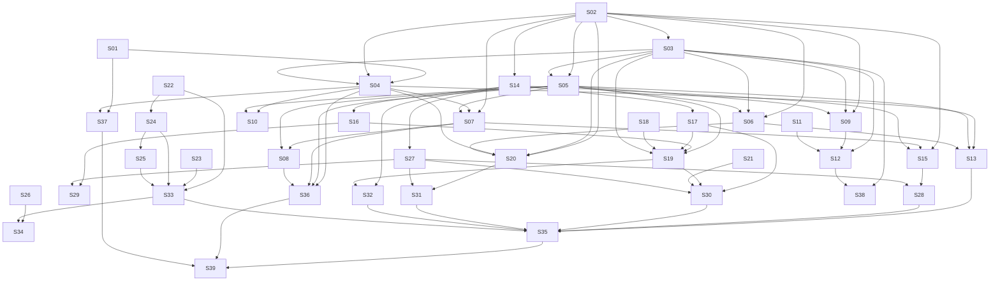

# M26 — Tenant Billing: BR Collection, Self-Signup & Launch

**Phase:** Local Development
**Goal:** Turn the dark Billing foundation of M25 into a product Ikaro can charge for in Brazil: the **money loop** (issue the next charge, handle the provider webhook, sweep statuses, reconcile, self-heal, dunning, billing emails), everything a **manager** needs to see and do about their subscription (billing page, payment, identity, plan, cancel, reactivate, trial banner), **self-signup** with a free trial on the public `/ikaro-trial` page, the `TRIAL_SIGNUP_CTA` hotsite module, the **real Asaas adapter** with its nightly sandbox contract job, alerts/runbooks, and the launch-readiness story. The whole loop is built and tested against the `FakeBillingProvider` from M25 first; the real provider is the last backend story, so nothing before it needs a provider account.
**Depends on:** M25 (the `billing` schema and first-schema tables, `Subscription` / `BillingAccount` / `FeaturePrice` aggregates, `TenantAccessPort`, `IClock`, `BillingProviderPort` + `FakeBillingProvider` + contract-suite skeleton, the operator touchpoints, the suspension / hotsite / notification enforcement, the `exempt` backfill). M26 never redoes any of it; every M25 story it relies on is named in that story's `Dependencies`.
**Blocks:** M27 (purge / discard / deactivation), M28 (Stripe / US), M29 (automatic collection), M30 (annual billing) — reserved, drafted when their gates open (see `## Reserved follow-ups`).
**Design rationale:** `docs/discovery/tenant-billing/tenant-billing.md` (promoted via `/discovery-to-milestone` on 2026-10-29) — kept as the permanent *why*; this file and the canonical docs it cites (`docs/USE_CASES.md` UC-110–145, `docs/DOMAIN_MODEL.md` § Context 7: Billing Context, `docs/DOMAIN_EVENTS.md` § Billing Context Events, `docs/DATABASE_SCHEMA.md` § Schema: `billing`, `docs/API_CONTRACTS.md` § Billing — …, `docs/LOCK_CATALOG.md` § Billing locks, `docs/RUNBOOKS.md` § Billing (planned), `docs/OBSERVABILITY_STRATEGY.md` § 7, `journeys/manager/billing.md`, `journeys/guest/ikaro-trial.md`) are the implementation source. Where a canonical doc and the discovery doc differ, the canonical doc wins.

---

## Follow-up milestones to write (reminders — nothing here is drafted yet)

M27–M30 have numbers and outlines (§ Reserved follow-ups below) but **no milestone files and no stories**. Draft each one with the same milestone-drafting steps used for M25/M26 (group its UCs into stories, sequence the waves, write the stories, audit), working from the already-promoted canonical docs — no new `docs/discovery/` folder is needed unless the "Needs first" column says so.

| Milestone | Write it when | Needs first |
|---|---|---|
| **M27** purge / discard / deactivation (UC-132, 141, 142) | **Before M26 launches** (a launch condition: M26-S39). The first possible erasure is 90 days after the first real suspension, which can only happen after launch. | A short discovery for the per-context deletion rules (what each of the nine contexts erases, what it keeps for fiscal reasons) and for who emits `TenantDeactivated`; the M17-S51 data inventory feeds it. |
| **M29** Pix Automático + hosted card (UC-135, 143) | When the real Asaas production PJ account is live (M26-S39 observed) | The end-to-end Pix Automático verification in sandbox and production; for card, the spike's F2 checks (M25-S01). No new discovery. |
| **M30** annual billing (UC-144, 145) | When the owner sets the annual prices | The annual price list. No new discovery. |
| **M28** Stripe / US (no UC of its own) | When a Stripe account exists and the accountant has decided US sales-tax handling | The accountant's decision and real Stripe fees; a short discovery only if the tax decision changes how tax lines work. |

Until M27 is written, `summary.canDiscard` stays `false` and the `billing-tenant-purge` cron stays disabled (see Non-Goals).

---

## Non-Goals

- **Purge, discard and deactivation (UC-132, UC-141, UC-142).** M27. The `billing.tenant_purge_*` tables already exist (M25-S03) but no M26 story reads or writes them. Consequences that M26 states rather than hides: `summary.canDiscard` is always `false` in M26 (no purge participant has shipped), UC-127 A3's second action is replaced by the honest "contact Ikaro" message, and the `purgeAt` clean-up date is shown on the suspended page but no job acts on it. The `billing-tenant-purge` trigger is **not** registered.
- **Automatic collection (UC-135 Pix Automático, UC-143 hosted card), annual billing (UC-144, UC-145), Stripe / US (no UC of its own).** M28–M30. The "Cobrança automática" tab renders the "Em breve" state (UC-117) with no endpoint behind it; `cycle` is always `MONTHLY`; the BR billing flow is tax-inclusive (`taxMinor = 0`, `taxLines = []`); the US option is not offered (`FEATURE_FLAG_SIGNUP_US` stays off, UC-127 A7). No `charge_tax_lines`, no `next_cycle` handling, no `origin = PROVIDER_SUBSCRIPTION` charges are written.
- **UC-129 (first-run onboarding checklist).** Delivered only if M24's onboarding wizard (UC-075) ships; an M24 follow-up, not a story here.
- **Self-service data export and the per-context deletion rules of the purge pipeline.** No use case yet (M27 outline only).
- **Changing the commercial catalog.** The offered features, tiers, prices, chatbot caps and the Plus model were settled in M25-S02; M26 consumes them (S21 maps tier → model and caps in code).
- **A manual "mark paid" route or any operator payment override.** None exists by design (`docs/API_CONTRACTS.md` § Provider port): a payment the provider confirmed but Ikaro missed is repaired by reconcile.
- **Promoted-but-unused concepts (milestone check).** The `charge_tax_lines` / `next_cycle` / `ADDON` / `origin` pieces of the first schema and `startAutoBilling` / `revokeAutoBilling` on `BillingProviderPort` are promoted for fidelity of the first schema and the port, built by no M26 story, and owned by M28–M30. `tenant_purge_jobs` / `tenant_purge_steps` are owned by M27.

## Known open items

- **Gates the owner must open (not code):** (1) the Asaas **production** PJ account (KYC lead time unknown) and the NFS-e configuration in the Asaas account; (2) the accountant's confirmation that provider-automatic NFS-e satisfies the Brazilian duty; (3) the **Terms of Use and Privacy Policy** texts and their versions (UC-127 step 3, `acceptedTermsVersion`), supplied by the owner / legal — M26-S33 hosts them but does not write them; (4) the Asaas facts that M25-S01 could not verify (webhook re-enable through the API, `invoiceUrl` behaviour after the due date) are re-checked by M26-S37 against the real adapter. Stories S37 and S39 are marked **GATE**.
- **Trigger-name convention (verify at S05):** the canonical docs name the cron triggers `billing-issue-charges`, `billing-status-sweep`, … while the repo's trigger constants are `cron-…` strings that also become the literal Pub/Sub topic (`ikaro-${name}`) and that `infra/terraform/modules/scheduler/variables.tf` validates one-to-one against a `google_cloud_scheduler_job` (precedent: `CRON_LEAD_FORM_RETENTION_TRIGGER = 'cron-lead-form-retention'`). S05 (the first cron) settles the constant values with that rule in hand; if the registered name differs from the doc, the same story corrects `docs/API_CONTRACTS.md` § Billing cron triggers, `docs/RUNBOOKS.md` and `docs/CI_CD_PIPELINE.md` — the doc follows the code that the infra validation forces.
- **HTTP statuses "decided at story discovery":** `BILLING_CHARGE_NOT_PAYABLE` and which charge statuses count as not payable (S15); the rejections of `PUT /v1/billing/plan` (`BILLING_FEATURE_DEPENDENCY_UNMET`, `…_HAS_DEPENDENTS`, `…_IN_USE`, `…_PLAN_EMPTY`, `…_PLAN_CHANGE_NOT_ALLOWED`, `…_NO_PRICE_FOR_COUNTRY`, `…_ADDRESS_REQUIRED`) (S19); the status of `GET /v1/public/signup/session` without a valid cookie, of `resend` when the first manager already exists, and the public mapping of `BILLING_US_NOT_AVAILABLE` / `BILLING_NO_PRICE_FOR_COUNTRY` (S24, S25); the error code and `violations[]` shape for a non-owner using `TRIAL_SIGNUP_CTA` (S26). Each is flagged in the story that implements it, never guessed.
- **`SubscriptionBanner` mount point (S32):** the dashboard has no single shared layout (`docs/DASHBOARD_FRONTEND_ARCHITECTURE.md` § Staff/Manager Shell); where the banner mounts once above the page content is settled at S32's story discovery.
- **Other story-discovery items:** the signup session cookie name, the `/ikaro-trial` rewrite mechanism and its CSP allowance (S24, S33), the mechanism by which the editor learns that a tenant is the platform owner (S26 / S34), the internal route that carries Platform's signup use case from the BFF (S24), the response shape of `GET /internal/billing/tenants` extensions, and the `Money` / `MinorAmount` reuse (settled in M25-S04).
- **M24 interaction (recorded, built here):** the BOOKING-removal guard (S18) must also count M24's class-session bookings, enrollments and waitlist entries when those exist; the story states it as an acceptance criterion with a "recount when M24 lands" note. M24's own routes are annotated by whoever lands them after the M25 detector flip (`plan/M24-…` § Billing interaction).
- **M17-S51 (recorded, not a story):** the manual offboarding runbook stays the interim path for erasing a never-paid tenant (UC-127 A3 message, `docs/RUNBOOKS.md` § Billing "Interim" entry) until M27.
- **Percentage-adjust and exact price changes (S38)** may follow launch; the launch does not depend on them (prices are seeded in M25-S04). Listed in the last wave on purpose.

---

## Build order

| Wave | Story | Theme |
|---|---|---|
| 1 | M26-S01 | Provider secrets and webhook env contract (devops) |
| 1 | M26-S02 | `Charge` aggregate, `ChargeLine`, provider-event inbox, recovery-charge factory |
| 1 | M26-S03 | Billing domain events, audit-log lines and topics (devops half) |
| 1 | M26-S04 | Provider webhook — BFF route, internal processing, exact-200 contract (UC-114) |
| 1 | M26-S05 | Issue the next charge + creation retry + `billing-issue-charges` trigger (UC-113) |
| 1 | M26-S06 | Status sweep + `billing-status-sweep` trigger (UC-115) |
| 1 | M26-S07 | Reconcile + `billing-reconcile` trigger + single-charge refresh (UC-116) |
| 1 | M26-S08 | Self-heal, provider health, suspension freeze + trigger (UC-140) |
| 1 | M26-S09 | Dunning reminders + `billing-reminders` trigger (UC-139) |
| 1 | M26-S10 | `provider_events` retention purge + trigger (UC-114) |
| 1 | M26-S11 | Notification: platform-scoped template lookup + Billing templates (UC-124 precondition) |
| 1 | M26-S12 | Billing email handlers (UC-124) |
| 1 | M26-S13 | Dev simulate and seed endpoints (UC-138) |
| 2 | M26-S14 | Manager reads — summary and charge history (UC-117) |
| 2 | M26-S15 | Payment link and payment return (UC-119) |
| 2 | M26-S16 | Billing identity read and save (UC-118) |
| 2 | M26-S17 | Plan reads — catalog and preview (UC-136) |
| 2 | M26-S18 | BOOKING removal guard and the `bookableUntil` window cap (UC-136 A11) |
| 2 | M26-S19 | Plan save and trial confirm (UC-136, UC-130) |
| 2 | M26-S20 | Cancel and reactivate (UC-133, UC-134) |
| 2 | M26-S21 | Chatbot tier → model and caps mapping (Platform) |
| 3 | M26-S22 | Slug rules and availability (UC-128) |
| 3 | M26-S23 | Public prices (UC-128) |
| 3 | M26-S24 | Self-signup — session, trial rule, signup use case, BFF routes (UC-127) |
| 3 | M26-S25 | Signup resend (UC-127 A10) |
| 3 | M26-S26 | `TRIAL_SIGNUP_CTA` contract and owner-tenant restriction (UC-131) |
| 4 | M26-S27 | Billing page shell, Resumo and Cobranças tabs (UC-117) |
| 4 | M26-S28 | "Pagar agora" — payment link, return, polling (UC-119) |
| 4 | M26-S29 | "Dados de cobrança" tab (UC-118) |
| 4 | M26-S30 | "Plano" tab and "Confirmar plano" (UC-136) |
| 4 | M26-S31 | Cancel and reactivate pages (UC-133, UC-134) |
| 4 | M26-S32 | `SubscriptionBanner` and the suspended-manager repoint (UC-130, UC-121) |
| 4 | M26-S33 | `/ikaro-trial` public pages, Terms and Privacy hosting (UC-127, UC-128) |
| 4 | M26-S34 | `TRIAL_SIGNUP_CTA` component and editor panel (UC-131) |
| 5 | M26-S35 | Money-loop and suspended-experience E2E on the fake |
| 5 | M26-S36 | Alert policies, KPIs and as-built runbooks (devops) |
| 5 | M26-S37 | Real `AsaasBillingProvider`, sandbox contract run, nightly job **[GATE]** |
| 5 | M26-S38 | Operator price changes — exact, percentage, announcement fan-out (UC-112) |
| 5 | M26-S39 | Launch readiness **[GATE]** |

Wave notes (a wave is a sequencing guarantee, not a concurrency one — see `## Run-batch preview`): **Wave 1** is backend only and runs entirely on the fake provider; there is no Wave 0 in M26 because M25 already owns the migration / backfill safety (the schema and the `exempt` backfill exist before any M26 code runs, and M26 adds **no migration of an existing table** — only data and, in S11, a notification template migration). **Wave 2** is backend / BFF for the manager and starts after the charge model (S02). **Wave 3** is backend / BFF / packages for signup and the hotsite module contract. **Wave 4** is frontend only and starts after the backend stories it reads from. **Wave 5** is the E2E, the observability / runbook work, the real adapter and launch readiness — the real adapter (S37) is deliberately last among the backend stories: everything before it is proven against the fake, and the nightly contract job then proves the fake and Asaas agree.

---

## Design & test strategy (milestone-level)

**Shared patterns (decided once; every story cites them).**
- **M26-D1 — One use case, three entry points.** Applying a provider fact to a charge and its subscription is a single application service (`ApplyChargeFactUseCase`, introduced by S04) called by the webhook (UC-114), by reconcile (UC-116) and by the on-demand refresh behind `payment-return` (UC-119). The paid-state transition, the reactivation of a `PAST_DUE` / `SUSPENDED` subscription and the recovery-charge settlement therefore exist **once**; S07 and S15 add entry points, never a second copy of the rules.
- **M26-D2 — `Charge` is its own aggregate; paying it touches two aggregates in one use case.** `Charge` (S02) is not a child of `Subscription` (one per period forever). `ApplyChargeFactUseCase` loads the subscription with `findByIdForUpdate` (lock **B-R1**, `docs/LOCK_CATALOG.md` § Billing locks) first, then writes the charge through `chargeRepo.save()`; the order is subscription → charge rows, never the reverse, in every M26 use case (S04, S06, S19, S20). Status is recomputable, so the invariant never rests on the lock alone (`Subscription.version` is the second line).
- **M26-D3 — Provider I/O is never inside `txManager.run()`.** Charge creation is two steps: insert the `Charge` + lines (`provider_creation_status = PENDING`) and advance `next_due_date` in one transaction; call the provider **after** commit; store `READY` (id, URL, expiry) in a second short transaction; publish `ChargeIssued` only after `READY` (S05). The same shape applies to cancelling a stale charge at the provider (S06, S19, S20) and to creating the recovery charge at the provider (S06, S20): the local state is saved first (a `PENDING` recovery charge), the provider call follows after commit, `READY` is stored in a second short transaction; the provider side of a cancel is retried by reconcile and a `PENDING` recovery charge by S05's retry. CI enforces it (`transactional-io`); S04, S05, S06, S07, S15, S19 and S20 each carry the acceptance criterion.
- **M26-D4 — Idempotency lives in the database.** `UNIQUE(tenant_id, subscription_id, period_start)` (ignoring cancelled charges) makes a double-run issue job a no-op; `provider_events(provider, event_id)` makes a replayed webhook a `200` no-op; the unique constraint on open recovery charges (`UQ_billing_charges_open_recovery`, M25-S03 — catalogued in `docs/LOCK_CATALOG.md`; it is **not** the lock-catalog id B-Q1, which is the purge-job unique owned by M27) makes a double suspension or double reactivate return the same recovery charge. Every job and handler states its redelivery behaviour as an acceptance criterion.
- **M26-D5 — The seven-trigger family.** Six cron triggers are built in M26 (issue, sweep, reminders, reconcile, self-heal, provider-events purge); the seventh (tenant purge) is M27. Each is registered with `ITriggerBus.registerTrigger(name, handler, consumer)`, passes an explicit `tenantId` to every use case (no `RequestContext`), skips `exempt` subscriptions, uses the shared `TenantScopedJob` helper (M25-S22) with **`includeSuspended: true`** for the sweep, reconcile, reminders and self-heal (they must run for non-operational tenants — a `SUSPENDED` tenant with an open recovery charge is exactly what reconcile and the reminders serve), selects its tenants through its own **standalone index** (created in M25-S03; each job story re-checks the index covers its filter), and has a thin manual publisher `POST /cron/billing-…` behind `InternalApiGuard` (`CronLeadFormController` is the precedent). Each trigger story owns its devops half (scheduler job, topic, subscription) with the playbook row and a live-verification check.
- **M26-D6 — Emails are event handlers.** Billing never calls Notification; domain events (S03) feed handlers (S12) that call one send use case each, using platform-level templates (S11). Billing templates are exempt from the suspension gate (M25-S23).
- **M26-D7 — BR is tax-inclusive.** `taxMinor` is `0` and `taxLines` is `[]` for every M26 charge; the field shapes exist so M28 does not change the contract.
- **M26-D8 — Money is integer minor units + ISO currency** (M25-D4); the Billing-local `MinorAmount` VO from M25-S04 is used everywhere.
- **M26-D9 — Everything is proven on the fake first.** The contract suite from M25-S14 runs on the fake on every PR; S37 runs the same suite against the Asaas sandbox and adds the nightly job. A scenario the fake can produce (Pix `RECEIVED` only; boleto `CONFIRMED` → `RECEIVED`; card `CONFIRMED` then `RECEIVED` ~32 days later; duplicates, delays, out-of-order, provider 5xx) is a named integration test in the story that owns the behaviour.

**Aggregates and boundaries (named pass).**
- `Charge` (root): kind (`PERIOD` | `RECOVERY`; `ADDON` is M30), period dates (null forever for `RECOVERY`), due date (tenant-timezone date), immutable `ChargeLine` snapshot (feature, tier, unit price), subtotal / amount, status (`PENDING | PAID | OVERDUE | FAILED | CANCELED | REFUNDED | CHARGEBACK`), method, `paidAt`, provider ids and URL, `paymentReturnSeenAt`, `refundedAmountMinor`, `providerCreationStatus`. Invariants in the aggregate: legal status transitions (a paid charge can only become `REFUNDED` / `CHARGEBACK`; a cancelled one never becomes paid unless the provider proves it was paid), immutability of the lines and amounts after insert, only status / payment fields written afterwards.
- `Subscription` / `BillingAccount` change only through methods defined in M25-S08 plus the payment-driven transitions M26 adds, each owned by the **first** story that needs it (one name everywhere): **S04** `markPeriodPaid`, `reactivateOnPayment`, `suspend(reason)` (incl. `PAYMENT_REVERSED`) and the `BillingAccount` cross-tenant lookup by provider customer id; **S05** the `BillingAccount.provider_customer_id` setter; **S06** `markPastDue`, `activateAfterTrial`; **S19** `scheduleItems`, `confirmPlan`; **S20** `scheduleCancel`, `clearCancel`. Each new method gets a unit test next to the M25 ones; M25-S08 states that these are M26's.
- `ProviderEvent` is an inbox record per `docs/DATABASE_SCHEMA.md` § `billing.provider_events` (PK `(provider, event_id)`, `tenant_id` NOT NULL, `event_type`, `received_at`, `processed_at`; **no payload column**), not an aggregate; `SignupRegistration` is the M25-S09 thin record.
- **Cross-aggregate check:** the only pair that must stay consistent in one transaction is `Charge` + `Subscription` (payment, recovery, cancel-and-reissue); M26-D2 states the order and the lock. No other M26 story needs two aggregates consistent.
- **Unused-promotion check:** `ProviderEvent` and `Charge` are owned here; the tax / cycle / purge tables are not (Non-Goals).

**Locks and constraints (all in `docs/LOCK_CATALOG.md`; each needs a named test).**
- **B-R1** (S04, S06, S19, S20): *concurrency test — a webhook confirming a payment racing the status sweep on the same subscription serialises and the paid state wins* (S06 owns it; S04 owns "two webhooks for one charge"); a manager's cancel racing a webhook (S20).
- **`UQ_billing_charges_open_recovery`** (S02 repository, S06, S20): *concurrency test — two simultaneous suspensions / reactivations produce exactly one open recovery charge.*
- **B-A1** (M25-S09) is exercised end to end by S24: *concurrency test — two simultaneous self-signups for one Google account produce exactly one trial.*
- Every lock port method added by an M26 story is catalogued in `docs/LOCK_CATALOG.md` (CI: `lock-catalog-coverage`); the story that implements a lock or unique **names its concurrency test next to the catalog row** (`docs/LOCK_CATALOG.md` checklist) — S02, S04, S06, S19, S20 and S24 therefore list `docs/LOCK_CATALOG.md` in Files.

**Migration ordering.** M26 adds **no migration of an existing table**. Data migrations only: S11's notification template seed (platform-scoped rows with `tenant_id IS NULL`, both languages, kept out of the per-tenant default copy by the key set described in S11) and nothing else; `charges`, `charge_lines` and `provider_events` already exist from M25-S03. Code that reads `charges` ships after S02. The Notification change in S11 is an additive lookup — the existing tenant-strict lookup is untouched.

**Cross-context edges (milestone-level).** M26 adds exactly: one exact-path `permittedEdges` entry for Billing → Booking (S18) and, in Notification, nine exact-path entries for the handlers importing Billing event / command classes (S12); the Billing → Platform tenant-info edge from M25-S13 only gains one target path (S08). Everything else is an event, a BFF call or an existing port.

**Performance.** (1) The hourly sweep, the daily issue / reminders / reconcile jobs and self-heal are **cross-tenant, unscoped system jobs**: each selects through the standalone partial index named in `docs/DATABASE_SCHEMA.md` § `billing.subscriptions` / `billing.charges` (`next_due_date`, open-charge status, `suspended_at`, `trial_ends_at`), batches its work, processes one subscription per transaction, and is bounded by a per-run limit so one slow provider call cannot starve the rest (CLAUDE.md §7 "cross-tenant, unscoped system job"; `EXPLAIN` asserted in each job's integration test). (2) The charge history is paginated by `(tenant_id, due_date DESC)`. (3) The webhook route is hot under a provider retry storm: it does one indexed insert (the inbox), one indexed charge lookup and one subscription row lock; it is `@SkipThrottle()` and returns `200` after commit. (4) The public price and slug routes are cacheable / throttled (S22, S23) so the public page cannot become a database hit per visitor.

**Backward compatibility.** M26 changes existing behaviour in three places only: Platform's `ProvisionTenantUseCase` is *called by* the new signup use case (it is not modified here — its M25-S10 changes already shipped), the hotsite module registry gains a 13th type (S26 — existing tenants, templates and the editor are unaffected because the type is owner-only and absent from templates), and Booking gains a read use case plus a `bookableUntil` input honoured by every window consumer (S18). **Non-regression contract, owned by S18:** with no `bookableUntil` set (every tenant today), every booking-window consumer returns exactly what it returned before — asserted by running the existing window / availability / recurring / alert integration suites unchanged plus a new table-driven test that a `null` cap equals today's result.

**Test pyramid.** Unit (`.spec.ts`) for the aggregate, VOs, use cases, handlers, mappers; integration (`.integration.spec.ts`) per use case with tenant-isolation scenarios and the named concurrency tests; the contract suite on the fake every PR and on the Asaas sandbox nightly (S37); E2E (Playwright) only in the frontend stories and the cross-cutting S35 (money loop on the fake, per-role suspended experience). The mocked-vs-real rule: provider behaviour is never `jest.fn()`-stubbed — the fake adapter is used (`no-jest-fn-for-repository-or-port`).

**Spanning scenario (golden path), implemented by S35 (Playwright) with backend integration slices in S04–S06 and S24:**
visitor opens `/ikaro-trial` (S33), signs up with Google, tax id and terms (S24) → `TenantProvisioned` creates a `TRIALING` subscription (M25-S11) and the first-manager invitation → the manager signs in and sees the **trial banner** (S32) and the Resumo (S27) → confirms the plan (S30/S19) → `simulate` advances time (S13 + M25-S12) to ten days before trial end → the **issue job** creates the first charge (S05) → the manager opens "Pagar agora" (S28/S15) → `simulate` delivers a Pix `PAID` event (S13/S04) → the webhook marks the charge paid and the page leaves "pagamento recebido, reativando…" (S27) → time advances past trial end → the **sweep** turns the subscription `ACTIVE` (S06) → a later charge goes unpaid → `PAST_DUE` banner (S32) → past 14 days the sweep suspends and issues the recovery charge → the manager lands on the billing page with "Pague 1 mês para reativar" (S32/S27) → pays → `ACTIVE`. **Observation side confirmed:** every actor-visible state in this scenario has a supplying read — status / dates / open charge / history (S14), payment pending flag (S14 + S15), banner states (S14 `summary` fields), suspended page + recovery charge (S14), plan state (S17), signup eligibility and account-created state (S24), operator investigation list (M25-S15).

**Interim / infra.** One shared devops story for provider secrets and the webhook env (S01); every cron, event-topic or new-subscription story owns its devops half with the playbook row from `infra/terraform/README.md` § New-resource PR-sequencing playbook and a named live-verification check (CLAUDE.md §9); alert policies and KPIs in S36; the nightly sandbox workflow in S37. Terraform / IAM / Pub/Sub / CI-CD stories are never presented merge-ready without their live check.

---

## Reserved follow-ups (not drafted until their gates open)

- **M27 — Purge, discard, deactivation** (UC-132, UC-141, UC-142). *Gate:* the first possible erasure is 90 days after the first suspension, so M27 must ship before the first suspended tenant ages out; the `billing-tenant-purge` cron stays disabled until all nine purge participants (storage, provider cancellation, Billing anonymization, the seven bounded-context deletions) ship, and `summary.canDiscard` flips on only then. Open there: the per-context deletion rules, the emitter of `TenantDeactivated` (sequenced with M17-S51), the self-service data export (no UC yet).
- **M28 — Stripe / US** (no UC of its own; cross-cuts UC-113, 114, 118, 127, 128). *Gate:* a Stripe account, the accountant's US sales-tax decision and real Stripe fees; adds `charge_tax_lines`, `StripeBillingProvider`, the US price list and `FEATURE_FLAG_SIGNUP_US`.
- **M29 — Automatic collection** (UC-135 Pix Automático, UC-143 hosted recurring card). *Gate:* the real PJ account with a CNPJ active for 6+ months and the end-to-end Pix Automático verification in sandbox and production; F2 also needs the spike's F2 checks.
- **M30 — Annual billing** (UC-144, UC-145). *Gate:* the owner sets the annual prices; adds `cycle`, `next_cycle*`, the co-terminus `ADDON` charge and the 30-day annual issue lead.
- Numbers M27–M30 are reserved; M115 is reserved by CLAUDE.md and skipped.

---

## Wave 1 — Money loop on the fake provider (backend)

### M26-S01 — Provider secrets and webhook env contract

**Agent:** `devops`
**Complexity:** S
**Docs to load:** `infra/terraform/README.md` § New-resource PR-sequencing playbook (the "new secret" rows) and § Gotchas, `docs/ENGINEERING_RULES_INFRA.md` § Billing configuration (planned) — live adapters, fake/sandbox keys, the staging email allowlist and the scheduler jobs, `infra/terraform/SECRETS.md`, `docs/USE_CASES.md` UC-114 (preconditions), `docs/API_CONTRACTS.md` § Billing — Provider Webhooks and Internal API (authenticity)
**Dependencies:** M25-S07 (the billing env contract already carries the kill switch, owner slug, allowlist and the signup-US flag), M25-S01 (the sandbox spike confirms the secret names and the webhook token mechanism)
**Pattern:** plain composition — Secret Manager containers wired through the existing `secret_env_vars` and the env contract; no new module.

**Description:**
Create the provider secrets and the environment variables the money loop and the real adapter need, in the order the Terraform playbook requires, so no later story is blocked on an infra side-effect. Secrets (one container each, sandbox and live separate entries): the Asaas API key, the Asaas webhook authentication token (the value the BFF compares timing-safe against `asaas-access-token`), and the `merchant_profile_key` is **not** a secret and not an env var of its own — it is data on the subscription, chosen per environment (`BRL_FAKE` local / CI, `BRL_ASAAS_SANDBOX` staging, the live key in production; the names come from the config guard written in M25-S14). Env vars added to `apps/backend/src/config/env.validation.ts`, `apps/bff/src/config/env.validation.ts` (the BFF needs the webhook token because it verifies it, **not** the API key) and `packages/infra-scripts/src/env-contract.ts`: `ASAAS_API_KEY` (backend only) and `ASAAS_WEBHOOK_TOKEN` (BFF and backend) — exactly the two names `docs/ENGINEERING_RULES_INFRA.md` § Billing configuration (planned) lists (the Asaas base URL is a constant of the adapter selected by `APP_ENV`, decided with M25-S14's guard, not an env var). `FEATURE_FLAG_SIGNUP_US` already exists from M25-S07 (default `false`) and is **not** re-added here; `TURNSTILE_SECRET` is not new either (the lead-form has it). No `STRIPE_*` secret is created here: Stripe is **M28** (M25-S07 says so too). **Pre-launch, no real traffic depends on the next deploy succeeding, so the two-PR secret row applies — provided this PR creates no new Pub/Sub subscription (rule 3)**: PR1 creates the containers and wires `secret_env_vars` and the schema entries together; PR2 is the `foundation`-only accessor-grant PR for the new secrets (the playbook's row 81 sequences the grant after the containers exist) followed by the manual step of populating the **sandbox** values (the production values are populated by S39, not here). No scheduler job or topic is added in this story — each trigger story owns its own.

**Backend use case steps:** none.
**Backend HTTP surface:** none.
**New migration / i18n keys / env vars / feature flags:** the two secrets above; `FEATURE_FLAG_BILLING_ENFORCEMENT` and `FEATURE_FLAG_SIGNUP_US` were added in M25-S07.

**PR sequence:** 2 PRs — matches the playbook row "Same, but a temporary broken deploy is acceptable (pre-launch …) and this PR does not also create a new Pub/Sub subscription".
- PR1: `infra/terraform/envs/{staging,prod}/` secret containers + `secret_env_vars` wiring + the three `env.validation.ts`/`env-contract.ts` schema entries together (satisfies `env-contract` immediately). Needs no `infra-app-mix-ok` unless `apps/**` and `infra/terraform/**` are touched together — they are (schema entries + Terraform), so apply the `infra-app-mix-ok` label for this coupled change.
- PR2 (`foundation` only — the accessor grants for `cloudrun_backend` / `cloudrun_bff` on the new secrets, if the secrets module does not derive them) **then the manual, explicit step**: populate the sandbox secret versions in Secret Manager for staging; confirm the service redeploys healthy. The production secret versions are **not** populated here.

**IAM / permissions:** the runtime service accounts of `cloudrun_backend` and `cloudrun_bff` read their own secret versions (`roles/secretmanager.secretAccessor` on the specific secrets) — same pattern as the existing secrets; no new principal.
**Live-verification check:** on staging after PR2: (1) `gcloud secrets versions access latest --secret=<asaas-webhook-token>` returns a value with the operator's own identity (never pasted in a PR or log); (2) `gcloud run services describe <backend> --format='value(spec.template.spec.containers[0].env)'` shows the new var names bound to secrets; (3) a fresh revision starts and `/health/ready` is 200 (a missing secret fails the revision, not silently); (4) the ingress and `vpc_egress` check required by `docs/ENGINEERING_RULES_INFRA.md` § Billing configuration (planned): the webhook path is reachable from the public internet through the BFF's ingress, and Ikaro's outbound calls to Asaas leave through the configured egress (`gcloud run services describe <bff> --format='value(spec.template.metadata.annotations)'` shows the ingress and `vpc-access-egress` values read against § Cloud Run `vpc_egress` mode). Pass = all four observed.

**Files to create/modify:**
- `apps/backend/src/config/env.validation.ts` (+ its spec) (modify)
- `apps/bff/src/config/env.validation.ts` (+ its spec) (modify)
- `packages/infra-scripts/src/env-contract.ts` (modify)
- `infra/terraform/envs/staging/main.tf`, `infra/terraform/envs/prod/main.tf` (modify — `secret_env_vars` wiring of the new secrets in `cloudrun_backend` and `cloudrun_bff`)
- `infra/terraform/SECRETS.md` (modify — document the new entries)
- `docs/ENGINEERING_RULES_INFRA.md` § Billing configuration (planned) (modify only if the implemented variable names differ from the doc)

**Acceptance criteria — product:**
- [ ] No tenant-visible change.
- [ ] The backend and BFF refuse to start in `production` without the Asaas webhook token and (backend) API key, and in any environment with a `*_FAKE` profile key paired with a live base URL.

**Acceptance criteria — technical:**
- Unit:
  - [ ] Each env schema entry (`ASAAS_API_KEY`, `ASAAS_WEBHOOK_TOKEN`): present / missing / malformed, required in `production` (including the fake-key-in-production rejection already unit-tested by M25-S14's guard)
- Integration: none — configuration only
- Tenant isolation: none — no tenant data
- E2E: none
- [ ] Checkov / Tfsec clean
- [ ] `env-contract` check passes (`pnpm --filter @ikaro/architecture-check check`)
- [ ] Coverage ≥80% on changed code
- [ ] `tsc --noEmit` clean, lint clean

---

### M26-S02 — `Charge` aggregate, `ChargeLine`, provider-event inbox, recovery-charge factory

**Agent:** `backend-ts`
**Complexity:** L
**Docs to load:** `docs/DOMAIN_MODEL.md` § Aggregate: Charge and § Context 7: Billing Context (price snapshot, immutability), `docs/DATABASE_SCHEMA.md` § `billing.charges`, `billing.charge_lines`, `billing.provider_events`, `docs/LOCK_CATALOG.md` § Billing locks (B-R1; the open-recovery unique), `docs/TESTING_STRATEGY.md` § Integration test DB isolation (entity registration in the harness), `docs/USE_CASES.md` UC-113 (main flow 1–3), UC-114 (steps 2, 4), UC-134 (main flow), `docs/ENGINEERING_RULES_BACKEND.md` § Billing (planned) (provider webhooks, PENDING→READY recipe) and § Transactions, `docs/AGENT_PATTERNS.md` (aggregate / repository), `docs/ENGINEERING_RULES_TESTING.md` § Shared test-builder date defaults
**Dependencies:** M25-S08 (`Subscription`, repositories, `findByIdForUpdate`), M25-S04 (`FeaturePrice`, `MinorAmount`, `getFeaturePriceAt`), M25-S12 (`IClock`), M25-S14 (`BillingProviderPort` types)
**Pattern:** Aggregate root with an immutable child snapshot; Repository + Adapter; a **domain factory** (`RecoveryChargeFactory`) shared by the sweep, reactivate and retry.

**Description:**
Give the money its model. **`Charge`** (root, `apps/backend/src/contexts/billing/domain/charge.aggregate.ts`) carries kind (`PERIOD` | `RECOVERY`), period dates (null for `RECOVERY`), due date, immutable `ChargeLine[]` price snapshot, `subtotalMinor` / `amountMinor` (equal for BR; the field exists so M28 can fill tax), status, method, `paidAt`, provider ids / payment URL / expiry / `receiptUrl`, `paymentReturnSeenAt`, `refundedAmountMinor`, `providerCreationStatus`. Behaviour: `markPaid(method, paidAt, now)` (idempotent — a second paid fact is a no-op), `markOverdue`, `cancel`, `markRefunded` (full or partial), `markChargeback`, `markCreationReady(providerChargeId, paymentUrl, expiresAt)`, `markCreationFailed` (increments `provider_creation_attempts`, which S05's "after N failures" alert reads; the column exists in the M25-S03 schema), `recordPaymentReturn(now)`; `FAILED` is a documented status with **no M26 transition into it** (reserved for M29's automatic collection) and is covered by the transition table as unreachable; illegal transitions throw a typed domain error (a `PAID` charge can only become `REFUNDED` / `CHARGEBACK`; a `CANCELED` one cannot be paid by a local event — only a provider-confirmed fact, applied by S04, may revive it, because "the provider could not cancel it because it was already paid" is the one legal case, UC-114 step 4). **`ChargeLine`** is a plain immutable value (`featureKey`, `tier`, `unitPriceMinor`). **`RecoveryChargeFactory`** builds the one-month `RECOVERY` charge for a subscription: the amount fixed at issue from the price versions in force **that day** (`getFeaturePriceAt`), lines = the subscription's current items, due date = today + `RECOVERY_CHARGE_DUE_DAYS` (7, `docs/DOMAIN_MODEL.md` § Context 7: Billing Context (constants) — a charge due today would be `OVERDUE` on the next sweep), no period dates; it is the single place the recovery rule lives (UC-115 step 3, UC-134, UC-113 A2). **`ProviderEvent`** is a thin inbox record exactly as `docs/DATABASE_SCHEMA.md` § `billing.provider_events` defines it — PK `(provider, event_id)`, `tenant_id` NOT NULL (the resolved tenant), `event_type`, `received_at`, `processed_at`; **no payload column** (the payload is not stored) — with a repository whose `insertIfAbsent` is `ON CONFLICT (provider, event_id) DO NOTHING` returning whether it inserted (this is how a replayed webhook becomes a no-op without an exception). **Repositories:** `ChargeRepository` (`save`, `findById`, `findByProviderChargeId`, `findOpenByTenant`, `findOpenRecoveryBySubscription`, `listByTenantPage` ordered `(tenant_id, due_date DESC)`, selection queries for the jobs: charges with `provider_creation_status = PENDING`, charges due soon / overdue, open charges for reconcile), all `tenant_id`-scoped except the explicitly cross-tenant job selectors, which take no tenant and are named `…ForJob`. The unique constraints created in M25-S03 are the backstops (`UNIQUE(tenant_id, subscription_id, period_start)` ignoring cancelled charges; the open-recovery unique `UQ_billing_charges_open_recovery` for open recovery charges); the repository maps a unique violation to a typed `ChargeAlreadyExists` / `RecoveryChargeAlreadyOpen` result the callers treat as "return the existing one".

**Backend use case steps:** none — this story is the model, repositories and factory; use cases arrive with S04–S09.
**Backend HTTP surface:** none.
**New migration / i18n keys / env vars / feature flags:** none (the tables exist from M25-S03; entity mappings only).

**Files to create/modify:**
- `apps/backend/src/contexts/billing/domain/charge.aggregate.ts` (+ `.spec.ts`) (new)
- `apps/backend/src/contexts/billing/domain/charge-line.ts` (+ `.spec.ts`) (new)
- `apps/backend/src/contexts/billing/domain/recovery-charge.factory.ts` (+ `.spec.ts`) (new)
- `apps/backend/src/contexts/billing/domain/provider-event.ts` (new)
- `apps/backend/src/contexts/billing/domain/errors/illegal-charge-transition.error.ts`, `charge-already-exists.error.ts`, `recovery-charge-already-open.error.ts` (new — one file per invariant error; M25-S08's error files are different names)
- `apps/backend/src/contexts/billing/infrastructure/http/billing-error.mapper.ts` (+ `.spec.ts`) (modify — M25-S06 created it; map the three errors, `error-mapper-coverage`)
- `apps/backend/src/contexts/billing/application/ports/charge-repository.port.ts`, `provider-event-repository.port.ts` (new)
- `apps/backend/src/contexts/billing/infrastructure/entities/charge.entity.ts`, `charge-line.entity.ts`, `provider-event.entity.ts` (new)
- `apps/backend/src/contexts/billing/infrastructure/repositories/typeorm-charge.repository.ts`, `typeorm-provider-event.repository.ts` (+ `.spec.ts`, `.integration.spec.ts`) (new)
- `apps/backend/src/test/utils/billing-integration-app.ts` (modify — M25-S03 created it; register the three new entities), `apps/backend/src/test/integration-global-setup.ts` and `apps/backend/src/test/utils/test-datasource.ts` (modify — entity registration; the harness must stay in sync with entities/migrations)
- `apps/backend/src/test/builders/billing/charge.builder.ts`, `charge-entity.builder.ts`, `charge-line.builder.ts`, `charge-line-entity.builder.ts`, `provider-event.builder.ts`, `provider-event-entity.builder.ts` (new — default `uuidv7()` ids; date defaults relative to `Date.now()`)
- `apps/backend/src/contexts/billing/billing.module.ts` (modify)
- `packages/architecture-check/architecture-policy.json` (modify — add the three entities to the `testDataHarnessRegistrations` `entities` array)
- `docs/LOCK_CATALOG.md` (modify — name the open-recovery-unique concurrency test next to its row)

**Acceptance criteria — product:**
- [ ] No tenant-visible change; the model matches `docs/DOMAIN_MODEL.md` § Aggregate: Charge field for field.

**Acceptance criteria — technical:**
- Unit:
  - [ ] Every legal and illegal status transition of `Charge` (table-driven); `markPaid` idempotent
  - [ ] Immutability: lines and amounts cannot change after construction; only status / payment fields are written
  - [ ] `RecoveryChargeFactory`: amount from the version in force **today** (a version effective tomorrow is ignored), lines = current items, no period dates
  - [ ] `ProviderEvent.insertIfAbsent` returns `false` on a duplicate and stores the tenant id and event type, never a payload
  - [ ] Recovery charge due date = today + 7 (boundary test)
- Integration:
  - [ ] `UNIQUE(tenant_id, subscription_id, period_start)` rejects a second period charge and ignores a cancelled one
  - [ ] **Concurrency (`UQ_billing_charges_open_recovery`):** two simultaneous `RecoveryChargeFactory` saves for one subscription produce exactly one open recovery charge; the loser reads the existing one
  - [ ] `provider_events` duplicate insert is a no-op under concurrency
  - [ ] Pagination order and the job selectors use their standalone indexes (`EXPLAIN` asserted)
- Tenant isolation: [ ] a tenant-scoped finder never returns another tenant's charge; a composite FK `(tenant_id, id)` rejects a cross-tenant line
- E2E: none — covered by unit / integration
- [ ] Coverage ≥80% on changed code
- [ ] `tsc --noEmit` clean, lint clean

---

### M26-S03 — Billing domain events, audit-log lines and topics

**Agent:** `backend-ts + devops`
**Complexity:** M
**Docs to load:** `docs/DOMAIN_EVENTS.md` § Billing Context Events (every payload), `docs/ANTI_PATTERNS.md` § A domain event is drained, `docs/ENGINEERING_RULES_BACKEND.md` § Event Handlers (Pub/Sub consumers), `docs/BOUNDED_CONTEXTS.md` § 7. Billing Context (published events), `infra/terraform/README.md` § New-resource PR-sequencing playbook (row: "A new Pub/Sub topic …"), `docs/ENGINEERING_RULES_SHARED.md` § Tenant access enforcement (item on event subscriptions — audit handlers always run)
**Dependencies:** M25-S15 (created `SubscriptionSuspended` / `SubscriptionReactivated`, the outbox publishing pattern and `BillingAuditLogHandler`), M26-S02 (charge types the payloads refer to)
**Pattern:** Domain events through the outbox; one audit-log subscription line per event (the `domain-event-audit-coverage` detector); topics provisioned from `pubsub-catalog.json`.

**Description:**
Define the Billing events M26's use cases publish, **before** any use case publishes them, so each use-case story is not also a topic story and the devops work is done once. New domain events (envelope per CLAUDE.md §4: `eventId` uuid-v7, `tenantId`, `occurredAt`, `correlationId`, `eventName`, `eventVersion`, `data` — exact `data` per `docs/DOMAIN_EVENTS.md`): `ChargeIssued` (charge id, kind, amount, due date, **`paymentUrl`** as `docs/DOMAIN_EVENTS.md` carries it — the email needs the link and Notification reads only event data), `ChargePaid` (charge id, amount, method, paidAt and the **provider receipt URL** — added to the payload here with a one-line `docs/DOMAIN_EVENTS.md` update, because the receipt email links to it), `SubscriptionPastDue`, `SubscriptionCancelled` (`immediate`, `cancelAt`), `PlanChanged`, `SubscriptionPriceChangeAnnounced` (the consolidated per-tenant payload; published only by S38 but defined here so the topic exists once). `SubscriptionSuspended` / `SubscriptionReactivated` already exist (M25-S15) and are only referred to. Each event gets its class in `domain/events/`, a publisher call-site contract (the use cases call `outbox.add(...)` inside their transaction), and a line in `BillingAuditLogHandler` (`subscribe(<Event>.name, …, LogDomainEventUseCase.CONSUMER_NAME)` — the call site is what gives the event a topic). **`BillingReminderDue` is a Command, not a domain event** — the class-versus-command question left open in the promotion is settled here: it is emitted by the reminders job (S09) and its idempotency key is a *business key* `(subscription, kind, daysOffset, chargeId)`, which is exactly what `shared.outbox.dedup_key` carries for a `Command` (`docs/DATABASE_SCHEMA.md` § `shared.outbox`: "the event's `eventId` for a `DomainEvent`, or the caller-supplied business key for a `Command`"; precedent `BookingReminderDue`, published through the outbox like the other cron-emitted messages). It therefore gets `domain/commands/billing-reminder-due.command.ts` and **no** audit-log line (the detector covers `DomainEvent`s). Its **topic is created by its consumer's `subscribe()` call site in S12** (topics are generated from `subscribe()` / `registerTrigger()` call sites, so nothing in S03 can give the command a topic). The same story updates `docs/DOMAIN_EVENTS.md` (the entry is marked `Command`) and `docs/BOUNDED_CONTEXTS.md` (the doc follows the decision, doc gate).

**Devops half (six new event topics).** Each new domain event needs a topic and the audit-log subscription; the reminder command's topic arrives with its consumer in S12. **PR sequence:** 1 PR + 1 Foundation apply per the playbook row "A new Pub/Sub topic (domain event …) + its app code" — PR1 (`infra-app-mix-ok`): the six event classes, the one command class (no topic yet), `BillingAuditLogHandler` lines for the six events, `pubsub-catalog.json` regenerated (`pnpm --filter @ikaro/infra-scripts run pubsub-catalog`), `envs/*` topic wiring; then the manual Foundation apply (`foundation-deploy.yml`, `apply=true`, from `main`).
**IAM / permissions:** publisher = the backend service account (as every domain-event topic); subscriber = the audit-log push subscription's invoker. No new principals.
**Live-verification check:** after the Foundation apply, `gcloud pubsub topics get-iam-policy projects/<staging>/topics/ikaro-ChargeIssued` (and the other five topics) list the publisher and subscriber bindings in **both** projects — an empty `{"etag": …}` means it was never applied (M23-S04 failure mode); then publish one event through the S13 `simulate`/seed path on staging once available, or a one-off backend REPL call, and confirm the audit-log consumer logs it. Pass = all six policies populated and one consumer log observed.

**Backend use case steps:** none (no use case yet publishes; S04–S09 and S19–S20 do).
**Backend HTTP surface:** none.
**New migration / i18n keys / env vars / feature flags:** none.

**Files to create/modify:**
- `apps/backend/src/contexts/billing/domain/events/charge-issued.event.ts`, `charge-paid.event.ts`, `subscription-past-due.event.ts`, `subscription-cancelled.event.ts`, `plan-changed.event.ts`, `subscription-price-change-announced.event.ts` (+ `.spec.ts` each) (new)
- `apps/backend/src/contexts/billing/domain/commands/billing-reminder-due.command.ts` (+ `.spec.ts`) (new)
- `apps/backend/src/contexts/billing/infrastructure/events/billing-audit-log.handler.ts` (+ spec) (modify — M25-S15 created it)
- `infra/terraform/pubsub-catalog.json` and `infra/terraform/envs/{staging,prod}/` topic wiring (modify — regenerated)
- `docs/DOMAIN_EVENTS.md`, `docs/BOUNDED_CONTEXTS.md` (modify — `BillingReminderDue` is documented as a Command; `ChargePaid` gains the receipt URL; any implemented payload that differs from the doc updates the doc)

**Acceptance criteria — product:**
- [ ] No tenant-visible change.

**Acceptance criteria — technical:**
- Unit:
  - [ ] Each event carries the full envelope and the documented `data`; no personal data (no tax id, email or address) is in any payload; the command's dedupe key is built from `(subscription, kind, daysOffset, chargeId)`
  - [ ] `BillingAuditLogHandler` subscribes every new domain event (the `domain-event-audit-coverage` detector passes)
- Integration:
  - [ ] An event added to the outbox inside a transaction is published and reaches the audit-log consumer through the in-memory bus; two outbox inserts of the command with the same dedupe key leave one row
- Tenant isolation: [ ] every event carries its own `tenantId`; a consumer sees only that tenant's data
- E2E: none — live check above
- [ ] Checkov / Tfsec clean
- [ ] Coverage ≥80% on changed code
- [ ] `tsc --noEmit` clean, lint clean

---

### M26-S04 — Provider webhook — BFF route, internal processing, exact-200 contract (UC-114)

**Agent:** `bff-ts + backend-ts`
**Complexity:** L
**Docs to load:** `docs/USE_CASES.md` UC-114 (all steps and A1–A5), `docs/API_CONTRACTS.md` § Billing — Provider Webhooks and Internal API (the webhook route and the internal route), `docs/ENGINEERING_RULES_BACKEND.md` § Billing (planned) (webhook decorator rule) and § Event Handlers, `docs/LOCK_CATALOG.md` § Billing locks (B-R1), `docs/TESTING_STRATEGY.md` § Testing the billing provider — fake, sandbox, contract suite and clock, `docs/BFF_ARCHITECTURE.md` § Module & Controller Naming Conventions, `docs/ANTI_PATTERNS.md` (guards vs interceptors; `@Public()`), `docs/DOMAIN_MODEL.md` § Aggregate: Subscription (reactivation), § Aggregate: Charge, `docs/DATABASE_SCHEMA.md` § `billing.billing_accounts` (the UNIQUE standalone index on `provider_customer_id`)
**Dependencies:** M26-S01 (webhook token), M26-S02 (charge model, inbox, factory), M26-S03 (events and topics), M25-S14 (provider port + fake), M25-S15 (suspend / reactivate events and cache invalidation), M25-S13 (access cache invalidation)
**Pattern:** Adapter (provider webhook → normalised `ProviderEvent`) + **one shared application service `ApplyChargeFactUseCase`** (M26-D1); Transaction Script with a subscription row lock (B-R1).

**Description:**
Make the provider's word the source of truth, safely. **BFF** (`billing.webhook.public.controller.ts`, its own module / controller per the BFF naming rule — it is public and provider-called, never mixed with the authenticated `billing.controller.ts`): `POST /v1/public/billing/webhooks/asaas` with `@Public()` **and** `@BypassWebOnlyGuard()` (the provider sends no web key) **and** `@SkipThrottle()`; verify the `asaas-access-token` header with a **timing-safe** comparison against `ASAAS_WEBHOOK_TOKEN` (wrong / missing → `401`, nothing stored), preserve the **raw body**, and forward it to `POST /internal/billing/webhooks/asaas`. **Backend** (`InternalApiGuard`): `ProcessProviderWebhookUseCase` resolves the tenant from the provider customer id (unknown customer → `200`, logged, no state change — A2), asks the provider adapter to **normalise** the event (`PaymentConfirmed` / `PaymentOverdue` / `PaymentRefunded` / `PaymentChargeback`; auto-billing events are not handled in M26) and, in **one transaction**: `ProviderEvent.insertIfAbsent` (duplicate → `200`, no-op), then `ApplyChargeFactUseCase` — which loads the subscription `findByIdForUpdate` (B-R1) **first**, then the charge, applies the fact and writes the outbox rows (`ChargePaid`, `SubscriptionReactivated`, `SubscriptionSuspended` as applicable). **The paid signal is method-dependent**: Asaas Pix emits only `PAYMENT_RECEIVED`; boleto `CONFIRMED` then `RECEIVED`; card `CONFIRMED` then `RECEIVED` ~32 days later — the first of `CONFIRMED` / `RECEIVED` for a charge yields the single `PaymentConfirmed`, the later is a no-op. **For Asaas a state-changing event is applied only after `fetchChargeStatus` confirms it and the amount matches** (a leaked token cannot forge a payment) — that re-read is a provider call and therefore happens **before** the transaction opens, never inside it. Paid → mark the charge paid, set `has_ever_paid`, reactivate `PAST_DUE` / `SUSPENDED` (UC-134 settles the period start and `anchor_day`: the period starts at the payment, `anchor_day` = the payment's tenant-local day clamped to 28, the recovery charge's own period stays empty); a `TRIALING` subscription stays `TRIALING` after its first charge is paid (the sweep, S06, flips it); if the provider could not cancel a stale charge because it was already paid, **that charge is the payment** and the recovery charge is cancelled; if both are ever paid, the second is recorded `REFUNDED` (the actual refund is made in the provider console). A partial refund and an opened dispute change no access; a full confirmed refund or completed chargeback that leaves the current period without settled payment suspends immediately with `PAYMENT_REVERSED` (and issues the recovery charge through the S02 factory). An out-of-order event (paid after cancelled) is applied only if legal for the charge's status, otherwise logged and left to reconcile (S07). After commit: invalidate the access cache. Response: **exactly `200`** after the commit — never `201`, `204` or a redirect (Asaas counts those as failures and pauses its queue after 15 consecutive failures); a backend failure returns non-2xx so the provider retries.

**Backend use case steps:**
1. **`ProcessProviderWebhookUseCase`**: tenant resolution, normalisation, the `fetchChargeStatus` re-read outside the transaction, then the single transaction above.
2. **`ApplyChargeFactUseCase`** (shared, M26-D1): the paid / overdue / refunded / chargeback transitions on a charge and the resulting subscription transition; called by S07 and S15 later.
**Backend HTTP surface:** new controller `apps/backend/src/contexts/billing/infrastructure/controllers/internal-billing-webhook.controller.ts` — `POST /internal/billing/webhooks/{provider}` (`InternalApiGuard`; the raw body is forwarded as received).
**BFF endpoint spec:** `POST /v1/public/billing/webhooks/asaas` — no JWT, no tenant header; request = the provider's raw JSON; response = empty `200`. (`/stripe` is M28.)
**New migration / i18n keys / env vars / feature flags:** none new (env from S01).

**Files to create/modify:**
- `apps/backend/src/contexts/billing/application/use-cases/process-provider-webhook.use-case.ts`, `apply-charge-fact.use-case.ts` (+ `.spec.ts`, `.integration.spec.ts` each) (new)
- `apps/backend/src/contexts/billing/infrastructure/controllers/internal-billing-webhook.controller.ts` (+ `.spec.ts`, `.integration.spec.ts`) (new)
- `apps/backend/http/billing/webhooks.http` (new)
- `apps/bff/src/features/billing/billing.webhook.public.controller.ts` (+ `.spec.ts`, `.component.spec.ts`) (new), `billing.webhook.schemas.ts` (new — raw-body handling note; the payload is forwarded, not parsed into a DTO)
- `apps/bff/src/features/billing/billing.module.ts` (modify — register the webhook controller)
- `apps/bff/http/billing/webhooks.http` (new)
- `apps/backend/src/contexts/billing/domain/subscription.aggregate.ts` (+ `.spec.ts`) (modify — `markPeriodPaid`, `reactivateOnPayment`, `suspend(PAYMENT_REVERSED)`; M25-S08 deliberately left these to M26)
- `apps/backend/src/contexts/billing/application/ports/billing-account-repository.port.ts`, `apps/backend/src/contexts/billing/infrastructure/repositories/typeorm-billing-account.repository.ts` (+ specs) (modify — `findByProviderCustomerIdForJob`, the cross-tenant lookup through the UNIQUE standalone index; named `…ForJob` because it takes no tenant)
- `apps/backend/src/contexts/billing/infrastructure/http/billing-error.mapper.ts` (modify — webhook-path domain errors)
- `docs/LOCK_CATALOG.md` (modify — name the B-R1 webhook concurrency tests)
- `apps/backend/src/contexts/billing/billing.module.ts` (modify)

**Acceptance criteria — product:**
- [ ] A paid Pix, boleto or card charge reactivates a `PAST_DUE` or `SUSPENDED` subscription without any human action, once, regardless of how many times the provider sends the event.
- [ ] A forged request (wrong token) changes nothing; an unknown customer changes nothing.
- [ ] A full refund or a lost chargeback that leaves the period unpaid suspends the tenant (`PAYMENT_REVERSED`); a partial refund or an opened dispute does not.

**Acceptance criteria — technical:**
- Unit:
  - [ ] BFF: wrong / missing token → `401`; timing-safe comparison used; raw body preserved; success → exactly `200`
  - [ ] Normalisation table for the three payment methods (Pix `RECEIVED` only; boleto `CONFIRMED`→`RECEIVED`; card `CONFIRMED`→`RECEIVED`), including "whichever arrives first wins, the later is a no-op"
  - [ ] `ApplyChargeFactUseCase`: each transition; the already-paid-stale-charge case; the double-paid refund case; out-of-order paid-after-cancelled applied only when legal
  - [ ] The `fetchChargeStatus` mismatch (amount differs) → event not applied, logged
- Integration:
  - [ ] End to end on the fake: simulate each delivery option from the fake — NORMAL, DUPLICATE, DELAYED, OUT_OF_ORDER, provider 5xx — and assert the resulting charge / subscription state each time
  - [ ] **Concurrency (B-R1):** two webhooks for one charge arriving together produce one `ChargePaid`; a webhook racing a `suspend` on the same subscription serialises (the row lock holds, no lost update)
  - [ ] Inbox idempotency: replaying the same `eventId` is a `200` no-op with no second outbox row
  - [ ] The transaction contains no provider I/O (`transactional-io` detector passes; the re-read happens before)
  - [ ] Unknown customer → `200`; missing `InternalApiGuard` key → `401`
- Tenant isolation: [ ] a webhook resolves exactly one tenant from the customer id and never touches another tenant's charges; two tenants with the same amount and due date are not confused
- E2E: none — covered by integration (the full money loop E2E is S35)
- [ ] Coverage ≥80% on changed code
- [ ] `tsc --noEmit` clean, lint clean

---

### M26-S05 — Issue the next charge, creation retry and the `billing-issue-charges` trigger (UC-113)

**Agent:** `backend-ts + devops`
**Complexity:** L
**Docs to load:** `docs/USE_CASES.md` UC-113 (all of it, A1–A11), `docs/DATABASE_SCHEMA.md` § `billing.subscriptions` (indexes) and § `billing.charges`, `docs/DOMAIN_MODEL.md` § Aggregate: Charge (price snapshot), `docs/API_CONTRACTS.md` § Billing cron triggers, `docs/ENGINEERING_RULES_BACKEND.md` § Billing (planned) (trigger jobs; the shared tenant-job helper is planned by M25-S22) and § Transactions, `docs/ENGINEERING_RULES_TESTING.md` § Standalone index for a cross-tenant system job, `infra/terraform/README.md` § New-resource PR-sequencing playbook (cron trigger row), `docs/ENGINEERING_RULES_INFRA.md` § Billing configuration (planned)
**Dependencies:** M26-S02 (charges, factory), M26-S03 (`ChargeIssued` topic), M25-S14 (provider port + fake), M25-S12 (`IClock`), M25-S22 (the shared tenant-scoped job helper)
**Pattern:** Trigger handler → job use case selecting through a standalone index, one subscription per transaction **taking the subscription row lock `findByIdForUpdate` (B-R1) first** — it inserts a charge and advances `next_due_date`, a subscription write that must serialise with a plan save (S19) and a webhook (S04); **PENDING → READY** two-step creation (M26-D3); the shared tenant-job helper from M25-S22 with `includeSuspended: true` where the selection needs it (the retry query reaches `SUSPENDED` tenants' recovery charges).

**Description:**
Issue every due charge exactly once. A cron publisher `CronBillingController` (`POST /cron/billing-issue-charges`, `InternalApiGuard`, local / manual only) publishes the trigger; `IssueNextChargesTriggerHandler` (class name unique across the codebase) is registered with `ITriggerBus.registerTrigger` and calls `IssueNextChargesUseCase`. **Selection:** subscriptions `TRIALING` or `ACTIVE`, not `exempt`, not cancelling beyond the period, whose `next_due_date` is within `CHARGE_ISSUE_LEAD_DAYS` (10), through the standalone partial index on `next_due_date` created in M25-S03 (`EXPLAIN` asserted). **Per subscription, one transaction:** compute the lines from the items scheduled for the next service period, each amount read from the price version in force on that period's **start date** (`effective_from <= period_start`); insert the `Charge` (`PERIOD`, `providerCreationStatus = PENDING`) and its lines, and advance `next_due_date` by one cycle in the **same** transaction (`UNIQUE(tenant_id, subscription_id, period_start)` makes a re-run a no-op). Then, **outside** the transaction (`transactional-io` passes), `BillingProviderPort.ensureCustomer` (syncing the identity, BR tax id required; the returned `provider_customer_id` is saved on the `BillingAccount` in the second short transaction) and `createCharge` (`billingType = UNDEFINED`, our charge id as `externalReference`); then a second short transaction stores the provider id, payment link, expiry and `READY`; **`ChargeIssued` is published only after `READY`**. **Creation retry** runs inside the same job: any charge left `PENDING` is re-attempted without inserting a duplicate period charge (A2); after N consecutive failures an alert metric fires (alert policy in S36). **TRIALING:** the first charge is issued from the manager's **confirmed** selection (`plan_confirmed_at` set — S19), due at trial end, as soon as it is within the 10-day lead; if still unconfirmed at `trial_ends_at − PLAN_CONFIRM_FALLBACK_DAYS` (3) the job issues it from the default paid items and the email states which features and total were invoiced (A10). **Holds:** BR customer without a valid CPF / CNPJ (A8) or without the full billing address (A9) → no provider charge, a banner flag on the summary and the email warning; issuing **resumes automatically** when the identity is saved (S16 triggers a re-evaluation by simply leaving the subscription due); no operator step. **Skips:** `exempt` (A1), `SUSPENDED` (A4), `cancelAt` passed for the period (A5), `is_active = false` (A11 — the M27 reference; guard written now, read through the M25 tenant-info port that S08 extends with an `isActive` field, `BillingPlatformPort` — the access answer does not carry it, so no second port is created), no renewable price version (A6 — never issued; alert only; prevented by a startup / CI check that every enabled country has a complete price set — added here as an `architecture-check`-style startup assertion in the billing module bootstrap, test below).

**Devops half (cron trigger).** New trigger → playbook row "A new Pub/Sub topic (… cron trigger) + its app code": 1 PR + 1 Foundation apply. PR1 (`infra-app-mix-ok`): the `registerTrigger()` call site, `pubsub-catalog.json` regenerated, `envs/*` wiring **and the `google_cloud_scheduler_job` entry in `modules/scheduler`'s `locals.jobs` in this same PR** (`variables.tf` rejects any catalog `cron-*` topic with no matching job); schedule daily; then the manual Foundation apply.
**IAM / permissions:** scheduler publisher → the new trigger topic; push-subscription invoker for the backend — both derived from the catalog by Foundation; no new principal.
**Live-verification check:** on staging after the Foundation apply: `gcloud pubsub topics get-iam-policy projects/<staging>/topics/ikaro-<trigger topic>` populated; then `gcloud scheduler jobs run ikaro-cron-<name> --location=<region>` and observe the handler log line with its `correlationId` and the count of subscriptions processed (zero is a valid pass on an empty staging). Pass = IAM policy populated and one handler log observed.

**Backend use case steps:**
1. **`IssueNextChargesUseCase`** (the job) and its per-subscription **`IssueChargeForSubscriptionUseCase`** (two transactions as above), 2. **`RetryPendingChargeCreationUseCase`** (the retry query).
**Backend HTTP surface:** new controller `apps/backend/src/contexts/billing/infrastructure/controllers/cron-billing.controller.ts` — `POST /cron/billing-issue-charges` (publisher only; `InternalApiGuard`).
**New migration / i18n keys / env vars / feature flags:** none.

**Files to create/modify:**
- `apps/backend/src/contexts/billing/application/use-cases/issue-next-charges.use-case.ts`, `issue-charge-for-subscription.use-case.ts`, `retry-pending-charge-creation.use-case.ts` (+ `.spec.ts`, `.integration.spec.ts` each) (new)
- `apps/backend/src/contexts/billing/infrastructure/events/issue-next-charges-trigger.handler.ts` (+ `.spec.ts`) (new)
- `apps/backend/src/contexts/billing/infrastructure/events/cron-trigger-names.constants.ts` (new)
- `apps/backend/src/contexts/billing/infrastructure/controllers/cron-billing.controller.ts` (+ `.spec.ts`) (new)
- `apps/backend/http/billing/cron.http` (new)
- `apps/backend/src/contexts/billing/domain/billing-account.aggregate.ts`, `apps/backend/src/contexts/billing/infrastructure/repositories/typeorm-billing-account.repository.ts` (+ specs) (modify — persist `provider_customer_id` after `ensureCustomer`)
- `apps/backend/src/contexts/billing/infrastructure/http/billing-error.mapper.ts` (modify — job-path domain errors)
- `docs/LOCK_CATALOG.md` (modify — note the S05 B-R1 use)
- `apps/backend/src/contexts/billing/billing.module.ts` (modify — also the price-set startup assertion)
- `infra/terraform/modules/scheduler/main.tf` (modify — `locals.jobs`), `infra/terraform/pubsub-catalog.json`, `infra/terraform/envs/{staging,prod}/` (modify)
- `docs/API_CONTRACTS.md`, `docs/RUNBOOKS.md`, `docs/CI_CD_PIPELINE.md` (modify only if the registered trigger name differs from the doc — see Known open items)

**Acceptance criteria — product:**
- [ ] A subscription ten days from its due date gets exactly one charge with a payment link and one email; running the job twice, or crashing between steps, never creates a second charge or loses the first.
- [ ] A trial that has confirmed its plan is invoiced from the confirmed selection; one that has not is invoiced from the default selection three days before the end, and the email says plainly what was invoiced.
- [ ] A tenant without a valid CPF / CNPJ or billing address gets no provider charge, is warned, and is invoiced automatically once the identity is saved.
- [ ] Exempt, suspended, cancelling-past-the-period and deactivated tenants are never invoiced.

**Acceptance criteria — technical:**
- Unit:
  - [ ] Line computation reads each price from the version in force at the **period start** (a version effective after the period start is ignored; an invoice issued early uses its future period's price)
  - [ ] Each alternative flow A1–A11 (one named test each), the trial first-charge rule and the fallback day
  - [ ] Handler calls exactly one use case, rethrows, passes `correlationId`
- Integration:
  - [ ] **Concurrency (B-R1):** the issue job racing a plan save (S19) or a webhook on one subscription serialises — exactly one charge for the period carrying the final selection (S19 owns the named race test; this story provides the lock)
  - [ ] The provider calls (`ensureCustomer`, `createCharge`) are outside any transaction (`transactional-io` passes)
  - [ ] **Idempotency:** running the job twice produces one charge; killing the process after the first transaction and re-running resumes at the provider call without a duplicate (`PENDING` → `READY`)
  - [ ] Provider failure (fake 5xx) leaves the charge `PENDING`; the retry query re-attempts it without a duplicate period charge; `ChargeIssued` is not published before `READY`
  - [ ] The job's `EXPLAIN` uses the `next_due_date` partial index; one slow subscription does not block the rest (per-run limit + per-subscription transaction)
  - [ ] The startup assertion fails the module bootstrap when an enabled country has an incomplete price set
- Tenant isolation: [ ] one run issues charges for several tenants, each charge carrying its own `tenantId`; the job never reads `RequestContext`
- E2E: none — covered by integration; live check above
- [ ] Checkov / Tfsec clean
- [ ] Coverage ≥80% on changed code
- [ ] `tsc --noEmit` clean, lint clean

---

### M26-S06 — Status sweep and the `billing-status-sweep` trigger (UC-115)

**Agent:** `backend-ts + devops`
**Complexity:** L
**Docs to load:** `docs/USE_CASES.md` UC-115 (all of it), UC-134 (recovery charge), `docs/DOMAIN_MODEL.md` § Aggregate: Subscription (status ladder, settlement margins, `graceUntil`), § Context 7 (constants), `docs/DATABASE_SCHEMA.md` § `billing.subscriptions` (partial indexes on `trial_ends_at`, `past_due_since`) and § `billing.provider_health`, `docs/LOCK_CATALOG.md` § Billing locks (B-R1; the open-recovery unique), `docs/ENGINEERING_RULES_BACKEND.md` § Billing (planned) and § Transactions, `infra/terraform/README.md` § New-resource PR-sequencing playbook (cron trigger row)
**Dependencies:** M26-S02 (charges, recovery factory), M26-S03 (`SubscriptionPastDue` topic and the events), M26-S05 (the trigger constants file and `CronBillingController` this story extends), M25-S15 (`SubscriptionSuspended` events), M25-S13 (cache invalidation), M25-S22 (job helper)
**Pattern:** Trigger handler → sweep use case, **one transaction per subscription** with the subscription row lock (B-R1); the recovery-charge factory from S02; shared tenant-job helper with `includeSuspended: true` (the sweep must also evaluate `SUSPENDED` / non-operational tenants — cancel-at, recovery charge, freeze). Provider I/O (the trial-end re-read, the stale-charge cancel, the recovery-charge creation) is **always outside the transaction** (M26-D3).

**Description:**
Make time move the ladder. Hourly trigger `billing-status-sweep` (publisher `POST /cron/billing-status-sweep` on the existing `CronBillingController`); `StatusSweepTriggerHandler` calls `SweepSubscriptionStatusesUseCase`. All dates are evaluated in `subscriptions.timezone` against `IClock.now()`; `exempt` subscriptions are never touched; each rule selects through its own standalone partial index. Rules, each a separate private step with its own tests: **(1) Overdue** — a `PENDING` charge past its tenant-local due date becomes `OVERDUE`; for an `ACTIVE` subscription it becomes `PAST_DUE` with `past_due_since` (event `SubscriptionPastDue`). **(2) Trial end** — a `TRIALING` subscription whose `trialEndsAt` plus the settlement margin has passed (`PAYMENT_SETTLEMENT_MARGIN_HOURS` 24 h, or `PAYMENT_PENDING_MARGIN_BUSINESS_DAYS` 3 business days when `payment_return_seen_at` shows the manager returned while the charge is still open) is re-read from the provider **before the per-subscription transaction opens** (never inside it); with its first charge unpaid, or no charge at all, it becomes `SUSPENDED` (`NON_PAYMENT`) **directly** — there is no `PAST_DUE` after a trial; access is unchanged during the margin. **(3) Past due** — `PAST_DUE` older than 14 days (or past `grace_until`) becomes `SUSPENDED` (`NON_PAYMENT`); **on every suspension for `NON_PAYMENT` or `PAYMENT_REVERSED`, the sweep cancels the stale open charge (locally and at the provider) and issues the recovery charge** through the S02 factory: the `RECOVERY` charge is inserted `PENDING` in the suspension's transaction, then — **after commit** — created at the provider and stored `READY` in a second short transaction (the PENDING → READY recipe, M26-D3), so the manager lands on a payable "Pague 1 mês para reativar" (UC-115) within the same sweep run, and S05's retry query picks up any left `PENDING` — and if the provider refuses to cancel because the stale charge is already paid, that charge is the payment and the case follows `ApplyChargeFactUseCase` (S04) instead (A3). **(4) Cancel-at** — `cancelAt` reached → `SUSPENDED` (`CANCELED`) (no recovery charge for `CANCELED`). **(5) Trial → paid** — a `TRIALING` subscription past `trialEndsAt` whose first charge is `PAID` becomes `ACTIVE` (the period starts at trial end; `anchor_day` = the trial-end local day clamped to 28). **(6)** A confirmed payment converts `PAST_DUE` / `SUSPENDED` to `ACTIVE` through S04, never here. **Suspension freeze (A4):** when `billing.provider_health.freeze_active` is set (S08) the sweep still marks `OVERDUE` / `PAST_DUE` but suspends nobody. The provider cancel call is **outside** the transaction; if it fails the local state still changes and reconcile (S07) retries the provider side. A payment arriving during the sweep: the row lock makes the paid state win (A2). Each suspension publishes `SubscriptionSuspended` and invalidates the access cache after commit.

**Devops half (cron trigger).** As S05: 1 PR + 1 Foundation apply (the `locals.jobs` scheduler entry in the same PR); schedule **hourly**. **IAM / permissions:** derived from the catalog; no new principal. **Live-verification check:** `gcloud pubsub topics get-iam-policy …` populated; `gcloud scheduler jobs run ikaro-cron-<name>` and observe the handler log with its processed counts. Pass = both observed.

**Backend use case steps:**
1. **`SweepSubscriptionStatusesUseCase`** (the job; one `SweepOneSubscriptionUseCase` per candidate subscription, each in its own transaction with `findByIdForUpdate`).
**Backend HTTP surface:** extends `apps/backend/src/contexts/billing/infrastructure/controllers/cron-billing.controller.ts` — `POST /cron/billing-status-sweep` (publisher only).
**New migration / i18n keys / env vars / feature flags:** none.

**Files to create/modify:**
- `apps/backend/src/contexts/billing/application/use-cases/sweep-subscription-statuses.use-case.ts`, `sweep-one-subscription.use-case.ts` (+ `.spec.ts`, `.integration.spec.ts`) (new)
- `apps/backend/src/contexts/billing/infrastructure/events/status-sweep-trigger.handler.ts` (+ `.spec.ts`) (new)
- `apps/backend/src/contexts/billing/infrastructure/events/cron-trigger-names.constants.ts` (modify)
- `apps/backend/src/contexts/billing/infrastructure/controllers/cron-billing.controller.ts` (+ `.spec.ts`) (modify)
- `apps/backend/src/contexts/billing/domain/subscription.aggregate.ts` (+ `.spec.ts`) (modify — `markPastDue`, `activateAfterTrial`; `suspend(reason)` already exists from S04)
- `apps/backend/src/contexts/billing/infrastructure/http/billing-error.mapper.ts` (modify)
- `docs/LOCK_CATALOG.md` (modify — name the sweep × webhook and double-sweep concurrency tests)
- `apps/backend/http/billing/cron.http` (modify)
- `apps/backend/src/contexts/billing/billing.module.ts` (modify)
- `infra/terraform/modules/scheduler/main.tf`, `infra/terraform/pubsub-catalog.json`, `infra/terraform/envs/{staging,prod}/` (modify)

**Acceptance criteria — product:**
- [ ] An unpaid trial is suspended one day after it ends (three business days when the manager already returned from a boleto page), with no `PAST_DUE` in between; an unpaid `ACTIVE` charge becomes `PAST_DUE` the day after its due date and `SUSPENDED` fourteen days later with a ready-to-pay recovery charge.
- [ ] A payment that lands during the sweep always wins.
- [ ] While the provider is unhealthy (freeze), nobody is newly suspended.

**Acceptance criteria — technical:**
- Unit:
  - [ ] Every rule 1–5 with table-driven dates, including a UTC-3 tenant and a DST zone, the 24 h and 3-business-day margins, and `grace_until` overriding the 14 days
  - [ ] `exempt` never touched; running twice is idempotent (A1)
  - [ ] Recovery charge issued on `NON_PAYMENT` / `PAYMENT_REVERSED`, not on `CANCELED`
- Integration:
  - [ ] **Concurrency (B-R1):** the sweep deciding to suspend while a webhook confirms payment on the same subscription serialises and the paid state wins; the loser leaves no recovery charge
  - [ ] **Concurrency (`UQ_billing_charges_open_recovery`):** two sweeps overlapping on one subscription produce one open recovery charge
  - [ ] Provider cancel failure → the local state still changes and the suspension is not rolled back; the stale-charge-already-paid refusal follows the paid path
  - [ ] No provider I/O inside any sweep transaction (`transactional-io` passes): the trial-end re-read happens before it, the stale-charge cancel and the recovery-charge creation after commit; a suspension leaves a `READY` recovery charge with a payment link within the same run (fake provider)
  - [ ] Freeze active → `PAST_DUE` still recorded, no suspension
  - [ ] Each rule's selection uses its standalone index (`EXPLAIN`); one failing subscription does not stop the rest
- Tenant isolation: [ ] each transition touches only its own tenant's rows; the job passes explicit `tenantId`s
- E2E: none — covered by integration; live check above
- [ ] Checkov / Tfsec clean
- [ ] Coverage ≥80% on changed code
- [ ] `tsc --noEmit` clean, lint clean

---

### M26-S07 — Reconcile, the on-demand refresh and the `billing-reconcile` trigger (UC-116)

**Agent:** `backend-ts + devops`
**Complexity:** M
**Docs to load:** `docs/USE_CASES.md` UC-116 (all of it), UC-114 (step 3: the shared apply), UC-119 (the on-demand refresh), `docs/DATABASE_SCHEMA.md` § `billing.provider_health`, `docs/API_CONTRACTS.md` § Billing cron triggers, `docs/RUNBOOKS.md` § Billing (planned) (Drift, Provider incident), `docs/ENGINEERING_RULES_BACKEND.md` § Billing (planned), `infra/terraform/README.md` § New-resource PR-sequencing playbook (cron trigger row)
**Dependencies:** M26-S02 (charge selectors), M26-S04 (`ApplyChargeFactUseCase`, the shared apply), M25-S14 (the fake and `fetchChargeStatus`), M26-S05 (trigger constants and `CronBillingController`)
**Pattern:** Trigger handler → job use case (shared tenant-job helper with `includeSuspended: true`); reuses `ApplyChargeFactUseCase` (M26-D1) — no second implementation of the paid transition; a **single-charge refresh use case** for the on-demand path. The provider read (`fetchChargeStatus`) is outside every transaction; only the apply is transactional (`transactional-io` passes).

**Description:**
Guarantee a missed webhook never leaves a paying tenant locked out. Trigger `billing-reconcile` (publisher `POST /cron/billing-reconcile`): a **daily** pass for every open or recently changed charge, and an **hourly** pass for charges of at-risk tenants (`TRIALING` near its end, `PAST_DUE`, `SUSPENDED` with an open recovery charge). **One trigger, one scheduler job, hourly** — the scheduler module validates one job per topic, so the two scopes are chosen by the handler from `IClock.now()`: every run reconciles the at-risk set, and the run in the configured daily hour (constant `FULL_RECONCILE_HOUR_UTC`) also reconciles every open or recently changed charge. Stateless, testable with the fake clock, and it keeps the family at six scheduler jobs (seven with M27's purge, as `docs/ENGINEERING_RULES_INFRA.md` counts); this story corrects the cron table in `docs/API_CONTRACTS.md` § Billing cron triggers (UC-113, UC-115, UC-116, UC-132, UC-139, UC-140) to "hourly, full pass once a day". For each charge: `fetchChargeStatus` (provider call, outside any transaction) and apply the difference through `ApplyChargeFactUseCase` — the exact same paid / overdue / refunded / chargeback logic as the webhook. **Drift** is fixed and counted (a metric; an alert fires only above a threshold, S36). Each **successful run** updates `billing.provider_health` (`last_reconcile_ok_at`), which the freeze (S08) reads. Provider unreachable → the run fails and an alert metric increments; it retries on the next run (A1). A local charge with no provider id older than 24 h → re-attempt creation through S05's retry use case, or alert (A2). **`RefreshChargeFromProviderUseCase`** (single charge, tenant-scoped) is the on-demand path S15 calls from `payment-return`: one provider read + one apply, returning the updated charge; it never throws on a provider error (the page keeps polling).

**Devops half (cron trigger).** As S05: 1 PR + 1 Foundation apply with the one hourly scheduler job in `locals.jobs` in the same PR. **Live-verification check:** `get-iam-policy` populated; `gcloud scheduler jobs run ikaro-cron-<name>` and observe the handler log with counts (charges checked, drift fixed, scope AT_RISK or FULL). Pass = both observed.

**Backend use case steps:**
1. **`ReconcileChargesUseCase`** (daily and hourly scopes), 2. **`RefreshChargeFromProviderUseCase`** (on demand).
**Backend HTTP surface:** extends `cron-billing.controller.ts` — `POST /cron/billing-reconcile` (publisher only); the on-demand refresh is called in-process by S15, not over HTTP by itself.
**New migration / i18n keys / env vars / feature flags:** none.

**Files to create/modify:**
- `apps/backend/src/contexts/billing/application/use-cases/reconcile-charges.use-case.ts`, `refresh-charge-from-provider.use-case.ts` (+ `.spec.ts`, `.integration.spec.ts` each) (new)
- `apps/backend/src/contexts/billing/domain/provider-health.ts`, `apps/backend/src/contexts/billing/application/ports/provider-health-repository.port.ts`, `apps/backend/src/contexts/billing/infrastructure/entities/provider-health.entity.ts`, `apps/backend/src/contexts/billing/infrastructure/repositories/typeorm-provider-health.repository.ts` (+ `.spec.ts`, `.integration.spec.ts`) (new — M25-S03 created only the table, no repository, entity or builder)
- `apps/backend/src/test/builders/billing/provider-health.builder.ts`, `provider-health-entity.builder.ts` (new)
- `apps/backend/src/test/utils/billing-integration-app.ts`, `apps/backend/src/test/integration-global-setup.ts`, `apps/backend/src/test/utils/test-datasource.ts` (modify — register `ProviderHealthEntity`), `packages/architecture-check/architecture-policy.json` (modify — `testDataHarnessRegistrations` entity)
- `docs/API_CONTRACTS.md` (modify — the `billing-reconcile` cron-table row: hourly, full pass once a day)
- `apps/backend/src/contexts/billing/infrastructure/http/billing-error.mapper.ts` (modify)
- `apps/backend/src/contexts/billing/infrastructure/events/reconcile-trigger.handler.ts` (+ `.spec.ts`) (new)
- `apps/backend/src/contexts/billing/infrastructure/events/cron-trigger-names.constants.ts`, `apps/backend/src/contexts/billing/infrastructure/controllers/cron-billing.controller.ts` (+ specs), `apps/backend/http/billing/cron.http` (modify)
- `apps/backend/src/contexts/billing/billing.module.ts` (modify)
- `infra/terraform/modules/scheduler/main.tf`, `infra/terraform/pubsub-catalog.json`, `infra/terraform/envs/{staging,prod}/` (modify)

**Acceptance criteria — product:**
- [ ] A payment the provider confirmed but Ikaro never heard about is picked up within the hour for an at-risk tenant (daily for everyone else) and reactivates the tenant.
- [ ] A manager who returns from the payment page sees the updated state on the next poll without waiting for the webhook.

**Acceptance criteria — technical:**
- Unit:
  - [ ] Drift matrix: provider says paid / overdue / refunded / unchanged × local status (table-driven); the apply path is `ApplyChargeFactUseCase`, asserted by a spy on the shared service
  - [ ] Provider unreachable → run fails, `last_reconcile_ok_at` not advanced; success advances it
- Integration:
  - [ ] End to end on the fake: drop a webhook (fake option), run reconcile, assert the charge is paid and the subscription reactivated, with `ChargePaid` published once
  - [ ] A local `PENDING` charge without a provider id older than 24 h is re-attempted
  - [ ] The at-risk scope runs every hour; the full scope runs only in `FULL_RECONCILE_HOUR_UTC` (fake clock); at-risk selects only at-risk tenants, full selects open / recently changed charges (`EXPLAIN` asserted for both, standalone indexes); the job reaches `SUSPENDED` tenants with an open recovery charge (`includeSuspended`)
  - [ ] No provider call inside a transaction (`transactional-io` passes)
  - [ ] `RefreshChargeFromProviderUseCase` on an unreachable provider returns the unchanged charge, never throws
- Tenant isolation: [ ] the refresh use case is tenant-scoped (another tenant's charge id → not found); the job passes explicit `tenantId`s
- E2E: none — covered by integration; live check above
- [ ] Checkov / Tfsec clean
- [ ] Coverage ≥80% on changed code
- [ ] `tsc --noEmit` clean, lint clean

---

### M26-S08 — Self-heal, provider health, suspension freeze and the `billing-self-heal` trigger (UC-140)

**Agent:** `backend-ts + devops`
**Complexity:** M
**Docs to load:** `docs/USE_CASES.md` UC-140 (all of it), UC-110 (the shared create-trial use case), `docs/BOUNDED_CONTEXTS.md` § 7. Billing Context (the narrow tenant-info port and its exact-path `permittedEdges`), `docs/DATABASE_SCHEMA.md` § `billing.provider_health`, `docs/DOMAIN_MODEL.md` § Entry point: `TenantAccessPort` (provisioning window), `docs/RUNBOOKS.md` § Billing (planned) (Provisioning, Provider incident), `docs/ENGINEERING_RULES_BACKEND.md` § Billing (planned), `docs/BOUNDED_CONTEXTS.md` § Rule 2 — Communication via Events or BFF Only, `infra/terraform/README.md` § New-resource PR-sequencing playbook (cron trigger row)
**Dependencies:** M26-S07 (reconcile writes `provider_health`), M25-S09 (the registration repository), M25-S11 (`CreateTrialSubscriptionUseCase`), M25-S13 (the access port **and the read-only tenant-info port with its exact-path `permittedEdges` entry**, which M25 creates for the provisioning window), M26-S05 (trigger constants and `CronBillingController`)
**Pattern:** Trigger handler → four small independent steps (shared tenant-job helper, `includeSuspended: true`); **reuses** the read-only Billing → Platform tenant-info port that M25 created (exact-path `permittedEdges`, the Notification precedent `INotificationPlatformPort.getTenantInfo`) — M26 adds no new cross-context edge here.

**Description:**
Resolve the common failure modes without an operator. Hourly trigger `billing-self-heal` (publisher `POST /cron/billing-self-heal`), four steps that fail independently: **(1) Provisioning repair** — tenants older than `PROVISIONING_GRACE_MINUTES` (15) with no subscription get their trial created through `CreateTrialSubscriptionUseCase` (idempotent, `UNIQUE(tenant_id)`). **How the tenants are found without a cross-context SQL join** (`docs/DATABASE_SCHEMA.md` describes this as an anti-join, but CLAUDE.md §8 forbids a join across contexts): this story **extends the M25-S13 tenant-info port** (`BillingPlatformPort`, existing exact-path `permittedEdges` entry) with `listTenantsCreatedBefore(cutoff, limit)` returning `{tenantId, countryCode, timezone, slug, createdAt, isActive}` — backed by a new read-only Platform use case `ListTenantsCreatedBeforeUseCase` (added to the same edge's `targetPaths`) that selects through a standalone index on `tenants.created_at` — and Billing then filters out the tenants that already have a subscription through its own `subscriptions` repository (`findExistingTenantIds`). No second port, no new edge direction. The `isActive` field is also what S05's A11 guard reads. **(1b) Release stale registrations** — a `RESERVED` `signup_registrations` row older than 1 hour (an orphan left by a failed signup step 3, S24) is released by `SignupRegistrationRepository.releaseExpiredReservations(cutoff)` (M25-S09 deliberately left this sweep to M26 — `docs/DATABASE_SCHEMA.md` § `billing.signup_registrations`), so the Google account's trial is not blocked by an orphan; the count is logged. After N failed attempts for one tenant, an alert metric fires (A1). **(2) Provider health** — ask each provider adapter for its webhook state; a paused or disabled webhook is re-enabled where the API allows it (a flag from M25-S01's findings — if the API cannot, an alert with the runbook link is raised, A2); the result is recorded in `billing.provider_health`. **(3) Suspension freeze** — if reconcile (S07) has not succeeded for 24 h, or the provider is unreachable, `freeze_active` is set and S06's sweep suspends nobody; it **clears itself** after the next successful reconcile. Tenants are never locked out because Ikaro or the provider was down, so no operator grace is needed. Nothing here raises a domain event (a repaired trial raises nothing new).

**Devops half (cron trigger).** As S05: 1 PR + 1 Foundation apply; schedule hourly. **Live-verification check:** `get-iam-policy` populated; `gcloud scheduler jobs run` and observe the handler log with the three step results. Pass = both observed.

**Backend use case steps:**
1. **`RepairMissingSubscriptionsUseCase`**, 2. **`CheckProviderHealthUseCase`**, 3. **`EvaluateSuspensionFreezeUseCase`** — orchestrated by `SelfHealTriggerHandler` → `SelfHealUseCase`.
**Backend HTTP surface:** extends `cron-billing.controller.ts` — `POST /cron/billing-self-heal` (publisher only). The Platform tenant-info reads are in-process ports, not new public endpoints.
**New migration / i18n keys / env vars / feature flags:** none.

**Files to create/modify:**
- `apps/backend/src/contexts/billing/application/use-cases/self-heal.use-case.ts`, `repair-missing-subscriptions.use-case.ts`, `check-provider-health.use-case.ts`, `evaluate-suspension-freeze.use-case.ts` (+ `.spec.ts`, `.integration.spec.ts` each) (new; handler class `SelfHealTriggerHandler`, consumer name constant in `cron-trigger-names.constants.ts`)
- `apps/backend/src/contexts/billing/application/ports/billing-platform.port.ts`, `apps/backend/src/contexts/billing/infrastructure/cross-context/billing-platform.adapter.ts` (+ specs) (modify — M25-S13 created them; add `listTenantsCreatedBefore`)
- `apps/backend/src/contexts/platform/application/use-cases/list-tenants-created-before.use-case.ts` (+ `.spec.ts`, `.integration.spec.ts`) (new — read-only, standalone `created_at` index; the migration for that index is the only schema change, expand-only `CREATE INDEX CONCURRENTLY`, `apps/backend/src/contexts/platform/infrastructure/migrations/<timestamp>-AddTenantsCreatedAtIndex.ts` (new) registered in `apps/backend/src/test/integration-global-setup.ts` and `PERSISTENCE_BYPASS_IGNORES` in `apps/backend/eslint.config.js`)
- `packages/architecture-check/architecture-policy.json` (modify — add the new Platform use case path to the existing Billing → Platform exact-path entry's `targetPaths`)
- `apps/backend/src/contexts/billing/application/ports/signup-registration-repository.port.ts`, `apps/backend/src/contexts/billing/infrastructure/repositories/typeorm-signup-registration.repository.ts` (+ specs) (modify — `releaseExpiredReservations`)
- `apps/backend/src/contexts/billing/application/ports/subscription-repository.port.ts`, `apps/backend/src/contexts/billing/infrastructure/repositories/typeorm-subscription.repository.ts` (+ specs) (modify — `findExistingTenantIds`)
- `apps/backend/src/contexts/billing/application/use-cases/release-stale-signup-registrations.use-case.ts` (+ `.spec.ts`, `.integration.spec.ts`) (new)
- `apps/backend/src/contexts/billing/infrastructure/events/self-heal-trigger.handler.ts` (+ `.spec.ts`) (new)
- `apps/backend/src/contexts/billing/infrastructure/events/cron-trigger-names.constants.ts`, `apps/backend/src/contexts/billing/infrastructure/controllers/cron-billing.controller.ts` (+ specs), `apps/backend/http/billing/cron.http` (modify)
- `apps/backend/src/contexts/billing/billing.module.ts` (modify)
- `infra/terraform/modules/scheduler/main.tf`, `infra/terraform/pubsub-catalog.json`, `infra/terraform/envs/{staging,prod}/` (modify)

**Acceptance criteria — product:**
- [ ] A tenant that ended up with no subscription (a lost event, a legacy payload) gets its trial within the hour, automatically.
- [ ] If the provider or Ikaro's own reconcile has been down for a day, no paying tenant is suspended; the freeze lifts by itself.
- [ ] A paused provider webhook is re-enabled by the system where the provider allows it, otherwise an alert names the runbook.

**Acceptance criteria — technical:**
- Unit:
  - [ ] Each step in isolation, including: tenant younger than the window skipped; repair idempotent; freeze set at 24 h without a reconcile success and cleared after one; step failure isolation (one step failing does not stop the others)
- Integration:
  - [ ] End to end on the fake: delete a subscription row, run the job, assert the trial is recreated with the tenant's country / timezone
  - [ ] With the freeze active, S06's sweep suspends nobody; after a reconcile success the freeze clears
  - [ ] `listTenantsCreatedBefore` returns exactly the six documented fields and nothing else, never joins `billing` tables, and its query uses the `created_at` standalone index (`EXPLAIN` asserted); a registration `RESERVED` for more than 1 hour is released, a younger one and a `COMPLETED` one are not (boundary at exactly 1 hour)
- Tenant isolation: [ ] the repair acts per tenant id; the port returns one tenant's fields only
- E2E: none — covered by integration; live check above
- [ ] `architecture-check` passes (no new cross-context edge direction: only the existing Billing → Platform entry gains one target path)
- [ ] Checkov / Tfsec clean
- [ ] Coverage ≥80% on changed code
- [ ] `tsc --noEmit` clean, lint clean

---

### M26-S09 — Dunning reminders and the `billing-reminders` trigger (UC-139)

**Agent:** `backend-ts + devops`
**Complexity:** M
**Docs to load:** `docs/USE_CASES.md` UC-139 (all of it), `docs/DOMAIN_EVENTS.md` § BillingReminderDue, `docs/DOMAIN_MODEL.md` § Aggregate: Subscription (`plan_confirmed_at`), `docs/ENGINEERING_RULES_BACKEND.md` § Billing (planned), `infra/terraform/README.md` § New-resource PR-sequencing playbook (cron trigger row)
**Dependencies:** M26-S02 (charge selectors), M26-S03 (`BillingReminderDue` class), M26-S05 (trigger constants and `CronBillingController`)
**Pattern:** Trigger handler → job use case emitting a `BillingReminderDue` **Command per milestone** through the outbox, deduplicated by its business `dedup_key`; consumed by S12 (M26-D6; the command's topic is created by S12's `subscribe()`). Shared tenant-job helper with `includeSuspended: true` (overdue reminders serve `PAST_DUE` and recovery-charge tenants).

**Description:**
Warn the manager repeatedly, with dates, before anything is suspended, with no human sending reminders. Daily trigger `billing-reminders` (publisher `POST /cron/billing-reminders`). For each non-exempt subscription the job publishes `BillingReminderDue` **once per milestone**, deduplicated by `(subscription, kind, daysOffset, chargeId)`: `PLAN_CONFIRMATION` at 10, 7 and 4 days before trial end while `plan_confirmed_at` is NULL (the last says the default plan will be invoiced in one day); `TRIAL_ENDING` at 7 and 3 days before trial end and on the last day (with the payment link when the first invoice exists); `CHARGE_DUE_SOON` 3 days before a charge's due date; `CHARGE_OVERDUE` at 1, 3, 7 and 12 days after the due date of a `PAST_DUE` subscription (the last states the suspension date). Ikaro sends every reminder itself because the provider's customer notifications are off. **Deduplication needs no new column or table:** the milestone key `(subscription, kind, daysOffset, chargeId)` is the `dedup_key` of the `BillingReminderDue` **Command** in `shared.outbox` (S03; the same mechanism as `BookingReminderDue`), whose `UNIQUE` makes a second publication of the same milestone a no-op. The email handler (S12) re-checks the charge before sending (A1: paid between scheduling and sending → skip); no recipient → logged, the dashboard banner remains (A2).

**Devops half (cron trigger).** As S05: 1 PR + 1 Foundation apply; schedule daily. **Live-verification check:** `get-iam-policy` populated; `gcloud scheduler jobs run`, then observe the handler log and, with a staging subscription 7 days from trial end, one `BillingReminderDue` audit-log line. Pass = IAM + both logs.

**Backend use case steps:**
1. **`PublishBillingRemindersUseCase`** (job), per-subscription milestone evaluation as a pure domain service `ReminderSchedule` (testable without a database).
**Backend HTTP surface:** extends `cron-billing.controller.ts` — `POST /cron/billing-reminders` (publisher only).
**New migration / i18n keys / env vars / feature flags:** none (deduplication is the outbox `dedup_key`).

**Files to create/modify:**
- `apps/backend/src/contexts/billing/domain/reminder-schedule.ts` (+ `.spec.ts`) (new)
- `apps/backend/src/contexts/billing/application/use-cases/publish-billing-reminders.use-case.ts` (+ `.spec.ts`, `.integration.spec.ts`) (new)
- `apps/backend/src/contexts/billing/infrastructure/events/reminders-trigger.handler.ts` (+ `.spec.ts`) (new — class `RemindersTriggerHandler`, consumer name in `cron-trigger-names.constants.ts`)
- `apps/backend/src/contexts/billing/infrastructure/events/cron-trigger-names.constants.ts`, `apps/backend/src/contexts/billing/infrastructure/controllers/cron-billing.controller.ts` (+ specs), `apps/backend/http/billing/cron.http` (modify)
- `apps/backend/src/contexts/billing/billing.module.ts` (modify)
- `infra/terraform/modules/scheduler/main.tf`, `infra/terraform/pubsub-catalog.json`, `infra/terraform/envs/{staging,prod}/` (modify)

**Acceptance criteria — product:**
- [ ] A trial tenant gets plan-confirmation reminders at 10, 7 and 4 days, trial-ending warnings at 7 and 3 days and on the last day; a due charge gets a reminder 3 days before; an overdue one at 1, 3, 7 and 12 days (the last names the suspension date) — each exactly once.
- [ ] Nobody is reminded about a charge they already paid.
- [ ] Exempt tenants receive nothing.

**Acceptance criteria — technical:**
- Unit:
  - [ ] `ReminderSchedule` table-driven over every milestone and boundary (UTC-3 and DST tenants), including "plan confirmed → no `PLAN_CONFIRMATION`"
  - [ ] Exempt skipped; handler calls exactly one use case and passes `correlationId`
- Integration:
  - [ ] Running the job twice on one day publishes each milestone once (the outbox `dedup_key` holds under concurrency)
  - [ ] End to end through the in-memory bus on the fake clock: advance time day by day and assert the exact sequence of commands for one trial and one overdue subscription
  - [ ] Selection uses standalone indexes (`EXPLAIN`)
- Tenant isolation: [ ] reminders carry their own `tenantId`; one run covers several tenants without crossing data
- E2E: none — covered by integration; live check above
- [ ] Checkov / Tfsec clean
- [ ] Coverage ≥80% on changed code
- [ ] `tsc --noEmit` clean, lint clean

---

### M26-S10 — `provider_events` retention purge and the `billing-provider-events-purge` trigger (UC-114)

**Agent:** `backend-ts + devops`
**Complexity:** S
**Docs to load:** `docs/USE_CASES.md` UC-114 (the retention job row), `docs/DATABASE_SCHEMA.md` § `billing.provider_events`, `docs/API_CONTRACTS.md` § Billing cron triggers, `docs/DATA_RETENTION_AND_PRIVACY.md` (retention conventions), `docs/ENGINEERING_RULES_TESTING.md` § Standalone index for a cross-tenant system job, `infra/terraform/README.md` § New-resource PR-sequencing playbook (cron trigger row)
**Dependencies:** M26-S04 (the table is populated), M26-S05 (trigger constants and `CronBillingController`)
**Pattern:** Trigger handler → retention use case with a bounded batch delete (precedent: `LeadFormRetentionPurgeTriggerHandler`).

**Description:**
Keep the webhook inbox small. Daily trigger `billing-provider-events-purge` (publisher `POST /cron/billing-provider-events-purge`) deletes `provider_events` older than 30 days in bounded batches through the standalone index on `received_at` (created in M25-S03). `PurgeProviderEventsUseCase` takes no tenant (the table is processed globally; each row carries its resolved `tenant_id` and event type but no payload or personal data), deletes in batches of a fixed size and stops at a per-run limit. Idempotent by nature. (The 30-day figure is the canonical retention; the provider's own 14-day expiry is why reconcile exists.)

**Devops half (cron trigger).** As S05: 1 PR + 1 Foundation apply; schedule daily. **Live-verification check:** `get-iam-policy` populated and one manual scheduler run observed in the handler log. Pass = both observed.

**Backend use case steps:**
1. **`PurgeProviderEventsUseCase`**.
**Backend HTTP surface:** extends `cron-billing.controller.ts` — `POST /cron/billing-provider-events-purge` (publisher only).
**New migration / i18n keys / env vars / feature flags:** none.

**Files to create/modify:**
- `apps/backend/src/contexts/billing/application/use-cases/purge-provider-events.use-case.ts` (+ `.spec.ts`, `.integration.spec.ts`) (new)
- `apps/backend/src/contexts/billing/infrastructure/events/provider-events-purge-trigger.handler.ts` (+ `.spec.ts`) (new — class `ProviderEventsPurgeTriggerHandler`, consumer name constant in `cron-trigger-names.constants.ts`)
- `apps/backend/src/contexts/billing/infrastructure/events/cron-trigger-names.constants.ts`, `apps/backend/src/contexts/billing/infrastructure/controllers/cron-billing.controller.ts` (+ specs), `apps/backend/http/billing/cron.http` (modify)
- `apps/backend/src/contexts/billing/application/ports/provider-event-repository.port.ts` and its adapter (modify — `deleteOlderThanBatch`)
- `apps/backend/src/contexts/billing/billing.module.ts` (modify)
- `infra/terraform/modules/scheduler/main.tf`, `infra/terraform/pubsub-catalog.json`, `infra/terraform/envs/{staging,prod}/` (modify)

**Acceptance criteria — product:**
- [ ] Webhook records older than 30 days disappear; newer ones stay.

**Acceptance criteria — technical:**
- Unit: [ ] boundary exactly 30 days (kept) vs 30 days + 1 second (deleted); batch loop stops at the per-run limit
- Integration: [ ] deletes only old rows; `EXPLAIN` uses the `received_at` index; running twice is safe
- Tenant isolation: none — the purge is a documented cross-tenant system job; rows carry a `tenant_id` but nothing tenant-visible is returned or modified beyond deletion by age
- E2E: none — covered by integration; live check above
- [ ] Checkov / Tfsec clean
- [ ] Coverage ≥80% on changed code
- [ ] `tsc --noEmit` clean, lint clean

---

### M26-S11 — Notification: platform-scoped template lookup and the Billing templates (UC-124 precondition)

**Agent:** `backend-ts`
**Complexity:** M
**Docs to load:** `docs/USE_CASES.md` UC-124 (preconditions: no per-tenant copy, no backfill), `docs/BOUNDED_CONTEXTS.md` § 3. Notification Context and § Communication Patterns (the event-to-email map), `docs/DATABASE_SCHEMA.md` § Schema: `notification` (`notification_templates`, `tenant_id` nullability), `docs/ENGINEERING_RULES_BACKEND.md` § Adding a new notification type (steps 1–7), `docs/ENGINEERING_RULES_SHARED.md` § Authoring new i18n UI copy keys, `docs/ANTI_PATTERNS.md` (plain `ALTER TABLE`)
**Dependencies:** M25-S23 (the notification gate and status CHECK; Billing templates must be exempt from it)
**Pattern:** The existing five-file notification-type recipe (enum → mapping → both `notifications.json` → migration → send use case) plus **one explicit key family**: `PLATFORM_SCOPED_TEMPLATE_KEYS`, a domain constant listing the Billing keys. The family is the least machinery that keeps platform rows out of the per-tenant default copy and is **flagged as a judgment call for story discovery**.

**Description:**
Billing emails are platform-level — UC-124: "no per-tenant copy and no backfill". **A trap the earlier draft missed:** in Notification, rows with `tenant_id IS NULL` are the *global defaults*, and `copyGlobalDefaultsForTenant` (called when a tenant is provisioned, and by `SeedDefaultTemplatesUseCase` / `seed.ts`) copies **every** `tenant_id IS NULL` row for the locale into the new tenant. Seeding the Billing templates as plain NULL rows would copy them into every tenant. The mechanism, with no schema change: (1) add the Billing keys to `NotificationTemplateKey` (`notification-template-key.enum.ts`) and their `{eventName, recipientType}` entries to `notification-template-key.mapping.ts` (the mapping spec fails if one is missing) — keys: `CHARGE_ISSUED`, `CHARGE_PAID`, `SUBSCRIPTION_PAST_DUE`, `SUBSCRIPTION_SUSPENDED`, `SUBSCRIPTION_REACTIVATED`, `SUBSCRIPTION_CANCELLED`, `PLAN_CHANGED`, `BILLING_REMINDER` (one template with a `kind` variable for the four kinds, wording decided with the copy), `SUBSCRIPTION_PRICE_CHANGE_ANNOUNCED`, and (reserved, shipped now so M27 needs no template migration) `TENANT_PURGE_WARNING`; (2) a domain constant `PLATFORM_SCOPED_TEMPLATE_KEYS` lists exactly these; (3) `copyGlobalDefaultsForTenant` excludes the platform-scoped trigger events (`AND trigger_event <> ALL($3)`), so no tenant ever receives a copy — a unit/integration test proves it; (4) a new, explicit repository lookup `findPlatformTemplate(key, locale)` reads only `tenant_id IS NULL AND trigger_event = ANY(platform-scoped)`; the existing tenant-strict lookup is unchanged, so no existing send path can fall back to a global template by accident; (5) copy in **both** `packages/i18n/locales/pt-BR/notifications.json` and `…/en/notifications.json` (the migration\'s `buildSeedRows()` throws if either locale lacks a key) — a complete, shippable sentence set in both languages (never `TODO`); (6) one data migration inserts the platform rows (expand-only, idempotent), registered in `integration-global-setup.ts` and listed in `PERSISTENCE_BYPASS_IGNORES` (`apps/backend/eslint.config.js`). A missing platform template at send time fails loudly with an alert (UC-124 A1), never a silent drop. Billing templates are tagged (membership of the family) so M25-S23\'s gate lets them through while suspended.

**Backend use case steps:** none (lookup + data).
**Backend HTTP surface:** none.
**New migration / i18n keys / env vars / feature flags:** one data migration `apps/backend/src/contexts/notification/infrastructure/migrations/<timestamp>-SeedBillingTemplates.ts`; the notification keys above in both `notifications.json` files.

**Files to create/modify:**
- `apps/backend/src/contexts/notification/domain/notification-template-key.enum.ts`, `notification-template-key.mapping.ts` (+ `notification-template-key.mapping.spec.ts`) (modify — the new keys; new `PLATFORM_SCOPED_TEMPLATE_KEYS` constant exported from the mapping file)
- `apps/backend/src/contexts/notification/application/ports/notification-template-repository.port.ts` (modify — `findPlatformTemplate`; `copyGlobalDefaultsForTenant` excludes the family)
- `apps/backend/src/contexts/notification/infrastructure/repositories/typeorm-notification-template.repository.ts` (+ `.spec.ts`, `.integration.spec.ts`) (modify)
- `apps/backend/src/test/repositories/notification/in-memory-notification-template.repository.ts` (modify — same two behaviours)
- `apps/backend/src/contexts/notification/application/use-cases/seed-default-templates/seed-default-templates.use-case.ts` (+ spec) and `apps/backend/src/shared/database/seed.ts` (modify — verified callers of `copyGlobalDefaultsForTenant`; assert they copy none of the family)
- `apps/backend/src/contexts/notification/infrastructure/migrations/<timestamp>-SeedBillingTemplates.ts` (new)
- `apps/backend/src/test/integration-global-setup.ts` (modify — register the migration), `apps/backend/eslint.config.js` (modify — `PERSISTENCE_BYPASS_IGNORES` entry)
- `packages/i18n/locales/pt-BR/notifications.json`, `packages/i18n/locales/en/notifications.json` (modify)
- `apps/backend/src/test/builders/notification/notification-template.builder.ts` and `notification-template-entity.builder.ts` (modify — a `withPlatformScope()` default)

**Acceptance criteria — product:**
- [ ] Every Billing email exists in both languages with complete, readable copy; no existing tenant email changes, and **no tenant ever receives a copy of a Billing template**.

**Acceptance criteria — technical:**
- Unit:
  - [ ] Every enum key has a mapping entry (the existing spec); `findPlatformTemplate` returns the platform row for the requested locale, missing → typed error; the tenant-strict lookup never returns a platform row
- Integration:
  - [ ] The migration seeds each template in both locales exactly once and is idempotent
  - [ ] **Provisioning a new tenant copies none of the platform-scoped templates** (`copyGlobalDefaultsForTenant`, `SeedDefaultTemplatesUseCase`, `seed.ts`) while still copying every existing default
  - [ ] Existing notification integration suites pass unchanged
- Tenant isolation: [ ] a tenant template with the same key is never returned by the platform lookup, and the platform row is never returned by the tenant lookup
- E2E: none — covered by integration
- [ ] Coverage ≥80% on changed code
- [ ] `tsc --noEmit` clean, lint clean

---

### M26-S12 — Billing email handlers (UC-124)

**Agent:** `backend-ts + devops`
**Complexity:** L
**Docs to load:** `docs/USE_CASES.md` UC-124 and UC-139 (A1: re-check before sending), `docs/BOUNDED_CONTEXTS.md` § Communication Patterns (the event-to-email map), `docs/DOMAIN_EVENTS.md` § Billing Context Events, `docs/ENGINEERING_RULES_BACKEND.md` § Event Handlers (Pub/Sub consumers) and § Adding a new notification type, `docs/ANTI_PATTERNS.md` § A domain event is drained, `docs/ENGINEERING_RULES_INFRA.md` § Billing configuration (planned) (the staging recipient allowlist), `infra/terraform/README.md` § New-resource PR-sequencing playbook (subscription on an existing topic)
**Dependencies:** M26-S03 (the events and topics), M26-S09 (`BillingReminderDue`), M26-S11 (templates and the lookup), M25-S21 (the mandatory `skipWhenSuspended` declaration on every `subscribe()`), M25-S23 (the gate; Billing templates exempt), M25-S28 (the Notification → Billing event edges, same pattern)
**Pattern:** One event handler per event, each calling exactly one send use case (`BaseNotificationUseCase` Template Method); idempotent on `eventId`; global-template lookup (S11).

**Description:**
Ikaro sends every Billing email itself (Asaas customers are created with `notificationDisabled = true`). For each of `ChargeIssued` (payment link), `ChargePaid` (receipt link), `SubscriptionPastDue`, `SubscriptionSuspended`, `SubscriptionReactivated`, `SubscriptionCancelled`, `PlanChanged`, `BillingReminderDue` (all four kinds) and `SubscriptionPriceChangeAnnounced` (one consolidated email per tenant: "o valor de X passa de R$ 39 para R$ 49 a partir de 10/12; seu novo total mensal será R$ …"), a handler class (names unique across the codebase) subscribes with its own consumer name and calls one send use case, passing `event.correlationId`. **Every one of the nine `subscribe()` calls declares `{ skipWhenSuspended: false }`** (M25-S21\'s explicit-declaration detector fails CI without a declaration; `true` would make the dispatcher skip `SubscriptionSuspended` and the recovery `ChargeIssued` for exactly the suspended tenant and defeat the acceptance criterion below). **Data source — events only:** the recipients, the payment link and the receipt link are in the event data (`ChargeIssued.paymentUrl`, `ChargePaid` receipt URL — added in S03); the billing email comes from the event\'s `tenantId` through Notification\'s existing `INotificationPlatformPort` / staff adapters (managers) — **no Billing read port and no new cross-context edge in the Notification → Billing direction beyond the event classes**, each of which needs an exact-path `permittedEdges` entry. **Recipients:** the billing email if set, else the tenant's managers; **exempt tenants receive nothing** (the handler skips them). **Re-check before send** for reminders and `ChargeIssued`: a charge paid between publishing and sending is skipped (UC-139 A1). Redelivery is deduplicated on `eventId` via the notification log (A3); a delivery failure uses the existing failed / retry handling (A2); a missing platform template alerts (A1). **Staging:** the recipient allowlist (`EMAIL_RECIPIENT_ALLOWLIST`, M25-S07) is honoured by the existing delivery path — no Billing-specific bypass; the `SKIPPED_NOT_ALLOWLISTED` status already exists. Billing emails use the platform lookup (S11) and are exempt from the suspension gate (M25-S23). The purge-warning email (`TenantPurgeWarning`) is **not** wired here — M27 owns its handler (its template ships in S11).

**Devops half (nine new subscriptions on the S03 / M25-S15 topics, and the `BillingReminderDue` command\'s topic, which this story\'s `subscribe()` creates).** **PR sequence:** 1 PR + 1 Foundation apply per the playbook row "A new Pub/Sub topic (… cron-published `Command` with a consumer …) + its app code" (the README has no separate row for a subscription on an existing topic: row 2 covers the `subscribe()` call site and its subscription) — PR1 (`infra-app-mix-ok`): the handlers' `subscribe()` call sites, `pubsub-catalog.json` regenerated, `envs/*` subscription wiring; then the manual Foundation apply. **IAM / permissions:** push-subscription invoker per subscription, derived from the catalog; no new principal. **Live-verification check:** on staging after the apply: `gcloud pubsub subscriptions describe <each>` shows the push endpoint; then provision a throwaway staging tenant with an allowlisted manager email, advance time (S13) / issue a charge, and confirm one `ChargeIssued` email arrives (Mailhog is local only; on staging the allowlisted inbox) and the notification log row is `SENT`. Pass = subscriptions described + one email delivered.

**Backend use case steps:**
1. One `Send<Event>NotificationUseCase` per event (nine, thin, over `BaseNotificationUseCase`), 2. one handler class per event under `contexts/billing/infrastructure/events/` **or** `contexts/notification/infrastructure/events/` — the Notification context owns sending; the handlers live in **Notification** (consumers of Billing events, listed in `docs/BOUNDED_CONTEXTS.md` § Communication Patterns), subscribing with consumer names `send-<event>-notification`.
**Backend HTTP surface:** none — event-driven.
**New migration / i18n keys / env vars / feature flags:** none.

**Files to create/modify:**
- `apps/backend/src/contexts/notification/application/use-cases/send-charge-issued-notification/`, `send-charge-paid-notification/`, `send-subscription-past-due-notification/`, `send-subscription-suspended-notification/`, `send-subscription-reactivated-notification/`, `send-subscription-cancelled-notification/`, `send-plan-changed-notification/`, `send-billing-reminder-notification/`, `send-price-change-announced-notification/` (+ `.spec.ts`, `.integration.spec.ts` each) (new — nine folders, each `send-<event>-notification.use-case.ts` plus its specs, following the existing `send-booking-*` siblings)
- `apps/backend/src/contexts/notification/infrastructure/events/charge-issued-notification.handler.ts`, `charge-paid-notification.handler.ts`, `subscription-past-due-notification.handler.ts`, `subscription-suspended-notification.handler.ts`, `subscription-reactivated-notification.handler.ts`, `subscription-cancelled-notification.handler.ts`, `plan-changed-notification.handler.ts`, `billing-reminder-notification.handler.ts`, `price-change-announced-notification.handler.ts` (+ `.spec.ts` each) (new — class names are the PascalCase of the file names, unique across the codebase)
- `apps/backend/src/contexts/notification/notification.module.ts` (modify)
- `infra/terraform/pubsub-catalog.json` and `infra/terraform/envs/{staging,prod}/` subscription wiring (modify — regenerated)
- `packages/architecture-check/architecture-policy.json` (modify — one exact-path `permittedEdges` entry per handler importing a Billing event class or the `BillingReminderDue` command, nine entries, source = the handler file, target = `billing/domain/events/<event>.event.ts` or `billing/domain/commands/billing-reminder-due.command.ts`; the precedent is the 22 existing Notification entries such as `booking-approved.handler.ts` → `booking`)
- `docs/BOUNDED_CONTEXTS.md` (modify only if an implemented consumer name differs)

**Acceptance criteria — product:**
- [ ] The manager (or the billing email) receives the right email, in their language, for each billing event, once; exempt tenants receive none.
- [ ] A reminder about a charge paid in the meantime is not sent.
- [ ] On staging, only allowlisted addresses receive anything.

**Acceptance criteria — technical:**
- Unit:
  - [ ] Each use case: recipient resolution (billing email vs managers), exempt skip, locale, variables per template, re-check skip
  - [ ] Each handler calls exactly one use case, rethrows, passes `correlationId`, and its `subscribe()` declares `skipWhenSuspended: false` (the M25-S21 detector passes)
- Integration:
  - [ ] End to end through the in-memory bus on the fake: each event → one log row `SENT`; redelivery of the same `eventId` creates no second row
  - [ ] Missing platform template → failure + alert metric, not a silent drop
  - [ ] A suspended tenant still receives its `SubscriptionSuspended` / `ChargeIssued (recovery)` email (the gate exemption)
- Tenant isolation: [ ] emails go only to the event's tenant's recipients; the log row carries that `tenantId`
- E2E: none — covered by integration; live check above
- [ ] Checkov / Tfsec clean
- [ ] Coverage ≥80% on changed code
- [ ] `tsc --noEmit` clean, lint clean

---

### M26-S13 — Dev `simulate` and `seed` endpoints (UC-138)

**Agent:** `backend-ts`
**Complexity:** M
**Docs to load:** `docs/USE_CASES.md` UC-138 (all of it), `docs/API_CONTRACTS.md` § Billing — Provider Webhooks and Internal API (non-production endpoints), `docs/TESTING_STRATEGY.md` § Testing the billing provider — fake, sandbox, contract suite and clock, `docs/ENGINEERING_RULES_INFRA.md` § Billing configuration (planned), `docs/ENGINEERING_RULES_TESTING.md` § Billing provider tests (planned)
**Dependencies:** M26-S04 (the webhook route the fake delivers to), M26-S05 (charge issuing), M26-S06 (statuses), M25-S12 (clock, the dev controller pattern and the `APP_ENV` rule), M25-S14 (the fake's delivery options), M25-S15 (`PlatformAdminGuard` in shared)
**Pattern:** Test-support endpoints registered only in `local` / `staging`; the normal path processes every simulated event (**no test-only path inside any use case**).

**Description:**
Let a developer or operator drive every billing state without a provider account or waiting. `POST /internal/dev/billing/provider/simulate` `{ tenantId | chargeId, event, delivery, failure? }` — `event ∈ PAID_PIX | PAID_BOLETO | PAID_CARD | OVERDUE | REFUND_FULL | REFUND_PARTIAL | CHARGEBACK_OPENED | CHARGEBACK_LOST`; `delivery ∈ NORMAL | DUPLICATE | DELAYED | OUT_OF_ORDER`; `failure ∈ PROVIDER_5XX | LINK_EXPIRED | INVALID_LOCATION` (fails the next provider call). The `FakeBillingProvider` builds the signed webhook (with the verified per-method sequences) and **delivers it to the app's own webhook route (S04)**; the normal path processes it. Works **only** for a subscription whose `merchant_profile_key` is a `*_FAKE` key (A2: sandbox / live keys → refused; staging sandboxes are driven by the provider's own sandbox). `POST /internal/dev/billing/seed` creates one tenant per billing state through the **normal use cases** — `TRIALING`, `ACTIVE`, `ACTIVE` with a scheduled cancel, `PAST_DUE`, `SUSPENDED` for `NON_PAYMENT` and `CANCELED`, `exempt` (the US variants are M28) — using the clock endpoint (M25-S12) to reach each. Both sit behind `InternalApiGuard` + `PlatformAdminGuard`, are registered **only when `APP_ENV ∈ {local, staging}`** and do not exist (404) in production (A1); missing keys → `401` (A3). Scripts `scripts/billing-simulate.sh` and `scripts/billing-seed.sh` wrap them.

**Backend use case steps:**
1. **`SimulateProviderEventUseCase`** (fake only), 2. **`SeedBillingStatesUseCase`**.
**Backend HTTP surface:** extends/creates `apps/backend/src/contexts/billing/infrastructure/controllers/internal-dev-billing.controller.ts` — `POST /internal/dev/billing/provider/simulate`, `POST /internal/dev/billing/seed` (`InternalApiGuard` + `PlatformAdminGuard`; module-conditional on `APP_ENV`).
**New migration / i18n keys / env vars / feature flags:** none.

**Files to create/modify:**
- `apps/backend/src/contexts/billing/application/use-cases/simulate-provider-event.use-case.ts`, `seed-billing-states.use-case.ts` (+ `.spec.ts`, `.integration.spec.ts`) (new)
- `apps/backend/src/contexts/billing/infrastructure/controllers/internal-dev-billing.controller.ts` (+ `.spec.ts`, `.integration.spec.ts`) (new)
- `apps/backend/http/billing/dev-billing.http` (new)
- `scripts/billing-simulate.sh`, `scripts/billing-seed.sh` (new)
- `apps/backend/src/contexts/billing/infrastructure/providers/fake-billing.provider.ts` (modify — the delivery to the webhook route, if M25-S14 left it as a builder only)
- `apps/backend/src/contexts/billing/billing.module.ts` (modify — conditional registration)

**Acceptance criteria — product:**
- [ ] A developer can put a local tenant into each billing state and fire each provider event (including duplicated and out-of-order) in one command; production cannot.

**Acceptance criteria — technical:**
- Unit:
  - [ ] Controllers not registered when `APP_ENV=production`; `simulate` refused for a non-`*_FAKE` key
- Integration:
  - [ ] Each `event` × `delivery` combination produces exactly the state a real event would (reusing the S04 assertions through the HTTP path)
  - [ ] `seed` creates the documented states through normal use cases and is re-runnable
  - [ ] Missing / wrong operator keys → `401`; production-configured app context → `404`
- Tenant isolation: [ ] `simulate` targets one tenant's subscription/charge; a charge id of another tenant is not found
- E2E: none — covered by integration (S35 uses these endpoints)
- [ ] Coverage ≥80% on changed code
- [ ] `tsc --noEmit` clean, lint clean

---

## Wave 2 — Manager backend / BFF

> The manager endpoints share one BFF controller (`apps/bff/src/features/billing/billing.controller.ts`, created in M25-S13 for `GET /v1/billing/access`) with sibling `billing.schemas.ts` / `billing.types.ts` / `billing.mapper.ts`, and one backend controller family under `contexts/billing/infrastructure/controllers/`. Every route is `@Roles('MANAGER')` and `@SuspensionAccess(MANAGER_BILLING)` (M25-S16), so a suspended manager can reach it; tenant scope comes from the JWT and `RequestContext`, never a request field. Because they edit the same BFF files, **the Wave 2 BFF stories are sequential in practice** (see `## Run-batch preview`).

### M26-S14 — Manager reads — summary and charge history (UC-117)

**Agent:** `backend-ts + bff-ts`
**Complexity:** M
**Docs to load:** `docs/USE_CASES.md` UC-117 (all), UC-130 (banner states), `docs/API_CONTRACTS.md` § Billing — Manager API (BFF, role MANAGER) (summary response, charge history item, placement and gating), `docs/DOMAIN_MODEL.md` § Context 7: Billing Context (`suspendsAt`, `purgeAt`, `paymentConfirmationPending`), `docs/BFF_ARCHITECTURE.md` § Module & Controller Naming Conventions, `docs/API_CONTRACTS.md` § Base Standards (Pattern A pagination, money)
**Dependencies:** M26-S02 (charge repository, listing), M25-S13 (BFF billing module and `@NoFeatureGate`/suspension-policy wiring), M25-S16 (`@SuspensionAccess`)
**Pattern:** Query use cases (read models) + BFF mapper building display strings; Pattern A pagination.

**Description:**
The read side of the billing page. `GET /v1/billing/summary` returns the documented shape: `status`, `exempt`, `suspensionReason` (only while `SUSPENDED`), `currency`/`countryCode`, `cycle` (always `MONTHLY` in M26), `trialEndsAt`, `nextDueDate`, `pastDueSince`, `suspendsAt` (= `coalesce(grace_until, past_due_since + 14 days)`, `PAST_DUE` only), `cancelAt`, `purgeAt` (only `SUSPENDED`; 90/180 days by `has_ever_paid`, `docs/DOMAIN_MODEL.md` § Context 7 — shown, no job acts on it in M26), `planConfirmationRequired` / `planConfirmationFallbackAt` (`TRIALING` with `plan_confirmed_at` null; fallback = `trial_ends_at − 3 days`), `canDiscard` (**always `false` in M26** — M27), `addressRequired` (the full billing address is not saved), `items[]` (feature, tier, current-period `unitPriceMinor` for display — items store no price, so each is read from the price version in force today), `totalMinor` (net of tax; BR has none), `openCharge` (the open `PERIOD` charge, or while `SUSPENDED` the open `RECOVERY` charge, with `hasPaymentLink` / `paymentLinkExpiresAt`; never a URL), `autoBilling` (`NONE`/`INACTIVE`, label null — the "Em breve" tab), `paymentConfirmationPending` (true while `payment_return_seen_at` is set and the charge is still open), and `upcomingPriceChanges[]` (announced dated list-price changes affecting the tenant's items). `GET /v1/billing/charges?limit=&offset=` returns the paginated history (Pattern A, `(tenant_id, due_date DESC)`): `id, kind, periodStart|null, periodEnd|null, dueDate, subtotalMinor, taxMinor (0), amountMinor, currency, status, method, paidAt, receiptUrl|null, lines[], taxLines ([])`. The summary **bypasses the BFF access cache** (UC-117) and an `exempt` tenant gets `exempt: true` with no actions. A staff or customer token → `403`. Display strings (the "Conta isenta de cobrança" notice, status labels) are built by the BFF mapper, never the backend.

**Backend use case steps:**
1. **`GetBillingSummaryUseCase`**, 2. **`ListBillingChargesUseCase`**.
**Backend HTTP surface:** new controller `apps/backend/src/contexts/billing/infrastructure/controllers/billing.controller.ts` — `GET /billing/summary`, `GET /billing/charges` (tenant from `RequestContext`; exact prefix mirrors the nearest sibling, e.g. `TenantSettingsController`, confirmed at story discovery).
**BFF endpoint spec:** extends `apps/bff/src/features/billing/billing.controller.ts` — `GET /v1/billing/summary`, `GET /v1/billing/charges?limit=&offset=` (`@Roles('MANAGER')`, `@SuspensionAccess(MANAGER_BILLING)`); response types in `packages/types/src/billing.dto.ts`.
**New migration / i18n keys / env vars / feature flags:** none.

**Files to create/modify:**
- `apps/backend/src/contexts/billing/application/use-cases/get-billing-summary.use-case.ts`, `list-billing-charges.use-case.ts` (+ `.spec.ts`, `.integration.spec.ts`) (new)
- `apps/backend/src/contexts/billing/infrastructure/controllers/billing.controller.ts` (+ `.spec.ts`, `.integration.spec.ts`) (new)
- `apps/backend/http/billing/billing.http` (new)
- `apps/bff/src/features/billing/billing.controller.ts`, `billing.schemas.ts`, `billing.types.ts`, `billing.mapper.ts` (+ specs) (modify)
- `apps/bff/src/features/billing/billing.controller.component.spec.ts` (new)
- `apps/bff/http/billing/billing.http` (new)
- `packages/types/src/billing.dto.ts` (modify), `packages/types/src/index.ts` (modify only if a new export is needed)
- `apps/backend/src/contexts/billing/billing.module.ts` (modify)

**Acceptance criteria — product:**
- [ ] A manager sees the status, dates, active features with prices, total, open charge, announced price changes and the full history; a trial, active, past-due, suspended (with the recovery charge and clean-up date), exempt and cancelling tenant each render correctly.
- [ ] A staff member or a customer cannot read any of it.

**Acceptance criteria — technical:**
- Unit:
  - [ ] Summary per status (table-driven): `suspendsAt` with and without `grace_until`, `purgeAt` for never-paid (90) vs paid (180), `planConfirmationRequired`/fallback date, `canDiscard` false, `paymentConfirmationPending`
  - [ ] An item price read from the version in force today (a future version is only in `upcomingPriceChanges`)
  - [ ] Mapper: exempt notice, status labels, never a URL in `openCharge`
- Integration:
  - [ ] Pagination order/limit/offset and `total`/`hasMore`; the query uses the `(tenant_id, due_date DESC)` index (`EXPLAIN`)
  - [ ] Summary of a suspended tenant returns the open `RECOVERY` charge, not the stale period charge
  - [ ] `STAFF` and `CUSTOMER` tokens → `403`; reachable for a `SUSPENDED` tenant's manager
- Tenant isolation: [ ] tenant A's manager never receives tenant B's charges or subscription (explicit cross-tenant integration test)
- E2E: none — covered by integration; the page E2E is S35
- [ ] Coverage ≥80% on changed code
- [ ] `tsc --noEmit` clean, lint clean

---

### M26-S15 — Payment link and payment return (UC-119)

**Agent:** `backend-ts + bff-ts`
**Complexity:** M
**Docs to load:** `docs/USE_CASES.md` UC-119 (all, A1–A5), UC-116 (the on-demand refresh), UC-117 A3, `docs/API_CONTRACTS.md` § Billing — Manager API (the two charge routes), `docs/DATABASE_SCHEMA.md` § `billing.charges` (`payment_return_seen_at`), `docs/ENGINEERING_RULES_BACKEND.md` § Billing (planned) and § Transactions
**Dependencies:** M26-S02 (charge), M26-S07 (`RefreshChargeFromProviderUseCase`), M26-S14 (BFF controller and types)
**Pattern:** Command use cases; provider I/O **outside** the transaction (M26-D3); reuse of the shared refresh (M26-D1).

**Description:**
Let the manager pay. `POST /v1/billing/charges/{chargeId}/payment-link` → `200 { paymentUrl, expiresAt }`: loads the tenant's charge; if it is not open (`PENDING`, `OVERDUE`, or the `RECOVERY` charge while suspended) → `BILLING_CHARGE_NOT_PAYABLE` (the HTTP status and which statuses count are fixed at story discovery); an already-paid charge returns the paid state so the page refreshes (A4). When the stored link is expired or missing the use case asks `BillingProviderPort.regeneratePaymentLink` (A1: Asaas's `invoiceUrl` has no documented expiry — the adapter re-reads the charge and returns the current URL; behaviour after the due date is re-verified by S37) and stores the new URL and expiry in a short transaction **after** the provider call. `POST /v1/billing/charges/{chargeId}/payment-return` is called by the web when the manager returns from the hosted page: it records `payment_return_seen_at` (which lengthens the S06 settlement margin for a boleto that has not compensated) and calls `RefreshChargeFromProviderUseCase` (S07) for an on-demand single-charge refresh; the response is the current charge state `{ status, paymentConfirmationPending }` and **never fails** because the provider is unreachable (the page keeps polling, A2). A payment that fails leaves the charge open and the page offers "Tentar pagar novamente" (A3 — no server state).

**Backend use case steps:**
1. **`GetOrRegenerateChargePaymentLinkUseCase`**, 2. **`RecordPaymentReturnUseCase`** (record, then refresh).
**Backend HTTP surface:** extends `billing.controller.ts` — `POST /billing/charges/:chargeId/payment-link`, `POST /billing/charges/:chargeId/payment-return`.
**BFF endpoint spec:** extends the BFF billing controller — `POST /v1/billing/charges/{chargeId}/payment-link` and `…/payment-return` (`@Roles('MANAGER')`, `@SuspensionAccess(MANAGER_BILLING)`); request: none; responses as above.
**New migration / i18n keys / env vars / feature flags:** none.

**Files to create/modify:**
- `apps/backend/src/contexts/billing/application/use-cases/get-or-regenerate-charge-payment-link.use-case.ts`, `record-payment-return.use-case.ts` (+ `.spec.ts`, `.integration.spec.ts`) (new)
- `apps/backend/src/contexts/billing/infrastructure/controllers/billing.controller.ts` (+ specs), `apps/backend/http/billing/billing.http` (modify)
- `apps/bff/src/features/billing/billing.controller.ts`, `billing.schemas.ts`, `billing.types.ts`, `billing.mapper.ts` (+ specs), `apps/bff/http/billing/billing.http` (modify)
- `packages/types/src/billing.dto.ts` (modify)
- `apps/backend/src/contexts/billing/domain/charge.aggregate.ts` (+ spec) (modify — `recordPaymentReturn`, `renewPaymentLink` if S02 left them as stubs)
- `apps/backend/src/contexts/billing/infrastructure/http/billing-error.mapper.ts` (modify — `BILLING_CHARGE_NOT_PAYABLE`)

**Acceptance criteria — product:**
- [ ] The manager gets a working pay link for any open charge (including an expired one and the recovery charge), pays, returns, and sees "pagamento recebido, reativando…" until the payment lands.
- [ ] A charge that cannot be paid any more says so; one that is already paid just refreshes to paid.

**Acceptance criteria — technical:**
- Unit:
  - [ ] Each of A1–A5; `payment_return_seen_at` set once and idempotent
  - [ ] The refresh failing (provider unreachable) still returns the unchanged state without an error
- Integration:
  - [ ] End to end on the fake: expired link regenerated (fake `LINK_EXPIRED`), return recorded, refresh applies a paid fact through `ApplyChargeFactUseCase` and reactivates a `PAST_DUE` tenant
  - [ ] The provider calls (link regeneration, the on-demand refresh) are outside any transaction (`transactional-io` passes)
  - [ ] Another tenant's charge id → not found; a `STAFF` token → `403`
- Tenant isolation: [ ] a manager can only generate links for and mark returns on their own tenant's charges
- E2E: none — covered by integration; the pay flow E2E is S35
- [ ] Coverage ≥80% on changed code
- [ ] `tsc --noEmit` clean, lint clean

---

### M26-S16 — Billing identity read and save (UC-118)

**Agent:** `backend-ts + bff-ts`
**Complexity:** M
**Docs to load:** `docs/USE_CASES.md` UC-118 (all, A1–A6), UC-113 (A8, A9 holds), `docs/API_CONTRACTS.md` § Billing — Manager API (identity), `docs/DOMAIN_MODEL.md` § Aggregate: BillingAccount, `docs/VALUE_OBJECTS_REFERENCE.md` (`Address`, `AddressSpec`, `CountrySpec`), `docs/ENGINEERING_RULES_SHARED.md` § Adding a new error — checklist
**Dependencies:** M25-S06 (`TaxId` VO, `CountrySpec` tax-ID entry, `BILLING_IDENTITY_*` codes), M25-S08 (`BillingAccount`), M26-S14 (BFF controller and types)
**Pattern:** Command use case on the `BillingAccount` aggregate; shared `Address` / `TaxId` VOs; validation by `CountrySpec`.

**Description:**
`GET /v1/billing/identity` and `PUT /v1/billing/identity` (every `PUT` field optional): `{ taxIdType: 'CNPJ'|'CPF'|'OTHER'|null, taxId, legalName, billingEmail, address: { street, number, complement?, neighborhood?, city, state, zipCode } }` → `200` with the same shape. **BR: the tax id is always present from signup, editable but never blankable** (the provider needs it); **US**: optional, no CNPJ / CPF type offered (A3; US is not offered in M26 but the validation is country-driven, not hard-coded). Validation by the billing country's `CountrySpec` through the shared VOs: invalid CNPJ / CPF check digits → `422 BILLING_IDENTITY_TAX_ID_INVALID` (A1), invalid email → `422 BILLING_IDENTITY_EMAIL_INVALID` (A2), wrong postal code or state format → the existing `Address` error codes (A5). The full address is required **before the first paid plan selection** (NFS-e): until saved, `summary.addressRequired` is true (S14) and `PUT /plan` is rejected `BILLING_ADDRESS_REQUIRED` (S19). The identity is **synced to the provider customer the next time a charge is issued** (S05) — saving never calls the provider. Saving an identity is also what lets a held subscription be issued automatically (UC-113 A8/A9): no re-trigger is needed because S05's selector sees the subscription due. It never blocks *using* the product. The form's labels / placeholders / fields come from `CountrySpec` on the web (S29); the API only validates.

**Backend use case steps:**
1. **`GetBillingIdentityUseCase`**, 2. **`UpdateBillingIdentityUseCase`** (partial update; BR tax-id blanking rejected).
**Backend HTTP surface:** extends `billing.controller.ts` — `GET /billing/identity`, `PUT /billing/identity`.
**BFF endpoint spec:** extends the BFF billing controller — `GET /v1/billing/identity`, `PUT /v1/billing/identity` (`@Roles('MANAGER')`, `@SuspensionAccess(MANAGER_BILLING)`); the Zod body schema lives in `billing.schemas.ts` and **mirrors the backend validation by construction** (CLAUDE.md §8: grep both layers for duplicate schemas).
**New migration / i18n keys / env vars / feature flags:** none (error codes already added with translations in M25-S06).

**Files to create/modify:**
- `apps/backend/src/contexts/billing/application/use-cases/get-billing-identity.use-case.ts`, `update-billing-identity.use-case.ts` (+ `.spec.ts`, `.integration.spec.ts`) (new)
- `apps/backend/src/contexts/billing/domain/billing-account.aggregate.ts` (+ spec) (modify — `updateIdentity`, `isAddressComplete`)
- `apps/backend/src/contexts/billing/infrastructure/controllers/billing.controller.ts` (+ specs), `apps/backend/http/billing/billing.http` (modify)
- `apps/backend/src/contexts/billing/infrastructure/http/billing-error.mapper.ts` (+ `.spec.ts`) (modify — M25-S06 created it; map the identity errors, `error-mapper-coverage`)
- `apps/bff/src/features/billing/billing.controller.ts`, `billing.schemas.ts`, `billing.types.ts`, `billing.mapper.ts` (+ specs), `apps/bff/http/billing/billing.http` (modify)
- `packages/types/src/billing.dto.ts` (modify)

**Acceptance criteria — product:**
- [ ] A manager can see and edit the billing identity with country-correct validation; a BR tenant can never blank its CPF/CNPJ.
- [ ] Saving a complete identity releases a held charge without any operator step.

**Acceptance criteria — technical:**
- Unit:
  - [ ] Each of A1–A6; BR blanking rejected; partial update leaves untouched fields; US optional tax id
  - [ ] `isAddressComplete` for BR and US field sets
- Integration:
  - [ ] Save → read round trip; invalid values return the documented codes and statuses (422) through the error mapper
  - [ ] **Hold release:** a subscription held by missing address (S05 fake) is issued on the next job run after the address is saved
  - [ ] `STAFF`/`CUSTOMER` → `403`; reachable while `SUSPENDED`
- Tenant isolation: [ ] a manager reads and writes only their tenant's billing account
- E2E: none — covered by integration; the tab E2E is in S35
- [ ] Coverage ≥80% on changed code
- [ ] `tsc --noEmit` clean, lint clean

---

### M26-S17 — Plan reads — catalog and preview (UC-136)

**Agent:** `backend-ts + bff-ts`
**Complexity:** M
**Docs to load:** `docs/USE_CASES.md` UC-136 (main flow 1–2, A1–A6, A11), `docs/API_CONTRACTS.md` § Billing — Manager API (plan routes), `docs/DOMAIN_MODEL.md` § Aggregate: Subscription (item dependency graph, next-period scheduling), `docs/TENANTS_SETTINGS_SCHEMA.md` (chatbot tier source), `docs/DATABASE_SCHEMA.md` § `billing.subscription_items`
**Dependencies:** M25-S04 (`FeaturePrice`, selectable prices), M25-S08 (`Subscription` dependency graph and item scheduling), M26-S14 (BFF controller and types)
**Pattern:** Query use cases over the `Subscription` aggregate's pure methods (`validateSelection`, `previewSelection`); no persistence in this story.

**Description:**
The read side of the Plano tab. `GET /v1/billing/plan` returns the catalog for the tenant's country (every selectable feature with its tier prices, dependency hints — Loyalty needs Booking; chatbot tiers Básico / Plus), the **current** selection, the **scheduled next-period** selection (when one exists) and the effective dates ("entra em dd/mm" / "sai em dd/mm"); features without a list price for the country/tier are shown as unavailable (A6). `POST /v1/billing/plan/preview` takes the proposed `{ items: [{ featureKey, tier }] }` and returns each change with its effective date (the next paid service-period start) and that period's new total, or the specific rejection — dependency unmet / dependents active (`BILLING_FEATURE_DEPENDENCY_UNMET`, `BILLING_FEATURE_HAS_DEPENDENTS`, A1), empty selection (`BILLING_PLAN_EMPTY`, A5) — **without saving anything**. Read-only states are reported, not enforced here: `PAST_DUE` / `SUSPENDED` (A2) and a scheduled cancel (A4) set `readOnly` with the reason so the tab can explain; trial (A3) reports that all features stay active through the trial and the selection only determines the first paid period. The BOOKING-removal impact (A11) is **not** computed by preview (it needs S18); the removal guard is checked **at save only** (S19), whose `BILLING_FEATURE_IN_USE` response names what blocks it (UC-136 A11), while the UI shows a generic note beforehand — consistent with S30 and prototype `08i`. This keeps the preview a pure function of the aggregate.

**Backend use case steps:**
1. **`GetPlanCatalogUseCase`**, 2. **`PreviewPlanSelectionUseCase`**.
**Backend HTTP surface:** extends `billing.controller.ts` — `GET /billing/plan`, `POST /billing/plan/preview`.
**BFF endpoint spec:** extends the BFF billing controller — `GET /v1/billing/plan`, `POST /v1/billing/plan/preview` (`@Roles('MANAGER')`, `@SuspensionAccess(MANAGER_BILLING)`); preview body `{ items: [{ featureKey, tier }] }`.
**New migration / i18n keys / env vars / feature flags:** none.

**Files to create/modify:**
- `apps/backend/src/contexts/billing/application/use-cases/get-plan-catalog.use-case.ts`, `preview-plan-selection.use-case.ts` (+ `.spec.ts`, `.integration.spec.ts`) (new)
- `apps/backend/src/contexts/billing/domain/subscription.aggregate.ts` (+ spec) (modify — `previewSelection` if M25-S08 only left `validateSelection`)
- `apps/backend/src/contexts/billing/infrastructure/controllers/billing.controller.ts` (+ specs), `apps/backend/http/billing/billing.http` (modify)
- `apps/bff/src/features/billing/billing.controller.ts`, `billing.schemas.ts`, `billing.types.ts`, `billing.mapper.ts` (+ specs), `apps/bff/http/billing/billing.http` (modify)
- `packages/types/src/billing.dto.ts` (modify)
- `apps/backend/src/contexts/billing/infrastructure/http/billing-error.mapper.ts` (modify — `BILLING_FEATURE_DEPENDENCY_UNMET`, `…_HAS_DEPENDENTS`, `…_PLAN_EMPTY`)

**Acceptance criteria — product:**
- [ ] A manager sees every feature with its price, what they have, what is scheduled, when each change takes effect, and a live total; an impossible selection is explained, never silently accepted.
- [ ] A newly selected feature is shown as starting at the next paid period ("começa em dd/mm"), never as instant.

**Acceptance criteria — technical:**
- Unit:
  - [ ] Preview for add / remove / tier change with effective dates (UTC-3 and DST tenants); dependency and dependents rejections; empty selection; unavailable price
  - [ ] Read-only flags for `PAST_DUE`, `SUSPENDED`, scheduled cancel; trial reports first-paid-period semantics
- Integration:
  - [ ] Catalog and preview through the HTTP layer; preview persists nothing (row counts unchanged)
  - [ ] `STAFF`/`CUSTOMER` → `403`
- Tenant isolation: [ ] the current and scheduled selections returned are the caller tenant's
- E2E: none — covered by integration
- [ ] Coverage ≥80% on changed code
- [ ] `tsc --noEmit` clean, lint clean

---

### M26-S18 — BOOKING removal guard and the `bookableUntil` window cap (UC-136 A11)

**Agent:** `backend-ts + bff-ts`
**Complexity:** L
**Docs to load:** `docs/USE_CASES.md` UC-136 (A11), `docs/BUSINESS_LOGIC_REFERENCE.md` § Planned: the billing `bookableUntil` cap and § Booking — Booking Window (M23-S33), `docs/DOMAIN_MODEL.md` § Context 7 (removal guard), `docs/BOUNDED_CONTEXTS.md` § 7. Billing Context ("Billing → Booking"), § Rule 2 — Communication via Events or BFF Only, `docs/ENGINEERING_RULES_BACKEND.md` § Layering inside `application/`, `docs/ANTI_PATTERNS.md` (new cross-context Port+Adapter when one exists), `plan/M24-MULTIVERTICAL-CLASSES-SESSIONS.md` § Billing interaction (planned)
**Dependencies:** M25-S08 (`Subscription`), M25-S13 (the access answer the cap rides on — this story edits its files, listed below)
**Pattern:** Port + Adapter across contexts (Billing → Booking) behind **one** use case; a pure `bookableUntil` input threaded through the existing window resolver; Strategy-free — no new abstraction beyond the input.

**Description:**
Two linked changes, both in the Booking context, so removing the BOOKING feature can never strand a commitment. **(1) The guard.** Removing `BOOKING` (which includes recurring reservations and availability alerts) is rejected while any `PENDING` / `INFO_REQUESTED` / `APPROVED` booking, `PENDING_APPROVAL` / `ACTIVE` recurring schedule or `ACTIVE` alert extends on or after the removal's **effective date** → `BILLING_FEATURE_IN_USE`, and the response names what blocks it. A new Booking use case `GetBookingFeatureRemovalImpactUseCase(tenantId, effectiveDate)` runs **three queries** — bookings ending on or after the date; recurring schedules with `endsOn >= date`; tenant-wide active alerts with `expiresAt >= date` — counting the occurrence bookings of an active schedule **once**, and returns counts plus a bounded list of blockers. Billing reaches it through **one** port `BillingBookingPort` with an adapter in `contexts/billing/infrastructure/cross-context/billing-booking.adapter.ts` registered as an exact-path `permittedEdges` entry (grep `infrastructure/cross-context/` first: this is the first Billing → Booking edge, so no existing adapter is reusable). It is read-only and never a SQL join. **When M24 lands**, class-session bookings, enrollments and waitlist entries must be counted by the same use case — the M24 story that introduces each record extends this use case's queries in the same story (stated as an AC with a recount note, and already written into `plan/M24-…`). **(2) The cap.** Once a removal is saved, the bookable window is capped at its effective date: a new optional `bookableUntil` input is honoured by **every window consumer** — request / authenticated / staff / reschedule booking, the recurring-schedule window helpers, the availability-alert `selectableDays` / `bookingWindow` context and the manifest `booking` block — so no new commitment can appear after the guard has checked. The cap is not expressible as "days", hence a date input to the window resolver. **How Booking learns the cap — decided here: `bookableUntil` rides on the shared `TenantAccessPort` answer** (the access answer is already cached and read by every consumer; the story updates `get-tenant-access.use-case.ts`, the caching adapter, the BFF access mapper and DTO, and `docs/DOMAIN_MODEL.md` § Entry point: `TenantAccessPort` in the same change, doc gate). The alternative — a Booking-owned projection updated from `PlanChanged` — is recorded and rejected for adding an event consumer, a table and a second source of truth; story discovery may revisit it only if the cached answer proves too coarse. **Non-regression contract (M26 backward-compatibility owner):** with no cap set — every tenant today — every window consumer returns exactly what it returned before.

**Backend use case steps:**
1. **`GetBookingFeatureRemovalImpactUseCase`** (Booking), 2. the cap input threaded through `resolveBookingWindow` and its consumers.
**Backend HTTP surface:** none new — the guard is called in-process by S19; the cap affects existing routes' results only. (If the `bookableUntil` source needs an internal read endpoint, story discovery adds `GET /internal/tenants/{tenantId}/booking-cap`; not assumed.)
**New migration / i18n keys / env vars / feature flags:** none.

**Files to create/modify:**
- `apps/backend/src/contexts/booking/application/use-cases/get-booking-feature-removal-impact.use-case.ts` (+ `.spec.ts`, `.integration.spec.ts`) (new)
- `apps/backend/src/contexts/booking/application/ports/booking-repository.port.ts`, `recurring-booking-schedule-repository.port.ts`, `availability-alert-repository.port.ts` (modify — the three queries) and their TypeORM implementations `apps/backend/src/contexts/booking/infrastructure/repositories/typeorm-booking.repository.ts`, `typeorm-recurring-booking-schedule.repository.ts`, `typeorm-availability-alert.repository.ts` (+ specs) (modify)
- `apps/backend/src/contexts/billing/application/ports/billing-booking.port.ts` (new), `apps/backend/src/contexts/billing/infrastructure/cross-context/billing-booking.adapter.ts` (+ `.spec.ts`, `.integration.spec.ts`) (new)
- Booking window resolver and its consumers (modify — enumerated by `grep` at drafting time): `apps/backend/src/contexts/booking/application/use-cases/booking-window.helpers.ts`, `availability-window-resolution.helpers.ts`, `recurring-booking-schedule-window.helpers.ts`, `availability-alert-window.helpers.ts`, `booking-reschedule-options.helpers.ts`, `request-booking.use-case.ts`, `request-authenticated-booking.use-case.ts`, `create-booking-by-staff.use-case.ts`, `reschedule-booking-as-customer.use-case.ts`, `get-service-by-id.use-case.ts`, `get-services.use-case.ts`, `service-result.mapper.ts`, `apps/backend/src/contexts/booking/application/services/availability-alert-matching.service.ts`, `apps/backend/src/contexts/booking/application/ports/booking-platform.port.ts`, `apps/backend/src/contexts/booking/infrastructure/cross-context/booking-platform.adapter.ts` (+ specs); the BFF manifest `booking` block files are enumerated by `/story-discovery` (the BFF has no `bookingWindow` symbol today)
- `apps/backend/src/contexts/billing/application/use-cases/get-tenant-access.use-case.ts`, `apps/backend/src/contexts/billing/infrastructure/adapters/caching-tenant-access.adapter.ts` (+ specs) (modify — carry `bookableUntil`; M25-S13 created them)
- `apps/bff/src/features/billing/billing.mapper.ts`, `billing.types.ts` (+ specs) and `packages/types/src/billing.dto.ts` (modify — M25-S13 created them; the `bookableUntil` field on the access answer)
- `packages/architecture-check/architecture-policy.json` (modify — one exact-path `permittedEdges` entry)
- `docs/DOMAIN_MODEL.md`, `docs/BUSINESS_LOGIC_REFERENCE.md` (modify — final `bookableUntil` source; remove "Planned" once built)

**Acceptance criteria — product:**
- [ ] A tenant cannot remove BOOKING while it has live bookings, recurring schedules or alerts reaching the removal date, and is told exactly what blocks it.
- [ ] After a removal is saved, no new booking, recurring schedule or alert can be created beyond the effective date, in any channel (guest, customer, staff, reschedule, recurring, alert).
- [ ] A tenant with no scheduled removal sees no change in any booking window.
- [ ] Assumption stated, not hidden: the cap source defaults to the shared access answer (DEFERRABLE, revisit at story discovery).

**Acceptance criteria — technical:**
- Unit:
  - [ ] The three queries' boundary (a booking ending exactly on the effective date blocks; one ending the day before does not); occurrence bookings of an active schedule counted once
  - [ ] Window resolver: `bookableUntil` clamps each consumer; `null` equals today's result (table-driven across all consumers)
- Integration:
  - [ ] **Non-regression:** the existing window / availability / recurring / alert integration suites pass unchanged, plus a test that a `null` cap equals today's result
  - [ ] End to end: a tenant with an `APPROVED` booking past the date → `BILLING_FEATURE_IN_USE` with the blocker named; after the booking is cancelled the guard passes
  - [ ] The adapter is the only Billing → Booking import (`architecture-check` cross-context detector passes with the one new exact-path entry)
- Tenant isolation: [ ] counts are strictly per `tenant_id`; another tenant's bookings never block this tenant
- E2E: none — covered by integration
- [ ] Coverage ≥80% on changed code
- [ ] `tsc --noEmit` clean, lint clean

---

### M26-S19 — Plan save and trial confirm (UC-136, UC-130)

**Agent:** `backend-ts + bff-ts`
**Complexity:** L
**Docs to load:** `docs/USE_CASES.md` UC-136 (main flow 3, A1–A13), UC-130 (first charge), UC-113 (A10), `docs/API_CONTRACTS.md` § Billing — Manager API (`PUT /plan`, `POST /plan/confirm`), `docs/DOMAIN_MODEL.md` § Aggregate: Subscription (scheduling, `plan_confirmed_at`), `docs/LOCK_CATALOG.md` § Billing locks (B-R1 order), `docs/ENGINEERING_RULES_BACKEND.md` § Billing (planned) and § Transactions
**Dependencies:** M26-S05 (`IssueChargeForSubscriptionUseCase`), M26-S16 (address completeness), M26-S17 (selection validation and preview), M26-S18 (removal guard port), M26-S03 (`PlanChanged` event)
**Pattern:** Command use case with B-R1 (subscription row lock) → charge rows; cancel-and-re-issue after commit with provider I/O outside the transaction (M26-D3).

**Description:**
Persist the manager's plan choice. **`PUT /v1/billing/plan`** `{ items: [{ featureKey, tier }] }`: under `findByIdForUpdate` it validates the proposed **final dependency graph** (A1), non-empty (A5), a list price exists for the country/tier (A6), the full billing address is saved (A10, `BILLING_ADDRESS_REQUIRED`), the subscription state allows it (`PAST_DUE`/`SUSPENDED` and a scheduled cancel are rejected as read-only — A2/A4; trial: all features stay active, the selection only fixes the first paid period — A3) and, when `BOOKING` is removed, the removal guard through the port (S18, A11). It then **schedules** the item / tier changes at the next paid service-period start (current entitlements are unchanged) and publishes `PlanChanged`. If the next invoice is already issued and **unpaid**, it cancels and re-issues it **after commit**: cancel the old charge locally (in the same transaction, status `CANCELED` — the uniqueness index ignores cancelled charges), then — outside the transaction — cancel at the provider and call S05's per-subscription issue use case for the **same period**, raising `ChargeIssued`; if the provider re-issue fails, the scheduled selection is kept and the creation-retry (S05) handles the replacement (A8, alert on repeated failure); if the provider refuses to cancel because the invoice was just paid, the change waits for the following renewal and the response says so (A12). A **paid** invoice is never changed — the change applies from the following renewal and the page says so (A7). **`POST /v1/billing/plan/confirm`** (trial only): confirms the current default selection unchanged, sets `plan_confirmed_at` and returns `200 { planConfirmedAt }`; `409 BILLING_PLAN_ALREADY_CONFIRMED` on a confirmed trial (A13); when the trial end is within the 10-day lead it triggers first-invoice issuing through the same per-subscription use case after commit. During the trial, `PUT /plan` also sets `plan_confirmed_at` (the same action, labelled "Confirmar plano"). Statuses of the rejections are fixed at story discovery.

**Backend use case steps:**
1. **`SavePlanUseCase`**, 2. **`ConfirmPlanUseCase`**; both end with the after-commit provider re-issue/issue hook.
**Backend HTTP surface:** extends `billing.controller.ts` — `PUT /billing/plan`, `POST /billing/plan/confirm`.
**BFF endpoint spec:** extends the BFF billing controller — `PUT /v1/billing/plan` (body as preview), `POST /v1/billing/plan/confirm` (`@Roles('MANAGER')`, `@SuspensionAccess(MANAGER_BILLING)`).
**New migration / i18n keys / env vars / feature flags:** none.

**Files to create/modify:**
- `apps/backend/src/contexts/billing/application/use-cases/save-plan.use-case.ts`, `confirm-plan.use-case.ts` (+ `.spec.ts`, `.integration.spec.ts`) (new)
- `apps/backend/src/contexts/billing/domain/subscription.aggregate.ts` (+ spec) (modify — `scheduleItems`, `confirmPlan`)
- `apps/backend/src/contexts/billing/infrastructure/http/billing-error.mapper.ts` (modify — plan rejection errors)
- `docs/LOCK_CATALOG.md` (modify — name the plan save × issue job race test)
- `apps/backend/src/contexts/billing/infrastructure/controllers/billing.controller.ts` (+ specs), `apps/backend/http/billing/billing.http` (modify)
- `apps/bff/src/features/billing/billing.controller.ts`, `billing.schemas.ts`, `billing.types.ts`, `billing.mapper.ts` (+ specs), `apps/bff/http/billing/billing.http` (modify)
- `packages/types/src/billing.dto.ts` (modify)

**Acceptance criteria — product:**
- [ ] A manager can change the next-period plan; the change starts at the next paid period, current access is unchanged, and an unpaid next invoice is replaced with the new amount.
- [ ] During the trial, "Confirmar plano" fixes the first invoice's content; confirming twice is refused; an unconfirmed plan is invoiced from the default selection three days before the end (S05), which the banner and emails say.
- [ ] Removing BOOKING is refused with the blocker named; an empty plan, an unmet dependency and a missing address are refused with their specific messages.

**Acceptance criteria — technical:**
- Unit:
  - [ ] Each of A1–A13 (one named test each), including trial semantics
- Integration:
  - [ ] **Concurrency (B-R1):** a plan save racing the issue job (S05) on the same subscription serialises — exactly one charge for the period carrying the final selection
  - [ ] Unpaid next invoice cancelled and re-issued with the new amount on the fake; the old one stays as `CANCELED` history; provider failure keeps the schedule and the retry fixes it; "refuses to cancel — already paid" defers to the next renewal
  - [ ] Paid invoice never changed; `PlanChanged` published once; confirm idempotency (second → 409)
  - [ ] No provider I/O inside the transaction (`transactional-io`)
- Tenant isolation: [ ] a save affects only the caller's tenant's items and charges
- E2E: none — covered by integration; the tab E2E is S35
- [ ] Coverage ≥80% on changed code
- [ ] `tsc --noEmit` clean, lint clean

---

### M26-S20 — Cancel and reactivate (UC-133, UC-134)

**Agent:** `backend-ts + bff-ts`
**Complexity:** L
**Docs to load:** `docs/USE_CASES.md` UC-133 and UC-134 (all), UC-114 (step 4), UC-115 (A3), `docs/API_CONTRACTS.md` § Billing — Manager API (`cancel`, `reactivate`), `docs/DOMAIN_MODEL.md` § Aggregate: Subscription and § Aggregate: Charge (recovery charge), `docs/LOCK_CATALOG.md` § Billing locks (B-R1; the open-recovery unique), `docs/ENGINEERING_RULES_BACKEND.md` § Billing (planned)
**Dependencies:** M25-S15 (the operator touchpoints, `SetTenantExemptUseCase`), M26-S02 (recovery factory, charges), M26-S03 (`SubscriptionCancelled`), M26-S04 (`ApplyChargeFactUseCase` for the already-paid case), M26-S06 (suspension and recovery behaviour it must agree with)
**Pattern:** Two command use cases under B-R1; the shared `RecoveryChargeFactory`; PENDING → READY creation for the recovery charge (M26-D3).

**Description:**
**Cancel** (`POST /v1/billing/cancel`, any manager; nothing is refunded): `ACTIVE` → set `cancelAt` (the end of the last paid period), cancel immediately every unpaid charge for a period beginning on or after that date (local first; provider after commit), response `200 { cancelAt }`; `PAST_DUE` → immediate: cancel any open charge and become `SUSPENDED` (`CANCELED`), `200 { status: "SUSPENDED", cancelAt: null }`; `TRIALING` with the first invoice already `PAID` → `cancelAt = trialEndsAt` (scheduled, access continues); `TRIALING` otherwise → immediate suspension (A3). Already cancelling → `409 BILLING_ALREADY_CANCELLING` (A1). If the provider cancel fails, the local state is saved and reconcile (S07) retries — the manager sees success only after the local save (A2). `SubscriptionCancelled` on every cancel (emailed to the billing email by S12); `SubscriptionSuspended` for the immediate cases; the access cache is invalidated after commit. **Reactivate** (`POST /v1/billing/reactivate`): not allowed for an `OPERATOR` suspension (only the operator lifts it) or after the data is purged (a new signup is needed, A1). Within the paid period `cancelAt` is simply cleared. If `SUSPENDED` (`NON_PAYMENT`, `PAYMENT_REVERSED` or `CANCELED`): cancel any open `PERIOD` charge (locally and at the provider, never re-dated) and issue **one** `RECOVERY` charge for one month through S02's factory — amount fixed at issue from the versions in force that day — `PENDING` then `READY` after the provider call (outside the transaction; provider failure → `BILLING_PROVIDER_UNAVAILABLE` with retry, A3); response `200 { cancelAt: null, openCharge: { …, kind: "RECOVERY" } | null }` — **never a URL** (the web then calls `payment-link`). Calling reactivate again while a recovery charge is open returns that charge (the unique makes it exactly one). If the provider refuses to cancel the old charge because it was just paid, **that charge is the payment** and reactivates the subscription through `ApplyChargeFactUseCase`; the recovery charge is cancelled (A4). On payment (S04) the status becomes `ACTIVE`, the period starts at the payment, `anchor_day` is the payment\'s tenant-local day clamped to 28, and no months are owed for the gap. **Open-charge cancellation is one shared use case** (`CancelOpenChargesUseCase`: local `CANCELED` in the caller\'s transaction, provider cancel after commit, reconcile retries) that cancel, reactivate **and the operator\'s exempt-set hook** use: M25-S15\'s `SetTenantExemptUseCase` left a no-op hook for "exempt cancels any open charge locally and at the provider" (UC-137 step 1) and this story fills it in `set-tenant-exempt.use-case.ts`.

**Backend use case steps:**
1. **`CancelSubscriptionUseCase`**, 2. **`ReactivateSubscriptionUseCase`**.
**Backend HTTP surface:** extends `billing.controller.ts` — `POST /billing/cancel`, `POST /billing/reactivate`.
**BFF endpoint spec:** extends the BFF billing controller — `POST /v1/billing/cancel`, `POST /v1/billing/reactivate` (`@Roles('MANAGER')`, `@SuspensionAccess(MANAGER_BILLING)`); no request body.
**New migration / i18n keys / env vars / feature flags:** none.

**Files to create/modify:**
- `apps/backend/src/contexts/billing/application/use-cases/cancel-subscription.use-case.ts`, `reactivate-subscription.use-case.ts`, `cancel-open-charges.use-case.ts` (+ `.spec.ts`, `.integration.spec.ts`) (new)
- `apps/backend/src/contexts/billing/application/use-cases/set-tenant-exempt.use-case.ts` (+ spec) (modify — M25-S15 created it; fill the no-op hook: setting `exempt` cancels every open charge locally and at the provider)
- `apps/backend/src/contexts/billing/infrastructure/http/billing-error.mapper.ts` (modify)
- `docs/LOCK_CATALOG.md` (modify — name the reactivate and cancel × webhook race tests)
- `apps/backend/src/contexts/billing/domain/subscription.aggregate.ts` (+ spec) (modify — `scheduleCancel`, `clearCancel`, `suspend` reasons)
- `apps/backend/src/contexts/billing/infrastructure/controllers/billing.controller.ts` (+ specs), `apps/backend/http/billing/billing.http` (modify)
- `apps/bff/src/features/billing/billing.controller.ts`, `billing.schemas.ts`, `billing.types.ts`, `billing.mapper.ts` (+ specs), `apps/bff/http/billing/billing.http` (modify)
- `packages/types/src/billing.dto.ts` (modify)

**Acceptance criteria — product:**
- [ ] A manager can cancel (access continues to the paid period end), can undo a scheduled cancel, and can reactivate a suspended or cancelled subscription by paying one month; nothing is refunded and no months are owed for the gap.
- [ ] An unpaid trial or a past-due tenant that cancels is suspended at once, with wording that nothing was paid.
- [ ] A suspension by the operator cannot be lifted by the manager.

**Acceptance criteria — technical:**
- Unit:
  - [ ] Cancel per status (A1–A4 and the paid-trial rule); reactivate per reason (A1–A4); recovery amount from today's versions; `anchor_day` clamp to 28
- Integration:
  - [ ] **Concurrency (`UQ_billing_charges_open_recovery`):** two simultaneous reactivates produce one open recovery charge and both responses carry it
  - [ ] **Concurrency (B-R1):** a cancel racing a webhook payment serialises; a payment arriving first leaves the subscription `ACTIVE` with a scheduled cancel only if requested after
  - [ ] Provider cancel failure → local state saved, reconcile later; provider create failure on reactivate → `BILLING_PROVIDER_UNAVAILABLE`, charge `PENDING`, retry covered by S05's retry query
  - [ ] "Old charge already paid" path reactivates without a recovery charge
  - [ ] Setting a tenant `exempt` (operator) cancels its open charge locally and at the provider through `CancelOpenChargesUseCase` (UC-137 step 1)
  - [ ] No provider call inside a transaction (`transactional-io` passes)
  - [ ] Events: `SubscriptionCancelled`/`SubscriptionSuspended`/`ChargeIssued` exactly as documented
- Tenant isolation: [ ] actions affect only the caller's tenant; `STAFF`/`CUSTOMER` → `403`
- E2E: none — covered by integration; the pages' E2E is in S35
- [ ] Coverage ≥80% on changed code
- [ ] `tsc --noEmit` clean, lint clean

---

### M26-S21 — Chatbot tier → model and caps mapping (Platform)

**Agent:** `backend-ts`
**Complexity:** M
**Docs to load:** `docs/TENANTS_SETTINGS_SCHEMA.md` § chatbot ("Tier source" and the cap fields), `docs/DOMAIN_MODEL.md` § Entry point: `TenantAccessPort` (`features: [{ key: 'CHATBOT', tier }]`), `docs/ENGINEERING_RULES_BACKEND.md` § OpenRouter chatbot outbound HTTP resilience (the retry / `provider.ignore` / `reasoning` / `provider.sort` / timeout rules) and § Billing (planned), `docs/USE_CASES.md` — the chatbot **settings** use cases ("Configure chatbot module", UC-027 Section B / UC-026 chatbot section; UC-033 / UC-034 are the guest chatbot use cases), `docs/ENGINEERING_RULES_SHARED.md` § Schema-level enforcement, M25-S02 (the validated Plus model and caps)
**Dependencies:** M25-S02 (settled Plus model, caps and OpenRouter validation), M25-S13 (the access answer carries the CHATBOT tier)
**Pattern:** A pure mapping `chatbotConfigForTier(tier)` in code constants (never in Billing), consumed by the chatbot use cases; the tier read goes through the shared `TenantAccessPort`.

**Description:**
The chatbot becomes a tiered, billed feature (`CHATBOT`, `BASIC` / `PLUS`; display names Básico / Plus). Billing stores only the tier on the subscription item; **Platform maps tier → model + caps in code constants** (`apps/backend/src/contexts/platform/chatbot.constants.ts`, never in Billing). From now on the per-tenant `llmProvider`, `llmModel` and the cap fields are **no longer a manual-override path: they are derived from the tier** — the "direct database update or ad hoc script" path described in the settings Validation Rules is removed by this story, and it **must precede the Plano tab (S30)**. `BASIC` keeps today's code defaults exactly (the `DEFAULT_*` caps and the current OpenRouter model), so existing behaviour does not change; `PLUS` is defined by the caps and behaviour M25-S02 validated, so its model can change without repricing. A trial tenant gets `BASIC`; a tenant that loses the entitlement (suspended, or `CHATBOT` not in its plan) keeps its `knowledgeText` but the feature is **inert** until entitled again. `knowledgeText` and `maxKnowledgeTextLength` are unaffected. The BFF `ChatbotSettingsSchema` keeps rejecting the cap and provider fields (`.strict()`), unchanged. Stored per-tenant `llmProvider` / `llmModel` / cap values are **ignored** after this story (derived values win) — a one-time inventory shows no production tenant has an override (pre-production, none can exist; the story still logs and counts any it finds in local / staging).

**Backend use case steps:**
1. **`ResolveChatbotConfigUseCase`** (tier from the access port → constants), consumed by `SendChatMessageUseCase` and the chatbot settings reads.
**Backend HTTP surface:** none new — existing chatbot and settings routes return derived values.
**New migration / i18n keys / env vars / feature flags:** none.

**Files to create/modify:**
- `apps/backend/src/contexts/platform/chatbot.constants.ts` (+ spec) (modify — `CHATBOT_TIER_CONFIG`)
- `apps/backend/src/contexts/platform/application/use-cases/resolve-chatbot-config.use-case.ts` (+ `.spec.ts`) (new)
- `apps/backend/src/contexts/platform/application/use-cases/send-chat-message.use-case.ts`, `get-chatbot-status.use-case.ts`, `get-tenant-by-id.use-case.ts`, `update-tenant-settings.use-case.ts`, `apps/backend/src/contexts/platform/domain/value-objects/tenant-settings.vo.ts`, `apps/backend/src/contexts/platform/infrastructure/cross-context/platform-tenant-settings.adapter.ts`, `apps/backend/src/contexts/platform/application/services/llm-provider-registry.service.ts` (+ specs) (modify — the verified readers of `llmModel` / `llmProvider`; they take the derived values)
- `apps/backend/src/contexts/platform/domain/value-objects/validators/chatbot-settings.validator.ts` (+ spec) (modify)
- `docs/TENANTS_SETTINGS_SCHEMA.md` (modify — the chatbot "Tier source" paragraph loses "planned" once built)

**Acceptance criteria — product:**
- [ ] A Básico tenant's chatbot behaves exactly as today; a Plus tenant gets the larger caps and model; a tenant without the CHATBOT feature (or suspended) gets an inert chatbot that resumes, with its knowledge text intact, when entitled again.

**Acceptance criteria — technical:**
- Unit:
  - [ ] `BASIC` mapping equals today's defaults (**non-regression: snapshot of the current effective values**); `PLUS` equals the M25-S02 values; trial → `BASIC`
  - [ ] Not entitled / suspended → inert
- Integration:
  - [ ] End to end on the fake LLM adapter: tier change takes effect on the next message; stored legacy override fields are ignored and counted
  - [ ] Existing chatbot integration suites pass unchanged
- Tenant isolation: [ ] one tenant's tier never affects another's caps or model
- E2E: none — covered by integration
- [ ] Coverage ≥80% on changed code
- [ ] `tsc --noEmit` clean, lint clean

---

## Wave 3 — Self-signup and the hotsite module (backend / BFF / packages)

### M26-S22 — Slug rules and availability (UC-128)

**Agent:** `backend-ts + bff-ts`
**Complexity:** M
**Docs to load:** `docs/USE_CASES.md` UC-128 and UC-127 (A1), `docs/API_CONTRACTS.md` § Billing — Public Signup API (slug-availability), `docs/BFF_ARCHITECTURE.md` § Module & Controller Naming Conventions (`<module>.public.controller.ts`), `docs/VALUE_OBJECTS_REFERENCE.md` (`Slug`), `docs/ENGINEERING_RULES_SHARED.md` § Schema-level enforcement, `docs/ENGINEERING_RULES_BACKEND.md` § Billing (planned) (public throttles)
**Dependencies:** none within M26 (uses the existing `Slug` VO and tenant repository)
**Pattern:** A `SlugPolicy` domain service over the `Slug` VO; one shared reserved-word list; a throttled public read.

**Description:**
Today `Slug` is regex-only (`^[a-z0-9-]+$`) and the web proxy reserves only four top-level segments (`RESERVED_TOP_SEGMENTS` in `apps/web/proxy.ts`). Self-signup lets anyone pick a slug, so add the policy: minimum and maximum length, a **reserved list** (every web top-level route — `dashboard`, `api`, `auth`, `v1`, `select-staff-tenant`, `switch-tenant`, `ikaro-trial`, … — plus platform words and an **impersonation list**: `ikaro`, `admin`, `suporte`, `support`, `login`, … ), and uniqueness against existing tenants. The reserved list is a **single source of truth** in `@ikaro/validation` (`packages/validation/src/slug-policy.ts`) used by the backend policy and the BFF Zod schema; `apps/web/proxy.ts` keeps its own routing list, and a unit test asserts every top-level `apps/web/app` directory is in the reserved set (a drift guard). `GET /v1/public/signup/slug-availability?slug=` returns `{ status: 'available' }`, `{ status: 'taken' }`, `{ status: 'reserved' }` or `{ status: 'invalid', reason }` (e.g. `TOO_SHORT`), is **throttled** to limit enumeration, and carries no Turnstile of its own (the Turnstile is on the signup's first step and on `POST /signup/tenant`; UC-128 A3's Turnstile protection is realised there — recorded). The same policy runs again inside the signup use case (S24), so a slug taken between the check and the submit lands in UC-127 A1. Backend: a small `CheckSlugAvailabilityUseCase` in Platform behind an internal endpoint; the BFF route is the public face. The existing tenant provisioning path (UC-024) also applies the reserved list (operator provisioning of a reserved slug is refused) — tested.

**Backend use case steps:**
1. **`CheckSlugAvailabilityUseCase`**; 2. `SlugPolicy.validate(slug)` shared with S24.
**Backend HTTP surface:** new controller `apps/backend/src/contexts/platform/infrastructure/controllers/internal-slug.controller.ts` — `GET /internal/tenants/slug-availability?slug=` (`InternalApiGuard`; exact path decided at story discovery).
**BFF endpoint spec:** `GET /v1/public/signup/slug-availability?slug=` — `@Public()`, throttled; response above.
**New migration / i18n keys / env vars / feature flags:** none.

**Files to create/modify:**
- `packages/validation/src/slug-policy.ts` (+ `.spec.ts`) (new), `packages/validation/src/index.ts` (modify)
- `apps/backend/src/shared/value-objects/slug.vo.ts` (+ spec) (modify only if the policy needs a factory hook; keep `create()` regex-only for existing callers)
- `apps/backend/src/contexts/platform/application/use-cases/check-slug-availability.use-case.ts` (+ `.spec.ts`, `.integration.spec.ts`) (new)
- `apps/backend/src/contexts/platform/application/use-cases/provision-tenant.use-case.ts` (+ spec) (modify — apply the reserved list)
- `apps/backend/src/contexts/platform/infrastructure/controllers/internal-slug.controller.ts` (+ specs), `apps/backend/http/platform/slug.http` (new)
- `apps/bff/src/features/platform/signup.public.controller.ts`, `apps/bff/src/features/platform/signup.public.schemas.ts` (+ specs) (new — BFF naming: public controller, sibling `.schemas.ts`)
- `apps/bff/http/platform/signup.http` (new)
- `apps/bff/src/features/platform/platform.module.ts` (modify)
- `apps/web/shared/lib/slug-reserved.spec.ts` (new — the drift guard asserting every `apps/web/app` top-level directory is reserved; `apps/web/proxy.ts` itself is not modified)
- `docs/USE_CASES.md` (modify — UC-128 A3 says the slug check is "throttled and Turnstile-protected"; `docs/API_CONTRACTS.md` § Billing — Public Signup API says "throttled" only: the story aligns UC-128 A3 with the contract, i.e. throttled, with Turnstile on the signup\'s first step and on `POST /signup/tenant`)

**Acceptance criteria — product:**
- [ ] A visitor typing a slug learns immediately whether it is available, taken, reserved or invalid and why; reserved and impersonation words can never be registered, by any path.

**Acceptance criteria — technical:**
- Unit:
  - [ ] Policy table: length bounds, every reserved class, impersonation list, invalid characters, case
  - [ ] Drift guard: every `apps/web/app` top-level directory is reserved
  - [ ] Throttle decorator present on the route
- Integration:
  - [ ] Availability against real tenants (taken) and against a slug taken during the call (the signup path catches it, tested in S24)
  - [ ] `POST /internal/tenants` with a reserved slug is refused
- Tenant isolation: none for the public read (it returns a status only, never tenant data) — asserted: the response carries no tenant fields
- E2E: none — covered by integration; the page E2E is S35
- [ ] Coverage ≥80% on changed code
- [ ] `tsc --noEmit` clean, lint clean

---

### M26-S23 — Public prices (UC-128)

**Agent:** `backend-ts + bff-ts`
**Complexity:** S
**Docs to load:** `docs/USE_CASES.md` UC-128 (A1), `docs/API_CONTRACTS.md` § Billing — Public Signup API (prices), `docs/DOMAIN_MODEL.md` § Aggregate: FeaturePrice (versions, `upcoming`), `docs/DATABASE_SCHEMA.md` § `billing.feature_prices`
**Dependencies:** M25-S04 (`ListSelectablePricesUseCase`, price versions)
**Pattern:** Cacheable read model; the exempt-from-`tenant_id` aggregate.

**Description:**
`GET /v1/public/billing/prices?country=BR` returns `{ countryCode, currency, taxBehavior: 'INCLUSIVE', items: [{ featureKey, tier, amountMinor, upcoming?: { amountMinor, effectiveFrom } }] }` — the selectable list prices of the country (hidden prices excluded), with `upcoming` only when a dated change is scheduled. Feature descriptions are translated copy in the web app, not API data. The route is `@Public()`, **cacheable** (HTTP cache headers; the data changes at most a few times a year), reads through the M25-S04 use case via an internal endpoint, and carries no tenant data. An unsupported or unpriced country returns the documented empty/not-offered answer (status decided at story discovery; the US is not offered while `FEATURE_FLAG_SIGNUP_US` is off — UC-127 A7). A price-load failure on the page leaves signup possible (UC-128 A1, handled in S33).

**Backend use case steps:** reuses `ListSelectablePricesUseCase` (M25-S04), adding the `upcoming` projection.
**Backend HTTP surface:** extends/creates `apps/backend/src/contexts/billing/infrastructure/controllers/internal-billing-prices.controller.ts` — `GET /internal/billing/public-prices?country=` (`InternalApiGuard`).
**BFF endpoint spec:** `GET /v1/public/billing/prices?country=` — `@Public()`, cacheable; response above.
**New migration / i18n keys / env vars / feature flags:** none.

**Files to create/modify:**
- `apps/backend/src/contexts/billing/application/use-cases/list-selectable-prices.use-case.ts` (+ spec) (modify — `upcoming`)
- `apps/backend/src/contexts/billing/infrastructure/controllers/internal-billing-prices.controller.ts` (+ `.spec.ts`, `.integration.spec.ts`) (new), `apps/backend/http/billing/prices.http` (new)
- `apps/bff/src/features/billing/billing.public.controller.ts`, `billing.public.schemas.ts` (+ specs) (new), `apps/bff/src/features/billing/billing.module.ts` (modify), `apps/bff/http/billing/prices.http` (new)
- `packages/types/src/billing.dto.ts` (modify)

**Acceptance criteria — product:**
- [ ] The public page can show the current price table for Brazil, including an announced increase with its date; hidden prices never appear.

**Acceptance criteria — technical:**
- Unit: [ ] projection with and without a scheduled version; hidden excluded; cache headers set
- Integration: [ ] real seeded prices returned for BR; a future version appears only as `upcoming`
- Tenant isolation: none — platform-wide data with no tenant owner (the documented `feature_prices` exemption)
- E2E: none — covered by integration
- [ ] Coverage ≥80% on changed code
- [ ] `tsc --noEmit` clean, lint clean

---

### M26-S24 — Self-signup — session, trial rule, signup use case and BFF routes (UC-127)

**Agent:** `bff-ts + backend-ts`
**Complexity:** L
**Docs to load:** `docs/USE_CASES.md` UC-127 (all, A1–A10), UC-110 and UC-024, `docs/API_CONTRACTS.md` § Billing — Public Signup API (BFF, no JWT) and § Billing — Provider Webhooks and Internal API (the registrations route and the `POST /internal/tenants` row), `docs/LOCK_CATALOG.md` § Billing locks (B-A1), `docs/DOMAIN_EVENTS.md` § TenantProvisioned, `docs/ENGINEERING_RULES_FRONTEND.md` § CSP allowances for a new external UI resource and `docs/CI_TRAPS.md` § Cloudflare Turnstile's test sitekey, `docs/BFF_ARCHITECTURE.md`, `docs/ENGINEERING_RULES_BACKEND.md` § Billing (planned), `journeys/guest/ikaro-trial.md`
**Dependencies:** M26-S22 (slug policy), M25-S06 (`TaxId`, signup error codes), M25-S09 (registration reservation, B-A1), M25-S10 (provisioning with `registrationId`), M25-S11 (the trial handler)
**Pattern:** Orchestration in the BFF over two internal endpoints (Billing reserves, Platform provisions); a short-lived signed cookie; the existing Turnstile verifier port; B-A1 exercised end to end.

**Description:**
Anyone can start a free trial. **Session:** the visitor passes Turnstile and signs in with Google; the BFF keeps only `{ email, name, googleSub }` in a **short-lived (30 minutes), httpOnly, signed cookie** built on `JwtService` / `OAuthStateService` — no tenant exists yet and **no tenant JWT is ever issued** (there is no existing "staff selection token" to reuse). `GET /v1/public/signup/session` returns `{ email, name, trialAvailable, existingTenantSlug? }`; `trialAvailable` is `false` when an earlier self-signup tenant of that Google `sub` never paid, and `existingTenantSlug` lets the page link to sign-in. The Google step's mechanism (a `type=signup` branch of the existing OAuth flow versus a dedicated route) and the cookie name are settled at story discovery under the constraints above. **Create:** `POST /v1/public/signup/tenant` `{ businessName, slug, countryCode: 'BR', taxId (BR), acceptedTermsVersion, turnstileToken }`; email and name come **from the session, never from the body**; the language derives from `countryCode` (no language field). Server-side the BFF (1) validates with the Zod schema, (2) calls Billing `POST /internal/billing/registrations` (M25-S09: B-A1 advisory lock on the Google `sub`, trial rule — an earlier unpaid self-signup tenant → `409 SIGNUP_TRIAL_NOT_AVAILABLE`, A3), storing the Google `sub`, the BR tax id and the accepted terms version/timestamp in `signup_registrations`, then (3) calls Platform's **signup use case** `SignupTenantUseCase` through an internal endpoint, which verifies Turnstile (existing `TurnstileVerifier` port), re-applies the slug policy (S22 — a slug taken between check and submit → `409 SIGNUP_SLUG_TAKEN`, a unique violation mapped, A1), checks the terms version against the current one (`SIGNUP_TERMS_NOT_ACCEPTED`, A5), validates the tax id (`SIGNUP_TAX_ID_REQUIRED` / `SIGNUP_TAX_ID_INVALID`, A9) and calls the **existing** `ProvisionTenantUseCase` with the Google email as first manager and the `registrationId`. **Transaction and network I/O placement:** the Turnstile verification (a network call) and the BFF → Billing / BFF → Platform calls sit in separate use cases and **never inside `txManager.run()`**; the Billing reservation and Platform provisioning are two separate transactions. A failure after step 2 and before step 3 leaves an orphan `RESERVED` registration, released after one hour by S08 (step 1b) so the Google account is not blocked; a failure inside step 3 creates nothing (A6). None of the personal data travels in the event (`TenantProvisioned` carries only `countryCode`, `timezone`, `billingHint {exempt, features, registrationId}`). `201 { tenantSlug, nextPath: '/ikaro-trial/conta-criada' }`, the cookie is cleared; the first-manager invitation / login email follows asynchronously from `TenantProvisioned`. **Failures:** Turnstile fails → `400 SIGNUP_TURNSTILE_FAILED` (A2); rate limit exceeded (per IP per day and per Google account) → `429 SIGNUP_RATE_LIMITED` with `Retry-After` (A4 — the per-Google counter's storage must survive several instances, settled at story discovery with the precedent of the lead-form throttles); US selected while `FEATURE_FLAG_SIGNUP_US` is off or a country has no prices → not offered, public mapping decided at story discovery (A7); tenant-creation transaction fails → nothing is created and a retry is offered (A6 — the durable event retry completes a delayed `TenantProvisioned` consumer; the self-heal job S08 repairs a missing trial); a Google account that already manages other tenants → allowed, trial rule still applies (A8). The signup routes are platform-level and carry no tenant slug header; `WebOnlyGuard` has no per-route allowance, so they work when ikaro-web calls them server-side with no bypass.

**Backend use case steps:**
1. **`SignupTenantUseCase`** (Platform): Turnstile, slug policy, terms, tax id, provision with `registrationId`. 2. BFF orchestration: session read → reserve registration → signup → clear cookie.
**Backend HTTP surface:** new controller `apps/backend/src/contexts/platform/infrastructure/controllers/internal-signup.controller.ts` — `POST /internal/signup/tenant` (`InternalApiGuard`; exact path decided at story discovery); reuses `POST /internal/billing/registrations` (M25-S09).
**BFF endpoint spec:** extends `apps/bff/src/features/platform/signup.public.controller.ts` — `GET /v1/public/signup/session`, `POST /v1/public/signup/tenant` (`@Public()`, Turnstile, throttles); the signup session cookie service in `signup-session.service.ts`.
**New migration / i18n keys / env vars / feature flags:** env: the signup session signing secret and the current Terms version (`SIGNUP_TERMS_VERSION`) — added to both `env.validation.ts` and the env contract; **the secret follows the "new secret" playbook row (two PRs, pre-launch)** inside this story's devops note below; i18n: none server-side (error codes translated in M25-S06).

**Devops half (one secret, one env var).** **PR sequence:** 2 PRs per the playbook row "temporary broken deploy is acceptable (pre-launch) and this PR does not also create a new Pub/Sub subscription": PR1 (`infra-app-mix-ok`): the secret container + wiring + schema entries together; PR2 (manual, explicit): populate the staging value. **Live-verification check:** `gcloud run services describe <bff>` shows the new secret binding; the fresh revision is healthy; a smoke `GET /v1/public/signup/session` without a cookie returns the documented unauthenticated answer. Pass = all three.

**Files to create/modify:**
- `apps/backend/src/contexts/platform/application/use-cases/signup-tenant.use-case.ts` (+ `.spec.ts`, `.integration.spec.ts`) (new)
- `apps/backend/src/contexts/platform/infrastructure/controllers/internal-signup.controller.ts` (+ `.spec.ts`, `.integration.spec.ts`) (new), `apps/backend/http/platform/signup.http` (new)
- `apps/backend/src/contexts/platform/infrastructure/http/platform-error.mapper.ts` (+ spec) (modify — `SIGNUP_*` mapping, `error-mapper-coverage`)
- `apps/bff/src/features/platform/signup.public.controller.ts`, `apps/bff/src/features/platform/signup.public.schemas.ts`, `apps/bff/src/features/platform/platform.types.ts`, `apps/bff/http/platform/signup.http` (modify)
- `apps/bff/src/features/platform/signup-session.service.ts` (+ spec), `apps/bff/src/features/platform/signup.public.controller.component.spec.ts` (new)
- `packages/types/src/signup.dto.ts` (new), `packages/types/src/index.ts` (modify)
- `apps/bff/src/features/auth/auth.controller.ts`, `apps/bff/src/features/auth/auth-controller-flow.service.ts` (+ specs) (modify **only if** the Google step is a `type=signup` branch of the existing OAuth flow — the mechanism is settled at story discovery; listed so batch overlap with auth work is visible)
- `apps/backend/src/config/env.validation.ts`, `apps/bff/src/config/env.validation.ts`, `packages/infra-scripts/src/env-contract.ts`, `infra/terraform/envs/staging/main.tf`, `infra/terraform/envs/prod/main.tf` (modify)
- `docs/LOCK_CATALOG.md` (modify — name the double-signup test next to B-A1)

**Acceptance criteria — product:**
- [ ] A visitor with a Google account can create a tenant with a business name, slug, country and CPF/CNPJ after accepting the Terms, and receives the first-manager invitation email; no JWT is issued and the dashboard is not entered by signup.
- [ ] A second signup by the same Google account is allowed only if every earlier self-signup tenant has paid; otherwise the visitor is told exactly why and offered the sign-in link (and, until M27, the "contact Ikaro" message instead of discard).
- [ ] A taken, reserved or invalid slug, a failed Turnstile, an invalid tax id, unaccepted Terms and a rate limit each produce their own clear error and create nothing.

**Acceptance criteria — technical:**
- Unit:
  - [ ] Each of A1–A10 mapped to its code/status (`400`, `409`, `422`, `429` with `Retry-After`); email/name never read from the body
  - [ ] Cookie: signed, httpOnly, 30-minute expiry, only the three fields, cleared on `201`; tampered cookie rejected
- Integration:
  - [ ] **Concurrency (B-A1):** two simultaneous signups for one Google account produce exactly one reserved trial; the loser gets `SIGNUP_TRIAL_NOT_AVAILABLE`
  - [ ] End to end through the in-memory bus: signup → `TenantProvisioned` → trial subscription (M25-S11) and a first-manager invitation, with the registration completed and the tax id cleared
  - [ ] Two simultaneous signups for one slug → one tenant, the other `SIGNUP_SLUG_TAKEN`; a tenant-creation failure leaves no registration-completed row and no tenant
  - [ ] Turnstile via the fake verifier; the per-IP and per-Google throttles trip
  - [ ] No tenant-scoped `RequestContext` is read on any signup path
- Tenant isolation: [ ] a signup creates a tenant and never touches an existing tenant's data; the registration is bound to the new tenant only
- E2E: none — covered by integration; the page E2E is S35
- [ ] Checkov / Tfsec clean
- [ ] Coverage ≥80% on changed code
- [ ] `tsc --noEmit` clean, lint clean

---

### M26-S25 — Signup resend (UC-127 A10)

**Agent:** `bff-ts + backend-ts`
**Complexity:** S
**Docs to load:** `docs/USE_CASES.md` UC-127 (A10), `docs/API_CONTRACTS.md` § Billing — Public Signup API (resend), `docs/ENGINEERING_RULES_BACKEND.md` § Staff OAuth login URL format and § Adding a new notification type, `journeys/guest/ikaro-trial.md`
**Dependencies:** M26-S24 (the signup flow and its session)
**Pattern:** Reuse the existing first-manager invitation use case behind its existing port; a rate-limited public mutation.

**Description:**
`POST /v1/public/signup/resend` re-sends the first-manager invitation / login email from the account-created page (rate-limited per IP and per tenant). It reuses the **existing** staff invitation path — no new template — and, once the first manager exists, the page instead offers a one-click Google sign-in to the existing staff login (handled in S33). **How the resend identifies the tenant** after the signup cookie was cleared on `201` (a second short-lived signed value returned with `nextPath`, or the tenant slug validated against the Google email) is settled at story discovery under the rule that it must not become a way to probe whether an email belongs to a tenant. Statuses beyond the rate limit and the happy path (including "the first manager already exists") are decided at story discovery.

**Backend use case steps:** reuses the existing invitation use case via Staff; a thin `ResendFirstManagerInvitationUseCase` in Platform composes it.
**Backend HTTP surface:** extends `internal-signup.controller.ts` — `POST /internal/signup/resend` (shape decided at story discovery).
**BFF endpoint spec:** `POST /v1/public/signup/resend` — `@Public()`, throttled.
**New migration / i18n keys / env vars / feature flags:** none.

**Files to create/modify:**
- `apps/backend/src/contexts/platform/application/use-cases/resend-first-manager-invitation.use-case.ts` (+ `.spec.ts`, `.integration.spec.ts`) (new)
- `apps/backend/src/contexts/platform/infrastructure/controllers/internal-signup.controller.ts` (+ specs), `apps/backend/http/platform/signup.http` (modify)
- `apps/bff/src/features/platform/signup.public.controller.ts`, `apps/bff/src/features/platform/signup.public.schemas.ts` (+ specs), `apps/bff/http/platform/signup.http` (modify)

**Acceptance criteria — product:**
- [ ] A visitor who did not receive the email can ask for it again a limited number of times; the endpoint never reveals whether an email belongs to a tenant.

**Acceptance criteria — technical:**
- Unit: [ ] rate limit trips; no enumeration signal in the response differences
- Integration: [ ] end to end through the in-memory bus: resend produces exactly one invitation email; a second within the limit window is refused
- Tenant isolation: [ ] the resend can only target the tenant created by the caller's signup
- E2E: none — covered by integration
- [ ] Coverage ≥80% on changed code
- [ ] `tsc --noEmit` clean, lint clean

---

### M26-S26 — `TRIAL_SIGNUP_CTA` contract and owner-tenant restriction (UC-131)

**Agent:** `backend-ts + bff-ts`
**Complexity:** M
**Docs to load:** `docs/USE_CASES.md` UC-131 (all), `docs/HOTSITE_DYNAMIC_ARCHITECTURE.md` § 3 (module registry), § 4 `TRIAL_SIGNUP_CTA`, § 7 (layout rules), § 12 (template catalogue), `docs/API_CONTRACTS.md` § Tenant Hotsite Manifest and the hotsite admin routes, `docs/ENGINEERING_RULES_SHARED.md` § Schema-level enforcement and § `no-restricted-syntax` selectors, `docs/ENGINEERING_RULES_INFRA.md` § Billing configuration (planned) (`PLATFORM_OWNER_TENANT_SLUG`)
**Dependencies:** M25-S07 (`PLATFORM_OWNER_TENANT_SLUG` in the env contract)
**Pattern:** Registry extension (the module-type union is closed and mirrored in several packages) + a domain layout rule; the same mirror-consistency discipline as every previous module.

**Description:**
Add the 13th hotsite module type, `TRIAL_SIGNUP_CTA` — a call to action, **not a billable feature** (no price, no entitlement). Data contract (mirrors `BOOKING_CTA`'s vocabulary): `variant` (`centered` | `left-aligned`), `title` (1–80), optional `subtitle` (≤ 200), `ctaLabel` (1–30); **the link target is fixed to `/ikaro-trial` and is not a field**. The section background is **not** a data field: it is the section-level `presentation.surface` every module uses; whether the type accepts `presentation.background` (the image slot) is decided in `hotsite-layout.rules.ts`'s `PRESENTATION_MODULE_TYPES`. **Touch points (the registry is closed and mirrored; the mirror-consistency detectors enforce them):** `packages/types/src/enums.ts` (`HotsiteModuleType`), `packages/validation/src/hotsite.ts` (`HOTSITE_MODULE_TYPES` and the discriminated data schema) and `hotsite-modules.ts`, `packages/types/src/hotsite.ts` (data type), the contract test `packages/types/src/testing/hotsite-module-contract.ts`, the BFF `hotsite-admin.schemas.ts` module union (via `HotsiteModuleSchema`), and the backend layout rules. **Owner restriction:** `apps/backend/src/contexts/platform/domain/hotsite-layout.rules.ts` rejects the type for any tenant other than the platform owner (slug equals `PLATFORM_OWNER_TENANT_SLUG`) — the use case passes an `isPlatformOwner` flag into the rule; **the error code and `violations[]` shape for a non-owner are decided at story discovery** (no `PLATFORM_HOTSITE_*` entry exists for it today). **Templates never carry it:** the template catalogue's test `packages/hotsite-templates/src/catalogue.spec.ts` ("lists all twelve module types exactly once") compares each template's layout to the full registry, so adding a 13th type breaks it for all six templates unless the test excludes this type explicitly (the test is renamed/reworded and the exclusion is a named constant); whether applying a template that somehow carries it ignores or rejects it is **decided at story discovery**. The manifest includes the module when enabled; module filtering by entitlement (M25-S25) must treat it as **not feature-gated**. An editor panel and the public component are S34; the contract is here so the registry is complete before any UI.

**Backend use case steps:** none new — `UpdateHotsiteContentUseCase` runs the layout rule.
**Backend HTTP surface:** reuses `PATCH /v1/tenants/hotsite` (BFF) / its backend counterpart — validation only.
**BFF endpoint spec:** none new.
**New migration / i18n keys / env vars / feature flags:** none (no migration: `layout` is JSON; existing hotsites are unaffected).

**Files to create/modify:**
- `packages/types/src/enums.ts`, `packages/types/src/hotsite.ts`, `packages/types/src/testing/hotsite-module-contract.ts` (modify)
- `packages/validation/src/hotsite.ts`, `packages/validation/src/hotsite-modules.ts` (+ specs) (modify)
- `apps/backend/src/contexts/platform/domain/hotsite-layout.rules.ts` (+ `.spec.ts`) (modify)
- `packages/types/src/hotsite-schemas.ts` (modify — the strict module schema location per `docs/HOTSITE_DYNAMIC_ARCHITECTURE.md` § 7)
- the non-owner error code plumbing (code decided at story discovery, M25-S06 pattern): `packages/types/src/error-codes.ts`, `packages/i18n/locales/pt-BR/errors.json`, `packages/i18n/locales/en/errors.json`, `apps/web/shared/lib/i18n/error-codes-exhaustiveness.spec.ts`, `apps/backend/src/contexts/platform/infrastructure/http/platform-error.mapper.ts` (+ spec) (modify — shared with S24, so S24 and S26 are **not** batchable)
- `apps/backend/src/contexts/platform/application/use-cases/update-hotsite-content.use-case.ts` (+ spec) (modify — pass `isPlatformOwner` into the layout rule)
- `packages/hotsite-templates/src/catalogue.spec.ts` (modify — explicit exclusion) and, if applicable, `build-template-manifest.ts` (+ spec)
- `apps/bff/src/features/platform/hotsite-admin.schemas.ts` (+ spec) (modify only if the union is not derived from `HotsiteModuleSchema`)
- `docs/HOTSITE_DYNAMIC_ARCHITECTURE.md`, `docs/DOMAIN_MODEL.md`, `docs/API_CONTRACTS.md`, `docs/USE_CASES.md` (modify — the "planned 13th" notes become built; any final error code/shape)

**Acceptance criteria — product:**
- [ ] The platform-owner tenant's manager can save a layout containing the `TRIAL_SIGNUP_CTA` module; any other tenant's attempt is rejected; no template includes it and no existing hotsite changes.

**Acceptance criteria — technical:**
- Unit:
  - [ ] Data schema bounds (title 1–80, subtitle ≤ 200, label 1–30, variants); `href` not accepted as a field
  - [ ] Layout rule: owner accepted, non-owner rejected (A1), singleton per type, presentation allow-list
  - [ ] `catalogue.spec.ts` passes with the explicit exclusion; the mirror / closed-enum detectors (`closed-enum-registry`, `ikaro-types-drift`) pass
- Integration:
  - [ ] Save by the owner tenant round-trips through the manifest; save by another tenant → the documented rejection; entitlement filtering never removes it
  - [ ] Existing hotsite and template integration suites pass unchanged
- Tenant isolation: [ ] the owner check reads the calling tenant's slug only; one tenant's layout never affects another's
- E2E: none — covered by integration (the editor E2E is S34)
- [ ] Coverage ≥80% on changed code
- [ ] `tsc --noEmit` clean, lint clean

---

## Wave 4 — Frontend

> **Shared frontend rules for every Wave 4 story** (cited once): the web slice is `apps/web/features/billing/{api,components,hooks,model}/` (created by the first story that needs it, S27); routes live under `apps/web/app/dashboard/billing/` and `app/[slug]/…`, kept thin (CLAUDE.md §7 Testing); server data uses `bffServerFetch` (authenticated, server-only) and client mutations / polling use `bffClient` through React Query hooks (precedent: `apps/web/features/booking/api/availability-alerts.server.ts` / `availability-alerts.ts`); `useTenant()` is the only source of `tenantId` in hooks; **never a raw `fetch()`** and never `--ba-*` in dashboard components (Tailwind + shadcn only); `ls apps/web/shared/components/ui/` and reuse what exists (`section-card`, `badge`, `button`, `alert-dialog`, `select`, `switch-field`, `pill-select`, `card`) before writing a control; every new component ships its `.spec.tsx` in the same commit; every visible string uses `useTranslations()` with keys in **both** `packages/i18n/locales/pt-BR/web.json` and `…/en/web.json` (and the backend error codes already have translations from M25-S06); Playwright specs are test cases only, reusable flows live in `apps/web/e2e/helpers/billing/`. The Wave 4 stories share `packages/i18n/locales/*/web.json` and the billing page files and are therefore **sequential in practice** (see `## Run-batch preview`).

### M26-S27 — Billing page shell, Resumo and Cobranças tabs (UC-117)

**Agent:** `frontend-ts`
**Complexity:** L
**Docs to load:** `docs/USE_CASES.md` UC-117 (all, A1–A8), `docs/DASHBOARD_FRONTEND_ARCHITECTURE.md` § Staff/Manager Shell (the planned Assinatura entry), `docs/API_CONTRACTS.md` § Billing — Manager API (summary and charge history), `docs/ENGINEERING_RULES_FRONTEND.md` § Reuse the repo's UI primitives, `docs/CODE_STANDARDS.md`, `docs/ENGINEERING_RULES_SHARED.md` § Authoring new i18n UI copy keys, `docs/BFF_ARCHITECTURE.md` § Web → BFF Transport Layer, `journeys/manager/billing.md`
**Dependencies:** M26-S14 (summary and charges reads), M25-S29 (the route-to-feature registry and `proxy.ts` role routing the nav entry uses), M25-S31 (the suspended notice the manager page replaces for managers)
**Pattern:** Server Component fetch (`bffServerFetch`) with client sub-components for tabs; one shared `generateMetadata()` fetch via React `cache()`; tabs as query-param or sub-route state (settled at implementation against the prototype).

**Description:**
Build the manager's "Assinatura" page (`/dashboard/billing`): one page, five tabs and one primary action per tab — **Resumo**, **Plano** (S30), **Cobranças**, **Dados de cobrança** (S29) and **Cobrança automática** (shown as "Em breve" until M29; no endpoint). Destructive actions (cancel, S31) are separate confirmation pages. This story builds the shell, the nav entry and the two read tabs. **Resumo** shows the status, trial end or next due date, the active features with tier and price, the total, the open charge with the **Pagar agora** call to action (wired in S28), the automatic-billing status, announced price changes, the cancel link and "Falar com a gente"; every state in `journeys/manager/prototypes/billing/` (01–01o) is covered: loading skeleton and load error with retry (A1), trial, active, past-due, suspended (reason, the open recovery charge and the clean-up date; A5), suspended-canceled, suspended-operator, payment-reversed, no-charges (A2), price-change notice, **exempt** ("Conta isenta de cobrança" on every tab, no actions — A7) and the trial "Confirmar plano" prompt with the automatic-invoice date (A8); a staff or customer opening the route gets the 403 / redirect (A6). **Cobranças** is the paginated history (subtotal, total, status, method, receipt link on paid charges; BR has no tax lines). The "Pagamento recebido, reativando…" polling state (A3) is S28's. The nav entry "Assinatura" is **manager-only** (Sidebar / BottomNav / MoreSheet, `apps/web/shells/dashboard/components/`) and uses the M25-S29 registry as a `@NoFeatureGate` route so it stays reachable while suspended. The M25 interim route `/dashboard/suspended` for managers is repointed here by S32 (this story does not touch `proxy.ts`).

**Prototype references:** `journeys/manager/prototypes/billing/01-billing-active.html`, `01b`–`01o`, `01q` (annual is M30 — not built), `journeys/manager/billing.md`.
**BFF endpoint spec:** none new — consumes `GET /v1/billing/summary` and `GET /v1/billing/charges` (S14).
**Backend HTTP surface:** none — consumes S14.
**New migration / i18n keys / env vars / feature flags:** i18n keys under `dashboard.billing.*` in both locales.

**Files to create/modify:**
- `apps/web/app/dashboard/billing/page.tsx`, `loading.tsx`, `error.tsx` (new — thin)
- `apps/web/features/billing/api/billing.server.ts`, `billing.ts` (+ `.spec.ts`) (new)
- `apps/web/features/billing/components/BillingPage.tsx`, `BillingTabs.tsx`, `BillingSummaryTab.tsx`, `BillingChargesTab.tsx`, `BillingStatusBadge.tsx`, `AutoBillingComingSoon.tsx`, `ExemptNotice.tsx` (+ `.spec.tsx` each) (new)
- `apps/web/features/billing/hooks/useBillingSummary.ts`, `useBillingCharges.ts` (+ specs) (new)
- `apps/web/features/billing/model/billing-view-model.ts` (+ spec) (new — pure mapping of summary → view state, node-env Vitest)
- `apps/web/shells/dashboard/components/Sidebar.tsx`, `BottomNav.tsx`, `MoreSheet.tsx` (+ specs) (modify — manager-only entry)
- `apps/web/shared/lib/billing/feature-registry.ts` (+ spec) (modify — register the route as not feature-gated)
- `packages/i18n/locales/pt-BR/web.json`, `packages/i18n/locales/en/web.json` (modify)

**Acceptance criteria — product:**
- [ ] A manager sees the right Resumo for every state in the prototype (trial, active, past-due, suspended in its three reasons, exempt, no charges, price change, plan unconfirmed) and the full paginated history with receipt links.
- [ ] The page is reachable while the tenant is suspended and unreachable for staff and customers; "Cobrança automática" says "Em breve".
- [ ] No state shows another tenant's data or a suspension reason to a non-manager.

**Acceptance criteria — technical:**
- Unit (Vitest):
  - [ ] `billing-view-model` per status (table-driven); each component renders its prototype state; i18n keys exist in both locales (the exhaustiveness test passes)
  - [ ] Nav entry rendered for `MANAGER` only
- Integration: n/a (web)
- E2E:
  - [ ] Covered by S35's billing-page scenarios (Playwright) — **named here:** `billing-page-states.spec.ts` renders each seeded state (S13 seed) and asserts the visible status, primary action and, for exempt, the absence of actions
- [ ] `ls apps/web/shared/components/ui/` checked; no hand-rolled primitive; no `--ba-*` in the dashboard
- [ ] Coverage ≥80% on changed code
- [ ] `tsc --noEmit` clean, lint clean

---

### M26-S28 — "Pagar agora" — payment link, return and polling (UC-119)

**Agent:** `frontend-ts`
**Complexity:** M
**Docs to load:** `docs/USE_CASES.md` UC-119 and UC-117 (A3, A4), `docs/API_CONTRACTS.md` § Billing — Manager API (payment-link, payment-return), `docs/ENGINEERING_RULES_FRONTEND.md` § Reuse the repo's UI primitives, `docs/CODE_STANDARDS.md`, `journeys/manager/billing.md`
**Dependencies:** M26-S15 (the two endpoints), M26-S27 (the page and the Resumo tab)
**Pattern:** React Query mutation + a bounded polling query keyed on `paymentConfirmationPending`.

**Description:**
Wire the Resumo's primary action. **Pagar agora** calls `POST /v1/billing/charges/{chargeId}/payment-link` and navigates to the provider's hosted page; the return URL brings the manager back to `/dashboard/billing`, where the page calls `POST …/payment-return` once and then shows "pagamento recebido, reativando…" (`paymentConfirmationPending`), **polling `GET /v1/billing/summary` every 5 seconds for about a minute** (A3) until the status leaves pending or the window ends (then a calm "ainda processando" message with a manual refresh). Link expired / failed payment → a regenerate / retry affordance (A4: "Gerar novo link", "Tentar pagar novamente"); payment in processing (A2: Pix / boleto compensation) → "pagamento em processamento"; charge already paid → the page refreshes to the paid state; `BILLING_CHARGE_NOT_PAYABLE` → an explanation. States match `01i`, `01j`, `01o`. While `SUSPENDED` the action pays the **recovery** charge. The polling stops when the page is hidden (visibility API) and never runs for exempt tenants.

**Prototype references:** `journeys/manager/prototypes/billing/01i-billing-payment-pending.html`, `01j-billing-payment-link-expired.html`, `01o-billing-payment-failed.html`, `01c-billing-past-due.html`, `01d-billing-suspended.html`.
**BFF endpoint spec:** none new — consumes S15's two routes and the summary.
**Backend HTTP surface:** none — consumes S15.
**New migration / i18n keys / env vars / feature flags:** i18n keys under `dashboard.billing.pay.*` in both locales.

**Files to create/modify:**
- `apps/web/features/billing/components/PayNowButton.tsx`, `PaymentPendingBanner.tsx`, `PaymentLinkExpiredNotice.tsx`, `PaymentFailedNotice.tsx` (+ `.spec.tsx` each) (new)
- `apps/web/features/billing/hooks/usePayCharge.ts`, `usePaymentConfirmationPolling.ts` (+ specs) (new)
- `apps/web/features/billing/api/billing.ts` (+ spec) (modify)
- `apps/web/features/billing/components/BillingSummaryTab.tsx` (+ spec) (modify)
- `packages/i18n/locales/pt-BR/web.json`, `packages/i18n/locales/en/web.json` (modify)

**Acceptance criteria — product:**
- [ ] A manager can pay any open charge (period or recovery) on the provider's page, returns, sees the pending state and then the paid state without reloading; an expired link is regenerated; a failed payment can be retried.

**Acceptance criteria — technical:**
- Unit (Vitest):
  - [ ] Polling: 5 s cadence, stops after the window, stops when hidden, stops on a paid status (fake timers)
  - [ ] Each of A2–A5 renders its state; the return call is made exactly once
- E2E:
  - [ ] Covered by S35 — **named here:** `billing-pay-flow.spec.ts` (fake provider: create the link, simulate `PAID_PIX`, assert the page leaves the pending state)
- [ ] Coverage ≥80% on changed code
- [ ] `tsc --noEmit` clean, lint clean

---

### M26-S29 — "Dados de cobrança" tab (UC-118)

**Agent:** `frontend-ts`
**Complexity:** M
**Docs to load:** `docs/USE_CASES.md` UC-118 (all), `docs/API_CONTRACTS.md` § Billing — Manager API (identity), `docs/VALUE_OBJECTS_REFERENCE.md` (`CountrySpec`, `Address`), `docs/ENGINEERING_RULES_FRONTEND.md` § Reuse the repo's UI primitives, `docs/CODE_STANDARDS.md`, `journeys/manager/billing.md`
**Dependencies:** M26-S16 (identity endpoints), M26-S27 (the page and tabs)
**Pattern:** Country-driven form rendered from `CountrySpec`; reuse of the CEP lookup hook; React Hook Form + Zod mirroring the BFF schema.

**Description:**
The identity tab. The form is **rendered from the billing country's `CountrySpec`** — labels, placeholders, formats and fields follow the country in the tenant's language (BR: Logradouro, Número, Complemento, Bairro, Cidade, UF, CEP with ViaCEP autofill through the existing `useAddressLookup` hook in `features/booking/hooks/` — reused, not duplicated; US: Street, Number, Apt/Suite, City, State, ZIP Code, no neighbourhood). Fields: tax-id type (`CNPJ` / `CPF` / `OTHER`) and number (**BR: always present, editable, never blankable**; US optional and no CNPJ/CPF type offered — A3), legal name, billing email, address. Client validation mirrors the BFF schema; server errors map to fields (`BILLING_IDENTITY_TAX_ID_INVALID`, `BILLING_IDENTITY_EMAIL_INVALID`, postal/state format — A1, A2, A5); save failure keeps the form (A4); success shows the saved state (`02d`). While the full address is missing (`summary.addressRequired`), the tab shows the required-address state (`02e` / `02f`) and a note that it unlocks the first paid plan selection. The tab is read/write even while suspended.

**Prototype references:** `journeys/manager/prototypes/billing/02-billing-identity-br.html`, `02b-billing-identity-br-erro.html`, `02c-billing-identity-us.html`, `02d-billing-identity-saved.html`, `02e-billing-identity-us-address-required.html`, `02f-billing-identity-br-address-required.html`.
**BFF endpoint spec:** none new — consumes S16's `GET`/`PUT /v1/billing/identity`.
**Backend HTTP surface:** none — consumes S16.
**New migration / i18n keys / env vars / feature flags:** i18n keys under `dashboard.billing.identity.*` in both locales.

**Files to create/modify:**
- `apps/web/features/billing/components/BillingIdentityTab.tsx`, `BillingIdentityForm.tsx`, `AddressRequiredNotice.tsx` (+ `.spec.tsx` each) (new)
- `apps/web/features/billing/hooks/useBillingIdentity.ts`, `useUpdateBillingIdentity.ts` (+ specs) (new)
- `apps/web/features/billing/model/identity-form.ts` (+ spec) (new — Zod schema and `CountrySpec` field mapping)
- `apps/web/features/billing/api/billing.ts` (+ spec) (modify)
- `packages/i18n/locales/pt-BR/web.json`, `packages/i18n/locales/en/web.json` (modify)

**Acceptance criteria — product:**
- [ ] A BR manager edits the legal name, email, CPF/CNPJ (never blank) and the full address with CEP autofill; the form shows country-correct labels and errors in the tenant's language; saving confirms; a missing address is flagged until saved.

**Acceptance criteria — technical:**
- Unit (Vitest):
  - [ ] Field set and labels per country spec (BR and US); BR tax-id blanking blocked; invalid CNPJ/CPF and email show field errors; server error codes mapped to fields
  - [ ] ViaCEP autofill fills the address; save failure keeps the form
- E2E:
  - [ ] Covered by S35 — **named here:** `billing-identity.spec.ts` (BR happy path with the address, then the plan tab accepts a selection)
- [ ] Coverage ≥80% on changed code
- [ ] `tsc --noEmit` clean, lint clean

---

### M26-S30 — "Plano" tab and "Confirmar plano" (UC-136)

**Agent:** `frontend-ts`
**Complexity:** L
**Docs to load:** `docs/USE_CASES.md` UC-136 (all, A1–A13), UC-130, `docs/API_CONTRACTS.md` § Billing — Manager API (plan routes), `docs/ENGINEERING_RULES_FRONTEND.md` § Reuse the repo's UI primitives, `docs/CODE_STANDARDS.md`, `journeys/manager/billing.md`
**Dependencies:** M26-S17 (catalog and preview), M26-S19 (save and confirm), M26-S21 (the chatbot tier mapping — the Plus tier must be real before it is sold), M26-S27 (the page)
**Pattern:** Controlled form with a debounced preview query; one primary action whose label depends on the trial state.

**Description:**
The plan tab lists every feature with its price for the tenant's country, a toggle, the chatbot tier choice (Básico / Plus), dependency hints and a **live total**; each change is previewed with its effective date ("entra em dd/mm" / "sai em dd/mm") through `POST /v1/billing/plan/preview` (debounced on every change). One primary action: **Salvar** (`PUT /v1/billing/plan`), which during the trial is labelled **Confirmar plano** (and the untouched default is confirmed through `POST /v1/billing/plan/confirm`, A13 → "já confirmado"). States match the prototype: edit (`08`), trial choose (`08b`), dependency error (`08c`), saved (`08d`), read-only while suspended (`08e`) or past due (`08f`) or cancelling (A4), not-removable-yet (`08g`), save error (`08h`), BOOKING in use (`08i` — names what blocks the removal, A11), plan-confirm required (`09`). A newly selected feature is described as starting at the next paid period ("começa em dd/mm"), never as instant (the locked-feature screens say the same); a paid next invoice defers the change to the following renewal and says so (A7, A12); an unavailable price shows the feature as unavailable (A6); the missing-address rejection links to the Dados tab (A10). `BILLING_FEATURE_*` errors surface their specific messages and the selection is kept (A9).

**Prototype references:** `journeys/manager/prototypes/billing/08-plan-edit.html`, `08b`–`08i`, `09-plan-confirm-required.html`.
**BFF endpoint spec:** none new — consumes S17 and S19.
**Backend HTTP surface:** none — consumes S17 and S19.
**New migration / i18n keys / env vars / feature flags:** i18n keys under `dashboard.billing.plan.*` in both locales.

**Files to create/modify:**
- `apps/web/features/billing/components/BillingPlanTab.tsx`, `PlanFeatureRow.tsx`, `PlanTierSelect.tsx`, `PlanTotalBar.tsx`, `PlanChangePreview.tsx`, `PlanRemovalBlockedNotice.tsx`, `ConfirmPlanPrompt.tsx` (+ `.spec.tsx` each) (new)
- `apps/web/features/billing/hooks/useBillingPlan.ts`, `usePlanPreview.ts`, `useSavePlan.ts`, `useConfirmPlan.ts` (+ specs) (new)
- `apps/web/features/billing/model/plan-selection.ts` (+ spec) (new — pure selection / dependency hints)
- `apps/web/features/billing/api/billing.ts` (+ spec) (modify)
- `packages/i18n/locales/pt-BR/web.json`, `packages/i18n/locales/en/web.json` (modify)

**Acceptance criteria — product:**
- [ ] A manager toggles features and the chatbot tier, sees what each change does and when, and saves; during the trial the same action confirms the first invoice's content; impossible selections are explained.
- [ ] No state implies instant access for a newly added feature.

**Acceptance criteria — technical:**
- Unit (Vitest):
  - [ ] Each prototype state (`08`–`09`) renders; preview is debounced; the primary label switches in trial; read-only states disable the controls
  - [ ] Error-code → message mapping for every `BILLING_*` plan code
- E2E:
  - [ ] Covered by S35 — **named here:** `billing-plan.spec.ts` (toggle a feature, preview, save; trial confirm; removal blocked by a live booking)
- [ ] Coverage ≥80% on changed code
- [ ] `tsc --noEmit` clean, lint clean

---

### M26-S31 — Cancel and reactivate pages (UC-133, UC-134)

**Agent:** `frontend-ts`
**Complexity:** M
**Docs to load:** `docs/USE_CASES.md` UC-133 and UC-134 (all), `docs/API_CONTRACTS.md` § Billing — Manager API (cancel, reactivate), `docs/ENGINEERING_RULES_FRONTEND.md` § Reuse the repo's UI primitives, `docs/CODE_STANDARDS.md`, `journeys/manager/billing.md`
**Dependencies:** M26-S20 (cancel / reactivate endpoints), M26-S27 (the page)
**Pattern:** Destructive actions on their own confirmation page (`alert-dialog` for the second confirm where the prototype uses one); status-driven wording.

**Description:**
Cancel is a **separate confirmation page** reached from the Resumo's "Cancelar assinatura" link: the wording depends on the status — `ACTIVE`: access continues to dd/mm, nothing refunded (`06`); `TRIALING` paid: scheduled at trial end (`06e`); `PAST_DUE` / unpaid trial: immediate suspension with the explicit note that nothing was paid (`06d`, A3). Outcomes: scheduled (`06b` "Cancelada — acesso até dd/mm") with an "Desfazer cancelamento" action; immediate (`06d`); already cancelling (`409` → shows the scheduled state, A1); error with retry (`06c`, A4). **Reactivate**: "Reativar assinatura" for a scheduled cancel or a `CANCELED` suspension; for a payment-based suspension the Resumo already shows "Pague 1 mês para reativar" with the recovery charge's **Pagar agora** (S28). `POST /v1/billing/reactivate` returns the open charge; the page then calls `payment-link` (reactivate never returns a URL) — a provider failure shows `BILLING_PROVIDER_UNAVAILABLE` with retry (A3). An `OPERATOR` suspension shows no reactivate action (only the operator lifts it, `01n`). The annual wording (`13`) is M30.

**Prototype references:** `journeys/manager/prototypes/billing/06-cancel-confirm.html`, `06b-cancel-scheduled.html`, `06c-cancel-error.html`, `06d-cancel-immediate.html`, `06e-cancel-trial-paid.html`, `01e-billing-suspended-canceled.html`, `01n-billing-suspended-operator.html`.
**BFF endpoint spec:** none new — consumes S20.
**Backend HTTP surface:** none — consumes S20.
**New migration / i18n keys / env vars / feature flags:** i18n keys under `dashboard.billing.cancel.*` and `…reactivate.*` in both locales.

**Files to create/modify:**
- `apps/web/app/dashboard/billing/cancel/page.tsx` (new — thin)
- `apps/web/features/billing/components/CancelSubscriptionPage.tsx`, `CancelOutcome.tsx`, `ReactivateAction.tsx` (+ `.spec.tsx` each) (new)
- `apps/web/features/billing/hooks/useCancelSubscription.ts`, `useReactivateSubscription.ts` (+ specs) (new)
- `apps/web/features/billing/api/billing.ts` (+ spec) (modify)
- `packages/i18n/locales/pt-BR/web.json`, `packages/i18n/locales/en/web.json` (modify)

**Acceptance criteria — product:**
- [ ] A manager can cancel with wording that matches exactly what will happen (scheduled vs immediate, nothing refunded), undo a scheduled cancel, and reactivate a cancelled or payment-suspended subscription by paying one month; an operator suspension offers no reactivation.

**Acceptance criteria — technical:**
- Unit (Vitest):
  - [ ] Each prototype state and status-dependent wording; the already-cancelling and error paths; reactivate → payment-link call sequence; no reactivate action for `OPERATOR`
- E2E:
  - [ ] Covered by S35 — **named here:** `billing-cancel-reactivate.spec.ts`
- [ ] Coverage ≥80% on changed code
- [ ] `tsc --noEmit` clean, lint clean

---

### M26-S32 — `SubscriptionBanner` and the suspended-manager repoint (UC-130, UC-121)

**Agent:** `frontend-ts`
**Complexity:** M
**Docs to load:** `docs/USE_CASES.md` UC-130 (all, A1–A6) and UC-121 (manager routing), `docs/DASHBOARD_FRONTEND_ARCHITECTURE.md` § Staff/Manager Shell (the banner mount point is **open**: there is no single shared dashboard layout; route-scoped chrome state such as `topbar-status-context.tsx` lives in a provider mounted above both shell and page — CLAUDE.md §7 Web styling boundary), `docs/ENGINEERING_RULES_SHARED.md` § Tenant access enforcement (item 6 — `proxy.ts` role routing), `journeys/manager/billing.md`
**Dependencies:** M26-S14 (summary fields), M26-S19 (`Confirmar plano` target), M25-S29 (`proxy.ts` role routing and the feature registry), M25-S31 (`/dashboard/suspended` notice)
**Pattern:** One banner component mounted **once** above the page content via a provider above both shell and page (not shell-local state); status-driven variants; fail-silent.

**Description:**
**The banner.** `SubscriptionBanner` (manager-only, mounted once above the page content, not dismissible) reads the summary: `TRIALING` → "Faltam N dias do seu teste" linking to billing, with "Confirme seu plano para gerarmos a primeira cobrança" and the **Confirmar plano** call to action until `plan_confirmed_at` is set (trial entitlements stay fully enabled); last days → "sua conta será suspensa se a primeira cobrança não for paga", "Seu teste termina hoje", singular "Falta 1 dia" (A1); `PAST_DUE` → the same component in the amber alert style: "Pagamento em atraso." with the amount, due date, `suspendsAt` and **Pagar agora**, access full and nothing locked, disappearing when the payment is confirmed (A3); billing address missing (BR or US) → an amber banner "Adicione seu endereço de cobrança — sem ele sua conta será suspensa em {fim do teste}" linking to the Dados tab (A4); `ACTIVE`, exempt or load error → no banner (A5, A6 — a load error fails **silent**: no banner, the page is never blocked). **Where it mounts** (the dashboard layouts are per-section) is settled at story discovery under the rule that the banner state lives in a provider above both shell and page and the component is mounted exactly once. **The repoint.** M25 sent a suspended manager to `/dashboard/suspended` (the notice); UC-121 sends them to the billing page. Update `apps/web/proxy.ts` and the feature registry so a `SUSPENDED` **manager** lands on `/dashboard/billing` (the only page reachable — every other nav item disabled, UC-117 A5), while the staff notice page stays for `STAFF`; the trial-ended-unpaid case lands with "Pague 1 mês para reativar".

**Prototype references:** `journeys/manager/prototypes/billing/04-dashboard-trial-banner.html`, `04b-dashboard-past-due-banner.html`, `01d-billing-suspended.html`, `journeys/manager/billing.md`.
**BFF endpoint spec:** none new — reads `GET /v1/billing/summary` (S14).
**Backend HTTP surface:** none.
**New migration / i18n keys / env vars / feature flags:** i18n keys under `dashboard.billing.banner.*` in both locales.

**Files to create/modify:**
- `apps/web/features/billing/components/SubscriptionBanner.tsx`, `SubscriptionBannerProvider.tsx` (+ `.spec.tsx` each) (new)
- `apps/web/features/billing/model/banner-state.ts` (+ spec) (new — pure status → variant mapping incl. day counts in the tenant timezone)
- `apps/web/shells/dashboard/components/DashboardSectionShell.tsx` and the section layouts `apps/web/app/dashboard/hotsite/layout.tsx`, `apps/web/app/dashboard/settings/layout.tsx`, `apps/web/app/dashboard/leads/layout.tsx` (modify — the mount point is chosen at story discovery among these verified candidates; the dashboard has no single shared layout)
- `apps/web/proxy.ts` (+ its spec) (modify — suspended-manager target)
- `apps/web/shared/lib/billing/feature-registry.ts` (+ spec) (modify)
- `packages/i18n/locales/pt-BR/web.json`, `packages/i18n/locales/en/web.json` (modify)

**Acceptance criteria — product:**
- [ ] A trial manager always sees how many days remain and, until confirmed, the call to confirm the plan; a past-due manager sees the amount, the dates and a pay button, and nothing is locked; an active or exempt manager sees nothing.
- [ ] A suspended manager is taken to the billing page and nowhere else; staff keep the notice.
- [ ] The banner never blocks a page, even if its data fails to load.

**Acceptance criteria — technical:**
- Unit (Vitest):
  - [ ] `banner-state` table-driven (singular/plural, last day, tenant-timezone boundaries, address-missing, exempt); component fails silent on a load error
  - [ ] `proxy.ts`: suspended `MANAGER` → billing, `STAFF` → notice, `CUSTOMER` unchanged
- E2E:
  - [ ] Covered by S35 — **named here:** `billing-banner-and-suspension.spec.ts`
- [ ] Coverage ≥80% on changed code
- [ ] `tsc --noEmit` clean, lint clean

---

### M26-S33 — `/ikaro-trial` public pages, Terms and Privacy hosting (UC-127, UC-128)

**Agent:** `frontend-ts`
**Complexity:** L
**Docs to load:** `docs/USE_CASES.md` UC-127 (all, A1–A10) and UC-128, `docs/API_CONTRACTS.md` § Billing — Public Signup API (BFF, no JWT), `docs/HOTSITE_DYNAMIC_ARCHITECTURE.md` (the `/ikaro-trial` routing paragraph), `docs/ENGINEERING_RULES_FRONTEND.md` § CSP allowances for a new external UI resource and § Hotsite full-page components, `docs/CI_TRAPS.md` § Cloudflare Turnstile's test sitekey, `docs/CODE_STANDARDS.md`, `journeys/guest/ikaro-trial.md`
**Dependencies:** M26-S22 (slug availability), M26-S23 (prices), M26-S24 (session and signup), M26-S25 (resend), M25-S30 (the `Unavailable` and hotsite shell conventions)
**Pattern:** Public pages branded as the owner tenant (`--ba-*` allowed: this is the hotsite tree), built under `app/[slug]/ikaro-trial/…` for the platform-owner slug only (any other slug gets `notFound()`), reached through the rewrite `/ikaro-trial/*` → `/{PLATFORM_OWNER_TENANT_SLUG}/ikaro-trial/*` (`docs/HOTSITE_DYNAMIC_ARCHITECTURE.md` § The `/ikaro-trial` pages); independent of `isPublished`. The public URLs are `/ikaro-trial`, `/ikaro-trial/entrar`, `/ikaro-trial/conta-criada` (the `nextPath` S24 returns), `/ikaro-trial/termos`, `/ikaro-trial/privacidade` — **all under the one `ikaro-trial` segment**, so no new top-level segment appears under a tenant slug and the reserved list of S22 needs no new word. Every full-page component paints `backgroundColor: 'var(--ba-background)'` (`docs/ENGINEERING_RULES_FRONTEND.md` § Hotsite full-page components).

**Description:**
The public self-signup flow, following `journeys/guest/prototypes/ikaro-trial/`: **details** with the BR price table (`02`; loading `02c`, error `02d` — signup stays possible, A1 of UC-128; the US variant `02b` is **not offered** while `FEATURE_FLAG_SIGNUP_US` is off); the **Turnstile + Google step** (`03`; failed `03b`; "trial already used" `03c` with "Entrar na conta existente" and — until M27 — the honest "fale com a gente" message instead of discard); the **form** (`04`: business name, slug with live availability check from S22, country, CPF/CNPJ for BR with check digits, the Terms/Privacy checkbox; states `04b` slug taken, `04c` validation, `04d` submitting, `04e` rate limited with `Retry-After`, `04f` creation failed); the **account-created / check-email** page (`05`) with the rate-limited "reenviar e-mail" and, once the first manager exists, a one-click Google sign-in to the existing staff login (A10). Email and name come from the session and are shown read-only; the language derives from the country (no language field). **Terms and Privacy hosting:** the owner-supplied legal texts are hosted as static pages with a **version constant** equal to the backend's `SIGNUP_TERMS_VERSION`; the story hosts them and wires the checkbox's link and version but **does not write them** (a gate: the owner supplies the final texts and version; until then the story ships clearly-marked placeholder pages that block launch in S39). **CSP:** the Turnstile allowance must cover the **whole `/ikaro-trial` route tree and every page a visitor could soft-navigate from** (CSP is only re-read on a fresh top-level navigation) — `docs/ENGINEERING_RULES_FRONTEND.md` § CSP allowances for a new external UI resource; the lead-form Turnstile widget (`features/platform/components/public/TurnstileWidget.tsx`) is reused, not rewritten. The rewrite mechanism and the exact route names are settled at story discovery.

**Prototype references:** `journeys/guest/prototypes/ikaro-trial/01-ikaro-hotsite-cta.html`, `02`–`02d`, `03`–`03c`, `04`–`04g`, `05-welcome-trial-started.html`, `journeys/guest/ikaro-trial.md`.
**BFF endpoint spec:** none new — consumes S22–S25.
**Backend HTTP surface:** none.
**New migration / i18n keys / env vars / feature flags:** i18n keys under `ikaroTrial.*` in both locales; the Terms version constant mirrored from the backend env (a spec asserts they match).

**Files to create/modify:**
- `apps/web/app/[slug]/ikaro-trial/page.tsx`, `apps/web/app/[slug]/ikaro-trial/entrar/page.tsx`, `apps/web/app/[slug]/ikaro-trial/conta-criada/page.tsx` (owner slug only, `notFound()` otherwise) (new — thin; the rewrite mechanism is settled at story discovery)
- `apps/web/features/billing/components/public/IkaroTrialDetails.tsx`, `apps/web/features/billing/components/public/TrialPriceTable.tsx`, `apps/web/features/billing/components/public/TrialGoogleStep.tsx`, `apps/web/features/billing/components/public/TrialSignupForm.tsx`, `apps/web/features/billing/components/public/SlugField.tsx`, `apps/web/features/billing/components/public/AccountCreatedPage.tsx`, `apps/web/features/billing/components/public/TrialAlreadyUsedNotice.tsx` (+ `.spec.tsx` each) (new)
- `apps/web/features/billing/hooks/useSignupSession.ts`, `useSlugAvailability.ts`, `useCreateTenantSignup.ts`, `useResendInvitation.ts` (+ specs) (new)
- `apps/web/features/platform/api/signup.ts`, `apps/web/features/platform/api/signup.server.ts` (+ specs) (new — the web fetchers mirror the BFF slice they call, `docs/BFF_ARCHITECTURE.md` § Web → BFF Transport Layer; the signup routes live in the BFF `platform` slice)
- `apps/web/app/[slug]/ikaro-trial/termos/page.tsx`, `apps/web/app/[slug]/ikaro-trial/privacidade/page.tsx`, `apps/web/features/billing/legal/terms-version.ts` (+ spec) (new)
- `apps/web/proxy.ts` (+ spec) (modify — the rewrite, role-free public routing, and the Turnstile CSP allowance for the route tree)
- `packages/i18n/locales/pt-BR/web.json`, `packages/i18n/locales/en/web.json` (modify)

**Acceptance criteria — product:**
- [ ] A visitor can read the features and Brazilian prices, pass Turnstile, sign in with Google, choose a free slug, enter CPF/CNPJ, accept the Terms and create a trial account, then be told to check their email — with a clear, specific message for every failure (taken slug, invalid tax id, rate limit, trial already used, creation failure).
- [ ] The US option is not offered; the Terms and Privacy pages are reachable from the checkbox and their version is recorded.

**Acceptance criteria — technical:**
- Unit (Vitest):
  - [ ] Each prototype state renders; slug availability debounced; CPF/CNPJ check digits; form submits no email/name; the terms-version constant equals the backend constant
  - [ ] The CSP helper covers every route in the `/ikaro-trial` tree (a spec iterates the route list); every full-page component paints `var(--ba-background)`
- E2E:
  - [ ] Covered by S35 — **named here:** `ikaro-trial-signup.spec.ts` (Turnstile test sitekey: wait on the hidden `cf-turnstile-response` input's value, not an iframe; Google step via the dev-login helper) and a soft-navigation spec proving the Turnstile widget loads when arriving from the hotsite CTA
- [ ] Coverage ≥80% on changed code
- [ ] `tsc --noEmit` clean, lint clean

---

### M26-S34 — `TRIAL_SIGNUP_CTA` component and editor panel (UC-131)

**Agent:** `frontend-ts`
**Complexity:** M
**Docs to load:** `docs/USE_CASES.md` UC-131 (all), `docs/HOTSITE_DYNAMIC_ARCHITECTURE.md` § 3, § 4 `TRIAL_SIGNUP_CTA` and § Adding a New Module, `docs/ENGINEERING_RULES_FRONTEND.md` § Hotsite full-page components and § CSP allowances for a new external UI resource, `docs/DASHBOARD_FRONTEND_ARCHITECTURE.md`, `journeys/manager/hotsite.md` (the appended Billing section), `journeys/manager/prototypes/hotsite/dev-notes.md`
**Dependencies:** M26-S26 (the module contract and owner rule), M26-S33 (the `/ikaro-trial` target exists)
**Pattern:** Registry-driven module addition mirroring `BOOKING_CTA` (public component + editor config panel + lazy registry + module schema), owner-only offering in the editor.

**Description:**
The public component and the editor panel for the 13th module. **Public:** a call to action that renders `title`, optional `subtitle`, a button with `ctaLabel` and the fixed target `/ikaro-trial` (the target is not configurable), with the `centered` / `left-aligned` variants and the standard section `presentation` tokens (`presentation.surface`); a full-page hotsite component must explicitly paint `backgroundColor: 'var(--ba-background)'`; disabled → not rendered, `/ikaro-trial` still works if linked (A3). **Editor:** a `TrialSignupCtaConfigPanel` in `apps/web/features/platform/components/hotsite/modules/` (title, text, button label, variant, presentation), registered in the lazy-panel registry; **offered only to the platform-owner tenant's manager** — how the editor learns the tenant is the owner is settled at story discovery (the module doc says "the editor asks the backend"; no endpoint is named), with the backend rule of S26 as the enforcement (A1) and the editor only a convenience. Validation errors (empty label, title too long) show inline (A2). Section background is the section-level `presentation.surface`, not a data field. The editor/panel states are in the prototype's appended GAP screens (`01g`, `01h`). The `CSP` allowance for the CTA's soft navigation to `/ikaro-trial` is the S33 allowance (this story adds a spec that the hotsite → `/ikaro-trial` soft navigation keeps Turnstile working).

**Prototype references:** `journeys/manager/prototypes/hotsite/01g-module-config-trial-signup-cta.html`, `01h-module-config-trial-signup-cta-erro.html`, `journeys/manager/hotsite.md`.
**BFF endpoint spec:** none new — saves through the existing `PATCH /v1/tenants/hotsite`.
**Backend HTTP surface:** none new (S26).
**New migration / i18n keys / env vars / feature flags:** i18n keys under the hotsite module copy in both locales.

**Files to create/modify:**
- `apps/web/features/platform/components/hotsite/modules/TrialSignupCtaConfigPanel.tsx` (+ `.spec.tsx`) (new)
- `apps/web/shells/hotsite/components/HotsiteModuleView.tsx` (modify — render the new type)
- `apps/web/shells/hotsite/components/TrialSignupCta.tsx` (+ `.spec.tsx`) (new)
- `apps/web/features/platform/components/hotsite/hotsite-editor-lazy-panels.tsx` (+ spec) (modify)
- `apps/web/features/platform/hotsite/module-schemas.ts`, `module-presentation.ts`, `render-plan.types.ts`, `page-model.ts`, `default-layout.ts`, `presentation-tokens.ts` (+ specs) (modify — the verified files that enumerate module types: they all mention `BOOKING_CTA` today)
- `packages/i18n/locales/pt-BR/web.json`, `packages/i18n/locales/en/web.json` (modify)

**Acceptance criteria — product:**
- [ ] The platform-owner manager can add, edit and publish the "Teste grátis" call to action on Ikaro's hotsite; visitors who click it land on the signup page; no other tenant's editor offers the module.

**Acceptance criteria — technical:**
- Unit (Vitest):
  - [ ] Panel: fields, bounds and inline errors; variants render; disabled module renders nothing; the type is exhaustively handled by every switch that enumerates module types (the exhaustiveness specs pass)
  - [ ] Owner-only offering: hidden for a non-owner tenant
- E2E:
  - [ ] Covered by S35 — **named here:** `hotsite-trial-signup-cta.spec.ts` (owner adds the module, publishes, a visitor clicks through to `/ikaro-trial`)
- [ ] Coverage ≥80% on changed code
- [ ] `tsc --noEmit` clean, lint clean

---

## Wave 5 — Tests, operations and launch

### M26-S35 — Money-loop and suspended-experience E2E on the fake

**Agent:** `frontend-ts + backend-ts`
**Complexity:** L
**Docs to load:** `docs/TESTING_STRATEGY.md` § Layer 5 — End-to-End Tests (Playwright), § Running Playwright locally, § E2E Selector Strategy, § Testing the billing provider — fake, sandbox, contract suite and clock, `docs/ENGINEERING_RULES_TESTING.md` § An E2E test that computes "today" and § An integration test seeding fixtures under fixed tenant UUIDs, `docs/CI_TRAPS.md` § Cloudflare Turnstile's test sitekey, `docs/USE_CASES.md` UC-138
**Dependencies:** M26-S13 (simulate / seed / clock), M26-S28, M26-S30, M26-S31, M26-S32, M26-S33 (the pages under test), M25-S31 (the suspended-experience spec it extends)
**Pattern:** Page-object / helper flows in `apps/web/e2e/helpers/billing/`; the spec files are test cases only; time and provider events are driven **only** through the dev endpoints, never by a test-only path inside a use case.

**Description:**
The spanning scenario the milestone promises, as Playwright specs against the local compose stack with the **fake provider** (`BRL_FAKE`): `ikaro-trial-signup.spec.ts` (S33's signup, from the Ikaro hotsite CTA to the account-created page and the first-manager invitation, Turnstile test sitekey); `billing-money-loop.spec.ts` (provision a trial tenant → trial banner → confirm the plan → advance the clock to ten days before trial end → the first charge exists → **Pagar agora** → simulate `PAID_PIX` → paid → advance past trial end → `ACTIVE`; a later charge unpaid → `PAST_DUE` banner → past 14 days → `SUSPENDED` with the recovery charge → pay → `ACTIVE`); `billing-page-states.spec.ts`, `billing-identity.spec.ts`, `billing-plan.spec.ts`, `billing-cancel-reactivate.spec.ts`, `billing-banner-and-suspension.spec.ts` and `hotsite-trial-signup-cta.spec.ts` (the specs S27–S34 each named); and the **manager half of the suspended experience** that M25-S31 could not test (the billing page as the only reachable page). "Today" in any date assertion is computed in the **tenant timezone** the same way the app does, never from the runner's clock. Fixtures that use fixed tenant UUIDs have symmetric, complete setup / teardown (the shared Postgres container is reused across unrelated CI runs). Local E2E runs only in the story's worktree via `pnpm infra:e2e` and `pnpm infra:e2e:down` (CLAUDE.md §0).

**Backend use case steps:** none.
**Backend HTTP surface:** none — uses the dev endpoints (S13, M25-S12).
**New migration / i18n keys / env vars / feature flags:** none.

**Files to create/modify:**
- `apps/web/e2e/billing-money-loop.spec.ts`, `billing-page-states.spec.ts`, `billing-identity.spec.ts`, `billing-plan.spec.ts`, `billing-cancel-reactivate.spec.ts`, `billing-banner-and-suspension.spec.ts`, `billing-pay-flow.spec.ts`, `ikaro-trial-signup.spec.ts`, `hotsite-trial-signup-cta.spec.ts` (new)
- `apps/web/e2e/helpers/billing/billing-seed.ts`, `apps/web/e2e/helpers/billing/billing-clock.ts`, `apps/web/e2e/helpers/billing/billing-simulate.ts`, `apps/web/e2e/helpers/billing/billing-page.ts`, `apps/web/e2e/helpers/billing/index.ts` (new)
- `apps/web/playwright.config.ts` (modify only if a project / env addition is needed)

**Acceptance criteria — product:**
- [ ] The full path from a visitor's signup to a paid, active subscription — and from a missed payment to suspension and recovery — works end to end in a real browser on the local stack, with every actor-visible state asserted.

**Acceptance criteria — technical:**
- Unit: none — E2E story (helpers carry their own `.spec.ts` where logic exists)
- Integration: none
- Tenant isolation: [ ] the scenarios run with two tenants; tenant B never sees tenant A's billing page or charges
- E2E:
  - [ ] The nine specs above pass locally and in CI; no `waitForTimeout`; selectors via the E2E selector strategy
- [ ] Coverage ≥80% on changed code (helpers)
- [ ] `tsc --noEmit` clean, lint clean

---

### M26-S36 — Alert policies, KPIs and as-built runbooks

**Agent:** `devops + backend-ts`
**Complexity:** M
**Docs to load:** `docs/OBSERVABILITY_STRATEGY.md` § 7. Dashboards, alerts and uptime checks (the Billing alert policies and KPI paragraph) and § 4 Metrics, `docs/RUNBOOKS.md` § Billing (planned) and § Simulate an incident (verify alerts), `infra/terraform/README.md` § New-resource PR-sequencing playbook and `infra/terraform/modules/monitoring/`, `docs/ENGINEERING_RULES_INFRA.md` § Billing configuration (planned), `packages/observability/src/**`
**Dependencies:** M26-S04 (webhook metrics), M26-S05 (stuck-creation signal), M26-S07 (drift and reconcile signals), M26-S08 (freeze, missing subscription)
**Pattern:** Log-based metrics + alert policies in the existing `modules/monitoring/` (module variables for thresholds); each alert names its runbook.

**Description:**
Billing is operator-free by default: humans are paged only after the automatic response failed. Add the log-based metrics (or counters from `packages/observability` where the job stories already log structured lines) and alert policies: **webhook failure ratio** (> 5 % non-`200` over 15 min, or the provider queue paused and not re-enabled), **reconcile failing** (no success for 24 h), **reconcile drift** (more than N charges differ in one run), **charge creation stuck** (`PENDING` > 24 h after N attempts), **missing subscription** (self-heal could not create it), **suspension freeze active**. The *purge step stuck* policy is M27. A missing price row, a missing template and a live-adapter misconfiguration have **no alert policy** by design (startup / CI catch them). The weekly KPI numbers (operator interventions per 100 active tenants per month from `billing.operator_audit`; share of charges paid with no manual action; involuntary churn; webhook p95 lag; reconcile corrections per run; time from payment to reactivation; open exceptions older than 24 h) are reported as numbers on the dashboard, never a worklist. `docs/RUNBOOKS.md` § Billing (planned) is updated to **as-built**: every alert's runbook (Webhook, Provider incident, Drift, Charge creation, Provisioning, Catalog) and the mapped operator cases (suspend / unsuspend / grace, exempt, chargeback evidence, refunds outside policy, LGPD requests, secret rotation, the interim offboarding entry for never-paid tenants until M27), using real commands (`gcloud scheduler jobs run ikaro-cron-<name>`, the operator routes). A new log-based metric can take up to 10 minutes to become queryable; the module waits after creating them.

**PR sequence:** 1 PR (no new topic, no new secret): PR1 — metric / alert definitions in `modules/monitoring` + the structured log fields the job stories already emit (a small backend change if a field is missing) + `docs/RUNBOOKS.md` and `docs/OBSERVABILITY_STRATEGY.md`. Apply to staging and trigger each condition (see the check below) before trusting it.
**IAM / permissions:** none beyond the monitoring module's existing grants.
**Live-verification check:** on staging after apply, follow `docs/RUNBOOKS.md` § Simulate an incident (verify alerts): (1) force a webhook `401` burst against the staging BFF with a wrong token and confirm the webhook-failure alert fires and emails the `notification_email` channel; (2) stop the reconcile trigger's schedule for the freeze threshold in a **throwaway staging tenant** setup and confirm `freeze active` is observable; (3) confirm each new metric is queryable (`gcloud logging metrics list`). Pass = alert 1 observed firing and recovering, metrics listed, and the runbook links in each alert body resolve.

**Backend use case steps:** none.
**Backend HTTP surface:** none.
**New migration / i18n keys / env vars / feature flags:** none.

**Files to create/modify:**
- `infra/terraform/modules/monitoring/main.tf`, `variables.tf`, `tests/` (modify), `infra/terraform/envs/{staging,prod}/` (modify — thresholds, if non-default)
- the job use cases created in S05–S10 (modify — `tenant_id`, counts and correlation fields added to their log lines): `apps/backend/src/contexts/billing/application/use-cases/issue-next-charges.use-case.ts`, `sweep-subscription-statuses.use-case.ts`, `reconcile-charges.use-case.ts`, `self-heal.use-case.ts`, `publish-billing-reminders.use-case.ts`, `purge-provider-events.use-case.ts`
- `docs/RUNBOOKS.md`, `docs/OBSERVABILITY_STRATEGY.md` (modify — as-built)

**Acceptance criteria — product:**
- [ ] An operator is alerted only when an automatic response has failed, with a link to the exact runbook; the weekly numbers are visible without a worklist.

**Acceptance criteria — technical:**
- Unit: [ ] any new counter / log-field helper in `packages/observability`; the `terraform test` suite for the module passes
- Integration: none
- Tenant isolation: none — platform operational metrics (no tenant data in alert bodies beyond ids)
- E2E: none
- [ ] Checkov / Tfsec clean
- [ ] Coverage ≥80% on changed code
- [ ] `tsc --noEmit` clean, lint clean

---

### M26-S37 — Real `AsaasBillingProvider`, sandbox contract run and the nightly job **[GATE]**

**Agent:** `backend-ts + devops`
**Complexity:** L
**Docs to load:** `docs/discovery/tenant-billing/tenant-billing_PROVIDERS.md` (as corrected by M25-S01), `docs/TECH_STACK_DECISIONS.md` § 10. PAYMENT PROVIDERS, `docs/TESTING_STRATEGY.md` § Testing the billing provider — fake, sandbox, contract suite and clock, `docs/ENGINEERING_RULES_TESTING.md` § Billing provider tests (planned), `docs/ENGINEERING_RULES_INFRA.md` § Billing configuration (planned), `docs/CI_CD_PIPELINE.md` § Nightly billing provider contract job, `docs/GITHUB_WORKFLOWS_GUIDELINES.md`, `docs/CI_TRAPS.md`, `docs/ENGINEERING_RULES_BACKEND.md` § OpenRouter chatbot outbound HTTP resilience (the undici retry / timeout traps apply to any outbound HTTP client)
**Dependencies:** M25-S01 (verified provider facts), M25-S14 (port, fake, contract suite, config guard), M26-S01 (secrets and env), M26-S04 (the webhook that normalises Asaas events)
**Pattern:** Adapter implementing `BillingProviderPort` (Strategy-per-provider); the **same contract suite** runs against both implementations; a scheduled GitHub workflow runs the sandbox leg.

**Description:**
Replace the fake in production with the real thing, and keep the fake honest. **`AsaasBillingProvider`** implements the port against Asaas: `ensureCustomer` (name + `cpfCnpj` required, `notificationDisabled = true`), `createCharge` (`billingType = UNDEFINED`, our charge id as `externalReference`, hosted `invoiceUrl`), `regeneratePaymentLink`, `cancelCharge`, `fetchChargeStatus` (the truth the webhook is only a hint for), `parseWebhook` (the per-method sequences: Pix `PAYMENT_RECEIVED` only; boleto `CONFIRMED`→`RECEIVED`; card `CONFIRMED` then `RECEIVED` ~32 days later) and the provider-health read / webhook re-enable **as S01 of M25 observed them**. `startAutoBilling` / `revokeAutoBilling` throw a typed `NotSupported` (M29). The outbound HTTP client carries an **explicit retry config and per-attempt timeouts** (undici excludes `POST` and connect-timeout errors from its retry defaults; a shared `AbortSignal.timeout()` caps total time, not per attempt) and never logs secrets or the tax id. Registered with `useClass`; **a live adapter refuses to start unless `APP_ENV=production`** and a `*_FAKE` / `*_SANDBOX` profile key is rejected in production (the M25-S14 guard). **Contract suite run:** the existing `billing-provider.contract.ts` runs against the Asaas **sandbox** (staging keys), asserting that the fake and Asaas agree on every behaviour the money loop depends on; any divergence is fixed in the **fake** (and the corrected sequences in `docs/TESTING_STRATEGY.md`) or reported as a provider fact. **Nightly job:** a scheduled workflow `.github/workflows/nightly-billing-contract.yml` runs that suite against the sandbox using the sandbox keys as repository secrets; it is **not a required check** on `main`, a failure opens an issue rather than blocking merges (`docs/CI_CD_PIPELINE.md` § Nightly billing provider contract job). **Gate:** the two Asaas facts M25-S01 could not verify (webhook re-enable through the API, `invoiceUrl` behaviour after the due date) are re-checked here; if the API cannot re-enable the webhook, the self-heal alert path (S08) and the runbook already cover it and the finding is recorded in the provider doc.

**PR sequence:** 2 PRs. PR1 (app): the adapter, its unit tests, the contract run, module wiring. PR2 (devops, `infra-app-mix-ok` not needed — `.github/workflows` only): the nightly workflow and the repository secrets (**manual step stated explicitly:** the operator adds `ASAAS_API_KEY_SANDBOX` and the other sandbox secrets in GitHub → Settings → Secrets before the first scheduled run).
**IAM / permissions:** GitHub repository secrets (sandbox only); no cloud IAM change.
**Live-verification check:** (1) trigger the workflow manually (`gh workflow run nightly-billing-contract.yml`) and confirm it completes green against the sandbox, with the suite's test names visible in the run log; (2) on staging with a `BRL_ASAAS_SANDBOX` subscription, create a real sandbox charge through S05's job and pay it with the sandbox's payment simulator, observing the **real** webhook arrive at the staging BFF (`200`, `provider_events` row, charge `PAID`); (3) confirm the live adapter refuses to start with `APP_ENV=staging` and a live key; (4) the ingress / `vpc_egress` check of `docs/ENGINEERING_RULES_INFRA.md` § Billing configuration (planned): the staging BFF\'s webhook path is reachable by the provider, and the backend\'s outbound calls to the Asaas API leave through the configured egress (a real sandbox charge created and its webhook received proves both). Pass = the four observed.

**Backend use case steps:** none (adapter).
**Backend HTTP surface:** none.
**New migration / i18n keys / env vars / feature flags:** none (env from S01).

**Files to create/modify:**
- `apps/backend/src/contexts/billing/infrastructure/providers/asaas-billing.provider.ts` (+ `.spec.ts`), `asaas-http.client.ts` (+ `.spec.ts`), `asaas-event.normalizer.ts` (+ `.spec.ts`) (new)
- `apps/backend/src/contexts/billing/infrastructure/providers/asaas-billing.provider.contract.spec.ts` (new — runs the shared suite; tagged to run only when the sandbox env is present)
- `apps/backend/src/contexts/billing/infrastructure/providers/fake-billing.provider.ts` (+ spec) (modify — any divergence the sandbox run finds)
- `apps/backend/src/contexts/billing/billing.module.ts` (modify — provider selection by `merchant_profile_key` / `APP_ENV`, `useClass`)
- `.github/workflows/nightly-billing-contract.yml` (new)
- `docs/discovery/tenant-billing/tenant-billing_PROVIDERS.md`, `docs/TESTING_STRATEGY.md`, `docs/CI_CD_PIPELINE.md`, `docs/GITHUB_WORKFLOWS_GUIDELINES.md` (modify — observed results; "planned" becomes built)

**Acceptance criteria — product:**
- [ ] Charges for a Brazilian tenant are created at, and payments confirmed by, the real payment provider; nothing in the product changes shape from what the fake produced.

**Acceptance criteria — technical:**
- Unit:
  - [ ] Each port method against recorded HTTP fixtures; event normalisation table (Pix / boleto / card); retry and timeout behaviour; no secret or tax id in logs
  - [ ] Config guard: the live adapter refuses to start outside production; fake / sandbox keys rejected in production
- Integration:
  - [ ] The contract suite passes on the **fake** on every PR and on the **Asaas sandbox** in the nightly job
- Tenant isolation: none — the adapter carries no tenant data beyond the provider customer reference
- E2E: none — live check above
- [ ] Checkov / Tfsec clean (workflow lint)
- [ ] Coverage ≥80% on changed code
- [ ] `tsc --noEmit` clean, lint clean

---

### M26-S38 — Operator price changes — exact, percentage and the announcement fan-out (UC-112)

**Agent:** `backend-ts`
**Complexity:** L
**Docs to load:** `docs/USE_CASES.md` UC-112 (all, A1–A8), `docs/API_CONTRACTS.md` § Billing — Provider Webhooks and Internal API (the three price endpoints and both request / response shapes), `docs/DOMAIN_MODEL.md` § Aggregate: FeaturePrice (versions, `batch_id`, supersession), `docs/DATABASE_SCHEMA.md` § `billing.feature_prices`, `billing.feature_price_versions`, `docs/DOMAIN_EVENTS.md` § SubscriptionPriceChangeAnnounced, `docs/ENGINEERING_RULES_BACKEND.md` § Billing (planned) and § Transactions
**Dependencies:** M25-S04 (`FeaturePrice` aggregate, seed, read side), M25-S15 (`PlatformAdminGuard` in shared, operator audit pattern), M26-S03 (`SubscriptionPriceChangeAnnounced` topic), M26-S12 (the announcement email handler)
**Pattern:** Command use cases with a `dryRun` mode computing the same result as the real run; one transaction writing versions + per-tenant outbox events; `previewHash` guarding the apply.

**Description:**
**Last wave, may follow launch** — the launch prices are seeded in M25-S04, so this story is the operator's way to change them later without a release. `PUT /internal/billing/feature-prices` creates a price (feature × country × tier × cycle, first `amountMinor`, currency) or sets `selectable = false` (A2: existing subscribers keep renewing it); `POST /internal/billing/feature-prices/adjust?dryRun=` is the normal way to raise prices (`percent`, `roundToMinor` default one whole real, `effectiveFrom`, `reason`, optional `cycles` / `exclude`): it selects every price of the country in force today that is `selectable` or still used by a non-exempt item, rounds half-up, and — **in one transaction** — inserts one `feature_price_versions` row per price sharing a `batch_id`, supersedes any pending version (A5) and writes **one `SubscriptionPriceChangeAnnounced` outbox event per affected tenant** with only that tenant's changed features and new total; `POST …/{featureKey}/{countryCode}/{tier}/versions?dryRun=` schedules one exact price. A **dry run** returns every new price, the affected tenants (`TRIALING`/`ACTIVE`/`PAST_DUE` with an active or next-period scheduled item in that country, not `exempt`; suspended tenants are not notified, trial tenants are), sample tenant totals and, for a percentage run, a `previewHash` — saving and sending nothing. Guards: currency must match the country (A1); cycle other than `MONTHLY` rejected until M30 (A3); an increase with less than `PRICE_CHANGE_MIN_NOTICE_DAYS + CHARGE_ISSUE_LEAD_DAYS` (30 + 10 = 40) days notice → `422 BILLING_PRICE_NOTICE_TOO_SHORT` (a decrease needs none but still an explicit future `effectiveFrom`, A4); a price that would not change → `422 BILLING_PRICE_UNCHANGED` (A7); the active prices moved between dry run and apply → `409 BILLING_PRICE_BATCH_CHANGED` (the apply carries `expectedPreviewHash`, A8); no affected tenants → versions saved, no events (A6). `effectiveFrom` is a **service-period start date**: an invoice snapshots the new amount only when its period starts on or after it, and issued invoices are untouched (S05's line computation already reads the version at the period start). The change is audited on `feature_price_versions` (`created_by`, `reason`, `batch_id`), not `operator_audit`.

**Backend use case steps:**
1. **`CreateFeaturePriceUseCase`**, 2. **`AdjustFeaturePricesUseCase`** (dry run + apply), 3. **`ScheduleFeaturePriceVersionUseCase`** (dry run + apply).
**Backend HTTP surface:** new controller `apps/backend/src/contexts/billing/infrastructure/controllers/internal-billing-prices-admin.controller.ts` — the three routes above (`InternalApiGuard` + `PlatformAdminGuard`).
**New migration / i18n keys / env vars / feature flags:** none.

**Files to create/modify:**
- `apps/backend/src/contexts/billing/application/use-cases/create-feature-price.use-case.ts`, `adjust-feature-prices.use-case.ts`, `schedule-feature-price-version.use-case.ts` (+ `.spec.ts`, `.integration.spec.ts` each) (new)
- `apps/backend/src/contexts/billing/domain/feature-price.aggregate.ts` (+ spec) (modify — `scheduleVersion`, `supersedePending`, rounding)
- `apps/backend/src/contexts/billing/infrastructure/controllers/internal-billing-prices-admin.controller.ts` (+ `.spec.ts`, `.integration.spec.ts`) (new), `apps/backend/http/billing/price-admin.http` (new)
- `apps/backend/src/contexts/billing/billing.module.ts` (modify)

**Acceptance criteria — product:**
- [ ] The operator can preview and apply a percentage or exact price change for a country; every affected manager gets exactly one consolidated email with the dated change; issued invoices and the current period never change; the public price page and the Plano tab show the upcoming amount.

**Acceptance criteria — technical:**
- Unit:
  - [ ] Rounding half-up to `roundToMinor`; notice rule for increase / decrease / (annual rejected); each of A1–A8; `previewHash` stability
- Integration:
  - [ ] Dry run saves and sends nothing (row and outbox counts unchanged); apply writes versions and N events in one transaction; a rollback leaves none
  - [ ] **Concurrency:** an apply racing a second adjust/apply on the same prices is rejected by the `previewHash` check
  - [ ] End to end on the fake: S05 issues the next invoice at the old price before `effectiveFrom` and the new price for a period starting on or after it
  - [ ] Missing operator keys → `401`
- Tenant isolation: [ ] per-tenant events carry only that tenant's features and total; exempt and suspended tenants get none
- E2E: none — covered by integration
- [ ] Coverage ≥80% on changed code
- [ ] `tsc --noEmit` clean, lint clean

---

### M26-S39 — Launch readiness **[GATE]**

**Agent:** `devops`
**Complexity:** M
**Docs to load:** `docs/discovery/tenant-billing/tenant-billing.md` (launch gates and open threads), `docs/RUNBOOKS.md` § Billing (planned), `docs/ENGINEERING_RULES_INFRA.md` § Billing configuration (planned), `infra/terraform/README.md` § New-resource PR-sequencing playbook, `docs/USE_CASES.md` UC-110, UC-111, UC-126, UC-127, `docs/DEPLOYMENT_STRATEGY.md`, `docs/TECH_STACK_DECISIONS.md` § 10. PAYMENT PROVIDERS
**Dependencies:** M26-S35 (E2E green), M26-S36 (alerts and runbooks live), M26-S37 (the real adapter and nightly job)
**Pattern:** A checklist story: every item is a verifiable fact with a named check; nothing here is "write the code" — it is the go/no-go gate.

**Description:**
The go / no-go for charging real customers. The story is complete when each item below is **observed**, not asserted: **(1) Production provider account** — the Asaas production PJ account is approved (KYC done) and its production API key and webhook token are in Secret Manager (production values populated here, after S01 populated only sandbox); the webhook is configured at Asaas pointing at the production BFF route; the production `merchant_profile_key` is the live key. **(2) NFS-e** — provider-automatic NFS-e emission is configured once in the Asaas account (launch gate; no per-charge work), and the accountant has confirmed it satisfies the Brazilian duty. **(3) Legal** — the final Terms of Use and Privacy Policy texts and version are in place (replacing the S33 placeholders), the Terms state the cancellation / no-refund policy, and `SIGNUP_TERMS_VERSION` matches. **(4) Kill-switch drill** — flip `FEATURE_FLAG_BILLING_ENFORCEMENT=false` on staging, confirm every choke point fails open, flip it back, confirm it denies again (documented in the runbook). **(5) Ikaro's own tenant** — create the platform-owner tenant with `scripts/provision-tenant.sh` using the `PLATFORM_OWNER_TENANT_SLUG` slug and the `exempt` flag; confirm it is `ACTIVE`, exempt, and cannot be un-exempted (D3: no production tenants exist before this point, so no production backfill is needed; the M25 backfill only ever ran on local / staging data). **(6) Hotsite CTA** — the owner's manager adds and publishes the `TRIAL_SIGNUP_CTA` module on Ikaro's hotsite. **(7) Alerts and schedulers live** — the six billing scheduler jobs are enabled in production, each alert policy exists in the production root (`module "monitoring"` is instantiated there — check, don't assume), and one throwaway production-safe dry run (a sandbox-keyed staging tenant going through the money loop with the production alert wiring mirrored in staging) has been observed. **(8) Staging email allowlist** — confirmed set on staging, ignored on production. **(9) Rollback** — the rollback procedure (`docs/RUNBOOKS.md` § Rollback) is rehearsed for the Billing release. The M27 purge dependency is recorded: the first possible erasure is 90 days after the first suspension, so M27 must be scheduled before that date. No code is written here except small fixes the checklist exposes (each in its own tiny commit referencing this story).

**PR sequence:** per item — production secret population is a manual step (no PR); Terraform changes (scheduler job enablement, monitoring in the prod root) follow the playbook rows cited in S05–S08 / S36; the production Foundation apply is explicit.
**IAM / permissions:** production secret versions readable by the production runtime service accounts (already wired in S01); no new principal.
**Live-verification check:** the nine items above, each with its command / observation recorded in the PR description — notably `gcloud scheduler jobs list --project=<prod>` showing the six billing scheduler jobs `ENABLED` (issue charges, status sweep, reminders, reconcile, self-heal, provider-events purge; the seventh, tenant purge, is M27 and stays absent), `gcloud pubsub topics get-iam-policy` populated for every billing topic in **production**, a real sandbox-to-staging money-loop run, and the kill-switch drill result. Pass = all nine observed; a failed or un-runnable item is a stuck condition, not a skip.

**Backend use case steps:** none.
**Backend HTTP surface:** none.
**New migration / i18n keys / env vars / feature flags:** none new.

**Files to create/modify:**
- `docs/RUNBOOKS.md` (modify — the kill-switch drill and launch checklist as-built)
- `infra/terraform/envs/prod/` (modify — enable the billing scheduler jobs and the monitoring instantiation, if not already)
- `apps/web/features/billing/legal/terms-version.ts`, `apps/web/app/[slug]/termos/page.tsx`, `apps/web/app/[slug]/privacidade/page.tsx` (modify — final legal text and version, owner-supplied)
- `docs/TECH_STACK_DECISIONS.md`, `docs/USE_CASES.md` (modify — remove "planned" markers that this milestone turned into built; only what the shipped stories actually cover)

**Acceptance criteria — product:**
- [ ] Ikaro can start charging Brazilian tenants: a visitor can sign up on the production hotsite, a trial runs, the first real invoice is issued, paid at Asaas and recognised, and NFS-e is emitted by the provider.

**Acceptance criteria — technical:**
- Unit: none
- Integration: none
- Tenant isolation: none
- E2E: [ ] S35's suite green against the release candidate; the sandbox money-loop run observed once on staging
- [ ] Checkov / Tfsec clean
- [ ] Every item (1)–(9) recorded as observed in the PR description
- [ ] **Follow-up gate:** `plan/M27-*.md` is drafted (its deletion-rules discovery done) before this story is marked done — see § Follow-up milestones to write; the first erasure can happen 90 days after the first real suspension

---

## Coverage check — every UC-110–145 addressed

UC-110 (M25) · UC-111 (M25) · UC-112 (M25-S04 seed and read side; **M26-S38** the operator price-change endpoints, the announcement fan-out and the percentage adjustment) · UC-113 (S05; S02 the charge model; S03 the event; S12 the email) · UC-114 (S04 the webhook; S10 the retention job; S02 the inbox; M25-S14 the provider seam) · UC-115 (S06) · UC-116 (S07; S15 uses its on-demand refresh) · UC-117 (S14 the reads; S27 the page) · UC-118 (S16; S29) · UC-119 (S15; S28) · UC-120 (M25) · UC-121 (M25; **S32** repoints the suspended manager to the billing page) · UC-122 (M25) · UC-123 (M25) · UC-124 (S11 templates and lookup; S12 handlers; S09 produces the reminders they send) · UC-125 (M25) · UC-126 (M25) · UC-127 (S24 session, trial rule, signup; S25 resend; S33 the pages and the interim "contact Ikaro" message for A3) · UC-128 (S22 slug availability; S23 prices; S33) · UC-129 (**not scheduled** — an M24 follow-up, delivered only if UC-075 ships) · UC-130 (S14 summary fields; S19 plan confirmation and first-invoice trigger; S05 the invoice rules; S32 the banner) · UC-131 (S26 contract and owner rule; S34 component and panel) · UC-132 (M27) · UC-133 (S20; S31) · UC-134 (S20; S02 the recovery factory; S04 settlement; S31) · UC-135 (M29) · UC-136 (S17 reads; S18 the BOOKING guard and window cap; S19 save and confirm; S21 the chatbot tier mapping its Plus tier relies on; S30) · UC-137 (M25) · UC-138 (M25-S12 clock and M25-S14 fake; **S13** simulate and seed) · UC-139 (S09; S12) · UC-140 (S08) · UC-141 (M27) · UC-142 (M27) · UC-143 (M29) · UC-144, UC-145 (M30).

Every UC is either in M25, in M26, in a named reserved milestone, or explicitly not scheduled (UC-129). No UC is silently dropped. Cross-check against M25's Coverage check: every UC that M25 marks "M26" appears above with at least one story (UC-112 remainder, 113–119, 124, 127, 128, 130, 131, 133, 134, 136, 138 remainder, 139, 140).

---

## Run-batch preview (not authoritative)

> **A preview, not a green light.** `/run-batch` re-derives independence live against the real plan file and repo state when a batch is requested; the `Files to create/modify` lists for later waves are best-effort snapshots. Computed mechanically (script over the final `Dependencies:` and `Files` lists; brace spellings expanded, bare filenames resolved against the preceding path, directory entries treated as overlapping everything beneath them): a pair is listed only if neither depends on the other (transitively, within M26) and their file lists share no path **and** they do not both touch `infra/terraform` (the Foundation apply serialises infra stories). Stories that list shared registration files (`architecture-policy.json`, `integration-global-setup.ts`, `test-datasource.ts`, `billing-error.mapper.ts`, `billing.module.ts`) are therefore not paired.

**Wave 1:** S01+S02, S01+S11, S03+S11, S04+S11, S04+S12, S05+S11, S06+S11, S09+S11, S10+S11, S11+S13, S12+S13

**Wave 2:** S14+S21, S15+S21, S16+S21, S17+S21, S18+S21, S19+S21, S20+S21

**Wave 3:** S22+S23, S23+S24, S23+S25, S23+S26, S25+S26

**Wave 4:** none

**Wave 5:** S35+S36, S35+S37, S35+S38, S36+S37, S36+S38, S38+S39

**Same-wave pairs with no dependency edge but a shared file or infra apply (not batchable):** S01+S03 (infra/terraform/envs/prod/main.tf, infra/terraform/envs/staging/main.tf); S01+S05 (infra/terraform/envs/prod/main.tf, infra/terraform/envs/staging/main.tf); S01+S06 (infra/terraform/envs/prod/main.tf, infra/terraform/envs/staging/main.tf); S01+S09 (infra/terraform/envs/prod/main.tf, infra/terraform/envs/staging/main.tf); S01+S12 (infra/terraform/envs/prod/main.tf, infra/terraform/envs/staging/main.tf); S02+S11 (apps/backend/src/test/integration-global-setup.ts); S04+S05 (apps/backend/src/contexts/billing/billing.module.ts, apps/backend/src/contexts/billing/infrastructure/http/billing-error.mapper.ts); S04+S06 (apps/backend/src/contexts/billing/billing.module.ts, apps/backend/src/contexts/billing/domain/subscription.aggregate.ts); S04+S09 (apps/backend/src/contexts/billing/billing.module.ts); S06+S07 (apps/backend/http/billing/cron.http, apps/backend/src/contexts/billing/billing.module.ts); S06+S08 (apps/backend/http/billing/cron.http, apps/backend/src/contexts/billing/billing.module.ts); S06+S09 (apps/backend/http/billing/cron.http, apps/backend/src/contexts/billing/billing.module.ts); S06+S10 (apps/backend/http/billing/cron.http, apps/backend/src/contexts/billing/billing.module.ts); S06+S12 (infra/terraform/envs/prod/, infra/terraform/envs/staging/); S07+S09 (apps/backend/http/billing/cron.http, apps/backend/src/contexts/billing/billing.module.ts); S07+S10 (apps/backend/http/billing/cron.http, apps/backend/src/contexts/billing/billing.module.ts); S07+S11 (apps/backend/src/test/integration-global-setup.ts); S07+S12 (infra/terraform/envs/prod/, infra/terraform/envs/staging/); S07+S13 (apps/backend/src/contexts/billing/billing.module.ts); S08+S09 (apps/backend/http/billing/cron.http, apps/backend/src/contexts/billing/billing.module.ts); S08+S10 (apps/backend/http/billing/cron.http, apps/backend/src/contexts/billing/billing.module.ts); S08+S11 (apps/backend/eslint.config.js, apps/backend/src/test/integration-global-setup.ts); S08+S12 (infra/terraform/envs/prod/, infra/terraform/envs/staging/); S08+S13 (apps/backend/src/contexts/billing/billing.module.ts); S09+S10 (apps/backend/http/billing/cron.http, apps/backend/src/contexts/billing/billing.module.ts); S09+S13 (apps/backend/src/contexts/billing/billing.module.ts); S10+S12 (infra/terraform/envs/prod/, infra/terraform/envs/staging/); S10+S13 (apps/backend/src/contexts/billing/billing.module.ts); S14+S18 (apps/bff/src/features/billing/billing.mapper.ts, apps/bff/src/features/billing/billing.types.ts); S14+S20 (apps/backend/http/billing/billing.http, apps/backend/src/contexts/billing/infrastructure/controllers/billing.controller.ts); S15+S16 (apps/backend/http/billing/billing.http, apps/backend/src/contexts/billing/infrastructure/controllers/billing.controller.ts); S15+S17 (apps/backend/http/billing/billing.http, apps/backend/src/contexts/billing/infrastructure/controllers/billing.controller.ts); S15+S18 (apps/bff/src/features/billing/billing.mapper.ts, apps/bff/src/features/billing/billing.types.ts); S15+S19 (apps/backend/http/billing/billing.http, apps/backend/src/contexts/billing/infrastructure/controllers/billing.controller.ts); S15+S20 (apps/backend/http/billing/billing.http, apps/backend/src/contexts/billing/infrastructure/controllers/billing.controller.ts); S16+S17 (apps/backend/http/billing/billing.http, apps/backend/src/contexts/billing/infrastructure/controllers/billing.controller.ts); S16+S18 (apps/bff/src/features/billing/billing.mapper.ts, apps/bff/src/features/billing/billing.types.ts); S16+S20 (apps/backend/http/billing/billing.http, apps/backend/src/contexts/billing/infrastructure/controllers/billing.controller.ts); S17+S18 (apps/bff/src/features/billing/billing.mapper.ts, apps/bff/src/features/billing/billing.types.ts); S17+S20 (apps/backend/http/billing/billing.http, apps/backend/src/contexts/billing/domain/subscription.aggregate.ts); S18+S20 (apps/bff/src/features/billing/billing.mapper.ts, apps/bff/src/features/billing/billing.types.ts); S19+S20 (apps/backend/http/billing/billing.http, apps/backend/src/contexts/billing/domain/subscription.aggregate.ts); S22+S26 (docs/USE_CASES.md); S24+S26 (apps/backend/src/contexts/platform/infrastructure/http/platform-error.mapper.ts); S27+S32 (apps/web/shared/lib/billing/feature-registry.ts, packages/i18n/locales/en/web.json); S27+S33 (packages/i18n/locales/en/web.json, packages/i18n/locales/pt-BR/web.json); S27+S34 (packages/i18n/locales/en/web.json, packages/i18n/locales/pt-BR/web.json); S28+S29 (apps/web/features/billing/api/billing.ts, packages/i18n/locales/en/web.json); S28+S30 (apps/web/features/billing/api/billing.ts, packages/i18n/locales/en/web.json); S28+S31 (apps/web/features/billing/api/billing.ts, packages/i18n/locales/en/web.json); S28+S32 (packages/i18n/locales/en/web.json, packages/i18n/locales/pt-BR/web.json); S28+S33 (packages/i18n/locales/en/web.json, packages/i18n/locales/pt-BR/web.json); S28+S34 (packages/i18n/locales/en/web.json, packages/i18n/locales/pt-BR/web.json); S29+S30 (apps/web/features/billing/api/billing.ts, packages/i18n/locales/en/web.json); S29+S31 (apps/web/features/billing/api/billing.ts, packages/i18n/locales/en/web.json); S29+S32 (packages/i18n/locales/en/web.json, packages/i18n/locales/pt-BR/web.json); S29+S33 (packages/i18n/locales/en/web.json, packages/i18n/locales/pt-BR/web.json); S29+S34 (packages/i18n/locales/en/web.json, packages/i18n/locales/pt-BR/web.json); S30+S31 (apps/web/features/billing/api/billing.ts, packages/i18n/locales/en/web.json); S30+S32 (packages/i18n/locales/en/web.json, packages/i18n/locales/pt-BR/web.json) …

**Caveats.** (1) The cron stories S05–S10 share the cron files and the scheduler / catalog / env wiring: not batchable with each other. (2) All Wave 2 stories edit the same BFF files and `packages/types/src/billing.dto.ts`, and all Wave 4 stories edit `packages/i18n/locales/*/web.json`: each wave is effectively sequential. (3) S18 now lists its Booking and access-answer files literally (no unenumerated consumers remain), but it edits M25-S13 files and the Booking window consumers, so it is not batchable with any story touching the Booking context or the access answer. (4) S24 and S26 both modify `platform-error.mapper.ts`: not batchable. (5) S01 and S24 both edit `infra/terraform/envs/{staging,prod}/main.tf` and the env-validation / env-contract files, and every devops half needs its Foundation apply and live check before the next infra story starts. (6) S36 and S37/S38 no longer share a glob; S36 lists the six job use cases it touches, which S05–S10 created.

---

## Self-dry-run findings

Mechanical checks run over the draft (all clean after the fixes below): every story has the ten required schema fields (Agent, Complexity, Docs to load, Dependencies, Pattern, Description, Backend HTTP surface, Files to create/modify, product AC, technical AC); every `Dependencies:` edge points at an earlier-numbered M26 story in the same file or an earlier wave, or at an M25 story ID in S01–S31 (a script cross-checks both); every "modify" path either exists on disk or is created by an earlier M25 or M26 story (including bare filenames listed after a full path on the same line); no discovery-doc labels (candidate ids, decision numbers, cluster numbers, rule ids, the operations-map case ids) appear; every cited `docs/…` `§ heading` resolves against the real headings (loosely, for table-row labels in `docs/ANTI_PATTERNS.md`, as the repo already cites them); the mermaid graph is generated from the `Dependencies:` lines, not hand-drawn.

Findings from the mechanical pass and from reading each story as `/story-discovery` would, **fixed in this draft**:
- **`BillingReminderDue` is a Command, not a domain event.** The promotion left the class-versus-command question open. Its idempotency key is a business key `(subscription, kind, daysOffset, chargeId)`, which is exactly what `shared.outbox.dedup_key` carries for a `Command` (precedent `BookingReminderDue`). A first version of S09 invented a reminder-deduplication column; settling the question in S03 removed it, so M26 adds **no** migration of an existing table.
- **The tenant-info port is not M26's.** An early S08 created the Billing → Platform read port; the M25 draft creates it (with its exact-path `permittedEdges`) for the provisioning window. S08 **extends** it with `listTenantsCreatedBefore` (a new Platform read use case added to the same edge\'s `targetPaths`) so self-heal finds subscription-less tenants without a cross-context SQL join; no new edge direction.
- **Env vars.** M25-S07 owns `FEATURE_FLAG_SIGNUP_US` (default `false`) and the kill switch; S01 owns only the Asaas secrets (`ASAAS_API_KEY`, `ASAAS_WEBHOOK_TOKEN`). Stripe secrets are M28.
- **Trigger-name convention.** The canonical docs name the triggers `billing-*` while the repo's trigger constants are `cron-…` strings that become literal topic names and are validated one-to-one against scheduler jobs (`CRON_LEAD_FORM_RETENTION_TRIGGER = 'cron-lead-form-retention'`). S05, the first cron, settles it and corrects three docs if needed; recorded under Known open items.
- **Wrong doc homes.** The route-scoped chrome-state rule lives in `docs/DASHBOARD_FRONTEND_ARCHITECTURE.md` (Staff/Manager Shell), not Frontend rules; the Notification section heading is "3. Notification Context"; the Staff/Manager Shell heading has no "§ 1" in its text; the shared notification-template builder is a concrete file, not a directory.
- **Files lists.** Several lines mixed "new" and "modify" files, and compound lines listed bare filenames after a path (the parser now resolves them). Split the mixed lines (S08–S10, S22, S24, S25), replaced directory entries by explicit files where the files are known (S04, S11, S24, S26, S33–S36, S39), and pointed S26 at the real `update-hotsite-content.use-case.ts`. No directory, glob, grep or prose entries remain in any `Files to create/modify` list after the audit pass: the envs are the explicit `main.tf` files, the Notification use cases and handlers are listed by name, S18\'s Booking consumers are enumerated, and S33\'s routes are the three `ikaro-trial` pages (the rewrite mechanism is the only item left to story discovery).
- **Coupling check.** Terms and Privacy hosting stays in the frontend public-pages story (S33) and out of the signup backend story: it shares no write boundary with signup (static pages plus a version constant), and a spec asserts the web and backend constants match. The reminders job (S09) and the email handlers (S12) are separate because they sit on opposite sides of a published command.

**Design checks applied while drafting (recorded so story discovery does not re-derive them, not defects):** `ApplyChargeFactUseCase` is one use case with three entry points (M26-D1); provider I/O is never inside a transaction — the webhook's `fetchChargeStatus` re-read happens before it, the stale-charge cancel in the sweep, plan save and cancel happens after the local commit, and `transactional-io` is an acceptance criterion in S04, S05, S06, S07, S15, S19 and S20; every use case touching both aggregates takes the subscription row lock (B-R1) before the charge rows (M26-D2), with named concurrency tests (webhook × sweep, webhook × webhook, cancel × webhook, plan save × issue job, double reactivate, double signup); the chatbot tier mapping (S21) precedes the Plano tab (S30) as `docs/TENANTS_SETTINGS_SCHEMA.md` requires (the chatbot UC numbers were renumbered by the promotion, so S21's Docs-to-load says to find them by title); S25's resend identifies the tenant from the signup that just happened so it cannot become an email-enumeration oracle; S27 deliberately leaves `proxy.ts` alone and S32 owns the suspended-manager repoint.

Judgement findings carried as **explicit open items** (not guessed): the statuses and codes listed under Known open items (charge-not-payable, plan rejections, public signup unlisted statuses, non-owner `TRIAL_SIGNUP_CTA`); the signup Google-step mechanism, the cookie name, the per-Google rate-limit storage, the `/ikaro-trial` rewrite and CSP allowance (S24, S33); how the editor learns the owner tenant and the invitation-resend identity (S34, S25); how Booking learns `bookableUntil` (S18, default: the shared access answer); the banner mount point (S32); the trigger-name convention (S05); the exact Wave 2 backend route prefixes (mirroring the nearest sibling controller). The `Files to create/modify` lists for Waves 3–5 are best-effort snapshots — `/story-discovery` Step 1 re-verifies each against the live repo.

Supplying-endpoint check (every frontend story): S27 reads `GET /v1/billing/summary` and `GET /v1/billing/charges` (S14); S28 reads `payment-link` / `payment-return` (S15) and the summary; S29 reads/writes identity (S16); S30 reads the plan catalog and preview (S17) and writes via S19; S31 writes via S20; S32 reads the summary (S14) and the access answer (M25-S13); S33 reads prices (S23), slug availability (S22), the signup session (S24) and writes signup/resend (S24, S25); S34 saves through the existing hotsite endpoint (contract S26) and learns the owner tenant through a backend read named at story discovery (a supplying read **is** an open item there, stated as one — not silently assumed). No other frontend read lacks a supplying endpoint.

Anti-pattern table cross-check (CLAUDE.md §8): adapters registered with `useClass` (S37, S13); no cross-context SQL join (S08 extends the M25 tenant-info port; S18 uses one Billing → Booking port; S12's handlers live in Notification and read only event data); BFF controllers have sibling `.types.ts` / `.schemas.ts` / `.mapper.ts`, public controllers are separate files (`billing.webhook.public.controller.ts`, `billing.public.controller.ts`, `signup.public.controller.ts`) and no JWT-gated write routes sit under `/public/`; no `--ba-*` in dashboard components (S27–S32) while the hotsite-tree public pages (S33, S34) may use it; error codes added with translations in both locales (M25-S06 for the existing codes; S26 states the new non-owner code, if any, must add both); entities have builders (S02); no new interface in web `api` paths that duplicates `@ikaro/types` (billing DTOs live in `packages/types/src/billing.dto.ts`).

