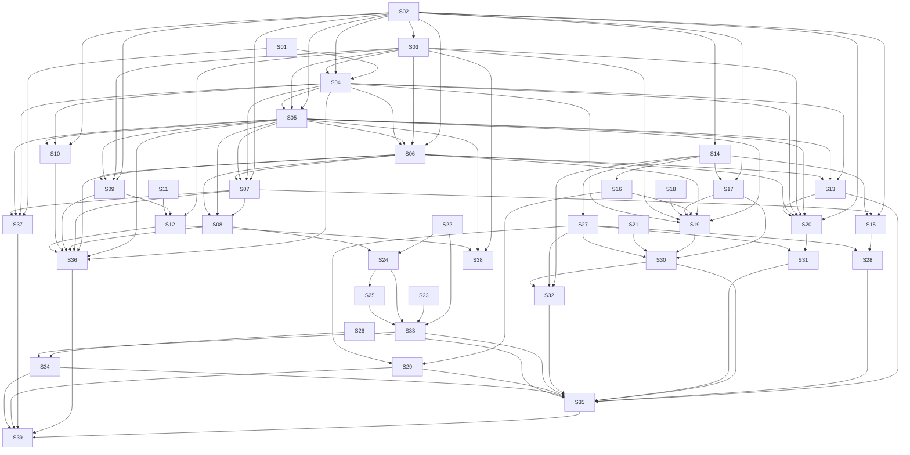

# M26 — Tenant Billing: BR Collection, Self-Signup & Launch

**Phase:** Local Development
**Goal:** Turn the dark Billing foundation of M25 into a product Ikaro can charge for in Brazil: the **money loop** (issue the next charge, handle the provider webhook, sweep statuses, reconcile, self-heal, dunning, billing emails), everything a **manager** needs to see and do about their subscription (billing page, payment, identity, plan, cancel, reactivate, trial banner), **self-signup** with a free trial on the public `/ikaro-trial` page, the `TRIAL_SIGNUP_CTA` hotsite module, the **real Asaas adapter** with its nightly sandbox contract job, alerts/runbooks, and the launch-readiness story. The whole loop is built and tested against the `FakeBillingProvider` from M25 first; the real provider is the last backend story, so nothing before it needs a provider account.
**Depends on:** M25 (the `billing` schema and first-schema tables, `Subscription` / `BillingAccount` / `FeaturePrice` aggregates, `TenantAccessPort`, `IClock`, `BillingProviderPort` + `FakeBillingProvider` + contract-suite skeleton, the operator touchpoints, the suspension / hotsite / notification enforcement, the `exempt` backfill). M26 never redoes any of it; every M25 story it relies on is named in that story's `Dependencies`.
**Blocks:** M27 (purge / discard / deactivation), M28 (Stripe / US), M29 (automatic collection), M30 (annual billing) — reserved, drafted when their gates open (see `## Reserved follow-ups`).
**Design rationale:** `docs/discovery/tenant-billing/tenant-billing.md` (promoted via `/discovery-to-milestone` on 2026-10-29) — kept as the permanent *why*; this file and the canonical docs it cites (`docs/USE_CASES.md` UC-110–145, `docs/DOMAIN_MODEL.md` § Context 7: Billing Context, `docs/DOMAIN_EVENTS.md` § Billing Context Events, `docs/DATABASE_SCHEMA.md` § Schema: `billing`, `docs/API_CONTRACTS.md` § Billing — …, `docs/LOCK_CATALOG.md` § Billing locks, `docs/RUNBOOKS.md` § Billing (planned), `docs/OBSERVABILITY_STRATEGY.md` § 7, `journeys/manager/billing.md`, `journeys/guest/ikaro-trial.md`) are the implementation source. Where a canonical doc and the discovery doc differ, the canonical doc wins.

---

## Follow-up milestones to write (reminders — nothing here is drafted yet)

M27–M30 have numbers and outlines (§ Reserved follow-ups below) but **no milestone files and no stories**. Draft each one with the same milestone-drafting steps used for M25/M26 (group its UCs into stories, sequence the waves, write the stories, audit), working from the already-promoted canonical docs — no new `docs/discovery/` folder is needed unless the "Needs first" column says so.

| Milestone | Write it when | Needs first |
|---|---|---|
| **M27** purge / discard / deactivation (UC-132, 141, 142) | **Before M26 launches** (a launch condition: M26-S39). The first possible erasure is 90 days after the first real suspension, which can only happen after launch. | A short discovery for the per-context deletion rules (what each of the nine contexts erases, what it keeps for fiscal reasons) and for who emits `TenantDeactivated`; the M17-S51 data inventory feeds it. |
| **M29** Pix Automático + hosted card (UC-135, 143) | When the real Asaas production PJ account is live (M26-S39 observed) | The end-to-end Pix Automático verification in sandbox and production; for card, the spike's F2 checks (M25-S01). No new discovery. |
| **M30** annual billing (UC-144, 145) | When the owner sets the annual prices | The annual price list. No new discovery. |
| **M28** Stripe / US (no UC of its own) | When a Stripe account exists and the accountant has decided US sales-tax handling | The accountant's decision and real Stripe fees; a short discovery only if the tax decision changes how tax lines work. |

Until M27 is written, `summary.canDiscard` stays `false` and the `billing-tenant-purge` cron stays disabled (see Non-Goals).

---

## Non-Goals

- **Purge, discard and deactivation (UC-132, UC-141, UC-142).** M27. The `billing.tenant_purge_*` tables already exist (M25-S03) but no M26 story reads or writes them. Consequences that M26 states rather than hides: `summary.canDiscard` is always `false` in M26 (no purge participant has shipped), UC-127 A3's second action is replaced by the honest "contact Ikaro" message, and the `purgeAt` clean-up date is shown on the suspended page labelled as the **earliest** possible date, but no job acts on it. The `billing-tenant-purge` trigger is **not** registered.
- **Automatic collection (UC-135 Pix Automático, UC-143 hosted card), annual billing (UC-144, UC-145), Stripe / US (no UC of its own).** M28–M30. The "Cobrança automática" tab renders the "Em breve" state (UC-117) with no endpoint behind it; `cycle` is always `MONTHLY`; the BR billing flow is tax-inclusive (`taxMinor = 0`, `taxLines = []`); the US option is not offered (UC-127 A7: no Stripe adapter before M28; the US price rows exist in every environment since M25-S04, so this story's signup must gate the country explicitly, not by the absence of prices). No `charge_tax_lines`, no `next_cycle` handling, no `origin = PROVIDER_SUBSCRIPTION` charges are written.
- **UC-129 (first-run onboarding checklist).** Delivered only if M24's onboarding wizard (UC-075) ships; an M24 follow-up, not a story here.
- **Self-service data export and the per-context deletion rules of the purge pipeline.** No use case yet (M27 outline only).
- **Changing the commercial catalog.** The offered features, tiers, prices, chatbot caps and the Plus model were settled in M25-S02; M26 consumes them (S21 maps tier → model and caps in code).
- **A manual "mark paid" route or any operator payment override.** None exists by design (`docs/API_CONTRACTS.md` § Provider port): a payment the provider confirmed but Ikaro missed is repaired by reconcile.
- **Promoted-but-unused concepts (milestone check).** The `charge_tax_lines` / `next_cycle` / `ADDON` / `origin` pieces of the first schema and `startAutoBilling` / `revokeAutoBilling` on `BillingProviderPort` are promoted for fidelity of the first schema and the port, built by no M26 story (beyond the typed `NotSupported` stubs S37 gives the Asaas adapter), and owned by M28–M30. `tenant_purge_jobs` / `tenant_purge_steps` are owned by M27.

## Known open items

- **Gates the owner must open (not code):** (1) the Asaas **production** PJ account (KYC lead time unknown) and the NFS-e configuration in the Asaas account; (2) the accountant's confirmation that provider-automatic NFS-e satisfies the Brazilian duty; (3) the **Terms of Use and Privacy Policy** texts and their versions (UC-127 step 3, `acceptedTermsVersion`), supplied by the owner / legal — M26-S33 hosts them but does not write them; (4) the Asaas facts that M25-S01's sandbox spike **cannot** observe: M25-S01 checks 10–14 already recorded `invoiceUrl` validity, the webhook payload fields, `externalReference` length, `notificationDisabled` and the minimum charge; what remains for the real account is the event that finalizes a **lost** chargeback, the callback-domain rule behind `returnUrl`, and the behaviour of the production account (whether `notificationDisabled` also silences the payer's NFS-e email, the contracted fee table; `docs/ASAAS_PROVIDER.md` § 4). S37 checks what the sandbox can show against the real adapter and S39 closes the rest with a production smoke charge; the webhook-queue re-enable was in scope of M25-S01 check 5 and is only re-confirmed there. Stories S37 and S39 are marked **GATE**.
- **Trigger names (settled, M26 decision):** the six cron trigger constants are `cron-billing-issue-charges`, `cron-billing-status-sweep`, `cron-billing-reminders`, `cron-billing-reconcile`, `cron-billing-self-heal` and `cron-billing-provider-events-purge` (precedent: `CRON_LEAD_FORM_RETENTION_TRIGGER = 'cron-lead-form-retention'`). The constant is also the literal Pub/Sub topic (`ikaro-${name}`), the Cloud Scheduler job is `ikaro-` + the topic key (`ikaro-cron-billing-issue-charges`, as `docs/RUNBOOKS.md` already states) and the manual publisher is `POST /cron/billing-…`. `modules/scheduler/variables.tf` rejects any `cron-*` topic without a `locals.jobs` entry, so each trigger story adds its job in the same PR; the canonical docs' "Trigger name" column (`docs/API_CONTRACTS.md` § Billing cron triggers, `docs/USE_CASES.md`) is corrected to the `cron-billing-*` names by the docs owner.
- **HTTP statuses "decided at story discovery":** `BILLING_CHARGE_NOT_PAYABLE` and which charge statuses count as not payable (S15); the rejections of `PUT /v1/billing/plan` (`BILLING_FEATURE_DEPENDENCY_UNMET`, `…_HAS_DEPENDENTS`, `…_IN_USE`, `…_PLAN_EMPTY`, `…_PLAN_CHANGE_NOT_ALLOWED`, `…_NO_PRICE_FOR_COUNTRY`, `…_ADDRESS_REQUIRED`) (S19); the status of `GET /v1/public/signup/session` without a valid cookie, of `resend` when the first manager already exists, and the public mapping of `BILLING_NO_PRICE_FOR_COUNTRY` (S24, S25); the error code and `violations[]` shape for a non-owner using `TRIAL_SIGNUP_CTA` (S26). Each is flagged in the story that implements it, never guessed.
- **`SubscriptionBanner` mount point (S32):** `apps/web/app/dashboard/layout.tsx` is a bare passthrough (`docs/DASHBOARD_FRONTEND_ARCHITECTURE.md` § Staff/Manager Shell), so the banner mounts in `shells/dashboard/components/DashboardShell.tsx`, the one component the ten section layouts render (S32 verifies this and tests the banner on every one of the ten sections).
- **Production before the Asaas KYC (decided, M26-D11):** two env feature flags (repo convention, no external system) let M26 code ship to production before a live provider account exists. `FEATURE_FLAG_BILLING_PROVIDER_LIVE` (default `false` in production until S39; `true` in local, CI and staging) gates the live adapter: while `false` the boot does not require `ASAAS_API_KEY` / `ASAAS_WEBHOOK_TOKEN`, the provider registry refuses live merchant keys, and the webhook route answers exactly `200` as a logged no-op. `FEATURE_FLAG_SIGNUP_ENABLED` (default `false` in production until S39; `true` elsewhere) gates self-signup: while `false` the signup routes answer `503 SIGNUP_CLOSED`, `/ikaro-trial` shows a "cadastro indisponível" notice, and slug availability and prices stay readable. It is also the real signup rollback lever drilled in S39 (disabling the `TRIAL_SIGNUP_CTA` module is not a kill switch). S01 declares the first flag (`FEATURE_FLAG_BILLING_PROVIDER_LIVE`), S24 declares the second (`FEATURE_FLAG_SIGNUP_ENABLED`).
- **Staging webhook reachability (decided):** the staging BFF has `INGRESS_TRAFFIC_INTERNAL_ONLY` and no public invoker (TD38), so Asaas cannot call it there. Staging is verified with the fake's `simulate` route and recorded payloads (the nightly contract run, S37); real Asaas → BFF reachability is proven in S39 by the production smoke charge, before `FEATURE_FLAG_SIGNUP_ENABLED` is turned on.
- **Known limitations stated rather than hidden:** "3 business days" in the settlement margin means Monday–Friday with no holiday calendar in M26; reminders match the exact `daysOffset`, so a cron day that did not run loses that milestone; a self-heal-created trial for a tenant that was meant to be `exempt` is a paying trial (the exempt intent lives only on the `SignupRegistration`, which self-heal cannot locate from the tenant alone, and `TenantProvisioned` carries no hint; the operator fixes it with UC-137, S08).
- **Audit decisions to re-confirm at the owning story's `/story-discovery` (set by the 2026-11 docs-audit fix; none is locked by the owner yet):** (1) a full refund of the first invoice while `TRIALING` leaves the charge `REFUNDED`, treated as unpaid at trial end so the recovery path applies — the alternative is making `UQ_billing_charges_period` ignore `REFUNDED` so a replacement can be issued (S04, S06, S36; `docs/DOMAIN_MODEL.md`, `docs/RUNBOOKS.md` follow S04); (2) the signup resend keeps a 60 s button cooldown that is cosmetic only — the enforced limits are 3/h per tenant and 10/day per IP (S25, S33); (3) the HTTP statuses of `BILLING_CANCEL_NOT_ALLOWED`, `BILLING_REACTIVATE_NOT_ALLOWED`, `BILLING_PRICE_CURRENCY_MISMATCH`, `PLATFORM_HOTSITE_MODULE_OWNER_ONLY` and the M26 use of `BILLING_CYCLE_NOT_AVAILABLE` (S20, S26, S38); (4) `POST /internal/signup/validate` and the `POST /internal/staff/resend-first-manager-invitation` shapes, the signup cookie names and `POST /auth/dev-signup-session` (S24, S25); (5) B-P1 and `PRICE_ANNOUNCE_MAX_TENANTS = 5000` (S38); (6) S36 and S37 staging checks must not run at the same time (the S36 live check pauses the staging reconcile job); (7) the S24 tax-id half of the one-trial rule is best-effort under concurrency, and an early `ExtendGrace` reuses `BILLING_GRACE_NOT_ALLOWED`; (8) the Charge-derived fields of the operator tenants list moved to S14. If discovery changes one, update this plan and the canonical docs together.
- **Other story-discovery items:** the `/ikaro-trial` rewrite mechanism and its CSP allowance (S24, S33), the internal route that carries Platform's signup use case from the BFF (S24), and the `Money` / `MinorAmount` reuse (settled in M25-S04).
- **M24 interaction (recorded, built here):** the BOOKING-removal guard (S18) must also count M24's class-session bookings, enrollments and waitlist entries when those exist; the story states it as an acceptance criterion with a "recount when M24 lands" note. M24's own routes are annotated by whoever lands them after the M25 detector flip (`plan/M24-…` § Billing interaction).
- **M17-S51 (recorded, not a story):** the manual offboarding runbook stays the interim path for erasing a never-paid tenant (UC-127 A3 message, `docs/RUNBOOKS.md` § Billing "Interim" entry) until M27.
- **Percentage-adjust and exact price changes (S38)** may follow launch; the launch does not depend on them (prices are seeded in M25-S04). Listed in the last wave on purpose.

---

## Build order

| Wave | Story | Theme |
|---|---|---|
| 1 | M26-S01 | Provider secrets and webhook env contract (devops) |
| 1 | M26-S02 | `Charge` aggregate, `ChargeLine`, provider-event inbox, recovery-charge factory |
| 1 | M26-S03 | Billing domain events, audit-log lines and topics (devops half) |
| 1 | M26-S04 | Provider webhook — BFF route, internal processing, exact-200 contract (UC-114) |
| 1 | M26-S05 | Issue the next charge + creation retry + `cron-billing-issue-charges` trigger (UC-113) |
| 1 | M26-S06 | Status sweep + `cron-billing-status-sweep` trigger (UC-115) |
| 1 | M26-S07 | Reconcile + `cron-billing-reconcile` trigger + single-charge refresh (UC-116) |
| 1 | M26-S08 | Self-heal, provider health, suspension freeze + trigger (UC-140) |
| 1 | M26-S09 | Dunning reminders + `cron-billing-reminders` trigger (UC-139) |
| 1 | M26-S10 | `provider_events` retention purge + trigger (UC-114) |
| 1 | M26-S11 | Notification: platform-scoped template lookup + Billing templates (UC-124 precondition) |
| 1 | M26-S12 | Billing email handlers (UC-124) |
| 1 | M26-S13 | Dev simulate and seed endpoints (UC-138) |
| 2 | M26-S14 | Manager reads — summary and charge history (UC-117) + operator list Charge-derived fields (UC-111) |
| 2 | M26-S15 | Payment link and payment return (UC-119) |
| 2 | M26-S16 | Billing identity read and save (UC-118) |
| 2 | M26-S17 | Plan reads — catalog and preview (UC-136) |
| 2 | M26-S18 | BOOKING removal guard and the `bookableUntil` window cap (UC-136 A11) |
| 2 | M26-S19 | Plan save and trial confirm (UC-136, UC-130) |
| 2 | M26-S20 | Cancel and reactivate (UC-133, UC-134) |
| 2 | M26-S21 | Chatbot tier → model and caps mapping (Platform) |
| 3 | M26-S22 | Slug rules and availability (UC-128) |
| 3 | M26-S23 | Public prices (UC-128) |
| 3 | M26-S24 | Self-signup — session, trial rule, signup use case, BFF routes (UC-127) |
| 3 | M26-S25 | Signup resend (UC-127 A10) |
| 3 | M26-S26 | `TRIAL_SIGNUP_CTA` contract and owner-tenant restriction (UC-131) |
| 4 | M26-S27 | Billing page shell, Resumo and Cobranças tabs (UC-117) |
| 4 | M26-S28 | "Pagar agora" — payment link, return, polling (UC-119) |
| 4 | M26-S29 | "Dados de cobrança" tab (UC-118) |
| 4 | M26-S30 | "Plano" tab and "Confirmar plano" (UC-136) |
| 4 | M26-S31 | Cancel and reactivate pages (UC-133, UC-134) |
| 4 | M26-S32 | `SubscriptionBanner` and the suspended-manager repoint (UC-130, UC-121) |
| 4 | M26-S33 | `/ikaro-trial` public pages, Terms and Privacy hosting (UC-127, UC-128) |
| 4 | M26-S34 | `TRIAL_SIGNUP_CTA` component and editor panel (UC-131) |
| 5 | M26-S35 | Money-loop and suspended-experience E2E on the fake |
| 5 | M26-S36 | Alert policies, KPIs and as-built runbooks (devops) |
| 5 | M26-S37 | Real `AsaasBillingProvider`, sandbox contract run, nightly job **[GATE]** |
| 5 | M26-S38 | Operator price changes — exact, percentage, announcement fan-out (UC-112) |
| 5 | M26-S39 | Launch readiness **[GATE]** |

Wave notes (a wave is a sequencing guarantee, not a concurrency one — see `## Run-batch preview`): **Wave 1** is backend only and runs entirely on the fake provider; there is no Wave 0 in M26 because M25 already owns the migration / backfill safety (the schema and the `exempt` backfill exist before any M26 code runs, and M26 adds **no breaking migration** — one expand-only index on `platform.tenants` (S08, `AddTenantsCreatedAtIndex`) and one data seed (S11, the notification templates)). **Wave 2** is backend / BFF for the manager and starts after the charge model (S02). **Wave 3** is backend / BFF / packages for signup and the hotsite module contract. **Wave 4** is frontend only and starts after the backend stories it reads from. **Wave 5** is the E2E, the observability / runbook work, the real adapter and launch readiness — the real adapter (S37) is deliberately last among the backend stories: everything before it is proven against the fake, and the nightly contract job then proves the fake and Asaas agree.

---

## Design & test strategy (milestone-level)

**Shared patterns (decided once; every story cites them).**
- **M26-D1 — One use case, three entry points.** Applying a provider fact to a charge and its subscription is a single application service (`ApplyChargeFactUseCase`, introduced by S04) called by the webhook (UC-114), by reconcile (UC-116) and by the on-demand refresh behind `payment-return` (UC-119). The paid-state transition, the reactivation of a `PAST_DUE` / `SUSPENDED` subscription and the recovery-charge settlement therefore exist **once**; S07 and S15 add entry points, never a second copy of the rules.
- **M26-D2 — `Charge` is its own aggregate; paying it touches two aggregates in one use case.** `Charge` (S02) is not a child of `Subscription` (one per period forever). `ApplyChargeFactUseCase` loads the subscription with `findByTenantIdForUpdate` (lock **B-R1**, `docs/LOCK_CATALOG.md` § Billing locks) first, then writes the charge through `chargeRepo.save()`; the order is subscription → charge rows, never the reverse, in every M26 use case (S04, S05, S06, S07, S15, S19, S20 — S07 and S15 through `ApplyChargeFactUseCase`). Status is recomputable, so the invariant never rests on the lock alone (`Subscription.version` is the second line).
- **M26-D3 — Provider I/O is never inside `txManager.run()`.** Charge creation is two steps: insert the `Charge` + lines (`provider_creation_status = PENDING`) and advance `next_due_date` in one transaction; call the provider **after** commit; store `READY` (id, URL, expiry) in a second short transaction; publish `ChargeIssued` only after `READY` (S05). The same shape applies to cancelling a stale charge at the provider (S06, S19, S20) and to creating the recovery charge at the provider (S06, S20): the local state is saved first (a `PENDING` recovery charge), the provider call follows after commit, `READY` is stored in a second short transaction; the provider side of a cancel is recorded in the new `billing.charges.provider_cancel_pending` flag (set in the local transaction, cleared after the provider confirms) and retried by reconcile (S07), and a `PENDING` recovery charge by S05's retry. **Single creator per charge:** before any `createCharge` (issue job, retry, recovery creation) the creator claims the charge in a short transaction (`provider_creation_last_attempt_at` null or older than 10 minutes, `provider_creation_attempts + 1`, `FOR UPDATE SKIP LOCKED`) and looks the charge up at the provider by `externalReference` (our charge id) before creating, so two concurrent creators (a manual `POST /cron/…` plus the scheduled run, two instances, the retry versus the sweep's own second step) produce one provider charge — Asaas has no idempotency key. CI enforces the no-I/O-in-transaction rule (`transactional-io`) (`transactional-io`); S04, S05, S06, S07, S15, S19 and S20 each carry the acceptance criterion.
- **M26-D4 — Idempotency lives in the database.** `UNIQUE(tenant_id, subscription_id, period_start)` (ignoring cancelled charges) makes a double-run issue job a no-op; `provider_events(provider, event_id)` makes a replayed webhook a `200` no-op; the unique constraint on open recovery charges (`UQ_billing_charges_open_recovery`, M25-S03 — catalogued in `docs/LOCK_CATALOG.md`; it is **not** the lock-catalog id B-Q1, which is the purge-job unique owned by M27) makes a double suspension or double reactivate return the same recovery charge. Every job and handler states its redelivery behaviour as an acceptance criterion.
- **M26-D5 — The seven-trigger family.** Six cron triggers are built in M26 (issue, sweep, reminders, reconcile, self-heal, provider-events purge); the seventh (tenant purge) is M27. Each is registered with `ITriggerBus.registerTrigger(name, handler, consumer)`, passes an explicit `tenantId` to every use case (no `RequestContext`), skips `exempt` subscriptions, does **not** use the shared `TenantScopedJob` helper (`docs/ENGINEERING_RULES_BACKEND.md` § Billing (planned): Billing's jobs deliberately select their own rows — there is no M25-S22 dependency and no `includeSuspended` switch), selects its rows through its own **standalone partial index** (created in M25-S03; each job story re-checks the index covers its filter, queries it through a `…ForJob` selector on the repository port, and compares tenant-local dates by selecting on UTC with ±1 day slack and then checking the local date per subscription) and applies no operational-status filter, so the sweep, reconcile, reminders and self-heal reach `SUSPENDED` / non-operational tenants (a `SUSPENDED` tenant with an open recovery charge is exactly what reconcile and the reminders serve), and has a thin manual publisher `POST /cron/billing-…` behind `InternalApiGuard` (`CronLeadFormController` is the precedent). Each trigger story owns its devops half (scheduler job, topic, subscription) with the playbook row and a live-verification check, and also updates the hard-coded scheduler test fixture (`infra/terraform/modules/scheduler/tests/resources_unit_test.tftest.hcl` lists every cron topic and asserts the job count) — S05 introduces the per-job `paused` switch (production jobs are created paused, S39 enables them). The constants are `cron-billing-*` (Known open items). **Every new route** (backend and BFF: webhook, cron, internal, manager billing routes) carries `@NoFeatureGate()` plus an explicit `@SuspensionAccess(...)` (M25-S16 / S20 / S24: the route-completeness detector is enforcing), and every Billing `subscribe()` passes `skipWhenSuspended: false` (M25-S21b).
- **M26-D6 — Emails are event handlers.** Billing never calls Notification; domain events (S03) feed handlers (S12) that call one send use case each, using platform-level templates (S11). Billing templates are exempt from the suspension gate (M25-S23).
- **M26-D7 — BR is tax-inclusive.** `taxMinor` is `0` and `taxLines` is `[]` for every M26 charge; the field shapes exist so M28 does not change the contract.
- **M26-D8 — Money is integer minor units + ISO currency** (M25-D4); the Billing-local `MinorAmount` VO from M25-S04 is used everywhere.
- **M26-D9 — Everything is proven on the fake first.** The contract suite from M25-S14 runs on the fake on every PR; S37 runs the same suite against the Asaas sandbox and adds the nightly job. A scenario the fake can produce (Pix `RECEIVED` only; boleto `CONFIRMED` → `RECEIVED`; card `CONFIRMED` then `RECEIVED` ~32 days later; duplicates, delays, out-of-order, provider 5xx) is a named integration test in the story that owns the behaviour.
- **M26-D10 — One provider-port method list.** `BillingProviderPort` is the M25-S14 port, and its method list is **complete from M25-S14**: `docs/API_CONTRACTS.md` (§ Provider port) already lists every method (`ensureCustomer`, `createCharge` with its `returnUrl` input, `regeneratePaymentLink`, `cancelCharge`, `startAutoBilling`, `revokeAutoBilling`, `fetchChargeStatus`, `readAccountHealth`, `reenableWebhookQueue`), and M25-S14 promotes `parseWebhook` into the interface block. M26 therefore adds **no method to the port and no method list to the doc**: S05 only *uses* the `returnUrl` input of `createCharge` (S28 reads it; S37 maps it to Asaas's `callback` only if Asaas's callback-domain rule allows it), and S37 adds the typed `NotSupported` stubs for `startAutoBilling` / `revokeAutoBilling` to the Asaas adapter (M29 builds them). A **typed error is not a method**: the port and the fake raise a typed `ChargeAlreadyPaidError` from `cancelCharge` when the provider refuses to cancel a charge that was already paid (the signal S06 / S19 / S20 route through `ApplyChargeFactUseCase`), with a contract case; M25-S14's text carries it. Every M26 use case obtains the adapter from `BillingProviderRegistry.resolve(merchantProfileKey)` (M25-S14), never from a bare port token. If a story finds the built port differs from the doc, the doc is corrected in that story's change.

**Aggregates and boundaries (named pass).**
- `Charge` (root): kind (`PERIOD` | `RECOVERY`; `ADDON` is M30), period dates (null forever for `RECOVERY`), due date (tenant-timezone date), immutable `ChargeLine` snapshot (feature, tier, unit price), subtotal / amount, status (`PENDING | PAID | OVERDUE | FAILED | CANCELED | REFUNDED | CHARGEBACK`), method, `paidAt`, provider ids and URL, `paymentReturnSeenAt`, `refundedAmountMinor`, `providerCreationStatus`. Invariants in the aggregate: legal status transitions (a paid charge can only become `REFUNDED` / `CHARGEBACK`; a cancelled one never becomes paid unless the provider proves it was paid), immutability of the lines and amounts after insert, only status / payment fields written afterwards.
- `Subscription` / `BillingAccount` change only through methods defined in M25-S08 plus the payment-driven transitions M26 adds, each owned by the **first** story that needs it (one name everywhere): **S04** `markPeriodPaid`, `reactivateOnPayment`, `suspend(reason)` (incl. `PAYMENT_REVERSED`) and the `BillingAccount` cross-tenant lookup by provider customer id; **S05** the `BillingAccount.provider_customer_id` setter; **S06** `markPastDue`, `activateAfterTrial`; **S19** `scheduleItems`, `confirmPlan`; **S20** `scheduleCancel`, `clearCancel`. Each new method gets a unit test next to the M25 ones; M25-S08 states that these are M26's.
- `ProviderEvent` is an inbox record per `docs/DATABASE_SCHEMA.md` § `billing.provider_events` (PK `(provider, event_id)`, `tenant_id` NOT NULL, `event_type`, `received_at`, `processed_at`; **no payload column**), not an aggregate; `SignupRegistration` is the M25-S09 thin record.
- **Cross-aggregate check:** the only pair that must stay consistent in one transaction is `Charge` + `Subscription` (payment, recovery, cancel-and-reissue); M26-D2 states the order and the lock. No other M26 story needs two aggregates consistent.
- **Unused-promotion check:** `ProviderEvent` and `Charge` are owned here; the tax / cycle / purge tables are not (Non-Goals).

**Locks and constraints (all in `docs/LOCK_CATALOG.md`; each needs a named test).**
- **B-R1** (S04, S05, S06, S07, S15, S19, S20; S07 and S15 take it through `ApplyChargeFactUseCase`): *concurrency test — a webhook confirming a payment racing the status sweep on the same subscription serialises and the paid state wins* (S06 owns it; S04 owns "two webhooks for one charge"); a manager's cancel racing a webhook (S20).
- **`UQ_billing_charges_open_recovery`** (S02 repository, S06, S20): *concurrency test — two simultaneous suspensions / reactivations produce exactly one open recovery charge.*
- **B-P1** (S38): the price-batch apply row lock `findByCountryForUpdate`, taken `ORDER BY id` and never combined with B-R1 in one transaction.
- **B-A1** (M25-S09) is exercised end to end by S24: *concurrency test — two simultaneous self-signups for one Google account produce exactly one trial.*
- Every lock port method added by an M26 story is catalogued in `docs/LOCK_CATALOG.md` (CI: `lock-catalog-coverage`); the story that implements a lock or unique **names its concurrency test next to the catalog row** (`docs/LOCK_CATALOG.md` checklist) — S02, S04, S06, S19, S20 and S24 therefore list `docs/LOCK_CATALOG.md` in Files.

**Migration ordering.** M26 adds **no breaking migration**: one expand-only index on `platform.tenants` (S08, `AddTenantsCreatedAtIndex`, a plain `CREATE INDEX` — not `CONCURRENTLY`, because `migrationsTransactionMode` is `all`, see `1748400000013-AddStartedAtIndexToChatbotSessions` and `1748500000009-AddResourceIdToScheduleClosuresAndOpenings` — no column or constraint change) and one data seed — S11's notification template seed (platform-scoped rows with `tenant_id IS NULL`, both languages, kept out of the per-tenant default copy by the key set described in S11) and nothing else; `charges`, `charge_lines` and `provider_events` already exist from M25-S03. Code that reads `charges` ships after S02. The Notification change in S11 is an additive lookup — the existing tenant-strict lookup is untouched.

**Cross-context edges (milestone-level).** M26 adds exactly: one exact-path `permittedEdges` entry for Billing → Booking (S18) and, in Notification, nine exact-path entries for the handlers importing Billing event / command classes (S12); the Billing → Platform tenant-info edge from M25-S13 only gains one target path (S08). Everything else is an event, a BFF call or an existing port.

**Performance.** (1) The hourly sweep, the daily issue / reminders jobs, the hourly reconcile (with a daily full pass) and self-heal are **cross-tenant, unscoped system jobs**: each selects through the standalone partial index named in `docs/DATABASE_SCHEMA.md` § `billing.subscriptions` / `billing.charges` (`next_due_date`, open-charge status, `suspended_at`, `trial_ends_at`), batches its work, processes one subscription per transaction, and is bounded by a per-run limit so one slow provider call cannot starve the rest (CLAUDE.md §7 "cross-tenant, unscoped system job"; `EXPLAIN` asserted in each job's integration test). (2) The charge history is paginated by `(tenant_id, due_date DESC)`. (3) The webhook route is hot under a provider retry storm: it does one indexed insert (the inbox), one indexed charge lookup and one subscription row lock; it is `@SkipThrottle()` and returns `200` after commit. (4) The public price and slug routes are cacheable / throttled (S22, S23) so the public page cannot become a database hit per visitor.

**Backward compatibility.** M26 changes existing behaviour in three places only: Platform's `ProvisionTenantUseCase` is *called by* the new signup use case (it is not modified here — its M25-S10 changes already shipped), the hotsite module registry gains a 13th type (S26 — existing tenants, templates and the editor are unaffected because the type is owner-only and absent from templates), and Booking gains a read use case plus a `bookableUntil` input honoured by every window consumer (S18). **Non-regression contract, owned by S18:** with no `bookableUntil` set (every tenant today), every booking-window consumer returns exactly what it returned before — asserted by running the existing window / availability / recurring / alert integration suites unchanged plus a new table-driven test that a `null` cap equals today's result.

**Test pyramid.** Unit (`.spec.ts`) for the aggregate, VOs, use cases, handlers, mappers; integration (`.integration.spec.ts`) per use case with tenant-isolation scenarios and the named concurrency tests; the contract suite on the fake every PR and on the Asaas sandbox nightly (S37); E2E (Playwright) only in the frontend stories and the cross-cutting S35 (money loop on the fake, per-role suspended experience). The mocked-vs-real rule: provider behaviour is never `jest.fn()`-stubbed — the fake adapter is used (`no-jest-fn-for-repository-or-port`).

**Spanning scenario (golden path), implemented by S35 (Playwright) with backend integration slices in S04–S06 and S24:**
visitor opens `/ikaro-trial` (S33), signs up with Google, tax id and terms (S24) → `TenantProvisioned` creates a `TRIALING` subscription (M25-S11) and the first-manager invitation → the manager signs in and sees the **trial banner** (S32) and the Resumo (S27) → confirms the plan (S30/S19) → `simulate` advances time (S13 + M25-S12) to ten days before trial end → the **issue job** creates the first charge (S05) → the manager opens "Pagar agora" (S28/S15) → `simulate` delivers a Pix `PAID` event (S13/S04) → the webhook marks the charge paid and the page leaves "pagamento recebido, reativando…" (S27) → time advances past trial end → the **sweep** turns the subscription `ACTIVE` (S06) → a later charge goes unpaid → `PAST_DUE` banner (S32) → past 14 days the sweep suspends and issues the recovery charge → the manager lands on the billing page with "Pague 1 mês para reativar" (S32/S27) → pays → `ACTIVE`. **Observation side confirmed:** every actor-visible state in this scenario has a supplying read — status / dates / open charge / history (S14), payment pending flag (S14 + S15), banner states (S14 `summary` fields), suspended page + recovery charge (S14), plan state (S17), signup eligibility and account-created state (S24), operator investigation list (M25-S15b).

**Interim / infra.** One shared devops story for provider secrets and the webhook env (S01); every cron, event-topic or new-subscription story owns its devops half with the playbook row from `infra/terraform/README.md` § New-resource PR-sequencing playbook and a named live-verification check (CLAUDE.md §9); alert policies and KPIs in S36; the nightly sandbox workflow in S37. Terraform / IAM / Pub/Sub / CI-CD stories are never presented merge-ready without their live check.

---

## Reserved follow-ups (not drafted until their gates open)

- **M27 — Purge, discard, deactivation** (UC-132, UC-141, UC-142). *Gate:* the first possible erasure is 90 days after the first suspension, so M27 must ship before the first suspended tenant ages out; the `billing-tenant-purge` cron stays disabled until all nine purge participants (storage, provider cancellation, Billing anonymization, the seven bounded-context deletions) ship, and `summary.canDiscard` flips on only then. Open there: the per-context deletion rules, the emitter of `TenantDeactivated` (sequenced with M17-S51), the self-service data export (no UC yet).
- **M28 — Stripe / US** (no UC of its own; cross-cuts UC-113, 114, 118, 127, 128). *Gate:* a Stripe account, the accountant's US sales-tax decision and real Stripe fees; adds `charge_tax_lines`, `StripeBillingProvider`, and the US price list. US identity (M25-S06 added the `EIN` type): validate the 9-digit EIN, which is shape-checked only today, and send it to Stripe as `us_ein`; widen the `tax_id_type` CHECK only if M28 needs a new type.
  - **Stripe discovery and fake update (carried from M25-S14, decided 2026-11-11).** `FakeBillingProvider` is Asaas-shaped and serves `BRL_FAKE` only; `USD_FAKE` throws `ProviderNotSupportedError` because no Stripe behaviour has been observed. M28 therefore starts with a Stripe discovery that produces a canonical Stripe provider doc under `docs/` (named `STRIPE_PROVIDER`, not yet created), the same shape as `docs/ASAAS_PROVIDER.md` (observed in Stripe test mode, labelled V / O / I). Then, in this order: (1) extend the contract suite (`apps/backend/src/test/contracts/billing-provider.contract.ts`) first, with the Stripe-specific cases (signature verification inside `parseWebhook`, the `automatic_tax` breakdown in `createCharge`, finalized-invoice event sequences); (2) make the fake Stripe-faithful and register `USD_FAKE`; (3) add `StripeBillingProvider` and append its path to the `externalSideEffectPorts` entries; (4) add `USD_STRIPE_TEST` and run the same suite against Stripe test mode in the nightly job; (5) revisit whether `PaymentChargeback` and `NormalizedChargeStatus` need Stripe-specific fields.
  - **US tenants before M28.** `resolveMerchantProfileKey` already gives a US tenant `USD_FAKE` locally and `USD_STRIPE_LIVE` in production, and neither has an adapter until M28. Every M26 caller of `BillingProviderRegistry` (the issue-charges job, status sweep, reconcile, self-heal) must treat `ProviderNotSupportedError` for such a subscription as skip-and-log, never a crash; the plan carries no such line yet, so whichever M26 story first resolves a provider owns it.
- **M29 — Automatic collection** (UC-135 Pix Automático, UC-143 hosted recurring card). *Gate:* the real PJ account with a CNPJ active for 6+ months and the end-to-end Pix Automático verification in sandbox and production; F2 also needs the spike's F2 checks.
- **M30 — Annual billing** (UC-144, UC-145). *Gate:* the owner sets the annual prices; adds `cycle`, `next_cycle*`, the co-terminus `ADDON` charge and the 30-day annual issue lead.
- Numbers M27–M30 are reserved; M115 is an existing completed milestone, so M27–M30 do not collide with it.
- **Slice letters in the canonical docs** (`docs/API_CONTRACTS.md`, `docs/DATA_RETENTION_AND_PRIVACY.md`, the discovery docs) are not in milestone-number order: M28 Stripe / US = slice E, M29 automatic collection = slice F (F1 Pix Automático, F2 hosted card), M27 purge / discard = slice G, M30 annual = slice H.

---

## Wave 1 — Money loop on the fake provider (backend)

### M26-S01 — Provider secrets, the live-provider flag and the webhook env contract

**Agent:** `devops + backend-ts`
**Complexity:** M
**Docs to load:** `infra/terraform/README.md` § New-resource PR-sequencing playbook (the "new secret" rows and the three-places IAM rule) and § Gotchas, `docs/ENGINEERING_RULES_INFRA.md` § Billing configuration (planned) — live adapters, fake/sandbox keys and the scheduler jobs, `infra/terraform/SECRETS.md`, `docs/USE_CASES.md` UC-114 (preconditions), `docs/API_CONTRACTS.md` § Billing — Provider Webhooks and Internal API (authenticity)
**Dependencies:** M25-S07 (the billing env contract already carries the owner slug), M25-S01 (the sandbox spike confirms the secret names and the webhook token mechanism), M25-S14 (the provider registry and its live-key guard, which this story's flag feeds)
**Pattern:** plain composition — Secret Manager containers wired through the existing `secret_env_vars` and the env contract, plus one plain feature flag; no new module.

**Description:**
Create the provider secrets and the environment variables the money loop and the real adapter need, in the order the Terraform playbook requires, so no later story is blocked on an infra side-effect.

**Secrets (one container per secret in each environment's own GCP project; the staging project holds the sandbox values, the production project the live values — never both in one project):** `asaas-api-key` (consumed by `cloudrun_backend` as `ASAAS_API_KEY`: needed in **staging too**, because `BRL_ASAAS_SANDBOX` calls the sandbox) and `asaas-webhook-token` (consumed by `cloudrun_bff` as `ASAAS_WEBHOOK_TOKEN`). **The webhook token is a BFF-only secret:** the BFF compares the `asaas-access-token` header timing-safe and the backend's internal route is protected by `InternalApiGuard`; the backend never receives or verifies the token and `parseWebhook` only normalises (authenticity is a BFF test, S04). The `merchant_profile_key` is **not** a secret and not an env var — it is data on the subscription, chosen per environment (`BRL_FAKE` local / CI, `BRL_ASAAS_SANDBOX` staging, the live key in production; the names come from M25-S07's `resolveMerchantProfileKey` and the guard of M25-S14). The Asaas base URL is a constant of the adapter selected by `APP_ENV` (decided with M25-S14's guard), not an env var. `TURNSTILE_SECRET_KEY` (secret `turnstile-secret-key`) is not new either (the lead form has it). No `STRIPE_*` secret is created here (M28).

**Env contract.** Added to `apps/backend/src/config/env.validation.ts` (`ASAAS_API_KEY`, `FEATURE_FLAG_BILLING_PROVIDER_LIVE`), `apps/bff/src/config/env.validation.ts` (`ASAAS_WEBHOOK_TOKEN`, `FEATURE_FLAG_BILLING_PROVIDER_LIVE` — the webhook route is a no-op while it is off) and `packages/infra-scripts/src/env-contract.ts`. **`FEATURE_FLAG_BILLING_PROVIDER_LIVE`** (boolean; default `false` when `APP_ENV=production`, `true` otherwise; Terraform sets it explicitly to `false` in `envs/prod` and `true` in `envs/staging` as a plain `env_vars` entry, so S39 turns production on by a one-line change): while `false` the boot does **not** require `ASAAS_API_KEY` / `ASAAS_WEBHOOK_TOKEN`, the provider registry (M25-S14) refuses live merchant profile keys, and the BFF webhook route answers exactly `200` as a logged no-op (S04); when `true` the two secrets are required (a `refine` on the schema, so a `true` flag without the secrets fails startup). `ASAAS_API_KEY` and `ASAAS_WEBHOOK_TOKEN` are listed in the relevant `exemptKeys` (local and CI have no Asaas credentials; they are still wired in both Terraform roots). **The refusal of a `*_FAKE` profile key paired with a live adapter is the M25-S14 registry guard, not `env.validation.ts`** (the key is a database column that the env schema cannot see); this story only feeds it the flag. The docs owner adds the flag to `docs/ENGINEERING_RULES_INFRA.md` § Billing configuration (planned).

**Pre-launch, no real traffic depends on the next deploy succeeding, so the two-PR secret row applies — provided this PR creates no new Pub/Sub subscription (rule 3).** PR1 creates the containers (`modules/secrets` `base_secret_ids`), wires `secret_env_vars` and the plain `env_vars` flag, and adds the schema entries together; **as soon as PR1 merges, populate the sandbox values in the staging project** (the playbook's ordered step; the production values are populated by S39, not here); PR2 is the `foundation`-only accessor-grant PR (see Files: the grant lives in **three places** — `runtime-identities`' `secret_accessors_base` lists, both Foundation env roots' `secret_ids` maps, and the module test fixtures). Between PR1 and PR2 the next `envs/*` revision for the affected service fails resolving the secret and the previous revision keeps serving; the stale-revision gotcha's forced redeploy is the recovery. No scheduler job or topic is added in this story — each trigger story owns its own. **Webhook-token rotation (documented order, no dual-token machinery):** the BFF compares against the single `ASAAS_WEBHOOK_TOKEN`; to rotate, write the new secret version and redeploy the BFF, then change the token in the Asaas account immediately after the new revision is serving. Deliveries between the two steps get `401` and are retried by Asaas; anything missed is caught up by reconcile (S07), and a queue the provider paused in the gap is re-enabled by self-heal (S08). The runbook rotation entry (S36) states this order and the post-rotation check that the queue is not paused.

**Backend use case steps:** none.
**Backend HTTP surface:** none.
**New migration / i18n keys / env vars / feature flags:** secrets `asaas-api-key` and `asaas-webhook-token`; env vars `ASAAS_API_KEY` (backend), `ASAAS_WEBHOOK_TOKEN` (BFF), `FEATURE_FLAG_BILLING_PROVIDER_LIVE` (backend and BFF). `FEATURE_FLAG_SIGNUP_ENABLED` is declared and owned by S24, not S01.

**PR sequence:** 2 PRs — matches the playbook row "Same, but a temporary broken deploy is acceptable (pre-launch …) and this PR does not also create a new Pub/Sub subscription".
- PR1 (`infra-app-mix-ok`, because `apps/**` and `infra/terraform/**` change together): the secret containers, `secret_env_vars` and `env_vars` wiring, and the schema / env-contract entries, together (satisfies `env-contract` immediately). Then **populate the staging sandbox values** and confirm the service redeploys healthy once PR2 lands.
- PR2 (`foundation` only — the playbook forbids mixing `foundation/**` with any other `infra/terraform/**` path in one PR): the accessor grants for the backend service account on `asaas-api-key` and the BFF service account on `asaas-webhook-token`, then the Foundation apply.

**IAM / permissions:** the runtime service accounts read their own secret versions (`roles/secretmanager.secretAccessor` on the specific secrets): backend on `asaas-api-key`, BFF on `asaas-webhook-token` — same pattern as the existing secrets; no new principal.
**Live-verification check:** on staging after PR2: (1) `gcloud secrets versions access latest --secret=asaas-webhook-token` returns a value with the operator's own identity (never pasted in a PR or log); (2) `gcloud run services describe <backend|bff> --format='value(spec.template.spec.containers[0].env)'` shows the new var names bound to secrets and the flag value; (3) a fresh revision starts and `/health/ready` is 200 (a missing secret fails the revision, not silently); (4) the ingress and `vpc_egress` check required by `docs/ENGINEERING_RULES_INFRA.md` § Billing configuration (planned), **per environment**: on **staging** the BFF has `INGRESS_TRAFFIC_INTERNAL_ONLY` and no public invoker (TD38), so the check *records* that Asaas cannot reach the webhook path there and that staging is verified through `simulate` and recorded payloads (S13, S37); on **production** the check is that the webhook path is reachable through the edge load balancer and that Ikaro's outbound calls to Asaas leave through the configured egress (`gcloud run services describe <bff> --format='value(spec.template.metadata.annotations)'` read against § Cloud Run `vpc_egress` mode) — observed in S39 with the production smoke charge, not here. Pass = (1)–(3) observed on staging and (4) recorded for staging with the production half carried to S39.

**Files to create/modify:**
- `apps/backend/src/config/env.validation.ts` (+ its spec) (modify)
- `apps/bff/src/config/env.validation.ts` (+ its spec) (modify)
- `packages/infra-scripts/src/env-contract.ts` (+ its spec) (modify — `exemptKeys` for the two Asaas vars)
- `infra/terraform/modules/secrets/main.tf` and `infra/terraform/modules/secrets/tests/resources_unit_test.tftest.hcl` (modify — `base_secret_ids` gains `asaas-api-key`, `asaas-webhook-token`; the test fixture lists every secret)
- `infra/terraform/envs/staging/main.tf`, `infra/terraform/envs/prod/main.tf` (modify — `secret_env_vars` wiring in `cloudrun_backend` / `cloudrun_bff` and the `FEATURE_FLAG_BILLING_PROVIDER_LIVE` `env_vars` entry; prod's `bootstrap_mode` ignores `secret_env_vars` until go-live)
- `infra/terraform/foundation/modules/runtime-identities/main.tf` and `infra/terraform/foundation/modules/runtime-identities/tests/runtime_identities_unit_test.tftest.hcl` (modify, PR2 — `secret_accessors_base` backend and BFF lists, test fixture)
- `infra/terraform/foundation/envs/staging/main.tf`, `infra/terraform/foundation/envs/prod/main.tf` (modify, PR2 — the hard-coded `secret_ids` maps)
- `infra/terraform/SECRETS.md` (modify — document the new entries and the rotation order)
- `.env.example` of the backend and the BFF (modify — the new vars; local values: flag `true`, empty secrets)
- `docs/ENGINEERING_RULES_INFRA.md` § Billing configuration (planned) (modify only if the implemented variable names differ from the doc; the docs owner adds the flag)

**Acceptance criteria — product:**
- [ ] No tenant-visible change.
- [ ] In `production` with `FEATURE_FLAG_BILLING_PROVIDER_LIVE=true` the backend and BFF refuse to start without the Asaas secrets; with the flag `false` (the pre-KYC production default) they start without them and the registry refuses live profile keys.

**Acceptance criteria — technical:**
- Unit:
  - [ ] Each env schema entry (`ASAAS_API_KEY`, `ASAAS_WEBHOOK_TOKEN`, `FEATURE_FLAG_BILLING_PROVIDER_LIVE`): present / missing / malformed; required exactly when the flag is `true`; the flag defaults `false` in `production` and `true` elsewhere
  - [ ] The refusal of a fake/sandbox key in `production` and of a live key outside it stays the registry's test in M25-S14 (not duplicated here)
- Integration: none — configuration only
- Tenant isolation: none — no tenant data
- E2E: none
- [ ] Checkov / Tfsec clean; `terraform test` of `modules/secrets` and `runtime-identities` green with the new fixtures
- [ ] `env-contract` check passes (`pnpm --filter @ikaro/architecture-check check`)
- [ ] Coverage ≥80% on changed code
- [ ] `tsc --noEmit` clean, lint clean

---

### M26-S02 — `Charge` aggregate, `ChargeLine`, provider-event inbox, recovery-charge factory

**Agent:** `backend-ts`
**Complexity:** L
**Docs to load:** `docs/DOMAIN_MODEL.md` § Aggregate: Charge and § Context 7: Billing Context (price snapshot, immutability), `docs/DATABASE_SCHEMA.md` § `billing.charges`, `billing.charge_lines`, `billing.provider_events`, `docs/LOCK_CATALOG.md` § Billing locks (B-R1; the open-recovery unique), `docs/TESTING_STRATEGY.md` § Integration test DB isolation (entity registration in the harness), `docs/USE_CASES.md` UC-113 (main flow 1–3), UC-114 (steps 2, 4), UC-134 (main flow), `docs/ENGINEERING_RULES_BACKEND.md` § Billing (planned) (provider webhooks, PENDING→READY recipe) and § Transactions, `docs/AGENT_PATTERNS.md` (aggregate / repository), `docs/ENGINEERING_RULES_TESTING.md` § Shared test-builder date defaults
**Dependencies:** M25-S08 (`Subscription`, repositories, `findByTenantIdForUpdate`), M25-S04 (`FeaturePrice`, `MinorAmount`, `GetFeaturePriceAtUseCase`), M25-S12 (`IClock`), M25-S14 (`BillingProviderPort` types)
**Pattern:** Aggregate root with an immutable child snapshot; Repository + Adapter; a **domain factory** (`RecoveryChargeFactory`) shared by the sweep, reactivate and retry.

**Description:**
Give the money its model. **`Charge`** (root, `apps/backend/src/contexts/billing/domain/charge.aggregate.ts`) carries kind (`PERIOD` | `RECOVERY`), period dates (null for `RECOVERY`), due date, immutable `ChargeLine[]` price snapshot, `subtotalMinor` / `amountMinor` (equal for BR; the field exists so M28 can fill tax), status, method, `paidAt`, provider ids / payment URL / expiry / `receiptUrl`, `paymentReturnSeenAt`, `refundedAmountMinor`, `providerCreationStatus`. Behaviour: `markPaid(method, paidAt, receiptUrl | null, now)` (idempotent — a second paid fact is a no-op; `receiptUrl` comes from the provider re-read, `NormalizedChargeStatus.receiptUrl` of M25-S14, and feeds `ChargePaid`), `markOverdue`, `cancel`, `markRefunded` (full or partial), `markChargeback`, `markCreationReady(providerChargeId, paymentUrl, expiresAt)`, `markCreationFailed` (increments `provider_creation_attempts`, which S05's "after N failures" alert reads; the column exists in the M25-S03 schema; it leaves `provider_creation_status` at `PENDING`, so `provider_creation_status = FAILED` is unreachable in M26 and is covered by a test as such), `recordPaymentReturn(now)`, `markProviderCancelPending()` / `clearProviderCancelPending()` (the `billing.charges.provider_cancel_pending` flag that records "cancelled locally, the provider side still to do"; S06/S19/S20 set it in the local transaction, S07 retries and clears it), `claimForProviderCreation(now)` (the creation lease, below); `FAILED` is a documented status with **no M26 transition into it** (reserved for M29's automatic collection; `docs/DOMAIN_MODEL.md`'s transition table is aligned to say so by the docs owner) and is covered by the transition table as unreachable; illegal transitions throw a typed domain error (a `PAID` charge can only become `REFUNDED` / `CHARGEBACK`; a `CANCELED` one cannot be paid by a local event — only a provider-confirmed fact, applied by S04, may revive it. **"Legal" is defined once, here:** a paid fact is legal for a `PENDING`, `OVERDUE` or `CANCELED` charge when it comes from a provider fact verified by the re-read (S04) — for a `CANCELED` charge this is exactly the case "the provider could not cancel it because it was already paid" (UC-114 step 4) and also a payer using a cancelled link before the cancel reached the provider; a paid fact for a `REFUNDED`/`CHARGEBACK` charge is illegal and only logged. The `CANCELED → PAID` edge is not in `docs/DOMAIN_MODEL.md`'s table yet; the docs owner adds it). **`ChargeLine`** is a plain immutable value (`featureKey`, `tier`, `unitPriceMinor`). **`RecoveryChargeFactory`** builds the one-month `RECOVERY` charge for a subscription: the amount fixed at issue from the price versions in force **that day**, lines = the subscription's current items, due date = today + `RECOVERY_CHARGE_DUE_DAYS` (7, `docs/DOMAIN_MODEL.md` § Context 7: Billing Context (constants) — a charge due today would be `OVERDUE` on the next sweep), no period dates. **The factory is domain code and takes already-resolved inputs** — the items, a price map (`featureKey`/`tier` → `unitPriceMinor`) and "today" as a date in the **subscription's timezone** (`subscriptions.timezone`) — so it never calls an application use case; the calling use case (S06, S20, S05's retry) resolves the prices through `GetFeaturePriceAtUseCase` (M25-S04) for that day. It is the single place the recovery rule lives (UC-115 step 3, UC-134, UC-113 A2). **`ProviderEvent`** is a thin inbox record exactly as `docs/DATABASE_SCHEMA.md` § `billing.provider_events` defines it — PK `(provider, event_id)`, `tenant_id` NOT NULL (the resolved tenant), `event_type`, `received_at`, `processed_at`; **no payload column** (the payload is not stored) — with a repository whose `insertIfAbsent` is `ON CONFLICT (provider, event_id) DO NOTHING` returning whether it inserted (this is how a replayed webhook becomes a no-op without an exception). **Repositories:** `ChargeRepository` (`save`, `findById`, `findByProviderChargeId`, `findOpenByTenant`, `findOpenRecoveryBySubscription`, `listByTenantPage` ordered `(tenant_id, due_date DESC)`, selection queries for the jobs: charges with `provider_creation_status = PENDING`, charges due soon / overdue, open charges for reconcile, charges with `provider_cancel_pending`, `claimForProviderCreation`: a short-transaction `UPDATE … WHERE provider_creation_status = 'PENDING' AND provider_charge_id IS NULL AND (provider_creation_last_attempt_at IS NULL OR provider_creation_last_attempt_at < now() - 10 minutes) … FOR UPDATE SKIP LOCKED RETURNING`, which sets `provider_creation_last_attempt_at = now()` and increments `provider_creation_attempts` and returns whether this caller owns the creation — the lease every creator takes before any `createCharge`, see M26-D3), all `tenant_id`-scoped except the explicitly cross-tenant job selectors, which take no tenant and are named `…ForJob`. The unique constraints created in M25-S03 are the backstops (`UNIQUE(tenant_id, subscription_id, period_start)` ignoring cancelled charges; the open-recovery unique `UQ_billing_charges_open_recovery` for open recovery charges); the repository maps a unique violation to a typed `ChargeAlreadyExists` / `RecoveryChargeAlreadyOpen` result the callers treat as "return the existing one". The three domain errors are internal and never reach a client as a distinct code: the mapper maps `IllegalChargeTransition` to `409` with the existing generic conflict code and the two "already" results are consumed by the use cases (no new `BillingErrorCode`, so no `@ikaro/types` or locale change in this story).

**Backend use case steps:** none — this story is the model, repositories and factory; use cases arrive with S04–S09.
**Backend HTTP surface:** none.
**New migration / i18n keys / env vars / feature flags:** none (the tables exist from M25-S03; entity mappings only).

**Files to create/modify:**
- `apps/backend/src/contexts/billing/domain/charge.aggregate.ts` (+ `.spec.ts`) (new)
- `apps/backend/src/contexts/billing/domain/charge-line.ts` (+ `.spec.ts`) (new)
- `apps/backend/src/contexts/billing/domain/recovery-charge.factory.ts` (+ `.spec.ts`) (new)
- `apps/backend/src/contexts/billing/domain/provider-event.ts` (new)
- `apps/backend/src/test/repositories/billing/in-memory-charge.repository.ts`, `in-memory-provider-event.repository.ts` (new — `InMemoryXxx` doubles for the two ports; `no-jest-fn-for-repository-or-port`; follow the sibling naming in that directory)
- `apps/backend/src/contexts/billing/domain/errors/illegal-charge-transition.error.ts`, `charge-already-exists.error.ts`, `recovery-charge-already-open.error.ts` (new — one file per invariant error; M25-S08's error files are different names)
- `apps/backend/src/contexts/billing/infrastructure/http/billing-error.mapper.ts` (+ `.spec.ts`) (modify — M25-S06 created it; map the three errors as stated above, `error-mapper-coverage`)
- `apps/backend/src/contexts/billing/application/ports/charge-repository.port.ts`, `provider-event-repository.port.ts` (new)
- `apps/backend/src/contexts/billing/infrastructure/entities/charge.entity.ts`, `charge-line.entity.ts`, `provider-event.entity.ts` (new)
- `apps/backend/src/contexts/billing/infrastructure/repositories/typeorm-charge.repository.ts`, `typeorm-provider-event.repository.ts` (+ `.spec.ts`, `.integration.spec.ts`) (new)
- `apps/backend/src/test/utils/billing-integration-app.ts` (modify — M25-S04 created it; register the three new entities), `apps/backend/src/test/integration-global-setup.ts` and `apps/backend/src/test/test-datasource.ts` (modify — entity registration; the harness must stay in sync with entities/migrations)
- `apps/backend/src/test/builders/billing/index.ts` (modify — export the new builders), `apps/backend/src/test/builders/billing/charge.builder.ts`, `charge-entity.builder.ts`, `charge-line.builder.ts`, `charge-line-entity.builder.ts`, `provider-event.builder.ts`, `provider-event-entity.builder.ts` (new — default `uuidv7()` ids; date defaults relative to `Date.now()`)
- `apps/backend/src/contexts/billing/billing.module.ts` (modify)
- `packages/architecture-check/architecture-policy.json` (modify — add the three entities to the `testDataHarnessRegistrations` `entities` array)
- `docs/LOCK_CATALOG.md` (modify — name the open-recovery-unique concurrency test next to its row)
- `docs/DOMAIN_MODEL.md` § Aggregate: Charge (docs owner — transition table: `CANCELED → PAID` by a provider-confirmed fact, `FAILED` reserved for M29)

**Acceptance criteria — product:**
- [ ] No tenant-visible change; the model matches `docs/DOMAIN_MODEL.md` § Aggregate: Charge field for field.

**Acceptance criteria — technical:**
- Unit:
  - [ ] Every legal and illegal status transition of `Charge` (table-driven); `markPaid` idempotent
  - [ ] Immutability: lines and amounts cannot change after construction; only status / payment fields are written
  - [ ] `RecoveryChargeFactory`: builds from the price map it is given, lines = current items, no period dates, due date from the subscription-timezone date it is given (the "version in force today, a version effective tomorrow is ignored" case is asserted on the price-resolving call in the use-case tests of S06/S20, not here)
  - [ ] The provider-event repository's `insertIfAbsent` returns `false` on a duplicate and stores the tenant id and event type, never a payload
  - [ ] `markPaid` stores `receiptUrl` (and `null` when the provider gave none); `markProviderCancelPending` / `clearProviderCancelPending` toggle the flag and are illegal on a `PAID` charge; a paid fact on a `CANCELED` charge is accepted only when marked provider-confirmed, and on a `REFUNDED`/`CHARGEBACK` one is rejected
  - [ ] Recovery charge due date = today + 7 (boundary test)
- Integration:
  - [ ] `UNIQUE(tenant_id, subscription_id, period_start)` rejects a second period charge and ignores a cancelled one
  - [ ] **Concurrency (`UQ_billing_charges_open_recovery`):** two simultaneous `RecoveryChargeFactory` saves for one subscription produce exactly one open recovery charge; the loser reads the existing one
  - [ ] `provider_events` duplicate insert is a no-op under concurrency
  - [ ] **Concurrency (creation lease):** two simultaneous `claimForProviderCreation` calls on one `PENDING` charge give exactly one owner; a claim within 10 minutes of the last attempt is refused, a later one succeeds
  - [ ] Pagination order and the job selectors use their standalone indexes (`EXPLAIN` asserted)
- Tenant isolation: [ ] a tenant-scoped finder never returns another tenant's charge; a composite FK `(tenant_id, id)` rejects a cross-tenant line
- E2E: none — covered by unit / integration
- [ ] Coverage ≥80% on changed code
- [ ] `tsc --noEmit` clean, lint clean

---

### M26-S03 — Billing domain events, audit-log lines and topics

**Agent:** `backend-ts + devops`
**Complexity:** M
**Docs to load:** `docs/DOMAIN_EVENTS.md` § Billing Context Events (every payload), `docs/ANTI_PATTERNS.md` § A domain event is drained, `docs/ENGINEERING_RULES_BACKEND.md` § Event Handlers (Pub/Sub consumers), `docs/BOUNDED_CONTEXTS.md` § 7. Billing Context (published events), `infra/terraform/README.md` § New-resource PR-sequencing playbook (row: "A new Pub/Sub topic …"), `docs/ENGINEERING_RULES_SHARED.md` § Tenant access enforcement (item on event subscriptions — audit handlers always run)
**Dependencies:** M25-S15b (created `SubscriptionSuspended` / `SubscriptionReactivated`, the outbox publishing pattern and `BillingAuditLogHandler`), M26-S02 (charge types the payloads refer to), M25-S21b (every `subscribe()` declares `skipWhenSuspended`)
**Pattern:** Domain events through the outbox; one audit-log subscription line per event (the `domain-event-audit-coverage` detector); topics provisioned from `pubsub-catalog.json`.

**Description:**
Define the Billing events M26's use cases publish, **before** any use case publishes them, so each use-case story is not also a topic story and the devops work is done once. New domain events (envelope per CLAUDE.md §4: `eventId` uuid-v7, `tenantId`, `occurredAt`, `correlationId`, `eventName`, `eventVersion`, `data` — exact `data` per `docs/DOMAIN_EVENTS.md`): `ChargeIssued` (charge id, kind, amount, due date, **`paymentUrl`** as `docs/DOMAIN_EVENTS.md` carries it — the email needs the link and Notification reads only event data; every email-triggering event also carries the nullable `recipientEmail`, see below), `ChargePaid` (charge id, amount, method, paidAt and the **provider receipt URL** `receiptUrl` (nullable) — `docs/DOMAIN_EVENTS.md` gains it, because the receipt email links to it; S02's `markPaid` stores it and S04 fills it from the provider re-read), `SubscriptionPastDue`, `SubscriptionCancelled` (`immediate`, `cancelAt`), `PlanChanged`, `SubscriptionPriceChangeAnnounced` (the consolidated per-tenant payload; published only by S38 but defined here so the topic exists once). `SubscriptionSuspended` / `SubscriptionReactivated` already exist (M25-S15b); this story only adds `recipientEmail` to them (their `data` is otherwise unchanged). **`recipientEmail` — the single documented exception to "no email in an event payload":** the email-triggering events (`ChargeIssued`, `ChargePaid`, `SubscriptionPastDue`, `SubscriptionSuspended`, `SubscriptionReactivated`, `SubscriptionCancelled`, `PlanChanged`, `SubscriptionPriceChangeAnnounced`) and the `BillingReminderDue` command carry `recipientEmail: string | null`, resolved by **Billing** at publish time from `BillingAccount.billingEmail` (null when unset) through one shared helper the publishing use cases call. Notification never reads Billing: it uses the field when non-null and otherwise falls back to the tenant's MANAGER emails (`INotificationStaffPort.getManagerEmails`, S12). It is the only email in any Billing payload (no tax id, no address, no other email field), it is excluded from the command's dedupe key, and it adds no cross-context edge. **Exempt subscriptions emit no email-triggering event or command at all, and an event raised on an exempt path (e.g. the operator `exempt` set reactivating a suspended tenant) carries `recipientEmail = null` — the shared helper returns `null` for an `exempt` subscription and the use cases skip publishing the email-only events for it.** Billing also re-checks "charge still open" and "not exempt" immediately before writing the outbox row of any email-triggering event or command (Notification does no re-check and has no read port into Billing; a small stale window is accepted and the email copy is tolerant, S12). Each event gets its class in `domain/events/`, a publisher call-site contract (the use cases call `outbox.add(...)` inside their transaction), and a line in `BillingAuditLogHandler` (`subscribe(<Event>.name, …, LogDomainEventUseCase.CONSUMER_NAME, { skipWhenSuspended: false })` — the call site is what gives the event a topic, and the fourth argument is mandatory since M25-S21b: audit-log and Billing's own handlers always run for a suspended tenant). **`BillingReminderDue` is a Command, not a domain event** — the class-versus-command question left open in the promotion is settled here: it is emitted by the reminders job (S09) and its idempotency key is a *business key* `(subscription, kind, daysOffset, chargeId)`, which is exactly what `shared.outbox.dedup_key` carries for a `Command` (`docs/DATABASE_SCHEMA.md` § `shared.outbox`: "the event's `eventId` for a `DomainEvent`, or the caller-supplied business key for a `Command`"; precedent `BookingReminderDue`, published through the outbox like the other cron-emitted messages). It therefore gets `domain/commands/billing-reminder-due.command.ts` and **no** audit-log line (the detector covers `DomainEvent`s). Its **topic is created by its consumer's `subscribe()` call site in S12** (topics are generated from `subscribe()` / `registerTrigger()` call sites, so nothing in S03 can give the command a topic). `docs/DOMAIN_EVENTS.md` already marks the entry as a Command and already carries `recipientEmail?` on every email-triggering event; the remaining doc work (`ChargePaid.receiptUrl`, the five reminder kinds, the "Billing re-checks at publish time" wording) is done by the docs owner, and this story only corrects any implemented payload that differs.

**Devops half (six new event topics).** Each new domain event needs a topic and the audit-log subscription; the reminder command's topic arrives with its consumer in S12. **PR sequence:** 1 PR + 1 Foundation apply per the playbook row "A new Pub/Sub topic (domain event …) + its app code" — PR1 (`infra-app-mix-ok`): the six event classes, the one command class (no topic yet), `BillingAuditLogHandler` lines for the six events, `pubsub-catalog.json` regenerated (`pnpm --filter @ikaro/infra-scripts run pubsub-catalog`); no `envs/*` edit (`modules/pubsub` reads the catalog directly, M25-S15b precedent); then the manual Foundation apply (`foundation-deploy.yml`, `apply=true`, from `main`).
**IAM / permissions:** publisher = the backend service account (as every domain-event topic); subscriber = the audit-log push subscription's invoker. No new principals.
**Live-verification check:** after the Foundation apply, `gcloud pubsub topics get-iam-policy projects/<staging>/topics/ikaro-ChargeIssued` (and the other five topics) list the publisher and subscriber bindings in **both** projects — an empty `{"etag": …}` means it was never applied (M23-S04 failure mode); then publish one event through the S13 `simulate`/seed path on staging once available, or a one-off backend REPL call, and confirm the audit-log consumer logs it. Pass = all six policies populated and one consumer log observed.

**Backend use case steps:** none (no use case yet publishes; S04–S09 and S19–S20 do).
**Backend HTTP surface:** none.
**New migration / i18n keys / env vars / feature flags:** none.

**Files to create/modify:**
- `apps/backend/src/contexts/billing/domain/events/charge-issued.event.ts`, `charge-paid.event.ts`, `subscription-past-due.event.ts`, `subscription-cancelled.event.ts`, `plan-changed.event.ts`, `subscription-price-change-announced.event.ts` (+ `.spec.ts` each) (new)
- `apps/backend/src/contexts/billing/domain/commands/billing-reminder-due.command.ts` (+ `.spec.ts`) (new)
- `apps/backend/src/contexts/billing/domain/events/subscription-suspended.event.ts`, `subscription-reactivated.event.ts` (+ specs) (modify — M25-S15b created them; add `recipientEmail`)
- `apps/backend/src/contexts/billing/infrastructure/events/billing-audit-log.handler.ts` (+ spec) (modify — M25-S15b created it)
- `infra/terraform/pubsub-catalog.json` (modify — regenerated)
- `apps/backend/src/test/builders/billing/charge-issued-event.builder.ts`, `charge-paid-event.builder.ts`, `subscription-past-due-event.builder.ts`, `subscription-cancelled-event.builder.ts`, `plan-changed-event.builder.ts`, `subscription-price-change-announced-event.builder.ts`, `billing-reminder-due-command.builder.ts`, and `subscription-suspended-event.builder.ts` / `subscription-reactivated-event.builder.ts` if M25-S15b did not create them (new; `test-builder-coverage` requires an `<Event>EventBuilder` / `<Command>CommandBuilder` once a class is constructed inline in two spec files — S04–S12 will), plus `apps/backend/src/test/builders/billing/index.ts` (modify)
- `docs/DOMAIN_EVENTS.md`, `docs/BOUNDED_CONTEXTS.md` (`ChargePaid` carrying `receiptUrl` is already in `DOMAIN_EVENTS` — nothing to add; modify only where an implemented payload or the re-check wording differs from the doc)

**Acceptance criteria — product:**
- [ ] No tenant-visible change.

**Acceptance criteria — technical:**
- Unit:
  - [ ] Each event carries the full envelope and the documented `data`; no personal data in any payload except the single documented nullable `recipientEmail` (no tax id, no address, no other email field); the command's dedupe key is built from `(subscription, kind, daysOffset, chargeId)`
  - [ ] `BillingAuditLogHandler` subscribes every new domain event with an explicit `skipWhenSuspended: false` (the `domain-event-audit-coverage` and `event-handler-suspension-declaration` detectors pass)
  - [ ] The `recipientEmail` helper returns the billing email when set, `null` when unset, and `null` for an `exempt` subscription
- Integration:
  - [ ] An event added to the outbox inside a transaction is published and reaches the audit-log consumer through the in-memory bus; two outbox inserts of the command with the same dedupe key leave one row
- Tenant isolation: [ ] every event carries its own `tenantId`; a consumer sees only that tenant's data
- E2E: none — live check above
- [ ] Checkov / Tfsec clean
- [ ] Coverage ≥80% on changed code
- [ ] `tsc --noEmit` clean, lint clean

---

### M26-S04 — Provider webhook — BFF route, internal processing, exact-200 contract (UC-114)

**Agent:** `bff-ts + backend-ts`
**Complexity:** L
**Docs to load:** `docs/USE_CASES.md` UC-114 (all steps and A1–A6) and UC-134 (main flow), `docs/API_CONTRACTS.md` § Billing — Provider Webhooks and Internal API (the webhook route and the internal route), `docs/ENGINEERING_RULES_BACKEND.md` § Billing (planned) (webhook decorator rule) and § Event Handlers, `docs/LOCK_CATALOG.md` § Billing locks (B-R1), `docs/TESTING_STRATEGY.md` § Testing the billing provider — fake, sandbox, contract suite and clock, `docs/BFF_ARCHITECTURE.md` § Module & Controller Naming Conventions, `docs/ANTI_PATTERNS.md` (guards vs interceptors; `@Public()`), `docs/DOMAIN_MODEL.md` § Aggregate: Subscription (reactivation), § Aggregate: Charge, `docs/DATABASE_SCHEMA.md` § `billing.billing_accounts` (the UNIQUE standalone index on `(provider, provider_customer_id)`) and § `billing.subscriptions` (`current_period_*`, `next_due_date`, `anchor_day`)
**Dependencies:** M26-S01 (webhook token, `FEATURE_FLAG_BILLING_PROVIDER_LIVE`), M26-S02 (charge model, inbox, factory), M26-S03 (events and topics), M25-S14 (provider port, `BillingProviderRegistry` and fake), M25-S15b (suspend / reactivate events and cache invalidation), M25-S13 (access cache invalidation), M25-S12 (`IClock`), M25-S08 (aggregates and repositories), M25-S16 / M25-S20 / M25-S21b (the gating decorators every new route carries)
**Pattern:** Adapter (provider webhook → normalised `ProviderEvent`) + **one shared application service `ApplyChargeFactUseCase`** (M26-D1); Transaction Script with a subscription row lock (B-R1).

**Description:**
Make the provider's word the source of truth, safely.

**BFF** (`billing.webhook.public.controller.ts`, in the existing `features/billing` module but its own controller per the BFF naming rule — it is public and provider-called, never mixed with the authenticated `billing.controller.ts`): `POST /v1/public/billing/webhooks/asaas` with `@Public()` **and** `@BypassWebOnlyGuard()` (the provider sends no web key) **and** `@SkipThrottle()` **and** `@NoFeatureGate()` + `@SuspensionAccess(ANY_AUTHENTICATED)` (no tenant slug arrives, so the access guard passes it untouched; the annotations satisfy the enforcing route-completeness detector, M25-S16/S24), and `@HttpCode(200)` (Nest's default `201` for `POST` would make Asaas count a failure). It verifies the `asaas-access-token` header with a **timing-safe** comparison against `ASAAS_WEBHOOK_TOKEN` (wrong / missing → `401`, nothing stored — **authenticity is the BFF's job and its unit test; the backend never sees the token** and `parseWebhook` only normalises), then forwards the already-parsed JSON body to `POST /internal/billing/webhooks/asaas` through a **dedicated tenant-less call** (`BackendHttpService.postWithoutTenant`, new: `BackendHttpService.post()` always sends `X-Tenant-ID: ''` for a caller without a user). The body is not kept as raw bytes: Asaas authenticates with a static token header, not a body signature, and the BFF's JSON parser re-serialises the object (raw-body preservation is Stripe's need, M28, and is not built here). While `FEATURE_FLAG_BILLING_PROVIDER_LIVE` is `false` (production before S39) the route answers exactly `200` as a logged no-op after the token check and calls no backend.

**Backend** (`InternalApiGuard`, `@NoFeatureGate()` + `@SuspensionAccess(ANY_AUTHENTICATED)`): `ProcessProviderWebhookUseCase`. **Provider resolution** (every M26 use case obtains the adapter from `BillingProviderRegistry.resolve(merchantProfileKey)`, never a bare port): before the tenant is known the adapter is resolved from the provider in the route plus `resolveMerchantProfileKey(APP_ENV, 'BR')` (M25-S07) and used only for `parseWebhook` (local, no network); once the tenant is known, `fetchChargeStatus` uses the registry entry of the **subscription's own** `merchant_profile_key`. The use case resolves the tenant from the provider customer id and, when that customer is not yet known locally, from the payment's `externalReference` (our charge id, which exists locally as a `PENDING` charge before the provider is ever called; the field's presence in the webhook payload was observed in the sandbox (`docs/ASAAS_PROVIDER.md` § 2, check 11) and is re-checked in S37) so a webhook that outruns S05's customer save is not dropped (neither resolves → `200`, logged, no state change — A2), normalises the event (`PaymentConfirmed` / `PaymentOverdue` / `PaymentRefunded` / `PaymentChargeback`; auto-billing events are not handled in M26) and, in **one transaction**: `ProviderEvent.insertIfAbsent` (duplicate → `200`, no-op), then `ApplyChargeFactUseCase` — which loads the subscription `findByTenantIdForUpdate` (B-R1) **first**, then the charge, applies the fact and writes the outbox rows (`ChargePaid`, `SubscriptionReactivated`, `SubscriptionSuspended` as applicable). **Any event the adapter does not normalise** (Asaas also sends `PAYMENT_CREATED`, `PAYMENT_UPDATED`, `PAYMENT_DELETED` and more), an unknown customer **and** unknown `externalReference`, and an amount mismatch after the re-read all end in **exactly `200`**, logged, with no state change — a non-2xx would count toward Asaas's documented pause rule (15 consecutive failures, `docs/ASAAS_PROVIDER.md` G3) for events that are not failures.

**The paid signal is method-dependent**: Asaas Pix emits only `PAYMENT_RECEIVED`; boleto `CONFIRMED` then `RECEIVED`; card `CONFIRMED` then `RECEIVED` ~32 days later — the first of `CONFIRMED` / `RECEIVED` for a charge yields the single `PaymentConfirmed`, the later is a no-op. **For Asaas a state-changing event is applied only after `fetchChargeStatus` confirms it and the amount matches** (a leaked token cannot forge a payment) — that re-read is a provider call and therefore happens **before** the transaction opens, never inside it; it also supplies the `receiptUrl` (`NormalizedChargeStatus.receiptUrl`, M25-S14), stored by `markPaid(method, paidAt, receiptUrl | null, now)` and carried by `ChargePaid`. To protect the provider's rate limit (25,000 requests per 12 h per account, `docs/ASAAS_PROVIDER.md` A13) a replayed or duplicate delivery must not cost a re-read: a cheap read-only `ProviderEvent` existence check by `(provider, eventId)` runs first and returns `200` with no provider call when the event is already in the inbox (the authoritative dedupe stays `insertIfAbsent` inside the transaction).

**What a paid fact writes (one definition; the aggregate methods are unit-tested per row, and S06/S20 reuse them):**
- *PERIOD charge, subscription `TRIALING`:* the charge is marked paid and `has_ever_paid` is set; the subscription stays `TRIALING` with `current_period_*` untouched (the sweep's `activateAfterTrial`, S06, writes them at trial end).
- *PERIOD charge, subscription `ACTIVE`:* `markPeriodPaid` marks the charge paid, sets `has_ever_paid`, sets `current_period_end = max(current_period_end, charge.period_end)` and sets `current_period_start = charge.period_start` only when that start is today or earlier in the subscription timezone (an invoice issued 10 days early does not change the current period). It never touches `anchor_day` or `next_due_date` (advanced by S05 at issue).
- *PERIOD charge, subscription `PAST_DUE`:* the same writes, and the subscription becomes `ACTIVE` (`past_due_since` and `grace_until` cleared); the period is **not** re-dated — it is the charge's own period.
- *RECOVERY charge, subscription `SUSPENDED` (`NON_PAYMENT`, `PAYMENT_REVERSED`, `CANCELED`):* `reactivateOnPayment` makes the subscription `ACTIVE` (reason, `suspended_at`, the purge-warning stamps and `cancel_at` cleared), sets `current_period_start` = the payment moment, `current_period_end` = one cycle later, `anchor_day` = the payment's tenant-local day clamped to 28, `next_due_date` = the day after the new period's end, and `has_ever_paid`; the recovery charge's own period stays empty. An `OPERATOR` suspension is never lifted by a payment.
- *Stale charge paid:* if the provider could not cancel a stale charge because it was already paid (UC-114 step 4), **that charge is the payment** and is applied by the rule above for its kind, and the recovery charge is cancelled; if both are ever paid, the second is recorded `REFUNDED` (the actual refund is made in the provider console).
- *Refund / chargeback:* a partial refund (`refunded_amount_minor` only) and an opened dispute change no access — an opened dispute is only logged with a structured `billing_dispute_opened` field (S36 turns it into a metric and an alert; no new table). A **full confirmed refund** or a **completed chargeback** (the chargeback leg only for an event verified as finalizing a lost dispute — `docs/ASAAS_PROVIDER.md` A11, G5, S37) that leaves the current period without settled payment suspends immediately with `PAYMENT_REVERSED` (`ApplyChargeFactUseCase` inserts the `RECOVERY` charge `PENDING` through the S02 factory in the same transaction; creating it at the provider after commit is the `CreateRecoveryChargeAtProviderUseCase` that S06 introduces and adds to this use case's after-commit step — until S06 ships, S05's retry creates it). **Exception — a full refund of the first invoice while the subscription is `TRIALING`:** nothing settled is being reversed, so there is no `PAYMENT_REVERSED`; the charge becomes `REFUNDED` and, because `UQ_billing_charges_period` ignores only `CANCELED` charges (a replacement period charge is impossible), S06's trial-end rule treats a `REFUNDED` first charge as unpaid and the recovery path applies at trial end. (This differs from the "re-issue" wording of the decision record; the canonical docs `DOMAIN_MODEL`, `RUNBOOKS` and UC-113 are aligned to this in the audit fix.)
- *`PaymentOverdue` is confirm-only:* after the re-read it records the inbox row and a log line and changes no charge or subscription state — the local due-date sweep (S06 rule 1) alone owns `PENDING` → `OVERDUE` and `PAST_DUE`, and a webhook never sets `past_due_since`.
- *Out-of-order:* "legal" is defined in S02 (a provider-verified paid fact may revive a `CANCELED` charge; nothing pays a `REFUNDED` / `CHARGEBACK` one); an illegal event is logged and left to reconcile (S07).

After commit: invalidate the access cache. Response: **exactly `200`** after the commit — never `201`, `204` or a redirect; a backend failure returns non-2xx so the provider retries.

**Backend use case steps:**
1. **`ProcessProviderWebhookUseCase`**: parse and tenant resolution, normalisation, the `fetchChargeStatus` re-read outside the transaction, then the single transaction above.
2. **`ApplyChargeFactUseCase`** (shared, M26-D1): the paid / refunded / chargeback transitions on a charge and the resulting subscription transition (an overdue fact is confirm-only); called by S07 and S15 later.
**Backend HTTP surface:** new controller `apps/backend/src/contexts/billing/infrastructure/controllers/internal-billing-webhook.controller.ts` — `POST /internal/billing/webhooks/{provider}` (`InternalApiGuard`, `@NoFeatureGate()`, `@SuspensionAccess(ANY_AUTHENTICATED)`).
**BFF endpoint spec:** `POST /v1/public/billing/webhooks/asaas` — no JWT, no tenant header; request = the provider's JSON; response = empty `200`. (`/stripe` is M28.)
**New migration / i18n keys / env vars / feature flags:** none new (env and `FEATURE_FLAG_BILLING_PROVIDER_LIVE` from S01).

**Files to create/modify:**
- `apps/backend/src/contexts/billing/application/use-cases/process-provider-webhook.use-case.ts`, `apply-charge-fact.use-case.ts` (+ `.spec.ts`, `.integration.spec.ts` each) (new)
- `apps/backend/src/contexts/billing/infrastructure/controllers/internal-billing-webhook.controller.ts` (+ `.spec.ts`, `.integration.spec.ts`) (new)
- `apps/backend/http/billing/webhooks.http` (new)
- `apps/bff/src/features/billing/billing.webhook.public.controller.ts` (+ `.spec.ts`, `.component.spec.ts`) (new), `billing.webhook.schemas.ts` (new — the payload is forwarded, not parsed into a DTO)
- `apps/bff/src/features/billing/billing.module.ts` (modify — register the webhook controller)
- `apps/bff/src/shared/http/backend-http.service.ts` (+ `.spec.ts`) (modify — `postWithoutTenant`)
- `apps/bff/http/billing/webhooks.http` (new)
- `apps/backend/src/contexts/billing/domain/subscription.aggregate.ts` (+ `.spec.ts`) (modify — `markPeriodPaid`, `reactivateOnPayment`, `suspend(PAYMENT_REVERSED)`; M25-S08 deliberately left these to M26; one unit test per row of the "what a paid fact writes" list)
- `apps/backend/src/contexts/billing/domain/charge.aggregate.ts` (+ `.spec.ts`) (modify only if the paid / refund transitions need an accessor S02 did not define)
- `apps/backend/src/contexts/billing/application/ports/billing-account-repository.port.ts`, `apps/backend/src/contexts/billing/infrastructure/repositories/typeorm-billing-account.repository.ts` (+ specs) (modify — `findByProviderCustomerIdForJob`, the cross-tenant lookup through the UNIQUE standalone index; named `…ForJob` because it takes no tenant), plus its `InMemoryBillingAccountRepository` double `apps/backend/src/test/repositories/billing/in-memory-billing-account.repository.ts` (modify)
- `apps/backend/src/contexts/billing/application/ports/charge-repository.port.ts`, `apps/backend/src/contexts/billing/infrastructure/repositories/typeorm-charge.repository.ts` (+ specs) (modify — `findByIdForJob`, the cross-tenant lookup by our charge id used for the `externalReference` fallback, and `findByProviderChargeId` with the provider in the key), plus the in-memory double (modify)
- `apps/backend/src/contexts/billing/infrastructure/http/billing-error.mapper.ts` (modify — webhook-path domain errors; internal, no new client code)
- `docs/LOCK_CATALOG.md` (modify — name the B-R1 webhook concurrency tests)
- `apps/backend/src/contexts/billing/billing.module.ts` (modify)

**Acceptance criteria — product:**
- [ ] A paid Pix, boleto or card charge reactivates a `PAST_DUE` or `SUSPENDED` subscription without any human action, once, regardless of how many times the provider sends the event.
- [ ] A forged request (wrong token) changes nothing; an unknown customer changes nothing; an event type Ikaro does not act on is acknowledged with `200` and changes nothing.
- [ ] A full refund that leaves the period unpaid suspends the tenant (`PAYMENT_REVERSED`); a lost chargeback does the same **once the Asaas event that finalizes a lost dispute is verified** (`docs/ASAAS_PROVIDER.md` A11 / G5, S37) — until then `CHARGEBACK_LOST` is proven on the fake only and the Asaas normalizer maps an unverified chargeback event to "no state change, log"; a partial refund or an opened dispute never changes access; a full refund of the first invoice during the trial never suspends by itself.

**Acceptance criteria — technical:**
- Unit:
  - [ ] BFF: wrong / missing token → `401`; timing-safe comparison used; success → exactly `200` (not `201`); flag off → `200` no-op and no backend call; the tenant-less call sends no `X-Tenant-ID`
  - [ ] Normalisation table for the three payment methods (Pix `RECEIVED` only; boleto `CONFIRMED`→`RECEIVED`; card `CONFIRMED`→`RECEIVED`), including "whichever arrives first wins, the later is a no-op"
  - [ ] `ApplyChargeFactUseCase`: each row of the "what a paid fact writes" list (period fields, `anchor_day`, `next_due_date` per charge kind and status); the already-paid-stale-charge case; the double-paid refund case; out-of-order paid-after-cancelled applied only when provider-verified
  - [ ] Negative guarantees, each with its own test: a **partial refund** changes no access; an **opened dispute** changes no access and only logs `billing_dispute_opened`; `PaymentOverdue` changes no charge or subscription state and never sets `past_due_since`; a full refund of the first invoice while `TRIALING` produces `REFUNDED` and no suspension
  - [ ] The `fetchChargeStatus` mismatch (amount differs) → event not applied, logged, `200`; an unnormalised event type → `200`, nothing stored
  - [ ] A duplicate delivery already in the inbox returns `200` with **no** `fetchChargeStatus` call (the pre-check)
  - [ ] `markPaid` receives the `receiptUrl` from the re-read and `ChargePaid` carries it
- Integration:
  - [ ] End to end on the fake: simulate each delivery option from the fake — NORMAL, DUPLICATE, DELAYED, OUT_OF_ORDER, provider 5xx — and assert the resulting charge / subscription state each time
  - [ ] **Concurrency (B-R1):** two webhooks for one charge arriving together produce one `ChargePaid`; a webhook racing a `suspend` on the same subscription serialises (the row lock holds, no lost update)
  - [ ] Inbox idempotency: replaying the same `eventId` is a `200` no-op with no second outbox row
  - [ ] The transaction contains no provider I/O (`transactional-io` detector passes; the re-read happens before)
  - [ ] A webhook that arrives before the customer id was stored, or before the charge is `READY`, is resolved through `externalReference` and applied
  - [ ] Unknown customer **and** unknown `externalReference` → `200`; missing `InternalApiGuard` key → `401`
  - [ ] Both controllers carry `@NoFeatureGate()` and an explicit `@SuspensionAccess(...)` (the route-completeness detector passes)
- Tenant isolation: [ ] a webhook resolves exactly one tenant from the customer id and never touches another tenant's charges; two tenants with the same amount and due date are not confused
- E2E: none — covered by integration (the full money loop E2E is S35)
- [ ] Coverage ≥80% on changed code
- [ ] `tsc --noEmit` clean, lint clean

---

### M26-S05 — Issue the next charge, creation retry and the `cron-billing-issue-charges` trigger (UC-113)

**Agent:** `backend-ts + devops`
**Complexity:** L
**Docs to load:** `docs/USE_CASES.md` UC-113 (all of it, A1–A11), `docs/DATABASE_SCHEMA.md` § `billing.subscriptions` (indexes) and § `billing.charges`, `docs/DOMAIN_MODEL.md` § Aggregate: Charge (price snapshot), `docs/API_CONTRACTS.md` § Billing cron triggers, `docs/ENGINEERING_RULES_BACKEND.md` § Billing (planned) (trigger jobs; Billing's jobs do not use the shared tenant-job helper) and § Transactions, `docs/ENGINEERING_RULES_TESTING.md` § Standalone index for a cross-tenant system job, `infra/terraform/README.md` § New-resource PR-sequencing playbook (cron trigger row), `docs/ENGINEERING_RULES_INFRA.md` § Billing configuration (planned)
**Dependencies:** M26-S02 (charges, factory, the creation lease), M26-S03 (`ChargeIssued` topic), M26-S04 (`ApplyChargeFactUseCase`: a webhook that lands between the insert and `READY` is applied by it), M25-S04 (`GetFeaturePriceAtUseCase`), M25-S14 (provider port, `BillingProviderRegistry` + fake), M25-S12 (`IClock`), M25-S13 (the tenant-info port `BillingPlatformPort`, which this story extends with `isActive`), M25-S16 / M25-S20 / M25-S21b (gating decorators on the new controller)
**Pattern:** Trigger handler → job use case selecting through a standalone index, one subscription per transaction **taking the subscription row lock `findByTenantIdForUpdate` (B-R1) first** — it inserts a charge and advances `next_due_date`, a subscription write that must serialise with a plan save (S19) and a webhook (S04); **PENDING → READY** two-step creation (M26-D3); its own standalone-index selection with no operational-status filter (the retry query reaches `SUSPENDED` tenants' recovery charges).

**Description:**
Issue every due charge exactly once. A cron publisher `CronBillingController` (`POST /cron/billing-issue-charges`, `InternalApiGuard`, local / manual only, `@NoFeatureGate()` + an explicit `@SuspensionAccess(ANY_AUTHENTICATED)`) publishes the trigger `cron-billing-issue-charges` (`CRON_BILLING_ISSUE_CHARGES_TRIGGER`); `IssueNextChargesTriggerHandler` (class name unique across the codebase) is registered with `ITriggerBus.registerTrigger` and calls `IssueNextChargesUseCase`. **Selection:** subscriptions `TRIALING` or `ACTIVE`, not `exempt`, not cancelling beyond the period, whose `next_due_date` is within `CHARGE_ISSUE_LEAD_DAYS` (10), through the standalone partial index on `next_due_date` created in M25-S03 (`EXPLAIN` asserted) via a `findDueForIssueForJob` selector added to `ISubscriptionRepository` (the M25-S08 repository exposes only `findByTenantId`, `findByTenantIdForUpdate` and `save`). The query selects on the UTC date plus the lead plus one day of slack, then each subscription re-checks `next_due_date <= today(subscription timezone) + CHARGE_ISSUE_LEAD_DAYS` before it is processed (tenant-local dates, as in S06). **Per subscription, one transaction:** compute the lines from the items scheduled for the next service period, each amount read from the price version in force on that period's **start date** (`effective_from <= period_start`); insert the `Charge` (`PERIOD`, `providerCreationStatus = PENDING`) and its lines, and advance `next_due_date` by one cycle in the **same** transaction (`UNIQUE(tenant_id, subscription_id, period_start)` makes a re-run a no-op). Then, **outside** the transaction (`transactional-io` passes), the charge is **claimed** with S02's `claimForProviderCreation` lease (a creator that does not win the claim stops; the lease is why the manual `POST /cron/…`, a second instance and the retry query below can never create two provider charges), the adapter comes from `BillingProviderRegistry.resolve(subscription.merchantProfileKey)`, and the provider is asked for an existing charge with our charge id as `externalReference` before one is created; then `ensureCustomer` (syncing the identity, BR tax id required, with our tenant/customer reference as `externalReference` so a repeated call updates the same provider customer; the returned `provider_customer_id` is saved on the `BillingAccount` in its own short transaction **before** `createCharge`, so a fast webhook can resolve the tenant) and `createCharge` (`billingType = UNDEFINED`, our charge id as `externalReference`, and the `returnUrl` of the web billing page — a new input of the port's `createCharge`, M26-D10, used by S28 and mapped to Asaas's callback in S37 where allowed); then a further short transaction stores the provider id, payment link, expiry and `READY` (if a webhook already marked the charge paid in between, this step stores the ids but leaves the status alone and `ChargeIssued` is not published for a paid charge); **`ChargeIssued` is published only after `READY`**. **Creation retry** runs inside the same job: any charge left `PENDING` is re-attempted — through the same claim and `externalReference` lookup — without inserting a duplicate period charge (A2); a charge held for lack of identity (below) makes no provider call and does not increment `provider_creation_attempts`, so it never trips the "creation stuck" alert (S36: a charge `PENDING` provider creation with 3 or more attempts or older than 1 hour). **TRIALING:** the first charge is issued from the manager's **confirmed** selection (`plan_confirmed_at` set — S19), due at trial end, as soon as it is within the 10-day lead; if still unconfirmed at `trial_ends_at − PLAN_CONFIRM_FALLBACK_DAYS` (3) the job issues it from the default paid items and the email states which features and total were invoiced (A10). **Holds:** BR customer without a valid CPF / CNPJ (A8) or without the full billing address (A9) → no provider charge and **no charge row either** (the subscription is simply left due, so nothing is inserted and `next_due_date` does not advance), a banner flag on the summary (`summary.addressRequired`, banner copy points to "Dados de cobrança") — no extra email kind is invented; the trial-ending reminders (S09) already warn before the end; issuing **resumes automatically** when the identity is saved (S16 triggers a re-evaluation by leaving the subscription due) on the next run; no operator step. **The one other hold is the sweep-created `RECOVERY` charge** (S06 at a `NON_PAYMENT` / `PAYMENT_REVERSED` suspension — nobody is at the keyboard): it is inserted `PENDING` as usual but the provider customer and charge are not created while the CPF / CNPJ or the full billing address is missing; the charge stays `PENDING` with no payment link, `summary.addressRequired` is true, the suspended manager (who can still reach the billing page) is pointed to "Dados de cobrança" by the banner, the suspended page and the S12 suspended email (which says the payment link follows in the next email), and `POST …/payment-link` on it answers `BILLING_ADDRESS_REQUIRED`; saving the identity lets this story's retry query create it and `ChargeIssued` then sends the link. **A manager's own reactivate (UC-134, S20) never creates a held charge**: with no address it answers `BILLING_ADDRESS_REQUIRED` and creates nothing (UC-134 A6 stands). This sweep-hold extension is documented in UC-115 by the docs owner. A **trial held for lack of an address** keeps its end date — the hold never extends access: S06 rule 2 suspends it if no charge is paid, and its recovery charge is held the same way until the address is saved. **Skips:** `exempt` (A1), `SUSPENDED` (A4), `cancelAt` passed for the period (A5), `is_active = false` (A11 — the M27 reference; guard written now, read through the M25 tenant-info port `BillingPlatformPort`, which **this story** extends with an `isActive` field by extending Platform's `get-tenant-billing-info.use-case.ts` (its output type and spec), backed by the existing `platform.tenants.is_active` column; S08 later adds the list method to the same port — the access answer does not carry it, so no second port is created), no renewable price version (A6 — never issued; a logged alert only). **A6 is prevented by a CI / seed-consistency test, never by a boot crash** (a bad price row must not take the whole backend down): the test asserts that every country with prices in the seed migration has a complete set — a `selectable` or in-use price for every (feature, tier) the country's plan can hold — and that every country the app can sign up (BR only until M28; the US list is seeded everywhere, see UC-127 A7) is among them; at runtime a missing renewable price skips that subscription, logs `billing_price_missing` with the subscription id and lets the job continue.

**Devops half (cron trigger).** New trigger → playbook row "A new Pub/Sub topic (… cron trigger) + its app code". **PR sequence:** 1 PR + 1 Foundation apply. PR1 (`infra-app-mix-ok`): the `registerTrigger()` call site, `pubsub-catalog.json` regenerated (the topic auto-provisions from it — no `envs/*` pubsub edit) **and the `google_cloud_scheduler_job` entry (`ikaro-cron-billing-issue-charges`) in `modules/scheduler`'s `locals.jobs` in this same PR** (`variables.tf` rejects any catalog `cron-*` topic with no matching job); schedule daily, **created paused in production**. The scheduler module has no pause switch today, so this story adds it: a module variable `paused_job_keys` (set of `locals.jobs` keys, default empty) feeding `paused = contains(var.paused_job_keys, each.key)` on `google_cloud_scheduler_job.cron`, set in `envs/prod/main.tf` to the six billing job keys (S39 empties it after launch readiness) and left empty in staging. The module's hard-coded test fixture (`tests/resources_unit_test.tftest.hcl` lists the cron topic map and asserts `length(...) == 8`) and the "all 8" text of `cron_topic_ids` in `variables.tf` are updated here, and **every later trigger story (S06–S10) updates the same fixture and count** for its own job; then the manual Foundation apply.
**IAM / permissions:** scheduler publisher → the new trigger topic; push-subscription invoker for the backend — both derived from the catalog by Foundation; no new principal.
**Live-verification check:** on staging after the Foundation apply: `gcloud pubsub topics get-iam-policy projects/<staging>/topics/ikaro-cron-billing-issue-charges` populated; then `gcloud scheduler jobs run ikaro-cron-billing-issue-charges --location=<region>` and observe the handler log line with its `correlationId` and the count of subscriptions processed (zero is a valid pass on an empty staging). Pass = IAM policy populated and one handler log observed.

**Backend use case steps:**
1. **`IssueNextChargesUseCase`** (the job) and its per-subscription **`IssueChargeForSubscriptionUseCase`** (two transactions as above), 2. **`RetryPendingChargeCreationUseCase`** (the retry query).
**Backend HTTP surface:** new controller `apps/backend/src/contexts/billing/infrastructure/controllers/cron-billing.controller.ts` — `POST /cron/billing-issue-charges` (publisher only; `InternalApiGuard`; `@NoFeatureGate()` + `@SuspensionAccess(ANY_AUTHENTICATED)`).
**New migration / i18n keys / env vars / feature flags:** none.

**Files to create/modify:**
- `apps/backend/src/contexts/billing/application/use-cases/issue-next-charges.use-case.ts`, `issue-charge-for-subscription.use-case.ts`, `retry-pending-charge-creation.use-case.ts` (+ `.spec.ts`, `.integration.spec.ts` each) (new)
- `apps/backend/src/contexts/billing/infrastructure/events/issue-next-charges-trigger.handler.ts` (+ `.spec.ts`) (new)
- `apps/backend/src/contexts/billing/infrastructure/events/cron-trigger-names.constants.ts` (new — `CRON_BILLING_ISSUE_CHARGES_TRIGGER = 'cron-billing-issue-charges'`)
- `apps/backend/src/contexts/billing/application/ports/subscription-repository.port.ts`, `apps/backend/src/contexts/billing/infrastructure/repositories/typeorm-subscription.repository.ts` (+ `.spec.ts`, `.integration.spec.ts`) and `apps/backend/src/test/repositories/billing/in-memory-subscription.repository.ts` (modify — `findDueForIssueForJob` through the `next_due_date` partial index; `EXPLAIN` asserted)
- `apps/backend/src/contexts/platform/application/use-cases/get-tenant-billing-info.use-case.ts` (+ `.spec.ts`) (modify — M25-S13 created it; add `isActive` to its output)
- a CI price-set consistency spec next to the price seed (new — `apps/backend/src/contexts/billing/infrastructure/migrations/` sibling spec or an `architecture-check` fixture, per M25-S04's seed location)
- `apps/backend/src/contexts/billing/infrastructure/controllers/cron-billing.controller.ts` (+ `.spec.ts`) (new)
- `apps/backend/http/billing/cron.http` (new)
- `apps/backend/src/contexts/billing/domain/billing-account.aggregate.ts`, `apps/backend/src/contexts/billing/infrastructure/repositories/typeorm-billing-account.repository.ts` (+ specs) (modify — persist `provider_customer_id` after `ensureCustomer`, before `createCharge`)
- `apps/backend/src/contexts/billing/application/ports/billing-platform.port.ts`, `apps/backend/src/contexts/billing/infrastructure/cross-context/billing-platform.adapter.ts` (+ specs) (modify — M25-S13 created them; add `isActive` to the tenant-info answer; no new edge direction; the `permittedEdges` entry already targets `get-tenant-billing-info.use-case.ts`, so it is unchanged)
- `docs/ENGINEERING_RULES_BACKEND.md` § Billing (planned), `docs/BOUNDED_CONTEXTS.md` § 7. Billing Context (modify only if the implemented port fields differ; `docs/API_CONTRACTS.md` and `docs/BOUNDED_CONTEXTS.md` already list the five fields `country`, `timezone`, `slug`, `created_at`, `is_active`)
- `apps/backend/src/contexts/billing/infrastructure/http/billing-error.mapper.ts` (modify — job-path domain errors)
- `docs/LOCK_CATALOG.md` (modify — note the S05 B-R1 use)
- `apps/backend/src/contexts/billing/billing.module.ts` (modify)
- `infra/terraform/modules/scheduler/main.tf` (modify — `locals.jobs` entry and `paused`), `infra/terraform/modules/scheduler/variables.tf` (modify — `paused_job_keys`, the "all 8" text), `infra/terraform/modules/scheduler/tests/resources_unit_test.tftest.hcl` and `variables_unit_test.tftest.hcl` (modify — fixture topic map, job count, a `paused` case), `infra/terraform/pubsub-catalog.json` (regenerated), `infra/terraform/envs/prod/main.tf` (modify — `paused_job_keys` for the six billing jobs; no other `envs/*` file, `infra/terraform/envs/staging/main.tf` needs no edit)
- `docs/API_CONTRACTS.md` § Billing cron triggers, `docs/RUNBOOKS.md`, `docs/CI_CD_PIPELINE.md` (docs owner — the trigger-name column becomes `cron-billing-*`, see Known open items)

**Acceptance criteria — product:**
- [ ] A subscription ten days from its due date gets exactly one charge with a payment link and one email; running the job twice, or crashing between steps, never creates a second charge or loses the first.
- [ ] A trial that has confirmed its plan is invoiced from the confirmed selection; one that has not is invoiced from the default selection three days before the end, and the email says plainly what was invoiced.
- [ ] A tenant without a valid CPF / CNPJ or billing address gets no provider charge, sees the banner pointing to "Dados de cobrança", and is invoiced automatically on the next run once the identity is saved.
- [ ] Exempt, suspended, cancelling-past-the-period and deactivated tenants are never invoiced.
- [ ] A sweep-created recovery charge for a tenant without a valid CPF / CNPJ or billing address is held and becomes payable (and emailed) as soon as the identity is saved; a trial held for lack of an address is still suspended on its end date.

**Acceptance criteria — technical:**
- Unit:
  - [ ] Line computation reads each price from the version in force at the **period start** (a version effective after the period start is ignored; an invoice issued early uses its future period's price)
  - [ ] Each alternative flow A1–A11 (one named test each), the trial first-charge rule and the fallback day
  - [ ] Handler calls exactly one use case, rethrows, passes `correlationId`
- Integration:
  - [ ] **Concurrency (B-R1):** the issue job racing a plan save (S19) or a webhook on one subscription serialises — exactly one charge for the period carrying the final selection (S19 owns the named race test; this story provides the lock)
  - [ ] **Concurrency (creation lease):** two concurrent creators (the issue job twice, and the issue job racing the retry query) produce exactly one provider charge on the fake, and the second finds the first through the `externalReference` lookup
  - [ ] The provider calls (`ensureCustomer`, `createCharge`) are outside any transaction (`transactional-io` passes)
  - [ ] **Idempotency:** running the job twice produces one charge; killing the process after the first transaction and re-running resumes at the provider call without a duplicate (`PENDING` → `READY`)
  - [ ] Provider failure (fake 5xx) leaves the charge `PENDING`; the retry query re-attempts it without a duplicate period charge; `ChargeIssued` is not published before `READY`
  - [ ] `provider_customer_id` is committed before `createCharge` is called; a webhook that lands before `READY` is applied (S04 resolves it) and the `READY` step keeps the paid status and publishes no `ChargeIssued`
  - [ ] The job's `EXPLAIN` uses the `next_due_date` partial index; one slow subscription does not block the rest (per-run limit + per-subscription transaction)
  - [ ] The price-set consistency spec fails when a seeded country has an incomplete price set; at runtime a missing renewable price skips that subscription with `billing_price_missing` and the job continues (no boot failure)
  - [ ] Hold: a held `PERIOD` issue inserts nothing and leaves `next_due_date`; a sweep-created `RECOVERY` charge held for a missing address makes no provider call and increments no attempts
  - [ ] A subscription whose tenant-local date is one day ahead of or behind UTC is selected exactly when its local `next_due_date` is within the lead (the ±1 day slack plus the local re-check)
  - [ ] The controller carries `@NoFeatureGate()` and an explicit `@SuspensionAccess(...)` (route-completeness detector)
- Tenant isolation: [ ] one run issues charges for several tenants, each charge carrying its own `tenantId`; the job never reads `RequestContext`
- E2E: none — covered by integration; live check above
- [ ] Checkov / Tfsec clean
- [ ] Coverage ≥80% on changed code
- [ ] `tsc --noEmit` clean, lint clean

---

### M26-S06 — Status sweep and the `cron-billing-status-sweep` trigger (UC-115)

**Agent:** `backend-ts + devops`
**Complexity:** L
**Docs to load:** `docs/USE_CASES.md` UC-115 (all of it), UC-134 (recovery charge), `docs/DOMAIN_MODEL.md` § Aggregate: Subscription (status ladder, settlement margins, `graceUntil`), § Context 7 (constants), `docs/DATABASE_SCHEMA.md` § `billing.subscriptions` (partial indexes on `trial_ends_at`, `past_due_since`) and § `billing.provider_health`, `docs/LOCK_CATALOG.md` § Billing locks (B-R1; the open-recovery unique), `docs/ENGINEERING_RULES_BACKEND.md` § Billing (planned) and § Transactions, `infra/terraform/README.md` § New-resource PR-sequencing playbook (cron trigger row)
**Dependencies:** M26-S02 (charges, recovery factory), M26-S03 (`SubscriptionPastDue` topic and the events), M26-S05 (the trigger constants file and `CronBillingController` this story extends), M25-S15b (`SubscriptionSuspended` events), M25-S13 (cache invalidation), M25-S14 (`BillingProviderRegistry`, the typed `ChargeAlreadyPaidError`), M25-S12 (`IClock`), M26-S04 (`ApplyChargeFactUseCase` for the stale-charge-already-paid case and the trial-end re-read, and `suspend(PAYMENT_REVERSED)`), M25-S16 / M25-S20 / M25-S21b (gating decorators on the controller)
**Pattern:** Trigger handler → sweep use case, **one transaction per subscription** with the subscription row lock (B-R1); the recovery-charge factory from S02; its own standalone-index selection with no operational-status filter (the sweep must also evaluate `SUSPENDED` / non-operational tenants — cancel-at, recovery charge, freeze). Provider I/O (the trial-end re-read, the stale-charge cancel, the recovery-charge creation) is **always outside the transaction** (M26-D3).

**Description:**
Make time move the ladder. Hourly trigger `cron-billing-status-sweep` (`CRON_BILLING_STATUS_SWEEP_TRIGGER`; publisher `POST /cron/billing-status-sweep` on the existing `CronBillingController`, which keeps `@NoFeatureGate()` + an explicit `@SuspensionAccess(ANY_AUTHENTICATED)` on the new route); `StatusSweepTriggerHandler` calls `SweepSubscriptionStatusesUseCase`. All dates are evaluated in `subscriptions.timezone` against `IClock.now()`; `exempt` subscriptions are never touched; each rule selects through its own standalone index via a `…ForJob` selector added to `ISubscriptionRepository` (and, for rule 1, to the charge repository), on the UTC date with one day of slack and a per-subscription local-date re-check, exactly as S05. Rules, each a separate private step with its own tests: **(1) Overdue** — a `PENDING` charge past its tenant-local due date becomes `OVERDUE` (this sweep is the only writer of `OVERDUE` and `past_due_since`; S04 treats the webhook's `PaymentOverdue` as confirm-only); for an `ACTIVE` subscription it becomes `PAST_DUE` with `past_due_since` (event `SubscriptionPastDue`). **(2) Trial end** — a `TRIALING` subscription whose `trialEndsAt` plus the settlement margin has passed (`PAYMENT_SETTLEMENT_MARGIN_HOURS` 24 h, or `PAYMENT_PENDING_MARGIN_BUSINESS_DAYS` 3 business days — Monday to Friday in the tenant calendar, **no holiday calendar in M26** (a known limitation, stated) — when `payment_return_seen_at` shows the manager returned while the charge is still open) is re-read from the provider **before the per-subscription transaction opens** (never inside it) — **if the provider says the first charge is paid, the fact is routed through `ApplyChargeFactUseCase` (S04) and the tenant is not suspended** (a missed webhook at trial end must never lock out a paying tenant; rule 5 then activates it); with its first charge unpaid (a `REFUNDED` first charge counts as unpaid, S04), or no charge at all, it becomes `SUSPENDED` (`NON_PAYMENT`) **directly** — there is no `PAST_DUE` after a trial; access is unchanged during the margin. **(3) Past due** — a `PAST_DUE` subscription becomes `SUSPENDED` (`NON_PAYMENT`) when its grace has run out: if `grace_until` is set, when `now > grace_until` (the operator override replaces the 14 days; M25-S15b's `ExtendGrace` refuses a date earlier than `past_due_since + 14 days`), otherwise when `now > past_due_since + 14 days`. **On every `NON_PAYMENT` suspension the sweep cancels the stale open charge (locally and at the provider) and issues the recovery charge** (a `PAYMENT_REVERSED` suspension is applied by the webhook, S04, not by the sweep; `CANCELED` and `OPERATOR` issue none) through the S02 factory, whose price map this use case resolves with `GetFeaturePriceAtUseCase` for the subscription-timezone date: the stale charge is cancelled locally and flagged `provider_cancel_pending` and the `RECOVERY` charge is inserted `PENDING` in the suspension's transaction; **after commit** the provider side runs through two shared use cases **owned by this story** — `CancelOpenChargesUseCase` (local `CANCELED` + `provider_cancel_pending`, then the provider cancel, clearing the flag on success; S19, S20 and M25-S15b's `set-tenant-exempt` hook depend on it) and `CreateRecoveryChargeAtProviderUseCase` (the PENDING → READY recipe, M26-D3, behind S02's creation lease and the `externalReference` lookup; S20 reuses it, and this story adds its call to S04's `ProcessProviderWebhookUseCase` after-commit step for a `PAYMENT_REVERSED` recovery charge) — so the manager lands on a payable "Pague 1 mês para reativar" (UC-115) within the same sweep run, and S05's retry query picks up any left `PENDING`. If the provider refuses to cancel because the stale charge is already paid (the port's typed `ChargeAlreadyPaidError`), that charge is the payment and the case follows `ApplyChargeFactUseCase` (S04) instead (A3); any other cancel failure leaves `provider_cancel_pending` set for reconcile (S07). If the billing identity or address is incomplete, the recovery charge is held `PENDING` without a provider call (S05 holds — the sweep-created recovery charge is the one hold in M26): the suspension still happens, `summary.addressRequired` is set, and the S12 suspended email points to "Dados de cobrança" and says the payment link follows. **(4) Cancel-at** — `cancelAt` reached → `SUSPENDED` (`CANCELED`) (no recovery charge for `CANCELED`). **(5) Trial → paid** — a `TRIALING` subscription past `trialEndsAt` whose first charge is `PAID` becomes `ACTIVE` through `activateAfterTrial`: `current_period_start` = `trialEndsAt`, `current_period_end` = one cycle later (the first charge's own period), `anchor_day` = the trial-end local day clamped to 28; `next_due_date` is left as S05 advanced it. **(6)** A confirmed payment converts `PAST_DUE` / `SUSPENDED` to `ACTIVE` through S04, never here. **Suspension freeze (A4):** `billing.provider_health` has one row per `merchant_profile_key`; its aggregate, repository and entity are created in this story (S07 and S08 reuse them) and the sweep reads the row **of each subscription's own `merchant_profile_key`**; **no row means not frozen** (the row is created lazily by the first reconcile / health write, tested). When that row's `freeze_active` is set (written by S08; `false` until S08 ships) the sweep still marks `OVERDUE` / `PAST_DUE` but suspends nobody **for non-payment** (rules 2 and 3). `cancelAt` suspensions (rule 4) are **exempt from the freeze**: they are the manager's own decision at a known date, not a payment judgement, so a provider outage must not extend a cancelled subscription. The provider cancel call is **outside** the transaction; if it fails the local state still changes, `provider_cancel_pending` stays set and reconcile (S07) retries the provider side. A payment arriving during the sweep: the row lock makes the paid state win (A2). Each suspension publishes `SubscriptionSuspended` and invalidates the access cache after commit.

**Devops half (cron trigger).** **PR sequence:** as S05 — 1 PR + 1 Foundation apply (PR1, `infra-app-mix-ok`: the `registerTrigger()` call site, the regenerated catalog and the `ikaro-cron-billing-status-sweep` `locals.jobs` scheduler entry in the same PR, plus the scheduler test fixture and job count; no `envs/*` edit — S05 already put the key in `paused_job_keys`; then the manual Foundation apply); schedule **hourly**, created paused in production (S39 enables it). **IAM / permissions:** derived from the catalog; no new principal. **Live-verification check:** `gcloud pubsub topics get-iam-policy …` populated; `gcloud scheduler jobs run ikaro-cron-billing-status-sweep` and observe the handler log with its processed counts. Pass = both observed.

**Backend use case steps:**
1. **`SweepSubscriptionStatusesUseCase`** (the job; one `SweepOneSubscriptionUseCase` per candidate subscription, each in its own transaction with `findByTenantIdForUpdate`).
**Backend HTTP surface:** extends `apps/backend/src/contexts/billing/infrastructure/controllers/cron-billing.controller.ts` — `POST /cron/billing-status-sweep` (publisher only).
**New migration / i18n keys / env vars / feature flags:** none.

**Files to create/modify:**
- `apps/backend/src/contexts/billing/application/use-cases/sweep-subscription-statuses.use-case.ts`, `sweep-one-subscription.use-case.ts` (+ `.spec.ts`, `.integration.spec.ts`) (new)
- `apps/backend/src/contexts/billing/infrastructure/events/status-sweep-trigger.handler.ts` (+ `.spec.ts`) (new)
- `apps/backend/src/contexts/billing/infrastructure/events/cron-trigger-names.constants.ts` (modify)
- `apps/backend/src/contexts/billing/infrastructure/controllers/cron-billing.controller.ts` (+ `.spec.ts`) (modify)
- `apps/backend/src/contexts/billing/domain/subscription.aggregate.ts` (+ `.spec.ts`) (modify — `markPastDue`, `activateAfterTrial`; `suspend(reason)` already exists from S04)
- `apps/backend/src/contexts/billing/application/use-cases/cancel-open-charges.use-case.ts`, `create-recovery-charge-at-provider.use-case.ts` (+ `.spec.ts`, `.integration.spec.ts` each) (new — shared with S19 / S20 / M25-S15b's exempt hook); `apps/backend/src/contexts/billing/application/use-cases/process-provider-webhook.use-case.ts` (+ spec) (modify — the after-commit recovery creation)
- `apps/backend/src/contexts/billing/application/ports/subscription-repository.port.ts`, `apps/backend/src/contexts/billing/infrastructure/repositories/typeorm-subscription.repository.ts` (+ `.spec.ts`, `.integration.spec.ts`), `apps/backend/src/test/repositories/billing/in-memory-subscription.repository.ts` (modify — `…ForJob` selectors for rules 2–5 through the `trial_ends_at`, `(status, past_due_since)` and `cancel_at` indexes; `EXPLAIN` asserted) and the charge repository port / adapter / in-memory double (modify — the rule 1 selector through the `(status, due_date)` open-charge index)
- `apps/backend/src/contexts/billing/domain/provider-health.ts`, `apps/backend/src/contexts/billing/application/ports/provider-health-repository.port.ts`, `apps/backend/src/contexts/billing/infrastructure/entities/provider-health.entity.ts`, `apps/backend/src/contexts/billing/infrastructure/repositories/typeorm-provider-health.repository.ts` (+ `.spec.ts`, `.integration.spec.ts`) (new — M25-S03 created only the table, no repository, entity or builder; this story owns them because the freeze read needs them, S07 and S08 write through them)
- `apps/backend/src/test/builders/billing/provider-health.builder.ts`, `provider-health-entity.builder.ts` (new)
- `apps/backend/src/test/utils/billing-integration-app.ts`, `apps/backend/src/test/integration-global-setup.ts`, `apps/backend/src/test/test-datasource.ts` (modify — register `ProviderHealthEntity`), `packages/architecture-check/architecture-policy.json` (modify — `testDataHarnessRegistrations` entity)
- `apps/backend/src/contexts/billing/infrastructure/http/billing-error.mapper.ts` (modify)
- `docs/LOCK_CATALOG.md` (modify — name the sweep × webhook and double-sweep concurrency tests)
- `apps/backend/http/billing/cron.http` (modify)
- `apps/backend/src/contexts/billing/billing.module.ts` (modify)
- `infra/terraform/modules/scheduler/main.tf` (modify — `locals.jobs`), `infra/terraform/modules/scheduler/tests/resources_unit_test.tftest.hcl` (modify — fixture topic map and job count), `infra/terraform/pubsub-catalog.json` (regenerated)

**Acceptance criteria — product:**
- [ ] An unpaid trial is suspended one day after it ends (three business days when the manager already returned from a boleto page), with no `PAST_DUE` in between; an unpaid `ACTIVE` charge becomes `PAST_DUE` the day after its due date and `SUSPENDED` fourteen days later with a ready-to-pay recovery charge.
- [ ] A payment that lands during the sweep always wins.
- [ ] While the provider is unhealthy (freeze), nobody is newly suspended for non-payment (a tenant's own scheduled cancel still takes effect).

**Acceptance criteria — technical:**
- Unit:
  - [ ] Every rule 1–5 with table-driven dates, including a UTC-3 tenant and a DST zone, the 24 h and 3-business-day (Monday–Friday) margins, and `grace_until` overriding the 14 days in both directions (a later `grace_until` extends, an earlier one never shortens)
  - [ ] `exempt` never touched; running twice is idempotent (A1)
  - [ ] Recovery charge issued on `NON_PAYMENT` (the `PAYMENT_REVERSED` one belongs to S04), not on `CANCELED` or `OPERATOR`; the factory receives the price map for the subscription-timezone date
- Integration:
  - [ ] **Concurrency (B-R1):** the sweep deciding to suspend while a webhook confirms payment on the same subscription serialises and the paid state wins; the loser leaves no recovery charge
  - [ ] **Concurrency (`UQ_billing_charges_open_recovery`):** two sweeps overlapping on one subscription produce one open recovery charge
  - [ ] Provider cancel failure → the local state still changes, `provider_cancel_pending` stays set and the suspension is not rolled back; the `ChargeAlreadyPaidError` refusal follows the paid path
  - [ ] **Trial-end re-read:** a `TRIALING` subscription past `trialEndsAt + margin` whose first charge the provider reports `PAID` (webhook missed) is not suspended — the fact is applied and rule 5 activates it; the same with the provider reporting it unpaid suspends
  - [ ] **Concurrency (creation lease):** a suspension's post-commit recovery creation racing S05's retry produces one provider charge
  - [ ] No row in `provider_health` for the profile key means not frozen
  - [ ] No provider I/O inside any sweep transaction (`transactional-io` passes): the trial-end re-read happens before it, the stale-charge cancel and the recovery-charge creation after commit; a suspension leaves a `READY` recovery charge with a payment link within the same run (fake provider)
  - [ ] Freeze active → `PAST_DUE` still recorded, no non-payment suspension; the freeze row is looked up by the subscription's `merchant_profile_key` (a frozen profile does not freeze another); a `cancelAt` suspension still happens under a freeze
  - [ ] A suspension for a tenant with an incomplete billing address leaves a `PENDING` recovery charge with no provider call, and S05's retry creates it once the address is saved
  - [ ] Each rule's selection uses its standalone index (`EXPLAIN`); one failing subscription does not stop the rest
  - [ ] The controller route carries `@NoFeatureGate()` and an explicit `@SuspensionAccess(...)`
- Tenant isolation: [ ] each transition touches only its own tenant's rows; the job passes explicit `tenantId`s
- E2E: none — covered by integration; live check above
- [ ] Checkov / Tfsec clean
- [ ] Coverage ≥80% on changed code
- [ ] `tsc --noEmit` clean, lint clean

---

### M26-S07 — Reconcile, the on-demand refresh and the `cron-billing-reconcile` trigger (UC-116)

**Agent:** `backend-ts + devops`
**Complexity:** M
**Docs to load:** `docs/USE_CASES.md` UC-116 (all of it), UC-114 (step 3: the shared apply), UC-119 (the on-demand refresh), `docs/DATABASE_SCHEMA.md` § `billing.provider_health`, `docs/API_CONTRACTS.md` § Billing cron triggers, `docs/RUNBOOKS.md` § Billing (planned) (Drift, Provider incident), `docs/ENGINEERING_RULES_BACKEND.md` § Billing (planned), `infra/terraform/README.md` § New-resource PR-sequencing playbook (cron trigger row)
**Dependencies:** M26-S02 (charge selectors), M26-S04 (`ApplyChargeFactUseCase`, the shared apply), M25-S14 (the fake, `BillingProviderRegistry`, `fetchChargeStatus`, `readAccountHealth`), M26-S05 (trigger constants and `CronBillingController`), M26-S06 (the `ProviderHealth` repository and entity; `CancelOpenChargesUseCase` and the `provider_cancel_pending` flag this story's third step retries), M25-S03 (`provider_cancel_pending` column and the `IDX_billing_charges_paid_recent` index), M25-S16 / M25-S20 (gating decorators on the cron route)
**Pattern:** Trigger handler → job use case (its own standalone-index selection, no operational-status filter); reuses `ApplyChargeFactUseCase` (M26-D1) — no second implementation of the paid transition; a **single-charge refresh use case** for the on-demand path. The provider read (`fetchChargeStatus`) is outside every transaction; only the apply is transactional (`transactional-io` passes).

**Description:**
Guarantee a missed webhook never leaves a paying tenant locked out. Trigger `cron-billing-reconcile` (the doc name is `billing-reconcile`; manual publisher `POST /cron/billing-reconcile`): a **daily** full pass and an **hourly** at-risk pass. **One trigger, one scheduler job, hourly** — the trigger handler receives no payload (`ITriggerBus.registerTrigger` handlers take none and the scheduler job body is a fixed `{}`), so the two scopes are chosen by the handler from `IClock.now()`: every run reconciles the **at-risk set**, and the run in the configured daily hour (constant `FULL_RECONCILE_HOUR_UTC`) also runs the **full set**. Because a Pub/Sub redelivery after that hour would silently skip the day's full pass, the job records `last_full_reconcile_at` (one nullable column on `billing.provider_health`, per merchant key — a deviation from M25-S03's DDL, listed under Files and in the M25 change list) and runs the full pass whenever it is older than 24 h and the clock is at or past `FULL_RECONCILE_HOUR_UTC`. Stateless apart from that, testable with the fake clock, and it keeps the family at six scheduler jobs (seven with M27's purge, as `docs/ENGINEERING_RULES_INFRA.md` counts); this story corrects the cron table in `docs/API_CONTRACTS.md` § Billing cron triggers (UC-113, UC-115, UC-116, UC-132, UC-139, UC-140) to "hourly, full pass once a day".
**Scopes (R10).** *At-risk (every hour):* open charges (`PENDING` / `OVERDUE`) of `TRIALING` subscriptions whose `trial_ends_at` is within 14 days, of `PAST_DUE` subscriptions, of `SUSPENDED` subscriptions (the open `RECOVERY` charge), **and any open charge with `due_date <= today`** (so a missed webhook is corrected before the sweep turns a paying `ACTIVE` tenant `PAST_DUE` and emails it). *Full (daily):* every open charge, plus every charge `PAID` within the last **35 days** (a card `RECEIVED` arrives about 32 days after `CONFIRMED`, and a refund or chargeback can follow a payment) through the standalone partial index `IDX_billing_charges_paid_recent` `(paid_at) WHERE status = 'PAID'` (M25-S03). Selection is keyset-paged by `(due_date | paid_at, id)` so a per-run limit never re-reads the same first rows (no starvation); a run that hits the limit is **truncated**, continues from its cursor on the next run and is not a complete pass.
For each charge: `fetchChargeStatus` (provider call, outside any transaction, through `BillingProviderRegistry` by the charge's `merchant_profile_key`) and apply the difference through `ApplyChargeFactUseCase` — the exact same paid / overdue / refunded / **chargeback** logic as the webhook. **Drift** is fixed and counted: the daily pass emits a structured log line per differing charge and the `billing_kpi_daily` counts line (S36); any difference is a warning and more than 5 in one pass is critical (S36). **Third step — provider cancels:** charges with `provider_cancel_pending = true` (set by S06 / S19 / S20 before the post-commit provider cancel, M26-D3) are retried: `cancelCharge` through the registry, flag cleared on success; if the provider reports the charge already paid (typed `ChargeAlreadyPaidError`) that charge is the payment and goes through `ApplyChargeFactUseCase`. A run **advances `provider_health.last_reconcile_ok_at` only when it is a complete (non-truncated) pass and at least one provider call succeeded** — a run with nothing to check calls `readAccountHealth` per merchant key so an empty at-risk set cannot report success while the provider is down; the freeze (S08) reads that column. Provider unreachable → the run fails and a log-based alert signal is emitted; it retries on the next run (A1). A local charge with no provider id older than 24 h → re-attempt creation through S05's retry use case, or alert (A2). **`RefreshChargeFromProviderUseCase`** (single charge, tenant-scoped) is the on-demand path S15 calls from `payment-return`: one provider read + one apply, returning the updated charge; it never throws on a provider error (the page keeps polling).

**Devops half (cron trigger).** **PR sequence:** as S05 — 1 PR + 1 Foundation apply (PR1, `infra-app-mix-ok`: the `registerTrigger()` call site, `pubsub-catalog.json` regenerated, and the one hourly scheduler job `ikaro-cron-billing-reconcile` in `modules/scheduler`'s `locals.jobs` in the same PR; `modules/pubsub` reads the catalog, so there is no per-topic `envs/*` edit — only `envs/prod` sets the `paused` flag S05 added; then the manual Foundation apply); the job is created paused in production (S39 enables it). Like S05, update the scheduler module's test fixture (`modules/scheduler/tests/resources_unit_test.tftest.hcl`, which hard-codes the cron topics) and the "all 8" text in `variables.tf`. **Live-verification check:** `get-iam-policy` populated; `gcloud scheduler jobs run ikaro-cron-billing-reconcile` and observe the handler log with counts (charges checked, drift fixed, scope AT_RISK or FULL, truncated or complete). Pass = both observed.

**Backend use case steps:**
1. **`ReconcileChargesUseCase`** (at-risk and full scopes, plus the provider-cancel retry step), 2. **`RefreshChargeFromProviderUseCase`** (on demand).
**Backend HTTP surface:** extends `cron-billing.controller.ts` — `POST /cron/billing-reconcile` (publisher only; `@NoFeatureGate()` plus an explicit `@SuspensionAccess(...)` as the M25-S16/S20 route-completeness detector requires); the on-demand refresh is called in-process by S15, not over HTTP by itself.
**New migration / i18n keys / env vars / feature flags:** none new in M26 beyond the one nullable `last_full_reconcile_at` column on `billing.provider_health` (added to M25-S03's DDL; `provider_cancel_pending` and `IDX_billing_charges_paid_recent` are also M25-S03).

**Files to create/modify:**
- `apps/backend/src/contexts/billing/application/use-cases/reconcile-charges.use-case.ts`, `refresh-charge-from-provider.use-case.ts` (+ `.spec.ts`, `.integration.spec.ts` each) (new)
- `apps/backend/src/contexts/billing/domain/provider-health.ts`, `apps/backend/src/contexts/billing/infrastructure/repositories/typeorm-provider-health.repository.ts` (+ specs) (modify — S06 created the `ProviderHealth` aggregate, port, entity and repository for the freeze read; this story adds the `last_reconcile_ok_at` write per `merchant_profile_key`)
- `apps/backend/src/contexts/billing/application/ports/charge-repository.port.ts`, `apps/backend/src/contexts/billing/infrastructure/repositories/typeorm-charge.repository.ts` (+ specs), `apps/backend/src/test/repositories/billing/in-memory-charge.repository.ts` (modify — the `…ForJob` keyset selectors: at-risk open charges, full-pass open + recently-paid charges, `provider_cancel_pending` charges; each with an `EXPLAIN` integration test)
- `apps/backend/src/contexts/billing/application/ports/provider-health-repository.port.ts`, `apps/backend/src/contexts/billing/infrastructure/entities/provider-health.entity.ts`, `apps/backend/src/test/builders/billing/provider-health.builder.ts`, `provider-health-entity.builder.ts` (modify — `last_full_reconcile_at`)
- `docs/API_CONTRACTS.md` (modify — the `billing-reconcile` cron-table row: trigger name `cron-billing-reconcile`, hourly, full pass once a day)
- `apps/backend/src/contexts/billing/infrastructure/http/billing-error.mapper.ts` (modify, only if a new job-path error appears)
- `apps/backend/src/contexts/billing/infrastructure/events/reconcile-trigger.handler.ts` (+ `.spec.ts`) (new — class `ReconcileTriggerHandler`)
- `apps/backend/src/contexts/billing/infrastructure/events/cron-trigger-names.constants.ts`, `apps/backend/src/contexts/billing/infrastructure/controllers/cron-billing.controller.ts` (+ specs), `apps/backend/http/billing/cron.http` (modify)
- `apps/backend/src/contexts/billing/billing.module.ts` (modify)
- `infra/terraform/modules/scheduler/main.tf`, `infra/terraform/modules/scheduler/variables.tf`, `infra/terraform/modules/scheduler/tests/resources_unit_test.tftest.hcl`, `infra/terraform/pubsub-catalog.json` (modify)

**Acceptance criteria — product:**
- [ ] A payment the provider confirmed but Ikaro never heard about is picked up within the hour for an at-risk tenant (daily for everyone else) and reactivates the tenant.
- [ ] A manager who returns from the payment page sees the updated state on the next poll without waiting for the webhook.

**Acceptance criteria — technical:**
- Unit:
  - [ ] Drift matrix: provider says paid / overdue / refunded / chargeback / unchanged × local status (table-driven; a provider `overdue` is confirm-only — no local change, the S06 sweep owns it); the apply path is `ApplyChargeFactUseCase`, asserted by a spy on the shared service
  - [ ] Provider unreachable → run fails, `last_reconcile_ok_at` not advanced; a complete pass with at least one successful provider call advances it; a truncated pass does not; a pass with nothing to check calls `readAccountHealth` and advances only if it succeeds (an empty at-risk set cannot report success during an outage)
  - [ ] Keyset paging: with a per-run limit smaller than the open-charge count, consecutive runs cover every charge (no starvation)
  - [ ] Provider-cancel retry: a `provider_cancel_pending` charge is cancelled at the provider and the flag cleared; a provider that reports it already paid goes through `ApplyChargeFactUseCase`; a failing cancel stays pending for the next run
  - [ ] The full pass runs when `last_full_reconcile_at` is older than 24 h and the clock is at or past `FULL_RECONCILE_HOUR_UTC`, including on a redelivery after that hour (fake clock)
- Integration:
  - [ ] End to end on the fake: drop a webhook (fake option), run reconcile, assert the charge is paid and the subscription reactivated, with `ChargePaid` published once
  - [ ] A local `PENDING` charge without a provider id older than 24 h is re-attempted
  - [ ] The at-risk scope runs every hour; the full scope runs once a day (fake clock); at-risk selects only at-risk charges (trial ending within 14 days, `PAST_DUE`, `SUSPENDED` recovery, any open charge due today or earlier), full selects open charges and charges `PAID` within 35 days (`EXPLAIN` asserted for both, standalone indexes incl. `IDX_billing_charges_paid_recent`); the job reaches `SUSPENDED` tenants with an open recovery charge (no operational-status filter)
  - [ ] An `ACTIVE` tenant whose payment webhook was missed and whose charge is due today is corrected by the at-risk pass before the sweep marks it `PAST_DUE`
  - [ ] No provider call inside a transaction (`transactional-io` passes)
  - [ ] `RefreshChargeFromProviderUseCase` on an unreachable provider returns the unchanged charge, never throws
- Tenant isolation: [ ] the refresh use case is tenant-scoped (another tenant's charge id → not found); the job passes explicit `tenantId`s
- E2E: none — covered by integration; live check above
- [ ] Checkov / Tfsec clean
- [ ] Coverage ≥80% on changed code
- [ ] `tsc --noEmit` clean, lint clean

---

### M26-S08 — Self-heal, provider health, suspension freeze and the `cron-billing-self-heal` trigger (UC-140)

**Agent:** `backend-ts + devops`
**Complexity:** M
**Docs to load:** `docs/USE_CASES.md` UC-140 (all of it), UC-110 (the shared create-trial use case), `docs/BOUNDED_CONTEXTS.md` § 7. Billing Context (the narrow tenant-info port and its exact-path `permittedEdges`), `docs/DATABASE_SCHEMA.md` § `billing.provider_health`, `docs/DOMAIN_MODEL.md` § Entry point: `TenantAccessPort` (provisioning window), `docs/RUNBOOKS.md` § Billing (planned) (Provisioning, Provider incident), `docs/ENGINEERING_RULES_BACKEND.md` § Billing (planned), `docs/BOUNDED_CONTEXTS.md` § Rule 2 — Communication via Events or BFF Only, `infra/terraform/README.md` § New-resource PR-sequencing playbook (cron trigger row)
**Dependencies:** M26-S06 (the `ProviderHealth` repository and entity), M26-S07 (reconcile writes `provider_health`), M25-S09 (the registration repository), M25-S11 (`CreateTrialSubscriptionUseCase`), M25-S13 (the access port **and the read-only tenant-info port with its exact-path `permittedEdges` entry**, which M25 creates for the provisioning window), M26-S05 (trigger constants and `CronBillingController`), M25-S16 / M25-S20 (gating decorators on the cron route)
**Pattern:** Trigger handler → four small independent steps (its own selection, no operational-status filter); **reuses** the read-only Billing → Platform tenant-info port that M25 created (exact-path `permittedEdges`, the Notification precedent `INotificationPlatformPort.getTenantInfo`) — M26 adds no new cross-context edge here.

**Description:**
Resolve the common failure modes without an operator. Hourly trigger `cron-billing-self-heal` (the doc name is `billing-self-heal`; manual publisher `POST /cron/billing-self-heal`), four steps that fail independently: **(1) Provisioning repair** — tenants older than `PROVISIONING_GRACE_MINUTES` (15) with no subscription get their trial created through `CreateTrialSubscriptionUseCase` (idempotent, `UNIQUE(tenant_id)`). **How the tenants are found without a cross-context SQL join** (`docs/DATABASE_SCHEMA.md` describes this as an anti-join, but CLAUDE.md §8 forbids a join across contexts): this story **extends the M25-S13 tenant-info port** (`BillingPlatformPort`, existing exact-path `permittedEdges` entry) with `listTenantsCreatedBefore(cutoff, limit, after?)` — a **keyset page** ordered `created_at ASC, id ASC`, where `after` is the `(createdAt, id)` of the last row of the previous page, so a per-run limit never re-reads the same first tenants and a tenant beyond the first page is still reached (the job pages until exhausted or until its per-run cap, and resumes from the oldest unrepaired tenant on the next run; bounded work per run, not a full re-listing that starves the tail) — returning `{tenantId, countryCode, timezone, slug, createdAt, isActive}` (the key, the port's four documented tenant fields and the `isActive` field S05 added) — backed by a new read-only Platform use case `ListTenantsCreatedBeforeUseCase` (added to the same edge's `targetPaths`) that selects through a standalone index on `tenants.created_at` — and Billing then filters out the tenants that already have a subscription through its own `subscriptions` repository (`findExistingTenantIds(pageOfTenantIds)`, called per page). **Inactive tenants (`isActive = false`) are skipped, never repaired.** No second port, no new edge direction. The `isActive` field was added to the port by S05 (its A11 guard) and is simply returned here. **Known limitation, stated:** the repair runs `CreateTrialSubscriptionUseCase` without the original event's `registrationId` (the `exempt` flag now lives on the registration, which the repair cannot locate from the tenant alone, because it is linked to the tenant only when the handler completes it), so an operator-provisioned `exempt` tenant whose event was lost would get a paying trial (the owner tenant is still exempt by slug, and the operator can use UC-137 afterwards); if the tenant-info port can expose the registration reference cheaply S08 passes it, otherwise this is documented in `docs/RUNBOOKS.md` § Billing ("Provisioning"). **(1b) Release stale registrations** — a `RESERVED` `signup_registrations` row older than 1 hour (an orphan left by a failed signup step 3, S24) is released by `SignupRegistrationRepository.releaseExpiredReservations(cutoff)` (it releases operator registrations too: a tenant created from one that expired before the Billing handler completed it is repaired by (1) as a default trial, and the operator uses UC-137 if it was meant to be exempt) (M25-S09 deliberately left this sweep to M26 — `docs/DATABASE_SCHEMA.md` § `billing.signup_registrations`), so the Google account's trial is not blocked by an orphan; the count is logged. **"Released" means the `RESERVED` row is deleted** (the status column has only `RESERVED | COMPLETED`). This sweep is only the **backstop**: S24 releases its own registration immediately on any failure after the reserve step through the idempotent `POST /internal/billing/registrations/{id}/release`. The release job selects through a standalone index on `(status, created_at)`-equivalent access (the table is tiny and the filter is `status = 'RESERVED' AND created_at < cutoff`; its `EXPLAIN` is asserted like the other cross-tenant jobs, adding a partial index in M25-S03 if the plan is a scan of a non-trivial table). Self-heal repair failures are alerted **log-based**: the job is stateless, so "N failures" is a log-based metric over repeated structured error logs for the same tenant id within a window (S36), not a persisted counter (A1). **(2) Provider health** — ask each provider adapter for its webhook state through the port's account-health read and webhook-queue re-enable (both are in the M25-S14 port and already listed in `docs/API_CONTRACTS.md` § Provider port, M26-D10 — nothing to add to the port or the doc); a paused or disabled webhook raises the alert and is re-enabled once through the API (`PUT /v3/webhooks/{id} {interrupted: false}`, `docs/ASAAS_PROVIDER.md` § 4); the alert is closed only after a delivery succeeds after the call, and if the call fails or no delivery succeeds it stays raised with the runbook link (A2); the result is recorded in `billing.provider_health`. **(3) Suspension freeze** — if reconcile (S07) has not succeeded for 24 h, or the provider is unreachable, `freeze_active` is set and S06's sweep suspends nobody for non-payment; it **clears itself** after the next successful reconcile. **Flap-proof rule:** the freeze is *set* when `last_reconcile_ok_at` is older than 24 h or the health read fails on two consecutive runs; it is *cleared* only when `last_reconcile_ok_at` is newer than the freeze start **and** the current health read succeeds (S07 advances `last_reconcile_ok_at` only after a real provider call, so an empty reconcile cannot clear it). **No `provider_health` row means "not frozen"** (the row is created lazily by the first write; a fresh environment is never frozen by an absent row, and `last_reconcile_ok_at = NULL` on an existing row counts from `updated_at`); a test pins this. Tenants are never locked out because Ikaro or the provider was down, so no operator grace is needed. Nothing here raises a domain event (a repaired trial raises nothing new).

**Devops half (cron trigger).** **PR sequence:** as S05 — 1 PR + 1 Foundation apply (PR1, `infra-app-mix-ok`: the `registerTrigger()` call site, `pubsub-catalog.json` regenerated, the `ikaro-cron-billing-self-heal` entry in `modules/scheduler`'s `locals.jobs` (plus the scheduler test fixture and `variables.tf` text, as S05) and the index migration; no per-topic `envs/*` edit — `modules/pubsub` reads the catalog; then the manual Foundation apply); schedule hourly, created paused in production (S39 enables it). **Live-verification check:** `get-iam-policy` populated; `gcloud scheduler jobs run ikaro-cron-billing-self-heal` and observe the handler log with the three step results. Pass = both observed.

**Backend use case steps:**
1. **`RepairMissingSubscriptionsUseCase`**, 2. **`CheckProviderHealthUseCase`**, 3. **`EvaluateSuspensionFreezeUseCase`** — orchestrated by `SelfHealTriggerHandler` → `SelfHealUseCase`.
**Backend HTTP surface:** extends `cron-billing.controller.ts` — `POST /cron/billing-self-heal` (publisher only). The Platform tenant-info reads are in-process ports, not new public endpoints.
**New migration / i18n keys / env vars / feature flags:** one index-only migration — the standalone `created_at` index on `platform.tenants` (`AddTenantsCreatedAtIndex`, see Files); no column change, no other migration. It is a plain `CREATE INDEX`, **not** `CONCURRENTLY`: `CONCURRENTLY` cannot run inside a transaction and this codebase runs every migration under `migrationsTransactionMode "all"` (precedent and reasoning: `1748400000013-AddStartedAtIndexToChatbotSessions.ts`, `1748500000009-AddResourceIdToScheduleClosuresAndOpenings.ts`); `platform.tenants` is small and nothing is in production yet.

**Files to create/modify:**
- `apps/backend/src/contexts/billing/application/use-cases/self-heal.use-case.ts`, `repair-missing-subscriptions.use-case.ts`, `check-provider-health.use-case.ts`, `evaluate-suspension-freeze.use-case.ts` (+ `.spec.ts`, `.integration.spec.ts` each) (new; handler class `SelfHealTriggerHandler`, consumer name constant in `cron-trigger-names.constants.ts`)
- `apps/backend/src/contexts/billing/application/ports/billing-platform.port.ts`, `apps/backend/src/contexts/billing/infrastructure/cross-context/billing-platform.adapter.ts` (+ specs) (modify — M25-S13 created them; add `listTenantsCreatedBefore`)
- `apps/backend/src/contexts/platform/application/use-cases/list-tenants-created-before.use-case.ts` (+ `.spec.ts`, `.integration.spec.ts`) (new — read-only keyset page over the standalone `created_at` index; the migration for that index is the only schema change, a plain `CREATE INDEX`, `apps/backend/src/contexts/platform/infrastructure/migrations/<timestamp>-AddTenantsCreatedAtIndex.ts` (new) registered in `apps/backend/src/test/integration-global-setup.ts` and `PERSISTENCE_BYPASS_IGNORES` in `apps/backend/eslint.config.js`)
- `apps/backend/src/contexts/platform/application/ports/tenant-repository.port.ts`, `apps/backend/src/contexts/platform/infrastructure/repositories/typeorm-tenant.repository.ts` (+ `.spec.ts`), `apps/backend/src/contexts/platform/infrastructure/repositories/caching-tenant.repository.ts` (+ `.spec.ts`) and the `InMemory` tenant repository double (modify — `findCreatedBefore(cutoff, limit, after?)`; `CachingTenantRepository` forwards it **uncached**, the caching decorator stays the only place tenant read caching lives), `apps/backend/src/contexts/platform/platform.module.ts` (modify — provide and export the use case), and the Billing module import of it (`billing.module.ts`)
- `packages/architecture-check/architecture-policy.json` (modify — add the new Platform use case path to the existing Billing → Platform exact-path entry's `targetPaths`)
- `apps/backend/src/contexts/billing/application/ports/signup-registration-repository.port.ts`, `apps/backend/src/contexts/billing/infrastructure/repositories/typeorm-signup-registration.repository.ts` (+ specs), `apps/backend/src/test/repositories/billing/in-memory-signup-registration.repository.ts` (modify — `releaseExpiredReservations`, which deletes the stale `RESERVED` rows)
- `apps/backend/src/contexts/billing/application/ports/subscription-repository.port.ts`, `apps/backend/src/contexts/billing/infrastructure/repositories/typeorm-subscription.repository.ts` (+ specs), the in-memory subscription repository double (modify — `findExistingTenantIds`)
- `apps/backend/src/contexts/billing/application/use-cases/release-stale-signup-registrations.use-case.ts` (+ `.spec.ts`, `.integration.spec.ts`) (new)
- `docs/ENGINEERING_RULES_BACKEND.md` § Billing (planned), `docs/BOUNDED_CONTEXTS.md` § 7. Billing Context, `docs/API_CONTRACTS.md` (wherever it lists the tenant-info port; the provider-port health read / re-enable are already documented, M26-D10), `docs/DATABASE_SCHEMA.md` (modify — the tenant-info port fields now include the list method; the `platform.tenants` index entry, replacing any "no change" wording for that table)
- `apps/backend/src/contexts/billing/infrastructure/events/self-heal-trigger.handler.ts` (+ `.spec.ts`) (new)
- `apps/backend/src/contexts/billing/infrastructure/events/cron-trigger-names.constants.ts`, `apps/backend/src/contexts/billing/infrastructure/controllers/cron-billing.controller.ts` (+ specs), `apps/backend/http/billing/cron.http` (modify)
- `apps/backend/src/contexts/billing/billing.module.ts` (modify)
- `infra/terraform/modules/scheduler/main.tf`, `infra/terraform/modules/scheduler/variables.tf`, `infra/terraform/modules/scheduler/tests/resources_unit_test.tftest.hcl`, `infra/terraform/pubsub-catalog.json` (modify)

**Acceptance criteria — product:**
- [ ] A tenant that ended up with no subscription (a lost or dead-lettered event) gets its trial within the hour, automatically.
- [ ] If the provider or Ikaro's own reconcile has been down for a day, no paying tenant is suspended; the freeze lifts by itself.
- [ ] A paused provider webhook is re-enabled by the system where the provider allows it, and the alert stays raised until a webhook delivery succeeds after the re-enable (a cleared flag is not recovery, and a wrong token keeps failing with `401`); otherwise an alert names the runbook.

**Acceptance criteria — technical:**
- Unit:
  - [ ] Each step in isolation, including: tenant younger than the window skipped; repair idempotent; freeze set at 24 h without a reconcile success and cleared after one; step failure isolation (one step failing does not stop the others)
- Integration:
  - [ ] End to end on the fake: delete a subscription row, run the job, assert the trial is recreated with the tenant's country / timezone
  - [ ] With the freeze active, S06's sweep suspends nobody; after a reconcile success the freeze clears
  - [ ] `listTenantsCreatedBefore` returns exactly the documented fields (`tenantId`, `countryCode`, `timezone`, `slug`, `createdAt`, `isActive`) and nothing else, never joins `billing` tables, and its query uses the `created_at` standalone index (`EXPLAIN` asserted); a registration `RESERVED` for more than 1 hour is released, a younger one and a `COMPLETED` one are not (boundary at exactly 1 hour)
- Tenant isolation: [ ] the repair acts per tenant id; the port returns one tenant's fields only
- E2E: none — covered by integration; live check above
- [ ] `architecture-check` passes (no new cross-context edge direction: only the existing Billing → Platform entry gains one target path)
- [ ] The `AddTenantsCreatedAtIndex` migration is index-only (a plain `CREATE INDEX` that runs under `migrationsTransactionMode "all"`; no column or constraint change) — M26 adds no breaking migration
- [ ] Keyset paging: with a page size smaller than the tenant count, one run reaches a subscription-less tenant that sits beyond the first page; inactive tenants are skipped
- [ ] No `provider_health` row → not frozen; freeze flap-proof rule (set at 24 h or two failed health reads, cleared only after a real reconcile success and a successful health read)
- [ ] The release sweep deletes `RESERVED` rows older than 1 h and nothing else; the route is annotated (`@NoFeatureGate()` + explicit `@SuspensionAccess(...)`)
- [ ] Checkov / Tfsec clean
- [ ] Coverage ≥80% on changed code
- [ ] `tsc --noEmit` clean, lint clean

---

### M26-S09 — Dunning reminders and the `cron-billing-reminders` trigger (UC-139)

**Agent:** `backend-ts + devops`
**Complexity:** M
**Docs to load:** `docs/USE_CASES.md` UC-139 (all of it), `docs/DOMAIN_EVENTS.md` § BillingReminderDue, `docs/DOMAIN_MODEL.md` § Aggregate: Subscription (`plan_confirmed_at`), `docs/ENGINEERING_RULES_BACKEND.md` § Billing (planned), `infra/terraform/README.md` § New-resource PR-sequencing playbook (cron trigger row)
**Dependencies:** M26-S02 (charge selectors), M26-S03 (`BillingReminderDue` class), M26-S05 (trigger constants and `CronBillingController`), M25-S16 / M25-S20 (gating decorators on the cron route), M26-S06 (the `ProviderHealth` repository, read for the day-12 reminder; mermaid edge S06 → S09 to add)
**Pattern:** Trigger handler → job use case emitting a `BillingReminderDue` **Command per milestone** through the outbox, deduplicated by its business `dedup_key`; consumed by S12 (M26-D6; the command's topic is created by S12's `subscribe()`). Its own standalone-index selection with no operational-status filter (overdue reminders serve `PAST_DUE` and recovery-charge tenants).

**Description:**
Warn the manager repeatedly, with dates, before anything is suspended, with no human sending reminders. Daily trigger `cron-billing-reminders` (the doc name is `billing-reminders`; manual publisher `POST /cron/billing-reminders`). For each non-exempt subscription the job publishes `BillingReminderDue` **once per milestone**, deduplicated by `(subscription, kind, daysOffset, chargeId)`: `PLAN_CONFIRMATION` at 10, 7 and 4 days before trial end while `plan_confirmed_at` is NULL (the last says the default plan will be invoiced in one day); `TRIAL_ENDING` at 7 and 3 days before trial end and on the last day (with the payment link when the first invoice exists); `CHARGE_DUE_SOON` 3 days before a charge's due date (**not** for the first trial charge — `TRIAL_ENDING` covers it the same day — and **not** for a `RECOVERY` charge — `RECOVERY_CHARGE_OPEN` covers it); `CHARGE_OVERDUE` at 1, 3, 7 and 12 days after the due date of a `PAST_DUE` subscription (the last states the suspension date); `RECOVERY_CHARGE_OPEN` for a `SUSPENDED` subscription (reasons `NON_PAYMENT` and `PAYMENT_REVERSED` only — not `CANCELED` or `OPERATOR`) whose `RECOVERY` charge is still open: 3 days after the charge is issued, and at 1 and 7 days after its due date once it is `OVERDUE` (the email says the account stays suspended until the one-month charge is paid and links the payment page; it does not quote the clean-up date, because no job acts on it before M27); it stops when the charge is paid or cancelled. Without it a suspended tenant that ignored the first recovery email would never hear from Ikaro again. Ikaro sends every reminder itself because the provider's customer notifications are off. **Deduplication needs no new column or table:** the milestone key `(subscription, kind, daysOffset, chargeId)` is the `dedup_key` of the `BillingReminderDue` **Command** in `shared.outbox` (S03; the same mechanism as `BookingReminderDue`), whose `UNIQUE` makes a second publication of the same milestone a no-op. **Freshness is Billing's job, not Notification's (R3):** Pub/Sub is at-least-once with no delivery-time guarantee and Notification has no Billing read port, so the job re-checks **immediately before writing the outbox row** that the charge is still open (`PENDING` / `OVERDUE`) and that the subscription is not `exempt`; it never publishes a command for an exempt subscription or for a paid or cancelled charge (A1). A small stale window between publish and send is accepted, and the reminder copy is tolerant ("Se você já pagou, desconsidere este aviso"). No recipient → logged, the dashboard banner remains (A2). The command carries the nullable `recipientEmail` that Billing resolved (S03); S12 falls back to the managers when it is null. **Dates:** the `CHARGE_OVERDUE` day-12 reminder states the suspension date computed from the sweep's own rule (`grace_until` when set, else `past_due_since` + 14 days) in the tenant timezone, and is not sent while the suspension freeze is active for the subscription's merchant key. Milestones match the **exact** `daysOffset`; a missed cron day loses that milestone permanently (accepted and stated). "Business days" anywhere in the reminder rules means Mon-Fri with no holiday calendar in M26 (known limitation).

**Devops half (cron trigger).** **PR sequence:** as S05 — 1 PR + 1 Foundation apply (PR1, `infra-app-mix-ok`: the `registerTrigger()` call site, `pubsub-catalog.json` regenerated, the `ikaro-cron-billing-reminders` entry in `modules/scheduler`'s `locals.jobs` plus the scheduler test fixture and `variables.tf` text as S05 (no per-topic `envs/*` edit); then the manual Foundation apply); schedule daily, created paused in production (S39 enables it). **Live-verification check:** `get-iam-policy` populated; `gcloud scheduler jobs run ikaro-cron-billing-reminders`, then observe the handler log and, with a staging subscription 7 days from trial end, one `BillingReminderDue` audit-log line. Pass = IAM + both logs.

**Backend use case steps:**
1. **`PublishBillingRemindersUseCase`** (job), per-subscription milestone evaluation as a pure domain service `ReminderSchedule` (testable without a database).
**Backend HTTP surface:** extends `cron-billing.controller.ts` — `POST /cron/billing-reminders` (publisher only).
**New migration / i18n keys / env vars / feature flags:** none (deduplication is the outbox `dedup_key`).

**Files to create/modify:**
- `apps/backend/src/contexts/billing/domain/reminder-schedule.ts` (+ `.spec.ts`) (new)
- `apps/backend/src/contexts/billing/application/use-cases/publish-billing-reminders.use-case.ts` (+ `.spec.ts`, `.integration.spec.ts`) (new)
- `docs/BOUNDED_CONTEXTS.md` (modify only if it still lists fewer than five reminder kinds after the audit fix; UC-139 and the `BillingReminderDue` entry in DOMAIN_EVENTS already have all five, including `RECOVERY_CHARGE_OPEN`, so nothing to add there)
- `apps/backend/src/contexts/billing/infrastructure/events/reminders-trigger.handler.ts` (+ `.spec.ts`) (new — class `RemindersTriggerHandler`, consumer name in `cron-trigger-names.constants.ts`)
- `apps/backend/src/contexts/billing/infrastructure/events/cron-trigger-names.constants.ts`, `apps/backend/src/contexts/billing/infrastructure/controllers/cron-billing.controller.ts` (+ specs), `apps/backend/http/billing/cron.http` (modify)
- `apps/backend/src/contexts/billing/billing.module.ts` (modify)
- `apps/backend/src/contexts/billing/application/ports/subscription-repository.port.ts`, `charge-repository.port.ts`, their TypeORM adapters and in-memory doubles (modify — the `…ForJob` reminder selectors: trialing by `trial_ends_at`, open charges by due date, `PAST_DUE`, `SUSPENDED` with open recovery; each with an `EXPLAIN` integration test)
- `infra/terraform/modules/scheduler/main.tf`, `infra/terraform/modules/scheduler/variables.tf`, `infra/terraform/modules/scheduler/tests/resources_unit_test.tftest.hcl`, `infra/terraform/pubsub-catalog.json` (modify)

**Acceptance criteria — product:**
- [ ] A trial tenant gets plan-confirmation reminders at 10, 7 and 4 days, trial-ending warnings at 7 and 3 days and on the last day; a due charge gets a reminder 3 days before; an overdue one at 1, 3, 7 and 12 days (the last names the suspension date) — each exactly once.
- [ ] Nobody is reminded about a charge they already paid (Billing re-checks at publish time; a payment landing in the short window before the email is read is covered by the tolerant copy).
- [ ] The first trial charge gets `TRIAL_ENDING` only (no same-day `CHARGE_DUE_SOON`), and a recovery charge gets `RECOVERY_CHARGE_OPEN` only.
- [ ] A suspended tenant (non-payment or reversed payment) with an open recovery charge is reminded 3 days after issue and at 1 and 7 days after its due date, each once; nothing is sent for a `CANCELED` or `OPERATOR` suspension.
- [ ] Exempt tenants receive nothing.

**Acceptance criteria — technical:**
- Unit:
  - [ ] `ReminderSchedule` table-driven over every milestone and boundary (UTC-3 and DST tenants), including "plan confirmed → no `PLAN_CONFIRMATION`"
  - [ ] Exempt skipped; handler calls exactly one use case and passes `correlationId`
  - [ ] Publish-time re-check: a charge paid or cancelled, or a subscription turned exempt, between selection and the outbox write publishes nothing; the day-12 reminder's suspension date honours `grace_until`
  - [ ] `CHARGE_DUE_SOON` is not produced for the first trial charge nor for a `RECOVERY` charge; a skipped cron day does not back-fill the missed milestone
- Integration:
  - [ ] Running the job twice on one day publishes each milestone once (the outbox `dedup_key` holds under concurrency)
  - [ ] End to end through the in-memory bus on the fake clock: advance time day by day and assert the exact sequence of commands for one trial and one overdue subscription
  - [ ] Selection uses standalone indexes (`EXPLAIN`)
- Tenant isolation: [ ] reminders carry their own `tenantId`; one run covers several tenants without crossing data
- E2E: none — covered by integration; live check above
- [ ] Checkov / Tfsec clean
- [ ] Coverage ≥80% on changed code
- [ ] `tsc --noEmit` clean, lint clean

---

### M26-S10 — `provider_events` retention purge and the `cron-billing-provider-events-purge` trigger (UC-114)

**Agent:** `backend-ts + devops`
**Complexity:** S
**Docs to load:** `docs/USE_CASES.md` UC-114 (the retention job row), `docs/DATABASE_SCHEMA.md` § `billing.provider_events`, `docs/API_CONTRACTS.md` § Billing cron triggers, `docs/DATA_RETENTION_AND_PRIVACY.md` (retention conventions), `docs/ENGINEERING_RULES_TESTING.md` § Standalone index for a cross-tenant system job, `infra/terraform/README.md` § New-resource PR-sequencing playbook (cron trigger row)
**Dependencies:** M26-S02 (the `ProviderEvent` model, port and repository this story extends), M26-S04 (the table is populated), M26-S05 (trigger constants and `CronBillingController`), M25-S16 / M25-S20 (gating decorators on the cron route)
**Pattern:** Trigger handler → retention use case with a bounded batch delete (precedent: `LeadFormRetentionPurgeTriggerHandler`).

**Description:**
Keep the webhook inbox small. Daily trigger `cron-billing-provider-events-purge` (the doc name is `billing-provider-events-purge`; manual publisher `POST /cron/billing-provider-events-purge`) deletes `provider_events` older than 30 days in bounded batches through the standalone index on `received_at` (created in M25-S03). `PurgeProviderEventsUseCase` takes no tenant (the table is processed globally; each row carries its resolved `tenant_id` and event type but no payload or personal data), deletes in batches of a fixed size and stops at a per-run limit. Idempotent by nature. Postgres `DELETE` has no `LIMIT`, so each batch is `DELETE FROM billing.provider_events WHERE (provider, event_id) IN (SELECT provider, event_id FROM billing.provider_events WHERE received_at < $1 ORDER BY received_at LIMIT $2)` (the inner select uses the `received_at` index). (The 30-day figure is the canonical retention; the provider's own 14-day expiry is why reconcile exists.)

**Devops half (cron trigger).** **PR sequence:** as S05 — 1 PR + 1 Foundation apply (PR1, `infra-app-mix-ok`: the `registerTrigger()` call site, `pubsub-catalog.json` regenerated, the `ikaro-cron-billing-provider-events-purge` entry in `modules/scheduler`'s `locals.jobs` plus the scheduler test fixture and `variables.tf` text as S05 (no per-topic `envs/*` edit); then the manual Foundation apply); schedule daily, created paused in production (S39 enables it). **Live-verification check:** `get-iam-policy` populated and one manual `gcloud scheduler jobs run ikaro-cron-billing-provider-events-purge` observed in the handler log. Pass = both observed.

**Backend use case steps:**
1. **`PurgeProviderEventsUseCase`**.
**Backend HTTP surface:** extends `cron-billing.controller.ts` — `POST /cron/billing-provider-events-purge` (publisher only; `@NoFeatureGate()` plus an explicit `@SuspensionAccess(...)`).
**New migration / i18n keys / env vars / feature flags:** none.

**Files to create/modify:**
- `apps/backend/src/contexts/billing/application/use-cases/purge-provider-events.use-case.ts` (+ `.spec.ts`, `.integration.spec.ts`) (new)
- `docs/DATA_RETENTION_AND_PRIVACY.md` (modify — the "Planned: Billing data retention" section already exists with the `provider_events` 30-day row; flip that row from planned to implemented. The fiscal-retention years stay open until the accountant answers, S39 records them; S24 adds the signup and billing-account personal data)
- `apps/backend/src/contexts/billing/infrastructure/events/provider-events-purge-trigger.handler.ts` (+ `.spec.ts`) (new — class `ProviderEventsPurgeTriggerHandler`, consumer name constant in `cron-trigger-names.constants.ts`)
- `apps/backend/src/contexts/billing/infrastructure/events/cron-trigger-names.constants.ts`, `apps/backend/src/contexts/billing/infrastructure/controllers/cron-billing.controller.ts` (+ specs), `apps/backend/http/billing/cron.http` (modify)
- `apps/backend/src/contexts/billing/application/ports/provider-event-repository.port.ts`, `apps/backend/src/contexts/billing/infrastructure/repositories/typeorm-provider-event.repository.ts` (+ specs) and the in-memory provider-event repository double (modify — `deleteOlderThanBatch`)
- `apps/backend/src/contexts/billing/billing.module.ts` (modify)
- `infra/terraform/modules/scheduler/main.tf`, `infra/terraform/modules/scheduler/variables.tf`, `infra/terraform/modules/scheduler/tests/resources_unit_test.tftest.hcl`, `infra/terraform/pubsub-catalog.json` (modify)

**Acceptance criteria — product:**
- [ ] Webhook records older than 30 days disappear; newer ones stay.

**Acceptance criteria — technical:**
- Unit: [ ] boundary exactly 30 days (kept) vs 30 days + 1 second (deleted); batch loop stops at the per-run limit
- Integration: [ ] deletes only old rows; `EXPLAIN` uses the `received_at` index; running twice is safe
- Tenant isolation: none — the purge is a documented cross-tenant system job; rows carry a `tenant_id` but nothing tenant-visible is returned or modified beyond deletion by age
- E2E: none — covered by integration; live check above
- [ ] Checkov / Tfsec clean
- [ ] Coverage ≥80% on changed code
- [ ] `tsc --noEmit` clean, lint clean

---

### M26-S11 — Notification: platform-scoped template lookup and the Billing templates (UC-124 precondition)

**Agent:** `backend-ts`
**Complexity:** M
**Docs to load:** `docs/USE_CASES.md` UC-124 (preconditions: no per-tenant copy, no backfill), `docs/BOUNDED_CONTEXTS.md` § 3. Notification Context and § Communication Patterns (the event-to-email map), `docs/DATABASE_SCHEMA.md` § Schema: `notification` (`notification_templates`, `tenant_id` nullability), `docs/ENGINEERING_RULES_BACKEND.md` § Adding a new notification type (steps 1–7), `docs/ENGINEERING_RULES_SHARED.md` § Authoring new i18n UI copy keys, `docs/ANTI_PATTERNS.md` (plain `ALTER TABLE`)
**Dependencies:** M25-S23 (the notification gate, its `bypassSuspensionGate` mapping flag and the status CHECK; Billing templates must be exempt from it)
**Pattern:** The existing five-file notification-type recipe (enum → mapping → both `notifications.json` → migration → send use case) plus **one explicit key family**: `PLATFORM_SCOPED_TEMPLATE_KEYS`, a domain constant listing the Billing keys. The family is the least machinery that keeps platform rows out of the per-tenant default copy and is **flagged as a judgment call for story discovery**.

**Description:**
Billing emails are platform-level — UC-124: "no per-tenant copy and no backfill". **A trap the earlier draft missed:** in Notification, rows with `tenant_id IS NULL` are the *global defaults*, and `copyGlobalDefaultsForTenant` (called when a tenant is provisioned, and by `SeedDefaultTemplatesUseCase` / `seed.ts`) copies **every** `tenant_id IS NULL` row for the locale into the new tenant. Seeding the Billing templates as plain NULL rows would copy them into every tenant. The mechanism, with no schema change: (1) add the Billing keys to `NotificationTemplateKey` (`notification-template-key.enum.ts`) and their entries to `notification-template-key.mapping.ts` — **each entry is `{eventName, recipientType, variables, bypassSuspensionGate: true, platformScoped: true}`**: `variables` is the placeholder list the mapping spec compares with `notifications.json` in both languages (docs/ENGINEERING_RULES_BACKEND.md "every placeholder in a template must be supplied"), `bypassSuspensionGate` is the flag M25-S23 defines on the mapping so the notification gate lets the template through while the tenant is suspended, and `platformScoped` marks the family (the two flags are added to the mapping's entry type in this story if M25-S23 has not already added `bypassSuspensionGate`). **One template key per wording** (docs/ENGINEERING_RULES_BACKEND.md "wording that varies by actor or reason is a separate template key, not a sentence variable"; the localization catalog holds whole `{subject, body}` templates addressed by `{eventName}.{recipientType}`, so a `kind`-style variable would hard-code copy in code — M23-S28 reversed exactly that). The keys (the enum value is the kebab-case of the name; `eventName.recipientType` in `notifications.json`): `CHARGE_ISSUED_PERIOD`, `CHARGE_ISSUED_RECOVERY`, `CHARGE_PAID`, `SUBSCRIPTION_PAST_DUE`, `SUBSCRIPTION_SUSPENDED_NON_PAYMENT` (reasons `NON_PAYMENT` and `PAYMENT_REVERSED`), `SUBSCRIPTION_SUSPENDED_OPERATOR` (no payment instructions, "contact Ikaro"), `SUBSCRIPTION_REACTIVATED`, `SUBSCRIPTION_CANCELLED_IMMEDIATE`, `SUBSCRIPTION_CANCELLED_SCHEDULED`, `PLAN_CHANGED`, `BILLING_REMINDER_PLAN_CONFIRMATION`, `BILLING_REMINDER_TRIAL_ENDING`, `BILLING_REMINDER_CHARGE_DUE_SOON`, `BILLING_REMINDER_CHARGE_OVERDUE`, `BILLING_REMINDER_RECOVERY_CHARGE_OPEN`, `SUBSCRIPTION_PRICE_CHANGE_ANNOUNCED`, and (reserved, shipped now so M27 needs no template migration) `TENANT_PURGE_WARNING` — **17 keys**. There is no key for `SubscriptionSuspended` with reason `CANCELED`: the manager gets the `SUBSCRIPTION_CANCELLED_*` email for a cancel and S12 sends nothing for that suspension reason. S12 selects the key from event data (`kind`, `reason`, `immediate`, `ChargeIssued.kind`). The `ChargeIssued` trial-fallback email states only the total and due date (the event carries no line items); (2) the domain constant `PLATFORM_SCOPED_TEMPLATE_KEYS` is **derived from the `platformScoped` flag of the mapping** (`Object.entries(NOTIFICATION_TEMPLATE_KEY_MAPPING).filter(...)`), never a second hand-kept list; (3) `copyGlobalDefaultsForTenant` (the repository method, called only by `SeedDefaultTemplatesUseCase`) excludes the platform-scoped trigger events (`AND trigger_event <> ALL($3)`), so no tenant ever receives a copy — a unit/integration test proves it; **`apps/backend/src/shared/database/seed.ts` does not call that method**: it has two raw `INSERT … SELECT` copies of every `tenant_id IS NULL` row (`seedNotificationTemplates` and `seedTeamTenant`) which get the same exclusion, so the E2E seed tenants never receive Billing rows (the keys come from the notification domain constant, or the seed lists the excluded `trigger_event` values — `shared/database` may not import a context domain file without an architecture-policy exception, so use the explicit list there with a spec that compares it to the constant); (4) a new, explicit repository lookup `findPlatformTemplate(key, locale)` reads only `tenant_id IS NULL AND trigger_event = ANY(platform-scoped)`; the existing tenant-strict lookup is unchanged, so no existing send path can fall back to a global template by accident; (5) copy in **both** `packages/i18n/locales/pt-BR/notifications.json` and `…/en/notifications.json` (the migration\'s `buildSeedRows()` throws if either locale lacks a key) — a complete, shippable sentence set in both languages (never `TODO`); (6) one data migration inserts the platform rows (idempotent via `ON CONFLICT DO NOTHING` on `UQ_notification_templates_global`; on a brand-new database `1748100000010-CreateNotificationTemplates` already seeds every enum value, so this migration is then a no-op), registered in `integration-global-setup.ts` and listed in `PERSISTENCE_BYPASS_IGNORES` (`apps/backend/eslint.config.js`). A missing platform template at send time fails loudly (UC-124 A1): a structured error log carrying the fixed field `event: "billing_template_missing"` (a log-based metric, which S36's alert policy reads; no app-defined OTel instrument, `docs/OBSERVABILITY_STRATEGY.md`) — decided: yes, an alert, because billing emails are money-critical and a template can be absent at runtime (`docs/OBSERVABILITY_STRATEGY.md` § 7. Dashboards, alerts and uptime checks (it already lists the policy)) — never a silent drop. Every Billing mapping entry carries `bypassSuspensionGate: true` (the flag M25-S23 owns; family membership alone is not the mechanism) so M25-S23\'s gate lets them through while suspended.

**Backend use case steps:** none (lookup + data).
**Backend HTTP surface:** none.
**New migration / i18n keys / env vars / feature flags:** one data migration `apps/backend/src/contexts/notification/infrastructure/migrations/<timestamp>-SeedBillingTemplates.ts`; the 17 notification entries above in both `notifications.json` files (`eventName.recipientType`, e.g. `ChargeIssued.managerPeriod` / `ChargeIssued.managerRecovery`, `SubscriptionSuspended.managerNonPayment` / `.managerOperator`, `BillingReminderDue.planConfirmation` … `.recoveryChargeOpen`).

**Files to create/modify:**
- `apps/backend/src/contexts/notification/domain/notification-template-key.enum.ts`, `notification-template-key.mapping.ts` (+ `notification-template-key.mapping.spec.ts`) (modify — the 17 new keys, each entry with `variables`, `bypassSuspensionGate: true`, `platformScoped: true` (the entry type gains `platformScoped`, and `bypassSuspensionGate` unless M25-S23 added it); the `PLATFORM_SCOPED_TEMPLATE_KEYS` constant derived from `platformScoped` and exported from the mapping file; the mapping spec gains "every platform-scoped key bypasses the suspension gate" and the existing variable/placeholder parity covers the new copy)
- `apps/backend/src/contexts/notification/application/ports/notification-template-repository.port.ts` (modify — `findPlatformTemplate`; `copyGlobalDefaultsForTenant` excludes the family)
- `apps/backend/src/contexts/notification/infrastructure/repositories/typeorm-notification-template.repository.ts` (+ `.spec.ts`, `.integration.spec.ts`) (modify)
- `apps/backend/src/test/repositories/notification/in-memory-notification-template.repository.ts` (modify — same two behaviours)
- `apps/backend/src/contexts/notification/application/use-cases/seed-default-templates/seed-default-templates.use-case.ts` (+ spec; its only call to `copyGlobalDefaultsForTenant`, asserted to copy none of the family) and `apps/backend/src/shared/database/seed.ts` (modify — its two raw `INSERT … SELECT` copies, `seedNotificationTemplates` and `seedTeamTenant`, exclude the platform-scoped `trigger_event` values; the seed does not call the repository method). **The exclusion is applied in all three SQLs**: the repository's `copyGlobalDefaultsForTenant` (`WHERE tenant_id IS NULL AND locale = $2`, repository :62) and both raw seed copies (seed.ts :401 and :449, which select **all** `tenant_id IS NULL` rows with no locale column); the integration spec covers each of the three
- `apps/backend/src/contexts/notification/infrastructure/migrations/<timestamp>-SeedBillingTemplates.ts` (new)
- `apps/backend/src/test/integration-global-setup.ts` (modify — register the migration), `apps/backend/eslint.config.js` (modify — `PERSISTENCE_BYPASS_IGNORES` entry)
- `packages/i18n/locales/pt-BR/notifications.json`, `packages/i18n/locales/en/notifications.json` (modify)
- `apps/backend/src/test/builders/notification/notification-template.builder.ts` and `notification-template-entity.builder.ts` (modify — a `withPlatformScope()` default)

**Acceptance criteria — product:**
- [ ] Every Billing email exists in both languages with complete, readable copy; no existing tenant email changes, and **no tenant ever receives a copy of a Billing template**.

**Acceptance criteria — technical:**
- Unit:
  - [ ] Every enum key has a mapping entry with `variables` (the existing specs); every platform-scoped entry has `bypassSuspensionGate: true`; `PLATFORM_SCOPED_TEMPLATE_KEYS` equals the set of `platformScoped` entries (17); `findPlatformTemplate` returns the platform row for the requested locale, missing → typed error; the tenant-strict lookup never returns a platform row
- Integration:
  - [ ] The migration seeds each template in both locales exactly once and is idempotent
  - [ ] **Provisioning a new tenant copies none of the platform-scoped templates** (`copyGlobalDefaultsForTenant` via `SeedDefaultTemplatesUseCase`, and the two raw copies in `seed.ts`) while still copying every existing default
  - [ ] Existing notification integration suites pass unchanged
- Tenant isolation: [ ] a tenant template with the same key is never returned by the platform lookup, and the platform row is never returned by the tenant lookup
- E2E: none — covered by integration
- [ ] Coverage ≥80% on changed code
- [ ] `tsc --noEmit` clean, lint clean

---

### M26-S12 — Billing email handlers (UC-124)

**Agent:** `backend-ts + devops`
**Complexity:** L
**Docs to load:** `docs/USE_CASES.md` UC-124 and UC-139 (A1: re-check before sending), `docs/BOUNDED_CONTEXTS.md` § Communication Patterns (the event-to-email map), `docs/DOMAIN_EVENTS.md` § Billing Context Events, `docs/ENGINEERING_RULES_BACKEND.md` § Event Handlers (Pub/Sub consumers) and § Adding a new notification type, `docs/ANTI_PATTERNS.md` § A domain event is drained, `docs/ENGINEERING_RULES_INFRA.md` § Billing configuration (planned), `infra/terraform/README.md` § New-resource PR-sequencing playbook (subscription on an existing topic)
**Dependencies:** M26-S03 (the events and topics), M26-S09 (`BillingReminderDue`), M26-S11 (templates and the lookup), M25-S21b (the mandatory `skipWhenSuspended` declaration on every `subscribe()`), M25-S23 (the gate; Billing templates exempt), M25-S28 (the Notification → Billing event edges, same pattern)
**Pattern:** One event handler per event, each calling exactly one send use case (`BaseNotificationUseCase` Template Method); idempotent on `eventId`; global-template lookup (S11).

**Description:**
Ikaro sends every Billing email itself (Asaas customers are created with `notificationDisabled = true`). For each of `ChargeIssued` (payment link), `ChargePaid` (receipt link), `SubscriptionPastDue`, `SubscriptionSuspended`, `SubscriptionReactivated`, `SubscriptionCancelled`, `PlanChanged`, `BillingReminderDue` (all five kinds) and `SubscriptionPriceChangeAnnounced` (one consolidated email per tenant: "o valor de X passa de R$ 39 para R$ 49 a partir de 10/12; seu novo total mensal será R$ …"), a handler class (names unique across the codebase) subscribes with its own consumer name and calls one send use case, passing `event.correlationId`. **Every one of the nine `subscribe()` calls declares `{ skipWhenSuspended: false }`** (M25-S21b\'s explicit-declaration detector fails CI without a declaration; `true` would make the dispatcher skip `SubscriptionSuspended` and the recovery `ChargeIssued` for exactly the suspended tenant and defeat the acceptance criterion below). **Data source — events only:** the recipients, the payment link and the receipt link are in the event data (`ChargeIssued.paymentUrl`, `ChargePaid` receipt URL — added in S03); the recipient is the event's nullable `recipientEmail` (resolved by Billing, S03 — the single documented exception to "no email in payload"); when it is null Notification falls back to the tenant's MANAGER emails through the existing `INotificationStaffPort.getManagerEmails`, and reads locale and tenant details through the existing `INotificationPlatformPort` — **no Billing read port and no new cross-context edge in the Notification → Billing direction beyond the event classes**, each of which needs an exact-path `permittedEdges` entry. **Recipients:** the event's `recipientEmail` if non-null, else the tenant's managers (`INotificationStaffPort.getManagerEmails`). **Freshness and exempt tenants are Billing's responsibility, not Notification's (R3):** Pub/Sub is at-least-once with no delivery-time guarantee and Notification has no Billing read port, so **Notification does no re-check and no exempt check**. Billing re-checks "charge still open" and "subscription not exempt" immediately before writing the outbox row of any email-triggering event or command, never publishes an email-triggering event for an `exempt` subscription, and events raised from exempt paths (for example the set-exempt hook's `SubscriptionReactivated`) are not emailed: Billing does not publish the email-triggering event at all for those paths (the use case that sets the exempt flag decides this before the outbox write; S20 fills that hook). A small stale window is accepted; reminder and `ChargeIssued` copy is tolerant ("Se você já pagou, desconsidere este aviso"). Redelivery is deduplicated on `eventId` via the notification log (A3); a delivery failure uses the existing failed / retry handling (A2); a missing platform template alerts (A1). Billing emails use the platform lookup (S11) and are exempt from the suspension gate (M25-S23). **Consumer names and the suspended pair.** `SubscriptionSuspended` and `SubscriptionReactivated` already have M25-S28's customer-notice consumer (`notify-customers-tenant-unavailable`, the reason-neutral email to customers); this story's manager handlers use their own distinct consumer names (`send-subscription-suspended-notification`, `send-subscription-reactivated-notification`) and their own push subscriptions — two independent consumers of one topic, never merged. **One template key per wording (S11).** The handler/use case picks the key from event data: `ChargeIssued.kind` → `CHARGE_ISSUED_PERIOD` or `CHARGE_ISSUED_RECOVERY`; `SubscriptionCancelled.immediate` → `SUBSCRIPTION_CANCELLED_IMMEDIATE` or `_SCHEDULED`; `BillingReminderDue.kind` → the matching `BILLING_REMINDER_*` key; `SubscriptionSuspended.reason` as below. **What the manager email does by suspension reason** (read from the event's reason; product default, DEFERRABLE): `NON_PAYMENT` / `PAYMENT_REVERSED` → `SUBSCRIPTION_SUSPENDED_NON_PAYMENT`: "your account is suspended, pay one month to reactivate", linking the **billing page** (the dashboard path `/dashboard/billing`, reachable while suspended) — **not** a payment link, because the recovery charge is created at the provider after commit and the suspension event cannot carry its URL; the email says the payment link follows in the next email (the recovery `ChargeIssued`, `CHARGE_ISSUED_RECOVERY`, from S06), and points to "Dados de cobrança" when the billing address is missing (a held recovery charge has no `ChargeIssued`, R1); `CANCELED` → **no manager email from this handler** (the manager gets exactly one email per cancel: `SUBSCRIPTION_CANCELLED_*`; the same for a UC-142 deactivation); `OPERATOR` → `SUBSCRIPTION_SUSPENDED_OPERATOR`: the manager is still told, with **no payment link and no reactivation instructions** (only the operator can lift it; there is no recovery charge), saying to contact Ikaro. The purge-warning email (`TenantPurgeWarning`) is **not** wired here — M27 owns its handler (its template ships in S11).

**Devops half (nine new subscriptions on the S03 / M25-S15b topics, and the `BillingReminderDue` command\'s topic, which this story\'s `subscribe()` creates).** **PR sequence:** 1 PR + 1 Foundation apply per the playbook row "A new Pub/Sub topic (… cron-published `Command` with a consumer …) + its app code" (the README has no separate row for a subscription on an existing topic: row 2 covers the `subscribe()` call site and its subscription) — PR1 (`infra-app-mix-ok`): the handlers' `subscribe()` call sites, `pubsub-catalog.json` regenerated (subscriptions and their DLQs are derived from the catalog by `modules/pubsub`; no per-subscription `envs/*` edit, as M25-S11 records); then the manual Foundation apply. **IAM / permissions:** push-subscription invoker per subscription, derived from the catalog; no new principal. **Live-verification check:** on staging after the apply: `gcloud pubsub subscriptions describe <each>` shows the push endpoint; then provision a throwaway staging tenant with a manager email you own, advance time and issue a charge (precondition: S13's `simulate` / `seed` endpoints are merged — S12 does not depend on S13; otherwise use M25-S12's clock endpoint plus a manual `gcloud scheduler jobs run` of the issue job, or a one-off backend REPL call publishing the event), and confirm one `ChargeIssued` email arrives (Mailhog is local only; on staging the tenant manager's own inbox) and the notification log row is `SENT`. Pass = subscriptions described + one email delivered.

**Backend use case steps:**
1. One `Send<Event>NotificationUseCase` per event (nine, thin, over `BaseNotificationUseCase`), 2. one handler class per event under `contexts/billing/infrastructure/events/` **or** `contexts/notification/infrastructure/events/` — the Notification context owns sending; the handlers live in **Notification** (consumers of Billing events, listed in `docs/BOUNDED_CONTEXTS.md` § Communication Patterns), subscribing with consumer names `send-<event>-notification`.
**Backend HTTP surface:** none — event-driven.
**New migration / i18n keys / env vars / feature flags:** none.

**Files to create/modify:**
- `apps/backend/src/contexts/notification/application/use-cases/send-charge-issued-notification/send-charge-issued-notification.use-case.ts`, `apps/backend/src/contexts/notification/application/use-cases/send-charge-paid-notification/send-charge-paid-notification.use-case.ts`, `apps/backend/src/contexts/notification/application/use-cases/send-subscription-past-due-notification/send-subscription-past-due-notification.use-case.ts`, `apps/backend/src/contexts/notification/application/use-cases/send-subscription-suspended-notification/send-subscription-suspended-notification.use-case.ts`, `apps/backend/src/contexts/notification/application/use-cases/send-subscription-reactivated-notification/send-subscription-reactivated-notification.use-case.ts`, `apps/backend/src/contexts/notification/application/use-cases/send-subscription-cancelled-notification/send-subscription-cancelled-notification.use-case.ts`, `apps/backend/src/contexts/notification/application/use-cases/send-plan-changed-notification/send-plan-changed-notification.use-case.ts`, `apps/backend/src/contexts/notification/application/use-cases/send-billing-reminder-notification/send-billing-reminder-notification.use-case.ts`, `apps/backend/src/contexts/notification/application/use-cases/send-price-change-announced-notification/send-price-change-announced-notification.use-case.ts` (+ `.use-case.spec.ts` and `.use-case.integration.spec.ts` beside each) (new — nine folders following the existing `send-booking-*` sibling folders)
- `apps/backend/src/contexts/notification/infrastructure/events/charge-issued-notification.handler.ts`, `charge-paid-notification.handler.ts`, `subscription-past-due-notification.handler.ts`, `subscription-suspended-notification.handler.ts`, `subscription-reactivated-notification.handler.ts`, `subscription-cancelled-notification.handler.ts`, `plan-changed-notification.handler.ts`, `billing-reminder-notification.handler.ts`, `price-change-announced-notification.handler.ts` (+ `.spec.ts` each) (new — class names are the PascalCase of the file names, unique across the codebase)
- `apps/backend/src/contexts/notification/notification.module.ts` (modify)
- `apps/backend/src/contexts/notification/application/dtos/send-charge-issued-notification.dto.ts` and one sibling DTO per use case (new), with matching DTO builders in `apps/backend/src/test/builders/notification/` (new, following the `send-booking-*-dto.builder.ts` siblings; exported from its `index.ts`)
- `infra/terraform/pubsub-catalog.json` (modify — regenerated; no `envs/*` edit)
- `packages/architecture-check/architecture-policy.json` (modify — one exact-path `permittedEdges` entry per handler importing a Billing event class or the `BillingReminderDue` command, nine entries, source = the handler file, target = `billing/domain/events/<event>.event.ts` or `billing/domain/commands/billing-reminder-due.command.ts`; the precedent is the 22 existing Notification entries such as `booking-approved.handler.ts` → `booking`)
- `docs/BOUNDED_CONTEXTS.md` (modify only if an implemented consumer name differs)

**Acceptance criteria — product:**
- [ ] The manager (or the billing email) receives the right email, in their language, for each billing event, once; exempt tenants receive none (Billing never publishes for them, R3).
- [ ] A manager gets exactly one email for a cancel (the `SUBSCRIPTION_CANCELLED_*` one; none for the `CANCELED` suspension).
- [ ] A reminder or invoice email whose charge was paid in the meantime carries tolerant wording ("Se você já pagou, desconsidere este aviso"); the freshness check itself is Billing's, at publish time (S09 / S05).

**Acceptance criteria — technical:**
- Unit:
  - [ ] Each use case: recipient resolution (event `recipientEmail` vs the managers fallback; the `OPERATOR` key without a payment link), template-key selection from event data (`ChargeIssued.kind`, `SubscriptionCancelled.immediate`, `SubscriptionSuspended.reason`, `BillingReminderDue.kind`), `reason = CANCELED` sends nothing, locale, variables per template; no Billing read and no re-check in Notification (the use case has no Billing port)
  - [ ] Each handler calls exactly one use case, rethrows, passes `correlationId`, and its `subscribe()` declares `skipWhenSuspended: false` (the M25-S21b detector passes)
- Integration:
  - [ ] End to end through the in-memory bus on the fake: each event → one log row `SENT`; redelivery of the same `eventId` creates no second row
  - [ ] Missing platform template → failure plus a structured error log with the fixed field `event: "billing_template_missing"` (the log-based metric S36's alert reads), not a silent drop
  - [ ] A suspended tenant still receives its `SubscriptionSuspended` / `ChargeIssued (recovery)` email (the gate exemption); an `OPERATOR` suspension sends the manager email without a payment link, and M25-S28's customer notice is unaffected and independent
- Tenant isolation: [ ] emails go only to the event's tenant's recipients; the log row carries that `tenantId`
- E2E: none — covered by integration; live check above
- [ ] Checkov / Tfsec clean
- [ ] Coverage ≥80% on changed code
- [ ] `tsc --noEmit` clean, lint clean

---

### M26-S13 — Dev `simulate` and `seed` endpoints (UC-138)

**Agent:** `backend-ts`
**Complexity:** M
**Docs to load:** `docs/USE_CASES.md` UC-138 (all of it), `docs/API_CONTRACTS.md` § Billing — Provider Webhooks and Internal API (non-production endpoints), `docs/TESTING_STRATEGY.md` § Testing the billing provider — fake, sandbox, contract suite and clock, `docs/ENGINEERING_RULES_INFRA.md` § Billing configuration (planned), `docs/ENGINEERING_RULES_TESTING.md` § Billing provider tests (planned)
**Dependencies:** M26-S04 (the backend internal webhook route the fake delivers to), M26-S05 (charge issuing), M26-S06 (statuses), M25-S12 (clock, the dev controller pattern and the `APP_ENV` rule), M25-S14 (the fake's delivery options and `BillingProviderRegistry`), M25-S15a (`PlatformAdminGuard` in shared), M25-S09 / M25-S10 (the registrations and `POST /internal/tenants` routes the seed script calls; `exempt` is a field of the OPERATOR registration), M25-S15b (`SetTenantExemptUseCase`), M25-S16 / M25-S20 (gating decorators on the dev routes)
**Pattern:** Test-support endpoints registered only in `local` / `staging`; the normal path processes every simulated event (**no test-only path inside any use case**).

**Description:**
Let a developer or operator drive every billing state without a provider account or waiting. `POST /internal/dev/billing/provider/simulate` `{ tenantId | chargeId, event, delivery, failure? }` — `event ∈ PAID_PIX | PAID_BOLETO | PAID_CARD | OVERDUE | REFUND_FULL | REFUND_PARTIAL | CHARGEBACK_OPENED | CHARGEBACK_LOST`; `delivery ∈ NORMAL | DUPLICATE | DELAYED | OUT_OF_ORDER`; `failure ∈ PROVIDER_5XX | LINK_EXPIRED | INVALID_LOCATION` (fails the next provider call). The `FakeBillingProvider` builds the webhook payload (with the verified per-method sequences) and **delivers it in-process / by loopback to the backend internal webhook route `POST /internal/billing/webhooks/{provider}` (S04, `InternalApiGuard`)** — not to the BFF public route: the static `asaas-access-token` is verified only by the BFF (a BFF-only secret, S01/S04), so the BFF token check is covered by S04's own BFF tests and `simulate` exercises everything behind it (normalisation, inbox, `ApplyChargeFactUseCase`); the normal path processes it, no test-only path exists in any use case. **Which charge:** with `chargeId` that charge; with `tenantId` the tenant's single open charge for the `PAID_*` / `OVERDUE` events and its most recent `PAID` charge for `REFUND_*` / `CHARGEBACK_*`; exactly one of `tenantId` / `chargeId` is required (`400` otherwise). **When the event does not apply** (a paid event for a charge that is not open, a refund for a charge that is not paid, no matching charge) the endpoint returns `409` with a Problem Details body and delivers nothing. `DELAYED` and `OUT_OF_ORDER` deliveries are produced by the fake as a sequence delivered within the request (the delayed one after a short in-request wait, the out-of-order pair reversed), never by a background timer. Works **only** for a subscription whose `merchant_profile_key` is a `*_FAKE` key (A2: sandbox / live keys → refused; staging sandboxes are driven by the provider's own sandbox). **Seed is a script, not a Billing-owned provisioning path.** Creating a tenant needs Platform provisioning, the signup registration and Staff, and M26 adds no Billing → Platform provisioning edge (milestone "Cross-context edges"). So `scripts/billing-seed.sh` (the `scripts/provision-tenant.sh` precedent) **orchestrates HTTP**: `POST /internal/billing/registrations` (with `exempt: true` for the exempt state), `POST /internal/tenants` (with the returned `registrationId`), `POST /internal/dev/clock/advance`, and `POST /internal/dev/billing/provider/simulate` plus the cron publishers (`POST /cron/billing-issue-charges`, `…/billing-status-sweep` — the manual route keeps the short name, the trigger constant is `cron-billing-*`) to reach each state — one tenant per state with **fixed slugs** (`billing-seed-trialing`, `-active`, `-past-due`, `-suspended`, `-exempt`), so a re-run finds the existing tenants and only advances what is missing (re-runnable). The `exempt` state may also be reached through `SetTenantExemptUseCase` (M25-S15b). The backend endpoint `POST /internal/dev/billing/seed` only drives the **Billing-side** steps of that sequence (`SeedBillingStatesUseCase`: given an existing seeded tenant id and a target state, advance charges and statuses through the normal use cases); it creates no tenant. States: `TRIALING`, `ACTIVE`, `PAST_DUE`, `SUSPENDED` for `NON_PAYMENT`, `exempt`. **The US variants (US tenant with and without address, UC-138) are M28** and are not seeded here; record that in the milestone Coverage / Non-Goals. The two states that need a cancel — `ACTIVE` with a scheduled cancel and `SUSPENDED` for `CANCELED` — are added by **S20**, which extends `SeedBillingStatesUseCase` and the script (S13 cannot reach them without S20's cancel use case and deliberately takes no S20 dependency). Both endpoints sit behind `InternalApiGuard` + `PlatformAdminGuard`, are registered **only when `APP_ENV ∈ {local, staging}`** and do not exist (404) in production (A1); missing keys → `401` (A3). **Production safety:** `APP_ENV` defaults to `local` in `env.validation.ts`, so registration also requires an explicit positive signal and a **startup test refuses production-like configuration** (for example `NODE_ENV=production`, or a live `merchant_profile_key` configured) with `APP_ENV` unset or `local`; the production Terraform sets `APP_ENV = "production"` (`infra/terraform/envs/prod/main.tf`). On `staging`, `simulate` is effectively unavailable (staging subscriptions use `BRL_ASAAS_SANDBOX`, only `local` has `*_FAKE` keys) and `seed` runs against the Asaas sandbox with the single-instance dev clock (M25-S12 rule). Scripts `scripts/billing-simulate.sh` and `scripts/billing-seed.sh` wrap them.

**Backend use case steps:**
1. **`SimulateProviderEventUseCase`** (fake only), 2. **`SeedBillingStatesUseCase`**.
**Backend HTTP surface:** extends/creates `apps/backend/src/contexts/billing/infrastructure/controllers/internal-dev-billing.controller.ts` — `POST /internal/dev/billing/provider/simulate`, `POST /internal/dev/billing/seed` (`InternalApiGuard` + `PlatformAdminGuard`, `@NoFeatureGate()` plus an explicit `@SuspensionAccess(...)`; module-conditional: registered only when `APP_ENV` is `local` or `staging`).
**New migration / i18n keys / env vars / feature flags:** none.

**Files to create/modify:**
- `apps/backend/src/contexts/billing/application/use-cases/simulate-provider-event.use-case.ts`, `seed-billing-states.use-case.ts` (+ `.spec.ts`, `.integration.spec.ts`) (new)
- `apps/backend/src/contexts/billing/infrastructure/controllers/internal-dev-billing.controller.ts` (+ `.spec.ts`, `.integration.spec.ts`) (new)
- `apps/backend/http/billing/dev-billing.http` (new)
- `scripts/billing-simulate.sh`, `scripts/billing-seed.sh` (new — the seed script orchestrates the HTTP calls listed in the description; no Billing → Platform edge, so `architecture-policy.json` is not touched)
- `apps/backend/src/contexts/billing/infrastructure/providers/fake-billing.provider.ts` (modify — the delivery to the backend internal webhook route, if M25-S14 left it as a builder only)
- `apps/backend/src/contexts/billing/billing.module.ts` (modify — conditional registration, plus the startup test's guard)
- `docs/TESTING_STRATEGY.md`, `docs/API_CONTRACTS.md` (modify only to say `simulate` delivers to the backend internal route and `seed` is script-orchestrated)

**Acceptance criteria — product:**
- [ ] A developer can put a local tenant into each billing state (the two cancel states once S20 lands) and fire each provider event (including duplicated and out-of-order) in one command; production cannot.

**Acceptance criteria — technical:**
- Unit:
  - [ ] Controllers are registered only when `APP_ENV` is `local` or `staging` and not registered for any other value (production included); a production-like configuration with `APP_ENV` unset or `local` fails startup; `simulate` refused for a non-`*_FAKE` key
  - [ ] `simulate` input: exactly one of `tenantId` / `chargeId` (`400` otherwise); charge selection by event kind with `tenantId`; a non-applicable event → `409` and nothing delivered
- Integration:
  - [ ] Each `event` × `delivery` combination produces exactly the state a real event would (reusing the S04 assertions through the HTTP path)
  - [ ] The seed script, run twice, leaves one tenant per documented state under the fixed slugs (the two cancel states arrive with S20) and creates them only through normal use cases / routes; the Billing-side endpoint creates no tenant
  - [ ] Missing / wrong operator keys → `401`; production-configured app context → `404`
- Tenant isolation: [ ] `simulate` targets one tenant's subscription/charge; a charge id of another tenant is not found
- E2E: none — covered by integration (S35 uses these endpoints)
- [ ] Coverage ≥80% on changed code
- [ ] `tsc --noEmit` clean, lint clean

---

## Wave 2 — Manager backend / BFF

> The manager endpoints share one BFF controller (`apps/bff/src/features/billing/billing.controller.ts`, created in M25-S13 for `GET /v1/billing/access`) with sibling `billing.schemas.ts` / `billing.types.ts` / `billing.mapper.ts`, and one backend controller family under `contexts/billing/infrastructure/controllers/`. Every BFF route is `@Roles('MANAGER')`, `@NoFeatureGate()` (no sellable feature owns the billing surface) and `@SuspensionAccess(MANAGER_BILLING)` (M25-S16), so a suspended manager can reach it. **The backend `billing.controller.ts` carries the same `@NoFeatureGate()` + `@SuspensionAccess(MANAGER_BILLING)` on every route** (the M25-S16 global `TenantAccessGuard` also runs in the backend and defaults an unannotated route to suspension-denied; the `tenant-access-route-metadata` detector is enforcing after M25-S24) and reads the actor role from `X-Actor-Role`; each story below therefore lists the decorator specs in its AC. Tenant scope comes from the JWT and `RequestContext`, never a request field. **Error-code ownership (M26 rule):** the story that first throws a `BILLING_*` code owns its `packages/types/src/error-codes.ts` member, both `packages/i18n/locales/{pt-BR,en}/errors.json` entries, the error mapper and, for BFF-thrown codes, `BffThrowableCode` (`apps/bff/src/shared/http/problem-detail.ts`); M25-S06 translated only `SIGNUP_TAX_ID_REQUIRED`, `SIGNUP_TAX_ID_INVALID` and `BILLING_IDENTITY_TAX_ID_INVALID`. Because they edit the same BFF files, **the Wave 2 BFF stories are sequential in practice** (see `## Run-batch preview`).

### M26-S14 — Manager reads — summary and charge history (UC-117), plus the operator list's Charge-derived fields (UC-111)

**Agent:** `backend-ts + bff-ts`
**Complexity:** M
**Docs to load:** `docs/USE_CASES.md` UC-117 (all), UC-130 (banner states), `docs/API_CONTRACTS.md` § Billing — Manager API (BFF, role MANAGER) (summary response, charge history item, placement and gating), `docs/DOMAIN_MODEL.md` § Context 7: Billing Context (`suspendsAt`, `purgeAt`, `paymentConfirmationPending`), `docs/BFF_ARCHITECTURE.md` § Module & Controller Naming Conventions, `docs/API_CONTRACTS.md` § Base Standards (Pattern A pagination, money)
**Dependencies:** M26-S02 (charge repository, listing), M25-S13 (BFF billing module and `@NoFeatureGate`/suspension-policy wiring), M25-S16 (`@SuspensionAccess`)
**Pattern:** Query use cases (read models) + BFF mapper shaping the response (enums, no display strings); Pattern A pagination.

**Description:**
The read side of the billing page. `GET /v1/billing/summary` returns the documented shape: `status`, `exempt`, `suspensionReason` (only while `SUSPENDED`), `currency`/`countryCode`, `timezone` (the subscription's immutable IANA zone, so the web formats instants in it, never in the browser zone), `cycle` (always `MONTHLY` in M26) with `nextCycle` / `nextCycleFrom` (always `null` in M26 — owned by M30, present so the contract does not change), `trialEndsAt`, `nextDueDate`, `pastDueSince`, `suspendsAt` (= `coalesce(grace_until, past_due_since + 14 days)`, `PAST_DUE` only), `cancelAt`, `purgeAt` (only `SUSPENDED`; 90/180 days by `has_ever_paid`, `docs/DOMAIN_MODEL.md` § Context 7 — returned as the **earliest** clean-up date, never a promise: no job acts on it in M26, so the web (S27) labels it "a partir de" / "earliest", not as a scheduled deletion), `planConfirmationRequired` / `planConfirmationFallbackAt` (`TRIALING` with `plan_confirmed_at` null; fallback = `trial_ends_at − 3 days`), `canDiscard` (**always `false` in M26** — M27), `addressRequired` (the full billing address is not saved), `items[]` (feature, tier, `unitPriceMinor` for display — items store no price, so each is read from a price version: for `ACTIVE` / `PAST_DUE` / `SUSPENDED` the items running now at the version in force today; **for `TRIALING` the plan that will be invoiced first** — the items scheduled for the first paid period (the default paid items starting at `trialEndsAt`, or the manager's confirmed selection), at the version in force on that period's start date, which is what S05 will charge; a trial's items are never "active now", so reading `startsAt <= now` would return an empty list), `totalMinor` (net of tax; BR has none), `openCharge` (the open `PERIOD` charge, or while `SUSPENDED` the open `RECOVERY` charge, with `hasPaymentLink` / `paymentLinkExpiresAt`; never a URL), `autoBilling` (`NONE`/`INACTIVE`, label null — the "Em breve" tab), `paymentConfirmationPending` (true while `payment_return_seen_at` is set and the charge is still open), and `upcomingPriceChanges[]` (dated list-price changes affecting the tenant's items whose version has `effective_from` in the future, `announced_at IS NOT NULL` and `superseded_at IS NULL` — a version the operator created but whose fan-out has not run, or a superseded one, is never shown). `GET /v1/billing/charges?limit=&offset=` returns the paginated history (Pattern A, `(tenant_id, due_date DESC)`): `id, kind, periodStart|null, periodEnd|null, dueDate, subtotalMinor, taxMinor (0), amountMinor, currency, status, method, paidAt, receiptUrl|null, lines[], taxLines ([])`. The summary **bypasses the BFF access cache** (UC-117) and an `exempt` tenant gets `exempt: true` with no actions. A staff or customer token → `403`. The BFF mapper returns **enums and flags, not display strings** (the BFF has no i18n: `apps/bff/src` imports nothing from `@ikaro/i18n`, and CLAUDE.md §7 puts visible copy in the web's `pt-BR` / `en` locale files); the web (S27) translates the status labels and the "Conta isenta de cobrança" notice from `status` / `exempt`. The mapper only shapes the response (flattens `openCharge`, drops internal fields, never emits a URL).

**Operator list extension (UC-111; owner of the work M25 promised).** M25-S15b's read-only `GET /internal/billing/tenants?status=` (`internal-billing-operator.controller.ts`) returns only subscription-derived fields in M25; this story, which already owns the Charge repository reads, adds its Charge-derived fields: **overdue age** (days since the oldest `OVERDUE` open charge's `due_date`, in the subscription's timezone), **last charge** (latest non-`CANCELED` charge: kind, status, amount, due date) and **open recovery** (the open `RECOVERY` charge, if any). The extension reads charges through the S02 repository in one batched, `tenant_id`-scoped query per page (no per-row query, no N+1), keeps the list offset-paginated and an investigation lookup (never a worklist), and changes no operator write.

**Backend use case steps:**
1. **`GetBillingSummaryUseCase`**, 2. **`ListBillingChargesUseCase`**, 3. **the existing M25 operator tenants-list use case** (modified to add the Charge-derived fields above).
**Backend HTTP surface:** new controller `apps/backend/src/contexts/billing/infrastructure/controllers/billing.controller.ts` — `GET /billing/summary`, `GET /billing/charges` (tenant from `RequestContext`; exact prefix mirrors the nearest sibling, e.g. `TenantSettingsController`, confirmed at story discovery).
**BFF endpoint spec:** extends `apps/bff/src/features/billing/billing.controller.ts` — `GET /v1/billing/summary`, `GET /v1/billing/charges?limit=&offset=` (`@Roles('MANAGER')`, `@NoFeatureGate()`, `@SuspensionAccess(MANAGER_BILLING)`); response types in `packages/types/src/billing.dto.ts`. The backend routes carry `@NoFeatureGate()` + `@SuspensionAccess(MANAGER_BILLING)` too (Wave 2 note).
**New migration / i18n keys / env vars / feature flags:** none (no new error code is thrown here; labels are web locale keys added by S27).

**Files to create/modify:**
- `apps/backend/src/contexts/billing/application/use-cases/get-billing-summary.use-case.ts`, `list-billing-charges.use-case.ts` (+ `.spec.ts`, `.integration.spec.ts`) (new)
- `apps/backend/src/contexts/billing/infrastructure/controllers/billing.controller.ts` (+ `.spec.ts`, `.integration.spec.ts`) (new)
- `apps/backend/src/contexts/billing/infrastructure/controllers/internal-billing-operator.controller.ts` (+ spec, integration spec) and the M25 operator tenants-list use case under `apps/backend/src/contexts/billing/application/use-cases/` (modify — exact file name as created by M25-S15b; Charge-derived fields)
- `apps/backend/http/billing/billing.http` (new)
- `apps/bff/src/features/billing/billing.controller.ts`, `billing.schemas.ts`, `billing.types.ts`, `billing.mapper.ts` (+ specs) (modify)
- `apps/bff/src/features/billing/billing.controller.component.spec.ts` (new)
- `apps/bff/http/billing/billing.http` (new)
- `packages/types/src/billing.dto.ts` (modify), `packages/types/src/index.ts` (modify only if a new export is needed)
- `apps/backend/src/contexts/billing/billing.module.ts` (modify)

**Acceptance criteria — product:**
- [ ] A manager sees the status, dates, active features with prices, total, open charge, announced price changes and the full history; a trial, active, past-due, suspended (with the recovery charge and clean-up date), exempt and cancelling tenant each render correctly.
- [ ] A staff member or a customer cannot read any of it.

**Acceptance criteria — technical:**
- Unit:
  - [ ] Summary per status (table-driven): `suspendsAt` with and without `grace_until`, `purgeAt` for never-paid (90) vs paid (180), `planConfirmationRequired`/fallback date, `canDiscard` false, `paymentConfirmationPending`
  - [ ] An item price read from the version in force today (a future version is only in `upcomingPriceChanges`)
  - [ ] Mapper: `exempt` flag, enum status, never a URL in `openCharge`; `timezone`, `nextCycle` / `nextCycleFrom` (null) present
  - [ ] A `TRIALING` summary lists the first-paid-period items priced at the version in force on that period's start; `upcomingPriceChanges` excludes a version with `announced_at` null or `superseded_at` set
- Integration:
  - [ ] Both backend and BFF routes carry `@NoFeatureGate()` + `@SuspensionAccess(MANAGER_BILLING)` (decorator spec; a suspended manager reaches them)
  - [ ] Pagination order/limit/offset and `total`/`hasMore`; the query uses the `(tenant_id, due_date DESC)` index (`EXPLAIN`)
  - [ ] Summary of a suspended tenant returns the open `RECOVERY` charge, not the stale period charge
  - [ ] `STAFF` and `CUSTOMER` tokens → `403`; reachable for a `SUSPENDED` tenant's manager
- Tenant isolation: [ ] tenant A's manager never receives tenant B's charges or subscription (explicit cross-tenant integration test)
- Operator list (UC-111): [ ] `GET /internal/billing/tenants?status=` returns overdue age, last charge and open recovery for a `PAST_DUE` and a `SUSPENDED` tenant, and `null`s for a tenant with no charge; one batched charge query per page (no N+1); `InternalApiGuard` + `PlatformAdminGuard` unchanged
- E2E: none — covered by integration; the page E2E is S35
- [ ] Coverage ≥80% on changed code
- [ ] `tsc --noEmit` clean, lint clean

---

### M26-S15 — Payment link and payment return (UC-119)

**Agent:** `backend-ts + bff-ts`
**Complexity:** M
**Docs to load:** `docs/USE_CASES.md` UC-119 (all, A1–A5), UC-116 (the on-demand refresh), UC-117 A3, `docs/API_CONTRACTS.md` § Billing — Manager API (the two charge routes), `docs/DATABASE_SCHEMA.md` § `billing.charges` (`payment_return_seen_at`), `docs/ENGINEERING_RULES_BACKEND.md` § Billing (planned) and § Transactions
**Dependencies:** M26-S02 (charge), M26-S07 (`RefreshChargeFromProviderUseCase`), M26-S14 (BFF controller and types)
**Pattern:** Command use cases; provider I/O **outside** the transaction (M26-D3); reuse of the shared refresh (M26-D1).

**Description:**
Let the manager pay. `POST /v1/billing/charges/{chargeId}/payment-link` → `200 { paymentUrl, expiresAt }`: loads the tenant's charge; if it is not open (`PENDING`, `OVERDUE`, or the `RECOVERY` charge while suspended) → `BILLING_CHARGE_NOT_PAYABLE` (default recommendation `409`; not payable = `CANCELED`, `REFUNDED`, `CHARGEBACK`, `FAILED`; `PAID` is not an error (A4); final status and set confirmed at story discovery); an already-paid charge returns the paid state so the page refreshes (A4). When the stored link is expired or missing the use case asks `BillingProviderPort.regeneratePaymentLink` (a port method already built by M25-S14 and listed in `docs/API_CONTRACTS.md` § Provider port, M26-D10 — no port change here) (A1: Asaas's `invoiceUrl` has no documented expiry — the adapter re-reads the charge and returns the current URL; behaviour after the due date is re-verified by S37). **Locking (no lost update):** `charges` has no `version` column (`docs/DATABASE_SCHEMA.md` § `billing.charges`), so the use case reads the charge, calls the provider with no lock held (M26-D3), then opens a short transaction that takes the subscription row lock (`findByTenantIdForUpdate`, B-R1, M26-D2), **reloads the charge**, and writes only the link fields (`payment_url`, `payment_url_expires_at`) — a webhook that marked the charge `PAID` in between is never overwritten (the reloaded status wins; the stored link is still kept). A charge that has `provider_creation_status = PENDING` and no provider id (a provider outage, not an address hold) has no link to regenerate: the route answers `BILLING_PROVIDER_UNAVAILABLE` (default `503`, retryable; S05's retry creates it) without a provider call. `POST /v1/billing/charges/{chargeId}/payment-return` is called by the web when the manager returns from the hosted page: it records `payment_return_seen_at` (which lengthens the S06 settlement margin for a boleto that has not compensated) — written under the same B-R1 lock + charge reload as above, set once, idempotent — and calls `RefreshChargeFromProviderUseCase` (S07) for an on-demand single-charge refresh; the response is the current charge state `{ status, paymentConfirmationPending }` and **never fails** because the provider is unreachable (the page keeps polling, A2). A `RECOVERY` charge created by the status sweep and still held for a missing billing identity or address (the one hold on a recovery charge — S06 / S05; a manager's own reactivate never creates one, S20) has no link to give: the route answers `BILLING_ADDRESS_REQUIRED` (default `422`; **this story is its first thrower and owns the code**, reused by S19 and S20) without a provider call and the page sends the manager to "Dados de cobrança". A payment that fails leaves the charge open and the page offers "Tentar pagar novamente" (A3 — no server state).

**Backend use case steps:**
1. **`GetOrRegenerateChargePaymentLinkUseCase`**, 2. **`RecordPaymentReturnUseCase`** (record, then refresh).
**Backend HTTP surface:** extends `billing.controller.ts` — `POST /billing/charges/:chargeId/payment-link`, `POST /billing/charges/:chargeId/payment-return`.
**BFF endpoint spec:** extends the BFF billing controller — `POST /v1/billing/charges/{chargeId}/payment-link` and `…/payment-return` (`@Roles('MANAGER')`, `@NoFeatureGate()`, `@SuspensionAccess(MANAGER_BILLING)`; `chargeId` through `CanonicalParseUUIDPipe`); request: none; responses as above. The backend routes carry the same decorators.
**New migration / i18n keys / env vars / feature flags:** error codes first thrown here: `BILLING_CHARGE_NOT_PAYABLE`, `BILLING_ADDRESS_REQUIRED`, `BILLING_PROVIDER_UNAVAILABLE` — each added to `BillingErrorCode` and to both `errors.json` files (M26 rule, Wave 2 note).

**Files to create/modify:**
- `apps/backend/src/contexts/billing/application/use-cases/get-or-regenerate-charge-payment-link.use-case.ts`, `record-payment-return.use-case.ts` (+ `.spec.ts`, `.integration.spec.ts`) (new)
- `apps/backend/src/contexts/billing/infrastructure/controllers/billing.controller.ts` (+ specs), `apps/backend/http/billing/billing.http` (modify)
- `apps/bff/src/features/billing/billing.controller.ts`, `billing.schemas.ts`, `billing.types.ts`, `billing.mapper.ts` (+ specs), `apps/bff/http/billing/billing.http` (modify)
- `packages/types/src/billing.dto.ts` (modify)
- `apps/backend/src/contexts/billing/domain/charge.aggregate.ts` (+ spec) (modify — S02 already has `recordPaymentReturn(now)`; add the link-renewal behaviour, e.g. `renewPaymentLink(paymentUrl, expiresAt)`, which S02 does not have)
- `apps/backend/src/contexts/billing/infrastructure/http/billing-error.mapper.ts` (+ `.spec.ts`) (modify — `BILLING_CHARGE_NOT_PAYABLE`, `BILLING_ADDRESS_REQUIRED`, `BILLING_PROVIDER_UNAVAILABLE`, `error-mapper-coverage`)
- `packages/types/src/error-codes.ts` (modify — the three `BillingErrorCode` members), `packages/i18n/locales/pt-BR/errors.json` and `packages/i18n/locales/en/errors.json` (modify — the three entries), `apps/web/shared/lib/i18n/error-codes-exhaustiveness.spec.ts` (modify only if the spec needs it)
- `apps/bff/src/shared/http/problem-detail.ts` (modify — `BffThrowableCode` only for a code the BFF itself throws; none expected here)

**Acceptance criteria — product:**
- [ ] The manager gets a working pay link for any open charge (including an expired one and the recovery charge), pays, returns, and sees "pagamento recebido, reativando…" until the payment lands.
- [ ] A charge that cannot be paid any more says so; one that is already paid just refreshes to paid.

**Acceptance criteria — technical:**
- Unit:
  - [ ] Each of A1–A5; `payment_return_seen_at` set once and idempotent
  - [ ] The refresh failing (provider unreachable) still returns the unchanged state without an error
- Integration:
  - [ ] End to end on the fake: expired link regenerated (fake `LINK_EXPIRED`), return recorded, refresh applies a paid fact through `ApplyChargeFactUseCase` and reactivates a `PAST_DUE` tenant
  - [ ] The provider calls (link regeneration, the on-demand refresh) are outside any transaction (`transactional-io` passes)
  - [ ] A sweep-held recovery charge (incomplete address) → `BILLING_ADDRESS_REQUIRED`, no provider call; a `PENDING`-creation charge with no provider id (not held) → `BILLING_PROVIDER_UNAVAILABLE`, no provider call
  - [ ] **Race:** a webhook marking the charge `PAID` between the provider call and the link store is not overwritten (status stays `PAID`, link stored); the same for `payment-return` racing a webhook
  - [ ] Backend and BFF routes carry `@NoFeatureGate()` + `@SuspensionAccess(MANAGER_BILLING)` (decorator spec)
  - [ ] Another tenant's charge id → not found; a `STAFF` token → `403`
- Tenant isolation: [ ] a manager can only generate links for and mark returns on their own tenant's charges
- E2E: none — covered by integration; the pay flow E2E is S35
- [ ] Coverage ≥80% on changed code
- [ ] `tsc --noEmit` clean, lint clean

---

### M26-S16 — Billing identity read and save (UC-118)

**Agent:** `backend-ts + bff-ts`
**Complexity:** M
**Docs to load:** `docs/USE_CASES.md` UC-118 (all, A1–A6), UC-113 (A8, A9 holds), `docs/API_CONTRACTS.md` § Billing — Manager API (identity), `docs/DOMAIN_MODEL.md` § Aggregate: BillingAccount, `docs/VALUE_OBJECTS_REFERENCE.md` (`Address`, `AddressSpec`, `CountrySpec`), `docs/ENGINEERING_RULES_SHARED.md` § Adding a new error — checklist
**Dependencies:** M25-S06 (`TaxId` VO, `CountrySpec` tax-ID entry), M25-S08 (`BillingAccount`), M26-S14 (BFF controller and types)
**Pattern:** Command use case on the `BillingAccount` aggregate; shared `Address` / `TaxId` VOs; validation by `CountrySpec`.

**Description:**
`GET /v1/billing/identity` and `PUT /v1/billing/identity` (every `PUT` field optional): `{ taxIdType: 'CNPJ'|'CPF'|'EIN'|'OTHER'|null, taxId, legalName, billingEmail, address: { street, number, complement?, neighborhood?, city, state, zipCode } }` → `200` with the same shape. **BR: the tax id is always present from signup, editable but never blankable** (the provider needs it); **US**: optional, no CNPJ / CPF type offered (A3; US is not offered in M26 but the validation is country-driven, not hard-coded). Validation by the billing country's `CountrySpec` through the shared VOs: an invalid tax id for the billing country (BR: bad CPF / CNPJ check digits; US: an `EIN` that is not 9 digits, a declared `OTHER` over 32 characters) → `422 BILLING_IDENTITY_TAX_ID_INVALID` (A1; this story adds the code to `BillingErrorCode` and both locale files, and the use case catches the VO's `TaxIdValidationError`; the billing-page copy and the UI hint must say alphanumeric CNPJs are accepted — `journeys/manager/prototypes/billing/dev-notes.md` still says "14 dígitos"), invalid email → `422 BILLING_IDENTITY_EMAIL_INVALID` (A2), wrong postal code or state format → the existing `Address` error codes (A5). **Partial-PUT semantics:** every field is optional, but the stored `address` is an `Address | null` (`docs/DOMAIN_MODEL.md` § Aggregate: BillingAccount) and `Address.create` requires street, number, city, state and zipCode (`apps/backend/src/shared/value-objects/address.ts`), so a stored address is complete by construction. A `PUT` that sends `address` **merges** the sent sub-fields over the stored address (or over nothing) and validates the merged whole through `Address.create(…, countrySpec.address)`; if the merge is still incomplete the call fails with the existing `Address` field errors and nothing is saved (a half-typed address is never stored). "Address missing" is therefore simply `address == null`. The full address is required **before the first paid plan selection** (NFS-e): until saved, `summary.addressRequired` is true (S14) and `PUT /plan` is rejected `BILLING_ADDRESS_REQUIRED` (S19). The identity is **synced to the provider customer the next time a charge is issued** (S05) — saving never calls the provider. Saving an identity is also what lets a held subscription be issued automatically (UC-113 A8/A9): no re-trigger is needed because S05's selector sees the subscription due. It never blocks *using* the product. The form's labels / placeholders / fields come from `CountrySpec` on the web (S29); the API only validates.

**Backend use case steps:**
1. **`GetBillingIdentityUseCase`**, 2. **`UpdateBillingIdentityUseCase`** (partial update; BR tax-id blanking rejected).
**Backend HTTP surface:** extends `billing.controller.ts` — `GET /billing/identity`, `PUT /billing/identity`.
**BFF endpoint spec:** extends the BFF billing controller — `GET /v1/billing/identity`, `PUT /v1/billing/identity` (`@Roles('MANAGER')`, `@SuspensionAccess(MANAGER_BILLING)`); the Zod body schema lives in `billing.schemas.ts` and **mirrors the backend validation by construction** (CLAUDE.md §8: grep both layers for duplicate schemas).
**New migration / i18n keys / env vars / feature flags:** **`BILLING_IDENTITY_TAX_ID_INVALID` and `BILLING_IDENTITY_EMAIL_INVALID` are first thrown here and are added by this story** (M25-S06 deferred the former: the `TaxId` VO throws `SIGNUP_TAX_ID_*`, and this story's use case catches `TaxIdValidationError` and throws its own `BILLING_IDENTITY_TAX_ID_INVALID`) (`BillingErrorCode`, both `errors.json`, mapper). Tax id, legal name and billing email are PII/financial data: never written to logs, span attributes or domain events by this story.

**Files to create/modify:**
- `apps/backend/src/contexts/billing/application/use-cases/get-billing-identity.use-case.ts`, `update-billing-identity.use-case.ts` (+ `.spec.ts`, `.integration.spec.ts`) (new)
- `apps/backend/src/contexts/billing/domain/billing-account.aggregate.ts` (+ spec) (modify — `updateIdentity` with the merge-then-validate rule; "address missing" is `address == null`, no separate completeness method)
- `apps/backend/src/contexts/billing/infrastructure/controllers/billing.controller.ts` (+ specs), `apps/backend/http/billing/billing.http` (modify)
- `apps/backend/src/contexts/billing/infrastructure/http/billing-error.mapper.ts` (+ `.spec.ts`) (modify — M25-S06 created it; map the identity errors, including the shared `Email` VO error and the `Address` error, `error-mapper-coverage` / `shared-vo-error-mapper-coverage`)
- `packages/types/src/error-codes.ts` (modify — `BILLING_IDENTITY_EMAIL_INVALID`), `packages/i18n/locales/pt-BR/errors.json` and `packages/i18n/locales/en/errors.json` (modify), `apps/web/shared/lib/i18n/error-codes-exhaustiveness.spec.ts` (only if needed)
- `apps/bff/src/features/billing/billing.controller.ts`, `billing.schemas.ts`, `billing.types.ts`, `billing.mapper.ts` (+ specs), `apps/bff/http/billing/billing.http` (modify)
- `packages/types/src/billing.dto.ts` (modify)

**Acceptance criteria — product:**
- [ ] A manager can see and edit the billing identity with country-correct validation; a BR tenant can never blank its CPF/CNPJ.
- [ ] Saving a complete identity releases a held charge without any operator step.

**Acceptance criteria — technical:**
- Unit:
  - [ ] Each of A1–A6; BR blanking rejected; partial update leaves untouched fields; US optional tax id
  - [ ] Partial `address` PUT: merged over the stored address and validated whole for BR and US field sets; an incomplete merge stores nothing and returns the `Address` field errors
  - [ ] No tax id / legal name / billing email in any log line or event payload (spy on the logger in the integration test)
  - [ ] Backend and BFF routes carry `@NoFeatureGate()` + `@SuspensionAccess(MANAGER_BILLING)` (decorator spec)
- Integration:
  - [ ] Save → read round trip; invalid values return the documented codes and statuses (422) through the error mapper
  - [ ] **Hold release:** a subscription held by missing address (S05 fake) is issued on the next job run after the address is saved
  - [ ] `STAFF`/`CUSTOMER` → `403`; reachable while `SUSPENDED`
- Tenant isolation: [ ] a manager reads and writes only their tenant's billing account
- E2E: none — covered by integration; the tab E2E is in S35
- [ ] Coverage ≥80% on changed code
- [ ] `tsc --noEmit` clean, lint clean

---

### M26-S17 — Plan reads — catalog and preview (UC-136)

**Agent:** `backend-ts + bff-ts`
**Complexity:** M
**Docs to load:** `docs/USE_CASES.md` UC-136 (main flow 1–2, A1–A6, A11), `docs/API_CONTRACTS.md` § Billing — Manager API (plan routes), `docs/DOMAIN_MODEL.md` § Aggregate: Subscription (item dependency graph, next-period scheduling), `docs/TENANTS_SETTINGS_SCHEMA.md` (chatbot tier source), `docs/DATABASE_SCHEMA.md` § `billing.subscription_items`
**Dependencies:** M25-S04 (`FeaturePrice`, selectable prices), M25-S08 (`Subscription` dependency graph and item scheduling), M26-S02 (the charge repository, for the next-period-paid fact), M26-S14 (BFF controller and types)
**Pattern:** Query use cases over the `Subscription` aggregate's pure methods (`validateSelection`, `previewSelection`); no persistence in this story.

**Description:**
The read side of the Plano tab. `GET /v1/billing/plan` returns the catalog for the tenant's country (every selectable feature with its tier prices, dependency hints — Loyalty needs Booking; chatbot tiers Básico / Plus), the **current** selection, the **scheduled next-period** selection (when one exists) and the effective dates ("entra em dd/mm" / "sai em dd/mm"); features without a list price for the country/tier are shown as unavailable (A6). `POST /v1/billing/plan/preview` takes the proposed `{ items: [{ featureKey, tier }] }` and returns each change with its effective date (the next paid service-period start) and that period's new total, or the specific rejection — dependency unmet / dependents active (`BILLING_FEATURE_DEPENDENCY_UNMET`, `BILLING_FEATURE_HAS_DEPENDENTS`, A1), empty selection (`BILLING_PLAN_EMPTY`, A5) — **without saving anything**. Read-only states are reported, not enforced here: `PAST_DUE` / `SUSPENDED` (A2) and a scheduled cancel (A4) set `readOnly` with the reason so the tab can explain; trial (A3) reports that all features stay active through the trial and the selection only determines the first paid period. The BOOKING-removal impact (A11) is **not** computed by preview (it needs S18); the removal guard is checked **at save only** (S19), whose `BILLING_FEATURE_IN_USE` response names what blocks it (UC-136 A11), while the UI shows a generic note beforehand — consistent with S30 and prototype `08i`. This keeps the removal check out of the preview. **Effective dates account for an already-paid next invoice (UC-136 A7 / A12):** the aggregate does not know about charges, so each use case loads the tenant's next-period `PERIOD` charge (`ChargeRepository`) and passes one fact, `nextPeriodPaid: boolean`, into `previewSelection`; when true, every change's effective date is the period start **after** the paid one and the response says so (`deferredBecauseNextInvoicePaid: true`). Save (S19) uses the same fact, so preview and save never disagree. **`exempt`** subscriptions are `readOnly` with reason `EXEMPT` (UC-117 A7: no plan editing) and a save is rejected `BILLING_PLAN_CHANGE_NOT_ALLOWED` (S19). **Response shapes (defined here, mirrored in `packages/types/src/billing.dto.ts` and written into `docs/API_CONTRACTS.md` § Billing — Manager API, which today describes these routes only in prose):** `GET /plan` → `{ countryCode, currency, readOnly: null | { reason: 'PAST_DUE' | 'SUSPENDED' | 'CANCEL_SCHEDULED' | 'EXEMPT' }, trial: { active: boolean, planConfirmed: boolean }, features: [{ featureKey, requires: FeatureKey[], tiers: [{ tier, unitPriceMinor | null, available: boolean, upcoming?: { amountMinor, effectiveFrom } }] }], current: [{ featureKey, tier, endsAt: date | null }], scheduled: [{ featureKey, tier | null, startsAt: date }] | null, totalMinor }` (`upcoming` per tier = an announced future price version, so the Plano tab can show the price-change note); `POST /plan/preview` → `{ changes: [{ featureKey, kind: 'ADD' | 'REMOVE' | 'TIER', fromTier | null, toTier | null, effectiveFrom: date }], newTotalMinor, effectiveFrom, deferredBecauseNextInvoicePaid }` or the specific rejection (`422`-class problem with the code). `PUT /plan` response is defined in S19.

**Backend use case steps:**
1. **`GetPlanCatalogUseCase`**, 2. **`PreviewPlanSelectionUseCase`**.
**Backend HTTP surface:** extends `billing.controller.ts` — `GET /billing/plan`, `POST /billing/plan/preview`.
**BFF endpoint spec:** extends the BFF billing controller — `GET /v1/billing/plan`, `POST /v1/billing/plan/preview` (`@Roles('MANAGER')`, `@NoFeatureGate()`, `@SuspensionAccess(MANAGER_BILLING)`); preview body `{ items: [{ featureKey, tier }] }` (unique `featureKey`s; a duplicate is a `400` from the Zod schema). Backend routes carry the same decorators.
**New migration / i18n keys / env vars / feature flags:** error codes first thrown here (raised by the aggregate's `validateSelection` / `previewSelection` from M25-S08 and surfaced by this story's routes): `BILLING_FEATURE_DEPENDENCY_UNMET`, `BILLING_FEATURE_HAS_DEPENDENTS`, `BILLING_PLAN_EMPTY` (default `422` each; confirm at story discovery) — this story adds them to `BillingErrorCode` and to both `errors.json` files (unless M25-S08 already did; grep first).

**Files to create/modify:**
- `apps/backend/src/contexts/billing/application/use-cases/get-plan-catalog.use-case.ts`, `preview-plan-selection.use-case.ts` (+ `.spec.ts`, `.integration.spec.ts`) (new)
- `apps/backend/src/contexts/billing/domain/subscription.aggregate.ts` (+ spec) (modify — M25-S08 already names `validateSelection` and `previewSelection` (S17 consumes both, S19 consumes `validateSelection`); modify to add the `nextPeriodPaid` input to `previewSelection` and a read accessor for each feature's required features, for the dependency hints)
- `apps/backend/src/contexts/billing/infrastructure/controllers/billing.controller.ts` (+ specs), `apps/backend/http/billing/billing.http` (modify)
- `apps/bff/src/features/billing/billing.controller.ts`, `billing.schemas.ts`, `billing.types.ts`, `billing.mapper.ts` (+ specs), `apps/bff/http/billing/billing.http` (modify)
- `packages/types/src/billing.dto.ts` (modify)
- `apps/backend/src/contexts/billing/infrastructure/http/billing-error.mapper.ts` (+ `.spec.ts`) (modify — `BILLING_FEATURE_DEPENDENCY_UNMET`, `…_HAS_DEPENDENTS`, `…_PLAN_EMPTY`)
- `packages/types/src/error-codes.ts` (modify — the three members), `packages/i18n/locales/pt-BR/errors.json` and `packages/i18n/locales/en/errors.json` (modify), `apps/web/shared/lib/i18n/error-codes-exhaustiveness.spec.ts` (only if needed)
- `docs/API_CONTRACTS.md` (modify — § Billing — Manager API: the `GET /plan` and `POST /plan/preview` response shapes above; S19 adds `PUT /plan`)

**Acceptance criteria — product:**
- [ ] A manager sees every feature with its price, what they have, what is scheduled, when each change takes effect, and a live total; an impossible selection is explained, never silently accepted.
- [ ] A newly selected feature is shown as starting at the next paid period ("começa em dd/mm"), never as instant.

**Acceptance criteria — technical:**
- Unit:
  - [ ] Preview for add / remove / tier change with effective dates (UTC-3 and DST tenants); dependency and dependents rejections; empty selection; unavailable price
  - [ ] Read-only flags for `PAST_DUE`, `SUSPENDED`, scheduled cancel and `exempt`; trial reports first-paid-period semantics
  - [ ] `nextPeriodPaid = true` moves every effective date to the following period start and sets `deferredBecauseNextInvoicePaid` (UC-136 A7)
  - [ ] Backend and BFF routes carry `@NoFeatureGate()` + `@SuspensionAccess(MANAGER_BILLING)` (decorator spec)
- Integration:
  - [ ] Catalog and preview through the HTTP layer; preview persists nothing (row counts unchanged)
  - [ ] `STAFF`/`CUSTOMER` → `403`
- Tenant isolation: [ ] the current and scheduled selections returned are the caller tenant's
- E2E: none — covered by integration
- [ ] Coverage ≥80% on changed code
- [ ] `tsc --noEmit` clean, lint clean

---

### M26-S18 — BOOKING removal guard and the `bookableUntil` window cap (UC-136 A11)

**Agent:** `backend-ts + bff-ts`
**Complexity:** L
**Docs to load:** `docs/USE_CASES.md` UC-136 (A11), `docs/BUSINESS_LOGIC_REFERENCE.md` § Planned: the billing `bookableUntil` cap and § Booking — Booking Window (M23-S33), `docs/DOMAIN_MODEL.md` § Context 7 (removal guard), `docs/BOUNDED_CONTEXTS.md` § 7. Billing Context ("Billing → Booking"), § Rule 2 — Communication via Events or BFF Only, `docs/ENGINEERING_RULES_BACKEND.md` § Layering inside `application/`, `docs/ANTI_PATTERNS.md` (new cross-context Port+Adapter when one exists), `plan/M24-MULTIVERTICAL-CLASSES-SESSIONS.md` § Billing interaction (planned)
**Dependencies:** M25-S08 (`Subscription`), M25-S13 (the access answer the cap rides on — this story edits its files, listed below). The cap is *written* by S19 (`scheduleItems` produces the pending-removal item this story derives `bookableUntil` from); S19 depends on this story, not the reverse.
**Pattern:** Port + Adapter across contexts (Billing → Booking) behind **one** use case; a pure `bookableUntil` input threaded through the existing window resolver; Strategy-free — no new abstraction beyond the input.

**Description:**
Two linked changes, both in the Booking context, so removing the BOOKING feature can never strand a commitment. **(1) The guard.** Removing `BOOKING` (which includes recurring reservations and availability alerts) is rejected while any `PENDING` / `INFO_REQUESTED` / `APPROVED` booking, `PENDING_APPROVAL` / `ACTIVE` recurring schedule or `ACTIVE` alert extends on or after the removal's **effective date** → `BILLING_FEATURE_IN_USE`, and the response names what blocks it. A new Booking use case `GetBookingFeatureRemovalImpactUseCase(tenantId, effectiveDate)` runs **three queries** — bookings ending on or after the date; recurring schedules with `endsOn >= date`; tenant-wide active alerts with `expiresAt >= date` — counting the occurrence bookings of an active schedule **once**, and returns counts plus a bounded list of blockers. **The `BILLING_FEATURE_IN_USE` problem body (defined here, thrown and translated by S19):** `params: { effectiveFrom: 'YYYY-MM-DD', bookings: number, recurringSchedules: number, alerts: number, blockers: [{ category: 'BOOKING' | 'RECURRING_SCHEDULE' | 'ALERT', id, date }] }` (at most 10 blockers; ids and dates only, no customer data), so the web (S30) can name the categories and counts and link to each. Billing reaches it through **one** port `BillingBookingPort` with an adapter in `contexts/billing/infrastructure/cross-context/billing-booking.adapter.ts` registered as an exact-path `permittedEdges` entry (grep `infrastructure/cross-context/` first: this is the first Billing → Booking edge, so no existing adapter is reusable). It is read-only and never a SQL join. **When M24 lands**, class-session bookings, enrollments and waitlist entries must be counted by the same use case — the M24 story that introduces each record extends this use case's queries in the same story (stated as an AC with a recount note, and already written into `plan/M24-…`). **(2) The cap.** Once a removal is saved, the bookable window is capped at its effective date: a new optional `bookableUntil` input is honoured by **every window consumer** (enumerated in Files from a grep of the real code) — request / authenticated / staff / reschedule booking, the recurring-schedule window helpers, the availability-alert `selectableDays` / `bookingWindow` context, the booking-by-id reschedule options, the availability summary and the manifest `booking` block — so no new commitment is accepted beyond the effective date once a removal is pending. **How the web sees the cap (decided):** the backend caps the effective `maxBookingAdvanceDays` it already returns — `effective = min(configured, whole days from today to bookableUntil in the tenant timezone)` — in the manifest `booking` block and in the reschedule-options window, so the date pickers (`apps/web/app/[slug]/booking/page.tsx` reads `manifest.booking.maxBookingAdvanceDays`; `ReschedulePicker.tsx` reads `window.maxAdvanceDays`) need **no web change** and never offer a day the server rejects. The manifest `booking` block is built by Platform's `GetHotsiteManifestUseCase` (`mapBookingSettings`), not by the BFF; Platform reads the cap through the shared `TenantAccessPort` (no new cross-context edge), and S19 revalidates the manifest after a plan save that sets or clears a cap. **Closing the check-then-act gap explicitly (decided here).** Counting under the subscription row lock is not enough: Booking's write paths do not take B-R1 (`docs/LOCK_CATALOG.md` § Billing locks: Billing never opens a Booking transaction), so a booking committed after the count but before the plan-save commit would be invisible to both the guard and the not-yet-committed cap. The order is therefore: **(a)** `SavePlanUseCase` (S19) commits the **scheduled removal and its cap first** (the scheduled item with its effective date is the pending-removal state; `bookableUntil` derives from it), invalidating the access cache after commit; **(b)** from that moment Booking's new-commitment save paths (request / authenticated / staff booking, reschedule, recurring-schedule request, alert create / update) **re-read `bookableUntil` uncached** (a cache-bypassing read of just that value — a new `TenantAccessPort` method) immediately before saving and reject beyond it, so the cached answer's TTL is irrelevant; **(c)** after (a) commits, `SavePlanUseCase` calls the removal-impact guard (this story's use case, through `BillingBookingPort`) and, **if a blocker appeared**, reverts the scheduled removal (a compensating transaction under B-R1) and returns `BILLING_FEATURE_IN_USE` naming it; the guard is also run before (a) so the common rejection never writes anything. A booking racing the save is therefore either rejected by (b) or counted by (c) — never stranded. The cap is not expressible as "days", hence a date input to the window resolver. **How Booking learns the cap — decided here: `bookableUntil` rides on the shared `TenantAccessPort` answer** (the access answer is already cached and read by every consumer; the story updates `get-tenant-access.use-case.ts`, the caching adapter, the BFF access mapper and DTO, and `docs/DOMAIN_MODEL.md` § Entry point: `TenantAccessPort` in the same change). The alternative — a Booking-owned projection updated from `PlanChanged` — is recorded and rejected for adding an event consumer, a table and a second source of truth; story discovery may revisit it only if the cached answer proves too coarse. **Non-regression contract (M26 backward-compatibility owner):** with no cap set — every tenant today — every window consumer returns exactly what it returned before.

**Backend use case steps:**
1. **`GetBookingFeatureRemovalImpactUseCase`** (Booking), 2. the cap input threaded through `resolveBookingWindow` and its consumers.
**Backend HTTP surface:** none new — the guard is called in-process by S19; the cap affects existing routes' results only. (If the `bookableUntil` source needs an internal read endpoint, story discovery adds `GET /internal/tenants/{tenantId}/booking-cap`; not assumed.)
**New migration / i18n keys / env vars / feature flags:** none.

**Files to create/modify:**
- `apps/backend/src/contexts/booking/application/use-cases/get-booking-feature-removal-impact.use-case.ts` (+ `.spec.ts`, `.integration.spec.ts`) (new)
- `apps/backend/src/contexts/booking/application/ports/booking-repository.port.ts`, `recurring-booking-schedule-repository.port.ts`, `availability-alert-repository.port.ts` (modify — the three queries) and their TypeORM implementations `apps/backend/src/contexts/booking/infrastructure/repositories/typeorm-booking.repository.ts`, `typeorm-recurring-booking-schedule.repository.ts`, `typeorm-availability-alert.repository.ts` (+ specs) (modify)
- `apps/backend/src/contexts/billing/application/ports/billing-booking.port.ts` (new), `apps/backend/src/contexts/billing/infrastructure/cross-context/billing-booking.adapter.ts` (+ `.spec.ts`, `.integration.spec.ts`) (new)
- Booking window resolver and its consumers (modify — enumerated by `grep` of `tenantBookingWindow` / `maxBookingAdvanceDays` in `apps/backend/src/contexts/booking`): under `application/use-cases/`: `booking-window.helpers.ts`, `availability-window-resolution.helpers.ts`, `resource-scoped-availability.helpers.ts`, `recurring-booking-schedule-window.helpers.ts`, `availability-alert-window.helpers.ts`, `booking-reschedule-options.helpers.ts`, `request-booking.use-case.ts`, `request-authenticated-booking.use-case.ts`, `create-booking-by-staff.use-case.ts`, `reschedule-booking-as-customer.use-case.ts`, `request-recurring-booking-schedule.use-case.ts` and `request-recurring-booking-schedule.types.ts`, `get-booking-by-id.use-case.ts` (reschedule options), `get-service-by-id.use-case.ts`, `get-services.use-case.ts`, `service-result.mapper.ts`, `create-availability-alert.use-case.ts` / `update-availability-alert.use-case.ts` (via `availability-alert-input.helpers.ts`), `get-availability-summary.use-case.ts`; `application/services/availability-alert-matching.service.ts`; `application/ports/booking-platform.port.ts` and `infrastructure/cross-context/booking-platform.adapter.ts`; **the three controllers that build `tenantBookingWindow` from `ctx.settings`** and must pass the cap: `infrastructure/controllers/booking.controller.ts`, `recurring-booking-schedule.controller.ts`, `booking-completion.controller.ts`, plus `schedule-availability-summary.controller.ts`; and in Platform `apps/backend/src/contexts/platform/application/use-cases/get-hotsite-manifest.use-case.ts` (the manifest `booking` block, `mapBookingSettings`) (+ specs). The BFF has no `bookingWindow` symbol and needs no change for the cap.
- `apps/backend/src/shared/ports/tenant-access.port.ts` (modify — the access answer gains `bookableUntil: string | null` and the port gains the uncached `getBookableUntil(tenantId)` read) and `apps/backend/src/test/infrastructure/in-memory-tenant-access.port.ts` (modify — both), `apps/backend/src/test/infrastructure/in-memory-billing-booking.port.ts` (new — the `InMemory` double of `BillingBookingPort` for Billing's unit specs), and the in-memory Booking repositories the three new queries extend: `apps/backend/src/test/repositories/booking/in-memory-booking.repository.ts`, `in-memory-recurring-booking-schedule.repository.ts` and `in-memory-availability-alert.repository.ts`
- `apps/backend/src/contexts/billing/application/use-cases/get-tenant-access.use-case.ts`, `apps/backend/src/contexts/billing/infrastructure/adapters/caching-tenant-access.adapter.ts` (+ specs) (modify — carry `bookableUntil` on the cached answer; implement the uncached `getBookableUntil` that reads the subscription's pending-removal item directly; M25-S13 created these files)
- `apps/bff/src/features/billing/billing.mapper.ts` (+ spec) (modify — the role-reduced `GET /v1/billing/access` view must **omit** `bookableUntil` (internal; the web learns the cap only through the clamped window), so the mapper drops it and a spec asserts it); `billing.types.ts` and `packages/types/src/billing.dto.ts` only if the backend answer type is mirrored there
- `packages/architecture-check/architecture-policy.json` (modify — one exact-path `permittedEdges` entry)
- `docs/DOMAIN_MODEL.md`, `docs/BUSINESS_LOGIC_REFERENCE.md`, `docs/API_CONTRACTS.md` (modify — `docs/DOMAIN_MODEL.md` § Entry point: `TenantAccessPort` gains `bookableUntil` and the uncached read; `docs/BUSINESS_LOGIC_REFERENCE.md` final source, the web-side clamping and the three-step order; `docs/API_CONTRACTS.md` notes that `GET /v1/billing/access` does not expose it; remove "Planned" once built)

**Acceptance criteria — product:**
- [ ] A tenant cannot remove BOOKING while it has live bookings, recurring schedules or alerts reaching the removal date, and is told exactly what blocks it.
- [ ] After a removal is saved, no new booking, recurring schedule or alert can be created beyond the effective date, in any channel (guest, customer, staff, reschedule, recurring, alert).
- [ ] A tenant with no scheduled removal sees no change in any booking window.
- [ ] Decision recorded: the cap rides on the shared access answer (cached) plus one uncached read at save time; the alternative (a Booking-owned projection fed by `PlanChanged`) was rejected for adding a consumer, a table and a second source of truth.

**Acceptance criteria — technical:**
- Unit:
  - [ ] The three queries' boundary (a booking ending exactly on the effective date blocks; one ending the day before does not); occurrence bookings of an active schedule counted once
  - [ ] Window resolver: `bookableUntil` clamps each consumer; `null` equals today's result (table-driven across all consumers)
- Integration:
  - [ ] **Non-regression:** the existing window / availability / recurring / alert integration suites pass unchanged, plus a test that a `null` cap equals today's result
  - [ ] **Race after the cap commits:** a booking, recurring schedule or alert created after the scheduled removal committed but before the cached access answer expires is rejected beyond the effective date (Booking's save re-reads `bookableUntil` uncached)
  - [ ] **Race before the cap commits (pre-commit):** a booking beyond the effective date committed after the guard's first count but before the plan-save commit is caught by the post-commit re-count, the scheduled removal is reverted and `BILLING_FEATURE_IN_USE` is returned (test in S19's integration suite using this story's use case)
  - [ ] The manifest `booking.maxBookingAdvanceDays` and the reschedule-options `window.maxAdvanceDays` are clamped to the whole days until `bookableUntil` in the tenant timezone, and unchanged when it is `null`
  - [ ] End to end: a tenant with an `APPROVED` booking past the date → `BILLING_FEATURE_IN_USE` with the blocker named; after the booking is cancelled the guard passes
  - [ ] The adapter is the only Billing → Booking import (`architecture-check` cross-context detector passes with the one new exact-path entry)
- Tenant isolation: [ ] counts are strictly per `tenant_id`; another tenant's bookings never block this tenant
- E2E: none — covered by integration
- [ ] Coverage ≥80% on changed code
- [ ] `tsc --noEmit` clean, lint clean

---

### M26-S19 — Plan save and trial confirm (UC-136, UC-130)

**Agent:** `backend-ts + bff-ts`
**Complexity:** L
**Docs to load:** `docs/USE_CASES.md` UC-136 (main flow 3, A1–A13), UC-130 (first charge), UC-113 (A10), `docs/API_CONTRACTS.md` § Billing — Manager API (`PUT /plan`, `POST /plan/confirm`), `docs/DOMAIN_MODEL.md` § Aggregate: Subscription (scheduling, `plan_confirmed_at`), `docs/LOCK_CATALOG.md` § Billing locks (B-R1 order), `docs/ENGINEERING_RULES_BACKEND.md` § Billing (planned) and § Transactions
**Dependencies:** M26-S05 (`IssueChargeForSubscriptionUseCase` and the provider-creation claim), M26-S06 (`CancelOpenChargesUseCase`, the recovery/provider-cancel steps and `provider_cancel_pending`), M26-S16 (address completeness), M26-S17 (selection validation, preview and the `nextPeriodPaid` rule), M26-S18 (removal guard port, the cap and the uncached read), M26-S03 (`PlanChanged` event), M26-S04 (`ApplyChargeFactUseCase` for the "just paid" path)
**Pattern:** Command use case with B-R1 (subscription row lock) → charge rows; cancel-and-re-issue after commit with provider I/O outside the transaction (M26-D3).

**Description:**
Persist the manager's plan choice. **`PUT /v1/billing/plan`** `{ items: [{ featureKey, tier }] }`: under `findByTenantIdForUpdate` it validates the proposed **final dependency graph** (A1), non-empty (A5), a list price exists for the country/tier (A6), the full billing address is saved (A10, `BILLING_ADDRESS_REQUIRED`), the subscription state allows it (`PAST_DUE`/`SUSPENDED` and a scheduled cancel are rejected as read-only — A2/A4; trial: all features stay active, the selection only fixes the first paid period — A3) and, when `BOOKING` is removed, the removal guard through the port (S18, A11). It then **schedules** the item / tier changes at the next paid service-period start (current entitlements are unchanged) and publishes `PlanChanged`. If the next invoice is already issued and **unpaid**, it cancels and re-issues it with the provider call **after commit**. **In one transaction (under B-R1):** the old charge goes `CANCELED` with `provider_cancel_pending = true` (when it has a provider id), **and the replacement `PERIOD` charge is inserted `PENDING` with the same `period_start`, the new lines / amount (price versions in force on that period's start) and `provider_creation_status = PENDING`, without advancing `next_due_date`** (it was already advanced when the original was issued; `UQ_billing_charges_period` ignores cancelled rows, so the same `period_start` is legal). Nothing is ever left without a charge for the period, so a crash after commit loses nothing: S05's creation retry creates the replacement at the provider (A8, alert on repeated failure). **After commit, outside any transaction:** `CancelOpenChargesUseCase` (S06) cancels the old charge at the provider and clears `provider_cancel_pending` on success (S07 retries it otherwise), then the replacement is claimed and created at the provider through S05's creation step (M26-D3 / the S05 claim), raising `ChargeIssued` after `READY`. If the provider refuses to cancel the old charge because it was just paid (typed `ChargeAlreadyPaidError`, A12), that old charge **is the payment** — it is applied through `ApplyChargeFactUseCase` (S04; the local `CANCELED` is legally revived by a provider-confirmed paid fact), the replacement is cancelled locally, the selection is **re-dated**: the scheduled items that were set to start at that period's start are moved to start at the following period start (a second, short B-R1 transaction; `previewSelection`'s `nextPeriodPaid` rule, S17) and the response says the change applies from the following renewal. A **paid** invoice found at save time is treated the same way without any provider call: items start at the period after the paid one (A7). A cancel of the old charge racing an in-flight provider creation is handled where the READY step lives (S05 / `Charge.markCreationReady`, S02): storing ids on a `CANCELED` charge sets `provider_cancel_pending`, so the orphan provider charge is cancelled by S07's retry; this story owns the race test (below). **`POST /v1/billing/plan/confirm`** (trial only): confirms the current default selection unchanged, sets `plan_confirmed_at` and returns `200 { planConfirmedAt }`; `409 BILLING_PLAN_ALREADY_CONFIRMED` on a confirmed trial (A13); when the trial end is within the 10-day lead it triggers first-invoice issuing through the same per-subscription use case after commit. During the trial, `PUT /plan` also sets `plan_confirmed_at` (the same action, labelled "Confirmar plano"). **Other save-time rules:** `exempt` subscriptions are rejected `BILLING_PLAN_CHANGE_NOT_ALLOWED` (UC-117 A7); the access cache is invalidated after commit (`TenantAccessCacheInvalidator`) because `bookableUntil` rides on the access answer (S18), and when the save sets or clears a BOOKING cap the hotsite manifest is revalidated best-effort after commit (through the existing frontend-revalidation port; its `booking` block carries the clamped window); re-saving replaces any previously scheduled, not-yet-started items of the same features (the GIST exclusion is the backstop). **Response (`PUT /plan`, defined here, written into `docs/API_CONTRACTS.md`):** `200 { planConfirmedAt: string | null, effectiveFrom: 'YYYY-MM-DD', deferredBecauseNextInvoicePaid: boolean, newTotalMinor: number, openCharge: { id, amountMinor, status, hasPaymentLink } | null }`. **Rejection statuses (defaults, confirmed at story discovery):** `BILLING_FEATURE_DEPENDENCY_UNMET`, `…_HAS_DEPENDENTS`, `…_PLAN_EMPTY`, `…_NO_PRICE_FOR_COUNTRY` → `422`; `BILLING_FEATURE_IN_USE` → `409` (params per S18); `BILLING_PLAN_CHANGE_NOT_ALLOWED` → `409`; `BILLING_ADDRESS_REQUIRED` → `422` (code owned by S15); `BILLING_PLAN_ALREADY_CONFIRMED` → `409`.

**Backend use case steps:**
1. **`SavePlanUseCase`**, 2. **`ConfirmPlanUseCase`**; both end with the after-commit provider re-issue/issue hook. `SavePlanUseCase` runs the S18 three-step order for a BOOKING removal: guard, commit the scheduled removal, post-commit re-count with revert on a new blocker.
**Backend HTTP surface:** extends `billing.controller.ts` — `PUT /billing/plan`, `POST /billing/plan/confirm`.
**BFF endpoint spec:** extends the BFF billing controller — `PUT /v1/billing/plan` (body as preview), `POST /v1/billing/plan/confirm` (`@Roles('MANAGER')`, `@NoFeatureGate()`, `@SuspensionAccess(MANAGER_BILLING)`); the backend routes carry the same decorators.
**New migration / i18n keys / env vars / feature flags:** error codes first thrown here, each added to `BillingErrorCode` and both `errors.json` files: `BILLING_FEATURE_IN_USE`, `BILLING_PLAN_CHANGE_NOT_ALLOWED`, `BILLING_NO_PRICE_FOR_COUNTRY` (unless M25-S10 already added it — grep first), `BILLING_PLAN_ALREADY_CONFIRMED`. `BILLING_ADDRESS_REQUIRED` is S15's; `BILLING_FEATURE_DEPENDENCY_UNMET` / `…_HAS_DEPENDENTS` / `…_PLAN_EMPTY` are S17's.

**Files to create/modify:**
- `apps/backend/src/contexts/billing/application/use-cases/save-plan.use-case.ts`, `confirm-plan.use-case.ts` (+ `.spec.ts`, `.integration.spec.ts`) (new)
- `apps/backend/src/contexts/billing/domain/subscription.aggregate.ts` (+ spec) (modify — `scheduleItems`, `confirmPlan`)
- `apps/backend/src/contexts/billing/infrastructure/http/billing-error.mapper.ts` (+ `.spec.ts`) (modify — plan rejection errors)
- `packages/types/src/error-codes.ts`, `packages/i18n/locales/pt-BR/errors.json`, `packages/i18n/locales/en/errors.json` (modify — the four codes above), `apps/web/shared/lib/i18n/error-codes-exhaustiveness.spec.ts` (only if needed)
- `docs/API_CONTRACTS.md` (modify — `PUT /plan` and `POST /plan/confirm` response shapes and rejection statuses)
- `docs/LOCK_CATALOG.md` (modify — name the plan save × issue job race test)
- `apps/backend/src/contexts/billing/infrastructure/controllers/billing.controller.ts` (+ specs), `apps/backend/http/billing/billing.http` (modify)
- `apps/bff/src/features/billing/billing.controller.ts`, `billing.schemas.ts`, `billing.types.ts`, `billing.mapper.ts` (+ specs), `apps/bff/http/billing/billing.http` (modify)
- `packages/types/src/billing.dto.ts` (modify)

**Acceptance criteria — product:**
- [ ] A manager can change the next-period plan; the change starts at the next paid period, current access is unchanged, and an unpaid next invoice is replaced with the new amount.
- [ ] During the trial, "Confirmar plano" fixes the first invoice's content; confirming twice is refused; an unconfirmed plan is invoiced from the default selection three days before the end (S05), which the banner and emails say.
- [ ] Removing BOOKING is refused with the blocker named; an empty plan, an unmet dependency and a missing address are refused with their specific messages.

**Acceptance criteria — technical:**
- Unit:
  - [ ] Each of A1–A13 (one named test each), including trial semantics
- Integration:
  - [ ] **Concurrency (B-R1):** a plan save racing the issue job (S05) on the same subscription serialises — exactly one charge for the period carrying the final selection
  - [ ] Unpaid next invoice cancelled and re-issued with the new amount on the fake; the old one stays as `CANCELED` history; **the cancel and the replacement `PENDING` charge (same `period_start`, no `next_due_date` advance) commit in one transaction** — a simulated crash right after commit leaves a `PENDING` replacement that S05's retry creates (no period without a charge); provider failure keeps the schedule and the retry fixes it
  - [ ] "Refuses to cancel — already paid" (fake `ChargeAlreadyPaidError`): the old charge is applied as the payment, the replacement is cancelled, the scheduled items are re-dated to the following period start and the response says `deferredBecauseNextInvoicePaid`
  - [ ] **Race:** a plan save cancelling a charge whose provider creation is in flight leaves the orphan provider charge marked `provider_cancel_pending` and cancelled by S07's retry
  - [ ] **Pre-commit booking race (S18):** a booking beyond the effective date committed between the guard's count and the save commit → post-commit re-count reverts the scheduled removal and returns `BILLING_FEATURE_IN_USE`
  - [ ] `exempt` → `BILLING_PLAN_CHANGE_NOT_ALLOWED`; the access cache is invalidated after commit and the manifest revalidated when a cap is set or cleared
  - [ ] Backend and BFF routes carry `@NoFeatureGate()` + `@SuspensionAccess(MANAGER_BILLING)` (decorator spec)
  - [ ] Paid invoice never changed; `PlanChanged` published once per save that changes the selection (`added[]` / `removed[]` relative to the previously effective-or-scheduled selection); `POST /plan/confirm` of the untouched default publishes **no** `PlanChanged` (nothing changed); confirm idempotency (second → 409)
  - [ ] No provider I/O inside the transaction (`transactional-io`)
- Tenant isolation: [ ] a save affects only the caller's tenant's items and charges
- E2E: none — covered by integration; the tab E2E is S35
- [ ] Coverage ≥80% on changed code
- [ ] `tsc --noEmit` clean, lint clean

---

### M26-S20 — Cancel and reactivate (UC-133, UC-134)

**Agent:** `backend-ts + bff-ts`
**Complexity:** L
**Docs to load:** `docs/USE_CASES.md` UC-133 and UC-134 (all), UC-114 (step 4), UC-115 (A3), `docs/API_CONTRACTS.md` § Billing — Manager API (`cancel`, `reactivate`), `docs/DOMAIN_MODEL.md` § Aggregate: Subscription and § Aggregate: Charge (recovery charge), `docs/LOCK_CATALOG.md` § Billing locks (B-R1; the open-recovery unique), `docs/ENGINEERING_RULES_BACKEND.md` § Billing (planned)
**Dependencies:** M25-S15b (the operator touchpoints, `SetTenantExemptUseCase`), M26-S02 (recovery factory, charges), M26-S03 (`SubscriptionCancelled`), M26-S04 (`ApplyChargeFactUseCase` for the already-paid case), M26-S05 (the provider-creation step and claim, reached through S06), M26-S06 (suspension and recovery behaviour it must agree with, **and `CancelOpenChargesUseCase` / the recovery provider-creation step it reuses**), M26-S13 (`SeedBillingStatesUseCase`, extended here with the two cancel states)
**Pattern:** Two command use cases under B-R1; the shared `RecoveryChargeFactory` (given resolved unit prices by the use case) and S06's `CancelOpenChargesUseCase`; PENDING → READY creation for the recovery charge (M26-D3).

**Description:**
**Cancel** (`POST /v1/billing/cancel`, any manager; nothing is refunded): `ACTIVE` → set `cancelAt` = **the end of the last paid period**, computed as `max(period_end)` over the subscription's `PAID` `PERIOD` charges, falling back to `current_period_end` (invoices are issued 10 days early, so the next period may already be paid and `current_period_end` alone would cut off a paid month); cancel immediately every unpaid charge for a period beginning on or after that date (locally with `provider_cancel_pending`, the provider call after commit through `CancelOpenChargesUseCase`, S06), response `200 { cancelAt }`; `PAST_DUE` → immediate: cancel any open charge and become `SUSPENDED` (`CANCELED`), `200 { status: "SUSPENDED", cancelAt: null }`; `TRIALING` with the first `PERIOD` charge already `PAID` → `cancelAt` = **the end of that first paid period** (the same `max(period_end)` rule; access continues through the trial and the paid month, nothing is refunded, and the sweep's trial → `ACTIVE` conversion still happens at trial end, the cancel then takes effect at period end — owner decision R5; a `cancelAt = trialEndsAt` would cut off the month the customer paid for); `TRIALING` with nothing paid → immediate suspension (A3, canonical). Already cancelling → `409 BILLING_ALREADY_CANCELLING` (A1; default status `409`). A `SUSPENDED` or `exempt` subscription cannot be cancelled: `BILLING_CANCEL_NOT_ALLOWED` (default `409`; new code owned here — nothing to cancel). If the provider cancel fails, the local state is saved and reconcile (S07) retries — the manager sees success only after the local save (A2). `SubscriptionCancelled` on every cancel (emailed to the billing email by S12 — and, for an immediate cancel, the `SubscriptionSuspended` (CANCELED) manager email is suppressed there so the manager gets one email); `SubscriptionSuspended` for the immediate cases; the access cache is invalidated after commit. **Reactivate** (`POST /v1/billing/reactivate`): not allowed for an `OPERATOR` suspension (only the operator lifts it; `BILLING_REACTIVATE_NOT_ALLOWED`, default `409`, new code owned here — distinct from the operator route's `BILLING_UNSUSPEND_NOT_ALLOWED`) or after the data is purged (a new signup is needed, A1; same code). Reactivate on a subscription that is neither cancelling nor `SUSPENDED` (nothing to reactivate) → `BILLING_REACTIVATE_NOT_ALLOWED` too. **Within the paid period, `clearCancel` clears `cancelAt` and restores billing for the period it had cancelled:** cancel cancelled any unpaid charge for a period beginning on or after `cancelAt`, but `next_due_date` had already been advanced past it when that charge was issued, so the issue job would never select that period again; `clearCancel` therefore re-creates the cancelled period's `PERIOD` charge in the same transaction (`PENDING`, same `period_start`, lines at the versions in force on that period's start, no `next_due_date` advance; the provider creation follows after commit through S05's claim) when that period is within the issue lead or already issued, and otherwise simply leaves `next_due_date` for the issue job. If `SUSPENDED` (`NON_PAYMENT`, `PAYMENT_REVERSED` or `CANCELED`): cancel any open `PERIOD` charge (locally and at the provider, never re-dated) and issue **one** `RECOVERY` charge for one month through S02's factory — amount fixed at issue from the versions in force that day — `PENDING` then `READY` after the provider call (outside the transaction, through the shared creation step of S05 / S06 with its claim; provider failure → `BILLING_PROVIDER_UNAVAILABLE` (default `503`) with retry, A3). **A manager reactivate with an incomplete billing identity or address returns `BILLING_ADDRESS_REQUIRED` (default `422`, code owned by S15) and creates and cancels nothing** (UC-134 A6 — nobody is "away" here, the manager can fix it now; the only held recovery charge is the one the status sweep creates, S06); response `200 { cancelAt: null, openCharge: { …, kind: "RECOVERY" } | null }` — **never a URL** (the web then calls `payment-link`). Calling reactivate again while a recovery charge is open returns that charge (the unique makes it exactly one). If the provider refuses to cancel the old charge because it was just paid, **that charge is the payment** and reactivates the subscription through `ApplyChargeFactUseCase`; the recovery charge is cancelled (A4). On payment (S04) the status becomes `ACTIVE`, the period starts at the payment, `anchor_day` is the payment's tenant-local day clamped to 28, and no months are owed for the gap. **Open-charge cancellation is one shared use case, `CancelOpenChargesUseCase`, built in S06** (local `CANCELED` + `provider_cancel_pending` in the caller's transaction, provider cancel after commit, S07 retries; a provider that reports the charge already paid goes through `ApplyChargeFactUseCase`) — this story, S19 and **the operator's exempt-set hook** call it, and does not rebuild it. A cancel racing an in-flight provider creation is handled where the READY step lives (a `CANCELED` charge that receives provider ids gets `provider_cancel_pending`). M25-S15b's `SetTenantExemptUseCase` left a no-op hook for "exempt cancels any open charge locally and at the provider" (UC-137 step 1) and this story fills it in `set-tenant-exempt.use-case.ts`.

**Backend use case steps:**
1. **`CancelSubscriptionUseCase`**, 2. **`ReactivateSubscriptionUseCase`**.
**Backend HTTP surface:** extends `billing.controller.ts` — `POST /billing/cancel`, `POST /billing/reactivate`.
**BFF endpoint spec:** extends the BFF billing controller — `POST /v1/billing/cancel`, `POST /v1/billing/reactivate` (`@Roles('MANAGER')`, `@NoFeatureGate()`, `@SuspensionAccess(MANAGER_BILLING)`); no request body. The backend routes carry the same decorators.
**New migration / i18n keys / env vars / feature flags:** error codes first thrown here, each added to `BillingErrorCode` and both `errors.json` files: `BILLING_ALREADY_CANCELLING`, `BILLING_CANCEL_NOT_ALLOWED`, `BILLING_REACTIVATE_NOT_ALLOWED`. `BILLING_ADDRESS_REQUIRED` and `BILLING_PROVIDER_UNAVAILABLE` are S15's. Docs: `docs/ERROR_CATALOG.md` entries for `BILLING_CANCEL_NOT_ALLOWED` and `BILLING_REACTIVATE_NOT_ALLOWED` (both `409`) are added in the audit fix; confirm status at discovery.

**Files to create/modify:**
- `apps/backend/src/contexts/billing/application/use-cases/cancel-subscription.use-case.ts`, `reactivate-subscription.use-case.ts` (+ `.spec.ts`, `.integration.spec.ts`) (new; `CancelOpenChargesUseCase` is S06's)
- `packages/types/src/error-codes.ts`, `packages/i18n/locales/pt-BR/errors.json`, `packages/i18n/locales/en/errors.json` (modify — the three codes), `apps/web/shared/lib/i18n/error-codes-exhaustiveness.spec.ts` (only if needed)
- `apps/backend/src/contexts/billing/application/use-cases/seed-billing-states.use-case.ts` (+ specs) (modify — S13 created it; add the two states that need a cancel: `ACTIVE` with a scheduled cancel and `SUSPENDED` for `CANCELED`)
- `apps/backend/src/contexts/billing/application/use-cases/set-tenant-exempt.use-case.ts` (+ spec) (modify — M25-S15b created it and left the documented no-op hook (M25 S15b: "in M25 no charge can exist, so this is a no-op hook that M26-S20 fills in"); fill it by calling S06's `CancelOpenChargesUseCase`: setting `exempt` cancels every open charge locally and at the provider, and publishes no email-triggering event)
- `apps/backend/src/contexts/billing/infrastructure/http/billing-error.mapper.ts` (+ `.spec.ts`) (modify)
- `docs/LOCK_CATALOG.md` (modify — name the reactivate and cancel × webhook race tests)
- `apps/backend/src/contexts/billing/domain/subscription.aggregate.ts` (+ spec) (modify — `scheduleCancel`, `clearCancel`, `suspend` reasons)
- `apps/backend/src/contexts/billing/infrastructure/controllers/billing.controller.ts` (+ specs), `apps/backend/http/billing/billing.http` (modify)
- `apps/bff/src/features/billing/billing.controller.ts`, `billing.schemas.ts`, `billing.types.ts`, `billing.mapper.ts` (+ specs), `apps/bff/http/billing/billing.http` (modify)
- `packages/types/src/billing.dto.ts` (modify)

**Acceptance criteria — product:**
- [ ] A manager can cancel (access continues to the paid period end), can undo a scheduled cancel, and can reactivate a suspended or cancelled subscription by paying one month; nothing is refunded and no months are owed for the gap.
- [ ] An unpaid trial or a past-due tenant that cancels is suspended at once, with wording that nothing was paid.
- [ ] A suspension by the operator cannot be lifted by the manager.

**Acceptance criteria — technical:**
- Unit:
  - [ ] Cancel per status (A1–A4 and the paid-trial rule); reactivate per reason (A1–A4); recovery amount from today's versions; `anchor_day` clamp to 28
  - [ ] `cancelAt` = `max(period_end)` of `PAID` `PERIOD` charges: with the next period's invoice already `PAID` it is that period's end, not `current_period_end`; a `TRIALING` subscription whose first charge is `PAID` gets `cancelAt` = that first period's end (not `trialEndsAt`)
  - [ ] Error cases: cancel on `SUSPENDED` / `exempt` → `BILLING_CANCEL_NOT_ALLOWED`; reactivate on an `OPERATOR` suspension, on a purged tenant or with nothing to reactivate → `BILLING_REACTIVATE_NOT_ALLOWED`; reactivate with no billing address → `BILLING_ADDRESS_REQUIRED` and no charge created or cancelled
- Integration:
  - [ ] **Concurrency (`UQ_billing_charges_open_recovery`):** two simultaneous reactivates produce one open recovery charge and both responses carry it
  - [ ] **Concurrency (B-R1):** a cancel racing a webhook payment serialises; a payment arriving first leaves the subscription `ACTIVE` with a scheduled cancel only if requested after
  - [ ] Provider cancel failure → local state saved, reconcile later; provider create failure on reactivate → `BILLING_PROVIDER_UNAVAILABLE`, charge `PENDING`, retry covered by S05's retry query
  - [ ] "Old charge already paid" path reactivates without a recovery charge
  - [ ] **Cancel then reactivate inside the paid period** with the next period's invoice already issued and cancelled: `clearCancel` re-creates that period's charge (same `period_start`, no `next_due_date` advance) — the period is invoiced exactly once
  - [ ] **Race:** a cancel of a charge whose provider creation is in flight leaves the orphan provider charge marked `provider_cancel_pending` and cancelled by S07's retry
  - [ ] A sweep-held recovery charge (S06) is created at the provider by S05's retry once the address is saved, and a manager `reactivate` meanwhile returns that same open charge (no second recovery charge)
  - [ ] Backend and BFF routes carry `@NoFeatureGate()` + `@SuspensionAccess(MANAGER_BILLING)` (decorator spec)
  - [ ] `seed` now also creates `ACTIVE` with a scheduled cancel and `SUSPENDED` for `CANCELED`, through the normal cancel use case
  - [ ] Setting a tenant `exempt` (operator) cancels its open charge locally and at the provider through `CancelOpenChargesUseCase` (UC-137 step 1)
  - [ ] No provider call inside a transaction (`transactional-io` passes)
  - [ ] Events: `SubscriptionCancelled`/`SubscriptionSuspended`/`ChargeIssued` exactly as documented
- Tenant isolation: [ ] actions affect only the caller's tenant; `STAFF`/`CUSTOMER` → `403`
- E2E: none — covered by integration; the pages' E2E is in S35
- [ ] Coverage ≥80% on changed code
- [ ] `tsc --noEmit` clean, lint clean

---

### M26-S21 — Chatbot tier → model and caps mapping (Platform)

**Agent:** `backend-ts`
**Complexity:** M
**Docs to load:** `docs/TENANTS_SETTINGS_SCHEMA.md` § chatbot ("Tier source" and the cap fields), `docs/DOMAIN_MODEL.md` § Entry point: `TenantAccessPort` (`features: [{ key: 'CHATBOT', tier }]`), `docs/ENGINEERING_RULES_BACKEND.md` § OpenRouter chatbot outbound HTTP resilience (the retry / `provider.ignore` / `reasoning` / `provider.sort` / timeout rules) and § Billing (planned), `docs/USE_CASES.md` — the chatbot **settings** use cases ("Configure chatbot module", UC-027 Section B / UC-026 chatbot section; UC-033 / UC-034 are the guest chatbot use cases), `docs/ENGINEERING_RULES_SHARED.md` § Schema-level enforcement, M25-S02 (the validated Plus model and caps)
**Dependencies:** M25-S02 (settled Plus model, caps and OpenRouter validation), M25-S13 (the access answer carries the CHATBOT tier), M25-S17 (the chatbot routes' `@RequiresFeature(CHATBOT)` gates, which this story's "inert" rule complements)
**Pattern:** A pure mapping `chatbotConfigForTier(tier)` in code constants (never in Billing), consumed by the chatbot use cases; the tier read goes through the shared `TenantAccessPort`.

**Description:**
The chatbot becomes a tiered, billed feature (`CHATBOT`, `BASIC` / `PLUS`; display names Básico / Plus). Billing stores only the tier on the subscription item; **Platform maps tier → model + caps in code constants** (`apps/backend/src/contexts/platform/chatbot.constants.ts`, never in Billing). From now on the per-tenant `llmProvider`, `llmModel` and the cap fields are **no longer a manual-override path: they are derived from the tier** — the "direct database update or ad hoc script" path described in the settings Validation Rules is removed by this story, and it **must precede the Plano tab (S30)**. `BASIC` keeps today's code defaults exactly (the `DEFAULT_*` caps in `chatbot.constants.ts` and the current OpenRouter model, which is `DEFAULT_OPENROUTER_MODEL = 'deepseek/deepseek-v4-flash-0731'` inside `infrastructure/llm/openrouter-llm.adapter.ts` — the tier table references it rather than duplicating the id, so `BASIC` stays the adapter's own default), so existing behaviour does not change; `PLUS` is defined by the caps and behaviour M25-S02 validated, so its model can change without repricing (the tier table, `BASIC` and `PLUS` on the same caps with `claude-haiku-5.5` for `PLUS`, is in `docs/TENANTS_SETTINGS_SCHEMA.md` § 7; S21 also decides the spend-breaker value `CHATBOT_GLOBAL_DAILY_SPEND_LIMIT_USD`, a `BASIC` provider price ceiling (`max_price`) and whether a per-tenant monthly bound is needed, as recorded there). A trial tenant gets `BASIC`; a tenant that loses the entitlement (suspended, or `CHATBOT` not in its plan) keeps its `knowledgeText` but the feature is **inert** until entitled again. `knowledgeText` and `maxKnowledgeTextLength` are unaffected. **The Plus `knowledgeText` length is unaffected: `maxKnowledgeTextLength` stays fixed for every tier** (the settings doc says so; M25-S02's mention of a Plus `knowledgeText` length is corrected by its owner), so the tier tables carry only the conversation / message / output-token / history caps and the model. **Fallbacks:** when the access answer has no `CHATBOT` item and the tenant is not entitled → inert; when the access answer fails open (transient lookup error) the tier resolves to `BASIC`, never to an error. Entitlement is already refused at the HTTP choke point (M25-S17 annotates the chatbot routes `@RequiresFeature(CHATBOT)`), so "inert" here means only that `ResolveChatbotConfigUseCase` returns a not-entitled result the use cases honour (no LLM call, no counters touched) for internal callers that bypass the route gate; the public widget sees the typed refusal the gate returns. The `ChatbotSettingsSchema` (in `packages/validation/src/tenant-settings.ts`, not the BFF) keeps rejecting the cap and provider fields (`.strict()`), unchanged. Stored per-tenant `llmProvider` / `llmModel` / cap values are **ignored** after this story (derived values win) — a one-time inventory shows no production tenant has an override (pre-production, none can exist; the story still logs and counts any it finds in local / staging).

**Backend use case steps:**
1. **`ResolveChatbotConfigUseCase`** (tier from the access port → constants), consumed by `SendChatMessageUseCase`, the cap checks (`chatbot-cap-check.helpers.ts`, `get-chatbot-cap-status.use-case.ts`, `get-chatbot-status.use-case.ts`) and the chatbot settings reads.
**Backend HTTP surface:** none new — existing chatbot and settings routes return derived values.
**New migration / i18n keys / env vars / feature flags:** none.

**Files to create/modify:**
- `apps/backend/src/contexts/platform/chatbot.constants.ts` (+ spec) (modify — `CHATBOT_TIER_CONFIG`)
- `apps/backend/src/contexts/platform/application/use-cases/resolve-chatbot-config.use-case.ts` (+ `.spec.ts`) (new)
- `apps/backend/src/contexts/platform/application/use-cases/chatbot-cap-check.helpers.ts`, `get-chatbot-cap-status.use-case.ts` (+ specs) (modify — the `chatbotSettings.X ?? DEFAULT_X` cap reads; they take the tier-derived values. Only **seven of the eight** `DEFAULT_*` chatbot constants are tier-mapped: `DEFAULT_MAX_KNOWLEDGE_TEXT_LENGTH` stays fixed for every tier. The same `?? DEFAULT_` reads also live in `send-chat-message.use-case.ts` and `get-chatbot-status.use-case.ts`, which take the derived values too), `apps/backend/src/contexts/platform/infrastructure/llm/openrouter-llm.adapter.ts` (+ spec) (modify only to export / reference `DEFAULT_OPENROUTER_MODEL` for the `BASIC` entry), `apps/backend/src/shared/value-objects/tenant-settings-data.ts` (+ spec) (modify — the legacy cap / provider fields stay readable but are ignored and counted)
- `apps/backend/src/contexts/platform/application/use-cases/send-chat-message.use-case.ts`, `get-chatbot-status.use-case.ts`, `get-tenant-by-id.use-case.ts`, `update-tenant-settings.use-case.ts`, `apps/backend/src/contexts/platform/domain/value-objects/tenant-settings.vo.ts`, `apps/backend/src/contexts/platform/infrastructure/cross-context/platform-tenant-settings.adapter.ts`, `apps/backend/src/contexts/platform/application/services/llm-provider-registry.service.ts` (+ specs) (modify — the verified readers of `llmModel` / `llmProvider`; they take the derived values)
- `apps/backend/src/contexts/platform/domain/value-objects/validators/chatbot-settings.validator.ts` (+ spec) (modify)
- `docs/TENANTS_SETTINGS_SCHEMA.md` (modify — the chatbot "Tier source" paragraph loses "planned" once built)

**Acceptance criteria — product:**
- [ ] A Básico tenant's chatbot behaves exactly as today; a Plus tenant gets the Plus model on the same caps as Básico; a tenant without the CHATBOT feature (or suspended) gets an inert chatbot that resumes, with its knowledge text intact, when entitled again.
- [ ] **Recorded at M25-S02, to settle at this story's discovery:** `BASIC`'s measured worst case is about 95% of R$ 39 at the most expensive eligible endpoint, because the adapter's `max_price` (US$ 10 / 50) admits every DeepSeek flash provider (`docs/TENANTS_SETTINGS_SCHEMA.md` § 7, Chatbot Settings). Decide a tier-specific provider price ceiling for `BASIC`: about US$ 0.15 input / 0.50 output per million tokens leaves about 19 endpoints and, at list prices, brings the worst case to about 33% of R$ 39; confirm availability and speed against the live endpoint list before adopting it. This deliberately changes `BASIC`'s routing, so it is the one exception to "behaves exactly as today" above; its model, caps and answers stay the same. Also decide whether `CHATBOT_GLOBAL_DAILY_SPEND_LIMIT_USD` (US$ 1 a day, platform-wide) changes, and whether a per-tenant monthly cost bound is needed, since the daily cap counts new conversations only.

**Acceptance criteria — technical:**
- Unit:
  - [ ] `BASIC` mapping equals today's defaults (**non-regression: snapshot of the current effective values**); `PLUS` equals the M25-S02 values; trial → `BASIC`
  - [ ] Not entitled / suspended → inert (no LLM call, counters untouched); access answer failing open → `BASIC`; `maxKnowledgeTextLength` identical for both tiers
- Integration:
  - [ ] End to end on the fake LLM adapter: tier change takes effect on the next message; stored legacy override fields are ignored and counted
  - [ ] Existing chatbot integration suites pass unchanged — their tenants have no subscription row, so the `InMemoryTenantAccessPort` they use answers an entitled `CHATBOT` item at `BASIC` by default (stated in the double, not per test)
- Tenant isolation: [ ] one tenant's tier never affects another's caps or model
- E2E: none — covered by integration
- [ ] Coverage ≥80% on changed code
- [ ] `tsc --noEmit` clean, lint clean

---

## Wave 3 — Self-signup and the hotsite module (backend / BFF / packages)

### M26-S22 — Slug rules and availability (UC-128)

**Agent:** `backend-ts + bff-ts`
**Complexity:** M
**Docs to load:** `docs/USE_CASES.md` UC-128 and UC-127 (A1), `docs/API_CONTRACTS.md` § Billing — Public Signup API (slug-availability), `docs/BFF_ARCHITECTURE.md` § Module & Controller Naming Conventions (`<module>.public.controller.ts`), `docs/VALUE_OBJECTS_REFERENCE.md` (`Slug`), `docs/ENGINEERING_RULES_SHARED.md` § Schema-level enforcement, `docs/ENGINEERING_RULES_BACKEND.md` § Billing (planned) (public throttles)
**Dependencies:** none within M26 (uses the existing `Slug` VO and tenant repository)
**Pattern:** A `SlugPolicy` domain service over the `Slug` VO; one shared reserved-word list; a throttled public read.

**Description:**
Today `Slug` is regex-only (`^[a-z0-9-]+$`) and the web proxy reserves only four top-level segments (`RESERVED_TOP_SEGMENTS` in `apps/web/proxy.ts`). Self-signup lets anyone pick a slug, so add the policy. **Rules (from the discovery, `docs/discovery/tenant-billing/tenant-billing.md`):** 3–30 characters, `a-z0-9-`, no leading or trailing hyphen; a **reserved list** made of (a) every real top-level segment of `apps/web/app` (today `api`, `auth`, `bookings`, `dashboard`, `select-staff-tenant`, `switch-tenant`, `v1`), (b) platform words (`ikaro-trial`, `www`, `login`, `account`) and (c) an **impersonation list** (`ikaro`, `admin`, `suporte`, `support`, …); and uniqueness against existing tenants. **Owner exception:** `PLATFORM_OWNER_TENANT_SLUG` (for example `ikaro`) is reserved for the self-signup path but is accepted by the **operator** path (`POST /internal/tenants`, UC-024), so Ikaro's own tenant and the local/staging seeds can still be provisioned; a test pins both directions. The reserved list is a **single source of truth** in `@ikaro/validation` (`packages/validation/src/slug-policy.ts`) used by the backend policy; `apps/web/proxy.ts` keeps its own routing list. **Drift guard:** `apps/web` must never depend on `@ikaro/validation` (`packages/validation/package.json`: "never consumed by apps/web"), so the guard is a spec **inside `packages/validation`** that reads `apps/web/app` with `fs` and asserts every top-level directory (ignoring dynamic `[…]` segments and files) is in the reserved set. `GET /v1/public/signup/slug-availability?slug=` returns `{ status: 'available' }`, `{ status: 'taken' }`, `{ status: 'reserved' }` or `{ status: 'invalid', reason }` (e.g. `TOO_SHORT`), is **throttled at 30 requests per minute per IP** (the existing in-memory BFF throttler, `@Throttle`, best-effort and stated as such; the web's client-side suggestions each re-check, so the limit leaves room) and answers with `Cache-Control: no-store` (a cached `available` would be wrong). It carries no Turnstile (Turnstile is verified only on the final `POST /signup/tenant`, S24; UC-128 A3's Turnstile wording is aligned to the contract — throttled only). **One layer reports each condition** (`docs/ENGINEERING_RULES_SHARED.md` § Schema-level enforcement): the BFF Zod schema checks only the query parameter's shape (present, string); the backend `SlugPolicy` owns `taken` / `reserved` / `invalid` and the codes `SIGNUP_SLUG_INVALID` / `SIGNUP_SLUG_RESERVED` / `SIGNUP_SLUG_TAKEN` (`422` / `422` / `409`, the statuses in `docs/API_CONTRACTS.md` § Billing — Public Signup API). The same policy runs again inside the signup use case (S24), so a slug taken between the check and the submit lands in UC-127 A1. Backend: a small `CheckSlugAvailabilityUseCase` in Platform behind an internal endpoint (`TenantRepository.existsBySlug` is not cached, so the answer is live); the BFF route is the public face. The operator provisioning path (UC-024, `POST /internal/tenants`) also applies the policy (a reserved or invalid slug is refused with `422 SIGNUP_SLUG_RESERVED` / `SIGNUP_SLUG_INVALID`, `docs/ERROR_CATALOG.md` § Planned origins: `SIGNUP_*` lists Platform's slug validation on that route) — tested. **Error codes (this story is the first to throw them):** it adds `SIGNUP_SLUG_TAKEN`, `SIGNUP_SLUG_RESERVED`, `SIGNUP_SLUG_INVALID` to `SignupErrorCode`, to both `errors.json` locale files and to the web exhaustiveness spec (M25-S06 translated only the two tax-id codes).

**Backend use case steps:**
1. **`CheckSlugAvailabilityUseCase`**; 2. `SlugPolicy.validate(slug, { allowOwnerSlug })` — a pure function in `apps/backend/src/contexts/platform/domain/slug-policy.ts` over the shared list, used by this use case, by S24 and by `ProvisionTenantUseCase`.
**Backend HTTP surface:** new controller `apps/backend/src/contexts/platform/infrastructure/controllers/internal-slug.controller.ts` — `GET /internal/signup/slug-availability?slug=` (`InternalApiGuard`; the path is fixed in `docs/API_CONTRACTS.md` § Billing — Provider Webhooks and Internal API; deliberately **not** under `/internal/tenants/…`, where a `:tenantId` route would shadow it). Carries `@NoFeatureGate()` and an explicit `@SuspensionAccess(...)` as the M25 route-completeness detector requires (public/tenant-less routes: read M25-S16/S20 for the exact decorator).
**BFF endpoint spec:** `GET /v1/public/signup/slug-availability?slug=` — `@Public()`, `@Throttle` 30/min, `Cache-Control: no-store`; response above. When `FEATURE_FLAG_SIGNUP_ENABLED` is off the route stays readable (S24).
**New migration / i18n keys / env vars / feature flags:** i18n: the three `SIGNUP_SLUG_*` error entries in `packages/i18n/locales/{pt-BR,en}/errors.json`. No migration, env var or flag.

**Files to create/modify:**
- `packages/validation/src/slug-policy.ts` (+ `.spec.ts`, including the drift guard that reads `apps/web/app` with `fs`) (new), `packages/validation/src/index.ts` (modify)
- `apps/backend/src/contexts/platform/domain/slug-policy.ts` (+ `.spec.ts`) (new — the `SlugPolicy.validate` function over the shared list)
- `apps/backend/src/shared/value-objects/slug.vo.ts` (+ spec) (modify only if the policy needs a factory hook; keep `create()` regex-only for existing callers)
- `apps/backend/src/contexts/platform/application/use-cases/check-slug-availability.use-case.ts` (+ `.spec.ts`, `.integration.spec.ts`) (new)
- `apps/backend/src/contexts/platform/application/use-cases/provision-tenant.use-case.ts` (+ spec) (modify — apply the policy; the operator path allows `PLATFORM_OWNER_TENANT_SLUG`)
- `apps/backend/src/contexts/platform/infrastructure/controllers/internal-slug.controller.ts` (+ specs), `apps/backend/http/platform/slug.http` (new)
- `apps/backend/src/contexts/platform/infrastructure/http/platform-error.mapper.ts` (+ spec) (modify — `SlugPolicy` domain errors to `SIGNUP_SLUG_*`; `error-mapper-coverage`)
- `packages/types/src/error-codes.ts` (modify — `SIGNUP_SLUG_TAKEN`, `SIGNUP_SLUG_RESERVED`, `SIGNUP_SLUG_INVALID`), `packages/i18n/locales/pt-BR/errors.json`, `packages/i18n/locales/en/errors.json` (modify), `apps/web/shared/lib/i18n/error-codes-exhaustiveness.spec.ts` (modify only if the spec needs an entry)
- `apps/bff/src/features/platform/signup.public.controller.ts`, `apps/bff/src/features/platform/signup.public.schemas.ts` (+ specs) (new — BFF naming: public controller, sibling `.schemas.ts`)
- `apps/bff/http/platform/signup.http` (new)
- `apps/bff/src/features/platform/platform.module.ts` (modify)
- `docs/USE_CASES.md` (modify — UC-128 A3 says the slug check is "throttled and Turnstile-protected"; the contract says "throttled" only: the story aligns UC-128 A3 with the contract, i.e. throttled; Turnstile is verified only on the final `POST /signup/tenant`)

**Acceptance criteria — product:**
- [ ] A visitor typing a slug learns immediately whether it is available, taken, reserved or invalid and why; reserved and impersonation words can never be registered, by any path.

**Acceptance criteria — technical:**
- Unit:
  - [ ] Policy table: bounds 3 and 30 (2 and 31 rejected), leading/trailing hyphen, every reserved class (web top-level routes including `bookings`, platform words, impersonation list), invalid characters, case
  - [ ] Owner slug: reserved for the signup path, accepted by the operator path
  - [ ] Drift guard (in `packages/validation`): every `apps/web/app` top-level directory is reserved
  - [ ] Throttle decorator present on the route (30/min) and `Cache-Control: no-store` set
- Integration:
  - [ ] Availability against real tenants (taken) and against a slug taken during the call (the signup path catches it, tested in S24)
  - [ ] `POST /internal/tenants` with a reserved slug is refused with `422 SIGNUP_SLUG_RESERVED`; with the owner slug it succeeds
- Tenant isolation: none for the public read (it returns a status only, never tenant data) — asserted: the response carries no tenant fields
- E2E: none — covered by integration; the page E2E is S35
- [ ] Coverage ≥80% on changed code
- [ ] `tsc --noEmit` clean, lint clean

---

### M26-S23 — Public prices (UC-128)

**Agent:** `backend-ts + bff-ts`
**Complexity:** S
**Docs to load:** `docs/USE_CASES.md` UC-128 (A1), `docs/API_CONTRACTS.md` § Billing — Public Signup API (prices), `docs/DOMAIN_MODEL.md` § Aggregate: FeaturePrice (versions, `upcoming`), `docs/DATABASE_SCHEMA.md` § `billing.feature_prices`
**Dependencies:** M25-S04 (`ListSelectablePricesUseCase`, price versions), M25-S13 (creates the BFF `features/billing/billing.module.ts` this story extends)
**Pattern:** Cacheable read model; the exempt-from-`tenant_id` aggregate.

**Description:**
`GET /v1/public/billing/prices?country=BR` returns `{ countryCode, currency, taxBehavior: 'INCLUSIVE', items: [{ featureKey, tier, amountMinor, upcoming?: { amountMinor, effectiveFrom } }] }` — the selectable list prices of the country (hidden prices excluded), with `upcoming` only when a dated change is scheduled. Feature descriptions are translated copy in the web app, not API data. The route is `@Public()`, **cacheable**, reads through the M25-S04 use case via an internal endpoint, and carries no tenant data. **Cache:** the BFF sends `Cache-Control: public, max-age=300` (the manifest precedent in `platform.public.controller.ts`); the response varies by `country`, so the query string is part of the cache key, and a price that becomes effective is visible within five minutes. **"Current" date:** the route has no tenant, so "now" is the calendar date in `America/Sao_Paulo` for BR (the CountrySpec default timezone of the requested country), the same date basis the price-in-force lookup uses for a service-period start. **`upcoming`:** at most one per item — the earliest version with `effective_from` after today whose `announced_at IS NOT NULL` and `superseded_at IS NULL` (a scheduled-but-not-announced version never leaks). A country with no selectable prices, or an unsupported `country`, returns `200` with `items: []` (the page treats it as "not offered"); a malformed `country` value is `400`. The US must not be offered before M28 (UC-127 A7), but its seed rows exist in every environment since M25-S04, so `?country=US` returns its prices everywhere and the absence of prices can no longer gate the option: **decide at this story's discovery how a country is enabled for signup** (an explicit supported-country list, or the US rows seeded `selectable = false` until M28), and make the signup country selector, UC-127 A7 and the price page follow that one rule. A price-load failure on the page leaves signup possible (UC-128 A1, handled in S33). The route stays readable when `FEATURE_FLAG_SIGNUP_ENABLED` is off (S24).

**Backend use case steps:** reuses `ListSelectablePricesUseCase` (M25-S04), adding the `upcoming` projection.
**Backend HTTP surface:** new `apps/backend/src/contexts/billing/infrastructure/controllers/internal-billing-prices.controller.ts` — `GET /internal/billing/public-prices?country=` (`InternalApiGuard`; `@NoFeatureGate()` and the explicit `@SuspensionAccess(...)` the M25 detector requires for a tenant-less route).
**BFF endpoint spec:** `GET /v1/public/billing/prices?country=` — `@Public()`, `Cache-Control: public, max-age=300`; response above (enums and amounts only, no display strings).
**New migration / i18n keys / env vars / feature flags:** none.

**Files to create/modify:**
- `apps/backend/src/contexts/billing/application/use-cases/list-selectable-prices.use-case.ts` (+ spec) (modify — `upcoming`)
- `apps/backend/src/contexts/billing/infrastructure/controllers/internal-billing-prices.controller.ts` (+ `.spec.ts`, `.integration.spec.ts`) (new), `apps/backend/http/billing/prices.http` (new)
- `apps/bff/src/features/billing/billing.public.controller.ts`, `billing.public.schemas.ts` (+ specs) (new), `apps/bff/src/features/billing/billing.module.ts` (modify), `apps/bff/http/billing/prices.http` (new)
- `packages/types/src/billing.dto.ts` (modify)

**Acceptance criteria — product:**
- [ ] The public page can show the current price table for Brazil, including an announced increase with its date; hidden prices never appear.

**Acceptance criteria — technical:**
- Unit: [ ] projection with and without a scheduled version; hidden excluded; two future versions → only the earliest announced one; an unannounced future version never appears; cache headers set; US returns `items: []` while the flag is off
- Integration: [ ] real seeded prices returned for BR; a future version appears only as `upcoming`; unsupported country → `200 { items: [] }`, malformed → `400`
- Tenant isolation: none — platform-wide data with no tenant owner (the documented `feature_prices` exemption)
- E2E: none — covered by integration
- [ ] Coverage ≥80% on changed code
- [ ] `tsc --noEmit` clean, lint clean

---

### M26-S24 — Self-signup — session, trial rule, signup use case and BFF routes (UC-127)

**Agent:** `bff-ts + backend-ts + devops`
**Complexity:** L
**Docs to load:** `docs/USE_CASES.md` UC-127 (all, A1–A10), UC-110 and UC-024, `docs/API_CONTRACTS.md` § Billing — Public Signup API (BFF, no JWT) and § Billing — Provider Webhooks and Internal API (the registrations route and the `POST /internal/tenants` row), `docs/LOCK_CATALOG.md` § Billing locks (B-A1), `docs/DOMAIN_EVENTS.md` § TenantProvisioned, `docs/ENGINEERING_RULES_FRONTEND.md` § CSP allowances for a new external UI resource and `docs/CI_TRAPS.md` § Cloudflare Turnstile's test sitekey, `docs/BFF_ARCHITECTURE.md`, `docs/ENGINEERING_RULES_BACKEND.md` § Billing (planned), `journeys/guest/ikaro-trial.md`
**Dependencies:** M26-S22 (slug policy), M26-S08 (the one-hour `RESERVED` release is the backstop), M25-S06 (`TaxId`, tax-id error codes), M25-S09 (registration reservation, B-A1), M25-S10 (provisioning with `registrationId`), M25-S11 (the trial handler), M25-S13 (tenant-info port, for `existingTenantSlug`)
**Pattern:** Orchestration in the BFF over internal endpoints (Billing reserves and releases, Platform provisions); a short-lived signed cookie signed with the existing `JwtService`; the existing Turnstile verifier port; B-A1 exercised end to end.

**Description:**
Anyone can start a free trial. **Session (Google step).** The visitor signs in with Google through the existing OAuth flow with a new `type=signup` branch (`GET /auth/google?type=signup`): no Turnstile on this step (Turnstile is verified only on the final `POST /signup/tenant`). The callback checks the Google profile's **email-verified flag** (the existing strategy reads only `emails[0].value`; a Google account whose email is unverified is refused with the "Google account unverified" error page, because the email becomes the first manager), then keeps only `{ email, name, googleSub }` in a **short-lived signed cookie**: signed with the existing `JwtService` (`JWT_SECRET`, the `OAuthStateService` precedent — **no new signing secret and no new devops half**) with a distinct `typ`/`aud` claim (`signup-session`) so it can never be accepted as a session JWT or an OAuth state, a distinct cookie name (`__Host-signup_session` in production, `signup_session` elsewhere, mirroring `SESSION_COOKIE_NAME`), `httpOnly`, `Secure` outside local, `SameSite=Lax`, `Path=/`, 30 minutes. No tenant exists yet and **no tenant JWT is ever issued** (there is no existing "staff selection token" to reuse). The callback redirects to the `/ikaro-trial/entrar` page (S33 owns the form step on that route); that redirect is set by the signup branch itself, outside the slug-bound `isValidReturnTo` path (see the verified-files list below for the guard / state-encoder changes this branch needs). A **dev/test signup-session issuer** (`POST /auth/dev-signup-session`, `{ email, name, googleSub }`, gated exactly like `dev-login` by `ENABLE_DEV_AUTH` and refused when `APP_ENV=production`) sets the same cookie so Playwright (S33, S35) can obtain a signup session without Google.

**Read.** `GET /v1/public/signup/session` returns `{ email, name, trialAvailable, existingTenantSlug?, termsVersion }`. `trialAvailable` and `existingTenantSlug` come from a **read-only** Billing eligibility query (`GET /internal/billing/registrations/eligibility?googleSub=`, new here — the tax id is checked on the final `POST` only, never on this read: the same rule as M25-S09 but with no lock and no insert; `POST /internal/billing/registrations` inserts a `RESERVED` row and must not be called from a read). `existingTenantSlug` is the slug of the earliest unpaid self-signup tenant of that `sub`, resolved through the M25-S13 tenant-info port. `termsVersion` is the backend env `SIGNUP_TERMS_VERSION` — the **single source**: the web renders the hosted text for that version and sends it back as `acceptedTermsVersion`; the web keeps no duplicate constant (S33). Without a valid cookie the route answers `401` (confirm at story discovery). The session read does not know the tax id yet, so the tax-id half of the trial rule is applied at reservation (below), and the page learns of it from `409 SIGNUP_TRIAL_NOT_AVAILABLE` on submit.

**Trial rule.** A signup is refused with `409 SIGNUP_TRIAL_NOT_AVAILABLE` (A3) when (a) an earlier self-signup tenant of that Google `sub` never paid (M25-S09), or (b) the **normalised CPF/CNPJ already belongs to a `billing_accounts` row whose subscription has never paid and is not purged** (trial-farming rule). (b) compares the stored digits-only `billing_accounts.tax_id` directly (`docs/DATABASE_SCHEMA.md` L1300) through a standalone index on it — see **Notes for other owners** below; both checks run inside the same B-A1 transaction, and the cross-Google-account tax-id check is best-effort under concurrency (B-A1 serialises per `sub`, not per tax id) — stated, not hidden (`docs/LOCK_CATALOG.md` states the same best-effort caveat next to B-A1; the docs editor adds it). Eligibility is released only by M27 discard or the operator offboarding runbook (M17-S51), never automatically (UC-127 A3).

**Create.** `POST /v1/public/signup/tenant` `{ businessName, slug, countryCode: 'BR', taxId (BR), acceptedTermsVersion, turnstileToken }`; email and name come **from the session, never from the body**; the language derives from `countryCode` (no language field); `countryCode` is `BR` only until M28 (a US request is `422` with the A7 "not offered" mapping; confirm the exact code at discovery). The order is fixed so a recoverable error never costs the visitor their trial:
1. **Stateless validations first, nothing persisted:** the BFF Zod shape check, then Platform's `ValidateSignupUseCase` through the new stateless `POST /internal/signup/validate` (decided by the editor: a separate route, so reservation can sit between validation and provisioning without a `phase` flag) verifies Turnstile **once** (the only Turnstile verification in the flow — `POST /internal/signup/tenant` does not verify it again; the existing `ITurnstileVerifierPort`, token single-use, `clientIp` forwarded as the lead form does, BFF → backend timeout 15 s like `LEAD_FORM_SUBMISSION_TIMEOUT_MS`), the slug policy (S22) and availability (non-binding), the terms version against the current `SIGNUP_TERMS_VERSION` (`SIGNUP_TERMS_NOT_ACCEPTED`, A5) and the tax id (`SIGNUP_TAX_ID_REQUIRED` / `SIGNUP_TAX_ID_INVALID`, A9).
2. **Reserve:** the BFF calls Billing `POST /internal/billing/registrations` (B-A1 lock on the Google `sub`, the trial rule above → `409 SIGNUP_TRIAL_NOT_AVAILABLE`), storing the Google `sub`, the BR tax id and the accepted terms version and timestamp (set by the BFF at acceptance) in `signup_registrations`.
3. **Provision:** the BFF calls `POST /internal/signup/tenant` with the `registrationId` (required); `SignupTenantUseCase` re-applies the cheap stateless checks (slug policy, terms version, tax id) but does **not** consume a second Turnstile token (verified in step 1), and calls the **existing** `ProvisionTenantUseCase` with the Google email as first manager and the `registrationId`. A slug taken between the check and the commit surfaces as a unique violation in `ProvisionTenantUseCase` (it does `existsBySlug` then `save`; `tenants.slug` is `unique`), which that use case now maps to `SlugAlreadyTakenError`; `SignupTenantUseCase` maps it to `409 SIGNUP_SLUG_TAKEN` (A1).
4. **On ANY failure after step 2** (including a network error), the BFF calls the idempotent `POST /internal/billing/registrations/{id}/release` in a `finally`, deleting the `RESERVED` row; the one-hour sweep in S08 (step 1b) is only the backstop. **Acceptance: a retry after A1 / A2 / A5 / A9 / A6 succeeds immediately.**

**Transaction and network I/O placement:** the Turnstile verification (a network call) and the BFF → Billing / BFF → Platform calls sit in separate use cases and **never inside `txManager.run()`**; the Billing reservation and Platform provisioning are two separate transactions. None of the billing identity data (Google `sub`, tax id, terms) travels in the event (`TenantProvisioned` carries only `countryCode`, `timezone` and `registrationId` as billing references, next to the tenant's `name`, `slug` and `adminEmail`). `201 { tenantSlug, nextPath: '/ikaro-trial/conta-criada' }`; the signup-session cookie is cleared and replaced by the **resend credential** cookie (a signed value bound to `{ tenantId, email }`, 30 minutes, same attributes and `JwtService`, `typ`/`aud` `signup-resend`, which S25 consumes); the first-manager invitation / login email follows asynchronously from `TenantProvisioned`. **Failures:** Turnstile fails → `400 SIGNUP_TURNSTILE_FAILED` (A2); rate limit exceeded → `429 SIGNUP_RATE_LIMITED` with `Retry-After` (A4); `FEATURE_FLAG_SIGNUP_ENABLED` off → `503 SIGNUP_CLOSED` on the session read, the Google step and both `POST`s (slug availability and prices stay readable; the real "stop signups" lever, drilled in S39); US selected or a country without prices → not offered (A7); tenant-creation fails → nothing is created and a retry is offered (A6 — the durable event retry completes a delayed `TenantProvisioned` consumer; the self-heal job S08 repairs a missing trial); a Google account that already manages other tenants → allowed, trial rule still applies (A8).

**Design notes carried from M25-S10 (2026-11-11; settle them at this story's `/story-discovery`, nothing here is built).** (1) *One provisioning pattern.* Operator and self-signup both reserve a Billing registration first and create the tenant with its `registrationId` (M25-S10 made the id required in `ProvisionTenantUseCase`, so `SignupTenantUseCase` always passes it). Platform holds no tax id, no exempt flag and no feature list; the registration is the single holder of the billing intent. (2) *Why `validate` stays a separate first call.* It verifies Turnstile **before** the reservation, so a bot cannot spam `POST /internal/billing/registrations` (a lock on the Google `sub` plus a row) without being checked; the single-use token is verified once, there. Do not fold it into the provisioning call without moving the bot check elsewhere. (3) *The tax id is validated once, at the reservation* (Billing, `TaxId`); the `validate` pre-check and `SignupTenantUseCase` re-check are early-refusal conveniences for the form, not a second source of truth, so keep them to the shape check or drop them. (4) *Open product question for the owner:* must an ineligible visitor be refused before any tenant exists (UC-127 today: yes, hence reserve-before-create, the release call and the one-hour sweep)? A tenant-first alternative (create the tenant, let Billing's handler decide the trial) removes the reservation role for self-signup but changes that rule; it would also need another route for the tax id into Billing that is not the event.

**Rate limits (numbers; stated honestly).** Signup attempts: **5 per IP per day** (best-effort — the existing in-memory BFF throttler, per instance; not a hard guarantee); **3 per Google account per day** (durable, counted from `signup_registrations` rows of that `sub` created in the last 24 h, so no new table or migration). The hard anti-abuse controls are Turnstile, the per-`sub` B-A1 trial rule and the per-tax-id rule. The throttler override on the signup routes emits `429 SIGNUP_RATE_LIMITED` with `Retry-After` (the global `AppThrottlerGuard` throws `AUTH_RATE_LIMITED` with no header and is skipped unless `APP_ENV` is `staging`/`production`); the override is a route-level guard that is **testable under `APP_ENV=local`** by taking the throttle's enabled flag from an injectable provider the test sets. The signup routes are platform-level and carry no tenant slug header; `@BypassWebOnlyGuard()` exists (`apps/bff/src/shared/decorators/bypass-web-only-guard.decorator.ts`; S04 uses it for the provider webhook), but the signup routes need no bypass because ikaro-web calls them server-side with its web key. The `/v1` web gateway has an 8 s timeout (`BFF_GATEWAY_TIMEOUT_MS`): the signup `POST` goes through the Next server-side fetcher (`bffServerFetch`-style, S33), not the gateway, because the Turnstile verification can take close to 8 s on its own.

**Backend use case steps:**
1. **`ValidateSignupUseCase`** (Platform): Turnstile, slug policy and availability, terms version, tax id — persists nothing. 2. **`SignupTenantUseCase`** (Platform): re-applies the cheap checks, provisions with the required `registrationId` through the existing `ProvisionTenantUseCase`, maps the slug race. 3. **`GetSignupEligibilityUseCase`** (Billing): the read-only eligibility query (no lock, no insert). 4. **`ReleaseSignupRegistrationUseCase`** (Billing): deletes a `RESERVED` row, idempotent, refuses a `COMPLETED` one. 5. BFF orchestration: session read → validate → reserve → provision → on any failure after reserve, release (`finally`) → set the resend credential and clear the session cookie.
**Backend HTTP surface:**
- new `apps/backend/src/contexts/platform/infrastructure/controllers/internal-signup.controller.ts` — `POST /internal/signup/validate` (new here) and `POST /internal/signup/tenant` (path fixed in `docs/API_CONTRACTS.md`), both `InternalApiGuard` alone.
- extends the Billing registration controller (M25-S09, `internal-billing-registration.controller.ts`) — `GET /internal/billing/registrations/eligibility?googleSub=` and `POST /internal/billing/registrations/{id}/release`; `POST /internal/billing/registrations` is reused.
- Every new route carries `@NoFeatureGate()` and the explicit `@SuspensionAccess(...)` the M25 route-completeness detector requires for tenant-less internal routes (read M25-S16/S20/S24 for the exact decorator).
**BFF endpoint spec:** extends `apps/bff/src/features/platform/signup.public.controller.ts` — `GET /v1/public/signup/session`, `POST /v1/public/signup/tenant` (`@Public()`, throttles as above, `503 SIGNUP_CLOSED` when `FEATURE_FLAG_SIGNUP_ENABLED` is off); the cookie service in `signup-session.service.ts`; `GET /auth/google?type=signup` and the callback branch in the auth feature; `POST /auth/dev-signup-session` (dev/test only).
**New migration / i18n keys / env vars / feature flags:**
- env: the current Terms version `SIGNUP_TERMS_VERSION` (backend only; added to backend `env.validation.ts` and the env contract; required when `FEATURE_FLAG_SIGNUP_ENABLED` is true) and the flag `FEATURE_FLAG_SIGNUP_ENABLED` (default `false` in production until S39, `true` in local/CI/staging; backend and BFF read it). `TURNSTILE_SECRET_KEY` is the existing backend variable the lead form already uses. **No new secret.**
- i18n (this story first throws these codes, M25-S06 translated only the two tax-id codes `SIGNUP_TAX_ID_INVALID` and `SIGNUP_TAX_ID_REQUIRED`): `SIGNUP_TERMS_NOT_ACCEPTED`, `SIGNUP_TRIAL_NOT_AVAILABLE`, `SIGNUP_RATE_LIMITED`, `SIGNUP_TURNSTILE_FAILED`, `SIGNUP_CLOSED` added to `SignupErrorCode`, both `errors.json` locale files and the web exhaustiveness spec; the two BFF-thrown ones (`SIGNUP_RATE_LIMITED`, `SIGNUP_CLOSED`) also to `BffThrowableCode`; `SIGNUP_TURNSTILE_FAILED` is thrown by the backend `ValidateSignupUseCase` (it passes through the BFF unchanged, so it is not a `BffThrowableCode`). Default HTTP statuses (confirm at story discovery): `SIGNUP_TURNSTILE_FAILED` 400, `SIGNUP_TRIAL_NOT_AVAILABLE` 409, `SIGNUP_TERMS_NOT_ACCEPTED` 422, `SIGNUP_RATE_LIMITED` 429, `SIGNUP_CLOSED` 503.
- migration: none for the signup flow; the tax-id lookup index is owned by M25-S03 (see **Notes for other owners**).

**Notes for other owners (canonical docs / M25, not edited here):** (1) M25-S03 / `docs/DATABASE_SCHEMA.md`: the standalone partial index on `billing.billing_accounts (tax_id) WHERE tax_id IS NOT NULL` (cross-tenant, no `tenant_id` available at signup) is already documented as `IDX_billing_billing_accounts_tax_id`; a standalone index on `signup_registrations (created_at)` is not needed (the per-`sub` daily count uses the existing `google_sub` index). (2) `docs/API_CONTRACTS.md` § Billing — Public Signup API and § Provider Webhooks and Internal API: `POST /internal/signup/validate` (the row is added by the docs editor in the audit fix; the validate route is the only Turnstile verification), the eligibility and release routes, `termsVersion` on the session response, `SIGNUP_CLOSED`, `countryCode` `BR` only until M28, Turnstile only on the final `POST`, the throttle numbers. (3) `docs/USE_CASES.md` UC-127: Turnstile placement, A3 release is not automatic, the tax-id rule, the kill switch; `docs/ENGINEERING_RULES_INFRA.md` env list: `FEATURE_FLAG_SIGNUP_ENABLED`, `SIGNUP_TERMS_VERSION`. (4) M25-S09 L612 limitation reworded: M26-S24 releases the reservation on failure.

**Devops half (env only, no secret).** `SIGNUP_TERMS_VERSION` and `FEATURE_FLAG_SIGNUP_ENABLED` are plain env vars: `env_vars` in `infra/terraform/envs/staging/main.tf` and `envs/prod/main.tf` (prod: `FEATURE_FLAG_SIGNUP_ENABLED=false` and a placeholder terms version until S39), the env contract (`exemptKeys` for the local defaults). **PR sequence:** 1 PR (no new secret, topic or subscription). **Live-verification check:** after apply on staging, `gcloud run services describe <backend>` shows both vars; a smoke `GET /v1/public/signup/session` without a cookie returns the documented unauthenticated answer (and `503 SIGNUP_CLOSED` once the flag is flipped off in a throwaway revision). Pass = all three.

**Files to create/modify:**
- `apps/backend/src/contexts/platform/application/use-cases/validate-signup.use-case.ts`, `signup-tenant.use-case.ts` (+ `.spec.ts`, `.integration.spec.ts` each) (new)
- `apps/backend/src/contexts/platform/application/use-cases/provision-tenant.use-case.ts` (+ spec) (modify — map the `tenants.slug` unique-violation race to `SlugAlreadyTakenError`)
- `apps/backend/src/contexts/platform/infrastructure/controllers/internal-signup.controller.ts` (+ `.spec.ts`, `.integration.spec.ts`) (new), `apps/backend/http/platform/signup.http` (new)
- `apps/backend/src/contexts/platform/infrastructure/http/platform-error.mapper.ts` (+ spec) (modify — `SIGNUP_*` mapping, `error-mapper-coverage`)
- `apps/backend/src/contexts/billing/application/use-cases/get-signup-eligibility.use-case.ts`, `release-signup-registration.use-case.ts` (+ `.spec.ts`, `.integration.spec.ts` each) (new)
- `apps/backend/src/contexts/billing/application/ports/signup-registration-repository.port.ts`, `apps/backend/src/contexts/billing/infrastructure/repositories/typeorm-signup-registration.repository.ts` (+ specs), the in-memory double (modify — eligibility read, release, per-`sub` 24 h count, tax-id lookup against `billing_accounts` inside Billing's own schema)
- `apps/backend/src/contexts/billing/application/use-cases/reserve-signup-registration.use-case.ts` (+ spec) (modify — apply the per-tax-id rule and the 3-per-Google-per-day cap inside the B-A1 transaction)
- `apps/backend/src/contexts/billing/infrastructure/controllers/internal-billing-registration.controller.ts` (+ specs), `apps/backend/src/contexts/billing/infrastructure/http/billing-error.mapper.ts` (+ spec) (modify), `apps/backend/http/billing/registrations.http` (modify)
- `apps/bff/src/features/platform/signup.public.controller.ts`, `apps/bff/src/features/platform/signup.public.schemas.ts`, `apps/bff/src/features/platform/platform.types.ts`, `apps/bff/http/platform/signup.http` (modify)
- `apps/bff/src/features/platform/signup-session.service.ts` (+ spec), `apps/bff/src/features/platform/signup-throttle.guard.ts` (+ spec), `apps/bff/src/features/platform/signup.public.controller.component.spec.ts` (new)
- `packages/types/src/signup.dto.ts` (new), `packages/types/src/index.ts` (modify), `packages/types/src/error-codes.ts` (modify — the five codes above), `packages/i18n/locales/pt-BR/errors.json`, `packages/i18n/locales/en/errors.json` (modify), `apps/web/shared/lib/i18n/error-codes-exhaustiveness.spec.ts` (modify only if it needs an entry), `apps/bff/src/shared/http/problem-detail.ts` (modify — `BffThrowableCode`)
- The Google `type=signup` branch (verified files): `apps/bff/src/features/auth/oauth-state.ts` and `oauth-state.service.ts` (`loginType` / `encodeOAuthState` accept `'signup'`), `guards/google-auth.guard.ts` (maps `?type=signup`), `strategies/google.strategy.ts` (passes the email-verified flag), `apps/bff/src/shared/auth/google-profile.ts` (`loginType` gains `'signup'`, `emailVerified`), `auth.controller.ts`, `auth-controller-flow.service.ts`, a new `auth-signup-login.flow.ts` (the callback branch that sets the cookie), `dtos/dev-signup-session.dto.ts` (+ specs for each) (modify / new) **What the branch must change (verified against the code):** `guards/google-auth.guard.ts` (:23) maps only `staff` / `customer` today and needs a `signup` mapping; `encodeOAuthState` (`oauth-state.service.ts` :31-39) drops `returnTo` unless a valid tenant slug is present (a signup request has none) and only writes `loginType` for `staff`, and `OAuthState.loginType` (`oauth-state.ts` :33) is typed `'staff'` only, so the type, the encoder and the decoder all gain `'signup'`; the callback redirect to `/ikaro-trial/entrar` is set by the signup branch itself, **outside** the `isValidReturnTo` path (that validator is slug-bound and cannot accept it).
- `apps/backend/src/config/env.validation.ts`, `apps/bff/src/config/env.validation.ts` (the flag only), `packages/infra-scripts/src/env-contract.ts`, `infra/terraform/envs/staging/main.tf`, `infra/terraform/envs/prod/main.tf` (modify)
- `docs/LOCK_CATALOG.md` (modify — name the double-signup test next to B-A1)
- `docs/DATA_RETENTION_AND_PRIVACY.md` (modify — the Billing retention section S10 started: the BR tax id and Google `sub` kept in `signup_registrations` and how long, the `billing_accounts` personal data (legal name, billing email, address, tax id), and the fiscal-retention exception)

**Acceptance criteria — product:**
- [ ] A visitor with a Google account can create a tenant with a business name, slug, country and CPF/CNPJ after accepting the Terms, and receives the first-manager invitation email; no JWT is issued and the dashboard is not entered by signup.
- [ ] A second signup by the same Google account is allowed only if every earlier self-signup tenant has paid, and a signup whose CPF/CNPJ already belongs to a never-paid, unpurged account is refused; otherwise the visitor is told exactly why and offered the sign-in link (and, until M27, the "contact Ikaro" message instead of discard).
- [ ] A taken, reserved or invalid slug, a failed Turnstile, an invalid tax id, unaccepted Terms and a rate limit each produce their own clear error and create nothing — and the visitor can **correct and retry immediately** without losing their trial.
- [ ] With `FEATURE_FLAG_SIGNUP_ENABLED` off, signup returns `503 SIGNUP_CLOSED` while slug availability and prices keep working.

**Acceptance criteria — technical:**
- Unit:
  - [ ] Each of A1–A10 mapped to its code/status (`400`, `409`, `422`, `429` with `Retry-After`, `503`); email/name never read from the body
  - [ ] Cookie: signed with `JwtService` and a `signup-session` `typ`/`aud` claim (a session JWT or OAuth state is rejected by the signup reader and vice versa), httpOnly, `Secure` outside local, `SameSite=Lax`, 30-minute expiry, only the three fields, cleared on `201`; tampered cookie rejected; an unverified Google email refused
  - [ ] Throttle override emits `429 SIGNUP_RATE_LIMITED` + `Retry-After` and is exercisable under `APP_ENV=local`
- Integration:
  - [ ] **Retry after failure:** after each of A1 (slug race), A2 (Turnstile), A5 (terms), A9 (tax id) and a provisioning failure, an immediate corrected retry succeeds (the `RESERVED` row was released); release is idempotent and refuses a `COMPLETED` row
  - [ ] Read-only eligibility inserts nothing and takes no lock; `existingTenantSlug` is the earliest unpaid tenant's slug; the same CPF/CNPJ from a second Google account is refused while the first account is unpaid and unpurged, and allowed once it has paid
  - [ ] The 4th signup reservation of one Google account in 24 h is refused with `SIGNUP_RATE_LIMITED`
  - [ ] **Concurrency (B-A1):** two simultaneous signups for one Google account produce exactly one reserved trial; the loser gets `SIGNUP_TRIAL_NOT_AVAILABLE`
  - [ ] End to end through the in-memory bus: signup → `TenantProvisioned` → trial subscription (M25-S11) and a first-manager invitation, with the registration completed and the tax id cleared
  - [ ] Two simultaneous signups for one slug → one tenant, the other `SIGNUP_SLUG_TAKEN`; a tenant-creation failure leaves no registration-completed row and no tenant
  - [ ] Turnstile via the fake verifier; the per-IP and per-Google throttles trip
  - [ ] No tenant-scoped `RequestContext` is read on any signup path
- Tenant isolation: [ ] a signup creates a tenant and never touches an existing tenant's data; the registration is bound to the new tenant only
- E2E: none — covered by integration; the page E2E is S35
- [ ] Checkov / Tfsec clean
- [ ] Coverage ≥80% on changed code
- [ ] `tsc --noEmit` clean, lint clean

---

### M26-S25 — Signup resend (UC-127 A10)

**Agent:** `bff-ts + backend-ts`
**Complexity:** S
**Docs to load:** `docs/USE_CASES.md` UC-127 (A10), `docs/API_CONTRACTS.md` § Billing — Public Signup API (resend), `docs/ENGINEERING_RULES_BACKEND.md` § Staff OAuth login URL format and § Adding a new notification type, `journeys/guest/ikaro-trial.md`
**Dependencies:** M26-S24 (the signup flow and the resend credential it issues at the `201`)
**Pattern:** A Staff-owned use case re-raising the existing `StaffInvited` event (the existing `StaffInvitedHandler` / Notification path sends the email); BFF orchestration — no new Platform → Staff call; a rate-limited public mutation authenticated by a signed credential.

**Description:**
`POST /v1/public/signup/resend` re-sends the first-manager invitation / login email from the account-created page. **Why Staff owns it:** no resend exists today. `InviteStaffUseCase` needs `firstName`/`lastName` and `Staff.reinvite()` throws on an empty name and overwrites name, role and `invitedBy`, while the first manager is created by `Staff.inviteFromProvisioning` with `name = null` (apps/backend/src/contexts/staff/domain/staff.aggregate.ts), and the signup cookie holding the Google name is gone after the `201`. So a new Staff `ResendFirstManagerInvitationUseCase` finds the pending MANAGER by `tenantId` + `email`, requires `googleOAuthId` to be null, **never touches name or role**, and re-raises `StaffInvited` (a new `Staff.resendInvitation(correlationId)` method that only adds the event). No new template; the existing email is sent.

**Identity of the caller (no enumeration):** the BFF reads the **resend credential cookie** issued at the signup `201` (S24: signed, `typ`/`aud` `signup-resend`, bound to `{ tenantId, email }`, 30 minutes). Without a valid credential the route answers one generic `401`; there is no body parameter naming a tenant or email, so the route cannot be used to probe whether an email belongs to a tenant. **Response:** `200 { sent: boolean, ready: boolean }` — `ready` is true when the first-manager row exists (so the account-created page can show the one-click Google sign-in to the existing staff login, S33), `sent` is true when an email was re-raised; if the row does not exist yet the answer is `{ sent: false, ready: false }` (the page keeps waiting); if the manager already linked their Google account the answer is `{ sent: false, ready: true }` and no email is sent. **Rate limits:** 3 per hour per tenant and 10 per day per IP (the existing in-memory BFF throttler, keyed on the credential's tenant id and on the IP — best-effort per instance, stated; the credential's 30-minute life bounds the abuse); over the limit → `429 SIGNUP_RATE_LIMITED` + `Retry-After`. When `FEATURE_FLAG_SIGNUP_ENABLED` is off the route answers `503 SIGNUP_CLOSED`.

**Backend use case steps:** `ResendFirstManagerInvitationUseCase` (Staff): load by `tenantId` + `email`, return `{ sent, ready }`, save inside `ITransactionManager.run()` so the outbox publishes `StaffInvited` atomically.
**Backend HTTP surface:** extends `apps/backend/src/contexts/staff/infrastructure/controllers/internal-staff.controller.ts` — `POST /internal/staff/resend-first-manager-invitation` `{ tenantId, email }` (`InternalApiGuard`; `@NoFeatureGate()` and the explicit `@SuspensionAccess(...)` the M25 detector requires). This replaces the `POST /internal/signup/resend` placeholder in `docs/API_CONTRACTS.md` (listed under **Notes for other owners**).
**BFF endpoint spec:** `POST /v1/public/signup/resend` — `@Public()`, credential cookie, throttles above; response above.
**New migration / i18n keys / env vars / feature flags:** none (`SIGNUP_RATE_LIMITED` / `SIGNUP_CLOSED` are added by S24).

**Notes for other owners:** `docs/API_CONTRACTS.md` — the resend internal route is `POST /internal/staff/resend-first-manager-invitation` (it replaces API_CONTRACTS' placeholder `POST /internal/signup/resend`; the docs editor made that replacement in the audit fix), `POST /v1/public/signup/resend` returns `{ sent, ready }` and needs the resend credential cookie; `docs/USE_CASES.md` UC-127 A10 wording ("rate-limited resend" → credential-based, `ready` signal).

**Files to create/modify:**
- `apps/backend/src/contexts/staff/domain/staff.aggregate.ts` (+ spec) (modify — `resendInvitation(correlationId)`)
- `apps/backend/src/contexts/staff/application/use-cases/resend-first-manager-invitation.use-case.ts` (+ `.spec.ts`, `.integration.spec.ts`) (new)
- `apps/backend/src/contexts/staff/infrastructure/controllers/internal-staff.controller.ts` (+ specs), `apps/backend/http/staff/internal-staff.http` (modify)
- `apps/backend/src/contexts/staff/infrastructure/http/staff-error.mapper.ts` (+ spec) (modify only if the use case adds a domain error)
- `apps/bff/src/features/platform/signup.public.controller.ts`, `apps/bff/src/features/platform/signup.public.schemas.ts`, `apps/bff/src/features/platform/signup-session.service.ts` (+ specs), `apps/bff/http/platform/signup.http` (modify)

**Acceptance criteria — product:**
- [ ] A visitor who did not receive the email can ask for it again a limited number of times; the endpoint never reveals whether an email belongs to a tenant; the account-created page learns when the first manager exists.

**Acceptance criteria — technical:**
- Unit: [ ] rate limit trips; a missing or tampered credential gets the one generic `401`; the use case never changes name or role and refuses a manager whose Google account is already linked (`sent: false`); `ready` false when the row is absent
- Integration: [ ] end to end through the in-memory bus: resend produces exactly one invitation email; a second within the limit window is refused
- Tenant isolation: [ ] the resend can only target the tenant named by the caller's credential (issued by its own signup); a credential for tenant A never re-sends tenant B's invitation
- E2E: none — covered by integration
- [ ] Coverage ≥80% on changed code
- [ ] `tsc --noEmit` clean, lint clean

---

### M26-S26 — `TRIAL_SIGNUP_CTA` contract and owner-tenant restriction (UC-131)

**Agent:** `backend-ts + bff-ts`
**Complexity:** M
**Docs to load:** `docs/USE_CASES.md` UC-131 (all), `docs/HOTSITE_DYNAMIC_ARCHITECTURE.md` § 3 (module registry), § 4 `TRIAL_SIGNUP_CTA` (the layout rules table is in § 4 "Validation: where each layer stops"), § 7 Adding a New Module (the checklist this story follows to the letter), § 12 (template catalogue), `docs/API_CONTRACTS.md` § Tenant Hotsite Manifest and the hotsite admin routes, `docs/ENGINEERING_RULES_SHARED.md` § Schema-level enforcement and § `no-restricted-syntax` selectors, `docs/ENGINEERING_RULES_INFRA.md` § Billing configuration (planned) (`PLATFORM_OWNER_TENANT_SLUG`)
**Dependencies:** M25-S07 (`PLATFORM_OWNER_TENANT_SLUG` in the env contract), M25-S25 (module filtering by entitlement, whose map this type must stay out of)
**Pattern:** Registry extension (the module-type union is closed and mirrored in several packages) + a domain layout rule; the same mirror-consistency discipline as every previous module.

**Description:**
Add the 13th hotsite module type, `TRIAL_SIGNUP_CTA` — a call to action, **not a billable feature** (no price, no entitlement). Data contract (mirrors `BOOKING_CTA`'s vocabulary): `variant` (`centered` | `left-aligned`), `title` (1–80), optional `subtitle` (≤ 200), `ctaLabel` (1–30); **the link target is fixed to `/ikaro-trial` and is not a field**. The section background is **not** a data field: it is the section-level `presentation.surface` every module uses; whether the type accepts `presentation.background` (the image slot) is decided in `hotsite-layout.rules.ts`'s `PRESENTATION_MODULE_TYPES`. **Touch points (the registry is closed and mirrored; the mirror-consistency detectors enforce them):** `packages/types/src/enums.ts` (`HotsiteModuleType`), `packages/validation/src/hotsite.ts` (`HOTSITE_MODULE_TYPES` and the discriminated data schema) and `hotsite-modules.ts`, `packages/types/src/hotsite.ts` (data type), the contract test `packages/types/src/testing/hotsite-module-contract.ts`, the BFF `hotsite-admin.schemas.ts` module union (via `HotsiteModuleSchema`), and the backend layout rules. **Owner restriction:** `apps/backend/src/contexts/platform/domain/hotsite-layout.rules.ts` rejects the type for any tenant other than the platform owner (slug equals `PLATFORM_OWNER_TENANT_SLUG`). The flag travels use case → aggregate → rule: `UpdateHotsiteContentUseCase` already holds `tenantRepo`, so it loads the calling tenant's slug, compares it with `PLATFORM_OWNER_TENANT_SLUG` (read through the config port the other Platform use cases use) and passes `isPlatformOwner` in the existing `LayoutValidationContext` to `HotsiteConfig.updateContent(…, ctx)` → `validateLayout` → `assertValidLayoutStructure(layout, { isPlatformOwner })`; the other caller, `hotsite-template-materializer.service.ts` (line ~68), calls `assertValidLayoutStructure(safeLayout)` **directly** (not `updateContent`), so this story changes that direct call and the function's signature (`assertValidLayoutStructure(layout, { isPlatformOwner })`, with the context type `LayoutValidationContext` in `apps/backend/src/contexts/platform/domain/hotsite-config.types.ts`, currently only `maxBookingAdvanceDays`) — the materializer passes `false`; the aggregate's `validateLayout` (hotsite-config.aggregate.ts:257) passes the real flag. **Error (decided by the editor, simplest consistent with the existing hotsite errors):** a new `HotsiteModuleOwnerOnlyError` with code `PLATFORM_HOTSITE_MODULE_OWNER_ONLY`, field `layout`, mapped `422` by `platform-error.mapper.ts` as a single-cause error (`code` + `field`, not `violations[]`); confirm the status at story discovery. **Templates never carry it:** the template catalogue's test `packages/hotsite-templates/src/catalogue.spec.ts` ("lists all twelve module types exactly once") compares each template's layout to the full registry, so adding a 13th type breaks it for all six templates unless the test excludes this type explicitly (the test is reworded and the exclusion is a named constant `OWNER_ONLY_MODULE_TYPES`); applying a template that somehow carries it is **rejected** (the materializer passes `isPlatformOwner = false`, so the same error). The manifest includes the module when enabled; module filtering by entitlement (M25-S25, whose map is sparse: only `LEAD_FORM` and `CHATBOT`) already treats it as **not feature-gated** — a test pins it.

**How the editor learns the tenant is the owner (this story owns it):** `GET /tenants/hotsite` (backend `GetHotsiteContentUseCase`; BFF `GET /v1/tenants/hotsite`) gains `isPlatformOwner: boolean` — the same comparison as above, never a slug compared on the client — added to `HotsiteAdminContentResponse` in `@ikaro/types` (the `PATCH` response carries it too, since both return that type). **No staged rollout** (`docs/HOTSITE_DYNAMIC_ARCHITECTURE.md` § 7: a member missing from either side fails `pnpm architecture-check`, and the web has exhaustive switches), so this story also does the **minimal web registration** to keep `tsc` and the existing suites green, and S34 adds the real component, panel and preview: `apps/web/features/platform/hotsite/module-schemas.ts` (register `TrialSignupCtaModuleDataSchema` in `MODULE_DATA_SCHEMAS`; the parity spec `module-contract.parity.spec.ts` needs it because an unregistered type validates anything), `page-model.ts` (`MODULE_SCHEMAS` entry), `apps/web/shells/hotsite/components/HotsiteModuleView.tsx` (a `case 'TRIAL_SIGNUP_CTA'` returning `null` until S34 — the switch is exhaustive), its spec's `EXPECTED` record, the `hotsite.layout.modules.TRIAL_SIGNUP_CTA` label in both `web.json` files, and `default-layout.ts` / `manifest-schema.ts`: `MODULE_ORDER` stays the 12 shared types and a separate `OWNER_ONLY_MODULE_TYPES` set is added; `materializeLayout(existing, { isPlatformOwner })` appends the 13th disabled row **only for the owner** and `manifest-schema` accepts the type (and the owner-sized layout length) only when the draft belongs to the owner — otherwise a non-owner's Layout list would gain a row the backend rejects. S34's panel registry and visual editor consume the same flag.

**Backend use case steps:** `UpdateHotsiteContentUseCase` computes `isPlatformOwner` and runs the layout rule; `GetHotsiteContentUseCase` returns `isPlatformOwner`. **How it obtains the flag (decided):** today it only holds `HotsiteContentReader`, which carries no slug; it additionally injects `ITenantRepository` (the same port `UpdateHotsiteContentUseCase` uses) to read the calling tenant's slug and the same platform-owner config port (`PLATFORM_OWNER_TENANT_SLUG`; if the backend env entry does not exist yet, this story adds it to the env schema and contract) and compares the two — one comparison, shared with the update path.
**Backend HTTP surface:** reuses `PATCH /tenants/hotsite` (validation) and `GET /tenants/hotsite` (adds one response field) — no new route.
**BFF endpoint spec:** none new — `GET` / `PATCH /v1/tenants/hotsite` pass the typed response through.
**New migration / i18n keys / env vars / feature flags:** i18n: the non-owner error entry in both `errors.json` files and the module label in both `web.json` files. No migration (`layout` is JSON; existing hotsites are unaffected), env var or flag.

**Notes for other owners:** `docs/HOTSITE_DYNAMIC_ARCHITECTURE.md` § 4 (owner mechanism = `isPlatformOwner` on the admin GET; the component is `TrialSignupCtaModule.tsx`), `docs/API_CONTRACTS.md` (the field on `GET /v1/tenants/hotsite`; `PLATFORM_HOTSITE_MODULE_OWNER_ONLY` `422`), `docs/ERROR_CATALOG.md` (the new code `PLATFORM_HOTSITE_MODULE_OWNER_ONLY`, `422` — entry added in the audit fix; confirm status at discovery), `docs/USE_CASES.md` UC-131.

**Files to create/modify:**
- `packages/types/src/enums.ts`, `packages/types/src/hotsite.ts`, `packages/types/src/testing/hotsite-module-contract.ts` (modify)
- `packages/validation/src/hotsite.ts`, `packages/validation/src/hotsite-modules.ts` (+ specs) (modify)
- `apps/backend/src/contexts/platform/domain/hotsite-config.types.ts` (modify — `LayoutValidationContext` at :296 gains `isPlatformOwner`), `apps/backend/src/contexts/platform/domain/hotsite-layout.rules.ts` (+ `.spec.ts`) (modify — owner rule and the new `assertValidLayoutStructure` signature, `PRESENTATION_MODULE_TYPES` entry), `apps/backend/src/contexts/platform/domain/hotsite-config.aggregate.ts` (+ spec) (modify — `LayoutValidationContext` gains `isPlatformOwner`; `validateLayout` passes it), `apps/backend/src/contexts/platform/domain/errors/platform-domain.error.ts` (modify — `HotsiteModuleOwnerOnlyError`), `apps/backend/src/contexts/platform/application/services/hotsite-template-materializer.service.ts` (+ spec) (modify — passes `false`)
- `apps/backend/src/contexts/platform/application/use-cases/get-hotsite-content.use-case.ts` (+ spec) (modify — `isPlatformOwner`)
- `packages/types/src/hotsite-schemas.ts` (modify — the strict module schema location per `docs/HOTSITE_DYNAMIC_ARCHITECTURE.md` § 7), `packages/types/src/hotsite.ts` (`TrialSignupCtaModuleData`, `isPlatformOwner` on `HotsiteAdminContentResponse`)
- web minimal registration (see the Description): `apps/web/features/platform/hotsite/module-schemas.ts`, `page-model.ts`, `default-layout.ts`, `manifest-schema.ts`, `apps/web/features/platform/hotsite/module-contract.parity.spec.ts` (if it needs the new cases), `apps/web/shells/hotsite/components/HotsiteModuleView.tsx` + `HotsiteModuleView.spec.tsx`, `apps/web/features/platform/components/hotsite/LayoutTab.tsx` (+ spec, passes the owner flag to `materializeLayout`), `packages/i18n/locales/pt-BR/web.json`, `packages/i18n/locales/en/web.json` (+ specs for each logic file)
- the non-owner error code plumbing (`PLATFORM_HOTSITE_MODULE_OWNER_ONLY`, M25-S06 pattern): `packages/types/src/error-codes.ts`, `packages/i18n/locales/pt-BR/errors.json`, `packages/i18n/locales/en/errors.json`, `apps/web/shared/lib/i18n/error-codes-exhaustiveness.spec.ts`, `apps/backend/src/contexts/platform/infrastructure/http/platform-error.mapper.ts` (+ spec) (modify — shared with S24, so S24 and S26 are **not** batchable)
- `apps/backend/src/contexts/platform/application/use-cases/update-hotsite-content.use-case.ts` (+ spec) (modify — pass `isPlatformOwner` into the layout rule)
- `packages/hotsite-templates/src/catalogue.spec.ts` (modify — explicit exclusion) and, if applicable, `build-template-manifest.ts` (+ spec)
- `apps/bff/src/features/platform/hotsite-admin.schemas.ts` (+ spec) (modify only if the union is not derived from `HotsiteModuleSchema`)
- `docs/HOTSITE_DYNAMIC_ARCHITECTURE.md`, `docs/DOMAIN_MODEL.md`, `docs/API_CONTRACTS.md`, `docs/USE_CASES.md` (modify — the "planned 13th" notes become built; any final error code/shape)

**Acceptance criteria — product:**
- [ ] The platform-owner tenant's manager can save a layout containing the `TRIAL_SIGNUP_CTA` module; any other tenant's attempt is rejected; no template includes it and no existing hotsite changes.

**Acceptance criteria — technical:**
- Unit:
  - [ ] Data schema bounds (title 1–80, subtitle ≤ 200, label 1–30, variants); `href` not accepted as a field
  - [ ] Layout rule: owner accepted, non-owner rejected with `PLATFORM_HOTSITE_MODULE_OWNER_ONLY` (A1), singleton per type, presentation allow-list; a template layout carrying it is rejected
  - [ ] `catalogue.spec.ts` passes with the explicit exclusion; the mirror / closed-enum detectors (`closed-enum-registry`, `ikaro-types-drift`) pass
  - [ ] Web: the whole `apps/web` type-check and the existing hotsite suites (`HotsiteModuleView.spec`, `module-contract.parity.spec`, `manifest-schema`, layout editor) pass; `materializeLayout` adds the 13th disabled row for the owner only, and a non-owner's Layout list still shows twelve rows; `GET /tenants/hotsite` returns `isPlatformOwner` true only for the owner slug
- Integration:
  - [ ] Save by the owner tenant round-trips through the manifest; save by another tenant → the documented rejection; entitlement filtering never removes it
  - [ ] Existing hotsite and template integration suites pass unchanged
- Tenant isolation: [ ] the owner check reads the calling tenant's slug only; one tenant's layout never affects another's
- E2E: none — covered by integration (the editor E2E is S34)
- [ ] Coverage ≥80% on changed code
- [ ] `tsc --noEmit` clean, lint clean

---

## Wave 4 — Frontend

> **Shared frontend rules for every Wave 4 story** (cited once): the web slice is `apps/web/features/billing/{api,components,hooks,model}/` (created by the first story that needs it, S27); routes live under `apps/web/app/dashboard/billing/` and `app/[slug]/…`, kept thin (CLAUDE.md §7 Testing); server data uses `bffServerFetch` (authenticated, server-only) and client mutations / polling use `bffClient` through React Query hooks (precedent: `apps/web/features/booking/api/availability-alerts.server.ts` / `availability-alerts.ts`); `useTenant()` is the only source of `tenantId` in hooks; **never a raw `fetch()`** and never `--ba-*` in dashboard components (Tailwind + shadcn only); `ls apps/web/shared/components/ui/` and reuse what exists (`section-card`, `badge`, `button`, `alert-dialog`, `select`, `switch-field`, `pill-select`, `card`) before writing a control; every new component ships its `.spec.tsx` in the same commit; every visible string uses `useTranslations()` with keys in **both** `packages/i18n/locales/pt-BR/web.json` and `…/en/web.json` (and every backend error code the UI maps is added with its translations by the backend story that first throws it (M25-S06 covers only `SIGNUP_TAX_ID_REQUIRED`, `SIGNUP_TAX_ID_INVALID` and `BILLING_IDENTITY_TAX_ID_INVALID`; see decision M6)); Playwright specs are test cases only, reusable flows live in `apps/web/e2e/helpers/billing/`. **Cross-cutting Wave 4 rules (decisions R6, R9):** (1) one shared summary query key `['billing','summary',tenantId]` (tenant from `useTenant()`), used by the Resumo, the tabs and the S32 banner; **every billing mutation** (pay, identity save, plan save/confirm, cancel, reactivate) invalidates it (`docs/ENGINEERING_RULES_FRONTEND.md` § A mutation that changes server state owned by another feature must invalidate that feature's query keys), each with a spy-based unit test. (2) **Money and dates:** every `*Minor` amount is converted to major units before `formatMoney(amount, locale, currency)`, with `currency = summary.currency` (never the tenant's display currency); date-only values (`dueDate`, `nextDueDate`, `effectiveFrom`, `YYYY-MM-DD`) are parsed with `utcDateFromISO` (`shared/lib/formatting/calendar-day.ts`), never `new Date('YYYY-MM-DD')`; instants (`trialEndsAt`, `suspendsAt`, `cancelAt`, `purgeAt`) are formatted in the **subscription timezone** (`summary.timezone`, S14), not the settings timezone. (3) **Retention copy (R6):** no screen promises erasure or warning emails before M27 — use "Seus dados são mantidos por pelo menos {90|180} dias; depois dessa data (a partir de {data}) podem ser apagados", with `purgeAt` always labelled as the earliest date; where no `purgeAt` exists (cancel pages) the generic wording "pelo menos 90 dias (180 se já houve pagamento)" is used. (4) **Form feedback:** saves report through `ActionPane`, `FeedbackMessage`, `FieldFeedback` and `shared/lib/feedback/use-form-feedback` (`docs/ENGINEERING_RULES_FRONTEND.md` § A form's error or success message lives in the action pane); public forms use `shared/components/hotsite/branded-feedback-message`; never a hand-written `role="alert"`. (5) Error messages come from `resolveApiErrorFeedback` on the error `code`, never from `detail`. The Wave 4 stories share `packages/i18n/locales/*/web.json` and the billing page files and are therefore **sequential in practice** (see `## Run-batch preview`).

### M26-S27 — Billing page shell, Resumo and Cobranças tabs (UC-117)

**Agent:** `frontend-ts`
**Complexity:** L
**Docs to load:** `docs/USE_CASES.md` UC-117 (all, A1–A8), `docs/DASHBOARD_FRONTEND_ARCHITECTURE.md` § Staff/Manager Shell (the planned Assinatura entry), `docs/API_CONTRACTS.md` § Billing — Manager API (summary and charge history), `docs/ENGINEERING_RULES_FRONTEND.md` § Reuse the repo's UI primitives, `docs/CODE_STANDARDS.md`, `docs/ENGINEERING_RULES_SHARED.md` § Authoring new i18n UI copy keys, `docs/BFF_ARCHITECTURE.md` § Web → BFF Transport Layer, `journeys/manager/billing.md`
**Dependencies:** M26-S14 (summary and charges reads), M25-S29 (the route-to-feature registry the nav entry uses, and the `/dashboard/suspended` manager notice page this page replaces — M25-S31a only adds the staff variant)
**Pattern:** Server Component fetch (`bffServerFetch`) hydrating the shared summary query (`['billing','summary',tenantId]`) with client sub-components for tabs; one shared `generateMetadata()` fetch via React `cache()`; tabs as a `?tab=` query parameter (`resumo|plano|cobrancas|dados|automatica`, the journey's contract, also the deep-link target of S30/S32) on a `role="tablist"` bar written in the billing slice following the `ServiceEditTabBar` precedent (no cross-slice import; `ui/` has no tabs primitive).

**Description:**
Build the manager's "Assinatura" page (`/dashboard/billing`): one page, five tabs and one primary action per tab — **Resumo**, **Plano** (S30), **Cobranças**, **Dados de cobrança** (S29) and **Cobrança automática** (shown as "Em breve" until M29; no endpoint). Destructive actions (cancel, S31) are separate confirmation pages. This story builds the shell, the nav entry and the two read tabs. **Resumo** shows the status, trial end or next due date, the active features with tier and price, the total, the open charge with the **Pagar agora** call to action (wired in S28), the automatic-billing status, announced price changes, the cancel link and "Falar com a gente"; every state in `journeys/manager/prototypes/billing/` (01–01o) is covered: loading skeleton and load error with retry (A1), trial, active, past-due, suspended (reason, the open recovery charge and the earliest possible clean-up date — labelled as such, not a scheduled deletion, since no job acts on it before M27; A5), suspended-canceled, suspended-operator, payment-reversed, no-charges (A2), price-change notice, **exempt** ("Conta isenta de cobrança" on every tab, no actions — A7) and the trial "Confirmar plano" prompt with the automatic-invoice date (A8); a staff or customer opening the route gets the 403 / redirect (A6). **Cobranças** is the paginated history (subtotal, total, status, method, receipt link on paid charges; BR has no tax lines). The "Pagamento recebido, reativando…" polling state (A3) is S28's. The nav entry "Assinatura" is **manager-only** (Sidebar / BottomNav / MoreSheet, `apps/web/shells/dashboard/components/`) and is registered in the M25-S29 route-to-feature registry as a deliberately ungated route (the backend counterpart is `@NoFeatureGate`) so it stays reachable while suspended; its label is the new key `dashboard.nav.billing`, and the entry lives in `Sidebar.tsx` and `MoreSheet.tsx` (`BottomNav.tsx` only needs the drill-down hide for `/dashboard/billing/cancel`, no new item). **Shell wiring (every dashboard section needs it):** a new `app/dashboard/billing/layout.tsx` calling `loadDashboardShellContext` and rendering `DashboardSectionShell` (without it the page has no Locale/Tenant providers); `/dashboard/billing` added to `MANAGER_ONLY_ROUTES` in `proxy.ts` (+ `proxy.spec.ts`) so STAFF is redirected to `/dashboard` (A6 — `proxy.ts` is modified for this one line only; the suspended redirect is never in `proxy.ts`); `shells/dashboard/model/topbar-route.ts` `PAGE_TITLE_KEYS` gains the billing title and the cancel page's back link. The Plano and Dados tabs render a neutral "em breve" placeholder until S30 and S29 replace them (Wave 4 is sequential). The loading skeleton is written with the repo's inline `animate-pulse` blocks (no skeleton primitive exists in `ui/`). **Resumo also covers** the scheduled-cancel state `06b` (ACTIVE with `cancelAt`: grey alert "Cancelada — acesso até dd/mm", badge "Cancelando", cancel link hidden; the "Reativar assinatura" action is mounted by S31), the interim discard line when `canDiscard` is false ("Para descartar este teste, fale com a gente"), and the retention line per the Wave 4 copy rule. **"Falar com a gente"** links to the owner tenant's hotsite booking page: `/{PLATFORM_OWNER_TENANT_SLUG}/booking`, with the slug read server-side from the web env introduced by S33 (S27 renders the link from a shared helper `getTalkToUsHref()` that S33 backs with the env; until S33 lands it falls back to hiding the link). Money, dates and the shared summary key follow the Wave 4 rules above.

**Prototype references:** `journeys/manager/prototypes/billing/01-billing-active.html`, `01b`–`01o`, `01q` (annual is M30 — not built), `journeys/manager/billing.md`.
**BFF endpoint spec:** none new — consumes `GET /v1/billing/summary` and `GET /v1/billing/charges` (S14).
**Backend HTTP surface:** none — consumes S14.
**New migration / i18n keys / env vars / feature flags:** i18n keys under `dashboard.billing.*` in both locales.

**Files to create/modify:**
- `apps/web/app/dashboard/billing/page.tsx`, `layout.tsx`, `loading.tsx`, `error.tsx` (+ `error.spec.tsx`) (new — thin)
- `apps/web/features/billing/api/billing.server.ts`, `billing.ts` (+ `.spec.ts`) (new)
- `apps/web/features/billing/components/BillingPage.tsx`, `BillingTabs.tsx`, `BillingSummaryTab.tsx`, `BillingChargesTab.tsx`, `BillingStatusBadge.tsx`, `AutoBillingComingSoon.tsx`, `ExemptNotice.tsx` (+ `.spec.tsx` each) (new)
- `apps/web/features/billing/hooks/useBillingSummary.ts`, `useBillingCharges.ts` (+ specs) (new)
- `apps/web/features/billing/model/billing-view-model.ts` (+ spec) (new — pure mapping of summary → view state, node-env Vitest)
- `apps/web/shells/dashboard/components/Sidebar.tsx`, `MoreSheet.tsx`, `BottomNav.tsx` (+ specs) (modify — manager-only entry in Sidebar and MoreSheet; BottomNav hides on `/dashboard/billing/cancel`)
- `apps/web/shells/dashboard/model/topbar-route.ts` (+ spec) (modify — billing page title, cancel page back link)
- `apps/web/proxy.ts`, `apps/web/proxy.spec.ts` (modify — `/dashboard/billing` in `MANAGER_ONLY_ROUTES`)
- `apps/web/features/billing/utils/talk-to-us.ts` (+ spec) (new — `getTalkToUsHref()`)
- `apps/web/shared/lib/billing/feature-registry.ts` (+ spec) (modify — register the route as not feature-gated)
- `packages/i18n/locales/pt-BR/web.json`, `packages/i18n/locales/en/web.json` (modify)

**Acceptance criteria — product:**
- [ ] A manager sees the right Resumo for every state in the prototype (trial, active, past-due, suspended in its three reasons, exempt, no charges, price change, plan unconfirmed) and the full paginated history with receipt links.
- [ ] The page is reachable while the tenant is suspended and unreachable for staff and customers; "Cobrança automática" says "Em breve".
- [ ] No state shows another tenant's data or a suspension reason to a non-manager.

**Acceptance criteria — technical:**
- Unit (Vitest):
  - [ ] `billing-view-model` per status (table-driven); each component renders its prototype state; i18n keys exist in both locales (the exhaustiveness test passes)
  - [ ] Nav entry rendered for `MANAGER` only; `proxy.spec.ts`: a STAFF token on `/dashboard/billing` and `/dashboard/billing/cancel` is redirected to `/dashboard`
  - [ ] Money (minor → major, `summary.currency`), date-only (`utcDateFromISO`, no one-day shift in `America/Sao_Paulo`) and instant (subscription timezone) formatting; the retention line uses the earliest-date wording; the summary hook uses the shared key
  - [ ] Negative guarantee, named test: a STAFF/CUSTOMER session never renders a suspension reason (the route is unreachable and `BillingPage` renders nothing without the MANAGER role)
- Integration: n/a (web)
- E2E:
  - [ ] Covered by S35's billing-page scenarios (Playwright) — **named here:** `billing-page-states.spec.ts` renders each seeded state (S13 seed) and asserts the visible status, primary action and, for exempt, the absence of actions
- [ ] `ls apps/web/shared/components/ui/` checked; no hand-rolled primitive; no `--ba-*` in the dashboard
- [ ] Coverage ≥80% on changed code
- [ ] `tsc --noEmit` clean, lint clean

---

### M26-S28 — "Pagar agora" — payment link, return and polling (UC-119)

**Agent:** `frontend-ts`
**Complexity:** M
**Docs to load:** `docs/USE_CASES.md` UC-119 and UC-117 (A3, A4), `docs/API_CONTRACTS.md` § Billing — Manager API (payment-link, payment-return), `docs/ENGINEERING_RULES_FRONTEND.md` § Reuse the repo's UI primitives, `docs/CODE_STANDARDS.md`, `journeys/manager/billing.md`
**Dependencies:** M26-S15 (the two endpoints), M26-S27 (the page and the Resumo tab)
**Pattern:** React Query mutation + a bounded polling query keyed on `paymentConfirmationPending`.

**Description:**
Wire the Resumo's primary action. **Pagar agora** calls `POST /v1/billing/charges/{chargeId}/payment-link` and navigates to the provider's hosted page; the `returnUrl` passed to `createCharge` at issue time (S05; Asaas `callback`, usable only if Asaas's callback-domain rule accepts the web host — verified in S37) brings the manager back to `/dashboard/billing?payment=return` (the marker is part of the `returnUrl` S05 passes and S15 documents; if the provider cannot honour a return URL, the click also stores `sessionStorage['billing.payReturn']` so a manual return to the page is recognised; a later visit with `paymentConfirmationPending` already true resumes polling without a new return call). **Return detection:** the page treats `?payment=return` (or the sessionStorage marker) as the return, calls `POST …/payment-return` once for the charge in the marker, removes the marker, then shows "pagamento recebido, reativando…" (`paymentConfirmationPending`), **polling `GET /v1/billing/summary` every 5 seconds for about a minute** (A3) until the status leaves pending or the window ends (then a calm "ainda processando" message with a manual refresh). Link expired / failed payment → a regenerate / retry affordance (A4: "Gerar novo link"); payment in processing (A2: Pix / boleto compensation) → "pagamento em processamento"; charge already paid → the page refreshes to the paid state; `BILLING_CHARGE_NOT_PAYABLE` → an explanation and a summary refresh. **Failure (`01o`, decided by editor):** the API gives no failure signal (payment-return answers only `{ status, paymentConfirmationPending }`), so `01o` is **not a distinct state**: a return whose charge is still open after the polling window shows the calm "ainda processando" message with "Tentar pagar novamente" (`payment-link` again) beside the manual refresh. **Other outcomes of S15's contract:** `BILLING_PROVIDER_UNAVAILABLE` on `payment-link` → `FeedbackMessage` above the open-charge card ("Não foi possível abrir a página de pagamento") with the button still enabled (`journeys/manager/prototypes/billing/dev-notes.md` "Specified but not drawn", row "Payment-link failure"); `BILLING_ADDRESS_REQUIRED` (a sweep-held recovery charge, decision R1) → the manager is sent to the Dados tab; `openCharge.hasPaymentLink = false` (charge not yet created at the provider) → the button is disabled with "estamos preparando o link" and the summary is refetched, never a payment-link call. States match `01i`, `01j`, `01c`, `01d`. After every pay/return/regenerate call the shared summary key is invalidated. While `SUSPENDED` the action pays the **recovery** charge. The polling stops when the page is hidden (visibility API) and never runs for exempt tenants.

**Prototype references:** `journeys/manager/prototypes/billing/01i-billing-payment-pending.html`, `01j-billing-payment-link-expired.html`, `01c-billing-past-due.html`, `01d-billing-suspended.html` (`01o-billing-payment-failed.html` is folded into the "ainda processando" state — see the Description; the prototype needs a one-line note, listed for the journeys owner).
**BFF endpoint spec:** none new — consumes S15's two routes and the summary.
**Backend HTTP surface:** none — consumes S15.
**New migration / i18n keys / env vars / feature flags:** i18n keys under `dashboard.billing.pay.*` in both locales.

**Files to create/modify:**
- `apps/web/features/billing/components/PayNowButton.tsx`, `PaymentPendingBanner.tsx`, `PaymentLinkExpiredNotice.tsx` (+ `.spec.tsx` each) (new)
- `apps/web/features/billing/utils/payment-return-marker.ts` (+ spec) (new — reads/clears `?payment=return` and the sessionStorage marker)
- `apps/web/features/billing/hooks/usePayCharge.ts`, `usePaymentConfirmationPolling.ts` (+ specs) (new)
- `apps/web/features/billing/api/billing.ts` (+ spec) (modify)
- `apps/web/features/billing/components/BillingSummaryTab.tsx` (+ spec) (modify)
- `packages/i18n/locales/pt-BR/web.json`, `packages/i18n/locales/en/web.json` (modify)

**Acceptance criteria — product:**
- [ ] A manager can pay any open charge (period or recovery) on the provider's page, returns, sees the pending state and then the paid state without reloading; an expired link is regenerated; a failed payment can be retried.

**Acceptance criteria — technical:**
- Unit (Vitest):
  - [ ] Polling: 5 s cadence, stops after the window, stops when hidden, stops on a paid status (fake timers)
  - [ ] Each of A2–A5 renders its state; the return call is made exactly once and only when the marker is present; no marker and `paymentConfirmationPending` false → no call
  - [ ] `BILLING_PROVIDER_UNAVAILABLE`, `BILLING_ADDRESS_REQUIRED` and `hasPaymentLink = false` each render their state; the summary key is invalidated after each call
- E2E:
  - [ ] Covered by S35 — **named here:** `billing-pay-flow.spec.ts` (fake provider: create the link, simulate `PAID_PIX`, assert the page leaves the pending state)
- [ ] Coverage ≥80% on changed code
- [ ] `tsc --noEmit` clean, lint clean

---

### M26-S29 — "Dados de cobrança" tab (UC-118)

**Agent:** `frontend-ts`
**Complexity:** M
**Docs to load:** `docs/USE_CASES.md` UC-118 (all), `docs/API_CONTRACTS.md` § Billing — Manager API (identity), `docs/VALUE_OBJECTS_REFERENCE.md` (`CountrySpec`, `Address`), `docs/ENGINEERING_RULES_FRONTEND.md` § Reuse the repo's UI primitives, `docs/CODE_STANDARDS.md`, `journeys/manager/billing.md`
**Dependencies:** M26-S16 (identity endpoints), M26-S27 (the page and tabs)
**Pattern:** Country-driven form rendered from `CountrySpec`; reuse of the CEP lookup hook; React Hook Form + Zod mirroring the BFF schema.

**Description:**
The identity tab. The form is **rendered from the billing country's `CountrySpec`** — labels, placeholders, formats and fields follow the country in the tenant's language (BR: Logradouro, Número, Complemento, Bairro, Cidade, UF, CEP with ViaCEP autofill through the existing `useAddressLookup` hook in `features/booking/hooks/` — reused, not duplicated; US: Street, Number, Apt/Suite, City, State, ZIP Code, no neighbourhood). Fields: tax-id type (`CNPJ` / `CPF` / `EIN` / `OTHER`) and number (**BR: always present, editable, never blankable**; US optional, with `EIN` or `OTHER` offered as the type (the user declares it) — A3), legal name, billing email, address. Client validation mirrors the BFF schema; server errors map to fields (`BILLING_IDENTITY_TAX_ID_INVALID`, `BILLING_IDENTITY_EMAIL_INVALID`, postal/state format — A1, A2, A5); save failure keeps the form (A4); success shows the saved state (`02d`) in the action pane. Save, field errors and the form-level error go through `ActionPane` / `useFormFeedback` / `FieldFeedback` (the first invalid field is focused); a successful save invalidates the shared summary key so `addressRequired`, the S32 banner and the Plano tab update without a reload. Between the Resumo and this tab, a loading skeleton and a tab-level `FeedbackMessage` with retry cover a failed identity read. While the full address is missing (`summary.addressRequired`), the tab shows the required-address state (`02e` / `02f`) and a note that it unlocks the first paid plan selection. The tab is read/write even while suspended.

**Prototype references:** `journeys/manager/prototypes/billing/02-billing-identity-br.html`, `02b-billing-identity-br-erro.html`, `02c-billing-identity-us.html`, `02d-billing-identity-saved.html`, `02e-billing-identity-us-address-required.html`, `02f-billing-identity-br-address-required.html`.
**BFF endpoint spec:** none new — consumes S16's `GET`/`PUT /v1/billing/identity`.
**Backend HTTP surface:** none — consumes S16.
**New migration / i18n keys / env vars / feature flags:** i18n keys under `dashboard.billing.identity.*` in both locales.

**Files to create/modify:**
- `apps/web/features/billing/components/BillingIdentityTab.tsx`, `BillingIdentityForm.tsx`, `AddressRequiredNotice.tsx` (+ `.spec.tsx` each) (new)
- `apps/web/features/billing/hooks/useBillingIdentity.ts`, `useUpdateBillingIdentity.ts` (+ specs) (new)
- `apps/web/features/billing/model/identity-form.ts` (+ spec) (new — Zod schema and `CountrySpec` field mapping)
- `apps/web/features/billing/api/billing.ts` (+ spec) (modify)
- `apps/web/features/billing/components/BillingTabs.tsx` (+ spec) (modify — mounts the tab, replacing the placeholder)
- `packages/i18n/locales/pt-BR/web.json`, `packages/i18n/locales/en/web.json` (modify)

**Acceptance criteria — product:**
- [ ] A BR manager edits the legal name, email, CPF/CNPJ (never blank) and the full address with CEP autofill; the form shows country-correct labels and errors in the tenant's language; saving confirms; a missing address is flagged until saved.

**Acceptance criteria — technical:**
- Unit (Vitest):
  - [ ] Field set and labels per country spec (BR and US); BR tax-id blanking blocked; invalid CNPJ/CPF and email show field errors; server error codes mapped to fields
  - [ ] ViaCEP autofill fills the address; save failure keeps the form
  - [ ] A successful save invalidates `['billing','summary',tenantId]` (spy); a feedback message renders in the action pane, never as a hand-written `role="alert"`
- E2E:
  - [ ] Covered by S35 — **named here:** `billing-identity.spec.ts` (BR happy path with the address, then the plan tab accepts a selection)
- [ ] Coverage ≥80% on changed code
- [ ] `tsc --noEmit` clean, lint clean

---

### M26-S30 — "Plano" tab and "Confirmar plano" (UC-136)

**Agent:** `frontend-ts`
**Complexity:** L
**Docs to load:** `docs/USE_CASES.md` UC-136 (all, A1–A13), UC-130, `docs/API_CONTRACTS.md` § Billing — Manager API (plan routes), `docs/ENGINEERING_RULES_FRONTEND.md` § Reuse the repo's UI primitives, `docs/CODE_STANDARDS.md`, `journeys/manager/billing.md`
**Dependencies:** M26-S17 (catalog and preview), M26-S19 (save and confirm), M26-S21 (the chatbot tier mapping — the Plus tier must be real before it is sold), M26-S27 (the page)
**Pattern:** Controlled form with a debounced preview query; one primary action whose label depends on the trial state; saves report through `ActionPane` / `useFormFeedback` and invalidate the shared summary key (`planConfirmationRequired`, the S32 banner).

**Description:**
The plan tab lists every feature with its price for the tenant's country, a toggle, the chatbot tier choice (Básico / Plus), dependency hints and a **live total**; each change is previewed with its effective date ("entra em dd/mm" / "sai em dd/mm") through `POST /v1/billing/plan/preview` (debounced on every change). One primary action: **Salvar** (`PUT /v1/billing/plan`), which during the trial is labelled **Confirmar plano** (and the untouched default is confirmed through `POST /v1/billing/plan/confirm`, A13 → "já confirmado"). States match the prototype: edit (`08`), trial choose (`08b`), dependency error (`08c`), saved (`08d`), read-only while suspended (`08e`) or past due (`08f`) or cancelling (A4), scheduled next-period selection (`08g` — "Alterações agendadas para dd/mm", current and scheduled selections side by side, replaceable until the next invoice is paid; there is no first-billed lock), save error (`08h`), BOOKING in use (`08i` — names what blocks the removal, A11), plan-confirm required (`09`). A newly selected feature is described as starting at the next paid period ("começa em dd/mm"), never as instant (the locked-feature screens say the same); a paid next invoice defers the change to the following renewal and says so (A7, A12); an unavailable price shows the feature as unavailable (A6); the missing-address rejection links to the Dados tab (A10). `BILLING_FEATURE_*` errors surface their specific messages and the selection is kept (A9). `BILLING_FEATURE_IN_USE` names what blocks the removal from the response `params` S18/S19 define (counts per category — bookings, recurring schedules, availability alerts — and the effective date), rendered as `08i` does. A dated list-price change on a feature (`upcoming` per item in `GET /v1/billing/plan`, S17) shows the read-only note "Novo valor a partir de dd/mm: R$ …" (`01k`). The locked-feature pages from M25 ("Contratar este recurso") open `/dashboard/billing?tab=plano`; this story wires that link in `LockedFeaturePage.tsx`. Prices use the Wave 4 money rule.

**Prototype references:** `journeys/manager/prototypes/billing/08-plan-edit.html`, `08b`–`08i`, `09-plan-confirm-required.html`.
**BFF endpoint spec:** none new — consumes S17 and S19.
**Backend HTTP surface:** none — consumes S17 and S19.
**New migration / i18n keys / env vars / feature flags:** i18n keys under `dashboard.billing.plan.*` in both locales.

**Files to create/modify:**
- `apps/web/features/billing/components/BillingPlanTab.tsx`, `PlanFeatureRow.tsx`, `PlanTierSelect.tsx`, `PlanTotalBar.tsx`, `PlanChangePreview.tsx`, `PlanRemovalBlockedNotice.tsx`, `ConfirmPlanPrompt.tsx` (+ `.spec.tsx` each) (new)
- `apps/web/features/billing/hooks/useBillingPlan.ts`, `usePlanPreview.ts`, `useSavePlan.ts`, `useConfirmPlan.ts` (+ specs) (new)
- `apps/web/features/billing/model/plan-selection.ts` (+ spec) (new — pure selection / dependency hints)
- `apps/web/features/billing/components/BillingTabs.tsx` (+ spec) (modify — mounts the tab)
- `apps/web/features/billing/components/LockedFeaturePage.tsx` (+ spec) (modify — the "Contratar este recurso" link; M25-S29 created it)
- `apps/web/features/billing/api/billing.ts` (+ spec) (modify)
- `packages/i18n/locales/pt-BR/web.json`, `packages/i18n/locales/en/web.json` (modify)

**Acceptance criteria — product:**
- [ ] A manager toggles features and the chatbot tier, sees what each change does and when, and saves; during the trial the same action confirms the first invoice's content; impossible selections are explained.
- [ ] No state implies instant access for a newly added feature.

**Acceptance criteria — technical:**
- Unit (Vitest):
  - [ ] Each prototype state (`08`–`09`) renders; preview is debounced; the primary label switches in trial; read-only states disable the controls
  - [ ] Error-code → message mapping for every `BILLING_*` plan code; `BILLING_FEATURE_IN_USE` renders the categories from `params`
  - [ ] Save and confirm invalidate `['billing','summary',tenantId]` (spy); the `upcoming` note renders; the locked-page link targets `?tab=plano`
- E2E:
  - [ ] Covered by S35 — **named here:** `billing-plan.spec.ts` (toggle a feature, preview, save; trial confirm; removal blocked by a live booking)
- [ ] Coverage ≥80% on changed code
- [ ] `tsc --noEmit` clean, lint clean

---

### M26-S31 — Cancel and reactivate pages (UC-133, UC-134)

**Agent:** `frontend-ts`
**Complexity:** M
**Docs to load:** `docs/USE_CASES.md` UC-133 and UC-134 (all), `docs/API_CONTRACTS.md` § Billing — Manager API (cancel, reactivate), `docs/ENGINEERING_RULES_FRONTEND.md` § Reuse the repo's UI primitives, `docs/CODE_STANDARDS.md`, `journeys/manager/billing.md`
**Dependencies:** M26-S20 (cancel / reactivate endpoints), M26-S27 (the page)
**Pattern:** Destructive actions on their own confirmation page (`alert-dialog` for the second confirm where the prototype uses one); status-driven wording.

**Description:**
Cancel is a **separate confirmation page** reached from the Resumo's "Cancelar assinatura" link: the wording depends on the status — `ACTIVE`: access continues to dd/mm, nothing refunded (`06`); `TRIALING` with the first invoice paid: access continues to the end of the paid period (`cancelAt`, decision R5; `06e`); `PAST_DUE` / unpaid trial: immediate suspension with the explicit note that nothing was paid (`06d`, A3). The page cannot know before the click whether a trial's first invoice is paid (the summary carries no such flag), so the trial wording is decided from `summary.openCharge` (open first charge, or none issued yet → the immediate wording) and a paid first invoice is reported by the response `cancelAt`; where the two disagree the outcome screen (`06b` or `06d`) is authoritative and the confirm copy for a `TRIALING` tenant reads "se a primeira fatura já foi paga, o acesso continua até o fim do período pago; senão a conta é suspensa agora" (decided by editor — no new summary field). **Data paragraph (decision R6):** "Seus dados são mantidos por pelo menos 90 dias (180 se já houve pagamento); depois disso podem ser apagados. Você pode reativar pagando 1 mês." — never "apagados definitivamente" or "avisos 30 e 7 dias" (no purge job or warning email exists before M27); the prototype copy of `06`/`06d`/`06e` is superseded. Outcomes: scheduled (`06b` "Cancelada — acesso até dd/mm") with an "Desfazer cancelamento" action; immediate (`06d`); already cancelling (`409` → shows the scheduled state, A1); error with retry (`06c`, A4). **Reactivate**: "Reativar assinatura" for a scheduled cancel or a `CANCELED` suspension; for a payment-based suspension the Resumo already shows "Pague 1 mês para reativar" with the recovery charge's **Pagar agora** (S28). `POST /v1/billing/reactivate` returns the open charge; the page then calls `payment-link` (reactivate never returns a URL) — a provider failure shows `BILLING_PROVIDER_UNAVAILABLE` with retry (A3); a missing billing address answers `BILLING_ADDRESS_REQUIRED` with nothing created (decision R1) and sends the manager to the Dados tab (A6). Cancel, undo and reactivate invalidate the shared summary key. An `OPERATOR` suspension shows no reactivate action (only the operator lifts it, `01n`). The annual wording (`13`) is M30.

**Prototype references:** `journeys/manager/prototypes/billing/06-cancel-confirm.html`, `06b-cancel-scheduled.html`, `06c-cancel-error.html`, `06d-cancel-immediate.html`, `06e-cancel-trial-paid.html`, `01e-billing-suspended-canceled.html`, `01n-billing-suspended-operator.html`.
**BFF endpoint spec:** none new — consumes S20.
**Backend HTTP surface:** none — consumes S20.
**New migration / i18n keys / env vars / feature flags:** i18n keys under `dashboard.billing.cancel.*` and `…reactivate.*` in both locales.

**Files to create/modify:**
- `apps/web/app/dashboard/billing/cancel/page.tsx` (new — thin)
- `apps/web/features/billing/components/CancelSubscriptionPage.tsx`, `CancelOutcome.tsx`, `ReactivateAction.tsx` (+ `.spec.tsx` each) (new)
- `apps/web/features/billing/components/BillingSummaryTab.tsx`, `BillingStatusBadge.tsx` (+ specs) (modify — mounts `ReactivateAction` and the scheduled-cancel state `06b`/badge "Cancelando"; the cancel link)
- `apps/web/shared/lib/billing/feature-registry.ts` (+ spec) (modify — `/dashboard/billing/cancel` as an ungated route; M25-S29's spec asserts every dashboard page is mapped)
- `apps/web/features/billing/hooks/useCancelSubscription.ts`, `useReactivateSubscription.ts` (+ specs) (new)
- `apps/web/features/billing/api/billing.ts` (+ spec) (modify)
- `packages/i18n/locales/pt-BR/web.json`, `packages/i18n/locales/en/web.json` (modify)

**Acceptance criteria — product:**
- [ ] A manager can cancel with wording that matches exactly what will happen (scheduled vs immediate, nothing refunded), undo a scheduled cancel, and reactivate a cancelled or payment-suspended subscription by paying one month; an operator suspension offers no reactivation.

**Acceptance criteria — technical:**
- Unit (Vitest):
  - [ ] Each prototype state and status-dependent wording; the already-cancelling and error paths; reactivate → payment-link call sequence; no reactivate action for `OPERATOR`; `BILLING_ADDRESS_REQUIRED` on reactivate → Dados link
  - [ ] The cancel and suspended pages never contain "apagados definitivamente" or "30 e 7 dias" (named test); the summary key is invalidated by each mutation
- E2E:
  - [ ] Covered by S35 — **named here:** `billing-cancel-reactivate.spec.ts`
- [ ] Coverage ≥80% on changed code
- [ ] `tsc --noEmit` clean, lint clean

---

### M26-S32 — `SubscriptionBanner` and the suspended-manager repoint (UC-130, UC-121)

**Agent:** `frontend-ts`
**Complexity:** M
**Docs to load:** `docs/USE_CASES.md` UC-130 (all, A1–A6) and UC-121 (manager routing), `docs/DASHBOARD_FRONTEND_ARCHITECTURE.md` § Staff/Manager Shell (there is no single shared layout, but every section layout renders `shells/dashboard/components/DashboardShell.tsx`, which is the mount point), `docs/ENGINEERING_RULES_SHARED.md` § Tenant access enforcement (item 6 — the suspended redirect lives in the layouts via `loadDashboardShellContext`, never in `proxy.ts`), `journeys/manager/billing.md`
**Dependencies:** M26-S14 (summary fields), M26-S27 (the billing page, the `?tab=` deep links and the shared summary key — S32 repoints to it), M26-S30 (the Plano tab the "Confirmar plano" link opens), M25-S29 (the shared suspended-redirect helper called from `loadDashboardShellContext` / the section layouts — the root `app/dashboard/layout.tsx` is a passthrough and does **not** hold it — plus the `/dashboard/suspended` page and the feature registry)
**Pattern:** One banner component mounted **once** in `shells/dashboard/components/DashboardShell.tsx` — the single component all ten section layouts render, inside the Locale/Tenant providers — above `{children}`; it reads the shared summary query (`['billing','summary',tenantId]`, with a `staleTime` because it runs on every dashboard navigation); status-driven variants; fail-silent.

**Description:**
**The banner.** `SubscriptionBanner` (manager-only, mounted once above the page content, not dismissible) reads the summary: `TRIALING` → "Faltam N dias do seu teste" linking to billing, with "Confirme seu plano para gerarmos a primeira cobrança" and the **Confirmar plano** call to action until `plan_confirmed_at` is set (trial entitlements stay fully enabled); last days → "sua conta será suspensa se a primeira cobrança não for paga", "Seu teste termina hoje", singular "Falta 1 dia" (A1); `PAST_DUE` → the same component in the amber alert style: "Pagamento em atraso." with the amount, due date, `suspendsAt` and **Pagar agora**, access full and nothing locked, disappearing when the payment is confirmed (A3); billing address missing (BR or US) → an amber banner "Adicione seu endereço de cobrança — sem ele sua conta será suspensa em {fim do teste}" linking to the Dados tab (A4); `ACTIVE`, exempt or load error → no banner (A5, A6 — a load error fails **silent**: no banner, the page is never blocked). **Where it mounts** (decision R9): `DashboardShell.tsx`, the one component every section layout renders (`DashboardSectionShell`, `DashboardLayoutShell` and the hand-rolled bookings/loyalty/schedule layouts all end in it), so the banner appears on all ten sections with no per-layout edit; `SubscriptionBannerProvider` wraps it there and is exactly one instance. **Precedence:** one banner at a time, by priority `PAST_DUE` (pay) > billing address missing > plan unconfirmed trial > trial countdown (`SUSPENDED` shows no banner: the manager is on the billing page); `banner-state` is table-driven over the combinations. **"Pagar agora" in the banner is a link to `/dashboard/billing`** (it never calls `payment-link`). The summary call is fail-silent. **The repoint.** M25 sent a suspended manager to `/dashboard/suspended` (the notice); UC-121 sends them to the billing page. Change only the target of the M25 shared helper (`suspended-redirect.ts`, called from `loadDashboardShellContext`; `proxy.ts` is **not** modified — it cannot read tenant status, `docs/ENGINEERING_RULES_SHARED.md` § Tenant access enforcement, item 6) so a `SUSPENDED` **manager** lands on `/dashboard/billing`, while the staff notice page stays for `STAFF`; the trial-ended-unpaid case lands with "Pague 1 mês para reativar". **Loop guard:** the helper also skips `/dashboard/billing` and every subpath (as it already skips `/dashboard/login` and `/dashboard/suspended`). **Disabled navigation (UC-117 A5, owned here):** while the tenant is `SUSPENDED` the manager's Sidebar, MoreSheet and BottomNav items other than "Assinatura" render `aria-disabled` with no `href`, driven by the suspended flag the shell already receives from the access answer (M25-S29). **`ManagerSuspendedNotice` (decided by editor):** it stays as the page `/dashboard/suspended` renders for a manager who opens that URL directly, but with a link to `/dashboard/billing`; no redirect points to it any more.

**Prototype references:** `journeys/manager/prototypes/billing/04-dashboard-trial-banner.html`, `04b-dashboard-past-due-banner.html`, `01d-billing-suspended.html`, `journeys/manager/billing.md`.
**BFF endpoint spec:** none new — reads `GET /v1/billing/summary` (S14).
**Backend HTTP surface:** none.
**New migration / i18n keys / env vars / feature flags:** i18n keys under `dashboard.billing.banner.*` in both locales.

**Files to create/modify:**
- `apps/web/features/billing/components/SubscriptionBanner.tsx`, `SubscriptionBannerProvider.tsx` (+ `.spec.tsx` each) (new)
- `apps/web/features/billing/model/banner-state.ts` (+ spec) (new — pure status → variant mapping incl. day counts in the tenant timezone)
- `apps/web/shells/dashboard/components/DashboardShell.tsx` (+ spec) (modify — mounts `SubscriptionBannerProvider` and `SubscriptionBanner` above `{children}`; passes the suspended flag to the nav)
- `apps/web/shells/dashboard/components/Sidebar.tsx`, `MoreSheet.tsx`, `BottomNav.tsx` (+ specs) (modify — disabled items while suspended)
- `apps/web/shared/lib/billing/suspended-redirect.ts` (+ its spec) (modify — the suspended manager's target changes from `/dashboard/suspended` to `/dashboard/billing`; skip `/dashboard/billing` and subpaths; the helper stays called from `loadDashboardShellContext`, never the root `app/dashboard/layout.tsx`)
- `apps/web/features/billing/components/ManagerSuspendedNotice.tsx` (+ spec) (modify — link to the billing page)
- `apps/web/shared/lib/billing/feature-registry.ts` (+ spec) (modify)
- `packages/i18n/locales/pt-BR/web.json`, `packages/i18n/locales/en/web.json` (modify)

**Acceptance criteria — product:**
- [ ] A trial manager always sees how many days remain and, until confirmed, the call to confirm the plan; a past-due manager sees the amount, the dates and a pay button, and nothing is locked; an active or exempt manager sees nothing.
- [ ] A suspended manager is taken to the billing page and nowhere else; staff keep the notice.
- [ ] The banner never blocks a page, even if its data fails to load.

**Acceptance criteria — technical:**
- Unit (Vitest):
  - [ ] `banner-state` table-driven (singular/plural, last day, tenant-timezone boundaries, address-missing, exempt); component fails silent on a load error
  - [ ] Suspended-redirect helper: suspended `MANAGER` → billing, `STAFF` → notice, `CUSTOMER` unchanged; **no redirect on `/dashboard/billing` and `/dashboard/billing/cancel`** (loop guard)
  - [ ] Banner on every one of the ten sections (a spec renders each layout's shell and finds exactly one banner); banner precedence combinations; the banner reuses the shared summary key; suspended manager's other nav items are `aria-disabled` without `href`
- E2E:
  - [ ] Covered by S35 — **named here:** `billing-banner-and-suspension.spec.ts`
- [ ] Coverage ≥80% on changed code
- [ ] `tsc --noEmit` clean, lint clean

---

### M26-S33 — `/ikaro-trial` public pages, Terms and Privacy hosting (UC-127, UC-128)

**Agent:** `frontend-ts + devops`
**Complexity:** L
**Docs to load:** `docs/USE_CASES.md` UC-127 (all, A1–A10) and UC-128, `docs/API_CONTRACTS.md` § Billing — Public Signup API (BFF, no JWT), `docs/HOTSITE_DYNAMIC_ARCHITECTURE.md` (the `/ikaro-trial` routing paragraph), `docs/ENGINEERING_RULES_FRONTEND.md` § CSP allowances for a new external UI resource and § Hotsite full-page components, `docs/CI_TRAPS.md` § Cloudflare Turnstile's test sitekey, `docs/CODE_STANDARDS.md`, `journeys/guest/ikaro-trial.md`
**Dependencies:** M26-S22 (slug availability), M26-S23 (prices), M26-S24 (session, signup, `termsVersion`, the dev signup-session issuer), M26-S25 (resend), M25-S30 (the `Unavailable` and hotsite shell conventions)
**Pattern:** Public pages branded as the owner tenant (`--ba-*` allowed: this is the hotsite tree), built under `app/[slug]/ikaro-trial/…` for the platform-owner slug only (any other slug gets `notFound()`), reached through the rewrite `/ikaro-trial/*` → `/{PLATFORM_OWNER_TENANT_SLUG}/ikaro-trial/*` (`docs/HOTSITE_DYNAMIC_ARCHITECTURE.md` § The `/ikaro-trial` pages); independent of `isPublished`. The public URLs are `/ikaro-trial`, `/ikaro-trial/entrar`, `/ikaro-trial/conta-criada` (the `nextPath` S24 returns), `/ikaro-trial/termos`, `/ikaro-trial/privacidade` — **all under the one `ikaro-trial` segment**, so no new top-level segment appears under a tenant slug and the reserved list of S22 needs no new word. Every full-page component paints `backgroundColor: 'var(--ba-background)'` (`docs/ENGINEERING_RULES_FRONTEND.md` § Hotsite full-page components).

**Description:**
The public self-signup flow, following `journeys/guest/prototypes/ikaro-trial/`: **details** with the BR price table (`02`; loading `02c`, error `02d` — signup stays possible, A1 of UC-128; the US variant `02b` is **not offered** where the country has no price list, i.e. in production); the **Google step** (`03`; **no Turnstile here** — decision R9: Turnstile is verified only on the final `POST /v1/public/signup/tenant`, so a token never has to survive the full-page Google redirect; the prototype's `03`/`03b` Turnstile parts are superseded, the `03b` "verification failed" screen becomes the failure state of the form step's widget; "trial already used" `03c` with "Entrar na conta existente" and — until M27 — the honest "fale com a gente" message instead of discard; the Google button is a link to the BFF signup start that S24 settles); the **form** (`04`, rendered on `/ikaro-trial/entrar` once `useSignupSession` returns a session: business name, slug with live availability check from S22, country (Brasil only), CPF/CNPJ for BR with check digits, a **fresh Turnstile widget** (the lead-form `TurnstileWidget`, token single-use, re-requested after every failed submit), the Terms/Privacy checkbox; states `04b` slug taken **with client-generated suggestions** (typed slug plus a suffix, each re-checked through S22's availability call — UC-127 A1), `04c` validation, `04d` submitting, `04e` rate limited with `Retry-After`, `04f` creation failed; and a "cadastro indisponível" notice when the BFF answers `SIGNUP_CLOSED`, decision R7); the **account-created / check-email** page (`05`) with the rate-limited "reenviar e-mail" and, once the first manager exists, a one-click Google sign-in to the existing staff login (A10). Email and name come from the session and are shown read-only; the language derives from the country (no language field). **Terms and Privacy hosting (decision R9):** the backend env `SIGNUP_TERMS_VERSION` is the single source of the version; `GET /v1/public/signup/session` returns `termsVersion`, the form shows the checkbox link to the hosted text for that version and sends the same value back as `acceptedTermsVersion`; **the web has no duplicate version constant**. The owner-supplied legal texts are hosted per version as static content (`features/billing/legal/terms-texts.ts` maps version → text; the pages `termos` and `privacidade` render the text for `?v=` or the current version); the story hosts them but **does not write them** (a gate: until the owner supplies the final texts the story ships clearly-marked placeholder pages, `noindex`, that block launch in S39). A spec asserts a hosted text exists for the version the API returns (the dev/CI `SIGNUP_TERMS_VERSION` value is read from the backend's `.env.example`). **Routing and CSP:** the `/ikaro-trial/*` → `/{PLATFORM_OWNER_TENANT_SLUG}/ikaro-trial/*` rewrite is done **in `proxy.ts` at runtime** (a `next.config.ts` rewrite would be baked at build time, and the web container's env is runtime-only); `proxy.ts` sees the original `/ikaro-trial/…` path, which `isHotsiteRoute()` already treats as a hotsite route, so the whole tree **already gets the Turnstile CSP** — `ikaro-trial` must **not** be added to `RESERVED_TOP_SEGMENTS` (a spec asserts every route of the tree gets `challenges.cloudflare.com` in script/frame/connect-src, which also covers the soft navigation from the hotsite CTA). `x-pathname` keeps the original path, so `shared/lib/i18n/resolve-locale.ts` `STATIC_SEGMENTS` gains `ikaro-trial` (otherwise every request fires a manifest lookup for a slug named `ikaro-trial`). **Web env (devops half):** the web needs `PLATFORM_OWNER_TENANT_SLUG` as a server-only runtime env (read in `proxy.ts` for the rewrite and by `getTalkToUsHref()` for "Falar com a gente", S27): add it to `apps/web/.env.example`, to `WEB_REQUIRED_SERVER_ENV_KEYS` in `packages/infra-scripts/src/env-contract.ts`, and to the web `env_vars` in `infra/terraform/envs/staging/main.tf` and `envs/prod/main.tf`; the change is a plain non-secret env var, so it is one app+Terraform PR carrying the `infra-app-mix-ok` label (the playbook row for a plain env var, `infra/terraform/README.md` § New-resource PR-sequencing playbook; confirm the row at story discovery). **Live-verification check:** `gcloud run services describe <web>` shows the variable; `curl -I https://<web>/ikaro-trial` returns the owner tenant's page (200, not 404) and the response CSP contains `challenges.cloudflare.com`; pass = all of it. **SEO:** `/ikaro-trial` is indexable (title/description via `generateMetadata`, canonical `/ikaro-trial` so `/{ownerSlug}/ikaro-trial` is not a duplicate); `/entrar`, `/conta-criada` and the placeholder legal pages return `robots: { index: false, follow: false }` (the lead-form precedent). **Transport:** the public prices fetch uses `bffPublicFetch` in `features/billing/api/public-prices.server.ts`; the session/slug/signup/resend calls are client hooks through `bffClient` on the same-origin `/v1` gateway (the signup cookie is httpOnly and set on the web origin by the gateway); the `Retry-After` header of a `429` is surfaced by extending `bffClient`'s error interceptor/`ApiError` with an optional `retryAfterSeconds` (the web has no Retry-After handling today), used by `04e` and the resend countdown. Copy lives under the existing `hotsite.*` namespace (`hotsite.ikaroTrial.*`), not a new top-level namespace; messages use `BrandedFeedbackMessage`/`BrandedFieldFeedback` (`docs/ENGINEERING_RULES_FRONTEND.md` § A form's error or success message… Public hotsite). The E2E Google step uses S24's dev/test signup-session issuer (decision R9), not the staff dev-login.

**Prototype references:** `journeys/guest/prototypes/ikaro-trial/01-ikaro-hotsite-cta.html`, `02`–`02d`, `03`–`03c`, `04`–`04g`, `05-welcome-trial-started.html`, `journeys/guest/ikaro-trial.md`.
**BFF endpoint spec:** none new — consumes S22–S25.
**Backend HTTP surface:** none.
**New migration / i18n keys / env vars / feature flags:** i18n keys under `hotsite.ikaroTrial.*` in both locales; web server-only env `PLATFORM_OWNER_TENANT_SLUG` (devops half above, `infra-app-mix-ok`); no Terms version constant (the API returns it).
**IAM / permissions:** none.
**Live-verification check:** see the Description (web env var present, `/ikaro-trial` serves the owner page, CSP carries Turnstile).
**PR sequence:** 1 PR (plain env var, app + Terraform together, `infra-app-mix-ok`).

**Files to create/modify:**
- `apps/web/app/[slug]/ikaro-trial/page.tsx`, `apps/web/app/[slug]/ikaro-trial/entrar/page.tsx`, `apps/web/app/[slug]/ikaro-trial/conta-criada/page.tsx` (owner slug only, `notFound()` otherwise) (new — thin; the rewrite mechanism is settled at story discovery)
- `apps/web/features/billing/components/public/IkaroTrialDetails.tsx`, `apps/web/features/billing/components/public/TrialPriceTable.tsx`, `apps/web/features/billing/components/public/TrialGoogleStep.tsx`, `apps/web/features/billing/components/public/TrialSignupForm.tsx`, `apps/web/features/billing/components/public/SlugField.tsx`, `apps/web/features/billing/components/public/AccountCreatedPage.tsx`, `apps/web/features/billing/components/public/TrialAlreadyUsedNotice.tsx` (+ `.spec.tsx` each) (new)
- `apps/web/features/billing/hooks/useSignupSession.ts`, `useSlugAvailability.ts`, `useCreateTenantSignup.ts`, `useResendInvitation.ts` (+ specs), `apps/web/features/billing/model/slug-suggestions.ts` (+ spec) (new)
- `apps/web/features/platform/api/signup.ts` (+ spec) (new — client-only `bffClient` calls mirroring the BFF `platform` slice the signup routes live in, `docs/BFF_ARCHITECTURE.md` § Web → BFF Transport Layer; there is no server-side signup fetcher: the cookie-bound session read cannot use `bffServerFetch`/`bffPublicFetch`)
- `apps/web/app/[slug]/ikaro-trial/termos/page.tsx`, `apps/web/app/[slug]/ikaro-trial/privacidade/page.tsx`, `apps/web/features/billing/legal/terms-texts.ts` (+ spec) (new)
- `apps/web/proxy.ts` (+ `proxy.spec.ts`) (modify — the runtime rewrite `/ikaro-trial/*` → `/{PLATFORM_OWNER_TENANT_SLUG}/ikaro-trial/*`; no CSP change, the tree is already a hotsite route)
- `apps/web/shared/lib/i18n/resolve-locale.ts` (+ spec) (modify — `ikaro-trial` in `STATIC_SEGMENTS`)
- `apps/web/shared/lib/api/bff-client.ts`, `errors.ts` (+ specs) (modify — `retryAfterSeconds` on `ApiError`)
- `apps/web/features/billing/api/public-prices.server.ts` (+ spec) (new — `bffPublicFetch` of `GET /v1/public/billing/prices`)
- `apps/web/features/billing/hooks/usePublicPrices.ts` (+ spec) (new — retry for `02d`)
- `apps/web/.env.example` (modify), `packages/infra-scripts/src/env-contract.ts` (+ spec) (modify — `WEB_REQUIRED_SERVER_ENV_KEYS`), `infra/terraform/envs/staging/main.tf`, `infra/terraform/envs/prod/main.tf` (modify — web `env_vars`)
- `packages/i18n/locales/pt-BR/web.json`, `packages/i18n/locales/en/web.json` (modify)

**Acceptance criteria — product:**
- [ ] A visitor can read the features and Brazilian prices, pass Turnstile, sign in with Google, choose a free slug, enter CPF/CNPJ, accept the Terms and create a trial account, then be told to check their email — with a clear, specific message for every failure (taken slug, invalid tax id, rate limit, trial already used, creation failure).
- [ ] The US option is not offered; the Terms and Privacy pages are reachable from the checkbox and their version is recorded.

**Acceptance criteria — technical:**
- Unit (Vitest):
  - [ ] Each prototype state renders; slug availability debounced; CPF/CNPJ check digits; form submits no email/name and sends back the API's `termsVersion`; a fresh Turnstile token is requested after each failed submit
  - [ ] `proxy.spec.ts`: every route of the `/ikaro-trial` tree gets the Turnstile CSP and is rewritten to the owner slug; `RESERVED_TOP_SEGMENTS` is unchanged; every full-page component paints `var(--ba-background)`
  - [ ] A hosted legal text exists for the `termsVersion` the API returns; `SIGNUP_CLOSED` renders the notice; `ApiError.retryAfterSeconds` is read from `Retry-After` and drives `04e`; slug suggestions are re-checked through the availability call; form errors use `BrandedFeedbackMessage`
  - [ ] `/entrar` and `/conta-criada` set `noindex`; `/ikaro-trial` sets the canonical
- E2E:
  - [ ] Covered by S35 — **named here:** `ikaro-trial-signup.spec.ts` (Turnstile test sitekey: wait on the hidden `cf-turnstile-response` input's value, not an iframe; the Google step via S24's dev/test signup-session issuer) and a soft-navigation spec proving the Turnstile widget loads when arriving from the hotsite CTA
- [ ] Coverage ≥80% on changed code
- [ ] `tsc --noEmit` clean, lint clean

---

### M26-S34 — `TRIAL_SIGNUP_CTA` component and editor panel (UC-131)

**Agent:** `frontend-ts`
**Complexity:** M
**Docs to load:** `docs/USE_CASES.md` UC-131 (all), `docs/HOTSITE_DYNAMIC_ARCHITECTURE.md` § 3, § 4 `TRIAL_SIGNUP_CTA` and § Adding a New Module, `docs/ENGINEERING_RULES_FRONTEND.md` § Hotsite full-page components and § CSP allowances for a new external UI resource, `docs/DASHBOARD_FRONTEND_ARCHITECTURE.md`, `journeys/manager/hotsite.md` (the appended Billing section), `journeys/manager/prototypes/hotsite/dev-notes.md`
**Dependencies:** M26-S26 (the module contract, the owner rule, `isPlatformOwner` on the hotsite admin GET and the minimal web registration), M26-S33 (the `/ikaro-trial` target exists)
**Pattern:** Registry-driven module addition mirroring `BOOKING_CTA` (public component + editor config panel + lazy registry + module schema), owner-only offering in the editor.

**Description:**
The public component and the editor panel for the 13th module. **Public:** a call to action that renders `title`, optional `subtitle`, a button with `ctaLabel` and the fixed target `/ikaro-trial` (the target is not configurable), with the `centered` / `left-aligned` variants (default label "Testar grátis por 14 dias"), rendered as a server component **through `HotsiteSectionShell`** (which owns the section surface, so the module does **not** paint `--ba-background` itself — that rule is for full-page views, and painting it would override `presentation.surface`), using `sectionTextColor` / `sectionCardBackground` and `var(--ba-*)` only (`docs/HOTSITE_DYNAMIC_ARCHITECTURE.md` § 7. Adding a New Module, step 2); the link is a `next/link` to `/ikaro-trial`; disabled → not rendered, `/ikaro-trial` still works if linked (A3). **Editor:** a `TrialSignupCtaConfigPanel` in `apps/web/features/platform/components/hotsite/modules/` (title, text, button label, variant, presentation), registered in the lazy-panel registry; **offered only to the platform-owner tenant's manager** — the editor reads `isPlatformOwner` from the hotsite admin `GET` response that S26 adds (decision R9), with the backend rule of S26 as the enforcement (A1) and the editor only a convenience. **Owner-aware registry (S26 registers the type minimally so `tsc` stays green; this story completes it):** `MODULE_ORDER`/`materializeLayout` (`features/platform/hotsite/default-layout.ts`) and `manifest-schema.ts` (`MODULE_TYPE_SET`, `tooManyModules`) take the owner flag and omit `TRIAL_SIGNUP_CTA` for every other tenant, so a non-owner's layout list still shows twelve rows and its saves never carry the type (a spec per non-owner path); `DEFAULT_MODULE_DATA` gains an entry. **File discovery follows the §7 checklist** (every exhaustive `Record<HotsiteModuleType, …>` and switch), not a grep of `BOOKING_CTA`: that includes `LayoutTab.tsx`, `ModuleConfigPreviewScreen.tsx`, `hotsite-module-buffer.ts`, `hotsite-template-application.ts`, `HotsiteEditor.tsx` and the `hotsite.layout.modules.TRIAL_SIGNUP_CTA` label. Validation errors (empty label, title too long) show inline (A2). Section background is the section-level `presentation.surface`, not a data field. The editor/panel states are in the prototype's appended GAP screens (`01g`, `01h`). No CSP change is needed: `/ikaro-trial` is already a hotsite route with the Turnstile allowance (S33); this story adds a spec that the hotsite → `/ikaro-trial` soft navigation keeps Turnstile working.

**Prototype references:** `journeys/manager/prototypes/hotsite/01g-module-config-trial-signup-cta.html`, `01h-module-config-trial-signup-cta-erro.html`, `journeys/manager/hotsite.md`.
**BFF endpoint spec:** none new — saves through the existing `PATCH /v1/tenants/hotsite`.
**Backend HTTP surface:** none new (S26).
**New migration / i18n keys / env vars / feature flags:** i18n keys under the hotsite module copy in both locales.

**Files to create/modify:**
- `apps/web/features/platform/components/hotsite/modules/TrialSignupCtaConfigPanel.tsx` (+ `.spec.tsx`) (new)
- `apps/web/shells/hotsite/components/HotsiteModuleView.tsx` (modify — render the new type)
- `apps/web/shells/hotsite/components/TrialSignupCtaModule.tsx` (+ `.spec.tsx`) (new — named `XxxModule.tsx` per the §7 checklist)
- `apps/web/features/platform/components/hotsite/hotsite-editor-lazy-panels.tsx` (+ spec) (modify)
- `apps/web/features/platform/hotsite/module-schemas.ts`, `module-presentation.ts`, `render-plan.types.ts`, `page-model.ts`, `default-layout.ts`, `presentation-tokens.ts`, `manifest-schema.ts` (+ specs) (modify — owner-aware `MODULE_ORDER`/`materializeLayout`/`manifest-schema`; complete the entries S26 registered minimally)
- `apps/web/features/platform/components/hotsite/LayoutTab.tsx`, `ModuleConfigPreviewScreen.tsx`, `hotsite-module-buffer.ts`, `hotsite-template-application.ts`, `HotsiteEditor.tsx`, `HotsiteEditorMainView.tsx` (+ specs) (modify — only where the §7 checklist finds an exhaustive record or switch over `HotsiteModuleType`; the owner flag reaches the editor from the admin GET)
- `apps/web/e2e/helpers/hotsite/hotsite-api.ts` (modify if it enumerates module types)
- `packages/i18n/locales/pt-BR/web.json`, `packages/i18n/locales/en/web.json` (modify)

**Acceptance criteria — product:**
- [ ] The platform-owner manager can add, edit and publish the "Teste grátis" call to action on Ikaro's hotsite; visitors who click it land on the signup page; no other tenant's editor offers the module.

**Acceptance criteria — technical:**
- Unit (Vitest):
  - [ ] Panel: fields, bounds and inline errors; variants render; disabled module renders nothing; the type is exhaustively handled by every switch that enumerates module types (the exhaustiveness specs pass)
  - [ ] Owner-only offering: hidden for a non-owner tenant; a non-owner's `materializeLayout` result and saved layout never contain the type (named test), an owner's do; the module renders through `HotsiteSectionShell` and honours each `presentation.surface`
- E2E:
  - [ ] Covered by S35 — **named here:** `hotsite-trial-signup-cta.spec.ts` (owner adds the module, publishes, a visitor clicks through to `/ikaro-trial`)
- [ ] Coverage ≥80% on changed code
- [ ] `tsc --noEmit` clean, lint clean

---

## Wave 5 — Tests, operations and launch

### M26-S35 — Money-loop and suspended-experience E2E on the fake

**Agent:** `frontend-ts + backend-ts`
**Complexity:** L
**Docs to load:** `docs/TESTING_STRATEGY.md` § Layer 5 — End-to-End Tests (Playwright), § Running Playwright locally, § E2E Selector Strategy, § Testing the billing provider — fake, sandbox, contract suite and clock, `docs/ENGINEERING_RULES_TESTING.md` § An E2E test that computes "today" and § An integration test seeding fixtures under fixed tenant UUIDs, `docs/CI_TRAPS.md` § Cloudflare Turnstile's test sitekey, `docs/USE_CASES.md` UC-138
**Dependencies:** M26-S13 (simulate / seed / clock), M26-S26 (the `TRIAL_SIGNUP_CTA` contract and `isPlatformOwner`), M26-S28, M26-S29, M26-S30, M26-S31, M26-S32, M26-S33, M26-S34 (the pages under test — S29 for `billing-identity.spec.ts`, S34 for `hotsite-trial-signup-cta.spec.ts`), M25-S12 (the dev-clock reset it uses), M25-S31b (the suspended-experience spec it extends)
**Pattern:** Page-object / helper flows in `apps/web/e2e/helpers/billing/`; the spec files are test cases only; time and provider events are driven **only** through the dev endpoints, never by a test-only path inside a use case.

**Description:**
The spanning scenario the milestone promises, as Playwright specs against the local compose stack with the **fake provider** (`BRL_FAKE`): `ikaro-trial-signup.spec.ts` (S33's signup, from the Ikaro hotsite CTA to the account-created page and the first-manager invitation, Turnstile test sitekey); `billing-money-loop.spec.ts` (provision a trial tenant → trial banner → confirm the plan → advance the clock to ten days before trial end → the first charge exists → **Pagar agora** → simulate `PAID_PIX` → paid → advance past trial end → `ACTIVE`; a later charge unpaid → `PAST_DUE` banner → past 14 days → `SUSPENDED` with the recovery charge → pay → `ACTIVE`); `billing-page-states.spec.ts`, `billing-identity.spec.ts`, `billing-plan.spec.ts`, `billing-cancel-reactivate.spec.ts`, `billing-banner-and-suspension.spec.ts` and `hotsite-trial-signup-cta.spec.ts` (the specs S27–S34 each named); and the **manager half of the suspended experience** that M25-S31b could not test (the billing page as the only reachable page). "Today" in any date assertion is computed in the **tenant timezone** the same way the app does, never from the runner's clock. Fixtures that use fixed tenant UUIDs have symmetric, complete setup / teardown (the shared Postgres container is reused across unrelated CI runs). Local E2E runs only in the story's worktree via `pnpm infra:e2e` and `pnpm infra:e2e:down` (CLAUDE.md §0).

**Clock isolation (the dev clock is process-global and only moves forward).** `apps/web/playwright.config.ts` runs `fullyParallel: true` with `workers: undefined` **locally only** (CI already runs `workers: 1`, so the race is a local-run hazard; the dedicated project still protects local runs and any future CI worker increase), and a +40-day advance followed by a manual sweep could suspend any other non-exempt tenant created by a concurrently running spec. The clock-moving specs (`billing-money-loop`, `billing-banner-and-suspension`, `billing-cancel-reactivate`, `billing-plan`, and any other spec that calls `billing-clock.ts`) therefore run in a **dedicated Playwright project `billing-serial`** (`fullyParallel: false`, `workers: 1`, declared to run **after** the default project via `dependencies`; the existing project is named `chromium` (`apps/web/playwright.config.ts` :32), so `dependencies: ['chromium']` must name it exactly), each on tenants created for that spec only (never the shared seeded tenants). M25-S12 exposes a dev-clock **reset** (note for the M25 owner: `POST /internal/dev/clock/reset`, local/staging only); `billing-clock.ts` resets the offset in `afterAll`, and an AC asserts that no spec outside `billing-serial` observes a non-zero offset. Asynchronous effects of the cron publisher routes (`POST /cron/billing-…` only publishes the trigger) are awaited with `expect.poll` against the page or an API read, never `waitForTimeout`. S33's **soft-navigation spec** (the Turnstile widget loads when the visitor arrives from the hotsite CTA) is owned here as `ikaro-trial-soft-navigation.spec.ts`. The CI E2E job has a 30-minute cap with the suite already near 15 minutes (`.github/workflows/pr-tests.yml`, "shard it rather than raising the cap"): the story records the added wall-clock and, if the job exceeds 25 minutes, shards the `billing-serial` project into its own job instead of raising the cap. The signup specs obtain the signup-session cookie through the dev/test issuer S24 adds (APP_ENV-gated), not through Google.

**Backend use case steps:** none.
**Backend HTTP surface:** none — uses the dev endpoints (S13, M25-S12).
**New migration / i18n keys / env vars / feature flags:** none.

**Files to create/modify:**
- `apps/web/e2e/billing-money-loop.spec.ts`, `billing-page-states.spec.ts`, `billing-identity.spec.ts`, `billing-plan.spec.ts`, `billing-cancel-reactivate.spec.ts`, `billing-banner-and-suspension.spec.ts`, `billing-pay-flow.spec.ts`, `ikaro-trial-signup.spec.ts`, `ikaro-trial-soft-navigation.spec.ts`, `hotsite-trial-signup-cta.spec.ts` (new)
- `apps/web/e2e/helpers/billing/billing-seed.ts`, `apps/web/e2e/helpers/billing/billing-clock.ts`, `apps/web/e2e/helpers/billing/billing-simulate.ts`, `apps/web/e2e/helpers/billing/billing-page.ts`, `apps/web/e2e/helpers/billing/index.ts` (new)
- `apps/web/playwright.config.ts` (modify — the `billing-serial` project), `.github/workflows/pr-tests.yml` (modify only if the E2E job needs sharding, see the timing AC)

**Acceptance criteria — product:**
- [ ] The full path from a visitor's signup to a paid, active subscription — and from a missed payment to suspension and recovery — works end to end in a real browser on the local stack, with every actor-visible state asserted.

**Acceptance criteria — technical:**
- Unit: none — E2E story (helpers carry their own `.spec.ts` where logic exists)
- Integration: none
- Tenant isolation: [ ] the scenarios run with two tenants; tenant B never sees tenant A's billing page or charges
- E2E:
  - [ ] The ten specs above pass locally and in CI; no `waitForTimeout` (`expect.poll` for cron effects); selectors via the E2E selector strategy
  - [ ] **Clock isolation:** the clock-moving specs run only in the `billing-serial` project after the default project, on spec-owned tenants; the offset is reset after them and a check proves no other spec observes a non-zero offset
  - [ ] **Timing:** the CI Playwright job stays under its 30-minute cap with headroom (shard `billing-serial` into its own job if it exceeds 25 minutes)
- [ ] Coverage ≥80% on changed code (helpers)
- [ ] `tsc --noEmit` clean, lint clean

---

### M26-S36 — Alert policies, KPIs and as-built runbooks

**Agent:** `devops + backend-ts`
**Complexity:** M
**Docs to load:** `docs/OBSERVABILITY_STRATEGY.md` § 7. Dashboards, alerts and uptime checks (the Billing alert policies and KPI paragraph) and § 4 Metrics, `docs/RUNBOOKS.md` § Billing (planned) and § Simulate an incident (verify alerts), `infra/terraform/README.md` § New-resource PR-sequencing playbook and `infra/terraform/modules/monitoring/`, `docs/ENGINEERING_RULES_INFRA.md` § Billing configuration (planned), `packages/observability/src/**`
**Dependencies:** M26-S04 (webhook metrics, dispute-opened log field), M26-S05 (stuck-creation signal), M26-S06 (sweep log fields it modifies), M26-S07 (drift, reconcile and `billing_kpi_daily` signals), M26-S08 (freeze, missing subscription), M26-S09 and M26-S10 (job log fields it modifies), M26-S12 (the `billing_template_missing` signal), M25-S15a (`billing.operator_audit`, source of the intervention KPI)
**Pattern:** Log-based metrics + alert policies in the existing `modules/monitoring/` (module variables for thresholds); each alert names its runbook.

**Description:**
Billing is operator-free by default: humans are paged only after the automatic response failed. **Log-based metrics only** — no application-defined OTel instrument is added (`docs/OBSERVABILITY_STRATEGY.md` §4: "No application code defines its own OTel instruments"; an SDK metric needs a matching collector pipeline), and `packages/observability` gains no counter. Each metric reads a named structured log message and field that the job stories emit; where one is missing S36 adds it (the six job use cases below). The webhook signal is a pair of log-based metrics over the BFF's webhook-route request logs (Cloud Run's `request_count` has no path label, so the existing 5xx policy cannot be reused): `billing_webhook_failure` (non-2xx other than `401`) and `billing_webhook_ok`.

Alert policies (thresholds are module variables, with these defaults, all **count-based** because webhook volume is a handful per day and a percentage over a tiny denominator is noise):
- **Webhook failure:** ≥ 3 consecutive failures, or any `5xx`, on the webhook route within 15 min, or the provider queue paused and no delivery has succeeded since it was re-enabled (S08 `provider_health` log). A BFF `401` (wrong or rotated token, scanners) is **excluded** and never pages: it is not a processing failure and a token rotation produces a short burst by design (Asaas documents a pause after 15 consecutive failures, not reproduced in the sandbox (`docs/ASAAS_PROVIDER.md` G3), which the "queue paused" leg covers; that leg stays raised until a delivery succeeds after the re-enable, so a wrong token that pauses the queue again keeps paging, `docs/ASAAS_PROVIDER.md` § 4).
- **Reconcile failing:** 2 consecutive daily-pass failures or 24 h without a success (the suspension freeze starts at the same 24 h).
- **Reconcile drift:** any daily-pass charge difference (warning) and more than 5 in one run (critical).
- **Charge creation stuck:** a charge `PENDING` provider creation with ≥ 3 attempts or older than 1 h.
- **Missing subscription:** a tenant older than 30 min with none (self-heal could not create it).
- **Suspension freeze active:** self-heal logs the freeze state on every hourly run while it is set; the policy fires when the metric is > 0 in the last hour.
- **Missing platform template:** S11 / S12 emit `billing_template_missing`; one occurrence fires (billing emails are money-critical and a template can be absent at runtime for one locale).
- **Dispute opened:** S04 logs a structured `billing_dispute_opened` line for a chargeback request / dispute (no access change, no new table); one occurrence fires, so an operator can upload evidence in the provider console before its deadline.
- **Billing job did not run:** for the issue, sweep, reminders and reconcile jobs (all six jobs are created paused in production until S39), a log-absence condition on each job's per-run log line (sweep: 2 h, the daily jobs: 26 h).

The *purge step stuck* policy is M27. A missing price row and a live-adapter misconfiguration have **no alert policy** by design (CI / seed-consistency test and startup catch a missing price row; a wrong merchant profile key throws on lookup and surfaces as an ordinary backend error).

**Weekly KPIs, defined (numbers on the dashboard, never a worklist).** The reconcile **daily pass** (S07) emits one structured line `billing_kpi_daily` with counts; the dashboard widgets read it with log-based metrics, and the one KPI that does not come from it comes from `billing.operator_audit`:
- *share of charges paid with no manual action* = charges that became `PAID` in the period via webhook / reconcile ÷ charges that became `PAID` (an operator never marks a charge paid, so this is a drift indicator: PAID-by-reconcile ÷ PAID);
- *involuntary churn* = subscriptions suspended for `NON_PAYMENT` in the period and still `SUSPENDED` at its end ÷ active at its start;
- *webhook processing lag* = `received_at → processed_at` of `provider_events` (the table stores no provider timestamp, so a payment-to-webhook lag is **not** measurable and is dropped);
- *reconcile corrections per run* = the daily pass's corrected-charge count;
- *time from payment to reactivation* = `paid_at` → the `SubscriptionReactivated` time for reactivating payments;
- *open exceptions older than 24 h* = `PENDING` provider creations, `provider_cancel_pending` charges and held recovery charges older than 24 h;
- *operator interventions per 100 active tenants per month* = `billing.operator_audit` rows per month ÷ active subscriptions × 100, emitted by the same daily line (a count read through the audit repository), so no BigQuery or SQL dashboard is needed.

`docs/RUNBOOKS.md` § Billing (planned) is updated to **as-built**: every alert's runbook (Webhook, Provider incident, Drift, Charge creation, Provisioning, Dispute, Job-did-not-run, Catalog) and the mapped operator cases (suspend / unsuspend / grace, exempt, **chargeback**, refunds, LGPD requests, secret rotation, the interim offboarding entry for never-paid tenants until M27), using real commands (`gcloud scheduler jobs run ikaro-cron-billing-<name>`, the operator routes). Three entries change from the planned text: (1) **chargeback** — until the Asaas event that finalizes a lost dispute is verified (S37, S39), chargeback-driven `PAYMENT_REVERSED` suspension is **off**; an operator who learns a dispute was lost suspends the tenant manually (`OPERATOR` reason) and uploads evidence in the provider console; (2) **refund trap** — a **full** refund of the current period triggers the `PAYMENT_REVERSED` suspension, so the safe order is: prefer a partial refund; if a full refund is required, mark the tenant exempt — after `PAYMENT_REVERSED` the operator unsuspend is **not** allowed (`BILLING_UNSUSPEND_NOT_ALLOWED`), so exempt is the way back; a full refund of the **first** invoice while `TRIALING` suspends nothing (S04), the charge stays `REFUNDED` and is treated as unpaid at trial end, so a recovery charge is issued then (S06 rule 2); (3) **secret rotation** — the webhook token in S01's order, plus the **GitHub repository copy** of the sandbox key that S37's nightly job uses. Cancelling an NFS-e after a refund / chargeback is the accountant's procedure recorded in S39. A new log-based metric can take up to 10 minutes to become queryable; the module's `time_sleep.log_metric_propagation` `triggers` map gains each new metric the alert policies reference.

**PR sequence:** 2 PRs, because the story spans `infra/terraform/**` and `apps/**` and CI's `no-infra-app-mix` job (`.github/workflows/pr-quality.yml`) rejects a mixed PR without the `infra-app-mix-ok` label: PR1 (app + docs) — the structured log fields / lines the job stories must emit (`billing_kpi_daily`, `billing_dispute_opened`, per-run job lines, freeze state) + `docs/RUNBOOKS.md` + `docs/OBSERVABILITY_STRATEGY.md`; PR2 (devops) — metric / alert definitions in `modules/monitoring` + envs thresholds, merged after PR1 so the log messages exist. (If the owner prefers one PR, it carries `infra-app-mix-ok` with the apply-first note.) Apply to staging and trigger **each** condition (see the check below) before trusting it; no new topic and no new secret.
**IAM / permissions:** none beyond the monitoring module's existing grants.
**Live-verification check:** on staging after apply, using `docs/RUNBOOKS.md` § Simulate an incident (verify alerts) as the base procedure. That section today only describes stopping Cloud SQL, which trips unrelated alerts; S36 therefore **adds a webhook-specific step** to it (an authenticated `POST` to the staging webhook route with the real `ASAAS_WEBHOOK_TOKEN`, read with the operator's own identity, while the backend cannot process it, for example with Cloud SQL stopped for a few minutes) and uses that step here. (1) Webhook failure fires and emails the `notification_email` channel, recovers, and a burst of wrong-token `401`s does **not** fire it; (2) missing template: trigger one missing-template failure (a throwaway locale / key) and confirm the alert; (3) reconcile failing / job-did-not-run: pause the staging reconcile scheduler job past the threshold (the freeze is global per provider, not per tenant: pause it on staging only and resume afterwards) and confirm both alerts and that `freeze active` is observable; (4) drift, creation-stuck, missing-subscription, dispute-opened: trigger each once on staging through the fake / seed paths (a drifted charge via `simulate` DELAYED, a held creation via the fake's `PROVIDER_5XX`, a subscription row deleted before self-heal, a `CHARGEBACK_OPENED` simulate) — or, for any alert that cannot be triggered live, state it in the PR as proven by the unit / terraform test only; (5) every new metric is queryable (`gcloud logging metrics list`). Pass = each alert observed firing (and recovering where it can), silent on the `401` burst, metrics listed, and the runbook link in each alert body resolves.

**Backend use case steps:** none.
**Backend HTTP surface:** none.
**New migration / i18n keys / env vars / feature flags:** none.

**Files to create/modify:**
- `infra/terraform/modules/monitoring/main.tf`, `infra/terraform/modules/monitoring/variables.tf`, `infra/terraform/modules/monitoring/tests/resources_unit_test.tftest.hcl`, `infra/terraform/modules/monitoring/tests/variables_unit_test.tftest.hcl` (modify), `infra/terraform/envs/staging/main.tf`, `infra/terraform/envs/prod/main.tf` (modify — thresholds, only if non-default)
- the job use cases created in S05–S10 (modify — `tenant_id`, counts and correlation fields added to their log lines): `apps/backend/src/contexts/billing/application/use-cases/issue-next-charges.use-case.ts`, `sweep-subscription-statuses.use-case.ts`, `reconcile-charges.use-case.ts`, `self-heal.use-case.ts`, `publish-billing-reminders.use-case.ts`, `purge-provider-events.use-case.ts`
- `apps/backend/src/contexts/billing/application/use-cases/process-provider-webhook.use-case.ts` (modify — the structured `billing_dispute_opened` line; S04 owns the file)
- `docs/RUNBOOKS.md`, `docs/OBSERVABILITY_STRATEGY.md` (modify — as-built; log-based only; the alert list above; the webhook-failure policy excludes `401`; the missing-template policy is kept; the KPI definitions and the `billing_kpi_daily` line; the webhook-specific simulate-incident step)

**Acceptance criteria — product:**
- [ ] An operator is alerted only when an automatic response has failed, with a link to the exact runbook; the weekly numbers are visible without a worklist.

**Acceptance criteria — technical:**
- Unit: [ ] each job use case emits its per-run line and the structured fields the metrics read (`billing_kpi_daily`, `billing_dispute_opened`, freeze state); the `terraform test` suite for the module passes, including the new `time_sleep` triggers
- Integration: none
- Tenant isolation: none — platform operational metrics (no tenant data in alert bodies beyond ids)
- E2E: none
- [ ] Checkov / Tfsec clean
- [ ] Coverage ≥80% on changed code
- [ ] `tsc --noEmit` clean, lint clean

---

### M26-S37 — Real `AsaasBillingProvider`, sandbox contract run and the nightly job **[GATE]**

**Agent:** `backend-ts + devops`
**Complexity:** L
**Docs to load:** `docs/ASAAS_PROVIDER.md` (the verified Asaas facts, written by M25-S01), `docs/TECH_STACK_DECISIONS.md` § 10. PAYMENT PROVIDERS, `docs/TESTING_STRATEGY.md` § Testing the billing provider — fake, sandbox, contract suite and clock, `docs/ENGINEERING_RULES_TESTING.md` § Billing provider tests (planned), `docs/ENGINEERING_RULES_INFRA.md` § Billing configuration (planned), `docs/CI_CD_PIPELINE.md` § Nightly billing provider contract job, `docs/GITHUB_WORKFLOWS_GUIDELINES.md`, `docs/CI_TRAPS.md`, `docs/ENGINEERING_RULES_BACKEND.md` § OpenRouter chatbot outbound HTTP resilience (the undici retry / timeout traps apply to any outbound HTTP client)
**Dependencies:** M25-S01 (verified provider facts), M25-S14 (port, fake, contract suite, config guard, `BillingProviderRegistry`), M26-S01 (secrets and env), M26-S04 (the webhook that normalises Asaas events), M26-S05 (the issue job the staging live check drives), M26-S07 (reconcile, the second consumer of `fetchChargeStatus`)
**Pattern:** Adapter implementing `BillingProviderPort` (Strategy-per-provider); the **same contract suite** runs against both implementations; a scheduled GitHub workflow runs the sandbox leg.

**Description:**
Replace the fake in production with the real thing, and keep the fake honest. **`AsaasBillingProvider`** implements the port against Asaas: `ensureCustomer` (create **or update**: `name` + `cpfCnpj` required, `notificationDisabled = true`, **our tenant / account id as the customer `externalReference`**, and the billing identity's **email and address (street, number, complement, neighborhood, `postalCode`/CEP, city, state)** because provider-automatic NFS-e needs the payer's full data — `docs/ASAAS_PROVIDER.md` A15; an identity that changed since the customer was created updates the existing Asaas customer, S16 syncs it at the next issue), `createCharge` (`billingType = UNDEFINED`, our charge id as `externalReference`, hosted `invoiceUrl`, **explicit zero interest and fine and no late-fee field** — `docs/ASAAS_PROVIDER.md` A5: the tenant owes the list price only — amount sent as the decimal-real value converted from `MinorAmount`, and the `returnUrl` mapped to Asaas's `callback` where the account's domain rule allows it, M26-D10 (observed: the sandbox refuses a `callback` with 400 `invalid_object` until a site is registered on the account, `docs/ASAAS_PROVIDER.md` A25); both are marked *unverified* below), `regeneratePaymentLink`, `cancelCharge`, `fetchChargeStatus` (the truth the webhook is only a hint for), `parseWebhook` (the per-method sequences: Pix `PAYMENT_RECEIVED` only; boleto `CONFIRMED`→`RECEIVED`; card `CONFIRMED` then `RECEIVED` ~32 days later) and the provider-health read / webhook re-enable **as S01 of M25 observed them**. `startAutoBilling` / `revokeAutoBilling` throw a typed `NotSupported` (M29). **No duplicate provider objects (M26-S05 M8 rule).** Asaas does not enforce uniqueness on `externalReference` (two creates gave two customers and two charges in the sandbox), and only `POST /payments` honours an `Idempotency-Key` header, answering a repeat with 409 and an empty body (`docs/ASAAS_PROVIDER.md` A23, observed), so a retry after an ambiguous timeout or a crash between the call and storing `READY` could create a second payment or customer. Therefore `createCharge` sends the charge id as the `Idempotency-Key` and treats a 409 as "already received", then looks the charge up by `externalReference` (`GET /payments?externalReference=<chargeId>`, observed to filter) and returns the existing one; `ensureCustomer` looks the customer up by its `externalReference` before creating (the lookup is not atomic and `POST /customers` ignores the key, so two concurrent first calls for one tenant are serialized per tenant by the caller), and the HTTP client does **not** blindly retry a `POST` that may have reached the provider: it retries only connect-timeout / connection-refused (request never sent) and idempotent `GET`s; an ambiguous `POST` failure surfaces as a retryable error, and the next attempt starts with the lookup. **Status and event mapping (a table in the adapter and in `docs/ASAAS_PROVIDER.md`, unit-tested against recorded fixtures):** webhook events — `PAYMENT_CONFIRMED` / `PAYMENT_RECEIVED` → `PaymentConfirmed` (first of the two wins, the other is a no-op), `PAYMENT_OVERDUE` → `PaymentOverdue` (confirm-only), `PAYMENT_REFUNDED` → full refund, `PAYMENT_PARTIALLY_REFUNDED` → partial refund (no access change), `PAYMENT_REFUND_IN_PROGRESS` / `PAYMENT_REFUND_DENIED` → logged, no change, `PAYMENT_CHARGEBACK_REQUESTED` / `_DISPUTE` / `PAYMENT_AWAITING_CHARGEBACK_REVERSAL` → dispute opened (no access change, `billing_dispute_opened` log), the lost-dispute event → `PaymentChargeback` **only once verified**, `PAYMENT_CREATED` / `PAYMENT_UPDATED` / `PAYMENT_DELETED` / `PAYMENT_RESTORED` and **every unknown event type → ignored, still `200`**. `fetchChargeStatus` statuses (*the sandbox reached only `PENDING`, `RECEIVED`, the card `CONFIRMED` and `REFUNDED`; the rest of the list is from the documentation, `docs/ASAAS_PROVIDER.md` G16*): `PENDING` → `PENDING`; `CONFIRMED`, `RECEIVED`, `RECEIVED_IN_CASH` → `PAID` (the card `CONFIRMED` is access-restoring by design); `OVERDUE` → `OVERDUE`; `REFUNDED` → `REFUNDED`; `REFUND_REQUESTED` / `REFUND_IN_PROGRESS` → unchanged (`PAID`); `CHARGEBACK_REQUESTED` / `CHARGEBACK_DISPUTE` / `AWAITING_CHARGEBACK_REVERSAL` → `PAID` with a dispute flag; `DUNNING_REQUESTED` / `AWAITING_RISK_ANALYSIS` → unchanged; a payment returned with the `deleted` flag → `CANCELED`. **`Charge.method` source:** the charge is created `UNDEFINED`, so `method` stays null until the payer picks; it is filled from the payment's `billingType` on the paid fact (PIX / BOLETO / CREDIT_CARD) and, if Asaas still reports `UNDEFINED` (`docs/ASAAS_PROVIDER.md` G9), recorded as unknown and the settlement margin keys on `payment_return_seen_at` (M25-S01 check 7 observed which). The `receiptUrl` for `markPaid` is read from the payment's `transactionReceiptUrl` / `invoiceUrl` by `fetchChargeStatus` (`NormalizedChargeStatus.receiptUrl`). The provider-side "cannot cancel because it is already paid" error is raised as the typed `ChargeAlreadyPaidError` (M26-S05/S06; the contract suite asserts it). Asaas requires a `User-Agent` header on API calls (an empty one gets 400 `user_agent_not_informed`, observed, `docs/ASAAS_PROVIDER.md` A24): the HTTP client always sets one. The outbound HTTP client carries an **explicit retry config and per-attempt timeouts** (undici excludes `POST` and connect-timeout errors from its retry defaults; a shared `AbortSignal.timeout()` caps total time, not per attempt) and never logs secrets or the tax id. Registered with `useClass`; **every key is registered in every environment, so the app always boots; `resolve()` rejects a live key outside production and a `*_FAKE` / `*_SANDBOX` profile key in production** (the M25-S14 guard, on lookup only, never at startup). A live adapter instance that needs the live secrets is provided only when those secrets and `FEATURE_FLAG_BILLING_PROVIDER_LIVE` allow it, which is a configuration condition, not an exception. While `FEATURE_FLAG_BILLING_PROVIDER_LIVE` is `false` (the production default until S39, S01) the registry refuses live merchant keys and the production boot does not require the Asaas secrets; the adapter's live profile is only constructed when the flag is `true`. **Contract suite run:** the existing `billing-provider.contract.ts` runs against the Asaas **sandbox** (staging keys), asserting that the fake and Asaas agree on every behaviour the money loop depends on **that a sandbox can produce**. A GitHub runner has no public URL (it cannot receive webhooks), the sandbox has no overdue action and rejects a past due date (`docs/ASAAS_PROVIDER.md` § 5), the card `CONFIRMED` → `RECEIVED` ~32-day gap cannot occur in a nightly run, and a lost chargeback cannot be produced in the sandbox (M25-S01 deferred it). The story therefore ships a **case-by-case table** in `docs/TESTING_STRATEGY.md`, each case tagged:
- *sandbox-live* (API calls and `fetchChargeStatus` reads): create customer, create customer twice yields one, create charge, create charge twice yields one (the same `Idempotency-Key` answers 409, then the lookup by `externalReference`), link, regenerate link, cancel, cancel of a paid charge raises `ChargeAlreadyPaidError`, paid (via `POST /v3/sandbox/payment/{id}/confirm`, observed in M25-S01 check 3) read back as `PAID`, refund;
- *recorded-payload* (normaliser only, payloads captured from the sandbox / docs): the per-method event sequences, duplicate and out-of-order delivery, idempotent re-delivery, invalid token / signature, unknown event ignored;
- *fake-only*: overdue (unless the sandbox endpoint is captured), delayed card `RECEIVED`, chargeback lost, invalid location, provider 5xx.
Any divergence is fixed in the **fake** (and the corrected sequences in `docs/TESTING_STRATEGY.md`) or reported as a provider fact. **Nightly job:** a scheduled workflow `.github/workflows/nightly-billing-contract.yml` runs the sandbox-live and recorded-payload cases using the sandbox keys as repository secrets; it is **not a required check** on `main`, a failure opens an issue rather than blocking merges (`docs/CI_CD_PIPELINE.md` § Nightly billing provider contract job). **Workflow hygiene (this repository and its logs are public, `docs/GITHUB_WORKFLOWS_GUIDELINES.md` §7):** `permissions: contents: read` plus `issues: write` for the failure step only, `persist-credentials: false`, SHA-pinned actions like `weekly-jobs.yml`, `schedule` + `workflow_dispatch`; the issue step de-duplicates (it comments on the open "nightly billing contract failing" issue instead of opening a new one each night); the suite output never prints invoice URLs, customer names, tax ids or keys (the logger redaction AC below also covers the test output), and a failure issue carries the failing case names and a run link only. The sandbox account is **shared with staging**, so nightly payments also fire webhooks at the staging BFF webhook (A2: unknown customer / charge → `200`, no state change); the nightly customers carry a recognisable `externalReference` prefix. The sandbox key exists in two places (Secret Manager for staging, S01; the GitHub repository secret for the nightly job); the S36 secret-rotation runbook entry covers both copies. **Gate:** M25-S01 already **observed** in the sandbox (`docs/ASAAS_PROVIDER.md` § 2) `invoiceUrl` behaviour after cancel and after paid, the webhook payload fields including `externalReference`, the `externalReference` maximum length (100 characters) and the minimum charge per method (R$ 5,00); S37 **re-confirms** those results on the built adapter. Two items the sandbox could **not** show stay production gates and are not S37 sandbox checks: `invoiceUrl` behaviour after the due date (G1) and whether `notificationDisabled = true` silences paid receipts (G4); S37 also does not rediscover the results above (the recorded request / response fixtures are produced from them) and records any difference in the provider doc. What is genuinely **new** here and recorded in the provider doc: **the event that finalizes a lost chargeback** (A11, gate 5) — the sandbox cannot produce a lost dispute, so it is verified from Asaas's documentation / support or from the first real event, and until then the normalizer maps no chargeback event to `PAYMENT_REVERSED` (S04) and the S04 chargeback-suspension criterion stays carried open (the manual runbook path covers it, S36); Asaas's **callback-domain rule** for the `returnUrl` (S28; *unverified, own knowledge: the `successUrl` domain must match the account's registered site*); the sandbox payment-confirm endpoint and any force-overdue endpoint (*unverified*); and production-account behaviour, which S39 re-checks. Gate 4's follow-up stands: S12 sends Ikaro's own `ChargePaid` receipt; if Asaas still sends one the duplicate is recorded and the S12 copy adjusted. The webhook-queue re-enable through the API was in scope of M25-S01 check 5 and is re-confirmed on the real adapter, not treated as unknown; if the API cannot re-enable the webhook, the self-heal alert path (S08) and the runbook already cover it.

**PR sequence:** 2 PRs. PR1 (app): the adapter, its unit tests, the contract run, module wiring. PR2 (devops, `infra-app-mix-ok` not needed — `.github/workflows` only): the nightly workflow and the repository secrets (**manual step stated explicitly:** the operator adds `ASAAS_API_KEY_SANDBOX` and the other sandbox secrets in GitHub → Settings → Secrets before the first scheduled run).
**IAM / permissions:** GitHub repository secrets (sandbox only); no cloud IAM change.
**Live-verification check:** (1) trigger the workflow manually (`gh workflow run nightly-billing-contract.yml`) and confirm it completes green against the sandbox, with the suite's test names visible in the run log; (2) on staging with a `BRL_ASAAS_SANDBOX` subscription, create a real sandbox charge through S05's job and pay it with the sandbox's payment simulator. The staging BFF ingress is internal-only (R7), so Asaas **cannot** reach it: the webhook is verified by replaying a payload recorded from the sandbox (with the sandbox token) against the staging BFF route (`200`, `provider_events` row, charge `PAID` after the `fetchChargeStatus` re-read), and by the nightly recorded-payload cases; real Asaas → BFF reachability is proven by S39's production smoke charge, before signups are opened; (3) confirm that with `APP_ENV=staging` the app boots and `resolve()` of a live key throws `MerchantProfileKeyNotAllowedError`; (4) the ingress / `vpc_egress` check of `docs/ENGINEERING_RULES_INFRA.md` § Billing configuration (planned), per environment: on staging the backend's outbound calls to the Asaas API leave through the configured egress (a real sandbox charge created proves it); the webhook-path reachability by the provider is S39's production check; (5) every open gate named in the Gate paragraph (`docs/ASAAS_PROVIDER.md`) has its observed result written into the provider doc. Pass = the five observed.

**Backend use case steps:** none (adapter).
**Backend HTTP surface:** none.
**New migration / i18n keys / env vars / feature flags:** none (env from S01).

**Files to create/modify:**
- `apps/backend/src/contexts/billing/infrastructure/providers/asaas-billing.provider.ts` (+ `.spec.ts`), `asaas-http.client.ts` (+ `.spec.ts`), `asaas-event.normalizer.ts` (+ `.spec.ts`) (new)
- `apps/backend/src/contexts/billing/infrastructure/providers/asaas-billing.provider.contract.spec.ts` (new — runs the shared suite; tagged to run only when the sandbox env is present)
- `apps/backend/src/contexts/billing/infrastructure/providers/fake-billing.provider.ts` (+ spec) (modify — any divergence the sandbox run finds)
- `apps/backend/src/contexts/billing/infrastructure/providers/billing-provider.registry.ts` (+ `.spec.ts`) (modify — M25-S14 created it and said "M26 adds the Asaas keys": `BRL_ASAAS_SANDBOX` and the live key now resolve to `AsaasBillingProvider`, guard unchanged)
- `packages/architecture-check/architecture-policy.json` (modify — M25-S14 says "M26-S37 appends the Asaas adapter path to each" `externalSideEffectPorts` entry, so `transactional-io` covers the Asaas adapter)
- `apps/backend/src/contexts/billing/billing.module.ts` (modify — Asaas adapter registered with `useClass`)
- `.github/workflows/nightly-billing-contract.yml` (new)
- `docs/ASAAS_PROVIDER.md`, `docs/TESTING_STRATEGY.md`, `docs/CI_CD_PIPELINE.md`, `docs/GITHUB_WORKFLOWS_GUIDELINES.md` (modify — observed results; "planned" becomes built), `docs/API_CONTRACTS.md` (modify only if the built Asaas adapter or port differs from § Provider port — the method list, including `returnUrl`, the account-health read and webhook-queue re-enable, is already there, M26-D10)

**Acceptance criteria — product:**
- [ ] Charges for a Brazilian tenant are created at, and payments confirmed by, the real payment provider; nothing in the product changes shape from what the fake produced.

**Acceptance criteria — technical:**
- Unit:
  - [ ] Each port method against recorded HTTP fixtures; the **full event and status mapping tables** (Pix / boleto / card sequences, refund, partial refund, dispute opened, `PAYMENT_CREATED/UPDATED/DELETED/RESTORED`, an unknown event type ignored with `200`, every `fetchChargeStatus` status, the `deleted` flag, `Charge.method` from `billingType`); retry and timeout behaviour (a `POST` that may have reached the provider is not blindly retried); no secret, tax id, invoice URL or customer name in logs
  - [ ] **No duplicate provider objects:** `createCharge` twice with one `externalReference` and `ensureCustomer` twice yield one provider object (lookup before create); `ensureCustomer` maps email + address (CEP) and updates an existing customer; amounts convert `MinorAmount` ↔ Asaas decimal value without rounding drift
  - [ ] The registry resolves `BRL_ASAAS_SANDBOX` and the live key to the Asaas adapter, refuses a live key while `FEATURE_FLAG_BILLING_PROVIDER_LIVE=false`, and `architecture-check` flags a provider call inside `txManager.run()` on the Asaas adapter
  - [ ] `ensureCustomer` sends `notificationDisabled = true`; `createCharge` sends explicit zero interest and fine (`interest: {value: 0}`, `fine: {value: 0}`, accepted in the sandbox) and no late-fee field, and an `externalReference` within the verified maximum length of 100 characters (`docs/ASAAS_PROVIDER.md` § 1, item 1; A5, A10), asserted on the recorded request fixtures
  - [ ] **PCI:** no card data touches Ikaro — no PAN, CVV or expiry field exists in any request / response DTO, form, log line or database column of the Billing context, and the only payment surface is the provider-hosted invoice page (`docs/TECH_STACK_DECISIONS.md` § 10: Ikaro never stores card data and never renders a card form); a unit test over the Billing DTO and entity schemas asserts no such field name
  - [ ] Chargeback: the normalizer maps the verified lost-dispute event to `PaymentChargeback`; if it could not be verified, S04's chargeback-suspension criterion is recorded as carried open
  - [ ] Config guard: `resolve()` rejects a live key outside production and fake / sandbox keys in production; the app boots in every environment
- Integration:
  - [ ] The contract suite passes on the **fake** on every PR, and its sandbox-live and recorded-payload cases pass on the **Asaas sandbox** in the nightly job; each case is tagged in the table in `docs/TESTING_STRATEGY.md` (fake-only cases are named, never silently skipped)
  - [ ] Nightly workflow: least-privilege `permissions`, `persist-credentials: false`, SHA-pinned actions, de-duplicated failure issue, no PII / URL / key in the log (workflow lint clean)
  - [ ] The sandbox contract run creates a customer with an alphanumeric CNPJ (`12ABC34501DE35`) and a charge for it, and records the result as launch gate G17 in `docs/ASAAS_PROVIDER.md`; a refusal is a stuck condition for the BR charge path, not a silent skip
- Tenant isolation: none — the adapter carries no tenant data beyond the provider customer reference
- E2E: none — live check above
- [ ] Checkov / Tfsec clean (workflow lint)
- [ ] Coverage ≥80% on changed code
- [ ] `tsc --noEmit` clean, lint clean

---

### M26-S38 — Operator price changes — exact, percentage and the announcement fan-out (UC-112)

**Agent:** `backend-ts`
**Complexity:** L
**Docs to load:** `docs/USE_CASES.md` UC-112 (all, A1–A8), `docs/API_CONTRACTS.md` § Billing — Provider Webhooks and Internal API (the three price endpoints and both request / response shapes), `docs/DOMAIN_MODEL.md` § Aggregate: FeaturePrice (versions, `batch_id`, supersession), `docs/DATABASE_SCHEMA.md` § `billing.feature_prices`, `billing.feature_price_versions`, `docs/DOMAIN_EVENTS.md` § SubscriptionPriceChangeAnnounced, `docs/ENGINEERING_RULES_BACKEND.md` § Billing (planned) and § Transactions
**Dependencies:** M25-S04 (`FeaturePrice` aggregate, seed, read side), M25-S06 (error-code plumbing pattern), M25-S15a (`PlatformAdminGuard` in shared, operator audit pattern), M25-S16 and M25-S20 (gating decorators and the route-completeness detector for the new internal routes), M26-S03 (`SubscriptionPriceChangeAnnounced` topic), M26-S05 (the end-to-end AC: the issue job reads the version at the period start), M26-S12 (the announcement email handler)
**Pattern:** Command use cases with a `dryRun` mode computing the same result as the real run; one transaction writing versions + per-tenant outbox events; `previewHash` guarding the apply.

**Description:**
**Last wave, may follow launch** — the launch prices are seeded in M25-S04, so this story is the operator's way to change them later without a release. `PUT /internal/billing/feature-prices` creates a price (feature × country × tier × cycle, first `amountMinor`, currency) or sets `selectable = false` (A2: existing subscribers keep renewing it); `POST /internal/billing/feature-prices/adjust?dryRun=` is the normal way to raise prices (`percent`, `roundToMinor` default one whole real, `effectiveFrom`, `reason`, optional `cycles` / `exclude`): it selects every price of the country in force today that is `selectable` or still used by a non-exempt item, rounds half-up, and — **in one transaction** — inserts one `feature_price_versions` row per price sharing a `batch_id`, supersedes any pending version (A5) and writes **one `SubscriptionPriceChangeAnnounced` outbox event per affected tenant** with only that tenant's changed features, new total and its resolved `recipientEmail` (S03); `POST …/{featureKey}/{countryCode}/{tier}/versions?dryRun=` schedules one exact price. A **dry run** returns every new price, the affected tenants (`TRIALING`/`ACTIVE`/`PAST_DUE` with an active or next-period scheduled item in that country, not `exempt`; suspended tenants are not notified, trial tenants are), sample tenant totals and, for a percentage run, a `previewHash` — saving and sending nothing. Guards: currency must match the country (A1); cycle other than `MONTHLY` rejected until M30 (A3); an increase with less than `PRICE_CHANGE_MIN_NOTICE_DAYS + CHARGE_ISSUE_LEAD_DAYS` (30 + 10 = 40) days notice → `422 BILLING_PRICE_NOTICE_TOO_SHORT` (a decrease needs none but still an explicit future `effectiveFrom`, A4); a price that would not change → `422 BILLING_PRICE_UNCHANGED` (A7); the active prices moved between dry run and apply → `409 BILLING_PRICE_BATCH_CHANGED` (the apply carries `expectedPreviewHash`, A8); no affected tenants → versions saved, no events (A6). `effectiveFrom` is a **service-period start date**: an invoice snapshots the new amount only when its period starts on or after it, and issued invoices are untouched (S05's line computation already reads the version at the period start). The change is audited on `feature_price_versions` (`created_by`, `reason`, `batch_id`), not `operator_audit`.

**Backend use case steps:**
1. **`CreateFeaturePriceUseCase`**, 2. **`AdjustFeaturePricesUseCase`** (dry run + apply), 3. **`ScheduleFeaturePriceVersionUseCase`** (dry run + apply).
**Backend HTTP surface:** new controller `apps/backend/src/contexts/billing/infrastructure/controllers/internal-billing-prices-admin.controller.ts` — the three routes above (`InternalApiGuard` + `PlatformAdminGuard`, each also `@NoFeatureGate()` with an explicit `@SuspensionAccess(...)` as the M25 route-completeness detector requires — read M25-S16 / S20 for the value used by `/internal/*` operator routes).

**Concurrency primitive (decided here).** `previewHash` only detects that the prices changed **between** the dry run and the apply; it is not a lock — two applies that both read before either commits would both pass it. The apply therefore takes a **row lock on the affected `feature_prices` rows**: `featurePriceRepo.findByCountryForUpdate(countryCode, ids?)` selects the country's price rows `FOR UPDATE` in one batched query with a deterministic `ORDER BY id` (CLAUDE.md §7 race primitives), then re-computes the hash **after** the lock and compares it with `expectedPreviewHash`; the existing `UNIQUE (feature_price_id, effective_from) WHERE superseded_at IS NULL` on `feature_price_versions` (`docs/DATABASE_SCHEMA.md`) is the second line of defence against two pending versions for one date. The lock is catalogued in `docs/LOCK_CATALOG.md` (a new Billing row, id `B-P1`; it never nests with B-R1 — the price apply touches no subscription row) with its named concurrency test below. **Fan-out batching:** the affected tenants are selected through the existing subscription-item indexes in pages (keyset by `tenant_id`), and the per-tenant outbox rows are written in batches inside the same transaction; the dry run reports the count so the operator sees the size. The operator route is rare and bounded by the tenant count (low thousands, the milestone's scale assumption), so one transaction is kept for atomicity (a rollback leaves no events); if the count ever exceeds a configured ceiling (`PRICE_ANNOUNCE_MAX_TENANTS`, a code constant of 5000 beside the other defined-once Billing constants, not an env var) the apply is refused with a clear message rather than partially applied.

**Error codes (this story is the first thrower, so it owns the plumbing — M25-S06 only covers the three tax-id codes):** `BILLING_PRICE_NOTICE_TOO_SHORT` (default `422`), `BILLING_PRICE_UNCHANGED` (`422`), `BILLING_PRICE_BATCH_CHANGED` (`409`), plus the currency-mismatch and annual-cycle rejections (A1, A3) as `422 BILLING_PRICE_CURRENCY_MISMATCH` / `422 BILLING_CYCLE_NOT_AVAILABLE`; the statuses are the defaults of `docs/API_CONTRACTS.md` and are confirmed at story discovery. Docs: `docs/ERROR_CATALOG.md` entries for `BILLING_PRICE_CURRENCY_MISMATCH` (`422`) and `BILLING_CYCLE_NOT_AVAILABLE` are added in the audit fix; `BILLING_CYCLE_NOT_AVAILABLE` here means an annual price-change request while annual cycles do not exist, which is a different meaning from the one slice H of the plan-change flow gives it, and the catalog defines both uses.

**Plano tab.** UC-112 requires "the Plano tab and the public prices show the current amount and the upcoming one". The Plano tab's `upcoming` per item is supplied by **S17** (`GET /v1/billing/plan`) and rendered by **S30**; S23 supplies it for the public prices. This story only produces the dated versions they read; its integration test asserts that after an apply the three reads (`GET /plan`, public prices, summary `upcomingPriceChanges`) carry the upcoming amount.
**New migration / i18n keys / env vars / feature flags:** none migration; i18n error keys in `packages/i18n/locales/{pt-BR,en}/errors.json` for the five codes above (both locales).

**Files to create/modify:**
- `apps/backend/src/contexts/billing/application/use-cases/create-feature-price.use-case.ts`, `adjust-feature-prices.use-case.ts`, `schedule-feature-price-version.use-case.ts` (+ `.spec.ts`, `.integration.spec.ts` each) (new)
- `apps/backend/src/contexts/billing/domain/feature-price.aggregate.ts` (+ spec) (modify — `scheduleVersion`, `supersedePending`, rounding)
- `apps/backend/src/contexts/billing/application/ports/feature-price-repository.port.ts`, `apps/backend/src/contexts/billing/infrastructure/repositories/typeorm-feature-price.repository.ts` and its in-memory double (+ specs) (modify — `findByCountryForUpdate`, the affected-tenants selector)
- `apps/backend/src/contexts/billing/infrastructure/http/billing-error.mapper.ts` (modify — the five price codes), `packages/types/src/error-codes.ts`, `packages/i18n/locales/pt-BR/errors.json`, `packages/i18n/locales/en/errors.json` (modify — the five codes in both locales), `apps/web/shared/lib/i18n/error-codes-exhaustiveness.spec.ts` (modify only if the spec needs the new codes)
- `docs/LOCK_CATALOG.md` (modify — the B-P1 row and its concurrency test name)
- `apps/backend/src/contexts/billing/infrastructure/controllers/internal-billing-prices-admin.controller.ts` (+ `.spec.ts`, `.integration.spec.ts`) (new), `apps/backend/http/billing/price-admin.http` (new)
- `apps/backend/src/contexts/billing/billing.module.ts` (modify)

**Acceptance criteria — product:**
- [ ] The operator can preview and apply a percentage or exact price change for a country; every affected manager gets exactly one consolidated email with the dated change; issued invoices and the current period never change; the public price page and the Plano tab show the upcoming amount.

**Acceptance criteria — technical:**
- Unit:
  - [ ] Rounding half-up to `roundToMinor`; notice rule for increase / decrease / (annual rejected); each of A1–A8; `previewHash` stability
- Integration:
  - [ ] Dry run saves and sends nothing (row and outbox counts unchanged); apply writes versions and N events in one transaction; a rollback leaves none
  - [ ] **Concurrency (B-P1, a test that fails without the lock):** two applies on the same country started together serialise on `findByCountryForUpdate`; the second re-computes its hash after the lock and is rejected with `409 BILLING_PRICE_BATCH_CHANGED`; exactly one batch of versions and one set of per-tenant events exist afterwards
  - [ ] An apply with more affected tenants than `PRICE_ANNOUNCE_MAX_TENANTS` is refused and writes nothing; below it, events are written in batches in one transaction
  - [ ] After an apply, `GET /v1/billing/plan` (S17), the public prices (S23) and the summary `upcomingPriceChanges` (S14) each carry the upcoming amount and date
  - [ ] End to end on the fake: S05 issues the next invoice at the old price before `effectiveFrom` and the new price for a period starting on or after it
  - [ ] Missing operator keys → `401`
- Tenant isolation: [ ] per-tenant events carry only that tenant's features and total; exempt and suspended tenants get none
- E2E: none — covered by integration
- [ ] Coverage ≥80% on changed code
- [ ] `tsc --noEmit` clean, lint clean

---

### M26-S39 — Launch readiness **[GATE]**

**Agent:** `devops + frontend-ts`
**Complexity:** M
**Docs to load:** `docs/discovery/tenant-billing/tenant-billing.md` (launch gates and open threads), `docs/RUNBOOKS.md` § Billing (planned), `docs/ENGINEERING_RULES_INFRA.md` § Billing configuration (planned), `infra/terraform/README.md` § New-resource PR-sequencing playbook, `docs/USE_CASES.md` UC-110, UC-111, UC-126, UC-127, `docs/DEPLOYMENT_STRATEGY.md`, `docs/TECH_STACK_DECISIONS.md` § 10. PAYMENT PROVIDERS
**Dependencies:** M26-S29 (the billing-identity form the address / tax id and NFS-e depend on), M26-S34 (the `TRIAL_SIGNUP_CTA` component the owner publishes, item 5), M26-S35 (E2E green), M26-S36 (alerts and runbooks live), M26-S37 (the real adapter and nightly job); transitively S24 / S33 (the signup flag it drills). S38 is deliberately not a dependency: price changes may follow launch.
**Pattern:** A checklist story: every item is a verifiable fact with a named check; nothing here is "write the code" — it is the go/no-go gate.

**Description:**
The go / no-go for charging real customers. The story is complete when each item below is **observed**, not asserted: **Order matters.** Production boots without the Asaas secrets until now, because `FEATURE_FLAG_BILLING_PROVIDER_LIVE` and `FEATURE_FLAG_SIGNUP_ENABLED` default to `false` in production (S01 / S24): production deploys were never blocked by the unpopulated secrets. This story turns them on in this order: items 1-3 and 4 (account, NFS-e, legal, Ikaro's tenant), then `FEATURE_FLAG_BILLING_PROVIDER_LIVE=true`, then the production smoke charge (item 8, which also proves real Asaas → BFF webhook reachability), and only then `FEATURE_FLAG_SIGNUP_ENABLED=true`.

**(1) Production provider account** — the Asaas production PJ account is approved (KYC done) and its production API key and webhook token are in Secret Manager (production values populated here, after S01 populated only sandbox); the webhook is configured at Asaas pointing at the production BFF route (with the `authToken`); the production `merchant_profile_key` is the live key; the contracted **fee table** and notification fees are confirmed in the account (PROVIDERS §4 item 3) and recorded. The Asaas facts S37 re-confirmed on the sandbox (`notificationDisabled` vs paid receipts, `externalReference` length, webhook payload fields, R$ 5 minimum, `invoiceUrl` after the due date) are re-checked against the **production** account and each is either closed in the provider doc or carried with a named owner; also verify whether `notificationDisabled = true` **silences the payer's NFS-e email**. An unverified lost-chargeback event keeps chargeback-driven `PAYMENT_REVERSED` **off**, and the manual `OPERATOR`-suspension path is the runbook's chargeback entry (S36). **(2) NFS-e** — provider-automatic NFS-e emission is configured once in the Asaas account (launch gate; no per-charge work), and the accountant has confirmed it satisfies the Brazilian duty. Prerequisites checked first (`docs/ASAAS_PROVIDER.md` A15 and its account-owner row, `docs/TECH_STACK_DECISIONS.md` § 10): a PJ account whose CNPJ has been active 6+ months (also what Pix Automático needs, M29), the municipal registration, the prefeitura's NFS-e homologation, the registered service, and the payer data Ikaro already collects (name, valid CPF / CNPJ, email, full address with CEP — S16 / S29 and the S05 address hold exist for this). The accountant also states the **NFS-e cancellation procedure** for a refund or a chargeback (recorded in the runbook), and the **fiscal retention period in years** for the charge history that survives a tenant purge — which must be recorded in `docs/DATA_RETENTION_AND_PRIVACY.md` **before the first real charge** (that doc marks it open until then). **(3) Legal** — the final Terms of Use and Privacy Policy texts and version are in place (replacing the S33 placeholders), the Terms state the cancellation / no-refund policy, the **40-day price-change notice** S38 enforces, and name **Asaas as a data processor** (owner / legal text — this story is the gate, M26 does not write it), and the production backend env `SIGNUP_TERMS_VERSION` (the single source; the web has no duplicate constant, S24 / S33) is set in the production Terraform to the version of the hosted text. **(4) Ikaro's own tenant** — create the platform-owner tenant with `scripts/provision-tenant.sh` using the `PLATFORM_OWNER_TENANT_SLUG` slug and the `exempt` flag; confirm it is `ACTIVE`, exempt, and cannot be un-exempted (D3: no production tenants exist before this point, so no production backfill is needed; the M25 backfill only ever ran on local / staging data). **(5) Hotsite CTA** — the owner's manager adds and publishes the `TRIAL_SIGNUP_CTA` module on Ikaro's hotsite. **(6) Alerts and schedulers live** — the six billing scheduler jobs, created **paused** in production by S05–S10, are enabled here, each alert policy exists in the production root (`module "monitoring"` is instantiated there — check, don't assume), and one throwaway production-safe dry run (a sandbox-keyed staging tenant going through the money loop with the production alert wiring mirrored in staging) has been observed. **(7) Rollback** — the rollback procedure (`docs/RUNBOOKS.md` § Rollback) is rehearsed for the Billing release, including the two levers that stop new exposure: **stop signups** — set `FEATURE_FLAG_SIGNUP_ENABLED=false` (the real kill switch, S24 / S33; unpublishing the `TRIAL_SIGNUP_CTA` module is **not** one, because `/ikaro-trial` stays reachable from existing links, UC-131 A3) and verify by loading the hotsite and `/ikaro-trial`, which must show the "cadastro indisponível" notice while the signup routes return `503 SIGNUP_CLOSED` and prices / slug availability stay readable — and **pause the six scheduler jobs** (`gcloud scheduler jobs pause ikaro-cron-billing-<name>` for each, then resume) so no charge is issued and no suspension applied while the cause is investigated. **(8) Production smoke charge** (`docs/TESTING_STRATEGY.md` § Testing the billing provider, "Live mode cannot be sandboxed") — with signups still closed and `FEATURE_FLAG_BILLING_PROVIDER_LIVE=true`, create a **dedicated non-exempt production test tenant** (never Ikaro's own, which is exempt and cannot be charged), issue one small real charge, pay it at Asaas, observe the **real webhook** reach the production BFF (`200`, `provider_events` row, charge `PAID`, the receipt email), check the NFS-e emission, then **refund** it (the safe refund order is in the runbook: this is a full refund of the first invoice of a `TRIALING` tenant, which suspends nothing) and cancel the NFS-e per the accountant's procedure; only then open signups (`FEATURE_FLAG_SIGNUP_ENABLED=true`). A "dispute opened" alert (S36) is wired in production. The M27 purge dependency is recorded: the first possible erasure is 90 days after the first suspension, so M27 must be scheduled before that date. No code is written here except small fixes the checklist exposes (each in its own tiny commit referencing this story).

**PR sequence:** per item, and **never one PR mixing `infra/terraform/**` with `apps/**`** (CI's `no-infra-app-mix` job): PR-A (devops) — production Terraform (scheduler jobs enabled via the `paused` switch from S05, `SIGNUP_TERMS_VERSION`, the two flags, monitoring instantiation if missing) following the playbook rows cited in S05–S08 / S36, then the explicit production Foundation apply; PR-B (frontend) — the final legal text pages (owner-supplied); `docs/**` changes ride with the PR they describe. Production secret population is a manual step (no PR).
**IAM / permissions:** production secret versions readable by the production runtime service accounts (already wired in S01); no new principal.
**Live-verification check:** the eight items above, each with its command / observation recorded in the PR description — notably the production smoke charge (item 8) with the real webhook observed, the signup kill-switch drill (item 7), and `gcloud scheduler jobs list --project=<prod>` showing the six billing scheduler jobs `ENABLED` (issue charges, status sweep, reminders, reconcile, self-heal, provider-events purge; the seventh, tenant purge, is M27 and stays absent), `gcloud pubsub topics get-iam-policy` populated for every billing topic in **production**, and a real sandbox-to-staging money-loop run. Pass = all eight observed; a failed or un-runnable item is a stuck condition, not a skip.

**Backend use case steps:** none.
**Backend HTTP surface:** none.
**New migration / i18n keys / env vars / feature flags:** none new.

**Files to create/modify:**
- `docs/RUNBOOKS.md` (modify — the launch checklist as-built)
- `infra/terraform/envs/prod/main.tf` (modify — enable the six billing scheduler jobs, `SIGNUP_TERMS_VERSION`, `FEATURE_FLAG_BILLING_PROVIDER_LIVE` and `FEATURE_FLAG_SIGNUP_ENABLED` for the staged turn-on, and the monitoring instantiation if not already; it is already instantiated at `module "monitoring"`, check)
- `apps/web/app/[slug]/ikaro-trial/termos/page.tsx`, `apps/web/app/[slug]/ikaro-trial/privacidade/page.tsx` (modify — final legal text for the version, owner-supplied; S33 may keep versioned text files beside them, in which case those are listed in the PR)
- `docs/DATA_RETENTION_AND_PRIVACY.md` (modify — the fiscal retention period in years, from the accountant, before the first real charge)
- `docs/ASAAS_PROVIDER.md` (modify — the production-account re-check results (launch gates G1–G16) and the fee table)
- `docs/TECH_STACK_DECISIONS.md`, `docs/USE_CASES.md` (modify — remove "planned" markers that this milestone turned into built; only what the shipped stories actually cover)

**Acceptance criteria — product:**
- [ ] Ikaro can start charging Brazilian tenants: a visitor can sign up on the production hotsite, a trial runs, the first real invoice is issued, paid at Asaas and recognised, and NFS-e is emitted by the provider.

**Acceptance criteria — technical:**
- Unit: none
- Integration: none
- Tenant isolation: none
- E2E: [ ] S35's suite green against the release candidate; the sandbox money-loop run observed once on staging
- [ ] Checkov / Tfsec clean
- [ ] Every item (1)–(8) recorded as observed in the PR description, including the fiscal retention years written into `docs/DATA_RETENTION_AND_PRIVACY.md` and the real webhook of the production smoke charge
- [ ] **Follow-up gate:** `plan/M27-*.md` is drafted (its deletion-rules discovery done) before this story is marked done — see § Follow-up milestones to write; the first erasure can happen 90 days after the first real suspension
- [ ] **M28 checkpoint:** with M26 observed in production, the owner records either (a) the trigger and rough timing for starting M28 (a Stripe account, the accountant's US sales-tax decision, real Stripe fees), or (b) an explicit "not planned yet". Either way, `plan/M28-*.md` is drafted as a skeleton (goal, gate, known scope from § Reserved follow-ups, including the Stripe discovery and fake-update obligation carried from M25-S14), and its stories are written only if the gates are open; if they are not, the skeleton waits. M29 and M30 get the same one-line status. This does not block the launch.

---

## Coverage check — every UC-110–145 addressed

UC-110 (M25) · UC-111 (M25; **S14** adds the Charge-derived fields of `GET /internal/billing/tenants` that M25-S15b promised) · UC-112 (M25-S04 seed and read side; **M26-S38** the operator price-change endpoints, the announcement fan-out and the percentage adjustment; the "upcoming amount" reads are **S23** public prices, **S14 / S27** Resumo `upcomingPriceChanges` and **S17 / S30** the Plano tab `upcoming` per item, verified by S38's integration test) · UC-113 (S05; S02 the charge model; S03 the event; S12 the email) · UC-114 (S04 the webhook; S10 the retention job; S02 the inbox; M25-S14 the provider seam) · UC-115 (S06) · UC-116 (S07; S15 uses its on-demand refresh) · UC-117 (S14 the reads; S27 the page) · UC-118 (S16; S29) · UC-119 (S15; S28) · UC-120 (M25) · UC-121 (M25; **S32** repoints the suspended manager to the billing page) · UC-122 (M25) · UC-123 (M25) · UC-124 (S11 templates and lookup; S12 handlers; S09 produces the reminders they send) · UC-125 (M25) · UC-126 (M25) · UC-127 (S24 session, trial rule, signup; S25 resend; S33 the pages, the client-side slug suggestions of A1 re-checked through UC-128, and the interim "contact Ikaro" message for A3 — the trial eligibility is released only by M27's discard or an operator offboarding, never automatically) · UC-128 (S22 slug availability; S23 prices; S33) · UC-129 (**not scheduled** — an M24 follow-up, delivered only if UC-075 ships) · UC-130 (S14 summary fields; S19 plan confirmation and first-invoice trigger; S05 the invoice rules; S32 the banner) · UC-131 (S26 contract and owner rule; S34 component and panel) · UC-132 (M27) · UC-133 (S20; S31) · UC-134 (S20 — A6 `BILLING_ADDRESS_REQUIRED` creates nothing for a manager reactivate; only the sweep-created recovery charge is held, S06; S02 the recovery factory; S04 settlement; S31) · UC-135 (M29) · UC-136 (S17 reads; S18 the BOOKING guard and window cap; S19 save and confirm; S21 the chatbot tier mapping its Plus tier relies on; S30) · UC-137 (M25) · UC-138 (M25-S12 clock and M25-S14 fake; **S13** simulate and seed — the canonical seed's two **US** variants ("a US tenant with and without address") are deferred to **M28** with the rest of US; the two cancel states arrive with S20) · UC-139 (S09; S12) · UC-140 (S08) · UC-141 (M27) · UC-142 (M27) · UC-143 (M29) · UC-144, UC-145 (M30).

Every UC is either in M25, in M26, in a named reserved milestone, or explicitly not scheduled (UC-129). No UC is silently dropped. Deliberate partial deferrals (each also in Non-Goals or the owning story): US variants of the UC-138 seed and all US behaviour (M28), the "Cobrança automática" tab beyond "Em breve" (M29), the purge-related parts of UC-117 A5 / UC-134 A1 (M27: `purgeAt` is shown as the earliest date, nothing acts on it). Cross-check against M25's Coverage check: every UC that M25 marks "M26" appears above with at least one story (UC-112 remainder, 113–119, 124, 127, 128, 130, 131, 133, 134, 136, 138 remainder, 139, 140).

---

## Run-batch preview (not authoritative)

> **A preview, not a green light.** `/run-batch` re-derives independence live against the real plan file and repo state when a batch is requested; the `Files to create/modify` lists for later waves are best-effort snapshots. Computed mechanically (script over the final `Dependencies:` and `Files` lists; brace spellings expanded, bare filenames resolved against the preceding path, directory entries treated as overlapping everything beneath them): a pair is listed only if neither depends on the other (transitively, within M26) and their file lists share no path **and** they do not both touch `infra/terraform` (the Foundation apply serialises infra stories). Stories that list shared registration files (`architecture-policy.json`, `integration-global-setup.ts`, `test-datasource.ts`, `billing-error.mapper.ts`, `billing.module.ts`) are therefore not paired.

**Wave 1:** S01+S02, S01+S11, S03+S11, S04+S11, S05+S11, S07+S11, S09+S11, S10+S11, S11+S13, S12+S13

**Wave 2:** S14+S21, S15+S21, S16+S21, S17+S21, S18+S21, S19+S21, S20+S21

**Wave 3:** S22+S23, S23+S24, S23+S25, S23+S26, S25+S26

**Wave 4:** none

**Wave 5:** S35+S36, S35+S37, S35+S38, S36+S37, S36+S38, S38+S39

**Same-wave pairs with no dependency edge but a shared file or infra apply (not batchable; this list was computed before the post-audit edits, so treat the `Wave N:` lines above — recomputed over the final `Dependencies` and `Files` — as the authoritative pairs and re-run the script when the Files lists change):** S01+S03 (infra/terraform/envs/prod/main.tf, infra/terraform/envs/staging/main.tf); S01+S05 (infra/terraform/envs/prod/main.tf, infra/terraform/envs/staging/main.tf); S01+S06 (infra/terraform/envs/prod/main.tf, infra/terraform/envs/staging/main.tf); S01+S09 (infra/terraform/envs/prod/main.tf, infra/terraform/envs/staging/main.tf); S01+S12 (infra/terraform/envs/prod/main.tf, infra/terraform/envs/staging/main.tf); S02+S11 (apps/backend/src/test/integration-global-setup.ts); S04+S05 (apps/backend/src/contexts/billing/billing.module.ts, apps/backend/src/contexts/billing/infrastructure/http/billing-error.mapper.ts); S04+S09 (apps/backend/src/contexts/billing/billing.module.ts); S06+S09 (apps/backend/http/billing/cron.http, apps/backend/src/contexts/billing/billing.module.ts); S06+S10 (apps/backend/http/billing/cron.http, apps/backend/src/contexts/billing/billing.module.ts); S06+S12 (infra/terraform/envs/prod/, infra/terraform/envs/staging/); S07+S09 (apps/backend/http/billing/cron.http, apps/backend/src/contexts/billing/billing.module.ts); S07+S10 (apps/backend/http/billing/cron.http, apps/backend/src/contexts/billing/billing.module.ts); S06+S11 (apps/backend/src/test/integration-global-setup.ts); S07+S12 (infra/terraform/envs/prod/, infra/terraform/envs/staging/); S07+S13 (apps/backend/src/contexts/billing/billing.module.ts); S08+S09 (apps/backend/http/billing/cron.http, apps/backend/src/contexts/billing/billing.module.ts); S08+S10 (apps/backend/http/billing/cron.http, apps/backend/src/contexts/billing/billing.module.ts); S08+S11 (apps/backend/eslint.config.js, apps/backend/src/test/integration-global-setup.ts); S08+S12 (infra/terraform/envs/prod/, infra/terraform/envs/staging/); S08+S13 (apps/backend/src/contexts/billing/billing.module.ts); S09+S10 (apps/backend/http/billing/cron.http, apps/backend/src/contexts/billing/billing.module.ts); S09+S13 (apps/backend/src/contexts/billing/billing.module.ts); S10+S12 (infra/terraform/envs/prod/, infra/terraform/envs/staging/); S10+S13 (apps/backend/src/contexts/billing/billing.module.ts); S14+S18 (apps/bff/src/features/billing/billing.mapper.ts, apps/bff/src/features/billing/billing.types.ts); S14+S20 (apps/backend/http/billing/billing.http, apps/backend/src/contexts/billing/infrastructure/controllers/billing.controller.ts); S15+S16 (apps/backend/http/billing/billing.http, apps/backend/src/contexts/billing/infrastructure/controllers/billing.controller.ts); S15+S17 (apps/backend/http/billing/billing.http, apps/backend/src/contexts/billing/infrastructure/controllers/billing.controller.ts); S15+S18 (apps/bff/src/features/billing/billing.mapper.ts, apps/bff/src/features/billing/billing.types.ts); S15+S19 (apps/backend/http/billing/billing.http, apps/backend/src/contexts/billing/infrastructure/controllers/billing.controller.ts); S15+S20 (apps/backend/http/billing/billing.http, apps/backend/src/contexts/billing/infrastructure/controllers/billing.controller.ts); S16+S17 (apps/backend/http/billing/billing.http, apps/backend/src/contexts/billing/infrastructure/controllers/billing.controller.ts); S16+S18 (apps/bff/src/features/billing/billing.mapper.ts, apps/bff/src/features/billing/billing.types.ts); S16+S20 (apps/backend/http/billing/billing.http, apps/backend/src/contexts/billing/infrastructure/controllers/billing.controller.ts); S17+S18 (apps/bff/src/features/billing/billing.mapper.ts, apps/bff/src/features/billing/billing.types.ts); S17+S20 (apps/backend/http/billing/billing.http, apps/backend/src/contexts/billing/domain/subscription.aggregate.ts); S18+S20 (apps/bff/src/features/billing/billing.mapper.ts, apps/bff/src/features/billing/billing.types.ts); S19+S20 (apps/backend/http/billing/billing.http, apps/backend/src/contexts/billing/domain/subscription.aggregate.ts); S22+S26 (docs/USE_CASES.md); S24+S26 (apps/backend/src/contexts/platform/infrastructure/http/platform-error.mapper.ts); S27+S32 (apps/web/shared/lib/billing/feature-registry.ts, packages/i18n/locales/en/web.json); S27+S33 (packages/i18n/locales/en/web.json, packages/i18n/locales/pt-BR/web.json); S27+S34 (packages/i18n/locales/en/web.json, packages/i18n/locales/pt-BR/web.json); S28+S29 (apps/web/features/billing/api/billing.ts, packages/i18n/locales/en/web.json); S28+S30 (apps/web/features/billing/api/billing.ts, packages/i18n/locales/en/web.json); S28+S31 (apps/web/features/billing/api/billing.ts, packages/i18n/locales/en/web.json); S28+S32 (packages/i18n/locales/en/web.json, packages/i18n/locales/pt-BR/web.json); S28+S33 (packages/i18n/locales/en/web.json, packages/i18n/locales/pt-BR/web.json); S28+S34 (packages/i18n/locales/en/web.json, packages/i18n/locales/pt-BR/web.json); S29+S30 (apps/web/features/billing/api/billing.ts, packages/i18n/locales/en/web.json); S29+S31 (apps/web/features/billing/api/billing.ts, packages/i18n/locales/en/web.json); S29+S32 (packages/i18n/locales/en/web.json, packages/i18n/locales/pt-BR/web.json); S29+S33 (packages/i18n/locales/en/web.json, packages/i18n/locales/pt-BR/web.json); S29+S34 (packages/i18n/locales/en/web.json, packages/i18n/locales/pt-BR/web.json); S30+S31 (apps/web/features/billing/api/billing.ts, packages/i18n/locales/en/web.json); S30+S32 (packages/i18n/locales/en/web.json, packages/i18n/locales/pt-BR/web.json) …

**Caveats.** (1) The cron stories S05–S10 share the cron files and the scheduler / catalog / env wiring: not batchable with each other. (2) All Wave 2 stories edit the same BFF files and `packages/types/src/billing.dto.ts`, and all Wave 4 stories edit `packages/i18n/locales/*/web.json`: each wave is effectively sequential. (3) S18 now lists its Booking and access-answer files literally (no unenumerated consumers remain), but it edits M25-S13 files and the Booking window consumers, so it is not batchable with any story touching the Booking context or the access answer. (4) S24 and S26 both modify `platform-error.mapper.ts`: not batchable. (5) S01 and S24 both edit `infra/terraform/envs/{staging,prod}/main.tf` and the env-validation / env-contract files, and every devops half needs its Foundation apply and live check before the next infra story starts. (6) S36 and S37/S38 no longer share a glob; S36 lists the six job use cases it touches (which S05–S10 created) plus S04's `process-provider-webhook.use-case.ts` for the dispute log line. (7) **Behavioural overlap the file lists do not show:** S37 may modify `fake-billing.provider.ts` (a divergence the sandbox run finds) while S35's money loop relies on the fake — S35+S37 are listed as file-independent but should not run concurrently if S37's sandbox run is expected to change the fake. S36's live check and S37's staging live check both use staging, and S36 pauses the staging reconcile job, so they must not run at the same time. (8) S35 and S39 both depend on S29 / S34; S39 is last and runs alone. (9) Directory entries still present in some `Files` lists (S04's test-repository dir, S05/S06 `infra/terraform/envs/*/`, S12's use-case dirs, S18) are treated as overlapping everything beneath them and make those stories un-pairable; their owners replace them with explicit files (the earlier claim that none remained was wrong).

---

## Self-dry-run findings

Mechanical checks run over the draft (all clean after the fixes below): every story has the ten required schema fields (Agent, Complexity, Docs to load, Dependencies, Pattern, Description, Backend HTTP surface, Files to create/modify, product AC, technical AC); every `Dependencies:` edge points at an earlier-numbered M26 story or at an M25 story ID in S01–S31b (suffix ids: S15a/S15b, S18a/S18b, S21a/S21b, S31a/S31b) (a script cross-checks both) — a dependency is only ever backward; a *runtime or observation* reference to a later story (the S03 / S12 live checks using S13's endpoints, S06 reading the freeze flag S08 writes) is stated in that story as a precondition or a default value, never as an edge; every "modify" path either exists on disk or is created by an earlier M25 or M26 story (including bare filenames listed after a full path on the same line); no discovery-doc labels (candidate ids, decision numbers, cluster numbers, rule ids, the operations-map case ids) appear; every cited `docs/…` `§ heading` resolves against the real headings (loosely, for table-row labels in `docs/ANTI_PATTERNS.md`, as the repo already cites them); the mermaid graph is generated from the `Dependencies:` lines, not hand-drawn. **Post-audit re-check:** a script over the whole file (graph edges vs the M26 ids in each `Dependencies:` line, plus forward / cycle / cross-wave checks) found the original graph identical to the Dependencies lines, and the audit then added edges for dependencies the stories' bodies needed (S04→S05, S06→S19, S05→S37, S07→S37, S29/S34/S26→S35, S29/S34→S39, S27/S30→S32 with S19→S32 removed, S08→S24, and others other editors added); the script is re-run after every edit round.

Findings from the mechanical pass and from reading each story as `/story-discovery` would, **fixed in this draft**:
- **`BillingReminderDue` is a Command, not a domain event.** The promotion left the class-versus-command question open. Its idempotency key is a business key `(subscription, kind, daysOffset, chargeId)`, which is exactly what `shared.outbox.dedup_key` carries for a `Command` (precedent `BookingReminderDue`). A first version of S09 invented a reminder-deduplication column; settling the question in S03 removed it, so M26 adds no breaking migration (the one expand-only `platform.tenants` index is S08's, the one data seed is S11's).
- **The tenant-info port is not M26's.** An early S08 created the Billing → Platform read port; the M25 draft creates it (with its exact-path `permittedEdges`) for the provisioning window. S05 extends it with `isActive` and S08 **extends** it with `listTenantsCreatedBefore` (a new Platform read use case added to the same edge\'s `targetPaths`) so self-heal finds subscription-less tenants without a cross-context SQL join; no new edge direction.
- **Env vars.** M25-S07 owns `PLATFORM_OWNER_TENANT_SLUG`; S01 owns the Asaas secrets and the production-gating flag `FEATURE_FLAG_BILLING_PROVIDER_LIVE`; S24 declares and owns `FEATURE_FLAG_SIGNUP_ENABLED` (env schema, contract and behaviour); S39 turns both on in order (R7). Stripe secrets are M28.
- **Trigger-name convention.** The canonical docs name the triggers `billing-*` while the repo's trigger constants are `cron-…` strings that become literal topic names and are validated one-to-one against scheduler jobs (`CRON_LEAD_FORM_RETENTION_TRIGGER = 'cron-lead-form-retention'`). **Settled by the post-audit pass (no longer "verify at S05"):** the constants are `cron-billing-issue-charges`, `cron-billing-status-sweep`, `cron-billing-reminders`, `cron-billing-reconcile`, `cron-billing-self-heal`, `cron-billing-provider-events-purge` (scheduler job `ikaro-cron-billing-…`, manual route `POST /cron/billing-…`); the canonical docs' "Trigger name" column is corrected by the doc owner, and S05 adds the scheduler module's `paused` switch.
- **Wrong doc homes.** The route-scoped chrome-state rule lives in `docs/DASHBOARD_FRONTEND_ARCHITECTURE.md` (Staff/Manager Shell), not Frontend rules; the Notification section heading is "3. Notification Context"; the Staff/Manager Shell heading has no "§ 1" in its text; the shared notification-template builder is a concrete file, not a directory.
- **Files lists.** Several lines mixed "new" and "modify" files, and compound lines listed bare filenames after a path (the parser now resolves them). Split the mixed lines (S08–S10, S22, S24, S25), replaced directory entries by explicit files where the files are known (S04, S11, S24, S26, S33–S36, S39), and pointed S26 at the real `update-hotsite-content.use-case.ts`. **Correction (post-audit):** the earlier claim that no directory entries remained was false — a re-run of the Files parser found directory entries in S04, S05, S06, S12, S18, S36 and S39 (`infra/terraform/envs/{staging,prod}/`, use-case directories, test directories). The post-audit rule (M2) is: explicit `main.tf` paths and named files only, with no directory, glob or prose entries; S36 and S39 now comply, and the owners of the others replace theirs (the run-batch preview treats a directory entry as overlapping everything beneath it, so a remaining one only makes a story un-pairable, never unsafe).
- **Coupling check.** Terms and Privacy hosting stays in the frontend public-pages story (S33) and out of the signup backend story: it shares no write boundary with signup (static pages plus a version constant), and a spec asserts the web and backend constants match. The reminders job (S09) and the email handlers (S12) are separate because they sit on opposite sides of a published command.

**Design checks applied while drafting (recorded so story discovery does not re-derive them, not defects):** `ApplyChargeFactUseCase` is one use case with three entry points (M26-D1); provider I/O is never inside a transaction — the webhook's `fetchChargeStatus` re-read happens before it, the stale-charge cancel in the sweep, plan save and cancel happens after the local commit, and `transactional-io` is an acceptance criterion in S04, S05, S06, S07, S15, S19 and S20; every use case touching both aggregates takes the subscription row lock (B-R1) before the charge rows (M26-D2), with named concurrency tests (webhook × sweep, webhook × webhook, cancel × webhook, plan save × issue job, double reactivate, double signup); the chatbot tier mapping (S21) precedes the Plano tab (S30) as `docs/TENANTS_SETTINGS_SCHEMA.md` requires (the chatbot UC numbers were renumbered by the promotion, so S21's Docs-to-load says to find them by title); S25's resend identifies the tenant from the signup that just happened so it cannot become an email-enumeration oracle; S27 deliberately leaves `proxy.ts` alone and S32 owns the suspended-manager repoint.

Judgement findings carried as **explicit open items** (not guessed): the statuses and codes listed under Known open items (charge-not-payable, plan rejections, public signup unlisted statuses, non-owner `TRIAL_SIGNUP_CTA`); the signup Google-step mechanism, the cookie name, the per-Google rate-limit storage, the `/ikaro-trial` rewrite and CSP allowance (S24, S33); how the editor learns the owner tenant and the invitation-resend identity (S34, S25); how Booking learns `bookableUntil` (S18, default: the shared access answer); the banner mount point (S32); (the trigger-name convention is now settled, see above); the exact Wave 2 backend route prefixes (mirroring the nearest sibling controller). The `Files to create/modify` lists for Waves 3–5 are best-effort snapshots — `/story-discovery` Step 1 re-verifies each against the live repo.

Supplying-endpoint check (every frontend story): S27 reads `GET /v1/billing/summary` and `GET /v1/billing/charges` (S14); S28 reads `payment-link` / `payment-return` (S15) and the summary; S29 reads/writes identity (S16); S30 reads the plan catalog and preview (S17) and writes via S19; S31 writes via S20; S32 reads the summary (S14) and the access answer (M25-S13); S33 reads prices (S23), slug availability (S22), the signup session (S24) and writes signup/resend (S24, S25); S34 saves through the existing hotsite endpoint (contract S26) and learns the owner tenant through a backend read named at story discovery (a supplying read **is** an open item there, stated as one — not silently assumed). No other frontend read lacks a supplying endpoint.

Anti-pattern table cross-check (CLAUDE.md §8): adapters registered with `useClass` (S37, S13); no cross-context SQL join (S08 extends the M25 tenant-info port; S18 uses one Billing → Booking port; S12's handlers live in Notification and read only event data); BFF controllers have sibling `.types.ts` / `.schemas.ts` / `.mapper.ts`, public controllers are separate files (`billing.webhook.public.controller.ts`, `billing.public.controller.ts`, `signup.public.controller.ts`) and no JWT-gated write routes sit under `/public/`; no `--ba-*` in dashboard components (S27–S32) while the hotsite-tree public pages (S33, S34) may use it; error codes added with translations in both locales (M25-S06 for the existing codes; S26 states the new non-owner code, if any, must add both); entities have builders (S02); no new interface in web `api` paths that duplicates `@ikaro/types` (billing DTOs live in `packages/types/src/billing.dto.ts`).

