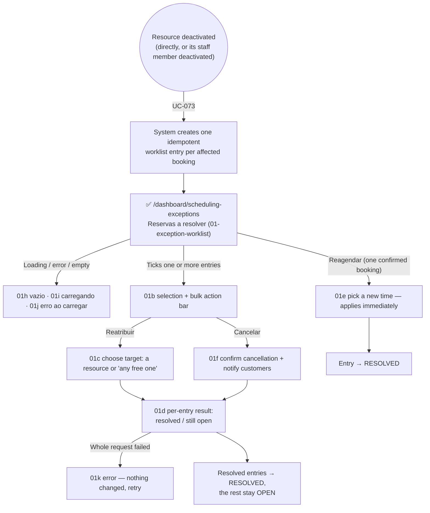

# MANAGER — Scheduling Exceptions (Future Commitment Worklist)

**Actor(s):** MANAGER  
**Goal:** Review and explicitly resolve — one by one or many at once — future bookings affected by a resource change nobody reviewed per-session  
**UCs covered:** UC-073 (System raises), UC-077 (Manager resolves)  
**Status:** Built — M23, Multi-Vertical Scheduling, Cluster 3. Backend + BFF shipped in `M23-S08` (✅); this frontend shipped in `M23-S14` (✅). Prototypes redrawn 2026-10-14 inside the real dashboard shell, reusing the agenda's cards, sheets and the staff reschedule picker (`dev-notes.md` § Design system). Customer/manager notifications for the worklist: `M23-S23`.

> Promoted from `docs/discovery/multivertical-booking/multivertical-booking_USECASES.md` (CAND-47, CAND-56) via `/discovery-to-milestone`. See `docs/02-DOMAIN_MODEL.md` § `FutureCommitmentException` for the full domain model. This worklist never silently moves or invalidates a commitment — every entry ends in an explicit manager decision (keep, reassign, reschedule, cancel) or a dismissal.

> **Decided in `M23-S08` (2026-09-30):**
> - An entry is one **future booking** (`PENDING`, `INFO_REQUESTED` or `APPROVED`) occupying a resource that was deactivated — either directly (UC-047) or because its staff member was deactivated (UC-048). A recurring schedule has **no entry of its own**: each of its occurrences is a booking and appears as its own entry.
> - **Reassign** = same time, another resource (an explicit one, or "any free one"). **Reschedule** = a manager-chosen new time, applied immediately, for a confirmed (`APPROVED`) booking and **one entry at a time** (the customer is notified by the existing reschedule email). There is no "offer options and wait for the customer" flow.
> - **Reassign, cancel, keep and dismiss work on many entries at once**, best-effort: each booking is its own transaction, the ones that could not be done stay open and are reported back.
> - Sending the manager an alert and telling the customer about a reassign is `M23-S23`, not this screen.
>
> **Decided for the UI on 2026-10-14:** the screen offers only **Reatribuir, Reagendar and Cancelar**. There is no "Manter" and no "Dispensar": a booking on a deactivated resource has nobody to perform it, so leaving it as it is is not a real outcome. The backend `KEEP` choice and `POST /dismiss` (shipped in `M23-S08`) stay but this page does not call them. A resource deactivated by mistake is fixed by reactivating it, and **reactivation must close that resource's open entries** (`M23-S45`) — otherwise the list could never be emptied without moving or cancelling healthy bookings.

## Flow

## Pages referenced

| Page / Route | Component | Story | Status |
|---|---|---|---|
| `/dashboard/scheduling-exceptions` | `SchedulingExceptionWorklistPage` | M23-S14 | ✅ Built |
| `/dashboard/scheduling-exceptions/[exceptionId]/reschedule` | `SchedulingExceptionReschedulePage` (the staff `RescheduleBookingPage`) | M23-S14 | ✅ Built |

## BFF calls in this flow

| Call | When | Roles |
|---|---|---|
| `GET /v1/scheduling-exceptions/count` | **New in `M23-S14`:** the sidebar badge (`{ count }` of open entries); cached 60 s | MANAGER |
| `GET /v1/scheduling-exceptions?status=OPEN` | Worklist page load (UC-073's output) — each item carries the booking summary and the stored alternatives | MANAGER |
| `POST /v1/scheduling-exceptions/resolve` | Manager reassigns/cancels one or many entries (`exceptionIds[]`), or reschedules one; per-entry result `RESOLVED` / `STILL_OPEN` (`KEEP` exists in the API but this page never sends it) | MANAGER |
| `POST /v1/scheduling-exceptions/dismiss` | **Not called by this page for `RESOURCE_DEACTIVATION` entries** (kept for the API and for future source types; see the 2026-10-14 decision above) | MANAGER |

Full request/response shapes: `docs/14-API_CONTRACTS.md` § Future Commitment Exceptions.

## Prototype

Folder: `manager/prototypes/scheduling-exceptions/` — relocated from `docs/discovery/multivertical-booking/prototype/manager-12-exception-worklist.html`, reworked on 2026-09-30 for the `M23-S08` decisions above, and **redrawn on 2026-10-14** inside the real dashboard shell (sidebar, topbar, bottom nav, the real queue card, shared bottom sheet, the staff reschedule picker) after the first pass turned out to be bare pages with bespoke CSS.

| File | Screen | UC | Status |
|---|---|---|---|
| `01-exception-worklist.html` | Worklist — one card per affected booking (the real queue card's shape: name + Cliente/Visitante + status pills, service, date/time and price · duration, small buttons, the card links to the booking), grouped by the unavailable resource, per-row actions, a "no compatible alternative" row and a pending row (no Reagendar) | UC-073, UC-077 | ✅ Built |
| `01b-selecionados.html` | Two entries ticked, bulk action bar (Reatribuir · Cancelar; Reagendar is one at a time) | UC-077 | ✅ Built |
| `01c-reatribuir.html` | Reassign target: "Qualquer recurso livre" (default) or a stored alternative labelled "livre em N de M reservas"; optional reason | UC-077 | ✅ Built |
| `01d-resultado-parcial.html` | Per-entry result after a bulk action: resolved vs still open, with the reason | UC-077 A1 | ✅ Built |
| `01e-reagendar.html` | Pick a new time for one confirmed booking with the staff reschedule picker — applies immediately | UC-077 | ✅ Built |
| `01f-cancelar.html` | Confirm a cancellation of several bookings | UC-077 | ✅ Built |
| `01h-vazio.html` · `01i-carregando.html` · `01j-erro-carregar.html` | Empty, loading and fetch-error states | UC-073 | ✅ Built |
| `01k-erro-enviar.html` | The whole request failed — nothing changed | UC-077 | ✅ Built |

## Open questions / gaps

- [x] Stories exist: `M23-S08` (backend + BFF), `M23-S14` (this page), `M23-S23` (notifications). `M23-S14` still begins with `/story-discovery`.
- [x] Reassign, reschedule, bulk and the "no entry per schedule" rules were decided in `M23-S08` and are drawn here (2026-09-30).
- [x] Nav placement — a new MANAGER-only sidebar item ("Reservas a resolver", right below "Agenda", with a count badge; in "Mais" on mobile) is now drawn in the shell; recheck at `M23-S14`'s discovery.
- [x] Slot source for `01e` — the existing staff availability endpoint; the route reuses the staff `RescheduleBookingPage` with an injected confirm (decided at `M23-S14`'s discovery, 2026-10-14).
- [x] `M23-S45` (reactivation closes the open entries) is related to this page but not blocking it.
- [ ] **Selecting "all from this resource from a time":** the prototype draws a per-resource "Selecionar todos" control; a free time filter ("a partir de …") is a proposal, not decided.
- [ ] **A `PENDING` / `INFO_REQUESTED` booking** has no Reagendar (only a confirmed booking can be rescheduled); how the manager moves such a booking's time is the normal approval flow, not this screen.
