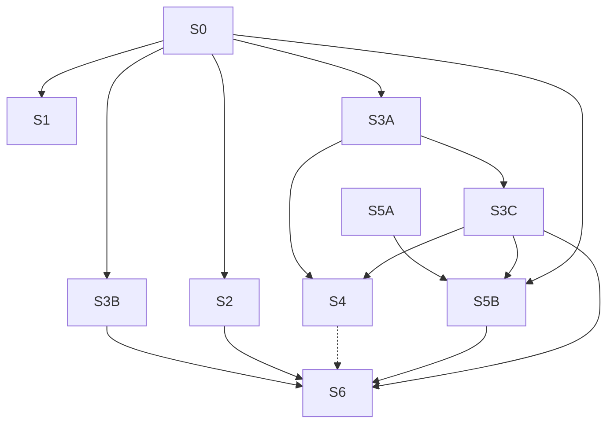

# TD53 — Agent-first documentation routing and integrity

## Status
- **Type**: Technical Debt / Documentation governance (AI-agent context)
- **Priority**: Medium (no functional defect; the cost is that an unattended agent can act on a dead pointer or a misrouted load with nothing to stop it)
- **Context**: `docs/`, `.copilot/context.md`, `.claude/commands/`, `packages/architecture-check`
- **Created**: 2026-10-17
- **Discovered**: a chat review of `/docs-audit`'s fit (2026-10-17), then measuring how agents actually read these docs from the repo's own session transcripts
- **Decision status**: Drafted 2026-10-17; re-scoped the same day from a human-oriented folder reorganisation to agent-first routing and integrity once the transcript measurements below were taken. Story 1 was re-scoped again in its own `/story-discovery` on 2026-10-18 (tags and a `docs-for` helper replace `Verified against` and `Audit bucket`). Each story still begins with `/story-discovery`.
- **Review 2026-10-17**: reviewed against the repository the same day; Story 3 split into 3A/3B/3C, Story 5 preceded by a mechanism spike (5A), Stories 1 and 0 tightened, Stories 4 and 6 gated on the Decision record, success metrics added.
- **Related**: TD52 (cancelled 2026-10-17 and folded into Story 1; re-scoped in Story 1's discovery on 2026-10-18 so the classification is each doc's `Tags` plus one tag vocabulary in the policy file, not per-doc code lists), TD41 (canonical-home rule, `ENGINEERING_RULES_*` split), TD37 (`architecture-check` decisions), `.claude/commands/docs-audit.md`, `CLAUDE.md` §10

## Problem

This repository is mainly maintained by AI agents running a mostly unattended flow, so documentation quality is judged by one question: *does an agent load the right context, and would anything stop it if the context were wrong?*

### Measured: how agents read docs (2026-10-17, 114 transcripts, 37 with doc reads, mostly Claude Code on this repo)

- Agents **search, then read a line range**. Of 1,381 Bash commands that touched `docs/`, 944 were `grep`/`rg`, 515 were `sed -n` ranges and 809 `head`/`tail`; only 130 were `cat`.
- **Large docs are never read whole.** Whole-file reads occurred only for small docs (up to about 28 KB: `STORY_SCHEMA`, `DEFINITION_OF_DONE`, `LOCK_CATALOG`). Every large doc was read partially — `04-USE_CASES` (251 KB) 11 of 11 reads, `14-API_CONTRACTS` (156 KB) 12 of 12, `13-DATABASE_SCHEMA` (121 KB) 10 of 10; overall 145 partial Read calls vs 31 whole.
- **Routing is coarse.** Only 8 of the 36 rows of `.copilot/context.md` §10 cite a `§ section`; the rest point at a whole file.
- **The always-on context is the biggest fixed cost.** `.copilot/context.md` is 57,647 characters loaded in every session, whatever the task: §7 Engineering Rules alone is 24,439 (42%), §9 Story Workflow 9,029, §10 5,379. No nested context file exists anywhere in the repo, so nothing is loaded by area.
- **The grep surface is mostly not live docs.** `docs/` holds about 4.9 MB, of which the 45 live top-level docs are about 1.9 MB; `docs/archive` (59 files, 1.46 MB, superseded) and `docs/discovery` (115 files, 1.59 MB) make up the rest. Ten archive files still mention the superseded UC-014/UC-015, so a grep of `docs/` can land on wrong context.
- **Orientation is missing where it matters.** Only 8 of the 45 top-level docs carry a "When to load" line (re-measured 2026-10-18), and only 3 of the 18 docs over 30 KB do (`ENGINEERING_RULES_BACKEND`, `_SHARED`, `_TESTING`).
- **Nothing checks pointers outside `context.md`.** The `agent-context-file` detector validates only `.copilot/context.md`; a moved, renamed or reworded target in any other doc, skill, TD, milestone or code comment fails silently. `docs/*.md` is cited in about 640 files / 3,930 occurrences (`plan/` 1,688, `apps/` 628 — 462 of them `.ts`/`.tsx` comments — `.claude/` 148, `.copilot/context.md` 131, `packages/` 118, `td/` 56).

Limits of this evidence: one repository, mostly Claude Code; other agents (Codex, Gemini) may read differently and are not visible in these transcripts.

### Why this matters

File size is not what costs an agent; **findability** is — the agent greps for a handle (a `§ heading`, a UC id, an error code) and reads around it. So what protects an unattended flow is: handles that stay valid (checked in CI), routing precise enough to land on the right section, and a one-line statement at the top of each large doc of when it applies. A reorganisation that renames or moves files would instead invalidate handles that agents and other docs already hold.

## Chosen approach (decided in the session that drafted this TD)

Principles:
- **Optimise findability and routing, not file layout.** Stable paths and stable `§ heading` handles are an asset; every move spends it.
- **Verify before changing.** The link and anchor checker lands first, so every later change is proven by CI, not trusted.
- **One uniform naming rule.** The 27 numbered docs (`01`–`28`, no `07`) carry a creation-order number that means nothing to an agent, while the other 16 are unnumbered. Story 6 drops the prefix from all of them (`14-API_CONTRACTS.md` → `API_CONTRACTS.md`), so one rule covers every doc and `grep -l API_CONTRACTS` finds it as well as before. It runs last, and only if the Decision record confirms it (the gain for an agent is low; the cost is about 2,662 citation rewrites), all proven by Story 0's checker.
- **Keep the grep surface to live, agent-facing text.** Superseded material moves out of `docs/` to a top-level `archive/`; it stays in the repository and keeps its history, it just stops appearing in docs searches.
- **Optimise tokens by loading less up front and more on demand.** Always-on context stays small; everything else loads by trigger (a `§ section` pointer, a path-scoped context file, a skill invoked by name).
- **Context is never sacrificed.** Nothing is deleted to save size; the only deletions allowed are verified duplicates collapsed to pointers and content code contradicts (`/docs-audit`'s guiding principle). Moving a rule from always-on to on-demand is not a deletion, but only when its new trigger is proven to fire (Story 5B).
- **One canonical home per fact.** The "when to load" statement and the doc's `Tags` live in each doc's own header and travel with it. The tag vocabulary, with each tag's code globs, lives once in `architecture-policy.json`, so a moved doc keeps its classification and a moved code folder is a one-line policy edit. There is no per-doc code list to go stale, and deep versus light checking is derived from the tags (a tag with code globs makes a doc deep-checked).
- **No table of contents to maintain.** `grep -n '^##' <doc>` already gives an agent the structure, and a hand-kept contents block would be one more thing to drift.

Rejected, with the condition to reopen:
- **Regrouping `docs/` into subfolders and dropping the numbers.** About 3,930 rewrites across 640 files for a human-browsing gain; the transcripts show agents are not slowed by a flat layout. Reopen only if Story 3A's triage shows another agent navigating by directory.
- **Splitting the large docs into smaller files.** The transcripts show they are already consumed by section. Reopen only if measurement shows an agent that reads them whole.
- **Moving `plan/journey/` into `docs/`.** About 5.8 MB of HTML and CSS would add noise to the `docs/` greps agents run constantly. The journeys move to a top-level `journeys/` instead (Story 4), so `plan/` means delivery only and `docs/` stays text. Agent value of this move is low; it is chosen for clarity, and its cost (about 790 mechanical edits) is small once Story 0's checker exists.

### Success metrics (baseline measured 2026-10-17; each story records its after-value in its PR)

| Metric | Baseline | Target | Story |
|---|---|---|---|
| Dead `docs/`, `plan/`, `td/`, `infra/` citations and dead `§` anchors in live text | counted by Story 0's first run | 0, enforced by CI | 0 |
| Top-level docs with a "When to load" line | 8 of 45 | 45 of 45, enforced by CI | 1 |
| Top-level docs with a `Tags` line from the vocabulary | 0 of 45 | 45 of 45, enforced by CI | 1 |
| `context.md` §10 rows citing a `§ section` or stating "whole file" with a reason | 8 of 36 | 36 of 36 | 2 |
| Always-on `context.md` size | 57,647 chars | set by Story 5A's measurement | 5B |
| Superseded or historical files under `docs/` (archive, lean) | 59 + 1 | 0 | 3B |

### Decision record (filled by Story 3C)

_Open. Story 3C writes here: the per-doc verdicts, the load measurements including any non-Claude agent evidence, the always-on `context.md` cost review, and the confirmed destination of the journeys move (top-level `journeys/` unless the measurements say otherwise), and an explicit go or no-go, with the cost shown, for Story 4 (journeys move) and Story 6 (numeric-prefix drop)._

## Stories

Stories 4 and 6 are gated: each runs only on an explicit go in Story 3C's Decision record. 5A is independent and can run at any time; 5B waits for its result.

### Story 0 — Repo-wide link and anchor checker ✅ Done

**Agent:** devops
**Complexity:** M
**Docs to load:** `docs/17-GITHUB_WORKFLOWS_GUIDELINES.md` § `architecture-check`; `docs/ENGINEERING_RULES_TESTING.md`; `docs/STORY_SCHEMA.md`
**Dependencies:** none
**Pattern:** plain composition — follows `lock-catalog-coverage.ts` / `agent-context-file.ts` (policy in, `ScanResult` out)

**Description:**
Only `.copilot/context.md` has its `docs|infra/` pointers and `§ heading` citations checked today. Add a detector `doc-link-integrity` that scans tracked `.md` files (`docs/**`, `plan/**`, `td/**`, `.claude/commands/**`, `.copilot/**`) and the `docs/…md` path citations in code comments (`apps/**`, `packages/**`), and fails when a cited `docs/`, `plan/`, `td/` or `infra/` path does not exist, or a `§ heading` citation matches no heading in its target. Reuse the heading-normalization and citation-matching helpers that `agent-context-file.ts` already has by extracting them into a shared module, not copying them. Pre-existing dead links are fixed in this same PR or allowlisted with a rationale, owner and review date, like the other policy files. **Placeholders and examples are not citations.** Docs deliberately contain example paths (`docs/NN-NAME.md`, `docs/X.md`, `docs/...md`) and detector fixtures cite fake docs. The detector ignores citations inside fenced code blocks and inside test fixtures, and honours an explicit marker for the rare inline example; each exemption rule is unit-tested. The baseline run's findings are triaged into real dead links (fixed), examples (exempted by rule, never by allowlist entry) and genuine exceptions (allowlisted). **Cost:** the scan covers `apps/**` and `packages/**` comments, so the PR records its runtime and it must stay within the `architecture-check` job's existing budget. `archive/**` and `docs/discovery/**` are excluded by the policy (the owner's decision: archived and discovery material is historical, so its internal citations are not checked and not rewritten when docs move or are renamed; live docs that cite a path inside them are still checked). <!-- doc-link:example -->

**Decisions locked in story-discovery (2026-10-17):**
- **Sources scanned** (from `git ls-files`): canonical `docs/*.md`, `.claude/commands/**`, `.copilot/**`, the `docs/…` citations in non-spec `.ts`/`.tsx` comments under `apps/**` and `packages/**`, and non-frozen `plan/**` and `td/**` files (open stories' "Docs to load" lines are followed by `/story-discovery`, so a dead path there misroutes an agent).
- **Excluded as sources:** `docs/archive/**`, `docs/discovery/**`, top-level `archive/**` (so Story 3B needs no detector change), `*.spec.ts`, and files whose header carries `> Frozen: <date>` (closed milestones' IA/`_DEVELOPER` files, finished TDs and completed milestone plan files; `/mark-done` Step 12 adds the header at close). Until it does, the policy lists the closed files explicitly. Files outside the listed source folders (`.claude/skills/**`, `scripts/**`, root `README`) are out of scope.
- **Targets checked:** a cited `docs/`, `plan/`, `td/` or `infra/` path must exist in `git ls-files`, wherever the source sits (a canonical doc citing `docs/archive/…` is still reported). Wildcards (`docs/ENGINEERING_RULES_*.md`) are skipped; a trailing `/` is a directory check.
- **Extension rules:** a `docs/`, `plan/` or `td/` citation must end in `.md` (or a trailing `/` for a directory); an `infra/` citation may be any tracked file (`.tf`, `.json`, `.md`) or a directory, as `.copilot/context.md` already cites. Citations are found by regex; existence is a plain `git ls-files` set lookup, and the `§ heading` comparison is normalized string matching, not regex. Trailing punctuation (`.` `,` `)` or a closing backtick) is trimmed before the lookup.
- **Exemptions by rule, never by allowlist entry:** fenced code blocks, `*.spec.ts` fixtures, and `<!-- doc-link:example -->` on the same line.
- **`§` grammar:** only `` `path.md` § <text> `` on the same line, matched with the shared `agent-context-file` helpers. A bare `§ 3.1` with no path is out of scope.
- **Historical names quoted in prose** (e.g. "formerly `docs/07-…`") are reworded in this PR, not allowlisted.
- **Gitignored paths** (`docs/BOOTSTRAP_LOG.md`) are listed under `gitignoredAllowed` in `architecture-policy.json` with a rationale, so a worktree and CI give the same result.
- **Policy shape:** `docLinkIntegrity.{sources,excluded,frozen,gitignoredAllowed,allowlist}` in `architecture-policy.json`; allowlist entries carry rationale, owner and `reviewBy`; the detector takes an injectable `now` so the expiry test is deterministic.
- **Scope added during implementation (owner's decision):** the superseded M14 (observability), M15 (GCP infrastructure) and M16 (deploy pipelines) plan files are deleted in this PR (their stories were merged into M17; recoverable from git history) and `plan/README.md` is brought up to date; `docs/10-OBSERVABILITY_STRATEGY.md` is rewritten against the code, the collector config and the Terraform module, because the baseline run showed old plans citing headings that no longer existed. The shared heading helpers also accept a bold lead-in paragraph (`**Label:**`) and `6.` versus `6` numbering as the same anchor.
- **Overlap:** `.copilot/context.md` pointers are also checked by `agent-context-file`; double reporting is accepted and `agent-context-file` changes only by the helper extraction.

**New migration / i18n keys / env vars / feature flags:** none

**Files to create/modify:**
- `packages/architecture-check/src/detectors/doc-link-integrity.ts` (new)
- `packages/architecture-check/src/detectors/doc-link-integrity.spec.ts` (new)
- `packages/architecture-check/src/detectors/agent-context-file.ts` (modify — extract shared citation helpers)
- `packages/architecture-check/src/index.ts`, `packages/architecture-check/src/cli.ts` (modify — export, register)
- `packages/architecture-check/architecture-policy.json` (modify — `docLinkIntegrity` section: sources, excluded, frozen, gitignoredAllowed, allowlist)
- `docs/17-GITHUB_WORKFLOWS_GUIDELINES.md` (modify — one detector-table row)
- Docs the baseline run finds dead links in (listed by the run; each is a `.md` the doc gate covers)

**Acceptance criteria — product:**
- [ ] Renaming or deleting a cited doc fails `pnpm architecture-check` and names each broken citation with file and line.
- [ ] A `§ heading` citation to a heading that does not exist fails the same way.
- [ ] The repository passes the new detector at merge, with every pre-existing dead link fixed or allowlisted.
- [ ] The PR records the baseline dead-link count split by class (real, example, historical name reworded, gitignored, allowlisted) and the detector's added runtime.

**Acceptance criteria — technical:**
- Unit:
  - [ ] `doc-link-integrity.spec.ts`: a cited missing path is reported.
  - [ ] `doc-link-integrity.spec.ts`: a `§ heading` with no matching heading is reported.
  - [ ] `doc-link-integrity.spec.ts`: a citation in a `.ts` comment to a missing doc is reported.
  - [ ] `doc-link-integrity.spec.ts`: an allowlisted dead link passes; an expired allowlist entry fails.
  - [ ] `doc-link-integrity.spec.ts`: a path inside a fenced code block or marked as an example passes; the same path in prose is reported.
  - [ ] `doc-link-integrity.spec.ts`: a fully valid set passes with zero findings.
  - [ ] `doc-link-integrity.spec.ts` (negative guarantees): files under `archive/**`, `docs/discovery/**` and files with a `> Frozen:` header are not scanned; a live doc citing a path inside `docs/archive/` is still reported; a `*.spec.ts` fixture is not scanned.
  - [ ] `doc-link-integrity.spec.ts`: an `infra/` citation to a tracked `.tf`/`.json` file or directory passes and a missing one is reported; trailing punctuation is trimmed before the lookup.
  - [ ] `doc-link-integrity.spec.ts`: a wildcard citation is skipped; a trailing-`/` citation is checked as a directory; a `gitignoredAllowed` path passes; `<!-- doc-link:example -->` passes.
  - [ ] `agent-context-file.spec.ts` still passes unchanged after the helper extraction.
- Integration: none — covered by unit tests plus a clean `pnpm architecture-check` on the real repository
- Tenant isolation: none — no tenant data
- E2E: none
- [ ] Coverage ≥80% on changed code
- [ ] `tsc --noEmit` clean, lint clean

### Story 1 — Doc header contract: "When to load" and "Tags", plus a `docs-for` helper ⚪

**Agent:** devops
**Complexity:** L
**Docs to load:** `docs/STORY_SCHEMA.md` (the existing header pattern); `docs/17-GITHUB_WORKFLOWS_GUIDELINES.md` § `architecture-check`; `.claude/commands/docs-audit.md` Step 1, Step 2b and the `changed` mode; `packages/architecture-check/src/detectors/doc-link-integrity.ts` (the model for policy in, `ScanResult` out)
**Dependencies:** Story 0 (so every path a header or a tag glob cites is checked by CI)
**Pattern:** plain composition — one shared module (`doc-tags.ts`) consumed by a CI detector and a CLI, so the two cannot disagree

**Description:**
Eight of the 45 top-level docs open with a `> **When to load:** …` line (`STORY_SCHEMA.md` is the model); 37 do not, including 15 of the 18 docs over 30 KB. `/docs-audit` also carries two hand-kept lists (deep-check and light-check docs) and four hand-kept bucket lists, which drift: nothing checks them, and a new doc is silently "unclassified". This story gives every live doc a two-field header and moves the classification into one reviewed place.

**The header contract.** Every top-level `docs/*.md` carries, in one blockquote right after the H1 and within its first 15 lines:
- `> **When to load:** <trigger, scope (apps, layers, contexts), and the neighbouring doc that holds what this one does not>`, written from the doc's actual content, not its title, at least 20 characters;
- `> **Tags:** <one or more tags, comma-separated>` from a closed vocabulary.
There is no size threshold: the rule is the same for a 2 KB doc and a 250 KB doc. `Verified against` and `Audit bucket` (the TD52 fold-in) are dropped: a hand-written per-doc code list goes stale quickly and CI could only catch a dead glob, not a wrong one, and tags give the same scoping in one place.

**The tag vocabulary** lives once in `architecture-policy.json`, under a new `docOrientation` section: each tag has a one-line description and zero or more code globs. Starting set: `backend`, `bff`, `web`, `database`, `events`, `tenancy`, `infra`, `testing`, `prototypes` (each with globs, verified against the real tree at implementation time) and `product`, `agent-process` (no globs). A doc is **deep-checked** when at least one of its tags has globs and **light-checked** otherwise, so there is no separate deep/light marker. A moved code folder is a one-line policy edit, and a moved doc keeps its tags.

**The detector `doc-orientation`** (runs in `architecture-check`, hence in `ci:fast` and on every PR) fails when a top-level `docs/*.md` has no `When to load` line within 15 lines or one shorter than 20 characters, no `Tags` line, an empty tag list, or a tag outside the vocabulary; and when a vocabulary tag is used by no doc, or a tag with globs matches no tracked file. `docs/archive/**`, `docs/discovery/**` and `docs/lean/*` are excluded in the policy.

**The helper `docs-for`** (a second entry point of `packages/architecture-check`, same matcher as the detector, run as `pnpm --filter @ikaro/architecture-check docs-for …`):
- `--file <path…>` prints each file's tags, then the docs carrying them;
- `--range <a>..<b>` does the same for every file changed in a git range, and lists the changed files that mapped to no tag;
- `--tag <name…>` lists the docs for a tag ("audit all the backend docs");
- output is one doc per line marked `deep` or `light`; `--json` gives the same data; an unknown tag exits non-zero.
It exists so `/docs-audit changed` and `/mark-done` get a deterministic answer instead of an agent reading the policy JSON and guessing.

**Skills.** `.claude/commands/docs-audit.md` drops its inline deep-check and light-check lists, the "unclassified" rule and the bucket doc lists. Scope resolution calls `docs-for` (a doc path reads its `Tags`, `changed` uses `--range`, a tag uses `--tag`); the four Step 2b agents keep their grep instructions, keyed by tag: `database` and `events` to the schema/data agent; `agent-process` and `testing` to the standards/structure agent; `infra` to the process/infra agent; `backend`, `bff`, `web`, `tenancy` and `prototypes` to the architecture/contracts agent; a doc with several tags goes to the first agent in that priority order whose tags it carries, so a `backend, database` doc is checked for its claimed shapes by the schema/data agent. Its stale `docs/ENGINEERING_RULES.md` wording is corrected. `.claude/commands/mark-done.md` Step 4 states that its docs audit is tag-driven and that "mapped to no doc" now means "mapped to no tag". `.claude/commands/discovery-to-milestone.md` line 77 stops citing "`/docs-audit`'s own deep-check docs bucketing" and uses the tags and `docs-for --tag`. The Codex copies are regenerated with `scripts/codex-skill.sh`. `docs/10-OBSERVABILITY_STRATEGY.md` carries the retired `Verified against` and `Audit bucket` lines (added by Story 0); they are replaced by `Tags`. `docs/DEFINITION_OF_DONE.md` gains one line: a story that adds a doc gives it both header fields.

**Header placement.** Before the detector lands, the story checks that no doc has a preamble that pushes the fields past line 15; where one does, the fields go above it. This adds context only; no existing text is changed or removed. No contents block is added (see Chosen approach).

**Decisions locked in story-discovery (2026-10-18):**
- Both fields mandatory on all 45 live top-level docs, no size threshold; `When to load` at least 20 characters; tags comma-separated, at least one, no maximum.
- Docs that Story 3B later deletes, moves or rewrites (`ENGINEERING_RULES.md`, `TD37-ARCHITECTURE-CHECK-DECISIONS.md`, `README.md`) are tagged now, so the rule has no exception and 3B only moves or deletes them.
- `plan/journey/README.md` and `td/` files are out of scope for the detector; prototypes are reached through the `prototypes` tag's globs. Story 4 moves the journeys and must update those globs (see Story 4).
- Glob matching uses `picomatch`, added to `packages/architecture-check/package.json` (explicit yes obtained in discovery).
- Deep versus light is derived from the tags (a tag with globs makes a doc deep); there is no separate marker.
- The `docs-for` helper is in this story, not a follow-up.
- Not in scope: `/story-discovery` is unchanged (see Follow-ups at the end of this document).

**New migration / i18n keys / env vars / feature flags:** none

**Files to create/modify:**
- `packages/architecture-check/src/doc-tags.ts` and `doc-tags.spec.ts` (new — header parsing, vocabulary, glob-to-tag matching, deep/light derivation)
- `packages/architecture-check/src/detectors/doc-orientation.ts` and `doc-orientation.spec.ts` (new)
- `packages/architecture-check/src/docs-for.ts` and `docs-for.spec.ts` (new — the CLI)
- `packages/architecture-check/src/index.ts`, `packages/architecture-check/src/cli.ts` (modify — export, register the detector)
- `packages/architecture-check/package.json` (modify — `picomatch` and the `docs-for` script)
- `packages/architecture-check/architecture-policy.json` (modify — `docOrientation` section: header lines, minimum length, exclusions, tag vocabulary with descriptions and globs)
- `.claude/commands/docs-audit.md`, `.claude/commands/mark-done.md`, `.claude/commands/discovery-to-milestone.md` (modify) and their regenerated copies under `.agents/skills/` (via `scripts/codex-skill.sh`, not by hand)
- `docs/17-GITHUB_WORKFLOWS_GUIDELINES.md` (modify — the detector row and the `docs-for` helper)
- `docs/DEFINITION_OF_DONE.md` (modify — one line)
- `docs/10-OBSERVABILITY_STRATEGY.md` (modify — replace the two retired lines with `Tags`)
- Every other top-level `docs/*.md` (modify — add `When to load` where missing, and `Tags` on all 45; each line written from reading the doc; re-measure the inventory at implementation time)

**Acceptance criteria — product:**
- [ ] Every top-level `docs/*.md` opens with a `When to load` line stating its trigger, scope and neighbouring doc, and a `Tags` line from the vocabulary.
- [ ] A new `docs/*.md` without either field, with an unknown tag, or with the field past line 15 fails `pnpm architecture-check` with a message naming it.
- [ ] `docs-for --file`, `--range` and `--tag` return the right docs on the real repository, and a changed file that matches no tag is listed as unmapped.
- [ ] `/docs-audit` Step 1 carries no inline deep/light lists, bucket doc lists or "unclassified" rule and derives them from `docs-for`; a dry run on one doc per tag group gives the same deep/light verdict as the old lists. No tracked skill file still names `Audit bucket` or `Verified against`.

**Acceptance criteria — technical:**
- Unit:
  - [ ] `doc-tags.spec.ts`: a `Tags` line is parsed; a file path is mapped to every tag whose globs match it (several tags possible); a doc is deep when any tag has globs and light otherwise.
  - [ ] `doc-orientation.spec.ts`: a doc with both fields in the first 15 lines passes; a missing `When to load`, one under 20 characters, a missing `Tags` line, an empty tag list and an unknown tag are each reported; a field on line 16 is reported.
  - [ ] `doc-orientation.spec.ts`: a vocabulary tag used by no doc is reported; a tag with globs that match no file is reported; a glob-less tag is not.
  - [ ] `doc-orientation.spec.ts` (negative guarantees): files under `docs/archive/**`, `docs/discovery/**` and `docs/lean/*`, and `.md` files outside the top level of `docs/`, are not scanned.
  - [ ] `docs-for.spec.ts`: `--file`, `--range` (a temporary git repository fixture) and `--tag` each return the expected docs marked deep or light; a file with no tag is listed as unmapped; `--json` returns the same data; an unknown tag exits non-zero.
- Integration: none — covered by unit tests plus a clean `pnpm architecture-check` on the real repository
- Tenant isolation: none — no tenant data
- E2E: none
- [ ] `pnpm architecture-check` (including `doc-orientation`, `doc-link-integrity` and `agent-context-file`) passes on the real repository
- [ ] The PR records the detector's added runtime and a before/after count of docs with each field
- [ ] Coverage ≥80% on changed code
- [ ] `tsc --noEmit` clean, lint clean

### Story 2 — Section-level routing in `context.md` §10 ⚪

**Agent:** devops
**Complexity:** M
**Docs to load:** `.copilot/context.md` §7 (How to edit this file), §10; `packages/architecture-check/agent-context-policy.json`
**Dependencies:** Story 0 (so every `§` cited here is verified by CI, not by eye)
**Pattern:** plain composition — no named pattern applies

**Description:**
8 of the 36 §10 rows cite a `§ section`; the rest send the agent to a whole file, so it greps and ranges through 100–250 KB to find the part the task needs. For each row, replace or add the section pointers that exist (`docs/04-USE_CASES.md` § the UC, `docs/14-API_CONTRACTS.md` § the resource, and so on); where a row genuinely needs the whole doc, say so with the reason in the row. Do not restate any doc's content in §10 (the file is budgeted, and `/docs-audit` 3e flags a restated rule). Every added pointer must resolve per Story 0's detector. §10's section budget in `agent-context-policy.json` may need a reviewed bump; that is a policy-file change and needs the explicit yes. <!-- doc-link:example -->

**New migration / i18n keys / env vars / feature flags:** none

**Files to create/modify:**
- `.copilot/context.md` (modify — §10 rows; edit this file directly, never through the symlinks)
- `packages/architecture-check/agent-context-policy.json` (modify — §10 budget, only if the pointers need it)

**Acceptance criteria — product:**
- [ ] Every §10 row cites a `§ section` where a relevant one exists, and states "whole file" with a reason where none does.
- [ ] Before/after bytes an agent reads per §10 row are recorded in the PR, using the cited section line ranges.

**Acceptance criteria — technical:**
- Unit: none — `.md` content; verified by Story 0's detector and the existing `agent-context-file` budget check
- Integration: none
- Tenant isolation: none — no tenant data
- E2E: none
- [ ] `pnpm architecture-check` (including `doc-link-integrity` and `agent-context-file`) passes
- [ ] Coverage ≥80% on changed code (not applicable — no code changed)

### Story 3A — Audit baseline and per-doc triage ⚪

**Agent:** devops
**Complexity:** M
**Docs to load:** `.claude/commands/docs-audit.md`; `.copilot/context.md` §10, §15, §17; `docs/README.md`
**Dependencies:** Story 0 (so dead links are found by CI, not by eye)
**Pattern:** plain composition — no named pattern applies

**Description:**
1. **Baseline.** Run `/docs-audit` with a blank scope (per folder if the context strains: `docs`, `plan`, `plan/journey`, `td`) and apply the approved fix batch — stale claims, dead pointers, journey `dev-notes.md` drift — so later work starts clean. Fixes the user declines are recorded as declined, not dropped.
2. **Per-doc triage table** in the Decision record: size, inbound reference count, verdict (keep / merge / archive / move) and whether the doc is still relevant, with evidence. This story only records verdicts; Story 3B acts on the ones already decided.

**New migration / i18n keys / env vars / feature flags:** none

**Files to create/modify:**
- `td/TD53-AGENT-FIRST-DOCS-ROUTING-AND-INTEGRITY.md` (modify — Decision record, triage table)
- Docs and journey files the approved audit fixes touch (listed in the audit report)

**Acceptance criteria — product:**
- [ ] Every `docs/*.md` has a recorded verdict with evidence.
- [ ] The audit baseline fixes are applied or each is explicitly declined.

**Acceptance criteria — technical:**
- Unit: none — documentation story
- Integration: none
- Tenant isolation: none — no tenant data
- E2E: none
- [ ] `pnpm architecture-check` (including `doc-link-integrity`) passes
- [ ] Coverage ≥80% on changed code (not applicable — no code changed)

### Story 3B — Moves and deletions out of the live grep surface ⚪

**Agent:** devops
**Complexity:** L
**Docs to load:** `docs/README.md`; `.claude/commands/docs-audit.md`
**Dependencies:** Story 0 (the checker proves every move). Not batchable with any other story: it rewrites citations across the repository.
**Pattern:** plain composition — no named pattern applies

**Description:**
1. **`docs/README.md`.** State where a new doc goes and the one naming rule (`UPPER_SNAKE.md`; the numeric prefix is removed by Story 6 only if that story is approved), keeping the former reading order as an ordered list. The convention paragraph also states the header contract Story 1 enforces: every doc opens with `When to load` and `Tags` lines, so a new doc is not a surprise CI failure.
2. **Move `docs/TD37-ARCHITECTURE-CHECK-DECISIONS.md` to `td/`** (citations rewritten, proven by Story 0).
3. **Delete `docs/ENGINEERING_RULES.md`** (a 94-line redirect index, cited by about 21 files outside archive and discovery) once the checker shows no citation still needs it.
4. **Move `docs/archive/` to a top-level `archive/`.** 59 files, about 1.5 MB of superseded content; about 52 citations to rewrite. History is preserved by `git mv`. `docs/discovery/` stays where it is until its milestone is promoted.
5. **Delete `docs/lean/`.** `docs/lean/WEB_LEAN.md` (139 KB) is a "Frontend Learning Journal" written for a human learning Next.js; the owner confirmed on 2026-10-17 that it can be deleted. It is cited only by the `M12`/`M13` `_DEVELOPER.md` plan files (which agents never load per `.copilot/context.md` §10) and as a scope example in the two `docs-audit` copies. Remove the file and fix every citation.
Each of items 2–5 is its own commit in the PR, so a bad one can be reverted alone. The Codex skill copies are regenerated with `scripts/codex-skill.sh`.

**New migration / i18n keys / env vars / feature flags:** none

**Files to create/modify:**
- `docs/README.md` (modify — convention paragraph and reading order)
- `docs/TD37-ARCHITECTURE-CHECK-DECISIONS.md` → `td/TD37-ARCHITECTURE-CHECK-DECISIONS.md` (`git mv`) and every file citing it (regenerate with `grep -rl TD37-ARCHITECTURE-CHECK-DECISIONS` at implementation time) <!-- doc-link:example -->
- `docs/ENGINEERING_RULES.md` (delete) and every file citing it (regenerate with `grep -rl "docs/ENGINEERING_RULES.md"`)
- `docs/archive/**` → `archive/**` (`git mv`, 59 files) and every file citing `docs/archive` (regenerate the list)
- `docs/lean/WEB_LEAN.md` (delete) and its citations: `plan/M12-HOTSITE-FRONTEND_IMPLEMENTATION_DETAILS_DEVELOPER.md`, `plan/M13-DASHBOARD-FRONTEND_IMPLEMENTATION_DETAILS_DEVELOPER.md`, `.claude/commands/docs-audit.md`, `.agents/skills/docs-audit/SKILL.md` (regenerated)

**Acceptance criteria — product:**
- [ ] `docs/lean/` is gone and no tracked file cites it.
- [ ] `docs/archive/` lives at `archive/` with its history intact, and no tracked live file still cites the old path.
- [ ] `docs/ENGINEERING_RULES.md` is gone and no tracked file cites it.
- [ ] `docs/README.md` states where a new doc goes and lists the docs in their former reading order.

**Acceptance criteria — technical:**
- Unit: none — documentation and move story
- Integration: none
- Tenant isolation: none — no tenant data
- E2E: none
- [ ] `pnpm architecture-check` (including `doc-link-integrity`) passes after each commit
- [ ] Coverage ≥80% on changed code (not applicable — no code changed)

### Story 3C — Load measurement and Decision record ⚪

**Agent:** devops
**Complexity:** M
**Docs to load:** `.copilot/context.md` §0–§10; the Decision record above
**Dependencies:** Story 3A (the triage table it builds on)
**Pattern:** plain composition — no named pattern applies

**Description:**
1. **Load measurement.** Re-run the transcript measurement on fresh sessions, including any non-Claude agent logs available, and record the Success-metrics after-values that are measurable at this point.
2. **Classify every bullet of `context.md` §0–§9** by the trigger that makes it relevant (global gate, area-scoped, workflow-scoped). The classification feeds Story 5B; this story removes nothing.
3. **Journeys destination.** Confirm the destination for Story 4 (`journeys/` at the repository top level; `docs/journeys/` is rejected for the grep noise of about 5.8 MB of HTML in `docs/`) and list the root config that hardcodes the current path (`.gitignore`, `.coderabbit.yaml`, `sonar-project.properties`, `knip.config.ts`). <!-- doc-link:example -->
4. **Go or no-go for Story 4 and Story 6**, recorded in the Decision record with the measured cost (files rewritten, non-markdown hits) beside the benefit. A no-go closes the story as cancelled and leaves the numbering and journeys where they are.

**New migration / i18n keys / env vars / feature flags:** none

**Files to create/modify:**
- `td/TD53-AGENT-FIRST-DOCS-ROUTING-AND-INTEGRITY.md` (modify — Decision record, success metrics)

**Acceptance criteria — product:**
- [ ] The Decision record states the load measurement, the `context.md` always-on classification, the confirmed journeys destination and a go or no-go for Stories 4 and 6.

**Acceptance criteria — technical:**
- Unit: none — measurement story
- Integration: none
- Tenant isolation: none — no tenant data
- E2E: none
- [ ] Coverage ≥80% on changed code (not applicable — no code changed)

### Story 4 — Move `plan/journey/` to `journeys/` ⚪

**Agent:** devops
**Complexity:** L
**Docs to load:** the Decision record above; `plan/journey/README.md`; `.copilot/context.md` §15
**Dependencies:** Story 0 (the checker proves the move), Story 3A (the audit baseline fixes journey drift first, so stale `dev-notes.md` content is not moved) and Story 3C (the go decision and destination). **Gated:** runs only on an explicit go in the Decision record; agent value is low and the cost is large.
**Pattern:** plain composition — no named pattern applies

**Description:**
`git mv` the whole subtree to the destination Story 3C confirmed (`journeys/`), preserving its structure so the prototypes' relative links (`../../../shared/...`) keep working. Rewrite every outside citation with a script (about 790 occurrences plus 51 inside the subtree), including `.copilot/context.md` §10/§15, the skills under `.claude/commands/`, `.github`, `.agents`, `apps/` comments, `td/TD50`, and any root config Story 3C listed. No stub is left at the old path; Story 0's checker proves nothing still points there. The rewrite script lives in the scratchpad and is not committed. **Tags:** update the `prototypes` tag's globs in `architecture-policy.json` (`docOrientation`) to the new location, and give the journeys index doc (`plan/journey/README.md`, or its replacement at the new path) a `Tags` line, so `docs-for --tag prototypes` keeps finding the journeys; Story 1's `doc-orientation` fails if that tag's globs match nothing, which makes a forgotten update visible. This story rewrites lines across the whole repository, so it is **not batchable** with any other story.

**New migration / i18n keys / env vars / feature flags:** none

**Files to create/modify:**
- The `plan/journey/**` subtree (`git mv`, 407 files)
- Every file returned by `grep -rl "plan/journey"` at implementation time (about 125 outside the subtree; regenerate then)
- Root config Story 3C confirmed contains the path

**Acceptance criteria — product:**
- [ ] No tracked file cites the old path after the move.
- [ ] Every relative `href`/`src` in the moved HTML prototypes still resolves (one-off script run, result recorded in the PR).

**Acceptance criteria — technical:**
- Unit: none — mechanical move, verified by Story 0's detector
- Integration: none
- Tenant isolation: none — no tenant data
- E2E: none
- [ ] `pnpm architecture-check` (including `doc-link-integrity`) passes
- [ ] `/docs-audit changed` over the move range reports zero dead pointers
- [ ] `tsc --noEmit` clean, lint clean

### Story 5A — Spike: which agent tools load path-scoped context, and how ⚪

**Agent:** devops
**Complexity:** S
**Docs to load:** `.copilot/context.md` §0, §7; the tools' own documentation for nested and path-scoped context files
**Dependencies:** none
**Pattern:** plain composition — time-boxed investigation, no code

**Description:**
Story 5B only makes sense for a tool that loads area context when the agent works in that area. Established by test, not assumption, per tool (Claude Code, Codex, Gemini), launched from the repository root as sessions are launched here: does a nested `CLAUDE.md`/`AGENTS.md`/`GEMINI.md` under `apps/backend` load when a file there is read or edited, is it loaded eagerly at start-up, or only when the working directory is below it? Expect differences (a tool that builds its chain from the working directory upward will never see a nested file in a root-launched session). Also evaluate Claude Code's path-scoped rules (`.claude/rules/*.md` with a `paths` frontmatter) as an alternative to nested files, and whether §9's workflow content belongs in a skill invoked by name. Output: a table in the Decision record of tool, mechanism, evidence (the session log line or the observed behaviour), and the resulting recommendation for 5B (nested files, path-scoped rules, per-tool mix, or no move). A recommendation of "no move" is a valid outcome and cancels 5B.

**New migration / i18n keys / env vars / feature flags:** none

**Files to create/modify:**
- `td/TD53-AGENT-FIRST-DOCS-ROUTING-AND-INTEGRITY.md` (modify — Decision record)

**Acceptance criteria — product:**
- [ ] For each tool, the Decision record states whether and when path-scoped context loads, with evidence from a real session.
- [ ] The Decision record states the 5B recommendation, including the case where one tool keeps everything always-on.

**Acceptance criteria — technical:**
- Unit: none — investigation
- Integration: none
- Tenant isolation: none — no tenant data
- E2E: none
- [ ] Coverage ≥80% on changed code (not applicable — no code changed)

### Story 5B — Load area-scoped rules on demand instead of always-on ⚪

**Agent:** devops
**Complexity:** L
**Docs to load:** `.copilot/context.md` §0, §7, §8, §9; `packages/architecture-check/agent-context-policy.json`; `docs/AGENT_CONTEXT_TRAP_SCENARIOS.md`; the Decision record above (Story 3C's bullet classification, Story 5A's recommendation)
**Dependencies:** Story 0, Story 3C (the bullet classification), Story 5A (the verified mechanism and recommendation). Does not run if 5A recommends no move.
**Pattern:** plain composition — no named pattern applies. The mechanism is progressive disclosure: a small always-on router, with area rules loaded by path.

**Description:**
`.copilot/context.md` is 57,647 characters loaded in every session, 42% of it §7. Many of its bullets are writing-time traps that live there only because an agent would not think to load a doc before writing that code (the keep-in-file criterion (c) in §7). A path-scoped context file solves the same trigger problem at lower cost: it loads when the agent works under that directory.
1. **Use the mechanism Story 5A verified.** Move rules only for the tools where 5A confirmed on-demand loading, using the mechanism it recommended (nested files or path-scoped rules). For a tool where it is not confirmed, the rules stay in the always-on file; to avoid two divergent copies, the always-on file keeps them and the area file holds only a pointer, or 5A's recommendation says how the single source is shared.
2. **Move by classification.** Using Story 3C's classification, move area-scoped bullets to the nested context file of their area, with the same wording and their `→ doc § heading` pointers intact. Global gates (§0, the multi-tenancy invariants, the PR gate) stay always-on. Workflow-scoped content (§9) is evaluated for a skill invoked by name.
3. **Keep the one-file contract.** `CLAUDE.md`, `AGENTS.md` and `gemini.md` remain symlinks to one canonical file at each level; extend the `agent-context-file` detector to every nested context file (symlink agreement, pointers resolve, per-file budget).
4. **Prove each moved rule still fires.** Every moved trap keeps its scenario in `docs/AGENT_CONTEXT_TRAP_SCENARIOS.md`, re-run against the new location; a rule whose new trigger cannot be shown to fire does not move.
5. **The always-on target comes from the measurement**, not from a number chosen here. The always-on file stays free of dates and PR numbers (already enforced), so its text stays stable for prompt caching.

**New migration / i18n keys / env vars / feature flags:** none

**Files to create/modify:**
- `.copilot/context.md` (modify — remove moved bullets, add one pointer per nested file; edit this file directly, never through the symlinks)
- Nested context files and their three symlinks each, at the directories the measurement confirms (candidates: `apps/backend`, `apps/bff`, `apps/web`, `infra`, `packages`) (new)
- `packages/architecture-check/src/detectors/agent-context-file.ts` and `agent-context-file.spec.ts` (modify — nested files)
- `packages/architecture-check/agent-context-policy.json` (modify — per-file budgets, new symlink entries)
- `docs/AGENT_CONTEXT_TRAP_SCENARIOS.md` (modify — moved-trap locations)
- `docs/17-GITHUB_WORKFLOWS_GUIDELINES.md` (modify — detector row wording)

**Acceptance criteria — product:**
- [ ] The measured always-on size before and after is recorded, and the after is smaller by the amount the classification predicts.
- [ ] Every removed line is accounted for: it appears verbatim in a nested context file or a doc, or is a verified duplicate collapsed to a pointer. No rule is deleted.
- [ ] For each moved rule, a recorded session test shows it loads when the matching files are touched, in every agent tool it was moved for.

**Acceptance criteria — technical:**
- Unit:
  - [ ] `agent-context-file.spec.ts`: a nested context file whose symlink target disagrees is reported.
  - [ ] `agent-context-file.spec.ts`: a nested context file with an unresolvable pointer is reported.
  - [ ] `agent-context-file.spec.ts`: a nested context file over its budget is reported.
  - [ ] `agent-context-file.spec.ts`: the existing root-file cases still pass unchanged.
- Integration: none — covered by unit tests plus a clean `pnpm architecture-check` on the real repository
- Tenant isolation: none — no tenant data
- E2E: none
- [ ] Coverage ≥80% on changed code
- [ ] `tsc --noEmit` clean, lint clean

**Open items for `/story-discovery`:** the per-file budget values; how a rule shared by tools with and without on-demand loading avoids being kept twice.

### Story 6 — Drop the numeric prefix from every numbered doc ⚪

**Agent:** devops
**Complexity:** L
**Docs to load:** `docs/README.md`; `.copilot/context.md` §10, §17; `.claude/commands/docs-audit.md`; the Decision record above
**Dependencies:** Story 0 (the checker proves the rewrite), Story 2, Story 4 (if approved) and Story 5B (they edit the same files and lines; this story runs last so nothing is rewritten twice), Stories 3B and 3C (the deletions and moves are done first, and the go decision is recorded). **Gated:** runs only on an explicit go in the Decision record; an agent gains little from dropping the numbers, so the cost must be shown against the benefit first.
**Pattern:** plain composition — no named pattern applies

**Description:**
Rename the 27 numbered docs by removing the `NN-` prefix, keeping the `UPPER_SNAKE` name, with `git mv` so history is preserved: `01-BUSINESS_CONTEXT`, `02-DOMAIN_MODEL`, `03-DOMAIN_EVENTS`, `04-USE_CASES`, `05-BOUNDED_CONTEXTS`, `06-TENANT_ISOLATION_STRATEGY`, `08-TESTING_STRATEGY`, `09-CI_CD_PIPELINE`, `10-OBSERVABILITY_STRATEGY`, `11-ARCHITECTURE`, `12-DEPLOYMENT_STRATEGY`, `13-DATABASE_SCHEMA`, `14-API_CONTRACTS`, `15-HOTSITE_DYNAMIC_ARCHITECTURE`, `16-DASHBOARD_FRONTEND_ARCHITECTURE`, `17-GITHUB_WORKFLOWS_GUIDELINES`, `18-RELEASE_LIFECYCLE_OPERATIONS`, `19-INFRASTRUCTURE_TOOLING_MAP`, `20-COST_OPTIMIZATION_STRATEGY`, `21-TENANTS_SETTINGS_SCHEMA`, `22-TECH_STACK_DECISIONS`, `23-INFRASTRUCTURE_SETUP`, `24-BFF_ARCHITECTURE`, `25-ERROR_CATALOG`, `26-DATA_RETENTION_AND_PRIVACY`, `27-BUSINESS_LOGIC_REFERENCE`, `28-LOCK_CATALOG` (each `.md`; confirm no name collision with an existing doc before running).
Rewrite every citation with a script kept in the scratchpad, not committed. Three citation shapes exist and all must be covered: the full path (`docs/14-API_CONTRACTS.md`), the bare filename in prose (`14-API_CONTRACTS.md`), and the short numeric form already used in prose (`docs/13`, `docs/27`, `docs/28`). Citations of a `§ heading` are unaffected. `archive/` and `docs/discovery/` are excluded from the rewrite and from the checker (the owner's decision: they are historical, so their internal citations of the old names are left as they are; the policy says so).
**Pre-rename impact inventory (before any `git mv`).** A read-only scan lists every place that cites each of the 27 old names, in all three shapes, across all tracked files except the two exclusions above and `node_modules`, `dist`, `.next` and the lockfile. It must cover more than markdown: `.ts`/`.tsx` comments, `.json` policy and config, `.yaml`/`.yml` (`.coderabbit.yaml`, workflows, issue and PR templates), `.tf`, `.sh`/`.cjs` scripts, `.html`, `sonar-project.properties`, `knip.config.ts`, the skills, and code that builds a doc path from parts or reads a doc by name (grep for `readFileSync`/`resolve(` calls and string concatenations containing `docs/`). It also lists gitignored local files that cite a doc (for example `docs/BOOTSTRAP_LOG.md`), which a commit cannot rewrite. The inventory (counts per file type and the list of non-markdown hits) goes in the PR, and every hit is either rewritten or explicitly justified. After the rename the same scan must return zero hits. Extend `doc-link-integrity` so that, after the rename, any `docs/NN` or `NN-NAME.md` form fails CI, which guarantees no short form survives. The Codex skill copies are regenerated with `scripts/codex-skill.sh`. This story rewrites lines across the whole repository, so it is **not batchable** with any other story.

**New migration / i18n keys / env vars / feature flags:** none

**Files to create/modify:**
- The 27 `docs/NN-NAME.md` files listed above (`git mv` to `docs/NAME.md`) <!-- doc-link:example -->
- Every file returned by `grep -rlE "docs/[0-9]{2}\b|[0-9]{2}-[A-Z_]+\.md"` at implementation time, excluding `archive/` and `docs/discovery/` (up to about 640 files; regenerate then, since stories land in between)
- `.coderabbit.yaml`, `packages/architecture-check/src/cli.ts` (the `docs/28-LOCK_CATALOG.md` read), `packages/architecture-check/src/detectors/lock-catalog-coverage.ts` and its spec (error text), `packages/architecture-check/agent-context-policy.json` (anchors, if any name a numbered doc), `.copilot/context.md`, `.claude/commands/*.md`, `.agents/skills/*/SKILL.md` (regenerated)
- `packages/architecture-check/src/detectors/doc-link-integrity.ts` and `doc-link-integrity.spec.ts` (modify — the numeric-form rule)
- `docs/README.md` (modify — the ordered reading list)

**Acceptance criteria — product:**
- [ ] No doc under `docs/` has a numeric prefix, and no tracked file outside `archive/` and `docs/discovery/` cites one by full path, bare filename or short numeric form.
- [ ] The pre-rename impact inventory is attached to the PR, covers non-markdown files and code that builds doc paths, and the same scan returns zero hits after the rename.
- [ ] `docs/README.md` lists the docs in their former reading order, and a check (in `doc-link-integrity` or `doc-orientation`) fails when the list and the set of `docs/*.md` files differ.

**Acceptance criteria — technical:**
- Unit:
  - [ ] `doc-link-integrity.spec.ts`: a `docs/NN` short numeric citation is reported.
  - [ ] `doc-link-integrity.spec.ts`: a `NN-NAME.md` bare filename citation is reported.
  - [ ] `doc-link-integrity.spec.ts`: the same forms inside `archive/` and `docs/discovery/` pass.
  - [ ] `lock-catalog-coverage.spec.ts` still passes with the renamed catalog path.
- Integration: none — covered by unit tests plus a clean `pnpm architecture-check` on the real repository
- Tenant isolation: none — no tenant data
- E2E: none
- [ ] `pnpm architecture-check` (every detector, including `doc-link-integrity`, `agent-context-file`, `lock-catalog-coverage`) passes
- [ ] `/docs-audit changed` over the rename range reports zero dead pointers
- [ ] Coverage ≥80% on changed code
- [ ] `tsc --noEmit` clean, lint clean

## Follow-ups (not scheduled)

- **`/story-discovery` Step 2 cross-check (after Story 1 ships).** Run `docs-for --file` over each path in a story's "Files to create/modify" and compare the result with its "Docs to load", flagging a relevant doc the author did not list (for example a story touching `apps/web/**` that does not cite `ENGINEERING_RULES_FRONTEND`). Deferred because it needs the tags and the helper to exist and be trusted, and it changes how a discovery loads context, which deserves its own measurement. Open it with `/create-story` once Story 1 is merged.
