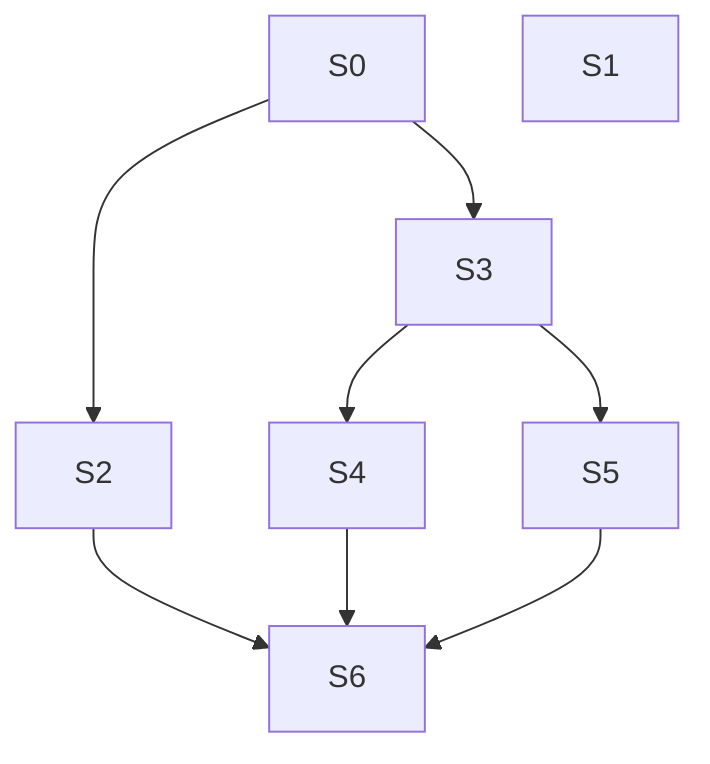

# TD53 — Agent-first documentation routing and integrity

## Status
- **Type**: Technical Debt / Documentation governance (AI-agent context)
- **Priority**: Medium (no functional defect; the cost is that an unattended agent can act on a dead pointer or a misrouted load with nothing to stop it)
- **Context**: `docs/`, `.copilot/context.md`, `.claude/commands/`, `packages/architecture-check`
- **Created**: 2026-10-17
- **Discovered**: a chat review of `/docs-audit`'s fit (2026-10-17), then measuring how agents actually read these docs from the repo's own session transcripts
- **Decision status**: Drafted 2026-10-17; re-scoped the same day from a human-oriented folder reorganisation to agent-first routing and integrity once the transcript measurements below were taken. Each story still begins with `/story-discovery`.
- **Related**: TD52 (cancelled 2026-10-17 and folded into Story 1: the deep/light classification lives in each doc's header, not in a registry JSON), TD41 (canonical-home rule, `ENGINEERING_RULES_*` split), TD37 (`architecture-check` decisions), `.claude/commands/docs-audit.md`, `CLAUDE.md` §10

## Problem

This repository is mainly maintained by AI agents running a mostly unattended flow, so documentation quality is judged by one question: *does an agent load the right context, and would anything stop it if the context were wrong?*

### Measured: how agents read docs (2026-10-17, 114 transcripts, 37 with doc reads, mostly Claude Code on this repo)

- Agents **search, then read a line range**. Of 1,381 Bash commands that touched `docs/`, 944 were `grep`/`rg`, 515 were `sed -n` ranges and 809 `head`/`tail`; only 130 were `cat`.
- **Large docs are never read whole.** Whole-file reads occurred only for small docs (up to about 28 KB: `STORY_SCHEMA`, `DEFINITION_OF_DONE`, `LOCK_CATALOG`). Every large doc was read partially — `04-USE_CASES` (251 KB) 11 of 11 reads, `14-API_CONTRACTS` (156 KB) 12 of 12, `13-DATABASE_SCHEMA` (121 KB) 10 of 10; overall 145 partial Read calls vs 31 whole.
- **Routing is coarse.** Only 8 of the 36 rows of `.copilot/context.md` §10 cite a `§ section`; the rest point at a whole file.
- **The always-on context is the biggest fixed cost.** `.copilot/context.md` is 57,647 characters loaded in every session, whatever the task: §7 Engineering Rules alone is 24,439 (42%), §9 Story Workflow 9,029, §10 5,379. No nested context file exists anywhere in the repo, so nothing is loaded by area.
- **The grep surface is mostly not live docs.** `docs/` holds about 4.9 MB, of which the 43 live top-level docs are 1.84 MB; `docs/archive` (59 files, 1.46 MB, superseded) and `docs/discovery` (115 files, 1.59 MB) make up the rest. Ten archive files still mention the superseded UC-014/UC-015, so a grep of `docs/` can land on wrong context.
- **Orientation is missing where it matters.** Only 7 docs carry a "When to load" line, and none of the 15 docs over 30 KB do.
- **Nothing checks pointers outside `context.md`.** The `agent-context-file` detector validates only `.copilot/context.md`; a moved, renamed or reworded target in any other doc, skill, TD, milestone or code comment fails silently. `docs/*.md` is cited in about 640 files / 3,930 occurrences (`plan/` 1,688, `apps/` 628 — 462 of them `.ts`/`.tsx` comments — `.claude/` 148, `.copilot/context.md` 131, `packages/` 118, `td/` 56).

Limits of this evidence: one repository, mostly Claude Code; other agents (Codex, Gemini) may read differently and are not visible in these transcripts.

### Why this matters

File size is not what costs an agent; **findability** is — the agent greps for a handle (a `§ heading`, a UC id, an error code) and reads around it. So what protects an unattended flow is: handles that stay valid (checked in CI), routing precise enough to land on the right section, and a one-line statement at the top of each large doc of when it applies. A reorganisation that renames or moves files would instead invalidate handles that agents and other docs already hold.

## Chosen approach (decided in the session that drafted this TD)

Principles:
- **Optimise findability and routing, not file layout.** Stable paths and stable `§ heading` handles are an asset; every move spends it.
- **Verify before changing.** The link and anchor checker lands first, so every later change is proven by CI, not trusted.
- **One uniform naming rule.** The 27 numbered docs (`01`–`28`, no `07`) carry a creation-order number that means nothing to an agent, while the other 16 are unnumbered. Story 6 drops the prefix from all of them (`14-API_CONTRACTS.md` → `API_CONTRACTS.md`), so one rule covers every doc and `grep -l API_CONTRACTS` finds it as well as before. It runs last because it rewrites about 2,662 citations, all proven by Story 0's checker.
- **Keep the grep surface to live, agent-facing text.** Superseded material moves out of `docs/` to a top-level `archive/`; it stays in the repository and keeps its history, it just stops appearing in docs searches.
- **Optimise tokens by loading less up front and more on demand.** Always-on context stays small; everything else loads by trigger (a `§ section` pointer, a path-scoped context file, a skill invoked by name).
- **Context is never sacrificed.** Nothing is deleted to save size; the only deletions allowed are verified duplicates collapsed to pointers and content code contradicts (`/docs-audit`'s guiding principle). Moving a rule from always-on to on-demand is not a deletion, but only when its new trigger is proven to fire (Story 5).
- **One canonical home per fact.** The "when to load" statement lives in each doc's own header, and travels with the doc together with its "Verified against" field (the code or config it is checked against, or `none (light check)`). There is no separate registry file, so there is nothing to keep in sync and the classification survives a rename or move.
- **No table of contents to maintain.** `grep -n '^##' <doc>` already gives an agent the structure, and a hand-kept contents block would be one more thing to drift.

Rejected, with the condition to reopen:
- **Regrouping `docs/` into subfolders and dropping the numbers.** About 3,930 rewrites across 640 files for a human-browsing gain; the transcripts show agents are not slowed by a flat layout. Reopen only if Story 3's triage shows another agent navigating by directory.
- **Splitting the large docs into smaller files.** The transcripts show they are already consumed by section. Reopen only if measurement shows an agent that reads them whole.
- **Moving `plan/journey/` into `docs/`.** About 5.8 MB of HTML and CSS would add noise to the `docs/` greps agents run constantly. The journeys move to a top-level `journeys/` instead (Story 4), so `plan/` means delivery only and `docs/` stays text. Agent value of this move is low; it is chosen for clarity, and its cost (about 790 mechanical edits) is small once Story 0's checker exists.

### Decision record (filled by Story 3)

_Open. Story 3 writes here: the per-doc verdicts, the load measurements including any non-Claude agent evidence, the always-on `context.md` cost review, and the confirmed destination of the journeys move (top-level `journeys/` unless the measurements say otherwise)._

## Stories

### Story 0 — Repo-wide link and anchor checker ⚪

**Agent:** devops
**Complexity:** M
**Docs to load:** `docs/17-GITHUB_WORKFLOWS_GUIDELINES.md` § `architecture-check`; `docs/ENGINEERING_RULES_TESTING.md`; `docs/STORY_SCHEMA.md`
**Dependencies:** none
**Pattern:** plain composition — follows `lock-catalog-coverage.ts` / `agent-context-file.ts` (policy in, `ScanResult` out)

**Description:**
Only `.copilot/context.md` has its `docs|infra/` pointers and `§ heading` citations checked today. Add a detector `doc-link-integrity` that scans tracked `.md` files (`docs/**`, `plan/**`, `td/**`, `.claude/commands/**`, `.copilot/**`) and the `docs/…md` path citations in code comments (`apps/**`, `packages/**`), and fails when a cited `docs/`, `plan/`, `td/` or `infra/` path does not exist, or a `§ heading` citation matches no heading in its target. Reuse the heading-normalization and citation-matching helpers that `agent-context-file.ts` already has by extracting them into a shared module, not copying them. Pre-existing dead links are fixed in this same PR or allowlisted with a rationale, owner and review date, like the other policy files. `archive/**` and `docs/discovery/**` are excluded by the policy (the owner's decision: archived and discovery material is historical, so its internal citations are not checked and not rewritten when docs move or are renamed; live docs that cite a path inside them are still checked).

**New migration / i18n keys / env vars / feature flags:** none

**Files to create/modify:**
- `packages/architecture-check/src/detectors/doc-link-integrity.ts` (new)
- `packages/architecture-check/src/detectors/doc-link-integrity.spec.ts` (new)
- `packages/architecture-check/src/detectors/agent-context-file.ts` (modify — extract shared citation helpers)
- `packages/architecture-check/src/index.ts`, `packages/architecture-check/src/cli.ts` (modify — export, register)
- `packages/architecture-check/architecture-policy.json` (modify — allowlist entries, if any)
- `docs/17-GITHUB_WORKFLOWS_GUIDELINES.md` (modify — one detector-table row)
- Docs the baseline run finds dead links in (listed by the run; each is a `.md` the doc gate covers)

**Acceptance criteria — product:**
- [ ] Renaming or deleting a cited doc fails `pnpm architecture-check` and names each broken citation with file and line.
- [ ] A `§ heading` citation to a heading that does not exist fails the same way.
- [ ] The repository passes the new detector at merge, with every pre-existing dead link fixed or allowlisted.

**Acceptance criteria — technical:**
- Unit:
  - [ ] `doc-link-integrity.spec.ts`: a cited missing path is reported.
  - [ ] `doc-link-integrity.spec.ts`: a `§ heading` with no matching heading is reported.
  - [ ] `doc-link-integrity.spec.ts`: a citation in a `.ts` comment to a missing doc is reported.
  - [ ] `doc-link-integrity.spec.ts`: an allowlisted dead link passes; an expired allowlist entry fails.
  - [ ] `doc-link-integrity.spec.ts`: a fully valid set passes with zero findings.
  - [ ] `agent-context-file.spec.ts` still passes unchanged after the helper extraction.
- Integration: none — covered by unit tests plus a clean `pnpm architecture-check` on the real repository
- Tenant isolation: none — no tenant data
- E2E: none
- [ ] Coverage ≥80% on changed code
- [ ] `tsc --noEmit` clean, lint clean

### Story 1 — Doc header contract: "When to load" and "Verified against" ⚪

**Agent:** devops
**Complexity:** M
**Docs to load:** `docs/STORY_SCHEMA.md` (the existing header pattern); `docs/17-GITHUB_WORKFLOWS_GUIDELINES.md` § `architecture-check`; `.claude/commands/docs-audit.md` Step 3i
**Dependencies:** none
**Pattern:** plain composition — no named pattern applies

**Description:**
Seven docs already open with a `> **When to load:** …` line (`STORY_SCHEMA.md` is the model); none of the 15 docs over 30 KB do. Add a one-line orientation to each large doc — when it applies, which apps/layers/contexts it covers, and which neighbouring doc holds what it does not — written from the doc's actual content, not from its title. Add a detector `doc-orientation` that fails when a `docs/*.md` over the size threshold has no `**When to load:**` line within its first 15 lines. The threshold and the exclusions (`docs/archive/**`, `docs/discovery/**`, `docs/lean/*`) live in the policy file. This adds context only; no existing text is changed or removed. No contents block is added (see Chosen approach).

**Folded in from TD52 (cancelled 2026-10-17).** The header contract covers every top-level `docs/*.md`, not only the large ones, and carries two fields: `**When to load:**` and `**Verified against:** <code or config paths>` or `none (light check)`. `doc-orientation` requires both on every doc, and fails when a listed path does not exist (a `none (light check)` value is valid). The size threshold gates only the "When to load" line; "Verified against" is required on every non-excluded doc regardless of size, so a new doc cannot be added without declaring its class. `.claude/commands/docs-audit.md` Step 1 drops its inline deep/light lists and derives the deep and light sets, and each doc's artifacts, by grepping the headers; its stale `docs/ENGINEERING_RULES.md` wording (now a 94-line index, not a possible leftover copy) is corrected in the same change. Detector settings go in the existing `architecture-policy.json`; no new policy file.

**New migration / i18n keys / env vars / feature flags:** none

**Files to create/modify:**
- `packages/architecture-check/src/detectors/doc-orientation.ts` (new)
- `packages/architecture-check/src/detectors/doc-orientation.spec.ts` (new)
- `packages/architecture-check/src/index.ts`, `packages/architecture-check/src/cli.ts` (modify — export, register)
- `packages/architecture-check/architecture-policy.json` (modify — threshold and exclusions)
- `.claude/commands/docs-audit.md` (modify — Step 1 derives deep/light and artifacts from headers; fix stale `ENGINEERING_RULES.md` wording)
- Every remaining top-level `docs/*.md` (modify — add the two header fields, seeded from the skill's current deep/light lists, verified against `ls docs/*.md`)
- `docs/17-GITHUB_WORKFLOWS_GUIDELINES.md` (modify — one detector-table row)
- The 15 docs over 30 KB: `docs/04-USE_CASES.md`, `14-API_CONTRACTS.md`, `02-DOMAIN_MODEL.md`, `13-DATABASE_SCHEMA.md`, `ANTI_PATTERNS.md`, `27-BUSINESS_LOGIC_REFERENCE.md`, `CI_TRAPS.md`, `08-TESTING_STRATEGY.md`, `15-HOTSITE_DYNAMIC_ARCHITECTURE.md`, `03-DOMAIN_EVENTS.md`, `24-BFF_ARCHITECTURE.md`, `05-BOUNDED_CONTEXTS.md`, `22-TECH_STACK_DECISIONS.md`, `AGENT_PATTERNS.md`, `21-TENANTS_SETTINGS_SCHEMA.md` (modify — one line each; re-measure the list at implementation time)

**Acceptance criteria — product:**
- [ ] Every doc over the threshold opens with a "When to load" line stating its trigger, scope and neighbouring doc.
- [ ] A new large doc without the line fails `pnpm architecture-check` with a message naming it.
- [ ] A new `docs/*.md` without a `Verified against` field fails `pnpm architecture-check` with a message naming it.
- [ ] `/docs-audit` Step 1 carries no inline deep/light lists and derives them from the doc headers.

**Acceptance criteria — technical:**
- Unit:
  - [ ] `doc-orientation.spec.ts`: a doc over the threshold without the line is reported.
  - [ ] `doc-orientation.spec.ts`: a doc over the threshold with the line inside the first 15 lines passes; with it on line 16 is reported.
  - [ ] `doc-orientation.spec.ts`: a doc under the threshold and an excluded doc pass without the "When to load" line.
  - [ ] `doc-orientation.spec.ts`: a doc with no `Verified against` field is reported; one listing a non-existent path is reported; `none (light check)` passes.
- Integration: none — covered by unit tests plus a clean `pnpm architecture-check` on the real repository
- Tenant isolation: none — no tenant data
- E2E: none
- [ ] Coverage ≥80% on changed code
- [ ] `tsc --noEmit` clean, lint clean

### Story 2 — Section-level routing in `context.md` §10 ⚪

**Agent:** devops
**Complexity:** M
**Docs to load:** `.copilot/context.md` §7 (How to edit this file), §10; `packages/architecture-check/agent-context-policy.json`
**Dependencies:** Story 0 (so every `§` cited here is verified by CI, not by eye)
**Pattern:** plain composition — no named pattern applies

**Description:**
8 of the 36 §10 rows cite a `§ section`; the rest send the agent to a whole file, so it greps and ranges through 100–250 KB to find the part the task needs. For each row, replace or add the section pointers that exist (`docs/04-USE_CASES.md` § the UC, `docs/14-API_CONTRACTS.md` § the resource, and so on); where a row genuinely needs the whole doc, say so with the reason in the row. Do not restate any doc's content in §10 (the file is budgeted, and `/docs-audit` 3e flags a restated rule). Every added pointer must resolve per Story 0's detector. §10's section budget in `agent-context-policy.json` may need a reviewed bump; that is a policy-file change and needs the explicit yes.

**New migration / i18n keys / env vars / feature flags:** none

**Files to create/modify:**
- `.copilot/context.md` (modify — §10 rows; edit this file directly, never through the symlinks)
- `packages/architecture-check/agent-context-policy.json` (modify — §10 budget, only if the pointers need it)

**Acceptance criteria — product:**
- [ ] Every §10 row cites a `§ section` where a relevant one exists, and states "whole file" with a reason where none does.
- [ ] Before/after bytes an agent reads per §10 row are recorded in the PR, using the cited section line ranges.

**Acceptance criteria — technical:**
- Unit: none — `.md` content; verified by Story 0's detector and the existing `agent-context-file` budget check
- Integration: none
- Tenant isolation: none — no tenant data
- E2E: none
- [ ] `pnpm architecture-check` (including `doc-link-integrity` and `agent-context-file`) passes
- [ ] Coverage ≥80% on changed code (not applicable — no code changed)

### Story 3 — Triage, baseline and minimal cleanup ⚪

**Agent:** devops
**Complexity:** L
**Docs to load:** `.claude/commands/docs-audit.md`; `.copilot/context.md` §10, §15, §17; `docs/README.md`
**Dependencies:** Story 0 (so the one file move below is proven)
**Pattern:** plain composition — no named pattern applies

**Description:**
1. **Baseline.** Run `/docs-audit` with a blank scope (per folder if the context strains: `docs`, `plan`, `plan/journey`, `td`) and apply the approved fix batch — stale claims, dead pointers, journey `dev-notes.md` drift — so later work starts clean.
2. **Per-doc triage table** in the Decision record: size, inbound reference count, verdict (keep / merge / archive / move) and whether the doc is still relevant, with evidence.
3. **Load measurement.** Re-run the transcript measurement on fresh sessions, including any non-Claude agent logs available, and classify every bullet of `context.md` §0–§9 by the trigger that makes it relevant (global gate, area-scoped, workflow-scoped). The classification feeds Story 5; this story removes nothing.
4. **Minimal cleanup.** State in `docs/README.md` where a new doc goes and the one naming rule (`UPPER_SNAKE.md`, no numeric prefix — applied to the existing numbered docs by Story 6), with the former reading order kept as an ordered list in that README; move `docs/TD37-ARCHITECTURE-CHECK-DECISIONS.md` to `td/` (its citations rewritten, proven by Story 0); delete `docs/ENGINEERING_RULES.md` (a 94-line redirect index) once Story 0's checker shows no citation still needs it.
7. **Move `docs/archive/` to a top-level `archive/`.** 59 files, 1.46 MB of superseded content; about 52 citations to rewrite, proven by Story 0. History is preserved by `git mv`. `docs/discovery/` stays where it is until its milestone is promoted.
5. **Journeys destination.** Confirm the destination for the move in Story 4 (`journeys/` at the repository top level; `docs/journeys/` is rejected for the grep noise of about 5.8 MB of HTML in `docs/`) and list the root config that hardcodes the current path (`.gitignore`, `.coderabbit.yaml`, `sonar-project.properties`, `knip.config.ts`).
6. **Delete `docs/lean/`.** `docs/lean/WEB_LEAN.md` (139 KB) is a "Frontend Learning Journal" written for a human learning Next.js; the owner confirmed on 2026-10-17 that it can be deleted. It is cited only by the `M12`/`M13` `_DEVELOPER.md` plan files (which agents never load per `.copilot/context.md` §10) and as a scope example in the two `docs-audit` copies. Remove the file and fix every citation; Story 0's checker proves none is left.

**New migration / i18n keys / env vars / feature flags:** none

**Files to create/modify:**
- `td/TD53-AGENT-FIRST-DOCS-ROUTING-AND-INTEGRITY.md` (modify — Decision record)
- `docs/README.md` (modify — convention paragraph)
- `docs/TD37-ARCHITECTURE-CHECK-DECISIONS.md` → `td/TD37-ARCHITECTURE-CHECK-DECISIONS.md` (`git mv`) and every file citing it (regenerate the list with `grep -rl TD37-ARCHITECTURE-CHECK-DECISIONS` at implementation time)
- `docs/ENGINEERING_RULES.md` (delete) and every file citing it (regenerate the list with `grep -rl "docs/ENGINEERING_RULES.md"` at implementation time)
- `docs/archive/**` → `archive/**` (`git mv`, 59 files) and every file citing `docs/archive` (about 52 occurrences; regenerate the list at implementation time)
- `docs/lean/WEB_LEAN.md` (delete) and its citations: `plan/M12-HOTSITE-FRONTEND_IMPLEMENTATION_DETAILS_DEVELOPER.md`, `plan/M13-DASHBOARD-FRONTEND_IMPLEMENTATION_DETAILS_DEVELOPER.md`, `.claude/commands/docs-audit.md`, `.agents/skills/docs-audit/SKILL.md` (modify — the Codex copy is regenerated with `scripts/codex-skill.sh`, not edited by hand)
- Docs and journey files the approved audit fixes touch (listed in the audit report)

**Acceptance criteria — product:**
- [ ] Every `docs/*.md` has a recorded verdict with evidence.
- [ ] The Decision record states the load measurement, the `context.md` always-on review and the confirmed journeys destination.
- [ ] `docs/lean/` is gone and no tracked file cites it.
- [ ] `docs/archive/` lives at `archive/` with its history intact, and no tracked file still cites the old path.
- [ ] `docs/ENGINEERING_RULES.md` is gone and no tracked file cites it.
- [ ] `docs/README.md` states where a new doc goes and why some are numbered.
- [ ] The audit baseline fixes are applied or each is explicitly declined.

**Acceptance criteria — technical:**
- Unit: none — documentation and measurement story
- Integration: none
- Tenant isolation: none — no tenant data
- E2E: none
- [ ] `pnpm architecture-check` (including `doc-link-integrity`) passes after the TD37 move
- [ ] Coverage ≥80% on changed code (not applicable — no code changed)

### Story 4 — Move `plan/journey/` to `journeys/` ⚪

**Agent:** devops
**Complexity:** L
**Docs to load:** the Decision record above; `plan/journey/README.md`; `.copilot/context.md` §15
**Dependencies:** Story 0 (the checker proves the move) and Story 3 (the audit baseline fixes journey drift first, so stale `dev-notes.md` content is not moved)
**Pattern:** plain composition — no named pattern applies

**Description:**
`git mv` the whole subtree to the destination Story 3 confirmed (`journeys/`), preserving its structure so the prototypes' relative links (`../../../shared/...`) keep working. Rewrite every outside citation with a script (about 790 occurrences plus 51 inside the subtree), including `.copilot/context.md` §10/§15, the skills under `.claude/commands/`, `.github`, `.agents`, `apps/` comments, `td/TD50`, and any root config Story 3 listed. No stub is left at the old path; Story 0's checker proves nothing still points there. The rewrite script lives in the scratchpad and is not committed. This story rewrites lines across the whole repository, so it is **not batchable** with any other story.

**New migration / i18n keys / env vars / feature flags:** none

**Files to create/modify:**
- The `plan/journey/**` subtree (`git mv`, 407 files)
- Every file returned by `grep -rl "plan/journey"` at implementation time (about 125 outside the subtree; regenerate then)
- Root config Story 3 confirmed contains the path

**Acceptance criteria — product:**
- [ ] No tracked file cites the old path after the move.
- [ ] Every relative `href`/`src` in the moved HTML prototypes still resolves (one-off script run, result recorded in the PR).

**Acceptance criteria — technical:**
- Unit: none — mechanical move, verified by Story 0's detector
- Integration: none
- Tenant isolation: none — no tenant data
- E2E: none
- [ ] `pnpm architecture-check` (including `doc-link-integrity`) passes
- [ ] `/docs-audit changed` over the move range reports zero dead pointers
- [ ] `tsc --noEmit` clean, lint clean

### Story 5 — Load area-scoped rules on demand instead of always-on ⚪

**Agent:** devops
**Complexity:** L
**Docs to load:** `.copilot/context.md` §0, §7, §8, §9; `packages/architecture-check/agent-context-policy.json`; `docs/AGENT_CONTEXT_TRAP_SCENARIOS.md`; the Decision record above (Story 3's bullet classification)
**Dependencies:** Story 0, Story 3
**Pattern:** plain composition — no named pattern applies. The mechanism is progressive disclosure: a small always-on router, with area rules loaded by path.

**Description:**
`.copilot/context.md` is 57,647 characters loaded in every session, 42% of it §7. Many of its bullets are writing-time traps that live there only because an agent would not think to load a doc before writing that code (the keep-in-file criterion (c) in §7). A path-scoped context file solves the same trigger problem at lower cost: it loads when the agent works under that directory.
1. **Verify the mechanism first.** In a controlled session per agent tool (Claude Code, Codex, Gemini), confirm whether a context file nested under `apps/backend`, `apps/bff`, `apps/web`, `infra` or `packages` loads on demand when the agent touches files there, and record what loaded. Move rules only for the tools where this is confirmed; the rest stay always-on. Nothing in this repository relies on that behaviour yet.
2. **Move by classification.** Using Story 3's classification, move area-scoped bullets to the nested context file of their area, with the same wording and their `→ doc § heading` pointers intact. Global gates (§0, the multi-tenancy invariants, the PR gate) stay always-on. Workflow-scoped content (§9) is evaluated for a skill invoked by name.
3. **Keep the one-file contract.** `CLAUDE.md`, `AGENTS.md` and `gemini.md` remain symlinks to one canonical file at each level; extend the `agent-context-file` detector to every nested context file (symlink agreement, pointers resolve, per-file budget).
4. **Prove each moved rule still fires.** Every moved trap keeps its scenario in `docs/AGENT_CONTEXT_TRAP_SCENARIOS.md`, re-run against the new location; a rule whose new trigger cannot be shown to fire does not move.
5. **The always-on target comes from the measurement**, not from a number chosen here. The always-on file stays free of dates and PR numbers (already enforced), so its text stays stable for prompt caching.

**New migration / i18n keys / env vars / feature flags:** none

**Files to create/modify:**
- `.copilot/context.md` (modify — remove moved bullets, add one pointer per nested file; edit this file directly, never through the symlinks)
- Nested context files and their three symlinks each, at the directories the measurement confirms (candidates: `apps/backend`, `apps/bff`, `apps/web`, `infra`, `packages`) (new)
- `packages/architecture-check/src/detectors/agent-context-file.ts` and `agent-context-file.spec.ts` (modify — nested files)
- `packages/architecture-check/agent-context-policy.json` (modify — per-file budgets, new symlink entries)
- `docs/AGENT_CONTEXT_TRAP_SCENARIOS.md` (modify — moved-trap locations)
- `docs/17-GITHUB_WORKFLOWS_GUIDELINES.md` (modify — detector row wording)

**Acceptance criteria — product:**
- [ ] The measured always-on size before and after is recorded, and the after is smaller by the amount the classification predicts.
- [ ] Every removed line is accounted for: it appears verbatim in a nested context file or a doc, or is a verified duplicate collapsed to a pointer. No rule is deleted.
- [ ] For each moved rule, a recorded session test shows it loads when the matching files are touched, in every agent tool it was moved for.

**Acceptance criteria — technical:**
- Unit:
  - [ ] `agent-context-file.spec.ts`: a nested context file whose symlink target disagrees is reported.
  - [ ] `agent-context-file.spec.ts`: a nested context file with an unresolvable pointer is reported.
  - [ ] `agent-context-file.spec.ts`: a nested context file over its budget is reported.
  - [ ] `agent-context-file.spec.ts`: the existing root-file cases still pass unchanged.
- Integration: none — covered by unit tests plus a clean `pnpm architecture-check` on the real repository
- Tenant isolation: none — no tenant data
- E2E: none
- [ ] Coverage ≥80% on changed code
- [ ] `tsc --noEmit` clean, lint clean

**Open items for `/story-discovery`:** whether any agent tool loads nested files eagerly (which would make the move cost more, not less); whether §9's workflow content belongs in a skill; the per-file budget values.

### Story 6 — Drop the numeric prefix from every numbered doc ⚪

**Agent:** devops
**Complexity:** L
**Docs to load:** `docs/README.md`; `.copilot/context.md` §10, §17; `.claude/commands/docs-audit.md`; the Decision record above
**Dependencies:** Story 0 (the checker proves the rewrite), Story 2, Story 4 and Story 5 (they edit the same files and lines; this story runs last so nothing is rewritten twice), Story 3 (the deletions and moves are done first)
**Pattern:** plain composition — no named pattern applies

**Description:**
Rename the 27 numbered docs by removing the `NN-` prefix, keeping the `UPPER_SNAKE` name, with `git mv` so history is preserved: `01-BUSINESS_CONTEXT`, `02-DOMAIN_MODEL`, `03-DOMAIN_EVENTS`, `04-USE_CASES`, `05-BOUNDED_CONTEXTS`, `06-TENANT_ISOLATION_STRATEGY`, `08-TESTING_STRATEGY`, `09-CI_CD_PIPELINE`, `10-OBSERVABILITY_STRATEGY`, `11-ARCHITECTURE`, `12-DEPLOYMENT_STRATEGY`, `13-DATABASE_SCHEMA`, `14-API_CONTRACTS`, `15-HOTSITE_DYNAMIC_ARCHITECTURE`, `16-DASHBOARD_FRONTEND_ARCHITECTURE`, `17-GITHUB_WORKFLOWS_GUIDELINES`, `18-RELEASE_LIFECYCLE_OPERATIONS`, `19-INFRASTRUCTURE_TOOLING_MAP`, `20-COST_OPTIMIZATION_STRATEGY`, `21-TENANTS_SETTINGS_SCHEMA`, `22-TECH_STACK_DECISIONS`, `23-INFRASTRUCTURE_SETUP`, `24-BFF_ARCHITECTURE`, `25-ERROR_CATALOG`, `26-DATA_RETENTION_AND_PRIVACY`, `27-BUSINESS_LOGIC_REFERENCE`, `28-LOCK_CATALOG` (each `.md`; confirm no name collision with an existing doc before running).
Rewrite every citation with a script kept in the scratchpad, not committed. Three citation shapes exist and all must be covered: the full path (`docs/14-API_CONTRACTS.md`), the bare filename in prose (`14-API_CONTRACTS.md`), and the short numeric form already used in prose (`docs/13`, `docs/27`, `docs/28`). Citations of a `§ heading` are unaffected. `archive/` and `docs/discovery/` are excluded from the rewrite and from the checker (the owner's decision: they are historical, so their internal citations of the old names are left as they are; the policy says so).
**Pre-rename impact inventory (before any `git mv`).** A read-only scan lists every place that cites each of the 27 old names, in all three shapes, across all tracked files except the two exclusions above and `node_modules`, `dist`, `.next` and the lockfile. It must cover more than markdown: `.ts`/`.tsx` comments, `.json` policy and config, `.yaml`/`.yml` (`.coderabbit.yaml`, workflows, issue and PR templates), `.tf`, `.sh`/`.cjs` scripts, `.html`, `sonar-project.properties`, `knip.config.ts`, the skills, and code that builds a doc path from parts or reads a doc by name (grep for `readFileSync`/`resolve(` calls and string concatenations containing `docs/`). It also lists gitignored local files that cite a doc (for example `docs/BOOTSTRAP_LOG.md`), which a commit cannot rewrite. The inventory (counts per file type and the list of non-markdown hits) goes in the PR, and every hit is either rewritten or explicitly justified. After the rename the same scan must return zero hits. Extend `doc-link-integrity` so that, after the rename, any `docs/NN` or `NN-NAME.md` form fails CI, which guarantees no short form survives. The Codex skill copies are regenerated with `scripts/codex-skill.sh`. This story rewrites lines across the whole repository, so it is **not batchable** with any other story.

**New migration / i18n keys / env vars / feature flags:** none

**Files to create/modify:**
- The 27 `docs/NN-NAME.md` files listed above (`git mv` to `docs/NAME.md`)
- Every file returned by `grep -rlE "docs/[0-9]{2}\b|[0-9]{2}-[A-Z_]+\.md"` at implementation time, excluding `archive/` and `docs/discovery/` (up to about 640 files; regenerate then, since stories land in between)
- `.coderabbit.yaml`, `packages/architecture-check/src/cli.ts` (the `docs/28-LOCK_CATALOG.md` read), `packages/architecture-check/src/detectors/lock-catalog-coverage.ts` and its spec (error text), `packages/architecture-check/agent-context-policy.json` (anchors, if any name a numbered doc), `.copilot/context.md`, `.claude/commands/*.md`, `.agents/skills/*/SKILL.md` (regenerated)
- `packages/architecture-check/src/detectors/doc-link-integrity.ts` and `doc-link-integrity.spec.ts` (modify — the numeric-form rule)
- `docs/README.md` (modify — the ordered reading list)

**Acceptance criteria — product:**
- [ ] No doc under `docs/` has a numeric prefix, and no tracked file outside `archive/` and `docs/discovery/` cites one by full path, bare filename or short numeric form.
- [ ] The pre-rename impact inventory is attached to the PR, covers non-markdown files and code that builds doc paths, and the same scan returns zero hits after the rename.
- [ ] `docs/README.md` lists the docs in their former reading order.

**Acceptance criteria — technical:**
- Unit:
  - [ ] `doc-link-integrity.spec.ts`: a `docs/NN` short numeric citation is reported.
  - [ ] `doc-link-integrity.spec.ts`: a `NN-NAME.md` bare filename citation is reported.
  - [ ] `doc-link-integrity.spec.ts`: the same forms inside `archive/` and `docs/discovery/` pass.
  - [ ] `lock-catalog-coverage.spec.ts` still passes with the renamed catalog path.
- Integration: none — covered by unit tests plus a clean `pnpm architecture-check` on the real repository
- Tenant isolation: none — no tenant data
- E2E: none
- [ ] `pnpm architecture-check` (every detector, including `doc-link-integrity`, `agent-context-file`, `lock-catalog-coverage`) passes
- [ ] `/docs-audit changed` over the rename range reports zero dead pointers
- [ ] Coverage ≥80% on changed code
- [ ] `tsc --noEmit` clean, lint clean
