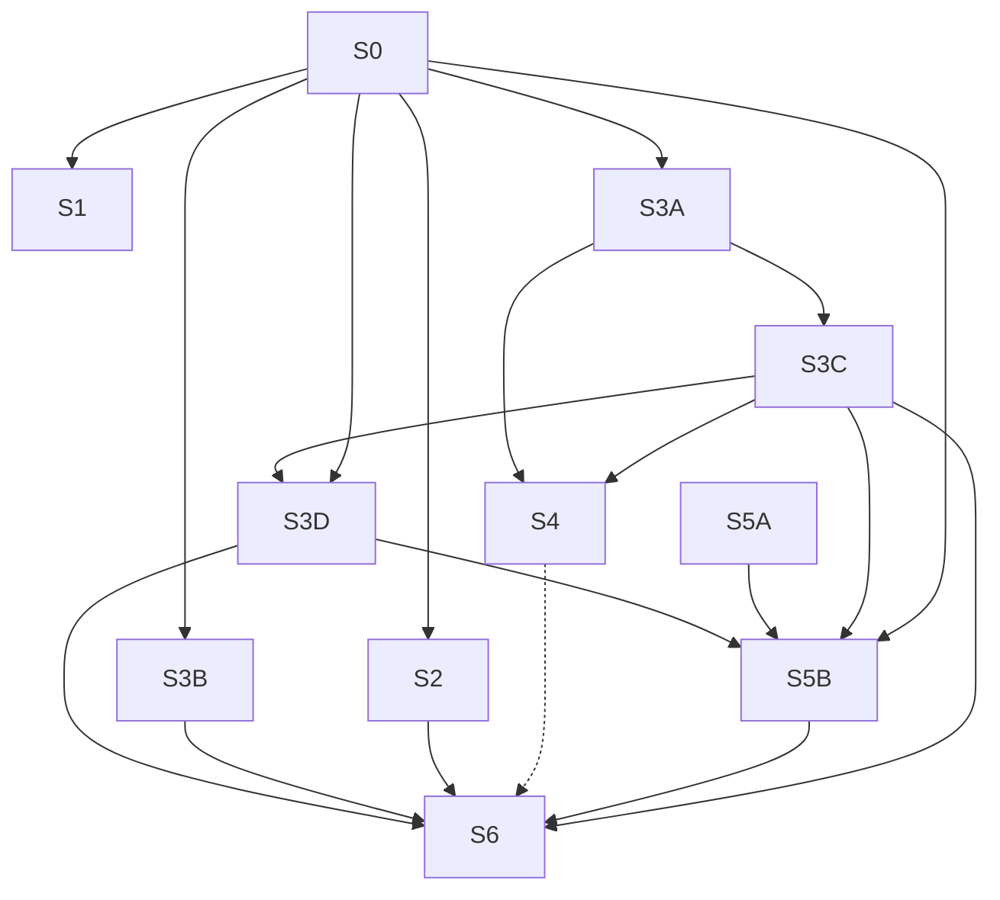

# TD53 — Agent-first documentation routing and integrity

## Status
- **Type**: Technical Debt / Documentation governance (AI-agent context)
- **Priority**: Medium (no functional defect; the cost is that an unattended agent can act on a dead pointer or a misrouted load with nothing to stop it)
- **Context**: `docs/`, `.copilot/context.md`, `.claude/commands/`, `packages/architecture-check`
- **Created**: 2026-10-17
- **Discovered**: a chat review of `/docs-audit`'s fit (2026-10-17), then measuring how agents actually read these docs from the repo's own session transcripts
- **Decision status**: Drafted 2026-10-17; re-scoped the same day from a human-oriented folder reorganisation to agent-first routing and integrity once the transcript measurements below were taken. Story 1 was re-scoped again in its own `/story-discovery` on 2026-10-18 (tags and a `docs-for` helper replace `Verified against` and `Audit bucket`). Each story still begins with `/story-discovery`.
- **Review 2026-10-17**: reviewed against the repository the same day; Story 3 split into 3A/3B/3C, Story 5 preceded by a mechanism spike (5A), Stories 1 and 0 tightened, Stories 4 and 6 gated on the Decision record, success metrics added.
- **Related**: TD52 (cancelled 2026-10-17 and folded into Story 1; re-scoped in Story 1's discovery on 2026-10-18 so the classification is each doc's `Tags` plus one tag vocabulary in the policy file, not per-doc code lists), TD41 (canonical-home rule, `ENGINEERING_RULES_*` split), TD37 (`architecture-check` decisions), `.claude/commands/docs-audit.md`, `CLAUDE.md` §10

## Problem

This repository is mainly maintained by AI agents running a mostly unattended flow, so documentation quality is judged by one question: *does an agent load the right context, and would anything stop it if the context were wrong?*

### Measured: how agents read docs (2026-10-17, 114 transcripts, 37 with doc reads, mostly Claude Code on this repo)

- Agents **search, then read a line range**. Of 1,381 Bash commands that touched `docs/`, 944 were `grep`/`rg`, 515 were `sed -n` ranges and 809 `head`/`tail`; only 130 were `cat`.
- **Large docs are never read whole.** Whole-file reads occurred only for small docs (up to about 28 KB: `STORY_SCHEMA`, `DEFINITION_OF_DONE`, `LOCK_CATALOG`). Every large doc was read partially — `04-USE_CASES` (251 KB) 11 of 11 reads, `14-API_CONTRACTS` (156 KB) 12 of 12, `13-DATABASE_SCHEMA` (121 KB) 10 of 10; overall 145 partial Read calls vs 31 whole.
- **Routing is coarse.** Only 8 of the 36 rows of `.copilot/context.md` §10 cite a `§ section`; the rest point at a whole file.
- **The always-on context is the biggest fixed cost.** `.copilot/context.md` is 57,647 characters loaded in every session, whatever the task: §7 Engineering Rules alone is 24,439 (42%), §9 Story Workflow 9,029, §10 5,379. No nested context file exists anywhere in the repo, so nothing is loaded by area.
- **The grep surface is mostly not live docs.** `docs/` holds about 4.9 MB, of which the 45 live top-level docs are about 1.9 MB; `docs/archive` (59 files, 1.46 MB, superseded) and `docs/discovery` (115 files, 1.59 MB) make up the rest. Ten archive files still mention the superseded UC-014/UC-015, so a grep of `docs/` can land on wrong context.
- **Orientation is missing where it matters.** Only 8 of the 45 top-level docs carry a "When to load" line (re-measured 2026-10-18), and only 3 of the 18 docs over 30 KB do (`ENGINEERING_RULES_BACKEND`, `_SHARED`, `_TESTING`).
- **Nothing checks pointers outside `context.md`.** The `agent-context-file` detector validates only `.copilot/context.md`; a moved, renamed or reworded target in any other doc, skill, TD, milestone or code comment fails silently. `docs/*.md` is cited in about 640 files / 3,930 occurrences (`plan/` 1,688, `apps/` 628 — 462 of them `.ts`/`.tsx` comments — `.claude/` 148, `.copilot/context.md` 131, `packages/` 118, `td/` 56).

Limits of this evidence: one repository, mostly Claude Code; other agents (Codex, Gemini) may read differently and are not visible in these transcripts.

### Why this matters

File size is not what costs an agent; **findability** is — the agent greps for a handle (a `§ heading`, a UC id, an error code) and reads around it. So what protects an unattended flow is: handles that stay valid (checked in CI), routing precise enough to land on the right section, and a one-line statement at the top of each large doc of when it applies. A reorganisation that renames or moves files would instead invalidate handles that agents and other docs already hold.

## Chosen approach (decided in the session that drafted this TD)

Principles:
- **Optimise findability and routing, not file layout.** Stable paths and stable `§ heading` handles are an asset; every move spends it.
- **Verify before changing.** The link and anchor checker lands first, so every later change is proven by CI, not trusted.
- **One uniform naming rule.** The 27 numbered docs (`01`–`28`, no `07`) carry a creation-order number that means nothing to an agent, while the other 16 are unnumbered. Story 6 drops the prefix from all of them (`14-API_CONTRACTS.md` → `API_CONTRACTS.md`), so one rule covers every doc and `grep -l API_CONTRACTS` finds it as well as before. It runs last, and only if the Decision record confirms it (the gain for an agent is low; the cost is about 2,662 citation rewrites), all proven by Story 0's checker.
- **Keep the grep surface to live, agent-facing text.** Superseded material moves out of `docs/` to a top-level `archive/`; it stays in the repository and keeps its history, it just stops appearing in docs searches.
- **Optimise tokens by loading less up front and more on demand.** Always-on context stays small; everything else loads by trigger (a `§ section` pointer, a path-scoped context file, a skill invoked by name).
- **Context is never sacrificed.** Nothing is deleted to save size; the only deletions allowed are verified duplicates collapsed to pointers and content code contradicts (`/docs-audit`'s guiding principle). Moving a rule from always-on to on-demand is not a deletion, but only when its new trigger is proven to fire (Story 5B).
- **One canonical home per fact.** The "when to load" statement and the doc's `Tags` live in each doc's own header and travel with it. The tag vocabulary, with each tag's code globs, lives once in `architecture-policy.json`, so a moved doc keeps its classification and a moved code folder is a one-line policy edit. There is no per-doc code list to go stale, and deep versus light checking is derived from the tags (a tag with code globs makes a doc deep-checked).
- **No table of contents to maintain.** `grep -n '^##' <doc>` already gives an agent the structure, and a hand-kept contents block would be one more thing to drift.

Rejected, with the condition to reopen:
- **Regrouping `docs/` into subfolders and dropping the numbers.** About 3,930 rewrites across 640 files for a human-browsing gain; the transcripts show agents are not slowed by a flat layout. Reopen only if Story 3A's triage shows another agent navigating by directory.
- **Splitting the large docs into smaller files.** The transcripts show they are already consumed by section. Reopen only if measurement shows an agent that reads them whole.
- **Moving `plan/journey/` into `docs/`.** About 5.8 MB of HTML and CSS would add noise to the `docs/` greps agents run constantly. The journeys move to a top-level `journeys/` instead (Story 4), so `plan/` means delivery only and `docs/` stays text. Agent value of this move is low; it is chosen for clarity, and its cost (about 790 mechanical edits) is small once Story 0's checker exists.

### Success metrics (baseline measured 2026-10-17; each story records its after-value in its PR)

| Metric | Baseline | Target | Story | After (Story 3C, 2026-10-19) |
|---|---|---|---|---|
| Dead `docs/`, `plan/`, `td/`, `infra/` citations and dead `§` anchors in live text | counted by Story 0's first run | 0, enforced by CI | 0 | 0 at each of Story 3A's passes (historical); this PR's own CI run (`Architecture validation`, which includes `doc-link-integrity`) also passed, so the current tree is clean. Enforced in CI from Story 0 |
| Top-level docs with a "When to load" line | 8 of 45 | 45 of 45, enforced by CI | 1 | 43 of 43 (two docs deleted or moved by 3B) |
| Top-level docs with a `Tags` line from the vocabulary | 0 of 45 | 45 of 45, enforced by CI | 1 | 43 of 43 |
| `context.md` §10 rows citing a `§ section` or stating "whole file" with a reason | 8 of 34 | every row | 2 | 19 of 37 rows cite a `§`; the other 18 name a skill or a small doc read whole with its size shown (the §10 header states that convention) |
| Always-on `context.md` size | 57,647 chars | set by Story 5A's measurement | 5B | 59,709 chars (up 2,062 since the baseline; §7 24,152, §9 8,724, §10 8,047). Unchanged by design until 5B |
| Superseded or historical files under `docs/` (archive, lean) | 59 + 1 | 0 | 3B | 0 (`docs/archive` and `docs/lean` no longer exist; the archive is the top-level `archive/`) |
| Rules explained in full in more than one doc | 9 (Story 3A) | 0 | 3D | 0 (Story 3D re-inventory, 2026-10-19: 3 collapsed to a pointer, 1 table row corrected, 5 were already one sentence or a detector row, so no full explanation is duplicated) |

### Decision record (filled by Story 3C)

#### Story 3A — audit baseline (2026-10-18)

**Triage method** (so Story 3C can re-run it): one row per top-level `docs/*.md` (45). *Size* is `wc -c`. *Citations* are distinct tracked files that cite the doc by path (`docs/<name>`): **live** = other top-level docs, `.claude/`, `.copilot/`, `apps/`, `packages/`, `scripts/`, `infra/`, `.github/`; **historical** = `plan/` and `td/`; `docs/archive` and `docs/discovery/` are not scanned, as in `doc-link-integrity`. *Agent reads* is the number of session transcripts (127 `.jsonl` files under the Claude Code project folders for this repository, excluding the session that ran this audit and the TD53 worktree sessions) with a Read call or a shell command naming `docs/<name>`; 99 of the 127 read at least one doc. This counts any mention in a tool call, so it is wider than the Problem section's measurement (read/`grep`/`sed` actions only) and will not match its figures. Other agents (Codex, Gemini) are not visible in these transcripts. A verdict other than *keep* names its no-loss proof. The scripts live outside the repository (in the session scratchpad) and are described here rather than committed.

| Doc | Size (bytes) | Live / historical citations | Agent reads (of 127 sessions) | Verdict | Evidence |
|---|---:|---:|---:|---|---|
| `01-BUSINESS_CONTEXT.md` | 13,418 | 0 / 1 | 1 | keep | Rarely read and not cited, but the only product-scope and glossary doc; reworded for the multivertical platform in this story. |
| `02-DOMAIN_MODEL.md` | 125,002 | 56 / 45 | 53 | keep | Read in 53 of 127 sessions; 56 live and 45 historical citations. |
| `03-DOMAIN_EVENTS.md` | 56,140 | 38 / 17 | 32 | keep | Read in 32 of 127 sessions; 38 live and 17 historical citations. |
| `04-USE_CASES.md` | 252,115 | 43 / 50 | 72 | keep | Read in 72 of 127 sessions; 43 live and 50 historical citations. |
| `05-BOUNDED_CONTEXTS.md` | 47,219 | 12 / 11 | 21 | keep | Read in 21 of 127 sessions; 12 live and 11 historical citations. |
| `06-TENANT_ISOLATION_STRATEGY.md` | 13,810 | 11 / 8 | 7 | keep | Read in 7 of 127 sessions; 11 live and 8 historical citations. |
| `08-TESTING_STRATEGY.md` | 74,016 | 29 / 14 | 38 | keep | Read in 38 of 127 sessions; 29 live and 14 historical citations. |
| `09-CI_CD_PIPELINE.md` | 4,813 | 7 / 5 | 7 | keep | Read in 7 of 127 sessions; 7 live and 5 historical citations. |
| `10-OBSERVABILITY_STRATEGY.md` | 19,588 | 11 / 8 | 7 | keep | Read in 7 of 127 sessions; 11 live and 8 historical citations. |
| `11-ARCHITECTURE.md` | 10,594 | 4 / 4 | 7 | keep | Read in 7 of 127 sessions; 4 live and 4 historical citations. |
| `12-DEPLOYMENT_STRATEGY.md` | 3,002 | 7 / 3 | 2 | keep; overlap question for 3C | Small; see the `19` row. |
| `13-DATABASE_SCHEMA.md` | 121,009 | 86 / 25 | 56 | keep | Read in 56 of 127 sessions; 86 live and 25 historical citations. |
| `14-API_CONTRACTS.md` | 158,612 | 68 / 56 | 68 | keep | Read in 68 of 127 sessions; 68 live and 56 historical citations. |
| `15-HOTSITE_DYNAMIC_ARCHITECTURE.md` | 60,349 | 26 / 15 | 10 | keep | Read in 10 of 127 sessions; 26 live and 15 historical citations. |
| `16-DASHBOARD_FRONTEND_ARCHITECTURE.md` | 25,796 | 5 / 14 | 30 | keep | Read in 30 of 127 sessions; 5 live and 14 historical citations. |
| `17-GITHUB_WORKFLOWS_GUIDELINES.md` | 20,189 | 8 / 5 | 9 | keep | Read in 9 of 127 sessions; 8 live and 5 historical citations. |
| `18-RELEASE_LIFECYCLE_OPERATIONS.md` | 7,231 | 7 / 1 | 3 | keep | Read in 3 of 127 sessions; 7 live and 1 historical citations. |
| `19-INFRASTRUCTURE_TOOLING_MAP.md` | 3,929 | 1 / 2 | 1 | keep; overlap question for 3C | Small and rarely read; shares ground with `12` and `23` (tools, deployment, setup). Each is distinct today (tool authority table, strategy, setup order); 3C decides whether one doc is clearer. |
| `20-COST_OPTIMIZATION_STRATEGY.md` | 3,979 | 0 / 1 | 0 | keep; merge candidate for 3C | Zero reads in 127 sessions and no live citation. Its lean-startup rules and scaling roadmap are not duplicated in `22`, so a merge must move content, never point. |
| `21-TENANTS_SETTINGS_SCHEMA.md` | 36,858 | 30 / 21 | 25 | keep | Read in 25 of 127 sessions; 30 live and 21 historical citations. |
| `22-TECH_STACK_DECISIONS.md` | 45,147 | 7 / 4 | 2 | keep | A decision record: low reads, but cited by 7 live files and the only home of the technology rationale. Its Kafka/Vault/multi-cloud material is now labelled historical. |
| `23-INFRASTRUCTURE_SETUP.md` | 5,131 | 5 / 5 | 1 | keep; overlap question for 3C | Small; see the `19` row. |
| `24-BFF_ARCHITECTURE.md` | 48,988 | 19 / 18 | 27 | keep | Read in 27 of 127 sessions; 19 live and 18 historical citations. |
| `25-ERROR_CATALOG.md` | 10,060 | 3 / 4 | 15 | keep | Read in 15 of 127 sessions; 3 live and 4 historical citations. |
| `26-DATA_RETENTION_AND_PRIVACY.md` | 6,353 | 0 / 1 | 2 | keep | Rarely read; the only home of the retention rules, verified accurate against the purge jobs and settings. |
| `27-BUSINESS_LOGIC_REFERENCE.md` | 103,827 | 16 / 7 | 75 | keep | Read in 75 of 127 sessions; 16 live and 7 historical citations. |
| `28-LOCK_CATALOG.md` | 28,747 | 35 / 4 | 9 | keep | Read in 9 of 127 sessions; 35 live and 4 historical citations. |
| `AGENT_CONTEXT_TRAP_SCENARIOS.md` | 8,389 | 1 / 1 | 6 | keep | Read in 6 of 127 sessions; 1 live and 1 historical citations. |
| `AGENT_PATTERNS.md` | 43,415 | 10 / 8 | 45 | keep | Read in 45 of 127 sessions; 10 live and 8 historical citations. |
| `ANTI_PATTERNS.md` | 112,047 | 55 / 10 | 43 | keep | Read in 43 of 127 sessions; 55 live and 10 historical citations. |
| `CI_TRAPS.md` | 101,901 | 20 / 4 | 30 | keep | Read in 30 of 127 sessions; 20 live and 4 historical citations. |
| `CODE_STANDARDS.md` | 18,828 | 55 / 11 | 48 | keep | Read in 48 of 127 sessions; 55 live and 11 historical citations. |
| `DEFINITION_OF_DONE.md` | 14,673 | 7 / 5 | 53 | keep | Read in 53 of 127 sessions; 7 live and 5 historical citations. |
| `ENGINEERING_RULES.md` | 6,163 | 8 / 3 | 11 | delete (3B, decided) | A 94-line redirect index; its content lives in the five split files. Still opened in 11 sessions and cited by 8 live and 3 historical files, so 3B rewrites those citations first (the checker proves it). |
| `ENGINEERING_RULES_BACKEND.md` | 91,500 | 49 / 15 | 50 | keep | Read in 50 of 127 sessions; 49 live and 15 historical citations. |
| `ENGINEERING_RULES_FRONTEND.md` | 20,540 | 10 / 6 | 37 | keep | Read in 37 of 127 sessions; 10 live and 6 historical citations. |
| `ENGINEERING_RULES_INFRA.md` | 28,697 | 12 / 10 | 10 | keep | Read in 10 of 127 sessions; 12 live and 10 historical citations. |
| `ENGINEERING_RULES_SHARED.md` | 37,474 | 25 / 13 | 51 | keep | Read in 51 of 127 sessions; 25 live and 13 historical citations. |
| `ENGINEERING_RULES_TESTING.md` | 38,801 | 24 / 5 | 40 | keep | Read in 40 of 127 sessions; 24 live and 5 historical citations. |
| `README.md` | 5,066 | 0 / 1 | 5 | keep, rewrite (3B, decided) | Never cited by agents. Its reading order stops at doc 26 and omits docs 27 and 28 and every unnumbered doc; 3B's rewrite starts from that finding. |
| `REPOSITORY_STRUCTURE.md` | 12,657 | 5 / 16 | 10 | keep | Read in 10 of 127 sessions; 5 live and 16 historical citations. |
| `RUNBOOKS.md` | 16,681 | 10 / 3 | 5 | keep | Read in 5 of 127 sessions; 10 live and 3 historical citations. |
| `STORY_SCHEMA.md` | 10,167 | 8 / 1 | 65 | keep | Read in 65 of 127 sessions; 8 live and 1 historical citations. |
| `TD37-ARCHITECTURE-CHECK-DECISIONS.md` | 1,805 | 0 / 1 | 4 | move to `td/` (3B, decided) | A TD decision record, not a reference doc; one historical citation and no live ones. |
| `VALUE_OBJECTS_REFERENCE.md` | 4,743 | 3 / 2 | 5 | keep | Read in 5 of 127 sessions; 3 live and 2 historical citations. |

**Findings for Story 3B** (from the audit of files 3B deletes or rewrites): `docs/README.md`'s reading order stops at doc 26 and omits docs 27 and 28 and every unnumbered doc (`AGENT_PATTERNS`, `ANTI_PATTERNS`, `CI_TRAPS`, `CODE_STANDARDS`, `DEFINITION_OF_DONE`, `ENGINEERING_RULES_*`, `REPOSITORY_STRUCTURE`, `RUNBOOKS`, `STORY_SCHEMA`, `VALUE_OBJECTS_REFERENCE`, `AGENT_CONTEXT_TRAP_SCENARIOS`); its rewrite should list them. `docs/ENGINEERING_RULES.md` and `docs/lean/` had no finding recorded (they were not audited, by decision). The `docs/TD37-ARCHITECTURE-CHECK-DECISIONS.md` move is unaffected. <!-- doc-link:example -->

**Audit baseline — what was found and fixed.** Four `/docs-audit` runs (`docs`, `plan`+`td`, `plan/journey`, then a `context.md` check), each with read-only agents whose every finding was re-read at the cited file and line before it became an edit. Pass 1 reported about 169 findings (`docs` 66, `plan`+`td` 10, `plan/journey` about 93; counts are approximate because the agents bundled items of unequal size). Dead `docs/`/`plan/`/`td/`/`infra/` pointers and dead anchors: 0 before and 0 after at every pass (`doc-link-integrity` was already clean). The rest were stale or wrong descriptive claims, missing inventory rows, missing "planned, not built" markers and stale journey status or dev-notes text, all fixed except the deferred items below. A few agent claims did not survive the re-read and were dropped or corrected (for example a wrong cron-job count in the light pass, an agent claim that `FOOTER` is not a layout module, which the code contradicts, and one constraint name an editing agent invented, which the migration disproved).

**Owner decisions applied** (answered 2026-10-18): `08` isolation section and Builders section rewritten; `ENGINEERING_RULES_BACKEND`'s stale lock example replaced; `01-BUSINESS_CONTEXT` reworded for the multivertical platform; multi-cloud material in `22` labelled historical; the CI Variables-versus-Secrets rule and its non-compliance recorded in `docs/17`; follow-ups opened as `td/TD54-FOLLOW-UPS-FROM-THE-TD53-DOCS-AUDIT.md` (missing BFF component specs, identity-shaped Variables to Secrets, the report-only isolation scan). One code-side note is carried there: `scripts/relay-vm-up.sh:99` describes the wrong apply job.

**Declined or deferred (recorded, not fixed):**
- `.copilot/context.md` §3's aggregate table omits several aggregates (Booking: `RecurringBookingSchedule`, `AvailabilityAlert`, `FutureCommitmentException`; Platform: the chatbot and lead-form aggregates). Adding them breaks §3's 872-character budget in `agent-context-policy.json`; Story 5B decides whether to raise it. `docs/05`'s context-map diagram has the same omission.
- `docs/04-USE_CASES.md`'s summary table has no rows for UC-010a to UC-010d.
- About a dozen detector rule ids (for example `lock-catalog-coverage`, `closed-enum-registry`, `doc-link-integrity`) appear in no doc other than `17`'s table; `docs/ANTI_PATTERNS.md` also names the `di-alias` detector by its file name while its rules are `unsafe-use-existing` and `reverse-di-alias`, and still cites a removed `problem-detail.ts`.
- Nine rules are explained in full in two docs each (the VO table in `VALUE_OBJECTS_REFERENCE` and `ENGINEERING_RULES_SHARED`; builder naming across `08`, `ENGINEERING_RULES_TESTING` and `AGENT_PATTERNS`; the InMemory-over-`jest.fn` rule across `ANTI_PATTERNS`, `ENGINEERING_RULES_TESTING` and `08`; the migration/entity registration rule across `ENGINEERING_RULES_TESTING`, `08` and `REPOSITORY_STRUCTURE`; the `useExisting` rule; the UI-primitive reuse rule; the barrel-import ban; the guard-placement rule; the shared date and address test helpers). Each needs a decision on which doc is canonical; Story 3C is the natural place.
- `plan/` conformance, left for each story's own `/story-discovery`: M17's open stories lack the `Pattern` and `Files to create/modify` fields (the milestone predates `STORY_SCHEMA.md`) and use shorthand in "Docs to load"; M18-S11's heading is `###` while S01 to S10 are `##`.
- Journey items that need a product or owner call: the unchecked "open question" boxes in `agenda.md`, `fidelidade.md` (phone search, manual redemption), `minha-conta` (loyalty card, `classDef gap` legend), the self-looping nav links in `plan/journey/shared/dashboard-shell.html` and the disabled `href="#"` in `customer-dashboard.html`, the horarios 07/08 prototype links the notes say were left on purpose, the missing Prototype tables in `horarios.md` and `fidelidade.md`, and the descoped login prototypes still on disk.
- `docs/ANTI_PATTERNS.md`'s and `docs/AGENT_PATTERNS.md`'s builder and helper tables are non-exhaustive by their own statement; the omissions were not backfilled.

**Convergence passes (three, not one).** After the fixes, read-only agents re-audited every touched doc group against the code and reported only what still existed, excluding the deferred list. Counts are the agents' reported findings, by `/docs-audit` category:

| Category | Pass 2 | Pass 3 |
|---|---:|---:|
| Stale or conflicting (doc vs code, incl. inventory omissions) | 69 | 63 |
| Internal inconsistency (doc vs doc) | 20 | 15 |
| Dead pointer | 10 | 9 |
| Context quality | 3 | 7 |
| Header or tag drift | 5 | 0 |
| IA gap (undocumented route) | 1 | 1 |
| Journey or prototype issue | 10 | 5 |
| Journey vs code | 4 | 2 |
| TD or milestone issue | 1 | 0 |
| **Total** | **123** | **102** |

By group in pass 3: schema and data docs 15, standards docs 22, infrastructure docs 9, architecture and contract docs 31, plan and manager journeys 10, staff journeys 6, guest and customer journeys 9. Every pass-2 and pass-3 finding that held up on re-read was fixed in this PR.

**Result: not converged.** The baseline is much cleaner (about 169 → 123 → 102, with the shallow layers such as journeys and infrastructure falling fastest), but a fourth pass would very likely still find items: the largest docs (`14`, `04`, `08`, `AGENT_PATTERNS`) keep yielding drift in deeper claims (examples, skeletons, status codes) each time agents check more of them. So the story's criterion that the convergence pass "reports nothing outside the declined list" is **not met**; what is established is zero dead pointers at every pass, every verified finding fixed, and a falling trend. **Owner decision (2026-10-19): accept the falling trend and stop repeating the audit here.** The remainder is covered by **one** closing `/docs-audit`, run in the last story that actually runs (see "Closing audit" under Stories), not by more passes inside Story 3A.

**Deviation from the story text:** the story names a literal `/docs-audit changed` re-run and exact before/after counts per category. The passes above use the same read-only agent fan-out as `/docs-audit` but with a "report only what survives" brief; pass-1 counts are approximate and the pass-1 category split was not tracked.

#### Story 3C — load measurement and decisions (2026-10-19)

**Summary of decisions**

| Decision | Outcome |
|---|---|
| Story 4 (journeys move) | **Go** (owner, 2026-10-19), against the measurement's no-go lean: the benefit is clarity, not findability |
| Story 6 (numeric-prefix drop) | **Go** (owner, 2026-10-19), against the measurement's no-go lean: the benefit is one uniform naming rule, not findability |
| Journeys destination | Top-level `journeys/` (confirmed) |
| Closing audit | Carried by **Story 6**, which runs last now that both gated stories are a go |
| Story 5B input | Classification of `context.md` §0–§9 below: about 24.8 KB of 44.8 KB is area- or workflow-scoped; 5A and the ablation decide how much may actually move |
| Doc overlaps | All four overlap candidates stay as separate docs; canonical homes chosen for the nine doubly-explained rules (collapse deferred to a TD54 story) |

**Load measurement.** Run with Story 3A's method over both Claude Code config folders (`~/.claude` and `~/.claude-two`; Story 3A's 127 sessions came from both) plus the Codex logs (`~/.codex/sessions`), read-only, counts only. A session counts for a doc when any tool call names `docs/<name>`; the sessions run in the TD53 worktrees (including this one) are excluded. Scripts stay in the scratchpad.

| Source | Sessions | With a doc named | Cohort |
|---|---:|---:|---|
| Claude Code | 129 | 101 | 124 up to 2026-10-17, 5 since |
| Codex | 406 | 346 | 2026-09-15 onward; many are headless `codex exec` review runs, which inflates its counts |
| Gemini | 0 | 0 | no logs exist |

- **Tool mix is unchanged.** Of the calls that read or search a doc through a shell, Claude used `grep`/`rg` 72%, `sed -n` ranges 14%, `head`/`tail` 10%, `cat` 4% (1,391 / 275 / 197 / 77). Codex used `grep`/`rg` 73%, `sed -n` 21%, `head`/`tail` 6%, `cat` 0.3% (866 / 248 / 72 / 3), plus 170 unclassified `exec` calls. Both agents search for a handle and then read a range; no agent read whole files as a habit, so the "findability, not file layout" principle holds for the second agent too. Whole-versus-partial `Read` calls were not re-measured; nothing contradicts the baseline.
- **Agents hold the paths and numbered names as handles.** Calls naming a numbered doc by its full name (`14-API_CONTRACTS`) outnumber calls naming it without the prefix 4,260 to 207 for Claude and 2,020 to 78 for Codex. `plan/journey` is named in tool calls in 75 of 129 Claude sessions (1,622 calls) and 108 of 406 Codex sessions (240 calls).
- **Reads by doc** (sessions naming the doc; the Story 3A table's verdicts are unchanged: every doc stays except the ones 3B already deleted, moved or rewrote):

| Doc | Size (bytes) | Claude sessions (of 129) | Codex sessions (of 406) |
|---|---:|---:|---:|
| `01-BUSINESS_CONTEXT.md` | 14,016 | 2 | 1 |
| `02-DOMAIN_MODEL.md` | 127,261 | 56 | 94 |
| `03-DOMAIN_EVENTS.md` | 56,377 | 37 | 56 |
| `04-USE_CASES.md` | 254,061 | 75 | 242 |
| `05-BOUNDED_CONTEXTS.md` | 49,138 | 25 | 15 |
| `06-TENANT_ISOLATION_STRATEGY.md` | 14,129 | 11 | 30 |
| `08-TESTING_STRATEGY.md` | 76,253 | 46 | 56 |
| `09-CI_CD_PIPELINE.md` | 5,033 | 9 | 0 |
| `10-OBSERVABILITY_STRATEGY.md` | 19,588 | 9 | 33 |
| `11-ARCHITECTURE.md` | 10,803 | 8 | 1 |
| `12-DEPLOYMENT_STRATEGY.md` | 3,334 | 3 | 3 |
| `13-DATABASE_SCHEMA.md` | 121,964 | 58 | 161 |
| `14-API_CONTRACTS.md` | 164,600 | 73 | 125 |
| `15-HOTSITE_DYNAMIC_ARCHITECTURE.md` | 62,749 | 13 | 6 |
| `16-DASHBOARD_FRONTEND_ARCHITECTURE.md` | 26,178 | 39 | 24 |
| `17-GITHUB_WORKFLOWS_GUIDELINES.md` | 20,394 | 11 | 11 |
| `18-RELEASE_LIFECYCLE_OPERATIONS.md` | 7,372 | 4 | 0 |
| `19-INFRASTRUCTURE_TOOLING_MAP.md` | 3,929 | 2 | 0 |
| `20-COST_OPTIMIZATION_STRATEGY.md` | 4,204 | 1 | 0 |
| `21-TENANTS_SETTINGS_SCHEMA.md` | 37,642 | 29 | 38 |
| `22-TECH_STACK_DECISIONS.md` | 48,143 | 4 | 0 |
| `23-INFRASTRUCTURE_SETUP.md` | 5,868 | 2 | 0 |
| `24-BFF_ARCHITECTURE.md` | 51,431 | 42 | 30 |
| `25-ERROR_CATALOG.md` | 10,060 | 18 | 6 |
| `26-DATA_RETENTION_AND_PRIVACY.md` | 6,353 | 2 | 0 |
| `27-BUSINESS_LOGIC_REFERENCE.md` | 103,827 | 81 | 71 |
| `28-LOCK_CATALOG.md` | 28,703 | 11 | 11 |
| `AGENT_CONTEXT_TRAP_SCENARIOS.md` | 8,389 | 8 | 2 |
| `AGENT_PATTERNS.md` | 45,232 | 47 | 30 |
| `ANTI_PATTERNS.md` | 112,399 | 48 | 159 |
| `CI_TRAPS.md` | 102,095 | 32 | 3 |
| `CODE_STANDARDS.md` | 19,110 | 53 | 48 |
| `DEFINITION_OF_DONE.md` | 14,673 | 55 | 63 |
| `ENGINEERING_RULES_BACKEND.md` | 91,513 | 57 | 69 |
| `ENGINEERING_RULES_FRONTEND.md` | 20,678 | 44 | 26 |
| `ENGINEERING_RULES_INFRA.md` | 28,738 | 14 | 3 |
| `ENGINEERING_RULES_SHARED.md` | 37,883 | 59 | 32 |
| `ENGINEERING_RULES_TESTING.md` | 38,965 | 47 | 29 |
| `README.md` | 3,734 | 7 | 1 |
| `REPOSITORY_STRUCTURE.md` | 12,931 | 13 | 29 |
| `RUNBOOKS.md` | 16,795 | 6 | 0 |
| `STORY_SCHEMA.md` | 10,459 | 66 | 3 |
| `VALUE_OBJECTS_REFERENCE.md` | 4,795 | 7 | 1 |

  Docs both agents barely touch (at most 4 sessions in each column): `01`, `12`, `18`, `19`, `20`, `22`, `23`, `26`. Their rarity follows the task (provisioning, release, cost, retention), which an agent meets rarely; it is not evidence of staleness, and none of them is made a deletion candidate by this measurement. Codex reads `ANTI_PATTERNS` (159) and `13-DATABASE_SCHEMA` (161) far more than `CI_TRAPS` (3) and `STORY_SCHEMA` (3): a Codex review run loads the review rules, not the workflow docs.

**Overlap candidates (left open by Story 3A) — verdicts.** Each doc already carries a distinct "When to load" line and a different Tags value, and the two agents read them 0 to 3 times; merging three small docs would rewrite their citations and save no reading.

| Candidate | Verdict | Reason |
|---|---|---|
| `12-DEPLOYMENT_STRATEGY`, `19-INFRASTRUCTURE_TOOLING_MAP`, `23-INFRASTRUCTURE_SETUP` | keep all three | Strategy, tool-authority map and provisioning order answer different questions, and each points at the others in its "When to load" line |
| `20-COST_OPTIMIZATION_STRATEGY` | keep | Its lean-startup rules and scaling roadmap are not stated in `22`; a merge would move content for a 4 KB doc read once in 129 sessions |

**Rules explained in full in two or three docs — canonical home chosen** (Story 3A's list). Each non-canonical copy becomes a one-line pointer in a follow-up story appended to `td/TD54-FOLLOW-UPS-FROM-THE-TD53-DOCS-AUDIT.md` after this PR merges; S3C itself edits none of these docs. Where `.copilot/context.md` already names a home, that choice is kept.

| Rule | Canonical doc | Becomes a pointer |
|---|---|---|
| Value-object table | `VALUE_OBJECTS_REFERENCE` | `ENGINEERING_RULES_SHARED` |
| Test-builder naming | `08-TESTING_STRATEGY` (named in `context.md` §7 Testing) | `ENGINEERING_RULES_TESTING`, `AGENT_PATTERNS` |
| InMemory double over `jest.fn` for a port | `ENGINEERING_RULES_TESTING` (CI-enforced by `jest-fn-port-mock`) | `ANTI_PATTERNS` (one row stays), `08-TESTING_STRATEGY` |
| Migration and entity registration in `integration-global-setup.ts` | `08-TESTING_STRATEGY` (named in `context.md` §7 Testing) | `ENGINEERING_RULES_TESTING`, `REPOSITORY_STRUCTURE` |
| `useExisting` versus `useClass` | `08-TESTING_STRATEGY` (the root cause; named in `context.md` §7) | `ANTI_PATTERNS` (one row stays; `di-alias` is CI-enforced) |
| UI-primitive reuse | `ENGINEERING_RULES_FRONTEND` (named in `context.md` §7) | any other copy |
| Barrel `index.ts` ban | `CODE_STANDARDS` (ESLint-enforced) | `ANTI_PATTERNS` row, `CI_TRAPS` rows, `REPOSITORY_STRUCTURE` |
| Guard-placement rule (middleware, not an Interceptor, for a rejected request) | `ENGINEERING_RULES_SHARED` (named in `context.md` §7) | `ANTI_PATTERNS`, `24-BFF_ARCHITECTURE` |
| Shared date and address test helpers | `08-TESTING_STRATEGY` (own subsections) | `AGENT_PATTERNS`, `ENGINEERING_RULES_TESTING` |

**Always-on `context.md` cost review.** The file is 59,709 characters (baseline 57,647): §7 24,152, §10 8,047, §9 8,724, §0 3,536, §8 3,052, §11 1,826, §1 1,761, §17 1,571, §2 1,488. §7 alone is 40% of the file. The split below covers §0–§9 (44,811 characters in 108 units). A unit is a top-level bullet, a bold-lead paragraph or a subsection heading with its text; §1–§6 and §8 are classified whole. §10, §11 and §17 are outside the story's scope and are not classified, but §10 alone is 8,047 characters and is the router, so it stays.

| Trigger class | Units | Characters | What it holds | Destination for 5B |
|---|---:|---:|---|---|
| Global gate or invariant | 36 | 20,039 | §0 gates, §1–§6, the three NON-NEGOTIABLE principles and the layer, value-object, transaction and event-handler rules, §8's table, the PR gate, the merge ask, the stuck conditions, the READY authorization | stays always-on |
| Area: backend | 20 | 5,715 | transactions, race-condition primitives, locks, cross-context access, TypeORM and migration traps, the OpenRouter and event-audit rules | nested context for `apps/backend` |
| Area: testing | 11 | 3,444 | builder dates, SonarCloud duplicate-test rule, Jest heap, integration-fixture and E2E traps, Vitest, the component-spec rule | nested context per app (spec and e2e files), or a docs pointer |
| Area: infra | 11 | 2,876 | Terraform and Cloud Run traps, `vpc_egress`, IAM and output rules, Dependabot digests | nested context for `infra` |
| Area: web | 10 | 2,848 | locale, `generateMetadata`, hotsite CSS and CSP traps, UI-primitive reuse, localization-ready components, Web to BFF transport | nested context for `apps/web` |
| Area: tooling | 6 | 2,093 | `architecture-check` detector rules, ESLint selector rules, schema-boundary rule, the Snyk note | nested context for `packages` or a docs pointer |
| Area: bff | 3 | 1,222 | Guard-rejected middleware, `Request.user` typing, BFF naming | nested context for `apps/bff` |
| Workflow-scoped | 11 | 6,574 | §9's step mechanics (commit format, push, `/pre-pr`, PR body, bot-fix loop), worktree and mark-done steps, three bot-review discipline bullets, the infra live-verification bullet | the skills that already carry them (`/pre-pr`, `/pr-land`, `/mark-done`, `/story-discovery`); only the gates stay inline |

- **Upper bound, not a prediction.** Area and workflow units total 24,772 characters, about 55% of §0–§9. Story 5A decides whether a nested file loads in each agent tool at all, and Story 5B must still run the ablation on each bullet it proposes to move or shorten (Story 2's n=2 result: the CHECK-constraint bullet steers, the LIKE-escaping bullet currently does not).
- **Duplicates inside the file.** §0's autonomous-chain bullet (861 characters) and §9's READY paragraph (212) state the same authorization; keep §0's gate and cut the §9 restatement. §8's table says it holds the 11 highest-severity rows; 7 of them name a single app (`useExisting`, the cross-context port, the VO error, raw SQL in a non-repository, `@Global()` exports, the BFF mapper, `--ba-*`), so they are movable, and 4 are cross-layer.
- **Story 2's inventory stands** and is not redone here: the 13 CI-enforced bullets (about 3.5 KB) shrink to a name and the gate; the 1 KB of model-known content (PR body template, commit examples, CI-gates list) compresses without an experiment.
- **Journeys.** The `prototypes` tag glob in `architecture-policy.json` and `plan/journey/README.md` are the only places that classify journeys; Story 4 updates both.

**Journeys destination and root config (Story 4).** Destination confirmed: top-level `journeys/` (`docs/journeys` stays rejected: about 5.0 MB of HTML in 407 tracked files would sit inside the `docs/` greps). None of `.gitignore`, `.coderabbit.yaml`, `sonar-project.properties` or `knip.config.ts` names the path or a broader `plan/**` glob, so none needs an edit. The places that do:
- `packages/architecture-check/architecture-policy.json` (the `prototypes` glob under `docOrientation`),
- `.copilot/context.md` (§10, §15), `.claude/commands/**`, `.agents/skills/**` (five skills: `create-discovery`, `discovery-to-milestone`, `docs-audit`, `pr-review`, `story-discovery`), `.github/instructions/pr-review.instructions.md`,
- `docs/` (`01`, `04`, `15`, `16`, `DEFINITION_OF_DONE`, `README`, `STORY_SCHEMA` and the like), `td/`, `plan/`, `archive/` and `docs/discovery/` text,
- five `apps/web` comments (`switch-tenant/page.tsx`, `ScheduleBufferBlock.tsx`, `BookingStatusIcon.tsx`, `Footer.tsx`, `HotsiteAuthBar.tsx`),
- no workflow under `.github/workflows` and nothing under `scripts/` or `infra/` cites the path.

**Cost of Stories 4 and 6, measured against the tracked tree on 2026-10-19** (Story 0's checker proves every rewrite; the rewrite scripts live in the scratchpad):

| | Story 4 (`plan/journey` to `journeys/`) | Story 6 (drop `NN-` from 27 docs) |
|---|---|---|
| Occurrences to rewrite | 879 (828 outside the subtree in 139 files, 51 inside in 40 files) | 3,275 in 452 files |
| Of which in `plan/`, `td/`, `archive/`, `docs/discovery` | 111 of the 139 outside files | 138 of the 452 files |
| Non-markdown | 92 files, 260 occurrences (mostly HTML prototypes under `docs/discovery`) | 264 files, 362 occurrences (code comments, `apps/web/eslint.config.js`, spec files) |
| Moved or renamed | 407 files, 5.0 MB | 27 files |
| Measured agent benefit | none for findability; it changes a handle used in 58% of Claude and 27% of Codex sessions | none for findability; agents use the numbered names 21 to 26 times as often as bare ones |
| Batchable | no | no |

Both stories were originally costed at about 790 and 2,662 occurrences; the tree grew since. The owner chose go for both for clarity and uniformity after seeing these figures. Order is fixed by the dependencies already in the TD: Story 4, then Story 5B, then Story 6, with Story 6 carrying the closing audit.

## Stories

Stories 4 and 6 are gated: each runs only on an explicit go in Story 3C's Decision record. 5A is independent and can run at any time; 5B waits for its result.

**Closing audit — one final run, then stop.** Story 3A's convergence passes did not reach zero (about 169, 123, then 102 findings; see its Decision record), and a repeated audit can always find more in the largest docs, so the loop must have an end. The **last story that actually runs** (Story 6 if it gets its go; otherwise whichever of Stories 3C, 4, 5A and 5B runs last) ends with **one** full `/docs-audit` of `docs/`, `plan/`, `td/` and `plan/journey/` (or its new `journeys/` location), run once after every move, rename and trim has landed so it checks the final layout and not a layout that is about to change. Its findings are fixed in the same PR, its counts are recorded beside Story 3A's table, and that closes the documentation baseline: it is **not** repeated unless a later change to the code or the docs gives a specific reason. Story 3C's Decision record names which story carries it.

### Story 0 — Repo-wide link and anchor checker ✅ Done

**Agent:** devops
**Complexity:** M
**Docs to load:** `docs/17-GITHUB_WORKFLOWS_GUIDELINES.md` § `architecture-check`; `docs/ENGINEERING_RULES_TESTING.md`; `docs/STORY_SCHEMA.md`
**Dependencies:** none
**Pattern:** plain composition — follows `lock-catalog-coverage.ts` / `agent-context-file.ts` (policy in, `ScanResult` out)

**Description:**
Only `.copilot/context.md` has its `docs|infra/` pointers and `§ heading` citations checked today. Add a detector `doc-link-integrity` that scans tracked `.md` files (`docs/**`, `plan/**`, `td/**`, `.claude/commands/**`, `.copilot/**`) and the `docs/…md` path citations in code comments (`apps/**`, `packages/**`), and fails when a cited `docs/`, `plan/`, `td/` or `infra/` path does not exist, or a `§ heading` citation matches no heading in its target. Reuse the heading-normalization and citation-matching helpers that `agent-context-file.ts` already has by extracting them into a shared module, not copying them. Pre-existing dead links are fixed in this same PR or allowlisted with a rationale, owner and review date, like the other policy files. **Placeholders and examples are not citations.** Docs deliberately contain example paths (`docs/NN-NAME.md`, `docs/X.md`, `docs/...md`) and detector fixtures cite fake docs. The detector ignores citations inside fenced code blocks and inside test fixtures, and honours an explicit marker for the rare inline example; each exemption rule is unit-tested. The baseline run's findings are triaged into real dead links (fixed), examples (exempted by rule, never by allowlist entry) and genuine exceptions (allowlisted). **Cost:** the scan covers `apps/**` and `packages/**` comments, so the PR records its runtime and it must stay within the `architecture-check` job's existing budget. `archive/**` and `docs/discovery/**` are excluded by the policy (the owner's decision: archived and discovery material is historical, so its internal citations are not checked and not rewritten when docs move or are renamed; live docs that cite a path inside them are still checked). <!-- doc-link:example -->

**Decisions locked in story-discovery (2026-10-17):**
- **Sources scanned** (from `git ls-files`): canonical `docs/*.md`, `.claude/commands/**`, `.copilot/**`, the `docs/…` citations in non-spec `.ts`/`.tsx` comments under `apps/**` and `packages/**`, and non-frozen `plan/**` and `td/**` files (open stories' "Docs to load" lines are followed by `/story-discovery`, so a dead path there misroutes an agent).
- **Excluded as sources:** `docs/archive`, `docs/discovery/**`, top-level `archive/**` (so Story 3B needs no detector change), `*.spec.ts`, and files whose header carries `> Frozen: <date>` (closed milestones' IA/`_DEVELOPER` files, finished TDs and completed milestone plan files; `/mark-done` Step 12 adds the header at close). Until it does, the policy lists the closed files explicitly. Files outside the listed source folders (`.claude/skills/**`, `scripts/**`, root `README`) are out of scope.
- **Targets checked:** a cited `docs/`, `plan/`, `td/` or `infra/` path must exist in `git ls-files`, wherever the source sits (a canonical doc citing `docs/archive/…` is still reported). Wildcards (`docs/ENGINEERING_RULES_*.md`) are skipped; a trailing `/` is a directory check.
- **Extension rules:** a `docs/`, `plan/` or `td/` citation must end in `.md` (or a trailing `/` for a directory); an `infra/` citation may be any tracked file (`.tf`, `.json`, `.md`) or a directory, as `.copilot/context.md` already cites. Citations are found by regex; existence is a plain `git ls-files` set lookup, and the `§ heading` comparison is normalized string matching, not regex. Trailing punctuation (`.` `,` `)` or a closing backtick) is trimmed before the lookup.
- **Exemptions by rule, never by allowlist entry:** fenced code blocks, `*.spec.ts` fixtures, and `<!-- doc-link:example -->` on the same line.
- **`§` grammar:** only `` `path.md` § <text> `` on the same line, matched with the shared `agent-context-file` helpers. A bare `§ 3.1` with no path is out of scope.
- **Historical names quoted in prose** (e.g. "formerly `docs/07-…`") are reworded in this PR, not allowlisted.
- **Gitignored paths** (`docs/BOOTSTRAP_LOG.md`) are listed under `gitignoredAllowed` in `architecture-policy.json` with a rationale, so a worktree and CI give the same result.
- **Policy shape:** `docLinkIntegrity.{sources,excluded,frozen,gitignoredAllowed,allowlist}` in `architecture-policy.json`; allowlist entries carry rationale, owner and `reviewBy`; the detector takes an injectable `now` so the expiry test is deterministic.
- **Scope added during implementation (owner's decision):** the superseded M14 (observability), M15 (GCP infrastructure) and M16 (deploy pipelines) plan files are deleted in this PR (their stories were merged into M17; recoverable from git history) and `plan/README.md` is brought up to date; `docs/10-OBSERVABILITY_STRATEGY.md` is rewritten against the code, the collector config and the Terraform module, because the baseline run showed old plans citing headings that no longer existed. The shared heading helpers also accept a bold lead-in paragraph (`**Label:**`) and `6.` versus `6` numbering as the same anchor.
- **Overlap:** `.copilot/context.md` pointers are also checked by `agent-context-file`; double reporting is accepted and `agent-context-file` changes only by the helper extraction.

**New migration / i18n keys / env vars / feature flags:** none

**Files to create/modify:**
- `packages/architecture-check/src/detectors/doc-link-integrity.ts` (new)
- `packages/architecture-check/src/detectors/doc-link-integrity.spec.ts` (new)
- `packages/architecture-check/src/detectors/agent-context-file.ts` (modify — extract shared citation helpers)
- `packages/architecture-check/src/index.ts`, `packages/architecture-check/src/cli.ts` (modify — export, register)
- `packages/architecture-check/architecture-policy.json` (modify — `docLinkIntegrity` section: sources, excluded, frozen, gitignoredAllowed, allowlist)
- `docs/17-GITHUB_WORKFLOWS_GUIDELINES.md` (modify — one detector-table row)
- Docs the baseline run finds dead links in (listed by the run; each is a `.md` the doc gate covers)

**Acceptance criteria — product:**
- [ ] Renaming or deleting a cited doc fails `pnpm architecture-check` and names each broken citation with file and line.
- [ ] A `§ heading` citation to a heading that does not exist fails the same way.
- [ ] The repository passes the new detector at merge, with every pre-existing dead link fixed or allowlisted.
- [ ] The PR records the baseline dead-link count split by class (real, example, historical name reworded, gitignored, allowlisted) and the detector's added runtime.

**Acceptance criteria — technical:**
- Unit:
  - [ ] `doc-link-integrity.spec.ts`: a cited missing path is reported.
  - [ ] `doc-link-integrity.spec.ts`: a `§ heading` with no matching heading is reported.
  - [ ] `doc-link-integrity.spec.ts`: a citation in a `.ts` comment to a missing doc is reported.
  - [ ] `doc-link-integrity.spec.ts`: an allowlisted dead link passes; an expired allowlist entry fails.
  - [ ] `doc-link-integrity.spec.ts`: a path inside a fenced code block or marked as an example passes; the same path in prose is reported.
  - [ ] `doc-link-integrity.spec.ts`: a fully valid set passes with zero findings.
  - [ ] `doc-link-integrity.spec.ts` (negative guarantees): files under `archive/**`, `docs/discovery/**` and files with a `> Frozen:` header are not scanned; a live doc citing a path inside `docs/archive` is still reported; a `*.spec.ts` fixture is not scanned.
  - [ ] `doc-link-integrity.spec.ts`: an `infra/` citation to a tracked `.tf`/`.json` file or directory passes and a missing one is reported; trailing punctuation is trimmed before the lookup.
  - [ ] `doc-link-integrity.spec.ts`: a wildcard citation is skipped; a trailing-`/` citation is checked as a directory; a `gitignoredAllowed` path passes; `<!-- doc-link:example -->` passes.
  - [ ] `agent-context-file.spec.ts` still passes unchanged after the helper extraction.
- Integration: none — covered by unit tests plus a clean `pnpm architecture-check` on the real repository
- Tenant isolation: none — no tenant data
- E2E: none
- [ ] Coverage ≥80% on changed code
- [ ] `tsc --noEmit` clean, lint clean

### Story 1 — Doc header contract: "When to load" and "Tags", plus a `docs-for` helper ✅ Done

**Agent:** devops
**Complexity:** L
**Docs to load:** `docs/STORY_SCHEMA.md` (the existing header pattern); `docs/17-GITHUB_WORKFLOWS_GUIDELINES.md` § `architecture-check`; `.claude/commands/docs-audit.md` Step 1, Step 2b and the `changed` mode; `packages/architecture-check/src/detectors/doc-link-integrity.ts` (the model for policy in, `ScanResult` out)
**Dependencies:** Story 0 (so every path a header or a tag glob cites is checked by CI)
**Pattern:** plain composition — one shared module (`doc-tags.ts`) consumed by a CI detector and a CLI, so the two cannot disagree

**Description:**
Eight of the 45 top-level docs open with a `> **When to load:** …` line (`STORY_SCHEMA.md` is the model); 37 do not, including 15 of the 18 docs over 30 KB. `/docs-audit` also carries two hand-kept lists (deep-check and light-check docs) and four hand-kept bucket lists, which drift: nothing checks them, and a new doc is silently "unclassified". This story gives every live doc a two-field header and moves the classification into one reviewed place.

**The header contract.** Every top-level `docs/*.md` carries, in one blockquote right after the H1 and within its first 15 lines:
- `> **When to load:** <trigger, scope (apps, layers, contexts), and the neighbouring doc that holds what this one does not>`, written from the doc's actual content, not its title, at least 20 characters;
- `> **Tags:** <one or more tags, comma-separated>` from a closed vocabulary.
There is no size threshold: the rule is the same for a 2 KB doc and a 250 KB doc. `Verified against` and `Audit bucket` (the TD52 fold-in) are dropped: a hand-written per-doc code list goes stale quickly and CI could only catch a dead glob, not a wrong one, and tags give the same scoping in one place.

**The tag vocabulary** lives once in `architecture-policy.json`, under a new `docOrientation` section: each tag has a one-line description and zero or more code globs. Starting set: `backend`, `bff`, `web`, `database`, `events`, `tenancy`, `infra`, `testing`, `prototypes` (each with globs, verified against the real tree at implementation time) and `product`, `agent-process` (no globs). A doc is **deep-checked** when at least one of its tags has globs and **light-checked** otherwise, so there is no separate deep/light marker. A moved code folder is a one-line policy edit, and a moved doc keeps its tags.

**The detector `doc-orientation`** (runs in `architecture-check`, hence in `ci:fast` and on every PR) fails when a top-level `docs/*.md` has no `When to load` line within 15 lines or one shorter than 20 characters, no `Tags` line, an empty tag list, or a tag outside the vocabulary; and when a vocabulary tag is used by no doc, or a tag with globs matches no tracked file. `docs/archive`, `docs/discovery/**` and `docs/lean/*` are excluded in the policy. <!-- doc-link:example -->

**The helper `docs-for`** (a second entry point of `packages/architecture-check`, same matcher as the detector, run as `pnpm --filter @ikaro/architecture-check docs-for …`):
- `--file <path…>` prints each file's tags, then the docs carrying them;
- `--range <a>..<b>` does the same for every file changed in a git range, and lists the changed files that mapped to no tag;
- `--tag <name…>` lists the docs for a tag ("audit all the backend docs");
- output is one doc per line marked `deep` or `light`; `--json` gives the same data; an unknown tag exits non-zero.
It exists so `/docs-audit changed` and `/mark-done` get a deterministic answer instead of an agent reading the policy JSON and guessing.

**Skills.** `.claude/commands/docs-audit.md` drops its inline deep-check and light-check lists, the "unclassified" rule and the bucket doc lists. Scope resolution calls `docs-for` (a doc path reads its `Tags`, `changed` uses `--range`, a tag uses `--tag`); the four Step 2b agents keep their grep instructions, keyed by tag: `database` and `events` to the schema/data agent; `agent-process` and `testing` to the standards/structure agent; `infra` to the process/infra agent; `backend`, `bff`, `web`, `tenancy` and `prototypes` to the architecture/contracts agent; a doc with several tags goes to the first agent in that priority order whose tags it carries, so a `backend, database` doc is checked for its claimed shapes by the schema/data agent. Its stale `docs/ENGINEERING_RULES.md` wording is corrected. `.claude/commands/mark-done.md` Step 4 states that its docs audit is tag-driven and that "mapped to no doc" now means "mapped to no tag". `.claude/commands/discovery-to-milestone.md` line 77 stops citing "`/docs-audit`'s own deep-check docs bucketing" and uses the tags and `docs-for --tag`. The Codex copies are regenerated with `scripts/codex-skill.sh`. `docs/10-OBSERVABILITY_STRATEGY.md` carries the retired `Verified against` and `Audit bucket` lines (added by Story 0); they are replaced by `Tags`. `docs/DEFINITION_OF_DONE.md` gains one line: a story that adds a doc gives it both header fields. <!-- doc-link:example -->

**Header placement.** Before the detector lands, the story checks that no doc has a preamble that pushes the fields past line 15; where one does, the fields go above it. This adds context only; no existing text is changed or removed. No contents block is added (see Chosen approach).

**Decisions locked in story-discovery (2026-10-18):**
- Both fields mandatory on all 45 live top-level docs, no size threshold; `When to load` at least 20 characters; tags comma-separated, at least one, no maximum.
- Docs that Story 3B later deletes, moves or rewrites (`ENGINEERING_RULES.md`, `TD37-ARCHITECTURE-CHECK-DECISIONS.md`, `README.md`) are tagged now, so the rule has no exception and 3B only moves or deletes them.
- `plan/journey/README.md` and `td/` files are out of scope for the detector; prototypes are reached through the `prototypes` tag's globs. Story 4 moves the journeys and must update those globs (see Story 4).
- Glob matching uses `picomatch`, added to `packages/architecture-check/package.json` (explicit yes obtained in discovery).
- Deep versus light is derived from the tags (a tag with globs makes a doc deep); there is no separate marker.
- The `docs-for` helper is in this story, not a follow-up.
- Not in scope: `/story-discovery` is unchanged (see Follow-ups at the end of this document).

**New migration / i18n keys / env vars / feature flags:** none

**Files to create/modify:**
- `packages/architecture-check/src/doc-tags.ts` and `doc-tags.spec.ts` (new — header parsing, vocabulary, glob-to-tag matching, deep/light derivation)
- `packages/architecture-check/src/detectors/doc-orientation.ts` and `doc-orientation.spec.ts` (new)
- `packages/architecture-check/src/docs-for.ts` and `docs-for.spec.ts` (new — the CLI)
- `packages/architecture-check/src/index.ts`, `packages/architecture-check/src/cli.ts` (modify — export, register the detector)
- `packages/architecture-check/package.json` (modify — `picomatch` and the `docs-for` script)
- `packages/architecture-check/architecture-policy.json` (modify — `docOrientation` section: header lines, minimum length, exclusions, tag vocabulary with descriptions and globs)
- `.claude/commands/docs-audit.md`, `.claude/commands/mark-done.md`, `.claude/commands/discovery-to-milestone.md` (modify) and their regenerated copies under `.agents/skills/` (via `scripts/codex-skill.sh`, not by hand)
- `docs/17-GITHUB_WORKFLOWS_GUIDELINES.md` (modify — the detector row and the `docs-for` helper)
- `docs/DEFINITION_OF_DONE.md` (modify — one line)
- `docs/10-OBSERVABILITY_STRATEGY.md` (modify — replace the two retired lines with `Tags`)
- Every other top-level `docs/*.md` (modify — add `When to load` where missing, and `Tags` on all 45; each line written from reading the doc; re-measure the inventory at implementation time)

**Acceptance criteria — product:**
- [ ] Every top-level `docs/*.md` opens with a `When to load` line stating its trigger, scope and neighbouring doc, and a `Tags` line from the vocabulary.
- [ ] A new `docs/*.md` without either field, with an unknown tag, or with the field past line 15 fails `pnpm architecture-check` with a message naming it.
- [ ] `docs-for --file`, `--range` and `--tag` return the right docs on the real repository, and a changed file that matches no tag is listed as unmapped.
- [ ] `/docs-audit` Step 1 carries no inline deep/light lists, bucket doc lists or "unclassified" rule and derives them from `docs-for`; a dry run on one doc per tag group gives the same deep/light verdict as the old lists. No tracked skill file still names `Audit bucket` or `Verified against`.

**Acceptance criteria — technical:**
- Unit:
  - [ ] `doc-tags.spec.ts`: a `Tags` line is parsed; a file path is mapped to every tag whose globs match it (several tags possible); a doc is deep when any tag has globs and light otherwise.
  - [ ] `doc-orientation.spec.ts`: a doc with both fields in the first 15 lines passes; a missing `When to load`, one under 20 characters, a missing `Tags` line, an empty tag list and an unknown tag are each reported; a field on line 16 is reported.
  - [ ] `doc-orientation.spec.ts`: a vocabulary tag used by no doc is reported; a tag with globs that match no file is reported; a glob-less tag is not.
  - [ ] `doc-orientation.spec.ts` (negative guarantees): files under `docs/archive`, `docs/discovery/**` and `docs/lean/*`, and `.md` files outside the top level of `docs/`, are not scanned. <!-- doc-link:example -->
  - [ ] `docs-for.spec.ts`: `--file`, `--range` (a temporary git repository fixture) and `--tag` each return the expected docs marked deep or light; a file with no tag is listed as unmapped; `--json` returns the same data; an unknown tag exits non-zero.
- Integration: none — covered by unit tests plus a clean `pnpm architecture-check` on the real repository
- Tenant isolation: none — no tenant data
- E2E: none
- [ ] `pnpm architecture-check` (including `doc-orientation`, `doc-link-integrity` and `agent-context-file`) passes on the real repository
- [ ] The PR records the detector's added runtime and a before/after count of docs with each field
- [ ] Coverage ≥80% on changed code
- [ ] `tsc --noEmit` clean, lint clean

### Story 2 — Section-level routing in `context.md` §10, and the trims that pay for it ✅ Done

**Agent:** devops
**Complexity:** L
**Docs to load:** `.copilot/context.md` §7 (How to edit this file), §9, §10, §13, §17; `packages/architecture-check/agent-context-policy.json`; `docs/AGENT_CONTEXT_TRAP_SCENARIOS.md`; `docs/ENGINEERING_RULES_INFRA.md` § Cloud Run CPU throttling; `docs/ENGINEERING_RULES_BACKEND.md` § OpenRouter chatbot
**Dependencies:** Story 0 (every `§` added here is verified by CI), Story 1 (the `docs-for` helper and the tags that the new §10 row points at)
**Pattern:** plain composition — no named pattern applies. Dynamic loading: a trap keeps a one-line headline in the always-on file; its explanation is read from the doc on demand.

**Description:**
`context.md` §10 has 34 rows (the TD's earlier "36" was wrong); about 8 cite a `§ section`, the rest send the agent to a whole 100–250 KB file, so it greps and ranges to find the part the task needs. The file has 177 characters of budget headroom (§10: 14), so the pointers have to be paid for by lossless trims or a reviewed budget increase.
1. **§10 routing.** Each row cites a `§ section` that exists, or says "whole file" and why. A row whose target depends on the task (a UC, an API resource, a milestone) says so and how to locate it (`grep -n 'UC-0NN'`), without a placeholder `§`. "Writing any code" stays three whole files, stated as such: they are the general rules for any code. Add rows for the unrouted docs agents work on often: `25-ERROR_CATALOG`, `21-TENANTS_SETTINGS_SCHEMA`, and `RUNBOOKS` with `18-RELEASE_LIFECYCLE_OPERATIONS`; and one catch-all row, "anything not listed: `docs-for --tag <tag>` and read the doc's `When to load` line", which covers `23-INFRASTRUCTURE_SETUP`, `19-INFRASTRUCTURE_TOOLING_MAP`, `26-DATA_RETENTION_AND_PRIVACY`, `01-BUSINESS_CONTEXT` and `20-COST_OPTIMIZATION_STRATEGY` through Story 1's headers and tags instead of one row each. (No separate "LLM / OpenRouter call" row: §7's OpenRouter bullet already points at its section of `ENGINEERING_RULES_BACKEND.md`, so a row would duplicate it.)
   **Where the value is.** Measured 2026-10-18, the rows that name whole docs load these many bytes if read whole: Implement a UC 422 KB, Database/migration/lock 357 KB, BFF implementation 289 KB, Hotsite frontend 254 KB, Dashboard frontend 197 KB, Event handler 190 KB, API endpoint 153 KB, Testing patterns 112 KB, CI failure 99 KB. These rows get the pointers first (for example `ENGINEERING_RULES_BACKEND.md`, 91 KB, is named whole by three rows). **Pointer rules:** one or two sections per row, or the locate method for a task-dependent row; never a list of every section, which would restate a table of contents; the cited text is a specific heading, never a generic one (`Overview`, `References`), because the checker accepts any heading that exists.
2. **Lossless trims.** Delete the `**Last updated:**` line, and with it `LAST_UPDATED_LINE_REGEX` and its test in `agent-context-file.ts`. Correct the editing notice to the three symlinks that exist (`CLAUDE.md`, `AGENTS.md`, `gemini.md`; there is no `claude.md`). Drop the two "kept per safeguard" notes. Cut §9 Step 5's parenthetical that restates `pr-land.md` (the skill loads its own Core Rule and Step 3).
3. **Dynamic-loading trims.** Only these four groups (any other candidate is left to Story 5B's classification): the Cloud Run/OTel bullet, the OpenRouter bullet, the Terraform/infra "cross-layer deployment invariants" and the testing traps that point at `ENGINEERING_RULES_TESTING.md`: keep each trap's one-line headline and its `→ doc § heading` pointer in the file, and move nothing out that is not already in the target doc. Before shortening a bullet, grep the target section and confirm it holds every fact the bullet drops (dates, incident history, caveats). A bullet whose target section does not hold it stays unchanged. No trap's existence is removed from the always-on file; only its explanation moves to the doc.
4. **Budgets.** After the edits, set `agent-context-policy.json`'s file and §10 limits to the new actual sizes, no slack. The increase is expected to be about 1 KB for the file and 1.5–2 KB for §10 and must be stated in the PR with the reason.

**Decisions locked in story-discovery (2026-10-18):**
- Trim only what loses no context; where a trim would lose information or quality, raise the budget instead.
- The dynamic-loading trims are done here, not deferred to Story 5B, in the headline-kept form above. Story 5B inherits the shortened bullets and the new triggers as its starting inventory and measures whether they fire.
- §13 is left alone (it is already five one-line pointers); §17 is left alone (agent-agnostic table); the `docs-for` row is added, and unrouted docs not worked on often are covered by one catch-all row (Story 1's headers and tags already make them findable) rather than a row each.
- Complexity is L: about 20 bullets are verified one by one against their target sections, and about 30 pointers are added.
- **Found during implementation:** the Terraform/infra and testing bullets were already a one-line headline plus a pointer (about 210–340 characters each), so shortening them would have dropped the actionable half and they were left unchanged; the OpenRouter bullet saves too little to justify the risk and already points at its section, so it was left as well. The only dynamic-loading trim was the Cloud Run/OTel bullet (dates and incident narrative moved out; every dropped fact verified present in `ENGINEERING_RULES_INFRA.md`), which also let two dated entries leave the policy allowlist. The real saving of this story is therefore in the §10 pointers (bytes read per task), not in the always-on size, which rose by about 1.3 KB.
- The before/after bytes per row come from a throwaway script using each cited section's line range, run in the scratchpad and pasted into the PR body; the script is not committed.

**New migration / i18n keys / env vars / feature flags:** none

**Files to create/modify:**
- `.copilot/context.md` (modify — §10 rows, header, §7 and §9 trims; edit this file directly, never through the symlinks)
- `packages/architecture-check/agent-context-policy.json` (modify — budgets; remove the dead `Last updated` handling if the policy mentions it)
- `packages/architecture-check/src/detectors/agent-context-file.ts` and `agent-context-file.spec.ts` (modify — delete `LAST_UPDATED_LINE_REGEX` and its test)
- `docs/AGENT_CONTEXT_TRAP_SCENARIOS.md` (modify — a scenario for each shortened bullet that lacks one, and the moved wording for those that have one)
- `td/TD53-AGENT-FIRST-DOCS-ROUTING-AND-INTEGRITY.md` (modify — the "36 of 36" metric row)

**Acceptance criteria — product:**
- [ ] Every §10 row cites a `§ section` that exists, or states "whole file" with a reason; no row that loads more than 100 KB if read whole stays so without a stated reason.
- [ ] Every top-level live doc is cited by a row or covered by the catch-all `docs-for` row, and the catch-all row names how to use it.
- [ ] Each shortened bullet is listed in the PR with the target section that holds every dropped fact; none is shortened without that check.
- [ ] For every shortened bullet that has a scenario in `docs/AGENT_CONTEXT_TRAP_SCENARIOS.md`, the scenario is re-run against the new text and its result is recorded in the PR; a shortened bullet with no scenario gets one, or the PR states the gap.
- [ ] Before/after bytes an agent reads per §10 row, and the file's before/after size and budgets, are recorded in the PR.
- [ ] The file has no `Last updated` line and names only the three real symlinks.

**Acceptance criteria — technical:**
- Unit: `agent-context-file.spec.ts` still passes after the removal of the `Last updated` exemption; a `Last updated` line now fails the forbidden-date rule (one test)
- Integration: none
- Tenant isolation: none — no tenant data
- E2E: none
- [ ] `pnpm architecture-check` (including `doc-link-integrity`, `agent-context-file` and `doc-orientation`) passes
- [ ] Coverage ≥80% on changed code
- [ ] `tsc --noEmit` clean, lint clean

### Story 3A — Audit baseline and per-doc triage ✅ Done

**Agent:** devops
**Complexity:** M
**Docs to load:** `.claude/commands/docs-audit.md`; `.copilot/context.md` §10, §15, §17; `docs/README.md`
**Dependencies:** Story 0 (so dead links are found by CI, not by eye)
**Pattern:** plain composition — no named pattern applies

**Description:**
1. **Baseline.** Run `/docs-audit` with a blank scope (per folder if the context strains: `docs`, `plan`, `plan/journey`, `td`) and apply the approved fix batch — stale claims, dead pointers, journey `dev-notes.md` drift — so later work starts clean. Fixes the user declines are recorded as declined, not dropped.
2. **Per-doc triage table** in the Decision record: size, inbound reference count, verdict (keep / merge / archive / move) and whether the doc is still relevant, with evidence. This story only records verdicts; Story 3B acts on the ones already decided.

**Decisions locked in story-discovery (2026-10-18):**
- **3A identifies and fixes; only verdicts are handed to 3B.** Audit findings (stale claims, dead pointers, journey drift) are verified by a re-read of the cited file:line and fixed in this story. The keep/merge/archive/move verdicts are recorded here and acted on by 3B.
- **Files 3B deletes or rewrites are not fixed here:** `docs/lean/WEB_LEAN.md`, `docs/ENGINEERING_RULES.md`, `docs/README.md`. A real finding in any of them is written under Story 3B's description, so 3B corrects it from a recorded finding and not from memory. <!-- doc-link:example -->
- **Run order:** `/docs-audit` per folder (`docs`, `td`, `plan`, `plan/journey`, then `.copilot/context.md`), one commit per folder, one docs-only PR. **`docs/discovery/` and `docs/archive` are ignored entirely** (not audited, not fixed, no structure check, no triage row); 3B owns `docs/archive`'s move and `docs/discovery/` stays as it is. The final `.copilot/context.md` run pools a cross-reference check (docs against plan against `context.md` pointers) over every file the earlier runs touched, since per-folder runs cannot see across folders.
- **Approval — descriptive facts only are auto-applied.** A verified fix is applied without a per-item ask only when the doc is *descriptive*: file paths and names, inventories, endpoint and field names, dead pointers, "planned/future" wording for something that shipped, journey drift where the code is the source of truth. Anything *normative* (a rule, UC behaviour, an invariant, a state machine) goes to the user even when the code disagrees, because the code may be the buggy side; so do duplicate-collapse proposals, context-quality rewrites that change meaning, and every `dev-notes.md` item whose direction is unclear (`ask`). Questions are batched into one round per folder run. Declined fixes are listed in the Decision record, not dropped.
- **Closed milestone files** (those with an `_IMPLEMENTATION_DETAILS_IA.md`, and `> Frozen:` files): fix only an error that would misdirect an agent (a dead path, a wrongly stated rule); historical wording is left alone.
- **Triage table:** one row per top-level `docs/*.md` (45). Columns: size (`wc -c`); inbound references (distinct tracked files citing the doc's path via `git grep`, split into live and historical = frozen plan files and `td/`, excluding `docs/archive` and `docs/discovery/` as the checker does); **agent reads** (how many of the repository's session transcripts read the doc, by the same measurement as the Problem section, because a citation count shows how docs cite each other, not whether an agent uses the doc); verdict; one-line relevance evidence. Any verdict other than keep also names its no-loss proof (the canonical home, read and confirmed complete). The method is recorded beside the table so Story 3C can re-run it.
- **Prove the baseline is clean.** The PR records finding counts per audit category before and after the fixes (the TD's success-metric style), and ends with a convergence pass: `/docs-audit changed` over the files the PR touched must report no remaining verified finding outside the declined list. One LLM-driven pass is not proof on its own.

**New migration / i18n keys / env vars / feature flags:** none

**Files to create/modify:**
- `td/TD53-AGENT-FIRST-DOCS-ROUTING-AND-INTEGRITY.md` (modify — Decision record, triage table)
- Docs and journey files the approved audit fixes touch (listed in the audit report)

**Acceptance criteria — product:**
- [ ] Every `docs/*.md` has a recorded verdict with evidence.
- [ ] The audit baseline fixes are applied or each is explicitly declined.
- [ ] The triage method (column definitions, the `git grep` rule and the transcript-read measurement) is recorded beside the table.
- [ ] The PR records before/after finding counts per audit category, and the convergence pass reports nothing outside the declined list — **owner decision 2026-10-19:** not reached after three passes (about 169, 123, 102); deferred to the one closing audit named under Stories, not repeated in this story.
- [ ] Every audit finding in a file Story 3B deletes or rewrites is listed under Story 3B's description.

**Acceptance criteria — technical:**
- Unit: none — documentation story
- Integration: none
- Tenant isolation: none — no tenant data
- E2E: none
- [ ] `pnpm architecture-check` (including `doc-link-integrity`) passes
- [ ] Coverage ≥80% on changed code (not applicable — no code changed)

### Story 3B — Moves and deletions out of the live grep surface ✅ Done

**Agent:** devops
**Complexity:** L
**Docs to load:** `docs/README.md`; `.claude/commands/docs-audit.md`
**Dependencies:** Story 0 (the checker proves every move). Not batchable with any other story: it rewrites citations across the repository.
**Pattern:** plain composition — no named pattern applies

**Description:**
1. **`docs/README.md`.** State where a new doc goes and the one naming rule (`UPPER_SNAKE.md`; the numeric prefix is removed by Story 6 only if that story is approved), keeping the former reading order as an ordered list. The convention paragraph also states the header contract Story 1 enforces: every doc opens with `When to load` and `Tags` lines, so a new doc is not a surprise CI failure.
2. **Move `docs/TD37-ARCHITECTURE-CHECK-DECISIONS.md` to `archive/td/`**, next to its own archived TD37 (`td/` holds live TDs only). Its two citations are in archived files and stay as they are. <!-- doc-link:example -->
3. **Delete `docs/ENGINEERING_RULES.md`** (a 94-line redirect index) once no live file cites it. Live citations are reworded to the split file that now holds the rule or to "the former `ENGINEERING_RULES.md`" without a path. <!-- doc-link:example -->
4. **Move `docs/archive` to a top-level `archive/`.** 59 files, about 1.5 MB of superseded content, moved by `git mv` with no edits inside it. About 10 live files cite it; see the decisions below. `docs/discovery/` stays where it is until its milestone is promoted.
5. **Delete `docs/lean/`.** `docs/lean/WEB_LEAN.md` (139 KB) is a "Frontend Learning Journal" written for a human learning Next.js; the owner confirmed on 2026-10-17 that it can be deleted. It is cited only by the `M12`/`M13` `_DEVELOPER.md` plan files (which agents never load per `.copilot/context.md` §10) and as a scope example in the two `docs-audit` copies. Remove the file and fix every citation. <!-- doc-link:example -->
**Decisions locked in story-discovery (2026-10-19):**
- **Archived files are not edited.** Citations inside `archive/` files (about 60, all historical; the checker excludes them as sources) stay as they are. The acceptance criteria below therefore say "no tracked live file", meaning outside `archive/`, `docs/discovery/` and files with a `> Frozen:` header.
- **No detector change.** `doc-link-integrity` is not given an `archive/` root; the rewritten citations are verified by `git grep`, not by the checker.
- **Live files stop depending on the archive.** A live file's pointer to an archived file is removed, not repointed, and the fact it supported stays in the sentence (for example "bundles are offered from TD49 Story 2"). Before each removal, check what the live doc would lose; only when the pointer was the single home of a fact does one sentence move into the canonical live doc, and nothing is copied wholesale or bloats a doc. The known cases are `docs/04-USE_CASES.md`, `plan/journey/customer/use-cases.md`, `plan/journey/staff/agenda.md`, `plan/journey/staff/horarios.md` and its `dev-notes.md`, the M22 IA file, `plan/M23-MULTIVERTICAL-APPOINTMENT-BOOKING.md` and the precedent note in `story-discovery` (both copies).
- **Pointers that name the folder itself are repointed to `archive/`:** `.copilot/context.md` §10 ("Never load"), `.github/instructions/pr-review.instructions.md` (excluded paths) and `docs/17-GITHUB_WORKFLOWS_GUIDELINES.md` (the checker's skipped folders). The policy's `excluded` list drops the dead `docs/archive` entry and keeps `archive/`.
- **`ENGINEERING_RULES.md` citations:** the two non-frozen `plan/M17-CLOUD-DEPLOY.md` lines say "the former `ENGINEERING_RULES.md`" with no `docs/` path, so the history stays true; the "Split from" header lines in the five `ENGINEERING_RULES_*` files, `CI_TRAPS.md` and both skill copies are reworded the same way; `agent-context-file.spec.ts` uses a real doc path as its fixture instead. `doc-orientation.spec.ts` and the `docs-audit` folder example stop naming `docs/lean`. The `M12`/`M13` `_DEVELOPER.md` plans lose only the sentence citing `WEB_LEAN`.
- **`docs/README.md`:** the placement and naming rule, the header-contract paragraph, and one ordered list (numbered docs in prefix order, then the unnumbered ones grouped by purpose, docs 27 and 28 included) with one line per entry instead of the long blurbs.
- **Test plan:** `pnpm architecture-check` (with `doc-link-integrity`) after each commit; a final `git grep` for `docs/archive`, `docs/lean`, `WEB_LEAN` and `ENGINEERING_RULES.md` that returns hits only inside `archive/`, frozen files and this TD; `git log --follow` on a sample of moved files; the Codex skill copies compared with a fresh `scripts/codex-skill.sh` run.

Each of items 2–5 is its own commit in the PR, so a bad one can be reverted alone. The Codex skill copies are regenerated with `scripts/codex-skill.sh`.

**New migration / i18n keys / env vars / feature flags:** none

**Files to create/modify:**
- `docs/README.md` (modify — convention paragraph and reading order)
- `docs/TD37-ARCHITECTURE-CHECK-DECISIONS.md` → `archive/td/TD37-ARCHITECTURE-CHECK-DECISIONS.md` (`git mv`; its citations are in archived files and stay) <!-- doc-link:example -->
- `docs/ENGINEERING_RULES.md` (delete) and every file citing it (regenerate with `grep -rl "docs/ENGINEERING_RULES.md"`) <!-- doc-link:example -->
- `docs/archive` → `archive/**` (`git mv`, 59 files) and the live files citing `docs/archive` (regenerate the list with `git grep -l docs/archive`, excluding `archive/`)
- `docs/lean/WEB_LEAN.md` (delete) and its citations: `plan/M12-HOTSITE-FRONTEND_IMPLEMENTATION_DETAILS_DEVELOPER.md`, `plan/M13-DASHBOARD-FRONTEND_IMPLEMENTATION_DETAILS_DEVELOPER.md`, `.claude/commands/docs-audit.md`, `.agents/skills/docs-audit/SKILL.md` (regenerated) <!-- doc-link:example -->

**Acceptance criteria — product:**
- [ ] `docs/lean/` is gone and no tracked live file cites it. <!-- doc-link:example -->
- [ ] `docs/archive` lives at `archive/` with its history intact, no file inside it was edited, and no tracked live file still cites the old path or depends on an archived file for a fact it states.
- [ ] `docs/ENGINEERING_RULES.md` is gone and no tracked live file cites it by path. <!-- doc-link:example -->
- [ ] `docs/README.md` states where a new doc goes and lists the docs in their former reading order.

**Acceptance criteria — technical:**
- Unit: none — documentation and move story
- Integration: none
- Tenant isolation: none — no tenant data
- E2E: none
- [ ] `pnpm architecture-check` (including `doc-link-integrity`) passes after each commit
- [ ] Coverage ≥80% on changed code (not applicable — no code changed)

### Story 3C — Load measurement and Decision record ✅ Done

**Agent:** devops
**Complexity:** M
**Docs to load:** `.copilot/context.md` §0–§10; the Decision record above
**Dependencies:** Story 3A (the triage table it builds on)
**Pattern:** plain composition — no named pattern applies

**Description:**
1. **Load measurement.** Re-run the transcript measurement on fresh sessions, including any non-Claude agent logs available, and record the Success-metrics after-values that are measurable at this point.
2. **Classify every bullet of `context.md` §0–§9** by the trigger that makes it relevant (global gate, area-scoped, workflow-scoped). The classification feeds Story 5B; this story removes nothing.
3. **Journeys destination.** Confirm the destination for Story 4 (`journeys/` at the repository top level; `docs/journeys/` is rejected for the grep noise of about 5.8 MB of HTML in `docs/`) and list the root config that hardcodes the current path (`.gitignore`, `.coderabbit.yaml`, `sonar-project.properties`, `knip.config.ts`). <!-- doc-link:example -->
4. **Go or no-go for Story 4 and Story 6**, recorded in the Decision record with the measured cost (files rewritten, non-markdown hits) beside the benefit. A no-go closes the story as cancelled and leaves the numbering and journeys where they are.
5. **Name the story that carries the closing audit** (see "Closing audit" under Stories): Story 6 if it gets a go, otherwise the last story that will actually run. Record it in the Decision record so the one final `/docs-audit` has an owner and is not repeated.

**Decisions locked in story-discovery (2026-10-19):**
- **Scope addition:** the Decision record also carries a canonical-home verdict for each item Story 3A left open for 3C: the `12`/`19`/`23` overlap, the `20` merge candidate, and the nine rules explained in full in two docs each. S3C only decides; any resulting doc edit becomes a follow-up story or TD.
- **Measurement:** re-run Story 3A's 127-session Claude method and add the newer sessions, with before and after side by side. Add Codex evidence from `~/.codex/sessions` (417 rollout files, read-only); record counts only, never transcript content. No Gemini logs exist. "After" values are measured fresh: `context.md` is 59,709 characters at discovery time, not the 57,647 baseline. Citation costs for Stories 4 and 6 are recomputed (discovery-time figures: about 693 occurrences of `plan/journey` in 176 files; about 1,919 occurrences of the `docs/NN-` form in 443 files).
- **Classification:** covers the 67 top-level bullets of §0–§9 and builds on the inventory Story 2 handed to Story 5B (the 13 CI-enforced bullets, §9 mechanics, emphasis, ablation results); it does not redo that inventory.
- **Root-config list (item 3):** corrected to what a grep shows. Real hits: the `prototypes` tag glob (`architecture-policy.json`), `.github/instructions/pr-review.instructions.md`, `.agents/skills/**`, `.claude/commands/**`, `.copilot/context.md`, and a few `apps/web` comments. `.gitignore`, `.coderabbit.yaml`, `sonar-project.properties` and `knip.config.ts` contain no literal path; S3C checks them for broader globs (such as `plan/**`) that the move would still affect.
- **Go or no-go (item 4):** the Decision record shows the measured cost beside the benefit and gives a recommendation for each story; the owner's call is recorded as final. The discovery-time lean is no-go on Story 6.
- **Closing-audit owner (item 5):** named conditionally, "Story 6 if go, else the last of Stories 4, 5A and 5B to run".

**New migration / i18n keys / env vars / feature flags:** none

**Files to create/modify:**
- `td/TD53-AGENT-FIRST-DOCS-ROUTING-AND-INTEGRITY.md` (modify — Decision record, success metrics)

**Acceptance criteria — product:**
- [ ] The Decision record states the load measurement, the `context.md` always-on classification, the confirmed journeys destination and a go or no-go for Stories 4 and 6, and names the story that carries the closing audit.

**Acceptance criteria — technical:**
- Unit: none — measurement story
- Integration: none
- Tenant isolation: none — no tenant data
- E2E: none
- [ ] Coverage ≥80% on changed code (not applicable — no code changed)

### Story 3D — Collapse the nine doubly-explained rules to one canonical home each ⚪

**Agent:** devops
**Complexity:** M
**Docs to load:** the Decision record above (Story 3C's canonical-home table); `docs/STORY_SCHEMA.md`; the nine rules' canonical and copy docs listed under Files to create/modify
**Dependencies:** Story 0 (the checker proves every rewritten pointer) and Story 3C (the canonical homes). Runs **before Story 5B and Story 6**: 5B moves rules into nested context files that must point at one home per rule, and Story 6 rewrites every `docs/` citation, so duplicates collapsed first are not rewritten twice. Not batchable with 4, 5B or 6 (they edit the same files).
**Pattern:** plain composition — no named pattern applies

**Discovered:** Story 3A's audit (2026-10-18); canonical homes chosen by Story 3C (2026-10-19). Re-checked against the docs on 2026-10-19 while drafting this story: the copies are fewer and smaller than Story 3A's list implied (see the inventory below), so the first task is a fresh per-rule inventory.

**Description:**
Nine rules are explained in more than one doc, so a change to a rule has to be made in two or three places and the copies drift. Story 3C chose one canonical doc per rule. This story turns every other full explanation into a statement of at most one sentence plus a pointer to the canonical doc, and loses no fact in doing so.

Decisions already made (not re-opened in discovery):
- **What collapses.** A passage that restates a rule's explanation, table or worked example collapses. A one-line statement that already points at the canonical doc, a table row that exists so `/pre-pr` or a detector finds the rule (the `ANTI_PATTERNS` rows), and a tree comment in `REPOSITORY_STRUCTURE` all stay.
- **No fact is lost.** Before a passage is cut, the canonical doc is read and must already hold every fact in it; a fact only the copy holds moves to the canonical doc first. The PR body lists, per rule, each removed passage next to the canonical line that carries it.
- **Canonical homes are Story 3C's.** `context.md` §7 already names several of them, so `context.md` does not change. For `useExisting`, `ENGINEERING_RULES_TESTING` currently points at the `ANTI_PATTERNS` row, so that pointer is repointed to `08-TESTING_STRATEGY`, and `ANTI_PATTERNS` keeps its row (its detector, `di-alias`, is CI-enforced).
- **Pointers use the exact `path § heading` form** so `doc-link-integrity` checks them. Use "see" wording, never a restated summary.
- **Extraction is conditional on benefit (locked in story-discovery, 2026-10-19).** A copy collapses only when that gains something real: maintainability (one place to edit), objectiveness (no two wordings that can disagree) or agent context (an agent landing on the copy no longer reads a stale or competing version). A copy that applies the rule to its own topic and adds a fact the canonical doc lacks is context-specific: that fact moves into the canonical doc only if it is general, and otherwise the copy stays as it is. A rule whose inventory finds no real copy is recorded as "already one home" and skipped. The decision and its reason are recorded per rule.
- **Staleness sweep in the same story (scope added 2026-10-19).** Every doc the story touches (the canonical and copy docs of the nine rules, and any doc a fact moves into) gets a pass for stale, wrong or confusing claims, checked against the code where a claim names a file, class, detector, command or behaviour. Each finding is re-read at its cited line before it is edited, and is fixed in this story. A finding that needs a decision or is too large for the story is listed in the PR body and, if real, appended to `td/TD54-FOLLOW-UPS-FROM-THE-TD53-DOCS-AUDIT.md`. The sweep covers the touched files only; the repository-wide closing audit stays with the story named in the Decision record.

Inventory found while drafting (to be re-run first; line numbers will have moved):

| Rule | Canonical | Copies found |
|---|---|---|
| Value-object table | `VALUE_OBJECTS_REFERENCE` | `ENGINEERING_RULES_SHARED` (§ Value Objects, line 20 onward) |
| Test-builder naming | `08-TESTING_STRATEGY` (§ Builder class pattern) | `ENGINEERING_RULES_TESTING` line 15; `08` also states it at line 615 |
| InMemory over `jest.fn` for a port | `ENGINEERING_RULES_TESTING` | `ANTI_PATTERNS` rows at lines 33 and 49; `08` line 927 |
| Migration and entity registration in `integration-global-setup.ts` | `08-TESTING_STRATEGY` (the numbered procedure, line 977 onward) | `ENGINEERING_RULES_TESTING` line 79. `REPOSITORY_STRUCTURE` holds no copy. |
| `useExisting` versus `useClass` | `08-TESTING_STRATEGY` (line 1010) | `ANTI_PATTERNS` rows at lines 71 and 132; `ENGINEERING_RULES_TESTING` § NestJS module provider pattern (already a pointer, to be repointed) |
| UI-primitive reuse | `ENGINEERING_RULES_FRONTEND` § Reuse the repo's UI primitives | `ANTI_PATTERNS` rows at lines 143 to 145 |
| Barrel `index.ts` ban | `CODE_STANDARDS` | `ANTI_PATTERNS` line 37; `CI_TRAPS` lines 347 and 348; `08` line 658 |
| Guard-placement rule | `ENGINEERING_RULES_SHARED` § RequestContext | `10-OBSERVABILITY_STRATEGY` lines 54 and 55; `24-BFF_ARCHITECTURE` line 274; `ANTI_PATTERNS` line 140 |
| Shared date and address test helpers | `08-TESTING_STRATEGY` (own subsections) | `AGENT_PATTERNS` line 380 (a table row) |

**New migration / i18n keys / env vars / feature flags:** none

**Files to create/modify:**
- `docs/ENGINEERING_RULES_SHARED.md`, `docs/ENGINEERING_RULES_TESTING.md`, `docs/ANTI_PATTERNS.md`, `docs/CI_TRAPS.md`, `docs/08-TESTING_STRATEGY.md`, `docs/10-OBSERVABILITY_STRATEGY.md`, `docs/24-BFF_ARCHITECTURE.md`, `docs/AGENT_PATTERNS.md` (modify — collapse copies to pointers; each exists)
- `docs/VALUE_OBJECTS_REFERENCE.md`, `docs/CODE_STANDARDS.md`, `docs/ENGINEERING_RULES_FRONTEND.md` (modify only if a fact moves in from a copy)

**Acceptance criteria — product:**
- [ ] Each of the nine rules has its full explanation in exactly one doc, the canonical home Story 3C chose, except a context-specific copy kept under the benefit test above.
- [ ] Every other doc that mentions a rule, apart from a kept context-specific copy, says it in one sentence at most and points at the canonical doc.
- [ ] No fact is lost: the PR body maps every removed passage to the canonical line that now carries it.
- [ ] The PR body records, per rule, one verdict with its reason: collapsed, kept as context-specific, or already one home.
- [ ] Every stale, wrong or confusing claim found in the touched docs is fixed (each checked against the code where it names code) or listed in the PR body with why it was not.
- [ ] `.copilot/context.md` is unchanged, and every pointer it already holds to a canonical home still resolves.

**Acceptance criteria — technical:**
- Unit: none — documentation story
- Integration: none
- Tenant isolation: none — no tenant data
- E2E: none
- [ ] `pnpm architecture-check` (including `doc-link-integrity`) passes after each commit
- [ ] A final per-rule grep for the rule's distinctive wording returns the full explanation in the canonical doc only; the result is recorded in the PR body
- [ ] Coverage ≥80% on changed code (not applicable — no code changed)

### Story 4 — Move `plan/journey/` to `journeys/` ⚪

**Agent:** devops
**Complexity:** L
**Docs to load:** the Decision record above; `plan/journey/README.md`; `.copilot/context.md` §15
**Dependencies:** Story 0 (the checker proves the move), Story 3A (the audit baseline fixes journey drift first, so stale `dev-notes.md` content is not moved) and Story 3C (the go decision and destination). **Gated:** runs only on an explicit go in the Decision record; agent value is low and the cost is large. **Go recorded 2026-10-19** (Story 3C's Decision record, with the measured cost shown).
**Pattern:** plain composition — no named pattern applies

**Description:**
`git mv` the whole subtree to the destination Story 3C confirmed (`journeys/`), preserving its structure so the prototypes' relative links (`../../../shared/...`) keep working. Rewrite all 879 occurrences with a script (828 outside the subtree in 139 files, 51 inside it in 40 files; measured by Story 3C, regenerate at implementation time), including `.copilot/context.md` §10/§15, the skills under `.claude/commands/`, `.github`, `.agents`, `apps/` comments and `td/TD50`. No root config needs an edit (Story 3C checked `.gitignore`, `.coderabbit.yaml`, `sonar-project.properties` and `knip.config.ts`: none names the path). No stub is left at the old path; Story 0's checker proves nothing still points there. The rewrite script lives in the scratchpad and is not committed. **Tags:** update the `prototypes` tag's globs in `architecture-policy.json` (`docOrientation`) to the new location, and give the journeys index doc (`plan/journey/README.md`, or its replacement at the new path) a `Tags` line, so `docs-for --tag prototypes` keeps finding the journeys; Story 1's `doc-orientation` fails if that tag's globs match nothing, which makes a forgotten update visible. This story rewrites lines across the whole repository, so it is **not batchable** with any other story.

**New migration / i18n keys / env vars / feature flags:** none

**Files to create/modify:**
- The `plan/journey/**` subtree (`git mv`, 407 files)
- Every file returned by `grep -rl "plan/journey"` at implementation time (139 measured outside the subtree; regenerate then)
- `packages/architecture-check/architecture-policy.json` (the `prototypes` glob under `docOrientation`); no root config edit is required

**Acceptance criteria — product:**
- [ ] No tracked file cites the old path after the move.
- [ ] Every relative `href`/`src` in the moved HTML prototypes still resolves (one-off script run, result recorded in the PR).

**Acceptance criteria — technical:**
- Unit: none — mechanical move, verified by Story 0's detector
- Integration: none
- Tenant isolation: none — no tenant data
- E2E: none
- [ ] `pnpm architecture-check` (including `doc-link-integrity`) passes
- [ ] `/docs-audit changed` over the move range reports zero dead pointers
- [ ] `tsc --noEmit` clean, lint clean

### Story 5A — Spike: which agent tools load path-scoped context, and how ⚪

**Agent:** devops
**Complexity:** S
**Docs to load:** `.copilot/context.md` §0, §7; the tools' own documentation for nested and path-scoped context files
**Dependencies:** none
**Pattern:** plain composition — time-boxed investigation, no code

**Description:**
Story 5B only makes sense for a tool that loads area context when the agent works in that area. Established by test, not assumption, per tool (Claude Code, Codex, Gemini), launched from the repository root as sessions are launched here: does a nested `CLAUDE.md`/`AGENTS.md`/`GEMINI.md` under `apps/backend` load when a file there is read or edited, is it loaded eagerly at start-up, or only when the working directory is below it? Expect differences (a tool that builds its chain from the working directory upward will never see a nested file in a root-launched session). Also evaluate Claude Code's path-scoped rules (`.claude/rules/*.md` with a `paths` frontmatter) as an alternative to nested files, and whether §9's workflow content belongs in a skill invoked by name. Output: a table in the Decision record of tool, mechanism, evidence (the session log line or the observed behaviour), and the resulting recommendation for 5B (nested files, path-scoped rules, per-tool mix, or no move). A recommendation of "no move" is a valid outcome and cancels 5B.

**New migration / i18n keys / env vars / feature flags:** none

**Files to create/modify:**
- `td/TD53-AGENT-FIRST-DOCS-ROUTING-AND-INTEGRITY.md` (modify — Decision record)

**Acceptance criteria — product:**
- [ ] For each tool, the Decision record states whether and when path-scoped context loads, with evidence from a real session.
- [ ] The Decision record states the 5B recommendation, including the case where one tool keeps everything always-on.

**Acceptance criteria — technical:**
- Unit: none — investigation
- Integration: none
- Tenant isolation: none — no tenant data
- E2E: none
- [ ] Coverage ≥80% on changed code (not applicable — no code changed)

### Story 5B — Load area-scoped rules on demand instead of always-on ⚪

**Agent:** devops
**Complexity:** L
**Docs to load:** `.copilot/context.md` §0, §7, §8, §9; `packages/architecture-check/agent-context-policy.json`; `docs/AGENT_CONTEXT_TRAP_SCENARIOS.md`; the Decision record above (Story 3C's bullet classification, Story 5A's recommendation)
**Dependencies:** Story 0, Story 3C (the bullet classification), Story 3D (one canonical home per rule, so the nested files point at it), Story 5A (the verified mechanism and recommendation). Does not run if 5A recommends no move.
**Pattern:** plain composition — no named pattern applies. The mechanism is progressive disclosure: a small always-on router, with area rules loaded by path.

**Description:**
`.copilot/context.md` is 57,647 characters loaded in every session, 42% of it §7. Many of its bullets are writing-time traps that live there only because an agent would not think to load a doc before writing that code (the keep-in-file criterion (c) in §7). A path-scoped context file solves the same trigger problem at lower cost: it loads when the agent works under that directory.
1. **Use the mechanism Story 5A verified.** Move rules only for the tools where 5A confirmed on-demand loading, using the mechanism it recommended (nested files or path-scoped rules). For a tool where it is not confirmed, the rules stay in the always-on file; to avoid two divergent copies, the always-on file keeps them and the area file holds only a pointer, or 5A's recommendation says how the single source is shared.
2. **Move by classification.** Using Story 3C's classification, move area-scoped bullets to the nested context file of their area, with the same wording and their `→ doc § heading` pointers intact. Story 2 already shortened the OTel, OpenRouter, Terraform and testing traps to headlines; this story moves those, and any others its classification finds, using the headlines as they stand. Global gates (§0, the multi-tenancy invariants, the PR gate) stay always-on. Workflow-scoped content (§9) is evaluated for a skill invoked by name.
3. **Keep the one-file contract.** `CLAUDE.md`, `AGENTS.md` and `gemini.md` remain symlinks to one canonical file at each level; extend the `agent-context-file` detector to every nested context file (symlink agreement, pointers resolve, per-file budget).
4. **Prove each moved rule still fires.** Every moved trap keeps its scenario in `docs/AGENT_CONTEXT_TRAP_SCENARIOS.md`, re-run against the new location; a rule whose new trigger cannot be shown to fire does not move.
5. **The always-on target comes from the measurement**, not from a number chosen here. The always-on file stays free of dates and PR numbers (already enforced), so its text stays stable for prompt caching.

**New migration / i18n keys / env vars / feature flags:** none

**Files to create/modify:**
- `.copilot/context.md` (modify — remove moved bullets, add one pointer per nested file; edit this file directly, never through the symlinks)
- Nested context files and their three symlinks each, at the directories the measurement confirms (candidates: `apps/backend`, `apps/bff`, `apps/web`, `infra`, `packages`) (new)
- `packages/architecture-check/src/detectors/agent-context-file.ts` and `agent-context-file.spec.ts` (modify — nested files)
- `packages/architecture-check/agent-context-policy.json` (modify — per-file budgets, new symlink entries)
- `docs/AGENT_CONTEXT_TRAP_SCENARIOS.md` (modify — moved-trap locations)
- `docs/17-GITHUB_WORKFLOWS_GUIDELINES.md` (modify — detector row wording)

**Acceptance criteria — product:**
- [ ] The measured always-on size before and after is recorded, and the after is smaller by the amount the classification predicts.
- [ ] Every removed line is accounted for: it appears verbatim in a nested context file or a doc, or is a verified duplicate collapsed to a pointer. No rule is deleted.
- [ ] For each moved rule, a recorded session test shows it loads when the matching files are touched, in every agent tool it was moved for.

**Acceptance criteria — technical:**
- Unit:
  - [ ] `agent-context-file.spec.ts`: a nested context file whose symlink target disagrees is reported.
  - [ ] `agent-context-file.spec.ts`: a nested context file with an unresolvable pointer is reported.
  - [ ] `agent-context-file.spec.ts`: a nested context file over its budget is reported.
  - [ ] `agent-context-file.spec.ts`: the existing root-file cases still pass unchanged.
- Integration: none — covered by unit tests plus a clean `pnpm architecture-check` on the real repository
- Tenant isolation: none — no tenant data
- E2E: none
- [ ] Coverage ≥80% on changed code
- [ ] `tsc --noEmit` clean, lint clean

**Open items for `/story-discovery`:** the per-file budget values; how a rule shared by tools with and without on-demand loading avoids being kept twice.

**Inventory handed over by Story 2's discovery (2026-10-18), to be classified by Story 3C and acted on here:**
- **CI-enforced bullets.** 13 bullets in §7 are marked CI-enforced (about 3.5 KB). A deterministic gate catches each one, so the always-on text needs only the trap's name and the gate; several still carry long rationale. Shrink them, with the rationale left in the doc each already points at.
- **§9 step mechanics.** §9 is about 9 KB and applies only while implementing a story. Evaluate moving the step-by-step mechanics (commit format, push, `/pre-pr`, PR body, bot-fix loop detail) to the skills that already carry them (`/pre-pr`, `/pr-land`), keeping inline only the gates that must hold before any skill loads: the PR gate, the merge ask and the stuck conditions.
- **Emphasis.** The file has 6 `NON-NEGOTIABLE`, about 48 `never`/`Never` and 25 `must`. Reserve the strong form for the gates that cost the most when broken, so it still stands out.
- **Content current models likely already know (judgment, 2026-10-18; not yet measured except where stated below).** About 1 KB is safe to compress without an experiment: the `gh pr create` body template in §9, the "stage specific files" and Conventional Commit examples in §9, the CI-gates list in §7 (keep the 80% differential coverage figure and the SonarCloud rule) and the stack rows in §1 that `package.json` already states (keep the decisions: shared-schema multi-tenancy, no migrations at startup, the feature-flag convention). The three "no workarounds / never improvise / mounting complexity" blocks (about 2 KB) are generic principles but are the owner's explicit rules, so compress them to a few lines and do not remove them. The §17 registry (1.5 KB) and the §3 and §11 tables duplicate what the harness or the linked docs show; they stay for non-Claude agents unless 5A shows those tools list skills themselves.
- **Ablation results (2026-10-18; fresh read-only `codex exec` sessions, no shell available, so each answered from the loaded context alone; same prompt per arm; arm A the full file, arm B the file without the two bullets; 2 samples per cell).** Method: `docs/AGENT_CONTEXT_TRAP_SCENARIOS.md` scenarios 4 and 2, in an isolated directory holding `context.md`, `docs/` and `apps/backend/src`.
  - **CHECK constraint on a live table (scenario 4):** with the bullet 2 of 2 used `NOT VALID` plus a separate `VALIDATE CONSTRAINT`; without it 0 of 2 did (both wrote a plain `ADD CONSTRAINT … CHECK`). The bullet is doing real work: keep it.
  - **LIKE/ILIKE escaping (scenario 2):** 0 of 2 escaped the search term **with** the bullet present and 0 of 2 without it. Models do not escape on their own, and in a file this long the bullet did not make them. This is a bullet that does not fire, which is worse than an unnecessary one. This bullet is not CI-backed. Candidate: a deterministic backstop (an ESLint `no-restricted-syntax` selector or an `architecture-check` detector for an unescaped `%…%` pattern), after which the prose can shrink; also re-test it after the file is smaller, since the size of the file may be why it is not followed.
  - **Limits:** n=2 per cell, one model family, no shell in the session. The result says the CHECK bullet matters and the LIKE bullet currently does not steer; it does not rank the other bullets. Run the same ablation (scenarios 1 to 7) on any bullet 5B proposes to remove or shorten.

### Story 6 — Drop the numeric prefix from every numbered doc ⚪

**Agent:** devops
**Complexity:** L
**Docs to load:** `docs/README.md`; `.copilot/context.md` §10, §17; `.claude/commands/docs-audit.md`; the Decision record above
**Dependencies:** Story 0 (the checker proves the rewrite), Story 2, Story 4 (if approved) and Story 5B (they edit the same files and lines; this story runs last so nothing is rewritten twice), Stories 3B, 3C and 3D (the deletions and moves are done first, the go decision is recorded, and the duplicated rules are already collapsed so no copy is rewritten twice). **Gated:** runs only on an explicit go in the Decision record; an agent gains little from dropping the numbers, so the cost must be shown against the benefit first. **Go recorded 2026-10-19** (Story 3C's Decision record, with the measured cost shown); it also carries the closing audit.
**Pattern:** plain composition — no named pattern applies

**Description:**
Rename the 27 numbered docs by removing the `NN-` prefix, keeping the `UPPER_SNAKE` name, with `git mv` so history is preserved: `01-BUSINESS_CONTEXT`, `02-DOMAIN_MODEL`, `03-DOMAIN_EVENTS`, `04-USE_CASES`, `05-BOUNDED_CONTEXTS`, `06-TENANT_ISOLATION_STRATEGY`, `08-TESTING_STRATEGY`, `09-CI_CD_PIPELINE`, `10-OBSERVABILITY_STRATEGY`, `11-ARCHITECTURE`, `12-DEPLOYMENT_STRATEGY`, `13-DATABASE_SCHEMA`, `14-API_CONTRACTS`, `15-HOTSITE_DYNAMIC_ARCHITECTURE`, `16-DASHBOARD_FRONTEND_ARCHITECTURE`, `17-GITHUB_WORKFLOWS_GUIDELINES`, `18-RELEASE_LIFECYCLE_OPERATIONS`, `19-INFRASTRUCTURE_TOOLING_MAP`, `20-COST_OPTIMIZATION_STRATEGY`, `21-TENANTS_SETTINGS_SCHEMA`, `22-TECH_STACK_DECISIONS`, `23-INFRASTRUCTURE_SETUP`, `24-BFF_ARCHITECTURE`, `25-ERROR_CATALOG`, `26-DATA_RETENTION_AND_PRIVACY`, `27-BUSINESS_LOGIC_REFERENCE`, `28-LOCK_CATALOG` (each `.md`; confirm no name collision with an existing doc before running).
Rewrite every citation with a script kept in the scratchpad, not committed. Three citation shapes exist and all must be covered: the full path (`docs/14-API_CONTRACTS.md`), the bare filename in prose (`14-API_CONTRACTS.md`), and the short numeric form already used in prose (`docs/13`, `docs/27`, `docs/28`). Citations of a `§ heading` are unaffected. `archive/` and `docs/discovery/` are excluded from the rewrite and from the checker (the owner's decision: they are historical, so their internal citations of the old names are left as they are; the policy says so).
**Pre-rename impact inventory (before any `git mv`).** A read-only scan lists every place that cites each of the 27 old names, in all three shapes, across all tracked files except the two exclusions above and `node_modules`, `dist`, `.next` and the lockfile. It must cover more than markdown: `.ts`/`.tsx` comments, `.json` policy and config, `.yaml`/`.yml` (`.coderabbit.yaml`, workflows, issue and PR templates), `.tf`, `.sh`/`.cjs` scripts, `.html`, `sonar-project.properties`, `knip.config.ts`, the skills, and code that builds a doc path from parts or reads a doc by name (grep for `readFileSync`/`resolve(` calls and string concatenations containing `docs/`). It also lists gitignored local files that cite a doc (for example `docs/BOOTSTRAP_LOG.md`), which a commit cannot rewrite. The inventory (counts per file type and the list of non-markdown hits) goes in the PR, and every hit is either rewritten or explicitly justified. After the rename the same scan must return zero hits. Extend `doc-link-integrity` so that, after the rename, any `docs/NN` or `NN-NAME.md` form fails CI, which guarantees no short form survives. The Codex skill copies are regenerated with `scripts/codex-skill.sh`. This story rewrites lines across the whole repository, so it is **not batchable** with any other story.

**New migration / i18n keys / env vars / feature flags:** none

**Files to create/modify:**
- The 27 `docs/NN-NAME.md` files listed above (`git mv` to `docs/NAME.md`) <!-- doc-link:example -->
- Every file returned by `grep -rlE "docs/[0-9]{2}\b|[0-9]{2}-[A-Z_]+\.md"` at implementation time, excluding `archive/` and `docs/discovery/` (up to about 640 files; regenerate then, since stories land in between)
- `.coderabbit.yaml`, `packages/architecture-check/src/cli.ts` (the `docs/28-LOCK_CATALOG.md` read), `packages/architecture-check/src/detectors/lock-catalog-coverage.ts` and its spec (error text), `packages/architecture-check/agent-context-policy.json` (anchors, if any name a numbered doc), `.copilot/context.md`, `.claude/commands/*.md`, `.agents/skills/*/SKILL.md` (regenerated)
- `packages/architecture-check/src/detectors/doc-link-integrity.ts` and `doc-link-integrity.spec.ts` (modify — the numeric-form rule)
- `docs/README.md` (modify — the ordered reading list)

**Acceptance criteria — product:**
- [ ] No doc under `docs/` has a numeric prefix, and no tracked file outside `archive/` and `docs/discovery/` cites one by full path, bare filename or short numeric form.
- [ ] The pre-rename impact inventory is attached to the PR, covers non-markdown files and code that builds doc paths, and the same scan returns zero hits after the rename.
- [ ] `docs/README.md` lists the docs in their former reading order, and a check (in `doc-link-integrity` or `doc-orientation`) fails when the list and the set of `docs/*.md` files differ.

**Acceptance criteria — technical:**
- Unit:
  - [ ] `doc-link-integrity.spec.ts`: a `docs/NN` short numeric citation is reported.
  - [ ] `doc-link-integrity.spec.ts`: a `NN-NAME.md` bare filename citation is reported.
  - [ ] `doc-link-integrity.spec.ts`: the same forms inside `archive/` and `docs/discovery/` pass.
  - [ ] `lock-catalog-coverage.spec.ts` still passes with the renamed catalog path.
- Integration: none — covered by unit tests plus a clean `pnpm architecture-check` on the real repository
- Tenant isolation: none — no tenant data
- E2E: none
- [ ] `pnpm architecture-check` (every detector, including `doc-link-integrity`, `agent-context-file`, `lock-catalog-coverage`) passes
- [ ] `/docs-audit changed` over the rename range reports zero dead pointers
- [ ] **Closing audit (if this is the last story that runs):** one full `/docs-audit` of `docs/`, `plan/`, `td/` and the journeys folder runs after the rename, every finding that holds up on re-read is fixed in the PR, and the per-category counts are recorded beside Story 3A's table (see "Closing audit" under Stories). It is run once and is not repeated.
- [ ] Coverage ≥80% on changed code
- [ ] `tsc --noEmit` clean, lint clean

## Follow-ups (not scheduled)

- **`/story-discovery` Step 2 cross-check (after Story 1 ships).** Run `docs-for --file` over each path in a story's "Files to create/modify" and compare the result with its "Docs to load", flagging a relevant doc the author did not list (for example a story touching `apps/web/**` that does not cite `ENGINEERING_RULES_FRONTEND`). Deferred because it needs the tags and the helper to exist and be trusted, and it changes how a discovery loads context, which deserves its own measurement. Open it with `/create-story` once Story 1 is merged.
- **Deterministic enforcement of the hard prohibitions (raised in Story 2's discovery, 2026-10-18).** `context.md` states several prohibitions as prose: no `git push --no-verify`, no `git add -A`, no `pkill -f <pattern>` in a session, no `gh pr create` before `/pre-pr`. Prose is followed probabilistically; a `PreToolUse` hook in the project's `.claude/settings.json` blocks the command deterministically, and the prose then shrinks to one line. The repository has no project hooks today (only `settings.local.json`, `commands/` and `skills/`). A hook changes what a session may run, so it needs its own story, a decision on which prohibitions are safe to block outright, and the explicit yes for a settings change. It covers Claude Code only; Codex and Gemini keep the prose. Open it with `/create-story`.
