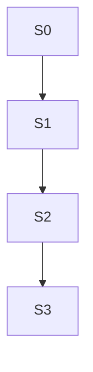

# TD53 — `docs/` has no stated layout rule, and `plan/journey/` is canonical but filed under `plan/`

## Status
- **Type**: Technical Debt / Documentation governance
- **Priority**: Medium (no functional defect; the cost is navigation, triage and an unverified link graph that every future doc move must rewrite by hand)
- **Context**: `docs/`, `plan/journey/`, `.copilot/context.md`, `.claude/commands/`, `packages/architecture-check`
- **Created**: 2026-10-17
- **Discovered**: a chat review of `/docs-audit`'s fit (2026-10-17) — the `docs/` listing mixes numbered and unnumbered files, and `plan/journey/` (about 5.8 MB, 407 files) is cited by 105 docs as canonical
- **Decision status**: Drafted 2026-10-17. Sequence signed off in the session; the destination of the journeys and whether to regroup `docs/` at all are **open on purpose** and are decided by Story 0 from measurements, not assumed here.
- **Related**: TD52 (docs inventory registry — should be seeded with the final paths, so it follows this TD), TD41 (canonical-home rule, `ENGINEERING_RULES_*` split), TD37 (`architecture-check` decisions), `.claude/commands/docs-audit.md`, `CLAUDE.md` §10 and §15

## Problem

Two layout problems, measured on 2026-10-17 (grep counts, approximate — no link checker exists yet to give exact ones):

1. **`docs/*.md` has an unwritten convention.** Numbered files (`01`–`28`, no `07`) are the foundation/reference set; unnumbered ones (`ENGINEERING_RULES_*`, `ANTI_PATTERNS`, `CI_TRAPS`, `RUNBOOKS`, `STORY_SCHEMA`) are rules and process. `docs/TD37-ARCHITECTURE-CHECK-DECISIONS.md` is a TD artifact sitting in `docs/`; `docs/ENGINEERING_RULES.md` is a 94-line redirect index; `docs/BOOTSTRAP_LOG.md` is gitignored. Nothing states which kind a new doc should be.
2. **`plan/journey/` is canonical but lives under `plan/`.** `plan/` tracks delivery (milestones); journeys and prototypes are product design artifacts that 105 docs cite and `CLAUDE.md` §15 treats as a gated canonical area.

**What a path change costs today:** `docs/*.md` is cited in about 640 files / 3,930 occurrences (2,662 point at numbered docs, 1,152 at named docs): `plan/` 1,688, `apps/` 628 (462 are `.ts`/`.tsx` comments), `.claude/` 148, `.copilot/context.md` 131, `packages/` 118, `td/` 56. `plan/journey` is cited about 790 times outside itself plus 51 inside. Hardcoded paths exist in `.coderabbit.yaml`, `.gitignore`, the `agent-context-file` detector (matches `docs|infra/` pointers), `lock-catalog-coverage` (reads `docs/28-LOCK_CATALOG.md`) and the skills under `.claude/`. The journeys' HTML prototypes link to each other by relative path (`../../../shared/...`), so moving the whole subtree intact keeps those links working.

Only `.copilot/context.md` has its pointers checked by CI (`agent-context-file`). A moved or renamed doc breaks every other citation silently, which is why `ENGINEERING_RULES.md` was left behind as a redirect.

### Why this matters

Without a link checker, any restructuring is an unverified 3,000-line rewrite, so the layout stays as is by default. And before moving anything, nobody has checked that each doc is still relevant: moving stale docs just relocates the staleness.

## Chosen approach (decided in the session that drafted this TD)

Principles:
- **Triage before move.** Run a full `/docs-audit` baseline and give each doc a verdict (keep / merge / archive / move) before any file moves.
- **Verify before rewriting.** Add a repo-wide link and anchor checker to CI first, so every later move is proven, not trusted.
- **Folders do not change what an agent loads.** An agent loads what `.copilot/context.md` §10 points at, then reads inside it; today `04-USE_CASES.md` is about 251 KB, `14-API_CONTRACTS.md` 156 KB, `02-DOMAIN_MODEL.md` 124 KB, `13-DATABASE_SCHEMA.md` 121 KB. Regrouping into folders leaves these sizes untouched. Folders benefit people (browsing, category triage). What reduces agent load is splitting large docs, clearer headings and "when to load" intros, and a sharper §10. Story 0 measures this and decides which levers are worth doing.
- **Subfolders and de-numbering cost the same**, because every path changes either way. If `docs/` is regrouped, drop the numbers in the same pass.

Example target layout evaluated in Story 0 (not decided): `docs/{domain,architecture,engineering,operations,process}/`, with `engineering/rules/` for the five `ENGINEERING_RULES_*` files, `journeys/` for the moved prototypes, and `discovery/`, `lean/`, `archive/` unchanged. The fallback that moves no `docs/` file: a `category` field in the TD52 registry plus a generated `docs/README.md`.

### Decision record (filled by Story 0)

_Open. Story 0 writes here: the per-doc verdicts, the measured load costs, the journeys destination (`docs/journeys/` vs a top-level `journeys/`, weighing the HTML/CSS grep noise in `docs/` against one canonical root), the go/no-go on regrouping, and any large-doc split stories it files with `/create-story`._

## Stories

### Story 0 — Triage, measure and decide ⚪

**Agent:** devops
**Complexity:** L
**Docs to load:** `.claude/commands/docs-audit.md`; `.copilot/context.md` §10, §15, §17; `docs/README.md`; `docs/STORY_SCHEMA.md`
**Dependencies:** none
**Pattern:** plain composition — no named pattern applies

**Description:**
No file is moved in this story. Deliverables:
1. **Baseline.** Run `/docs-audit` with a blank scope (per folder if the context strains: `docs`, `plan`, `plan/journey`, `td`). Apply the approved fix batch — stale claims, dead pointers, journey `dev-notes.md` drift — so the move starts from a clean baseline.
2. **Per-doc triage table** written into the Decision record: for each `docs/*.md` — size, inbound reference count, verdict (keep / merge / archive / move), and whether it is still relevant, with the evidence.
3. **Load-cost measurement.** For each `.copilot/context.md` §10 row, the bytes an agent loads today, and an estimate for each lever: folders (no change expected), splitting the largest docs, section-level §10 pointers, a `whenToLoad` field in the TD52 registry.
4. **Decisions.** The journeys destination (check `.gitignore`, `sonar-project.properties`, `knip.config.ts`, `.coderabbit.yaml` and the grep-noise cost of HTML under `docs/`); go or no-go on regrouping `docs/`, with the numbering rule if go; what happens to `ENGINEERING_RULES.md`, `TD37-ARCHITECTURE-CHECK-DECISIONS.md` and `BOOTSTRAP_LOG.md`.
5. File each large-doc split worth doing as its own story with `/create-story`.

**New migration / i18n keys / env vars / feature flags:** none

**Files to create/modify:**
- `td/TD53-DOCS-AND-JOURNEYS-LAYOUT.md` (modify — Decision record)
- Docs and journey files that the approved audit fixes touch (listed in the audit report; each is a `.md` the doc gate covers)

**Acceptance criteria — product:**
- [ ] Every `docs/*.md` has a recorded verdict with evidence.
- [ ] The Decision record states the journeys destination and the regroup go/no-go, each with the measurement behind it.
- [ ] The audit baseline fixes are applied or each is explicitly declined.

**Acceptance criteria — technical:**
- Unit: none — documentation and measurement story
- Integration: none
- Tenant isolation: none — no tenant data
- E2E: none
- [ ] `pnpm architecture-check` still passes after the audit fixes
- [ ] Coverage ≥80% on changed code (not applicable — no code changed)

### Story 1 — Repo-wide link and anchor checker ⚪

**Agent:** devops
**Complexity:** M
**Docs to load:** `docs/17-GITHUB_WORKFLOWS_GUIDELINES.md` § `architecture-check`; `docs/ENGINEERING_RULES_TESTING.md`; `docs/STORY_SCHEMA.md`
**Dependencies:** Story 0
**Pattern:** plain composition — follows `lock-catalog-coverage.ts` / `agent-context-file.ts` (policy in, `ScanResult` out)

**Description:**
Only `.copilot/context.md` has its `docs|infra/` pointers and `§ heading` citations checked today. Add a detector `doc-link-integrity` that scans tracked `.md` files (`docs/**`, `plan/**`, `td/**`, `.claude/commands/**`, `.copilot/**`) and the `docs/…md` path citations in code comments (`apps/**`, `packages/**`) and fails when a cited `docs/`, `plan/`, `td/` or `infra/` path does not exist, or a `§ heading` citation matches no heading in its target. Reuse the heading-normalization and citation-matching helpers `agent-context-file.ts` already has by extracting them to a shared module, rather than copying them. Pre-existing dead links are fixed in Story 0 or allowlisted with a rationale, owner and review date, like the other policy files. `docs/archive/**` and `docs/discovery/**` are scoped by Story 0's verdicts.

**New migration / i18n keys / env vars / feature flags:** none

**Files to create/modify:**
- `packages/architecture-check/src/detectors/doc-link-integrity.ts` (new)
- `packages/architecture-check/src/detectors/doc-link-integrity.spec.ts` (new)
- `packages/architecture-check/src/detectors/agent-context-file.ts` (modify — extract shared citation helpers)
- `packages/architecture-check/src/index.ts`, `packages/architecture-check/src/cli.ts` (modify — export, register)
- `packages/architecture-check/architecture-policy.json` (modify — allowlist entries, if any)
- `docs/17-GITHUB_WORKFLOWS_GUIDELINES.md` (modify — one detector-table row)

**Acceptance criteria — product:**
- [ ] Renaming or deleting a cited doc fails `pnpm architecture-check` and names each broken citation with file and line.
- [ ] A `§ heading` citation to a heading that does not exist fails the same way.

**Acceptance criteria — technical:**
- Unit:
  - [ ] `doc-link-integrity.spec.ts`: a cited missing path is reported.
  - [ ] `doc-link-integrity.spec.ts`: a `§ heading` with no matching heading is reported.
  - [ ] `doc-link-integrity.spec.ts`: a citation in a `.ts` comment to a missing doc is reported.
  - [ ] `doc-link-integrity.spec.ts`: an allowlisted dead link passes; an expired allowlist entry fails.
  - [ ] `doc-link-integrity.spec.ts`: a fully valid set passes with zero findings.
  - [ ] `agent-context-file.spec.ts` still passes unchanged after the helper extraction.
- Integration: none — covered by unit tests plus a clean `pnpm architecture-check` on the real repository
- Tenant isolation: none — no tenant data
- E2E: none
- [ ] Coverage ≥80% on changed code
- [ ] `tsc --noEmit` clean, lint clean

### Story 2 — Move the journeys ⚪

**Agent:** devops
**Complexity:** L
**Docs to load:** `plan/journey/README.md`; `.copilot/context.md` §15; `.claude/commands/docs-audit.md`
**Dependencies:** Story 1
**Pattern:** plain composition — no named pattern applies

**Description:**
`git mv` the whole `plan/journey/` subtree to the destination Story 0 chose, preserving its internal structure so the prototypes' relative links (`../../../shared/...`) keep working. Rewrite every outside citation with a script (about 790 occurrences, plus the 51 inside the subtree), including `.copilot/context.md` §10/§15, the skills under `.claude/commands/`, `.github`, `.agents`, `apps/` comments, `td/TD50`, and the root config files that hardcode the path. No stub is left behind at `plan/journey/`; Story 1's checker proves nothing still points there. The rewrite script lives in the scratchpad and is not committed. This story rewrites lines across the whole repo, so it is **not batchable** with any other story.

**New migration / i18n keys / env vars / feature flags:** none

**Files to create/modify:**
- The `plan/journey/**` subtree (`git mv`, 407 files)
- Every file returned by `grep -rl "plan/journey"` at implementation time (about 125 outside the subtree; regenerate the list then, since stories land in between)
- Root config that hardcodes the path (`.gitignore`, `.coderabbit.yaml`, `sonar-project.properties`, `knip.config.ts`) — only those Story 0 confirms contain it

**Acceptance criteria — product:**
- [ ] No tracked file cites `plan/journey` after the move.
- [ ] Every relative `href`/`src` in the moved HTML prototypes still resolves (one-off script run, result recorded in the PR).

**Acceptance criteria — technical:**
- Unit: none — mechanical move, verified by Story 1's detector
- Integration: none
- Tenant isolation: none — no tenant data
- E2E: none
- [ ] `pnpm architecture-check` (including `doc-link-integrity`) passes
- [ ] `/docs-audit changed` over the move range reports zero dead pointers
- [ ] `tsc --noEmit` clean, lint clean

### Story 3 — Regroup `docs/` (conditional) ⚪

**Agent:** devops
**Complexity:** L
**Docs to load:** the Decision record above; `.copilot/context.md` §10, §17; `docs/README.md`
**Dependencies:** Story 2, and a **go** decision in Story 0 — if Story 0 decides no-go, this story is closed unimplemented and the `category` field is added to the TD52 registry instead
**Pattern:** plain composition — no named pattern applies

**Description:**
Apply the layout Story 0 chose (for example `docs/{domain,architecture,engineering,operations,process}/`, with numbering dropped in the same pass), moving files with `git mv` and rewriting about 3,930 citations by script. Update `.coderabbit.yaml`, the `agent-context-file` and `lock-catalog-coverage` path constants in `cli.ts`, `.copilot/context.md` §10/§17, `docs/README.md`, and the TD52 registry paths. Story 1's detector proves the result. Anything Story 0 decided to keep as a redirect (for example `ENGINEERING_RULES.md`) is handled as recorded there. **Not batchable** with any other story.

**New migration / i18n keys / env vars / feature flags:** none

**Files to create/modify:**
- Every `docs/*.md` the Decision record moves (`git mv`)
- Every file returned by `grep -rl "docs/"` at implementation time (about 640; regenerate then)
- `.coderabbit.yaml`, `packages/architecture-check/src/cli.ts`, `.copilot/context.md`

**Acceptance criteria — product:**
- [ ] `docs/` matches the layout in the Decision record, and `docs/README.md` states the rule for where a new doc goes.
- [ ] No tracked file cites an old `docs/` path.

**Acceptance criteria — technical:**
- Unit: none — mechanical move, verified by Story 1's detector
- Integration: none
- Tenant isolation: none — no tenant data
- E2E: none
- [ ] `pnpm architecture-check` (including `doc-link-integrity`, `agent-context-file`, `lock-catalog-coverage`) passes
- [ ] `/docs-audit changed` over the move range reports zero dead pointers
- [ ] `tsc --noEmit` clean, lint clean
