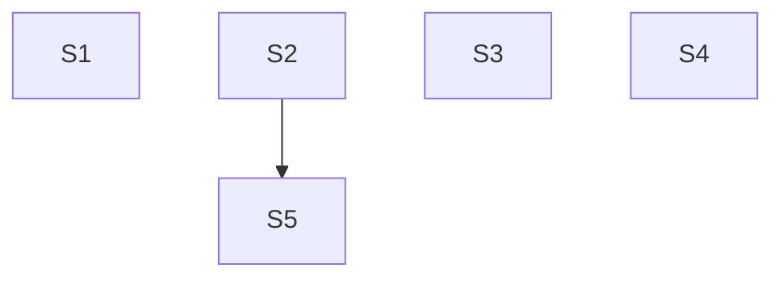

# TD54 — Follow-ups from the TD53 docs audit: BFF component specs, CI identity values, isolation gate

## Status
- **Type**: Technical Debt / Security hygiene and CI hardening
- **Priority**: High (Story 2: personal and account identifiers print unmasked in public CI logs); Medium (Stories 1 and 3)
- **Context**: `apps/bff` (tests), `.github/workflows/`, `packages/architecture-check`, `scripts/`
- **Created**: 2026-10-18
- **Discovered**: `/docs-audit` baseline run by TD53-S3A (2026-10-18). Each item is a place where a doc stated a rule or a gate that the code and CI do not actually enforce; the docs were corrected to say what is true, and each gap is recorded here so it is fixed instead of just described.
- **Decision status**: Drafted 2026-10-18 from the owner's decisions in the TD53-S3A discovery session. Five stories: Stories 1 to 4 are independent (Story 4 has a sequencing note against TD53 Story 5B); Story 5 was added 2026-10-20 as a follow-up found while landing Story 2 and depends on it. Each still begins with `/story-discovery`.
- **Related**: TD53 (`td/TD53-AGENT-FIRST-DOCS-ROUTING-AND-INTEGRITY.md`), `docs/08-TESTING_STRATEGY.md`, `docs/17-GITHUB_WORKFLOWS_GUIDELINES.md` § Repository Secrets vs. Variables, `docs/AGENT_CONTEXT_TRAP_SCENARIOS.md`

## Problem

Four gaps surfaced while the docs were checked against the code (a fifth, below, surfaced while landing Story 2). In each, the documented rule is the right one and the implementation lags it.

1. **BFF controllers without a component spec.** `docs/08-TESTING_STRATEGY.md` § BFF: two test files per controller says every `*.controller.ts` ships a `*.controller.component.spec.ts`. 4 of the 25 BFF controllers have none: `apps/bff/src/features/booking/bookings-attachments.controller.ts`, `recurring-booking-schedules.controller.ts`, `bookings-guest.controller.ts` and `bookings-no-show.controller.ts`. No `architecture-check` detector enforces the rule, so nothing flagged them.
2. **Identity-shaped values stored as Variables.** The owner's requirement is that secrets and sensitive information are never exposed, and that anything not compliant is fixed. `docs/17-GITHUB_WORKFLOWS_GUIDELINES.md` already says identity-shaped values default to Secrets. Today `vars.IAM_ADMIN_USER` (16 uses, `infra-deploy.yml` and `foundation-deploy.yml`) and `vars.NOTIFICATION_EMAIL` (8 uses) hold email addresses, and `vars.CLOUDFLARE_ACCOUNT_ID` (4 uses) holds an account identifier. A Variable's value prints unmasked in workflow logs, and this repository's logs are public. No real address is committed in tracked files (the audit grepped `docs`, `plan`, `td`, `infra`, `.github`, `scripts`); the exposure is the CI log path only.
3. **Cross-context isolation is not a blocking gate.** The isolation contract is expressed as `contextDependencyMatrix` (default deny plus exact `permittedEdges`) in `packages/architecture-check/architecture-policy.json` and enforced by `scripts/dependency-cruiser.config.cjs`. In `.github/workflows/pr-quality.yml` the scan step `pnpm dep-cruise` runs with `continue-on-error: true`, so only `pnpm dep-cruise:test` (the config's own spec) blocks. A cross-context import therefore does not fail a PR. The docs previously claimed an ESLint rule that blocks merge; `docs/08-TESTING_STRATEGY.md` now states the real, weaker position.
4. **Unescaped `%…%` LIKE/ILIKE patterns are not mechanically blocked.** `docs/ANTI_PATTERNS.md` and `.copilot/context.md` §7 require `escapeLikePattern()` on any user-supplied search term, but nothing enforces it, and the 2026-10-18 ablation showed models do not follow the prose (0 of 2 with the bullet, 0 of 2 without). Three repository call sites already ship the bug: the staff search, the service search and the tenant name filter.
5. **The identity-shaped Terraform inputs are not `sensitive`.** Found while landing Story 2: `iam_admin_user`, `notification_email` and `cloudflare_account_id` are plain string inputs, so a plan with a diff touching one prints it in the public job summary even though the Secret masks it in logs. No plan has shown it yet; Story 5 closes it at the source.

**Note, not a story:** `scripts/relay-vm-up.sh:99` writes a PR body saying merging "triggers the pipeline's `apply-${ENV}` job". That job belongs to `infra-deploy.yml`, which excludes `foundation/**` (`infra-deploy.yml:52-54`). The correct flow is a Foundation dispatch with `apply=true` (`docs/RUNBOOKS.md` § Provision a tenant). Fix the script's text the next time that file is touched.

## Chosen approach (decided in the TD53-S3A discovery session, 2026-10-18)

Fix each gap at its root rather than documenting around it: add the missing specs, move the values to Secrets, and make the gate blocking once its baseline is clean. No workaround is acceptable: do not hide the values by masking them in a step, do not downgrade the docs back to claim a gate that does not exist, and do not add a blanket exception to make the isolation scan pass.

Stories 1 to 4 are independent and can land in any order or in parallel; Story 5 follows Story 2. They touch different files (`apps/bff/**/*.spec.ts`; `.github/workflows/{infra,foundation}-deploy.yml`; `.github/workflows/pr-quality.yml` plus the isolation policy; `apps/backend/eslint.config.js` plus three backend repositories).

## Stories

### Story 1 — Component specs for the four BFF controllers that lack one 🟡 ✅ Done

**Agent:** bff-ts
**Complexity:** S
**Docs to load:** `docs/08-TESTING_STRATEGY.md` § BFF: two test files per controller (mandatory) and § BFF test helper file isolation; `docs/ENGINEERING_RULES_TESTING.md`
**Dependencies:** none
**Pattern:** plain composition — follows the existing `*.controller.component.spec.ts` files next to the controllers that have one (for example `apps/bff/src/features/staff/staff.controller.component.spec.ts`)

**Description:**
`docs/08-TESTING_STRATEGY.md` makes a `*.controller.component.spec.ts` mandatory for every BFF controller: it boots the real Nest pipeline (guards, pipes, filters) with the backend call stubbed, so route paths, `@Roles`, body validation and header forwarding are exercised the way a request would hit them, which the plain `*.controller.spec.ts` unit test does not. Four controllers have none: `bookings-attachments` (its one route, `POST /bookings/attachments/signed-url`, `@Public`), `recurring-booking-schedules` (GET, GET `:id`, POST, POST `:id/end`, `:id/approve`, `:id/reject`), `bookings-guest` (the public `PATCH :id/submit-info/guest` and `GET :id/guest` routes) and `bookings-no-show` (`POST :id/no-show` for MANAGER/STAFF and `POST :id/no-show/correct` for MANAGER). For each, read a sibling spec first and copy its harness; do not invent a new one. `bookings-guest` and `bookings-attachments` are already exercised by `bookings.controller.component.spec.ts` (the Nest app boots whole, so the split-out controllers get hit). Move its `PATCH :id/submit-info/guest` and `POST attachments/signed-url` describe blocks into the two new specs, with their helpers (`makeGuestToken`, `tenantInfo`), instead of duplicating them. The parent spec keeps no copy. `GET :id/guest`, both no-show routes and all six recurring routes have no coverage today. Once the four exist, remove the "Known gap" note in `docs/08-TESTING_STRATEGY.md` § BFF: two test files per controller.

**New migration / i18n keys / env vars / feature flags:** none

**Files to create/modify:**
- `apps/bff/src/features/booking/bookings-attachments.controller.component.spec.ts` (new)
- `apps/bff/src/features/booking/recurring-booking-schedules.controller.component.spec.ts` (new)
- `apps/bff/src/features/booking/bookings-guest.controller.component.spec.ts` (new)
- `apps/bff/src/features/booking/bookings-no-show.controller.component.spec.ts` (new)
- `apps/bff/src/features/booking/bookings.controller.component.spec.ts` (modify — remove the two moved describe blocks)
- `docs/08-TESTING_STRATEGY.md` (modify — remove the "Known gap" note)

**Acceptance criteria — product:**
- [ ] Every `*.controller.ts` under `apps/bff/src` has a sibling `*.controller.component.spec.ts`.

**Acceptance criteria — technical:**
- Unit:
  - [ ] `bookings-no-show.controller.component.spec.ts`: STAFF and MANAGER reach `POST :id/no-show`, including with no body (defaults to `{}`); MANAGER reaches `/no-show/correct`; STAFF on `/no-show/correct` gets 403 and CUSTOMER gets 403 on both; no JWT gets 401; the correction body rejects a `reason` shorter than 10 or longer than 500 characters and any `correctedStatus` other than `COMPLETED`; a non-UUID `:id` gets 400; a backend error propagates.
  - [ ] `recurring-booking-schedules.controller.component.spec.ts`: no JWT gets 401; CUSTOMER, STAFF and MANAGER each reach list, get, create and end and receive the backend response unchanged; CUSTOMER gets 403 on `approve` and `reject`, and STAFF and MANAGER reach them; an invalid POST body or list query gets 400 (problem-details shape); a non-UUID `:id` gets 400; a backend error propagates.
  - [ ] `bookings-guest.controller.component.spec.ts`: both routes work with no JWT, using the guest token; a missing token gets 400, an invalid token 401, and a token whose booking id does not match the route 400; a malformed `submit-info` body gets 400; `GET :id/guest` gets 409 `GUEST_BOOKING_NOT_AWAITING_INFO` when the booking is not `INFO_REQUESTED`; a backend error propagates. The web-only key guard is global and already covered by `web-only.guard.spec.ts`, so these specs do not re-test it.
  - [ ] `bookings-attachments.controller.component.spec.ts`: the existing scenarios move over unchanged — the tenant resolves from a JWT, a guest token or a slug; no auth and no slug gets 400, a bad guest token 401, and an invalid body 400.
- Integration: none — covered by the component specs
- Tenant isolation:
  - [ ] Public routes: the tenant argument of `postForPublic`/`patchForPublic`/`getForPublic` comes from the JWT, guest token or resolved slug, never from the body. Authenticated routes: a `tenantId` or `customerId` sent in the body or query does not reach the backend call. `X-Tenant-ID` construction stays covered by `backend-http.service.spec.ts`.
  - [ ] Mutation check, recorded in the PR: removing the `@Roles('MANAGER')` on `correctNoShow` and the `@Roles('MANAGER','STAFF')` on `approve`/`reject` each makes a named test fail.
- E2E: none — covered by the component specs
- [ ] Coverage ≥80% on changed code
- [ ] `tsc --noEmit` clean, lint clean

### Story 2 — Move identity-shaped CI Variables to Secrets 🔴 ✅ Done

**Agent:** devops
**Complexity:** M
**Docs to load:** `docs/17-GITHUB_WORKFLOWS_GUIDELINES.md` § Repository Secrets vs. Variables; `infra/terraform/README.md` § Layout and § New-resource PR-sequencing playbook; `docs/CI_TRAPS.md` (the failing tool's own section if a plan job fails); `docs/ENGINEERING_RULES_INFRA.md`
**Dependencies:** none
**Pattern:** plain composition — the same `secrets.X` wiring the other CI identifiers already use (`TF_PLANNER_SA_*`, `BREVO_SMTP_LOGIN`)

**Description:**
A secret or sensitive value is never a Variable (rule stated in `docs/17-GITHUB_WORKFLOWS_GUIDELINES.md` § Repository Secrets vs. Variables). Move three values, each used only inside the two infra workflows: `IAM_ADMIN_USER` (an admin's email address, 16 uses), `NOTIFICATION_EMAIL` (an email address, 8 uses) and `CLOUDFLARE_ACCOUNT_ID` (an account identifier, 4 uses). Decided here: move all three, because the mechanism is identical and an account identifier gains from log masking at no cost; the story's discovery may only reverse this for `CLOUDFLARE_ACCOUNT_ID`, with a reason. Steps: (1) the owner creates the three **repo-level** secrets (not environment-scoped: the PR plan and drift jobs declare no `environment:`, so an environment-scoped value resolves empty there — the M17-S24 precedent in `docs/17`), **before** the workflow change merges, then deletes the three Variables after the new run is proven; (2) change every `vars.IAM_ADMIN_USER`, `vars.NOTIFICATION_EMAIL` and `vars.CLOUDFLARE_ACCOUNT_ID` in `.github/workflows/infra-deploy.yml` and `foundation-deploy.yml` to the `secrets.` form; (3) check that no step echoes, `set -x`-traces or writes the values into a step summary or artifact, and that a value is passed to Terraform only through `TF_VAR_*`/env, never interpolated into a logged command line; (4) update the "Known gap" bullet in `docs/17` to describe the compliant state, and the `Secrets` list there if it changed. The Terraform side needs no behavioural change: `infra/terraform/envs/prod/variables.tf` and `infra/terraform/modules/monitoring/variables.tf` take these as ordinary input variables fed from env.

**Discovery decisions (2026-10-20):** (a) the four `::add-mask::${{ vars.IAM_ADMIN_USER }}` steps in `foundation-deploy.yml` are the masking workaround this TD rules out and become redundant once the value is a secret, so they are removed in the same change; (b) the stale description text in `infra/terraform/envs/prod/variables.tf` (the `brevo_smtp_login`, `cloudflare_account_id` and `notification_email` descriptions and the comment citing `vars.CLOUDFLARE_ACCOUNT_ID`, which say "GitHub environment variable" or `vars.`) is corrected, a description-only edit with no resource diff; it also makes `detect-changes` set `terraform=true`, so the credentialed `plan-staging`/`plan-prod` jobs run on the PR, which a workflow-only PR would not do; (c) masking is documented for logs, not verified for `$GITHUB_STEP_SUMMARY`, and both plan jobs write the full `plan-output.txt` (IAM members, the notification channel email, the Cloudflare `account_id`) to the job summary, so the live check also searches the job summaries, and if a literal value shows there a follow-up story marks the Terraform variables `sensitive = true` (not done in this story); (d) the drift check is dispatched from the branch if WIF accepts it, otherwise from `main` right after merge, and the Variables are deleted only after it passes.

**New migration / i18n keys / env vars / feature flags:** three repo-level GitHub secrets (`IAM_ADMIN_USER`, `NOTIFICATION_EMAIL`, `CLOUDFLARE_ACCOUNT_ID`) replacing three Variables of the same names; no application env var, no migration, no flag.

**Files to create/modify:**
- `.github/workflows/infra-deploy.yml` (modify — `vars.` to `secrets.`)
- `.github/workflows/foundation-deploy.yml` (modify — `vars.` to `secrets.`; remove the four redundant `Mask IAM admin email` steps)
- `infra/terraform/envs/prod/variables.tf` (modify — description/comment text only, no resource diff)
- `docs/17-GITHUB_WORKFLOWS_GUIDELINES.md` (modify — replace the "Known gap" bullet with the compliant state)

**Acceptance criteria — product:**
- [ ] No email address or account identifier is a GitHub Actions Variable; `grep -rE "vars\.(IAM_ADMIN_USER|NOTIFICATION_EMAIL|CLOUDFLARE_ACCOUNT_ID)" .github` returns nothing.
- [ ] Workflow logs for a plan run and a drift run show these values only as `***`.
- [ ] The plan jobs' job summaries are searched for the literal values; the result is recorded in the PR, and a follow-up story is created via `/create-story` if any value shows.
  - ⚠️ Job summaries were not opened; inferred clean because both plans had no changes. The latent exposure is tracked in TD54 Story 5 (2026-10-20).
- [ ] `foundation-deploy.yml` has no `add-mask` step left.

**Acceptance criteria — technical:**
- [ ] Checkov / Tfsec clean
- [ ] `actionlint` and `zizmor` pass on the changed workflows

**Live-verification check:** before merge review, run `infra-deploy.yml` (a `plan` run on the PR, and a manual drift dispatch) and open the logs. Pass = the plan and drift jobs complete, `terraform plan` shows no unexpected diff caused by an empty input (an empty `iam_admin_user` or notification channel would show as a change), and a search of the log for the literal values returns nothing. A failed or un-runnable check is a stuck condition.
**PR sequence:** 1 PR touching `.github/workflows/**`, `docs/` and a description-only edit under `infra/terraform/envs/prod/` (no `foundation/**`, no `apps/**`, so `infra-app-mix-ok` does not apply; the Terraform edit is what makes the credentialed plan jobs run on the PR).
- PR1: the two workflow files, `variables.tf` and `docs/17`. **Ordered manual step, first:** the owner creates the three repo-level secrets before this PR is merged or its plan job is trusted; a missing secret resolves to an empty string and the plan jobs fail or silently change their input. **Ordered manual step, last:** after the live check passes, delete the three old Variables.

### Story 3 — Make the dependency-graph scan a blocking gate, with a zero baseline 🟡 ✅ Done

**Agent:** backend-ts
**Complexity:** L
**Docs to load:** `docs/08-TESTING_STRATEGY.md` § Architecture Isolation Test; `docs/05-BOUNDED_CONTEXTS.md` § Rule 2 — Communication via Events or BFF Only; `docs/17-GITHUB_WORKFLOWS_GUIDELINES.md` § `architecture-check`; `docs/11-ARCHITECTURE.md`; `docs/ENGINEERING_RULES_BACKEND.md` § Event Handlers and the jobs rules; `docs/AGENT_PATTERNS.md`; `docs/ENGINEERING_RULES_SHARED.md` (the architecture-policy rules)
**Dependencies:** none
**Pattern:** plain composition — the policy and generator already exist (`architecture-policy.json` feeding `scripts/dependency-cruiser.config.cjs`). The story encodes the intended layering as directional rules, clears the baseline at its root, then removes the non-blocking flag.

**Description:**
`pnpm dep-cruise` is the only check that sees a context importing another context's internals (`pnpm architecture-check` runs 27 detectors, none of them on imports), and it is report-only (`continue-on-error: true` in `.github/workflows/pr-quality.yml`), so nothing can stop a bad import. Make the whole scan blocking. Its baseline on `main` is 215 violations (measured 2026-10-20), so the gate is flipped only after the baseline is zero: 4 cross-context imports, 202 `no-<ctx>-application-internal-imports` and 9 `no-circular`. Clear it at the root, in line with the "no workarounds" rule: register what is legitimate, encode the intended layering in the rules, and fix what is actually wrong.

**Discovery decisions (2026-10-20):**
- (a) **Events and commands stay in the publisher's `domain/`** (its published language; not moved to `@ikaro/types`). The 4 cross-context findings are handler imports of a subscribed event or command, the shape about 20 handlers are already registered for. Each becomes one `permittedEdges` entry: exact handler as `source`, exact event or command file as its single `targetPaths` entry, plus rationale, owner and review date; no globs. Entries: `notification/.../resource-deactivation-impact.handler.ts` → `booking/domain/events/resource-deactivation-impact-raised.event.ts`; `notification/.../recurring-schedule-renewal.handler.ts` → `booking/domain/commands/recurring-schedule-renewal-due.command.ts`; `notification/.../booking-resource-reassigned.handler.ts` → `booking/domain/events/booking-resource-reassigned.event.ts`; `booking/.../tenant-provisioned.handler.ts` → `platform/domain/events/tenant-provisioned.event.ts`.
- (b) **Locality rule for shared code inside `application/`:** a helper used only by use cases stays in `use-cases/`; a helper used only by jobs stays in `jobs/`; a helper used by both goes in a new `application/helpers/` folder beside `jobs/` and `use-cases/`. Baseline check: the only helper crossing that line is `booking/application/use-cases/booking-exception-closing.helpers.ts` (imported by `expire-booking-holds.job.ts` and 11 use cases), which moves to `booking/application/helpers/`.
- (c) **Directional rules (replace the flat allowlist):** `use-cases/` may import same-folder `*.helpers.ts`, `*.mapper.ts`, `*.util.ts`, `*.types.ts`, plus `application/helpers/`, services, ports, DTOs and domain; never `jobs/`, and no `*.use-case.ts` from another use case. `jobs/` may import same-folder `*.helpers.ts` and `*.base.ts`, plus `application/helpers/`, services, ports, DTOs, domain and `*.use-case.ts` (a job is a batch orchestrator above use cases, called by its `infrastructure/events/*-trigger.handler.ts`, and stays in `application/`). `application/helpers/` may import domain, ports and DTOs only. `layerTaxonomy.application.sameContextAllowedApplicationPaths` in `architecture-policy.json` carries these patterns; the cross-context no-wildcard rule applies to `permittedEdges`, not to this same-context list.
- (d) **A use case is not a reusable building block.** Use case → use case calls are fixed by extracting the shared logic: `RaiseFutureCommitmentExceptionsForResourceUseCase` (called by `deactivate-resource` and `cascade-staff-deactivation`) and the availability computation `match-availability-alerts` takes from `GetAvailabilityUseCase` become `application/services/` classes; a type or enum imported from a use case file (`FutureCommitmentExceptionResolutionOutcome`, every `*UseCaseInput`) moves to the matching `*.types.ts`. Two notification/platform findings (`send-availability-alert-matched-notification` → `send-availability-alert-matched-email` use case; `create-lead-form-submission` → `get-lead-form-public-config`) are inspected at implementation and fixed with the same two moves.
- (e) **Renames so the suffix patterns apply with no named exceptions:** `booking/application/jobs/tenant-local-window.ts` → `tenant-local-window.helpers.ts` (and its spec); `windowed-tenant.job.ts` → `windowed-tenant-job.base.ts` (an abstract base, not a job; the class name `WindowedTenantJob` is unchanged); `booking-day-reminder-job.base.ts` already fits. Grep `docs/`, `plan/`, `.claude/**` and `scripts/` for the old file names (stale-reference sweep).
- (f) **`chatbot-balance-poll.job.ts` imports `OpenRouterCreditsClient` from `infrastructure/llm/` directly.** A real layering fault: add a port in `platform/application/ports/`, have the client implement it, and inject the port. `platform/lead-form.constants.ts` becomes one named entry beside `chatbot.constants.ts` in `sameContextAllowedApplicationPathsByContext`.
- (g) **Cycles are fixed, not exempted** (9 findings, 3 backend cycles and 1 web cluster): `chatbot-cap-check.helpers` ↔ `send-chat-message.use-case` and `recurring-booking-schedule-window.helpers` ↔ `request-recurring-booking-schedule.use-case` (both close through an `…UseCaseInput` type, fixed by (d)); `resource-candidate-locking.helpers` ↔ `resource-occupancy.helpers` (a real runtime cycle, shared function extracted to a third file); web `features/platform/settings-form*` (the `settings-form.ts` barrel re-exports from `-validation`, which imports values back from it; move `WEEK_DAYS`, the shared types and the re-export so nothing imports the barrel).
- (h) **Everything blocks.** No `warn` split, no `continue-on-error`. A stale `permittedEdges` check was run: all 34 existing entries resolve to files that exist.
- (j) **Required status checks.** Read from branch protection on 2026-10-20: the required checks on `main` do not include "Architecture validation" or "Dependency graph validation", so a red result from either does not block a merge today. After PR2 merges the owner adds both job names as required checks in the repository settings (a repository setting, not a file in this repo; the exact names are those of the jobs in `pr-quality.yml` after the rename). The step is listed in the PR2 body and the live check confirms a red scan shows as a blocked merge.
- (i) **Conventions are written where the author reads them, so a future agent cannot repeat the mistake:** `docs/ENGINEERING_RULES_BACKEND.md` § Event Handlers (a handler registers its subscribed event or command in `permittedEdges` in the same change) and its jobs rules (job placement, the `helpers/` locality rule, the shared-file naming); `docs/05-BOUNDED_CONTEXTS.md` § Rule 2; `docs/11-ARCHITECTURE.md` (the file tree gains `helpers/`); `docs/ANTI_PATTERNS.md` (rows: a use case calling another use case, a use case importing a job, a job importing `infrastructure/`, a handler subscribing to another context's event without its `permittedEdges` entry); `.copilot/context.md` §7 (the cross-context bullet and Architecture policy bullet say the scan is CI-enforced and name the locality rule; edit the file directly, never through the symlinks, and keep within the `agent-context-file` section budget); `docs/AGENT_PATTERNS.md` (a short pattern: shared logic goes to a service, a helper used by both jobs and use cases goes to `helpers/`).

**New migration / i18n keys / env vars / feature flags:** none

**Files to create/modify:**
- `.github/workflows/pr-quality.yml` (modify — remove `continue-on-error: true` from the scan step; rename the job and step so neither says report-only)
- `packages/architecture-check/architecture-policy.json` (modify — the 4 exact `permittedEdges` entries; `sameContextAllowedApplicationPaths`/by-context patterns per (c) and (f))
- `scripts/dependency-cruiser.config.cjs` (modify — directional jobs/use-cases/helpers rules per (c))
- `scripts/dependency-cruiser-config.spec.cjs` (modify — pin the rules and the new entries)
- `apps/backend/src/contexts/booking/application/**` (move `booking-exception-closing.helpers.ts` to `helpers/`; rename the two job files and their spec; extract the services and `*.types.ts` per (d); import updates)
- `apps/backend/src/contexts/platform/application/**` (new credits port, `chatbot-cap-check` cycle, `send-chat-message` input type), `apps/backend/src/contexts/platform/infrastructure/llm/openrouter-credits.client.ts` (implement the port) and the platform module providers
- `apps/backend/src/contexts/notification/application/**` (per (d), after inspection)
- `apps/web/features/platform/settings-form*.ts` (modify — break the cycle per (g))
- `docs/08-TESTING_STRATEGY.md` (modify — § Architecture Isolation Test and the Quality Gates row)
- `docs/17-GITHUB_WORKFLOWS_GUIDELINES.md` (modify — the job's blocking status and the report-only line in the gating-jobs summary)
- `docs/05-BOUNDED_CONTEXTS.md` (modify — § Rule 2, handler imports of a subscribed event or command)
- `docs/ENGINEERING_RULES_BACKEND.md` (modify — § Event Handlers and the jobs rules)
- `docs/11-ARCHITECTURE.md` (modify — the `application/` tree gains `helpers/`)
- `docs/ANTI_PATTERNS.md`, `docs/AGENT_PATTERNS.md`, `.copilot/context.md` (modify — the rules above, so agents are told before they write the code)

**Acceptance criteria — product:**
- [ ] A PR that adds an import from one bounded context into another's internals fails CI.
- [ ] A PR that adds a use case → use case import, a use case → job import, a job importing `infrastructure/`, or a circular import fails CI.
- [ ] `pnpm dep-cruise` exits 0 on `main` for every workspace, with no `warn` downgrade and no finding hidden.
- [ ] The 4 new `permittedEdges` entries each name an exact source and a single exact target.
- [ ] After PR2, "Architecture validation" and "Dependency graph validation" are required status checks on `main` (owner action in repository settings, recorded in the PR2 body).
  - ⚠️ Both jobs are not yet required checks on main (owner action in repository settings, steps given at mark-done) — not a code gap, no TD opened, 2026-10-21
- [ ] Behaviour is unchanged: every touched context's existing unit and integration suites pass.

**Acceptance criteria — technical:**
- Unit:
  - [ ] `scripts/dependency-cruiser-config.spec.cjs` passes and covers the 4 new entries.
  - [ ] Negative guarantees pinned: a jobs → use case import is allowed, a use case → job import is not; an `application/helpers/` file importing a use case is not allowed; a use case importing another `*.use-case.ts` is not allowed.
  - [ ] Specs for each new service and the new credits port adapter; the renamed `tenant-local-window.helpers.spec.ts` still passes.
- Integration: the existing job and use-case integration specs of booking, notification and platform pass unchanged.
- Tenant isolation: unchanged by this story; the extracted services keep passing `tenantId` and the existing isolation specs still pass.
- [ ] Checkov / Tfsec clean
- [ ] `actionlint` and `zizmor` pass on `pr-quality.yml`
- [ ] Coverage ≥80% on changed code; `tsc --noEmit` and lint clean

**Live-verification check:** after the flag is removed, open a throwaway draft PR with one deliberate cross-context import (for example `booking` importing a `loyalty` domain file) and one use case → use case import, and confirm the scan job turns red; close the PR without merging. Pass = the job fails on the deliberate violations and passes on `main`. Opening the PR needs the owner's yes at that point. A failed or un-runnable check is a stuck condition.
**PR sequence:** 2 PRs, neither mixes `infra/terraform/**` with `apps/**`, so `infra-app-mix-ok` does not apply. PR1: clear the baseline (policy, config and rule changes, renames and moves, extractions, port, cycle fixes, the 4 entries, and the `docs/05`, `docs/11` and `ENGINEERING_RULES_BACKEND.md` conventions); no workflow change, so `pnpm dep-cruise` exits 0 but is still non-blocking. PR2: remove `continue-on-error`, rename the job, update `docs/08` and `docs/17`, run the live check. A gate flipped before the baseline is clean would block every PR, so PR2 merges only after PR1.

### Story 4 — Make unescaped `%…%` LIKE/ILIKE patterns fail lint, and fix the three that exist 🔴

**Agent:** backend-ts
**Complexity:** M
**Docs to load:** `docs/ANTI_PATTERNS.md` § A user-supplied search term is wrapped in a `%...%` LIKE/ILIKE pattern; `docs/ENGINEERING_RULES_SHARED.md` § `no-restricted-syntax` selectors must be checked against every already-documented bypass shape; `docs/ENGINEERING_RULES_TESTING.md`; `docs/AGENT_CONTEXT_TRAP_SCENARIOS.md` (scenario 2 and the exclusion table); `.copilot/context.md` §7
**Dependencies:** none. Sequencing note: TD53 Story 5B also edits `.copilot/context.md` and leaves the LIKE bullet untouched on purpose; this story shrinks that bullet, so run it after 5B or merge `main` first.
**Pattern:** plain composition — one `no-restricted-syntax` selector beside its siblings in `apps/backend/eslint.config.js`, tested like `restricted-imports-syntax.eslint.spec.ts`

**Discovered:** 2026-10-18, TD53 Story 2's ablation, then verified against the code on 2026-10-20.
**Root cause:** prose does not steer. 0 of 2 `codex exec` sessions escaped a user search term with the `context.md` bullet present and 0 of 2 without it (`docs/AGENT_CONTEXT_TRAP_SCENARIOS.md` scenario 2), and three call sites already ship the bug: `apps/backend/src/contexts/staff/infrastructure/repositories/typeorm-staff.repository.ts:69`, `apps/backend/src/contexts/booking/infrastructure/repositories/typeorm-service.repository.ts:108` and `apps/backend/src/contexts/platform/infrastructure/repositories/typeorm-tenant.repository.ts:84` build `%${term}%` from a caller-supplied value without `escapeLikePattern()`.

**Description:**
A caller's `%` or `_` is a LIKE wildcard, not text, so an unescaped term lets `%%%` match everything and defeats a trigram-index-backed search (`docs/ANTI_PATTERNS.md`, M20-S12 precedent). Today the only defense is a bullet that models do not follow. Decided here: a lint selector, not an `architecture-check` detector, because the rule is purely syntactic, applies per file, and the sibling syntax bans already live in `apps/backend/eslint.config.js` Tier S0, where an editor shows the error while the code is written. The selector flags a template literal or string concatenation that places a `%` at an edge of a pattern around a non-literal expression, unless every such expression is a direct `escapeLikePattern(...)` call. The helper file `apps/backend/src/shared/utils/escape-like-pattern.ts` and `*.spec.ts` files are exempt. Per `docs/ENGINEERING_RULES_SHARED.md` the selector is checked against all three documented bypass classes before it counts as done: computed-literal member access (a pattern assembled through a computed-literal call), a bare non-member call, and a value nested inside a conditional or logical expression. The story's discovery maps each class to a concrete LIKE shape (`'%' + x + '%'`, a prefix-only or suffix-only template, a ternary-nested pattern) and adds a spec case for each. The selector cannot see a pattern built in one place and consumed in another; that residual is stated in the `docs/ANTI_PATTERNS.md` row. Fix the three existing sites in the same PR (the gate would otherwise fail on its own baseline), then shrink the `context.md` bullet to its name plus "CI-enforced" and move scenario 2 to the exclusion table.

**New migration / i18n keys / env vars / feature flags:** none

**Files to create/modify:**
- `apps/backend/eslint.config.js` (modify — new selector in Tier S0, and in every later tier that repeats the S0 list)
- `apps/backend/src/eslint/like-pattern-syntax.eslint.spec.ts` (new)
- `apps/backend/src/contexts/staff/infrastructure/repositories/typeorm-staff.repository.ts` (modify)
- `apps/backend/src/contexts/booking/infrastructure/repositories/typeorm-service.repository.ts` (modify)
- `apps/backend/src/contexts/platform/infrastructure/repositories/typeorm-tenant.repository.ts` (modify)
- `apps/backend/src/contexts/staff/infrastructure/repositories/staff.repository.integration.spec.ts`, `apps/backend/src/contexts/booking/infrastructure/repositories/service.repository.integration.spec.ts` and `apps/backend/src/contexts/platform/infrastructure/repositories/platform.repository.integration.spec.ts` (modify)
- `.copilot/context.md` (modify — the LIKE/ILIKE bullet becomes a name plus "CI-enforced"; edit the file directly, never through the symlinks)
- `docs/AGENT_CONTEXT_TRAP_SCENARIOS.md` (modify — scenario 2 moves to the exclusion table)
- `docs/ANTI_PATTERNS.md` (modify — the row names the lint rule and its residual)

**Acceptance criteria — product:**
- [ ] A literal `%` or `_` typed into the staff search, the service search or the tenant name filter matches only itself.
- [ ] A new `%…%` pattern built from an unescaped value in `apps/backend/src` fails `pnpm lint`.

**Acceptance criteria — technical:**
- Unit:
  - [ ] `like-pattern-syntax.eslint.spec.ts`: flags a template with `%` on both edges, a prefix-only and a suffix-only template, `'%' + x + '%'` and a ternary-nested pattern; passes the same shapes when the value is a direct `escapeLikePattern(x)` call.
  - [ ] Negative guarantees pinned in the same spec: a literal-only `%` string (for example `'100%'`) is not flagged, `escape-like-pattern.ts` is exempt, and `*.spec.ts` files are exempt.
- Integration:
  - [ ] `staff.repository.integration.spec.ts`: a search for `%` returns only a staff row whose name contains a literal `%`.
  - [ ] `service.repository.integration.spec.ts`: a search for `_` returns only a service whose name contains a literal `_`.
  - [ ] `platform.repository.integration.spec.ts`: a tenant name filter for `%` matches only a literal `%`.
- Tenant isolation:
  - [ ] The staff and service search tests seed a second tenant with a matching name and assert it is not returned.
- E2E: none — covered by unit and integration
- [ ] `pnpm lint` clean on the whole repository after the selector lands
- [ ] Coverage ≥80% on changed code
- [ ] `tsc --noEmit` clean, lint clean

### Story 5 — Mark the identity-shaped Terraform inputs `sensitive = true` 🟡

**Agent:** devops
**Complexity:** M
**Docs to load:** `infra/terraform/README.md` § Layout and § Public-repository security; `docs/17-GITHUB_WORKFLOWS_GUIDELINES.md` § Repository Secrets vs. Variables; `docs/ENGINEERING_RULES_INFRA.md`; `docs/CI_TRAPS.md` (the failing tool's own section if a plan job fails)
**Dependencies:** TD54 Story 2 (done: the three values are repository Secrets, the three Variables are deleted, and `plan-staging`/`plan-prod` already run on `infra/terraform/**` changes)
**Pattern:** plain composition — `sensitive = true` on an input variable, the same attribute `cloudflare_api_token` already carries (the `cloudflare_api_token` variable in `infra/terraform/envs/prod/variables.tf`), plus a withhold-on-leak guard step in the two plan jobs; no named pattern applies

**Discovered:** 2026-10-20, Codex round-1 review of PR #644 (TD54-S2), triaged as real but out of that PR's scope.
**Root cause:** `iam_admin_user`, `notification_email` and `cloudflare_account_id` are plain `type = string` inputs (`envs/prod/variables.tf:31,119,131`, `envs/staging/variables.tf:58,70`, `modules/{database,relay-vm,monitoring}/variables.tf`). Terraform therefore prints their values wherever a plan renders them as resource attributes (the Cloud SQL IAM user name, the relay VM IAM members, the monitoring channel's `email_address`, the Turnstile widget's `account_id`). Both `plan-staging` and `plan-prod` write the full `terraform show` output to `$GITHUB_STEP_SUMMARY` (`infra-deploy.yml`, "Write plan to job summary"), a public page, and GitHub masks a Secret in logs only. Today's plans have no diff touching these values, so nothing is exposed yet.

**Discovery finding (2026-10-20): `sensitive = true` alone does not close the exposure.** Terraform masks only attributes derived from the variable. A provider-computed `id` that embeds the value is not masked, and a replace or destroy plan prints the old `id`. Confirmed in a real run: the PR #644 `plan-staging` log shows `module.database.google_sql_user.iam_admin: Refreshing state... [id=***//ikaro-db-staging]`, where `***` is the email that GitHub's Secret masking hid; the `google_sql_user` id is `<name>/<host>/<instance>`. The `google_iap_tunnel_instance_iam_member` and `google_compute_instance_iam_member` ids end in `user:<email>` (provider import format). In the `envs/*` plans the only affected resource is `google_sql_user.iam_admin`, and only when `IAM_ADMIN_USER` rotates or the user is removed; the relay members live in the Foundation root, whose plan jobs publish addresses and actions only. `notification_email` and `cloudflare_account_id` reach no id (the monitoring channel id is numeric, the Turnstile id is the public sitekey).

**Description:**
TD54 Story 2 moved the three values to Secrets so logs mask them. A plan with a diff that touches one of them still renders it in the job summary, which keeps the full plan on purpose (the 2026-07-08 decision stays). Two parts close it:

1. Declare the three variables `sensitive = true`, so Terraform prints `(sensitive value)` for every attribute derived from them, in any plan, log or summary.
2. Add a withhold-on-leak guard to `plan-staging` and `plan-prod`, immediately before "Write plan to job summary", for the residue `sensitive` cannot reach (provider-computed ids). The guard compares `plan-output.txt` against each non-empty injected identity value (`TF_VAR_iam_admin_user`, `TF_VAR_notification_email`, and in prod `TF_VAR_cloudflare_account_id`) with a fixed-string match. On a hit it writes the addresses-and-actions list (the same extraction as the PR comment) to the summary in place of the full plan, adds a line saying the detail was withheld and why, emits `::warning::`, and the job still passes, so a rotation PR is never blocked. It detects and withholds; it does not rewrite or mask the plan text. The guard is also the permanent named check for the negative guarantee: without it nothing fails if the exposure regresses.

Decided here: (a) mark every declaration of the three names that feeds an `envs/*` plan: both env roots and the `database`, `relay-vm` and `monitoring` module variables, so a module's own plan and `terraform test` behave the same; `modules/relay-vm` is composed only by the Foundation roots, so its edit is verified by a Foundation `workflow_dispatch` (see the live check); (b) Foundation (`foundation/envs/*/variables.tf`) is out of scope: its plan jobs run `terraform plan … >/dev/null` and publish addresses and actions only, so it does not leak, and including it would force the two-PR `foundation/**` split (`infra/terraform/README.md`'s playbook) and a conditional `var.iam_admin_user != ""` that feeds the `workload_cloud_run_invokers` map; (c) no `nonsensitive()` wrapper is added to make a plan pass; (d) the guard withholds and warns rather than failing the job (a failing guard would block every IAM_ADMIN_USER rotation PR on the required check); (e) the live check uses sentinel literals on the PR branch, not a `workflow_dispatch` input.

Hazards verified in the code, to check with a real plan rather than assume: a sensitive value cannot be a `for_each` key or argument (no use of these three as keys, counts or outputs found; re-grep at implementation); `terraform test` assertions comparing `var.notification_email` and `iam_admin_user` in `modules/{monitoring,relay-vm}/tests/*.tftest.hcl` must still pass, as must the `expect_failures = [var.x]` runs and the `can(regex(...))` validations on a sensitive value; values derived from a sensitive input become sensitive-marked (`google_sql_user.iam_admin` `name`, the monitoring channel label), which is wanted; a destroy-only plan of a resource applied before this change reads attributes from state without a sensitive mark until a later apply persists it, which is one more reason the guard exists. Stale text that becomes false and is fixed in the same PR: `infra-deploy.yml` comments saying none of staging's variables are `sensitive` (near lines 314-315 and 657), the `cloudflare_account_id` description's "Not sensitive", and `docs/17`'s "check a job summary" caveat.

**New migration / i18n keys / env vars / feature flags:** none.

**Files to create/modify:**
- `infra/terraform/envs/prod/variables.tf` (modify — `sensitive = true` on `cloudflare_account_id`, `iam_admin_user`, `notification_email`; update the `cloudflare_account_id` description's "Not sensitive" wording)
- `infra/terraform/envs/staging/variables.tf` (modify — `iam_admin_user`, `notification_email`)
- `infra/terraform/modules/database/variables.tf` (modify — `iam_admin_user`)
- `infra/terraform/modules/relay-vm/variables.tf` (modify — `iam_admin_user`; Foundation-composed)
- `infra/terraform/modules/monitoring/variables.tf` (modify — `notification_email`)
- `.github/workflows/infra-deploy.yml` (modify — the guard step in `plan-staging` and `plan-prod`; correct the comments that say staging has no sensitive variables)
- `infra/terraform/README.md` (modify — § Public-repository security: the provider-computed-id residual and the guard)
- `docs/17-GITHUB_WORKFLOWS_GUIDELINES.md` (modify — replace the "check a job summary" caveat in the identity-values bullet with the sensitive + guard description, once the redaction is demonstrated)

**Acceptance criteria — product:**
- [ ] A plan with a diff touching `iam_admin_user`, `notification_email` or `cloudflare_account_id` never prints the literal in the job summary: Terraform prints `(sensitive value)` for derived attributes, and where a provider-computed `id` embeds the value the guard publishes addresses and actions only.
- [ ] `plan-staging` and `plan-prod` on the PR still report `No changes` (no error from a sensitive value in a `for_each`, an output or a derived value), and the guard does not fire on a clean plan.
- [ ] A guard hit warns and withholds but does not fail the job.

**Acceptance criteria — technical:**
- [ ] Checkov / Tfsec clean
- [ ] `terraform fmt -check`, `terraform validate` (staging, prod) and the module `terraform test` suites for `database`, `relay-vm` and `monitoring` pass
- [ ] Negative guarantee pinned: the guard step is the named check for "the value is not printed", and the sentinel run in the live check proves it fires on a real leak (without it the `google_sql_user` id would print the sentinel)

**Live-verification check:** before merge review:
1. Read the PR's `plan-staging` and `plan-prod` jobs: both complete with `No changes`, with no guard warning.
2. Sentinel run: add a temporary commit on the PR branch that sets `TF_VAR_iam_admin_user`, `TF_VAR_notification_email` and (prod) `TF_VAR_cloudflare_account_id` to sentinel literals in `plan-staging`/`plan-prod` (a sentinel is not a Secret, so GitHub does not mask it and a hit proves Terraform's or the guard's behaviour, not GitHub's). Plan-only, read-only planner identity, no apply. Confirm in the job summary that the sentinel string does not appear, that derived attributes show `(sensitive value)`, and that the guard's withheld-detail note and `::warning::` appear (the `google_sql_user` id is the expected trigger); search the log for the sentinel to see exactly where it surfaces. Then revert the commit.
3. Foundation consumption of the `modules/relay-vm` edit: dispatch `foundation-deploy.yml` from the branch with `apply=false`; both `validate` jobs and every Foundation module test must pass (plan and apply do not run off `main`).
A failed or un-runnable check is a stuck condition.
**PR sequence:** 1 PR touching `infra/terraform/envs/**`, `infra/terraform/modules/**`, `.github/workflows/infra-deploy.yml`, `infra/terraform/README.md` and `docs/` (no `foundation/**`, no `apps/**`, so neither mixed-PR rule applies). Merging applies through `apply-staging` then `apply-prod`; with no resource diff they change nothing. No Foundation apply is needed. If discovery's decision (b) is ever reversed, cite the playbook's `foundation/**` row and split into two PRs.
