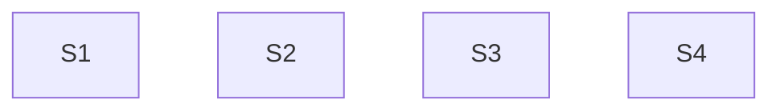

# TD54 — Follow-ups from the TD53 docs audit: BFF component specs, CI identity values, isolation gate

## Status
- **Type**: Technical Debt / Security hygiene and CI hardening
- **Priority**: High (Story 2: personal and account identifiers print unmasked in public CI logs); Medium (Stories 1 and 3)
- **Context**: `apps/bff` (tests), `.github/workflows/`, `packages/architecture-check`, `scripts/`
- **Created**: 2026-10-18
- **Discovered**: `/docs-audit` baseline run by TD53-S3A (2026-10-18). Each item is a place where a doc stated a rule or a gate that the code and CI do not actually enforce; the docs were corrected to say what is true, and each gap is recorded here so it is fixed instead of just described.
- **Decision status**: Drafted 2026-10-18 from the owner's decisions in the TD53-S3A discovery session. Four independent stories (Story 4 has a sequencing note against TD53 Story 5B), no dependency between them; each still begins with `/story-discovery`.
- **Related**: TD53 (`td/TD53-AGENT-FIRST-DOCS-ROUTING-AND-INTEGRITY.md`), `docs/08-TESTING_STRATEGY.md`, `docs/17-GITHUB_WORKFLOWS_GUIDELINES.md` § Repository Secrets vs. Variables, `docs/AGENT_CONTEXT_TRAP_SCENARIOS.md`

## Problem

Four gaps surfaced while the docs were checked against the code. In each, the documented rule is the right one and the implementation lags it.

1. **BFF controllers without a component spec.** `docs/08-TESTING_STRATEGY.md` § BFF: two test files per controller says every `*.controller.ts` ships a `*.controller.component.spec.ts`. 4 of the 25 BFF controllers have none: `apps/bff/src/features/booking/bookings-attachments.controller.ts`, `recurring-booking-schedules.controller.ts`, `bookings-guest.controller.ts` and `bookings-no-show.controller.ts`. No `architecture-check` detector enforces the rule, so nothing flagged them.
2. **Identity-shaped values stored as Variables.** The owner's requirement is that secrets and sensitive information are never exposed, and that anything not compliant is fixed. `docs/17-GITHUB_WORKFLOWS_GUIDELINES.md` already says identity-shaped values default to Secrets. Today `vars.IAM_ADMIN_USER` (16 uses, `infra-deploy.yml` and `foundation-deploy.yml`) and `vars.NOTIFICATION_EMAIL` (8 uses) hold email addresses, and `vars.CLOUDFLARE_ACCOUNT_ID` (4 uses) holds an account identifier. A Variable's value prints unmasked in workflow logs, and this repository's logs are public. No real address is committed in tracked files (the audit grepped `docs`, `plan`, `td`, `infra`, `.github`, `scripts`); the exposure is the CI log path only.
3. **Cross-context isolation is not a blocking gate.** The isolation contract is expressed as `contextDependencyMatrix` (default deny plus exact `permittedEdges`) in `packages/architecture-check/architecture-policy.json` and enforced by `scripts/dependency-cruiser.config.cjs`. In `.github/workflows/pr-quality.yml` the scan step `pnpm dep-cruise` runs with `continue-on-error: true`, so only `pnpm dep-cruise:test` (the config's own spec) blocks. A cross-context import therefore does not fail a PR. The docs previously claimed an ESLint rule that blocks merge; `docs/08-TESTING_STRATEGY.md` now states the real, weaker position.
4. **Unescaped `%…%` LIKE/ILIKE patterns are not mechanically blocked.** `docs/ANTI_PATTERNS.md` and `.copilot/context.md` §7 require `escapeLikePattern()` on any user-supplied search term, but nothing enforces it, and the 2026-10-18 ablation showed models do not follow the prose (0 of 2 with the bullet, 0 of 2 without). Three repository call sites already ship the bug: the staff search, the service search and the tenant name filter.

**Note, not a story:** `scripts/relay-vm-up.sh:99` writes a PR body saying merging "triggers the pipeline's `apply-${ENV}` job". That job belongs to `infra-deploy.yml`, which excludes `foundation/**` (`infra-deploy.yml:52-54`). The correct flow is a Foundation dispatch with `apply=true` (`docs/RUNBOOKS.md` § Provision a tenant). Fix the script's text the next time that file is touched.

## Chosen approach (decided in the TD53-S3A discovery session, 2026-10-18)

Fix each gap at its root rather than documenting around it: add the missing specs, move the values to Secrets, and make the gate blocking once its baseline is clean. No workaround is acceptable: do not hide the values by masking them in a step, do not downgrade the docs back to claim a gate that does not exist, and do not add a blanket exception to make the isolation scan pass.

The four stories are independent and can land in any order or in parallel; they touch different files (`apps/bff/**/*.spec.ts`; `.github/workflows/{infra,foundation}-deploy.yml`; `.github/workflows/pr-quality.yml` plus the isolation policy; `apps/backend/eslint.config.js` plus three backend repositories).

## Stories

### Story 1 — Component specs for the four BFF controllers that lack one 🟡

**Agent:** bff-ts
**Complexity:** S
**Docs to load:** `docs/08-TESTING_STRATEGY.md` § BFF: two test files per controller (mandatory) and § BFF test helper file isolation; `docs/ENGINEERING_RULES_TESTING.md`
**Dependencies:** none
**Pattern:** plain composition — follows the existing `*.controller.component.spec.ts` files next to the controllers that have one (for example `apps/bff/src/features/staff/staff.controller.component.spec.ts`)

**Description:**
`docs/08-TESTING_STRATEGY.md` makes a `*.controller.component.spec.ts` mandatory for every BFF controller: it boots the real Nest pipeline (guards, pipes, filters) with the backend call stubbed, so route paths, `@Roles`, body validation and header forwarding are exercised the way a request would hit them, which the plain `*.controller.spec.ts` unit test does not. Four controllers have none: `bookings-attachments` (its one route, `POST /bookings/attachments/signed-url`, `@Public`), `recurring-booking-schedules` (GET, GET `:id`, POST, POST `:id/end`, `:id/approve`, `:id/reject`), `bookings-guest` (the public `PATCH :id/submit-info/guest` and `GET :id/guest` routes) and `bookings-no-show` (`POST :id/no-show` for MANAGER/STAFF and `POST :id/no-show/correct` for MANAGER). For each, read a sibling spec first and copy its harness; do not invent a new one. Once the four exist, remove the "Known gap" note in `docs/08-TESTING_STRATEGY.md` § BFF: two test files per controller.

**New migration / i18n keys / env vars / feature flags:** none

**Files to create/modify:**
- `apps/bff/src/features/booking/bookings-attachments.controller.component.spec.ts` (new)
- `apps/bff/src/features/booking/recurring-booking-schedules.controller.component.spec.ts` (new)
- `apps/bff/src/features/booking/bookings-guest.controller.component.spec.ts` (new)
- `apps/bff/src/features/booking/bookings-no-show.controller.component.spec.ts` (new)
- `docs/08-TESTING_STRATEGY.md` (modify — remove the "Known gap" note)

**Acceptance criteria — product:**
- [ ] Every `*.controller.ts` under `apps/bff/src` has a sibling `*.controller.component.spec.ts`.

**Acceptance criteria — technical:**
- Unit:
  - [ ] `bookings-no-show.controller.component.spec.ts`: a STAFF caller reaches `POST /bookings/:id/no-show` and a MANAGER reaches `/no-show/correct`; a STAFF caller on `/no-show/correct` gets 403; the correction body rejects a `reason` shorter than 10 or longer than 500 characters.
  - [ ] `recurring-booking-schedules.controller.component.spec.ts`: each route returns the backend response unchanged for the allowed role, a disallowed role gets 403, and an invalid body on POST gets 400 with the standard problem-details shape.
  - [ ] `bookings-guest.controller.component.spec.ts`: both routes are reachable with no JWT (`@Public`) but still require the web-only key; a malformed body on `submit-info` gets 400.
  - [ ] `bookings-attachments.controller.component.spec.ts`: the tenant is resolved from the auth header, the guest token or the tenant slug (the three paths named in the controller), and a request with none of them is rejected.
- Integration: none — covered by the component specs
- Tenant isolation:
  - [ ] each spec asserts the forwarded `X-Tenant-ID` comes from the caller's JWT or resolved tenant, never from a body or query value.
- E2E: none — covered by the component specs
- [ ] Coverage ≥80% on changed code
- [ ] `tsc --noEmit` clean, lint clean

### Story 2 — Move identity-shaped CI Variables to Secrets 🔴

**Agent:** devops
**Complexity:** M
**Docs to load:** `docs/17-GITHUB_WORKFLOWS_GUIDELINES.md` § Repository Secrets vs. Variables; `infra/terraform/README.md` § Layout and § New-resource PR-sequencing playbook; `docs/CI_TRAPS.md` (the failing tool's own section if a plan job fails); `docs/ENGINEERING_RULES_INFRA.md`
**Dependencies:** none
**Pattern:** plain composition — the same `secrets.X` wiring the other CI identifiers already use (`TF_PLANNER_SA_*`, `BREVO_SMTP_LOGIN`)

**Description:**
A secret or sensitive value is never a Variable (rule stated in `docs/17-GITHUB_WORKFLOWS_GUIDELINES.md` § Repository Secrets vs. Variables). Move three values, each used only inside the two infra workflows: `IAM_ADMIN_USER` (an admin's email address, 16 uses), `NOTIFICATION_EMAIL` (an email address, 8 uses) and `CLOUDFLARE_ACCOUNT_ID` (an account identifier, 4 uses). Decided here: move all three, because the mechanism is identical and an account identifier gains from log masking at no cost; the story's discovery may only reverse this for `CLOUDFLARE_ACCOUNT_ID`, with a reason. Steps: (1) the owner creates the three **repo-level** secrets (not environment-scoped: the PR plan and drift jobs declare no `environment:`, so an environment-scoped value resolves empty there — the M17-S24 precedent in `docs/17`), **before** the workflow change merges, then deletes the three Variables after the new run is proven; (2) change every `vars.IAM_ADMIN_USER`, `vars.NOTIFICATION_EMAIL` and `vars.CLOUDFLARE_ACCOUNT_ID` in `.github/workflows/infra-deploy.yml` and `foundation-deploy.yml` to the `secrets.` form; (3) check that no step echoes, `set -x`-traces or writes the values into a step summary or artifact, and that a value is passed to Terraform only through `TF_VAR_*`/env, never interpolated into a logged command line; (4) update the "Known gap" bullet in `docs/17` to describe the compliant state, and the `Secrets` list there if it changed. The Terraform side needs no change: `infra/terraform/envs/prod/variables.tf` and `infra/terraform/modules/monitoring/variables.tf` take these as ordinary input variables fed from env.

**New migration / i18n keys / env vars / feature flags:** three repo-level GitHub secrets (`IAM_ADMIN_USER`, `NOTIFICATION_EMAIL`, `CLOUDFLARE_ACCOUNT_ID`) replacing three Variables of the same names; no application env var, no migration, no flag.

**Files to create/modify:**
- `.github/workflows/infra-deploy.yml` (modify — `vars.` to `secrets.`)
- `.github/workflows/foundation-deploy.yml` (modify — `vars.` to `secrets.`)
- `docs/17-GITHUB_WORKFLOWS_GUIDELINES.md` (modify — replace the "Known gap" bullet with the compliant state)

**Acceptance criteria — product:**
- [ ] No email address or account identifier is a GitHub Actions Variable; `grep -rE "vars\.(IAM_ADMIN_USER|NOTIFICATION_EMAIL|CLOUDFLARE_ACCOUNT_ID)" .github` returns nothing.
- [ ] Workflow logs for a plan run and a drift run show these values only as `***`.

**Acceptance criteria — technical:**
- [ ] Checkov / Tfsec clean
- [ ] `actionlint` and `zizmor` pass on the changed workflows

**Live-verification check:** before merge review, run `infra-deploy.yml` (a `plan` run on the PR, and a manual drift dispatch) and open the logs. Pass = the plan and drift jobs complete, `terraform plan` shows no unexpected diff caused by an empty input (an empty `iam_admin_user` or notification channel would show as a change), and a search of the log for the literal values returns nothing. A failed or un-runnable check is a stuck condition.
**PR sequence:** 1 PR touching only `.github/workflows/**` and `docs/` (no `foundation/**`, no `apps/**`, so none of the mixed-PR CI rules apply; cite `infra/terraform/README.md`'s playbook only if the discovery finds a Terraform change after all).
- PR1: the two workflow files and `docs/17`. **Ordered manual step, first:** the owner creates the three repo-level secrets before this PR is merged or its plan job is trusted; a missing secret resolves to an empty string and the plan jobs fail or silently change their input. **Ordered manual step, last:** after the live check passes, delete the three old Variables.

### Story 3 — Make the cross-context isolation scan a blocking gate 🟡

**Agent:** devops
**Complexity:** M
**Docs to load:** `docs/08-TESTING_STRATEGY.md` § Architecture Isolation Test; `docs/05-BOUNDED_CONTEXTS.md` § Rule 2 — Communication via Events or BFF Only; `docs/17-GITHUB_WORKFLOWS_GUIDELINES.md` § `architecture-check`; `docs/ENGINEERING_RULES_SHARED.md` (the architecture-policy rules)
**Dependencies:** none
**Pattern:** plain composition — the policy and generator already exist (`architecture-policy.json` `contextDependencyMatrix` feeding `scripts/dependency-cruiser.config.cjs`); this story only clears the baseline and removes the non-blocking flag

**Description:**
`pnpm dep-cruise` is the only check that sees a context importing another context's internals, and it is report-only (`continue-on-error: true` in `.github/workflows/pr-quality.yml`), so it cannot stop a bad import. Make it blocking in three steps: (1) run `pnpm dep-cruise` on `main` and list every finding; (2) triage each one: either fix the import (preferably through the existing `infrastructure/cross-context/` adapter or a domain event, per `.copilot/context.md` §7's cross-context order) or add a `permittedEdges` entry with an exact source path, exact target paths, rationale and owner (a wildcard is forbidden); (3) remove `continue-on-error: true` from the scan step so a finding fails the job, and update `docs/08-TESTING_STRATEGY.md` (§ Architecture Isolation Test and the Quality Gates row, both currently stating "report-only") and `docs/17-GITHUB_WORKFLOWS_GUIDELINES.md` to match. If the baseline turns out too large to clear in one PR, split it: PR1 clears or permits the findings, PR2 flips the gate; a gate flipped before the baseline is clean would block every PR. If the story's discovery concludes the scan should stay report-only, that must be argued and recorded, and the docs left as they are today.

**New migration / i18n keys / env vars / feature flags:** none

**Files to create/modify:**
- `.github/workflows/pr-quality.yml` (modify — remove `continue-on-error: true` from the `pnpm dep-cruise` step)
- `packages/architecture-check/architecture-policy.json` (modify — `contextDependencyMatrix.permittedEdges`, only for reviewed edges)
- `docs/08-TESTING_STRATEGY.md` (modify — § Architecture Isolation Test and the Quality Gates row)
- `docs/17-GITHUB_WORKFLOWS_GUIDELINES.md` (modify — the job's blocking status)
- Any `apps/backend/src/contexts/**` file the baseline shows importing across a context boundary (list produced by the first run; regenerate with `pnpm dep-cruise` at implementation time)

**Acceptance criteria — product:**
- [ ] A PR that adds an import from one bounded context into another's internals fails CI.
- [ ] `pnpm dep-cruise` exits 0 on `main` with no finding that lacks either a fix or a reviewed `permittedEdges` entry.

**Acceptance criteria — technical:**
- Unit:
  - [ ] `scripts/dependency-cruiser-config.spec.cjs` still passes, and covers a newly added `permittedEdges` entry if any is added.
- [ ] Checkov / Tfsec clean
- [ ] `actionlint` and `zizmor` pass on `pr-quality.yml`

**Live-verification check:** after the flag is removed, open a throwaway draft PR that adds a single cross-context import (for example `booking` importing a `loyalty` domain file) and confirm the scan job turns red; close the PR without merging. Pass = the job fails on the deliberate violation and passes on `main`. A failed or un-runnable check is a stuck condition.
**PR sequence:** 1 PR if the baseline is empty or small; otherwise 2 PRs — PR1: fixes and reviewed `permittedEdges` entries (no workflow change); PR2: remove `continue-on-error`, update the two docs. Neither mixes `infra/terraform/**` with `apps/**`, so `infra-app-mix-ok` does not apply.

### Story 4 — Make unescaped `%…%` LIKE/ILIKE patterns fail lint, and fix the three that exist 🔴

**Agent:** backend-ts
**Complexity:** M
**Docs to load:** `docs/ANTI_PATTERNS.md` § A user-supplied search term is wrapped in a `%...%` LIKE/ILIKE pattern; `docs/ENGINEERING_RULES_SHARED.md` § `no-restricted-syntax` selectors must be checked against every already-documented bypass shape; `docs/ENGINEERING_RULES_TESTING.md`; `docs/AGENT_CONTEXT_TRAP_SCENARIOS.md` (scenario 2 and the exclusion table); `.copilot/context.md` §7
**Dependencies:** none. Sequencing note: TD53 Story 5B also edits `.copilot/context.md` and leaves the LIKE bullet untouched on purpose; this story shrinks that bullet, so run it after 5B or merge `main` first.
**Pattern:** plain composition — one `no-restricted-syntax` selector beside its siblings in `apps/backend/eslint.config.js`, tested like `restricted-imports-syntax.eslint.spec.ts`

**Discovered:** 2026-10-18, TD53 Story 2's ablation, then verified against the code on 2026-10-20.
**Root cause:** prose does not steer. 0 of 2 `codex exec` sessions escaped a user search term with the `context.md` bullet present and 0 of 2 without it (`docs/AGENT_CONTEXT_TRAP_SCENARIOS.md` scenario 2), and three call sites already ship the bug: `apps/backend/src/contexts/staff/infrastructure/repositories/typeorm-staff.repository.ts:69`, `apps/backend/src/contexts/booking/infrastructure/repositories/typeorm-service.repository.ts:108` and `apps/backend/src/contexts/platform/infrastructure/repositories/typeorm-tenant.repository.ts:84` build `%${term}%` from a caller-supplied value without `escapeLikePattern()`.

**Description:**
A caller's `%` or `_` is a LIKE wildcard, not text, so an unescaped term lets `%%%` match everything and defeats a trigram-index-backed search (`docs/ANTI_PATTERNS.md`, M20-S12 precedent). Today the only defense is a bullet that models do not follow. Decided here: a lint selector, not an `architecture-check` detector, because the rule is purely syntactic, applies per file, and the sibling syntax bans already live in `apps/backend/eslint.config.js` Tier S0, where an editor shows the error while the code is written. The selector flags a template literal or string concatenation that places a `%` at an edge of a pattern around a non-literal expression, unless every such expression is a direct `escapeLikePattern(...)` call. The helper file `apps/backend/src/shared/utils/escape-like-pattern.ts` and `*.spec.ts` files are exempt. Per `docs/ENGINEERING_RULES_SHARED.md` the selector is checked against all three documented bypass classes before it counts as done: computed-literal member access (a pattern assembled through a computed-literal call), a bare non-member call, and a value nested inside a conditional or logical expression. The story's discovery maps each class to a concrete LIKE shape (`'%' + x + '%'`, a prefix-only or suffix-only template, a ternary-nested pattern) and adds a spec case for each. The selector cannot see a pattern built in one place and consumed in another; that residual is stated in the `docs/ANTI_PATTERNS.md` row. Fix the three existing sites in the same PR (the gate would otherwise fail on its own baseline), then shrink the `context.md` bullet to its name plus "CI-enforced" and move scenario 2 to the exclusion table.

**New migration / i18n keys / env vars / feature flags:** none

**Files to create/modify:**
- `apps/backend/eslint.config.js` (modify — new selector in Tier S0, and in every later tier that repeats the S0 list)
- `apps/backend/src/eslint/like-pattern-syntax.eslint.spec.ts` (new)
- `apps/backend/src/contexts/staff/infrastructure/repositories/typeorm-staff.repository.ts` (modify)
- `apps/backend/src/contexts/booking/infrastructure/repositories/typeorm-service.repository.ts` (modify)
- `apps/backend/src/contexts/platform/infrastructure/repositories/typeorm-tenant.repository.ts` (modify)
- `apps/backend/src/contexts/staff/infrastructure/repositories/staff.repository.integration.spec.ts`, `apps/backend/src/contexts/booking/infrastructure/repositories/service.repository.integration.spec.ts` and `apps/backend/src/contexts/platform/infrastructure/repositories/platform.repository.integration.spec.ts` (modify)
- `.copilot/context.md` (modify — the LIKE/ILIKE bullet becomes a name plus "CI-enforced"; edit the file directly, never through the symlinks)
- `docs/AGENT_CONTEXT_TRAP_SCENARIOS.md` (modify — scenario 2 moves to the exclusion table)
- `docs/ANTI_PATTERNS.md` (modify — the row names the lint rule and its residual)

**Acceptance criteria — product:**
- [ ] A literal `%` or `_` typed into the staff search, the service search or the tenant name filter matches only itself.
- [ ] A new `%…%` pattern built from an unescaped value in `apps/backend/src` fails `pnpm lint`.

**Acceptance criteria — technical:**
- Unit:
  - [ ] `like-pattern-syntax.eslint.spec.ts`: flags a template with `%` on both edges, a prefix-only and a suffix-only template, `'%' + x + '%'` and a ternary-nested pattern; passes the same shapes when the value is a direct `escapeLikePattern(x)` call.
  - [ ] Negative guarantees pinned in the same spec: a literal-only `%` string (for example `'100%'`) is not flagged, `escape-like-pattern.ts` is exempt, and `*.spec.ts` files are exempt.
- Integration:
  - [ ] `staff.repository.integration.spec.ts`: a search for `%` returns only a staff row whose name contains a literal `%`.
  - [ ] `service.repository.integration.spec.ts`: a search for `_` returns only a service whose name contains a literal `_`.
  - [ ] `platform.repository.integration.spec.ts`: a tenant name filter for `%` matches only a literal `%`.
- Tenant isolation:
  - [ ] The staff and service search tests seed a second tenant with a matching name and assert it is not returned.
- E2E: none — covered by unit and integration
- [ ] `pnpm lint` clean on the whole repository after the selector lands
- [ ] Coverage ≥80% on changed code
- [ ] `tsc --noEmit` clean, lint clean
