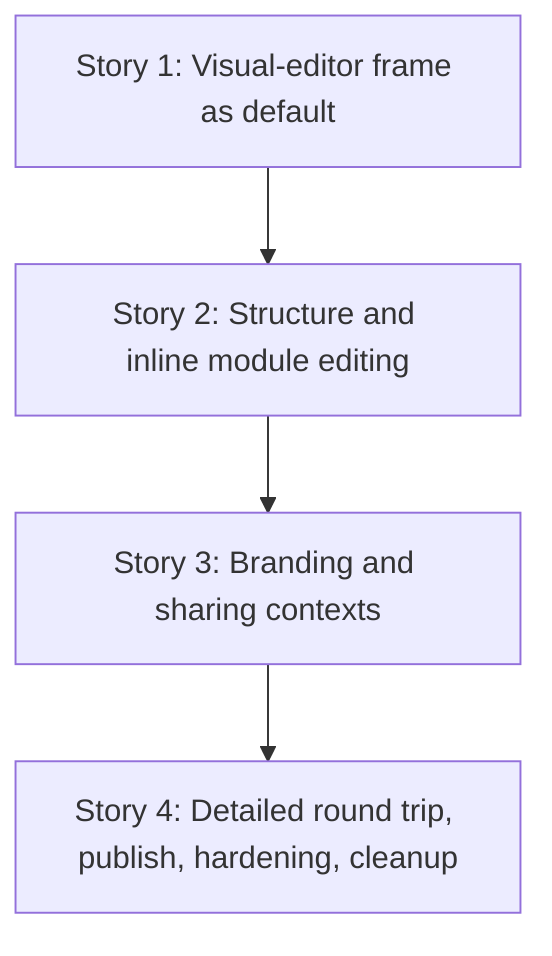

# TD55 — Hotsite visual-editor UX modernization

## Status

- **Type**: Technical Debt / product UX modernization
- **Priority**: Medium — hotsite configuration is not Ikaro's primary business flow, but the current split between forms and a separate Preview makes the outcome of an edit unnecessarily hard for a manager to understand.
- **Context**: `apps/web/features/platform/components/hotsite/`; manager hotsite journey
- **Created**: 2026-10-21
- **Discovered**: UX review of the shipped manager hotsite editor and its BeloAuto manifest, culminating in the approved visual-editor prototypes (`editor-vision/09`, `11` and the detailed-editor entry in `01`).
- **Decision status**: Ready for `/story-discovery`, in the sequence below. This TD deliberately introduces no new hotsite schema, API, module type, template catalogue, or authorization model. No feature flag: there is no production deployment yet, so each story ships straight to `main` (see *Rollout*). Reviewed against the code 2026-10-21; the *Rollout*, *Editor state model* and *Editor-only interaction boundary* sections are the locked contracts discovery should confirm, not re-derive.
- **Use case**: UC-027 (`docs/USE_CASES.md` § UC-027 — Tenant Admin Manages Hotsite Content & Branding); UC-037/UC-034 for LEAD_FORM/CHATBOT behavior touched by the preview.
- **Related**: `journeys/manager/hotsite.md`; prototypes (authority per file in *Chosen approach*): `journeys/manager/prototypes/hotsite/editor-vision/09-inline-realistic-editor.html` (main), `.../editor-vision/11-sharing-preview.html`, `journeys/manager/prototypes/hotsite/01-hotsite-editor.html`; `docs/HOTSITE_DYNAMIC_ARCHITECTURE.md`; `docs/DASHBOARD_FRONTEND_ARCHITECTURE.md`

## Problem

The delivered manager editor is powerful but asks the user to infer the result of a field from a tabbed form and then explicitly open a separate Preview. `HotsiteEditorMainView.tsx` makes Branding, Layout, SEO and Manifest the primary choices; Layout then sends a manager into a full-screen module drill-down. That preserves every capability but weakens orientation: a manager editing a Hero, Contact, colour or CTA cannot see its result where they are editing it.

The current implementation already has the right data model and most of the right safety behavior:

- one client-side `draft` is shared by Branding, Layout and SEO;
- a module panel owns local data until **Apply**, while **Cancel** asks before discarding changes;
- Layout supports ordering, enabled/disabled modules and Configure for all ten supported module types;
- Preview renders the draft without saving it; and
- image uploads, SEO limits, publish/unpublish and the raw Manifest editor already work.

The chosen direction is therefore a presentation and navigation change, not a replacement of the manifest system. The default manager journey becomes a persistent visual editor inside the existing Ikaro dashboard shell. Compact global actions sit above the preview; a contextual inspector remains visible at the right on desktop, including after the user scrolls to a lower section. The current tabbed editor remains available as **Edit in detail** for advanced work and Manifest access, with a clear route back to the visual editor.

## Chosen approach

Use the approved prototypes as the layout and navigation target, not as a source of production markup or field definitions:

- **Prototype authority** (each file is authoritative only for what is listed; everything else comes from the real code and this TD):
  - `journeys/manager/prototypes/hotsite/editor-vision/09-inline-realistic-editor.html` (+ `09-inline-interactions.js`, `vision.css`) — **the main reference**: overall layout, persistent preview, global command row, inline inspector, section selection and navigation between contexts. It does **not** model Apply/Cancel/discard, dirty-buffer rules, conditional fields, the Gallery photo picker or the Lead Form question builder, and its "Editar em detalhes" is a link to another HTML file where production is an in-app mode switch. Its per-module field lists are illustrative; the real panels (`modules/*ConfigPanel.tsx`) are the source of truth for fields.
  - `journeys/manager/prototypes/hotsite/01-hotsite-editor.html` — **only** the detailed (tabbed) editor and its "Back to visual editing" top-bar entry.
  - `journeys/manager/prototypes/hotsite/editor-vision/11-sharing-preview.html` — **only** the Sharing context's Google-result and WhatsApp-card rendering and its live update from title/description.
  - Other files in `editor-vision/` (`01`–`08`, `10-grouped-module-fields.html`) are earlier or superseded explorations and must not be used as references; `10` in particular disagrees with this TD (no Apply/Cancel, per-module group names, always-visible conditional fields, Hero-only preview).
- The visual preview is always based on the in-memory draft. A field change is reflected immediately in that preview, but it is not public until the existing save/publish flow succeeds.
- Module editing keeps the existing local **Apply / Cancel / discard confirmation** contract: local edits can be previewed immediately, Apply commits them into the shared draft, and Cancel restores the last applied draft state.
- The detailed view is not a separate persisted draft or a reload. Switching between visual and detailed editing must retain the same in-memory draft and, on return, the manager's selected visual context.
- Manifest remains available only through the detailed-editor path for this migration. Restricting it to another role would be an authorization/product decision outside this TD.
- Site templates are intentionally deferred. They need their own product discovery, manifest catalogue and maintenance model after the editor foundation is stable.

The stories are deliberately sequential at the UI state boundary. Stories 2 and 3 both change the visual preview and inspector host, so Story 3 follows Story 2 rather than overlapping it. No backend, BFF or database work is expected.

### Rollout: no flag, visual editor is the default from Story 1

There is no production deployment, so no feature flag or hidden route is needed. Every story merges to `main` with green CI, and the visual editor becomes the default in **Story 1**. Until Stories 2–3 land, the not-yet-wired contexts (Branding and style, Organize modules, Sharing) are present but inert/disabled, and the real fields are reachable through **Edit in detail** (the retained tabbed editor), which ships in Story 1 together with its Back to visual editing entry.

E2E and unit tests: Story 1 changes the entry point, so every existing test in `hotsite-editor.spec.ts` (33 tests, all start from `hotsite-tab` / `hotsite-preview-desktop`) and in `HotsiteEditor.spec.tsx` (e.g. "loads with 4 tabs, Branding active by default") would break. Story 1 therefore adds one shared e2e helper (under `apps/web/e2e/helpers/hotsite/`) that opens the detailed editor after load, and updates each legacy test's entry to use it, assertions unchanged, plus the unit-spec equivalents. Those tests stay as the regression suite for the retained detailed editor (tabs, Preview, module-config drill-down, Manifesto), so they are re-pointed once and not rewritten. Stories 2–3 add new tests for the visual paths they build; Story 4 adds the round-trip and publish journey. Each story must leave the whole suite green.

### Editor state model (locked contract for all stories)

`HotsiteEditor` stays the single owner of `draft`, `leadFormConfigDraft` and the module buffer. The current `EditorView` (`tabs | preview | module-config | module-config-preview`) is replaced by:

- **mode**: `visual | detailed`. `detailed` is today's tabbed `HotsiteEditorMainView` (own `activeTab` state, kept across round trips).
- **visualContext** (only meaningful in `visual`): `structure | branding | sharing | { module: HotsiteModuleType }`. Default `structure`.
- **module buffer**: `{ type, localData }`, present only while `visualContext` is a module; exactly today's `view.localData` semantics (Apply merges via `mergeLocalDataIntoLayout`, LEAD_FORM aggregate split via `applyModuleConfig`).
- **Dirty rule**: any transition away from a dirty module buffer (other context, Edit in detail, Publish) goes through the existing Apply-or-discard decision (`cancelModuleConfig` / `DiscardChangesDialog`). Publish is **disabled** while the buffer is dirty (tooltip/hint explains "Apply or cancel first") — it never publishes the buffer and never silently drops it.
- **Detailed-mode "Configure"** (Layout tab) keeps today's full-screen drill-down (`ModuleConfigView` + topbar override) unchanged; it is the legacy path, and returns to the detailed tabs.
- **Detailed-editor Preview is kept**: the `preview` and `module-config-preview` views, their topbar overrides, `previewView.*` keys and `hotsite-preview-*` test ids stay, because the detailed editor is "exactly as today" (as `01-hotsite-editor.html` shows). They render through the shared `HotsitePreviewCanvas`, so there is no second rendering implementation. The one dead export, `ModuleConfigPreviewView` (unused today), may be deleted as incidental cleanup. The detailed top bar gains "Back to visual editing" alongside its existing behavior.

### Editor-only interaction boundary (locked for Story 1)

The preview canvas renders the real public module components. Each module is wrapped in an editor selection wrapper: an overlay `<button>` (accessible name = module label, keyboard-focusable) above the module, with the module content `inert` and `pointer-events: none`, so no CTA link, Turnstile form, booking start or chatbot opens. The public render plan and module props are untouched (`buildHotsiteModuleRenderPlan` output is identical with and without the wrapper). `ChatbotWidget` renders `null` until a live pre-flight returns `available` and is `position: fixed`; CHATBOT is therefore always selectable from **Organize modules**, and from the preview only when its bubble renders. E2E must not depend on the bubble.

## Stories

### Story 1 — Make the persistent visual-editor frame the default ✅ Done

**Agent:** frontend-ts
**Complexity:** L (discovery decided: one story, one PR — the canvas extraction and test re-pointing are mostly mechanical moves the frame cannot land without)
**Docs to load:** `docs/DASHBOARD_FRONTEND_ARCHITECTURE.md` § 1. Role-Based Rendering and § 3. Shared Component Library — shadcn/ui; `docs/ENGINEERING_RULES_FRONTEND.md` § Reuse the repo's UI primitives — never hand-roll a control that already exists; `docs/HOTSITE_DYNAMIC_ARCHITECTURE.md` § 1. The Hotsite Manifest Pattern and § 2. Branding & Design Token System
**Dependencies:** none
**Pattern:** reducer-owned editor state with plain composition — `HotsiteEditor` remains the sole owner of the loaded config and shared draft; visual subviews receive state and explicit callbacks rather than creating competing drafts. The mode/visualContext/buffer state and its transitions live in an extracted `useHotsiteEditorSession` hook (or reducer module) next to `HotsiteEditor.tsx`, so that file (274 lines today) doesn't absorb the growth and trip SonarCloud complexity limits.

**Description:**
Replace the current tabbed `HotsiteEditorMainView` as the initial view with a dashboard-native visual editor following the *Editor state model*. It renders the current `draft` as a persistent page preview and places a compact action row immediately above it: **Branding and style**, **Organize modules**, **Sharing**, **Edit in detail**, **Publish**, and **View published site**. The action row is an editor command row, not the old four-tab navigation. It must preserve the current dashboard shell/topbar behavior and must not use hotsite `--ba-*` branding tokens for the manager controls.

On desktop, the contextual editor panel is a sticky, independently scrollable right-side inspector. It must stay usable when a manager scrolls the preview to Contact, Footer or another lower module; selecting a preview section scrolls the inspector to its beginning but must not jump the browser page back to the top. On narrow screens, the preview comes before the inspector in normal document order. This story supplies the visual-editor frame and explicit context state; it does not yet move every real field into the contexts — that is Stories 2 and 3. The not-yet-wired commands (Branding and style, Organize modules, Sharing) are rendered disabled until their story lands (see *Rollout*). Until Story 2, selecting a preview section highlights it and the inspector shows a placeholder naming the module with an "Edit in detail to configure" action (no fields).

**Publish and View published site work in this story**, because the default screen must be usable on day one: Publish runs the existing `executeHotsitePublish` (save complete draft, then publish) from the command row, success/error banners render in a banner slot above the preview (same `hotsite-action-*-banner` test ids as `HotsiteEditorMainView`), and View published site opens `/${tenantSlug}` in a new tab. Unpublish stays in the detailed editor's danger zone only (the visual command row has no Unpublish; the prototype has none either). Story 4 adds the dirty-buffer rule and hardening, not the basic wiring.

**Mobile layout:** on narrow screens the order is banner, command row, preview, inspector; Publish and View published site use the same fixed bottom action bar pattern as the existing editor (`MOBILE_ACTION_BAR_CLEARANCE_CLASS`), so the bar never covers the last preview section or the inspector's controls. **Edit in detail and Back to visual editing both ship in this story** (topbar override for the detailed mode, see `useHotsiteEditorTopbarOverride`), so a manager always has a working path to every field; Story 4 hardens them.

**Extract the canvas.** `HotsitePreview` today is a whole page: its own grid, publish aside, fixed mobile publish bar, loading/error states. Split it into a pure `HotsitePreviewCanvas` (branded content frame + supplementary-data loading/error, no publish chrome) and the legacy page wrapper (permanently used by the detailed editor's Preview). The canvas must paint `backgroundColor: 'var(--ba-background)'` alongside `applyBranding()` and the font variables — today's `hotsite-preview-content` omits it (`docs/ENGINEERING_RULES_FRONTEND.md` § Hotsite full-page components). Import the canvas through `hotsite-editor-lazy-panels.tsx` (`dynamic`, `ssr: false`) like `HotsitePreview`, so the module-render JS stays code-split from the rest of the editor.

The preview reuses the real public hotsite modules, so selection uses the locked *Editor-only interaction boundary* above; the selection wrapper lives in `renderHotsitePreviewModule.tsx` (or its caller), never in the public module components.

The old main tabbed composition is retained as the detailed view, not deleted. Its Preview and module-config drill-down views stay untouched apart from rendering through the shared canvas.

**Decisions locked in discovery:**
- **Initial inspector state:** nothing is selected on load, so the inspector shows a neutral empty state — "Select a section of the preview to see its details" (pt-BR "Selecione uma seção da prévia para ver os detalhes"). Selecting a section replaces it with the module-name placeholder and the Edit in detail action.
- **Labels** follow the prototype, as new keys under `dashboard.hotsitePage.visual.*` in both locales: Branding and style / "Branding e estilo", Organize modules / "Organizar módulos", Sharing / "Compartilhamento", Edit in detail / "Editar em detalhes", Publish / "Publicar", View published site / "Ver site publicado". The three disabled commands carry the hint "Coming soon — use Edit in detail" / "Disponível em breve — use Editar em detalhes". The existing `publish`, `viewLiveSite`, `tabs.*` and `previewView.*` keys stay for the detailed view and the legacy Preview.
- **E2E helper:** `apps/web/e2e/helpers/hotsite/hotsite-editor-navigation.ts` exporting `openDetailedEditor(page)`, added to the `index.ts` barrel. The unit equivalent is a `renderDetailedEditor()` helper in `HotsiteEditor.spec.tsx`.
- **Test ids** (stable, no templates): `visual-editor`, `visual-command` (with `data-command`), `visual-banner-slot`, `visual-preview`, `visual-inspector`, `preview-section-select` (with `data-module-type`), `visual-publish-mobile`, `visual-view-live-mobile`.
- **Module organization is not in this story:** the Organize modules command stays disabled until Story 2 builds the structure list; Branding and style and Sharing stay disabled until Story 3.

**Prototype references:** `journeys/manager/prototypes/hotsite/editor-vision/09-inline-realistic-editor.html` (compact global actions, persistent preview and desktop inspector); `journeys/manager/prototypes/hotsite/editor-vision/vision.css` (responsive placement only — production must use repository primitives/styles); `journeys/manager/prototypes/hotsite/01-hotsite-editor.html` (Edit in detail / Back to visual editing entry only)
**New migration / i18n keys / env vars / feature flags:** add localized visual-editor command, context, preview-status and accessibility-label keys to `packages/i18n/locales/pt-BR/web.json` and `packages/i18n/locales/en/web.json`; no migration, environment variable or feature flag.

**Files to create/modify:**
- `apps/web/features/platform/components/hotsite/HotsiteEditor.tsx` (modify — visual editing as the default, own the mode/visualContext state)
- `apps/web/features/platform/components/hotsite/HotsiteEditor.spec.tsx` (modify — default visual view, shared-draft ownership; existing tab-based cases enter the detailed editor first)
- `apps/web/e2e/hotsite-editor.spec.ts` (modify — every legacy test enters via the new detailed-editor helper; assertions unchanged)
- `apps/web/e2e/helpers/hotsite/` (new helper to open the detailed editor; confirm the exact filename against sibling helpers)
- `apps/web/features/platform/components/hotsite/renderHotsitePreviewModule.tsx` (modify — selection wrapper)
- `apps/web/features/platform/components/hotsite/renderHotsitePreviewModule.spec.tsx` (modify)
- `apps/web/features/platform/components/hotsite/HotsitePreviewCanvas.tsx` (new — extracted from `HotsitePreview`)
- `apps/web/features/platform/components/hotsite/HotsitePreviewCanvas.spec.tsx` (new — receives the canvas behavior tests moved from `HotsitePreview.spec.tsx`)
- `apps/web/features/platform/components/hotsite/hotsite-editor-lazy-panels.tsx` (modify — lazy canvas export)
- `apps/web/features/platform/hotsite/useHotsiteEditorTopbarOverride.ts` (modify — detailed-mode "Back to visual editing")
- `apps/web/features/platform/hotsite/useHotsiteEditorTopbarOverride.spec.tsx` (modify)
- `apps/web/features/platform/components/hotsite/HotsiteEditorMainView.tsx` (modify — preserve it as the detailed-editor composition boundary)
- `apps/web/features/platform/components/hotsite/HotsiteEditorMainView.spec.tsx` (modify — cover retained detailed view behavior)
- `apps/web/features/platform/components/hotsite/HotsitePreview.tsx` (modify — becomes the thin legacy page wrapper around `HotsitePreviewCanvas`; public hotsite rendering unchanged)
- `apps/web/features/platform/components/hotsite/HotsitePreview.spec.tsx` (modify — ten canvas tests move to `HotsitePreviewCanvas.spec.tsx`; keep the publish tests against the wrapper)
- `apps/web/features/platform/components/hotsite/hotsite-editor-views.tsx` (modify — extend the editor view/context model without duplicating draft state)
- `apps/web/features/platform/components/hotsite/hotsite-editor-views.spec.tsx` (modify — cover visual context transitions)
- `apps/web/features/platform/components/hotsite/VisualHotsiteEditorView.tsx` (new — visual-editor frame, command row, banner slot, preview and inspector layout)
- `apps/web/features/platform/components/hotsite/VisualHotsiteEditorView.spec.tsx` (new)
- `apps/web/features/platform/components/hotsite/useHotsiteEditorSession.ts` (new — mode/visualContext/buffer state and transitions extracted from `HotsiteEditor.tsx`) and its spec
- `apps/web/features/platform/components/hotsite/hotsite-editor-publish.ts` (modify — mode-aware post-publish callback) and `hotsite-editor-publish.spec.ts`
- `packages/i18n/locales/pt-BR/web.json` (modify)
- `packages/i18n/locales/en/web.json` (modify)

**Acceptance criteria — product:**
- [ ] Opening `/dashboard/hotsite` as a manager starts in the visual editor, within the existing Ikaro dashboard shell, with a persistent draft preview and compact global actions above it.
- [ ] Edit in detail opens the tabbed editor and Back to visual editing returns to the visual editor without losing the shared draft.
- [ ] On desktop, the inspector remains visible and independently scrollable while a manager navigates lower preview sections; on mobile it follows the preview in normal reading order.
- [ ] The visual-editor command row offers Branding and style, Organize modules, Sharing, Edit in detail, Publish and View published site; none is represented as the former primary four-tab navigation.
- [ ] Selecting an enabled preview section establishes an editing context and visibly identifies that section without changing the public hotsite output.
- [ ] Selecting a preview module never follows its visitor CTA, submits a form, starts booking or opens Chatbot.
- [ ] Publish from the visual editor saves the complete draft, publishes, shows the success/error banner and keeps the manager in the visual editor; View published site opens the live site in a new tab; Unpublish is only in the detailed editor.
- [ ] Until Story 2, selecting a section shows a placeholder inspector (module name plus an Edit in detail action); with nothing selected the inspector shows the neutral empty state.
- [ ] On narrow screens the bottom action bar never covers the last preview section or inspector controls.

**Acceptance criteria — technical:** *(Integration: none — web-only story, no integration tier; Tenant isolation: none — no new data access; unit/e2e/axe rules and the existing specs this story touches: see *Test strategy*)*
- Unit:
  - [ ] `VisualHotsiteEditorView.spec.tsx` proves the command row, selected-section state, desktop inspector semantics and mobile DOM order.
  - [ ] `HotsiteEditor.spec.tsx` proves visual editing is the default, the detailed tabbed editor is unchanged once entered, and one shared draft survives context changes.
  - [ ] `renderHotsitePreviewModule.spec.tsx` / `HotsitePreviewCanvas.spec.tsx` prove editor-only selection does not change the module render plan or public module props, that wrapped content is `inert`, that clicking a Hero/Booking CTA/Lead Form link does not navigate, and that the canvas root paints `backgroundColor: 'var(--ba-background)'` with a light-on-dark branding fixture.
  - [ ] Axe check on the visual editor frame (command row, selection buttons).
  - [ ] `hotsite-editor-publish.spec.ts` proves the mode-aware post-publish callback keeps a visual-editor publish in place on success and error, while a publish from the detailed editor still returns to its tabs.
  - [ ] `useHotsiteEditorSession` spec covers mode/context transitions and the "no module context without a buffer" invariant.
  - [ ] Selecting a section does not call `scrollTo`/change page scroll (inspector scrolls to top, window does not).
- E2E:
  - [ ] `apps/web/e2e/hotsite-editor.spec.ts` verifies a manager lands in the visual editor and can select Hero and Contact from the persistent preview without navigating to a separate preview screen or following Hero/Booking CTAs, submitting Lead Form or opening Chatbot; and Edit in detail → Back to visual editing round trip.
- [ ] Coverage ≥80% on changed code.
- [ ] `tsc --noEmit` clean, lint clean.

### Story 2 — Bring module structure and real fields into the contextual inspector ✅ Done

**Agent:** frontend-ts
**Complexity:** L
**Docs to load:** `docs/HOTSITE_DYNAMIC_ARCHITECTURE.md` § 3. Module Library and § 4. Module Data Contracts (TypeScript); `docs/ENGINEERING_RULES_FRONTEND.md` § Reuse the repo's UI primitives — never hand-roll a control that already exists; `docs/CODE_STANDARDS.md` § Next.js (`apps/web`): dialog and submit-handler conventions
**Dependencies:** Story 1
**Pattern:** local edit buffer plus explicit commit — reuse the existing `ModuleConfigView` Apply/Cancel/dirty-confirmation semantics while presenting its panels inside the visual inspector.

**Description:**
Make **Organize modules** the visual editor's structure context. It lists all currently supported module types in current layout order, provides the existing drag-and-drop/keyboard ordering behavior, enabled toggle and Configure action, and keeps disabled modules configurable from the list. Configuring a module or selecting its enabled preview section opens that module's real configuration panel in the right inspector. Do not create abbreviated replacement forms: every existing field, conditional field, validation and uploader in the ten panels remains reachable.

The ten panels render in the inspector exactly as they do in the detailed drill-down: one column, their own field order, labels, defaults, validation and conditional rendering. **No field grouping** (discovery decision: the prototype's regex-based Essential / Appearance / Image buckets mix unrelated fields, and the real panels' own order already reads content → layout → button → image). The inspector is 26rem wide from the `xl` breakpoint (22rem at `lg`, single column below `lg`) so the Lead Form question builder, Gallery and Testimonials fit; a spec pins the widths.

Edits update the persistent preview immediately from the module's local buffer. Apply merges the buffer into the shared draft using the existing merge behavior; Cancel discards it, with the current confirmation when dirty. Changing from a dirty module inspector to another global context or to detailed editing must use that same Apply-or-discard decision; it must never silently lose a local buffer. Returning to Organize modules restores the list and its current order/enabled state. A click on the floating Chatbot control is treated as selecting CHATBOT, when that bubble renders (see *Editor-only interaction boundary*); CHATBOT is always reachable from the structure list. The legacy detailed-mode drill-down (`ModuleConfigView` + topbar override) is unchanged; only the visual mode uses the inspector. No module type is silently omitted: HERO, SERVICE_LIST, GALLERY, TESTIMONIALS, BOOKING_CTA, ABOUT, CONTACT, FOOTER, CHATBOT and LEAD_FORM all retain a structure entry and panel mapping.

LEAD_FORM is the one intentional exception to an ordinary layout-only module. Its teaser fields belong to `layout[].data`, while `audienceMode` and `questions` belong to the separate LeadFormConfig aggregate. Its visual local buffer combines both only for editing and preview. Apply retains the existing question validation, writes the validated aggregate portion into the existing dedicated editor-session state, and strips `audienceMode`/`questions` from `layout[].data`; the existing consolidated save/publish path remains the only way those aggregate fields reach persistence.

**Decisions locked in discovery:**
- **No field grouping and no new dependency** (see Description). Panels and their ten specs are untouched.
- **Inspector width:** 26rem from `xl`, 22rem at `lg`, single column below `lg` (changes Story 1's `lg:grid-cols-[minmax(0,1fr)_22rem]` in `VisualHotsiteEditorView`; the detailed `ModuleConfigShell` is unchanged).
- **Publish while the buffer is dirty:** Publish (desktop and mobile) is disabled with the hint "Apply or cancel first" (pt-BR "Aplique ou cancele primeiro"). This rule moves from Story 4 into Story 2, where the buffer is introduced.
- **Dirty transitions:** any move away from a dirty buffer — selecting another preview section, return to the structure list, Edit in detail — goes through `DiscardChangesDialog` (Apply-or-discard). A clean buffer never prompts. The disabled Branding/Sharing commands need no handling until Story 3.
- **Disabled modules:** Configure on a disabled module opens its panel with the note "Disabled — not shown in the preview" (`visual-inspector-disabled-note`); edits still apply to the draft, and the module is not enabled automatically. `effectiveContext` in `VisualHotsiteEditorView` stops resetting a disabled module's context to `structure`.
- **Structure list:** reuses `LayoutTab` as is (its `layout-row*` test ids and `reorderLayout`); Configure calls the session's `selectModule` with `buildModuleBuffer`. Organize modules becomes enabled and is the default context.
- **State plumbing:** `applyModuleConfig` / `cancelModuleConfig` are generalised from `EditorView` to a `{ type, localData }` buffer, with the detailed drill-down and its specs unchanged and green; `useHotsiteEditorSession` gains an update-buffer action.
- **Test ids:** `visual-module-inspector`, `visual-inspector-apply`, `visual-inspector-cancel`, `visual-inspector-back`, `visual-inspector-disabled-note`, `visual-module-discard-confirm`.
- **LEAD_FORM preview:** the buffer carries `audienceMode`/`questions`/`hasSubmissions`; a unit test pins that none of them reaches the rendered module props (`LeadFormModuleDataSchema` strips them).
- **LEAD_FORM dirty baseline (found in the story's local E2E):** a LEAD_FORM buffer opens already carrying the loaded LeadFormConfig (the session draft, else the server's), so an untouched buffer is clean; otherwise it read as dirty until the lazy panel synced, blocking Publish and prompting on every section switch.
- **UI reuse:** `SwitchField` (via `LayoutTab`), `DiscardChangesDialog`, `ui/button`, `ui/card`; the panels keep their own `ConfigTextField`/`SingleImageUploadField`/`pill-select` controls. No new primitive.

**Prototype references:** `journeys/manager/prototypes/hotsite/editor-vision/09-inline-realistic-editor.html` and `journeys/manager/prototypes/hotsite/editor-vision/09-inline-interactions.js` (module selection, structure list and return to structure only; the prototype has no Apply/Cancel or conditional fields to copy, and its module forms are flat, with no grouping (the earlier `groupedModuleForm()` override was removed in Story 2's discovery) — the real panels and the *Editor state model* are authoritative)
**New migration / i18n keys / env vars / feature flags:** add localized structure, inspector, Apply/Cancel, disabled-note, "Apply or cancel first" and selection-status keys to both `web.json` locales as required; no migration, environment variable, dependency or feature flag.

**Files to create/modify:**
- `apps/web/features/platform/components/hotsite/HotsiteEditor.tsx` (modify — route module selection and committed draft changes through the visual editor)
- `apps/web/features/platform/components/hotsite/HotsitePreviewCanvas.tsx` and `renderHotsitePreviewModule.tsx` (**not modified** — Story 1's `PreviewSelectionWrapper` already dispatches selection, including CHATBOT, and highlights the selected section)
- `apps/web/features/platform/components/hotsite/useVisualModuleBuffer.ts` and its spec (new, added at implementation — the Apply-or-discard guard, buffer commit and back-to-visual resync; keeps `HotsiteEditor.tsx` within the lint size limits)
- `apps/web/features/platform/components/hotsite/hotsite-module-buffer.ts` and its spec (new — `commitModuleBuffer`, `isModuleBufferDirty`, `buildPreviewDraft`, `applyModuleConfig`, `cancelModuleConfig` moved out of `hotsite-editor-views.tsx`, which hit its file-size limit)
- `apps/web/features/platform/components/hotsite/ModuleConfigPreviewScreen.tsx` and its spec (new — the detailed editor's module-config Preview branch, extracted from `HotsiteEditor.tsx` unchanged for the same reason)
- `apps/web/features/platform/components/hotsite/VisualHotsiteEditorView.tsx` (modify — enable Organize modules, host `VisualModuleInspector`, `xl` inspector width, disable Publish while the buffer is dirty, keep a disabled module's context) and its spec
- `apps/web/features/platform/components/hotsite/useHotsiteEditorSession.ts` (modify — update-buffer action) and its spec
- `apps/web/features/platform/components/hotsite/hotsite-editor-publish.ts` / `HotsiteEditor.tsx` (modify only if the dirty-Publish guard needs it)
- `apps/web/features/platform/components/hotsite/LayoutTab.tsx` (reuse as is; modify only if the inspector host needs a prop) and `LayoutTab.spec.tsx`
- `apps/web/features/platform/components/hotsite/hotsite-editor-lazy-panels.tsx` (modify only if a panel boundary must expose visual-inspector props; all ten mappings remain exhaustive)
- `apps/web/features/platform/components/hotsite/hotsite-editor-lazy-panels.spec.tsx` (modify — pin exhaustive panel coverage)
- `apps/web/features/platform/components/hotsite/hotsite-editor-views.tsx` (modify — keep local module buffer, Apply/Cancel and discard behavior intact)
- `apps/web/features/platform/components/hotsite/hotsite-editor-views.spec.tsx` (modify)
- `apps/web/features/platform/components/hotsite/modules/ModuleConfigShell.tsx` (avoid modifying — the detailed drill-down depends on it and its 8-test spec; build the inspector chrome in `VisualModuleInspector` and extract shared content only if unavoidable, keeping `ModuleConfigShell.spec.tsx` green)
- `apps/web/features/platform/components/hotsite/VisualModuleInspector.tsx` (new — structure context, contextual panel host and accessible return-to-structure action)
- `apps/web/features/platform/components/hotsite/VisualModuleInspector.spec.tsx` (new)
- `packages/i18n/locales/pt-BR/web.json` (modify)
- `packages/i18n/locales/en/web.json` (modify)

**Acceptance criteria — product:**
- [ ] Organize modules shows all ten supported modules in persisted order, allows ordering and visibility changes, and makes disabled modules configurable.
- [ ] Configuring a module from the list or selecting it in the preview opens its real editable fields in the inspector; the user can return to the structure list without losing applied structure state.
- [ ] Every available current module field remains editable, including its conditional controls and upload controls, in the same order as in the detailed drill-down.
- [ ] Publish is disabled with the hint "Apply or cancel first" while a module buffer is dirty, and is enabled again after Apply or Cancel.
- [ ] Configure on a disabled module opens its fields with a note that it is not shown in the preview.
- [ ] A local module edit appears in the preview immediately, Apply makes it part of the shared draft, and Cancel restores the last applied draft after the existing dirty-discard confirmation.
- [ ] LEAD_FORM edits retain both teaser and separate form-config fields, validate questions before Apply/publish, and never persist `audienceMode` or `questions` in `layout[].data`.

**Acceptance criteria — technical:** *(Integration: none — web-only story, no integration tier; Tenant isolation: none — no new data access; unit/e2e/axe rules and the existing specs this story touches: see *Test strategy*)*
- Unit:
  - [ ] `VisualModuleInspector.spec.tsx` covers module-list order, enable/disable, Configure, preview selection, inspector reset-to-top and return-to-structure.
  - [ ] `hotsite-editor-views.spec.tsx` covers live local-buffer preview, Apply merge, Cancel discard, dirty confirmation, context-switch protection and LEAD_FORM aggregate/layout separation.
  - [ ] `hotsite-editor-lazy-panels.spec.tsx` proves all ten `HotsiteModuleType` values have a visual-inspector-compatible panel mapping.
  - [ ] Existing module panel specs pass unchanged (the panels are not modified).
  - [ ] Negative guarantees each have a named test: LEAD_FORM Apply never writes `audienceMode`/`questions` into `layout[].data`; the LEAD_FORM buffer's `audienceMode`/`questions` never reach the rendered preview module props; an invalid question blocks Apply; switching context (another preview section, back to structure, Edit in detail) from a dirty buffer never discards silently; Publish never includes the buffer and is disabled while it is dirty; Cancel leaves `draft` byte-identical.
  - [ ] Axe check on the inspector (structure list + one panel), full default ruleset.
- E2E:
  - [ ] `apps/web/e2e/hotsite-editor.spec.ts` (new visual-path tests; the legacy detailed-editor tests stay) enables/configures About and Testimonials, reorders a module, configures Contact from the lower preview, verifies Apply/Cancel behavior before publish, and edits LEAD_FORM's teaser plus questions/audience mode while asserting the saved public layout excludes aggregate-only fields.
- [ ] Coverage ≥80% on changed code.
- [ ] `tsc --noEmit` clean, lint clean.

### Story 3 — Make branding and sharing consequences visible in place ✅ Done

**Agent:** frontend-ts
**Complexity:** M
**Docs to load:** `docs/HOTSITE_DYNAMIC_ARCHITECTURE.md` § 2. Branding & Design Token System and § 11. SEO & Discoverability (M12-S09); `docs/ENGINEERING_RULES_FRONTEND.md` § Hotsite full-page components must explicitly paint `--ba-background`; `docs/CODE_STANDARDS.md` § Next.js (`apps/web`): localization-driven fields (address, phone, currency, dates)
**Dependencies:** Story 2
**Pattern:** controlled shared draft with derived preview — Branding and SEO inputs write to the existing draft; the hotsite preview and search/share cards derive display-only values from that draft.

**Description:**
Move the current Branding fields into **Branding and style** in the visual inspector. Preserve every existing color, typography, button and layout control and its default semantics. Editing one changes the draft preview immediately, so the manager sees where primary/secondary/background/text/button colors and visual choices affect the site. This is not a new styling system: it uses the current branding object and CSS-variable application path, including the explicit full-page background requirement.

Move SEO into **Sharing**. Preserve the existing title/description validation limits, Open Graph image upload and draft behavior. Beside those editable fields, show a clearly labelled simulation of a Google result and a WhatsApp share card. Both derive title, description and image from the draft as the manager types; the canonical public URL derives from the current tenant slug plus the client-safe site origin (see the source-of-truth paragraph below), not from the draft. Neither card promises an exact rendering by Google, WhatsApp or another external consumer. The hotsite preview is replaced by the sharing simulation only while Sharing is selected, then returns to the site preview when another context is chosen.

Source of truth for what the cards show: mirror `buildHotsiteMetadata` (`apps/web/features/platform/hotsite/seo.ts`) — title/description fall back to the localized `seo.defaultTitle*`/`seo.defaultDescription*` strings built from tenant name and address when unset (reuse those message keys, don't invent copy); the Open Graph image has **no fallback** (the code deliberately never falls back to the logo), so no image set means the cards show no image / a neutral placeholder. `SITE_URL` in `seo.ts` is server-only (`getPublicEnv`), so the canonical URL must come from a client-safe source (the tenant slug plus the public site origin exposed to the client); discovery picks that source and Story 3 does not import `seo.ts` into client code.

The canvas must keep the `applyBranding()` + `backgroundColor: 'var(--ba-background)'` pairing introduced in Story 1; this story only adds the branding-driven assertions for it.

**Decisions locked in discovery:**
- **Defaults data source:** the editable draft carries no tenant name, address or language, so the Sharing context reads them from the manifest (`tenant.name`, `business.address` city/state, `localization.language`) via a small hook next to `usePreviewSupplementaryData` in `useHotsitePreviewData.ts`, fetched only while Sharing is open. Raw `tenant.name`, as `seo.ts` does — not the `brandName`-resolved display name.
- **Default-copy locale:** defaults are built with `createTranslator` in the tenant's `localization.language`, exactly like `buildHotsiteMetadata`, not the manager's UI locale, so the simulation shows what the public site will really emit.
- **Canonical URL:** `getPublicEnv('NEXT_PUBLIC_SITE_URL')` (client-safe through `window.__PUBLIC_ENV__`), same `http://localhost:3000` fallback and trailing-slash strip as `seo.ts`, plus `/${tenantSlug}`. `seo.ts` itself is not imported into client code.
- **No image:** the cards show a neutral placeholder ("Sem imagem de compartilhamento"); never a logo fallback.
- **Image resolution:** the cards resolve `seo.ogImageUrl` through `useTmpSignedUrls` + `resolveDraftImageUrls`, so a just-uploaded `tmp/` path renders.
- **Canvas remount:** Sharing replaces the preview column, so the canvas unmounts and its manifest/services fetch re-runs on return to a site context (accepted; no hidden second tree).
- **Dirty guard:** `requestStructure` generalises to `requestGlobalContext(kind)` in `useVisualModuleBuffer.ts`, reusing the `DiscardChangesDialog` Apply-or-discard flow for Branding and Sharing as for structure; this is the handling Story 2 deferred to this story.
- **Branding scope:** the real `BrandingTab` is hosted unchanged in the inspector; immediate preview effect only, no impact-highlight overlay (prototype `02` is out of scope).
- **Width:** a spec pins that the Branding host fits at the 22rem (`lg`) and 26rem (`xl`) inspector widths.
- **Copy (pt-BR):** heading "Prévia de busca e compartilhamento"; disclaimer "Simulação aproximada. Google, WhatsApp e outros canais podem exibir o resultado de forma diferente."; image alt "Imagem de compartilhamento"; English equivalents in `en`.
- **UI reuse:** `SectionCard`, `Button`, `Card`, `FontPicker`, `PillSelect`, `SwitchField` via the existing tabs; the simulation cards are display-only markup, no new primitive.

**Prototype references:** `journeys/manager/prototypes/hotsite/editor-vision/09-inline-realistic-editor.html` (Branding and style / Sharing context placement in the inspector); `journeys/manager/prototypes/hotsite/editor-vision/11-sharing-preview.html` (authoritative for the Google-result and WhatsApp-card rendering and live title/description update; its hardcoded empty-field text is replaced by the localized defaults above)
**New migration / i18n keys / env vars / feature flags:** add localized context names, simulation labels/disclaimers and image alternative text to both `web.json` locales; no migration, environment variable or feature flag.

**Files to create/modify:**
- `apps/web/features/platform/components/hotsite/BrandingTab.tsx`, `SeoTab.tsx`, `OgImageUpload.tsx` and their specs (**not modified, as shipped** — the inspector hosts the real tabs unchanged, so their specs stay as the validation and draft-update coverage)
- `apps/web/features/platform/components/hotsite/HotsitePreviewCanvas.tsx` (**not modified** — the sharing/site switch is host-level in `VisualHotsiteEditorView`; the canvas never mutates the draft)
- `apps/web/features/platform/components/hotsite/VisualCommandRow.tsx` and `.spec.tsx` (new, added at implementation — the command row extracted from `VisualHotsiteEditorView`, which hit its function-size limit once the three contexts were wired)
- `apps/web/features/platform/hotsite/seo-defaults.ts`, `site-origin.ts` and their specs, plus `resolveDraftImageUrl` in `resolve-draft-image-urls.ts`, and `seo.ts` refactored to use them (new, added at implementation — the public `<head>` and the sharing simulation share one source for the fallback copy, the site origin and the image resolution, so they cannot drift)
- `apps/web/features/platform/components/hotsite/VisualHotsiteEditorView.tsx` and `.spec.tsx` (modify — enable and host Branding and Sharing contexts, drop the coming-soon hint)
- `apps/web/features/platform/components/hotsite/HotsiteEditor.tsx` and `.spec.tsx` (modify — pass `onBrandingChange`/`onSeoChange` and the global-context handlers)
- `apps/web/features/platform/components/hotsite/useVisualModuleBuffer.ts` and `.spec.ts` (modify — `requestGlobalContext(kind)` with the Apply-or-discard guard)
- `apps/web/features/platform/components/hotsite/useHotsiteEditorSession.spec.ts` (**not modified** — the session API did not change)
- `apps/web/features/platform/components/hotsite/useHotsitePreviewData.ts` (modify — manifest hook for tenant name, address and language)
- `journeys/manager/hotsite.md` (line 94 — one-sentence sync: Branding and Sharing are live; doc gate applies). `journeys/manager/prototypes/hotsite/editor-vision/dev-notes.md` has no stale statement about them, so it is **not modified**.
- `apps/web/features/platform/components/hotsite/HotsiteSharingPreview.tsx` (new — derived Google and WhatsApp simulations)
- `apps/web/features/platform/components/hotsite/HotsiteSharingPreview.spec.tsx` (new)
- `packages/i18n/locales/pt-BR/web.json` (modify)
- `packages/i18n/locales/en/web.json` (modify)

**Acceptance criteria — product:**
- [ ] A manager can edit all current branding controls from Branding and style and immediately see their effect in the draft hotsite preview.
- [ ] Sharing retains the current SEO fields, title/description limits and Open Graph image upload, and shows Google-result and WhatsApp-share simulations that update from the draft.
- [ ] The simulations are clearly identified as previews and never claim that an external channel will render an identical card.
- [ ] Switching between Branding and style, Sharing, Organize modules and a module context retains the unsaved shared draft.
- [ ] Switching to Branding and style or Sharing from a dirty module buffer requires Apply or the existing discard confirmation; a clean buffer never prompts.

**Acceptance criteria — technical:** *(Integration: none — web-only story, no integration tier; Tenant isolation: none — no new data access; unit/e2e/axe rules and the existing specs this story touches: see *Test strategy*)*
- Unit:
  - [ ] `HotsiteSharingPreview.spec.tsx` covers title and description (set and unset → localized defaults), uploaded image vs. no-image state, canonical URL from the tenant slug and client-safe site origin, and the simulation disclaimer.
  - [ ] `BrandingTab.spec.tsx` and `SeoTab.spec.tsx` stay green and unchanged (the tabs are hosted as they are), and `HotsiteEditor.spec.tsx` proves the same edits through the visual inspector.
  - [ ] `VisualHotsiteEditorView.spec.tsx` proves context switching (branding ⇄ sharing ⇄ structure ⇄ module) does not mutate the draft, and `HotsitePreviewCanvas.spec.tsx` keeps asserting the `--ba-background` paint under a changed background color.
  - [ ] Axe check on the Sharing context and on the Branding host (full default ruleset).
  - [ ] Negative guarantee, named test: switching to Branding or Sharing from a dirty module buffer never discards it silently (`useVisualModuleBuffer.spec.ts` and `HotsiteEditor.spec.tsx`).
  - [ ] A just-uploaded `tmp/` OG image resolves in both cards; the unset-title/description defaults follow the tenant's `localization.language`, not the UI locale (`it.each` over both locales).
  - [ ] A spec pins that the Branding host renders inside the 22rem and 26rem inspector widths.
- E2E:
  - [ ] `apps/web/e2e/hotsite-editor.spec.ts` (new visual-path tests; the legacy detailed-editor tests stay) changes the primary color and SEO title/description, observes the visual and sharing-preview updates, and confirms the saved/published hotsite semantics remain unchanged.
- [ ] Coverage ≥80% on changed code.
- [ ] `tsc --noEmit` clean, lint clean.

### Story 4 — Harden the detailed round trip, publish and accessibility

**Agent:** frontend-ts
**Complexity:** M
**Docs to load:** `docs/HOTSITE_DYNAMIC_ARCHITECTURE.md` § 1. The Hotsite Manifest Pattern, § 5. Next.js Routing & SSR Strategy and § 11. SEO & Discoverability (M12-S09); `docs/DASHBOARD_FRONTEND_ARCHITECTURE.md` § 3. Shared Component Library — shadcn/ui and § 4. Engineering Standards & Quality Gates; `docs/CODE_STANDARDS.md` § Next.js (`apps/web`): dialog and submit-handler conventions
**Dependencies:** Stories 2 and 3
**Pattern:** one editor session, two presentations — a single `HotsiteEditor` draft/view model switches between visual and detailed presentation; publish is an explicit command over that same draft.

**Description:**
Finish the migration without removing power-user capabilities. **Edit in detail** (entry and Back already exist from Story 1) opens the retained detailed/tabbed editor from the visual command row; it continues to expose Branding, Layout, SEO and Manifesto exactly as today. Its dashboard top bar provides **Back to visual editing**. That command returns to the visual editor without a reload and preserves the current unsaved shared draft and selected visual context. A dirty module-local buffer is not shared draft: Edit in detail stays enabled but invokes the existing discard confirmation (Keep editing / Discard), per the *Dirty rule*. The raw Manifest editor remains reachable through this detailed path and keeps its current validation/application behavior. Do not make it a primary visual-editor command, and do not change who is authorized to use it in this TD.

Publish, View published site and the banner slot already work from Story 1 (including the mode-aware `executeHotsitePublish` callback). This story hardens them against the module buffer (the disabled-Publish-while-dirty rule itself ships in Story 2): the public site never receives an uncommitted local module buffer; and the post-save `setDraft` must not clobber an open clean buffer (re-sync it). Unpublish remains in the detailed editor's danger zone with its existing confirmation and test ids, reachable via Edit in detail. Preserve current success/error feedback and published URL behavior in both modes.

Make keyboard and screen-reader behavior first-class: global actions, preview selection, inspector return, Apply/Cancel, detailed-entry/back and publish controls must be reachable and announce meaningful context changes. Validate desktop, tablet and mobile layouts; a sticky inspector must never make controls inaccessible.

**Decisions locked in discovery:**
- **Already shipped, only regression-tested here:** Edit in detail, Back to visual editing (topbar), the shared-draft/context round trip, the Apply-or-discard guard on Edit in detail, Publish disabled while the buffer is dirty, the mode-aware publish callback, Unpublish and Manifesto detailed-only. S04 adds no new behavior for these.
- **Clean-buffer re-sync:** after a successful save, `HotsiteEditor`'s publish path reloads an open clean module buffer from the new draft (`buildModuleBuffer`, as `useBackToVisual` already does). Reason: the save promotes a `tmp/` image to its final path, so a stale buffer would read as dirty (blocking Publish) and a later Apply would write the dead `tmp/` path back. Publish is only enabled with a clean buffer, so nothing unsaved is lost. If `HotsiteEditor.tsx` (293 lines) trips a size/complexity limit, extract it into `useVisualModuleBuffer`.
- **Accessibility scope:** `visual-preview-status` becomes a polite live region (`role="status"`); focus moves to the inspector heading when a module opens from the preview or the list; Back to structure returns focus to the Configure button / selected section; nothing is focused on initial load. Success banner (`<output>`) and error banner (`role="alert"`) are already live regions.
- **Responsive E2E:** one mobile (~390px) and one tablet (~820px) test: commands reachable, inspector after the preview, the fixed bottom bar never covers the last preview section.
- **E2E shape:** one full manager journey test (visual branding edit → module Apply → Sharing edit → detailed editor/Manifesto → return with draft retained → Publish → reload → public site) plus one keyboard test (preview section, Edit in detail, Back, Publish). The dirty-decision, Cancel/Discard and Manifesto-in-JSON scenarios already have E2E from S02/S03/M18-S02 and are referenced, not duplicated.
- **Dead code:** delete the unused `ModuleConfigPreviewView` export (`hotsite-editor-views.tsx`) and any spec case for it.
- **Docs (shipped-behavior sync, not a journey restructure — no `/docs-audit` baseline, normal doc gate):** rewrite `journeys/manager/hotsite.md`'s "Proposta futura" section and flip the `01-hotsite-editor.html` / `editor-vision/index.html` rows from "❓ Proposta"; replace the stale `editor-vision/dev-notes.md` (it lists `01-editor-visual.html`–`04-task-validation.html`, which no longer match the prototype files) with the shipped behavior; drop "Proposta"/redesign wording in `prototypes/hotsite/dev-notes.md`; update UC-027 (visual editor main flow, detailed editor secondary); grep `docs/DASHBOARD_FRONTEND_ARCHITECTURE.md`, `journeys/`, `.claude/` for stale tabbed-editor-as-default references (stale-reference sweep).
- **Correction to the original text:** Back to visual editing lives in the dashboard topbar, not in `HotsiteEditorMainView`, so its keyboard proof is E2E plus `useHotsiteEditorTopbarOverride.spec.tsx`; `HotsiteEditorMainView.tsx/.spec` and `ManifestTab.tsx/.spec` need no change.

**Prototype references:** `journeys/manager/prototypes/hotsite/editor-vision/09-inline-realistic-editor.html` (Edit in detail command and publish actions; the prototype's link to another page is an in-app mode switch in production); `journeys/manager/prototypes/hotsite/01-hotsite-editor.html` (Back to visual editing top-bar entry)
**New migration / i18n keys / env vars / feature flags:** add localized detailed-editor/back, publish status and accessible live-region labels to both `web.json` locales as needed; no migration, environment variable or feature flag.

**Files to create/modify:**
- `apps/web/features/platform/components/hotsite/HotsiteEditor.tsx` (modify — re-sync an open clean buffer after a successful save; the one-session state itself already shipped)
- `apps/web/features/platform/components/hotsite/HotsiteEditor.spec.tsx` (modify — post-publish re-sync, focus behavior)
- `apps/web/features/platform/components/hotsite/useVisualModuleBuffer.ts` and `.spec.ts` (modify only if the re-sync is extracted there)
- `apps/web/features/platform/components/hotsite/VisualHotsiteEditorView.tsx`, `VisualModuleInspector.tsx` and their specs (modify — live region on the preview status, focus management)
- `apps/web/e2e/helpers/hotsite/` (modify only if the journey needs a shared helper)
- `apps/web/features/platform/components/hotsite/hotsite-editor-views.tsx` and `.spec.tsx` (modify — delete the unused `ModuleConfigPreviewView` export)
- `journeys/manager/hotsite.md`, `journeys/manager/prototypes/hotsite/dev-notes.md`, `journeys/manager/prototypes/hotsite/editor-vision/dev-notes.md` (modify — replace "Proposta futura" with the shipped behavior; flip the "❓ Proposta" index rows; doc gate applies)
- `docs/DASHBOARD_FRONTEND_ARCHITECTURE.md` (modify only if the stale-reference sweep finds the tabbed editor described as the default)
- `docs/USE_CASES.md` § UC-027 (modify — describe the visual editor as the default flow and the detailed editor as secondary; doc gate applies)
- `apps/web/features/platform/hotsite/useHotsiteEditorTopbarOverride.ts` (modify — use the dashboard topbar's existing override pattern for Back to visual editing)
- `apps/web/features/platform/hotsite/useHotsiteEditorTopbarOverride.spec.tsx` (modify)
- `apps/web/features/platform/components/hotsite/hotsite-editor-publish.ts` (modify — clean-buffer re-sync after save; the mode-aware callback already landed in Story 1)
- `apps/web/features/platform/components/hotsite/hotsite-editor-publish.spec.ts` (modify)
- `apps/web/features/platform/components/hotsite/ManifestTab.tsx` (modify only if required to preserve detailed-only access and return state)
- `apps/web/features/platform/components/hotsite/ManifestTab.spec.tsx` (modify if its detailed access contract changes)
- `apps/web/e2e/hotsite-editor.spec.ts` (modify — migrate the current tab-and-separate-preview journey to the final visual/detailed journey)
- `packages/i18n/locales/pt-BR/web.json` (modify)
- `packages/i18n/locales/en/web.json` (modify)

**Acceptance criteria — product:**
- [ ] Edit in detail is available from the visual editor but is clearly secondary to visual editing; it keeps all current detailed tabs, including Manifesto.
- [ ] The detailed editor's top-bar Back to visual editing command returns to the same editor session, preserving unsaved shared-draft changes and the manager's visual context.
- [ ] Publish persists the complete shared draft before publishing; Publish is disabled while a module local buffer is dirty, so it can never be published accidentally.
- [ ] The detailed editor's Preview, module-config drill-down and Manifesto work as before, and publish from the detailed editor still returns to its tabs.
- [ ] Edit in detail and any context exit from a dirty module inspector require Apply or the existing discard confirmation; they never silently discard or publish that local buffer.
- [ ] Regression: Story 2's disabled-Publish-while-dirty behavior (hint "Apply or cancel first", enabled again after Apply or Cancel) still holds after the detailed round trip.
- [ ] Unpublish (via Edit in detail), View published site, action feedback and failure behavior remain available in both modes.
- [ ] The final editor is usable with keyboard and screen reader and does not lose action access on desktop, tablet or mobile.

**Acceptance criteria — technical:** *(Integration: none — web-only story, no integration tier; Tenant isolation: none — no new data access; unit/e2e/axe rules and the existing specs this story touches: see *Test strategy*)*
- Unit:
  - [ ] `HotsiteEditor.spec.tsx` proves visual → detailed → visual preserves shared draft and selected context, while a dirty local module buffer requires the Apply-or-discard decision and a full reload restores only the saved server draft; Publish is disabled with a dirty buffer; the legacy drill-down from the detailed Layout tab still works.
  - [ ] `useHotsiteEditorTopbarOverride.spec.tsx` stays green (already proves the Back label/handler and clear-on-context-change); `HotsiteEditorMainView.spec.tsx` and `ManifestTab.spec.tsx` are unchanged (Manifesto detailed-only is already covered).
  - [ ] `hotsite-editor-publish.spec.ts` proves `onSettled` runs on both success and error, publish receives only committed shared-draft data, and `onLeadFormPublished` runs only on success.
  - [ ] Negative guarantee, named test (`HotsiteEditor.spec.tsx`): after a successful publish, an open clean buffer holding a `tmp/` image is reloaded with the promoted path, is not dirty, and a later Apply never writes the `tmp/` path back.
  - [ ] `visual-preview-status` is `role="status"`; opening a module from the list or the preview moves focus to the inspector heading; Back to structure restores focus; nothing is focused on load (`VisualHotsiteEditorView.spec.tsx`, `VisualModuleInspector.spec.tsx`). Axe re-run on both.
  - [ ] `ModuleConfigPreviewView` and its spec cases are gone.
- E2E:
  - [ ] `apps/web/e2e/hotsite-editor.spec.ts` covers the full manager journey: visual branding edit, module Apply, Sharing edit, dirty-module Apply/discard decision, detailed-editor/Manifesto entry, return with draft retained, publish, reload persistence and published-site visibility.
  - [ ] The same E2E file covers keyboard activation for a preview section, Edit in detail, Back to visual editing and Publish.
  - [ ] Mobile (~390px) and tablet (~820px) tests: commands reachable, inspector follows the preview, the bottom bar never covers the last preview section; every mutation restored in `afterEach`.
- [ ] Coverage ≥80% on changed code.
- [ ] `tsc --noEmit` clean, lint clean.

## Open decisions for discovery (resolve once, in the story's `/story-discovery`)

- **Story 1:** resolved in discovery (helper filename, test ids, no split — see Story 1's *Decisions locked in discovery*); still to do during implementation: re-check the three `fetchSpy` "no network" assertions and manifest/services mock call counts in `HotsiteEditor.spec.tsx` after the visual default mounts the canvas.
- **Story 2:** resolved in discovery (no grouping, 26rem `xl` inspector, Publish disabled while dirty, no `ModuleConfigShell` change — see Story 2's *Decisions locked in discovery*).
- **Story 3:** resolved in discovery (canonical URL from `getPublicEnv('NEXT_PUBLIC_SITE_URL')` + slug, neutral no-image placeholder, manifest-sourced defaults in the tenant's language, dirty guard for the new contexts — see Story 3's *Decisions locked in discovery*).
- **Story 4:** resolved in discovery (clean-buffer re-sync, a11y scope, responsive and journey E2E shape, docs as shipped-behavior sync — see Story 4's *Decisions locked in discovery*).

## Test strategy (checked against the existing specs, 2026-10-21)

All stories are `apps/web` only. Rules come from `docs/TESTING_STRATEGY.md` § Layer 5, § E2E Selector Strategy and § apps/web Testing Infrastructure.

### Tiers

| Tier | Applies? | What it must cover |
|---|---|---|
| Unit (Vitest, `// @vitest-environment jsdom`) | Yes — every new `.tsx` ships its `.spec.tsx` in the same commit (CLAUDE.md §7 Testing) | Component behavior, state transitions, derived values, negative guarantees (named tests), a11y |
| Integration (`.integration.spec.ts`) | **None** — `apps/web` has no integration tier and no backend/BFF/DB change | Persistence behavior is already covered by the existing backend/BFF suites for `PATCH /v1/tenants/hotsite` and publish |
| Tenant isolation | **None** — no new data access; the preview reads the same tenant-scoped supplementary data (`tenantSlug`) it reads today | Do not add a tenant-isolation test; state "none" in each story |
| E2E (Playwright) | Yes — happy-path journeys only (the matrix below); edge cases (invalid input, dirty-discard variants, error banners) belong in unit tests | Real browser: default entry, selection safety, Apply/Cancel, LEAD_FORM boundary, branding/sharing, round trip, publish + reload |
| Axe | Yes, per new component | See below |

### Existing tests the plan affects (counts measured)

- `HotsiteEditor.spec.tsx` (33 tests, 26 call `renderEditor()` and assume the tabbed default): Story 1 adds a `renderDetailedEditor()` helper (render, then click Edit in detail) and the existing tests use it unchanged; new tests cover the visual default. The suite mocks `tenant-settings`, `tenant-provider`, `fetchManifestClient`, `fetchServicesClient` and spies `globalThis.fetch`; the visual default now mounts the canvas, so re-check the three `expect(fetchSpy).not.toHaveBeenCalled()` assertions and any manifest/services mock call counts.
- `HotsitePreview.spec.tsx` (12 tests): ten test canvas behavior (loading, error, draft hero, tmp/ signed-URL resolution ×4, services fetch ×2, containing block) and **move** to `HotsitePreviewCanvas.spec.tsx`; the wrapper spec keeps the two publish tests ("calls onPublish", "disables while isPublishing").
- `useHotsiteEditorTopbarOverride.spec.tsx` (9 tests): the hook gains a detailed-mode input; keep the existing priority/stability/cleanup tests and add precedence for the new mode and its clear-on-context-change.
- Module panel specs (~110 tests across the ten panels; they locate fields with `getByLabelText`, `getByDisplayValue` and `data-testid`): Story 2 does not modify the panels, so these specs stay unchanged and green.
- `ModuleConfigShell.spec.tsx` (8 tests): the detailed drill-down is unchanged, so build the inspector's chrome as a separate component (`VisualModuleInspector`) reusing `DiscardChangesDialog`; touch `ModuleConfigShell` only if shared content must be extracted, and keep its spec green.
- `LayoutTab.spec.tsx` (7), `hotsite-editor-views.spec.tsx` (10), `hotsite-editor-publish.spec.ts` (2), `HotsiteEditorMainView.spec.tsx` (3), `BrandingTab`/`SeoTab` specs: extended, not rewritten.
- `hotsite-editor.spec.ts` (33 tests, 28 `page.goto('/dashboard/hotsite')`, 9 `hotsite-preview-*` references): Story 1 adds one helper (new file under `apps/web/e2e/helpers/hotsite/`, exported from its `index.ts` barrel, split by concern rather than growing `hotsite-api.ts`) that opens the detailed editor, and each legacy test enters through it. The `hotsite-preview-*` ids stay valid because the detailed Preview is kept.
- `locale-family-key-parity.spec.ts` enforces that `pt-BR` and `en` `web.json` have the same keys, so every new key goes into both in the same change.

### Rules every new test must follow

- **Unit:** `renderWithIntl`; props interfaces `readonly` with explicit return types on components; mock the native `<dialog>` (`showModal`/`close`) wherever `DiscardChangesDialog` renders; use `it.each` for repeated cases (SonarCloud `S5976` flags 3+ near-duplicate tests); no `jest.fn()` standing in for a port-typed dependency.
- **Axe:** new dashboard components (command row, inspector, structure list, sharing preview, Branding/Sharing hosts) use the **full default axe ruleset including color-contrast**. Only the preview canvas content (the real hotsite modules) uses the shared `axe` helper from `apps/web/axe-helper.ts`, which disables color-contrast because jsdom can't resolve `--ba-*`; the canvas's real contrast is checked by the e2e/manual dark-theme check and `apply-branding.spec.ts`.
- **E2E selectors:** `data-testid` for everything except structural widgets; `getByRole` only for landmarks/tabs; `getByLabel`/`getByText` are banned (ESLint E2E-1); no template-literal or date-bearing `data-testid` (E2E-2/E2E-3), so per-module selection uses one stable testid plus `data-module-type` (the pattern `layout-row-configure` already uses). The dashboard topbar back control is `button[data-testid="topbar-back-button"]` (post-hydration variant).
- **E2E data:** extend the single serial suite; its `beforeEach`/`afterEach` already snapshot and restore HotsiteConfig, tenant settings and LeadFormConfig. A new test that mutates anything else must restore it there.
- **Running Playwright or a dev server needs an explicit yes from the user first** (CLAUDE.md §0 Local verification gate); agents write the specs and ask before running them.
- **Negative guarantees** ("never follows a CTA", "never persists `audienceMode`/`questions` in `layout[].data`", "never silently discards", "publish never includes the buffer") each get their own named test at the tier that proves them (`docs/STORY_SCHEMA.md`).

### Unit coverage required, by new component

| Component | Must cover |
|---|---|
| `VisualHotsiteEditorView` | Command row (six commands, disabled state for unwired ones in Story 1), context switching, sticky inspector semantics, mobile DOM order (preview before inspector), banner slot, Edit in detail |
| `HotsitePreviewCanvas` | Everything moved from `HotsitePreview.spec.tsx`, plus `--ba-background` paint (light-on-dark fixture), selected-section highlight |
| Selection wrapper (`renderHotsitePreviewModule`) | Render plan/props unchanged with and without wrapper; content `inert`; accessible name = module label; keyboard activation (Enter/Space); no navigation on CTA/Lead Form link clicks; CHATBOT bubble selects only when rendered |
| `VisualModuleInspector` | Structure list order, toggle, drag/keyboard reorder via existing `reorderLayout`, Configure, preview-driven selection, reset-to-top without window scroll, return to structure, dirty → discard dialog, Apply/Cancel |
| `HotsiteSharingPreview` | Title/description set vs. unset (localized defaults), image vs. none, canonical URL, disclaimer, live update as props change |
| `hotsite-editor-views` / `hotsite-editor-publish` | Buffer live-merge, Apply/Cancel, LEAD_FORM aggregate split, context-switch protection, mode-aware post-publish callback, publish excludes buffer |
| `useHotsiteEditorTopbarOverride` | Detailed-mode Back label/handler, precedence, clear on mode/context change |

## Cross-story E2E matrix

Extend the existing serial `apps/web/e2e/hotsite-editor.spec.ts` suite; do not create a second hotsite-editor E2E suite against the same seeded tenant. Story 1 re-points every legacy test's entry through the detailed-editor helper; those tests remain the regression suite for the detailed editor. Stories 2–4 add the visual-path scenarios below. The suite is green after every story. This matrix is the index of scenarios; the per-story E2E ACs are the source of truth for assertions. The suite's existing `beforeEach`/`afterEach` captures and restores HotsiteConfig, tenant settings and LeadFormConfig, which prevents one test's persisted manager change from contaminating another.

- [ ] **Visual entry and safe selection (Story 1):** visual editor is the default; Hero and lower-page Contact selection opens the contextual inspector without a page jump, navigation, booking, Lead Form submission or Chatbot opening.
- [ ] **Structure and standard modules (Story 2):** reorder, enable/disable and Configure work; lower-page Contact is configurable; live local preview, Apply, Cancel and dirty-discard behavior are observable before publish.
- [ ] **Lead Form aggregate boundary (Story 2):** edit LEAD_FORM teaser plus audience mode/questions; invalid questions block Apply/publish; the persisted public manifest's `layout[].data` excludes aggregate-only fields; the separately saved LeadFormConfig is restored after the test.
- [ ] **Branding and sharing (Story 3):** primary/background color changes appear on the branded preview canvas; title/description/Open Graph image update both sharing cards; their URL matches the current tenant slug.
- [ ] **Detailed round trip (Story 4):** visual shared draft survives visual → detailed → visual; a dirty module buffer cannot cross that boundary silently; Manifest remains detailed-only and the dashboard top-bar return is keyboard-operable.
- [ ] **Publish boundary and regression (Story 4):** publish only committed shared data, reload preserves it, the published hotsite exposes it, unpublish/view-live behavior remains available, and all test mutations are restored in `afterEach`.

## Deferred deliberately

- A selectable template/gallery catalogue and “start from a ready-made site” flow. This needs a separately owned collection of manifests, preview assets, migration/default rules and product decisions.
- New manifest fields, module types, backend/BFF endpoints or persistence schema changes.
- Changing Manifest access by role or removing it. The current manager behavior is preserved; any restriction needs its own authorization decision and discovery.
- Pixel-perfect parity with the HTML prototypes. The acceptance target is equivalent layout behavior and navigation in the real Ikaro component system, with fields, validation and Apply/Cancel semantics taken from the real panels, not the prototypes.
- Updating the prototypes themselves (e.g. adding Apply/Cancel to `editor-vision/09`) — a journeys change that needs `/docs-audit` first (CLAUDE.md §15); the TD's *Prototype authority* list covers the gap meanwhile.
