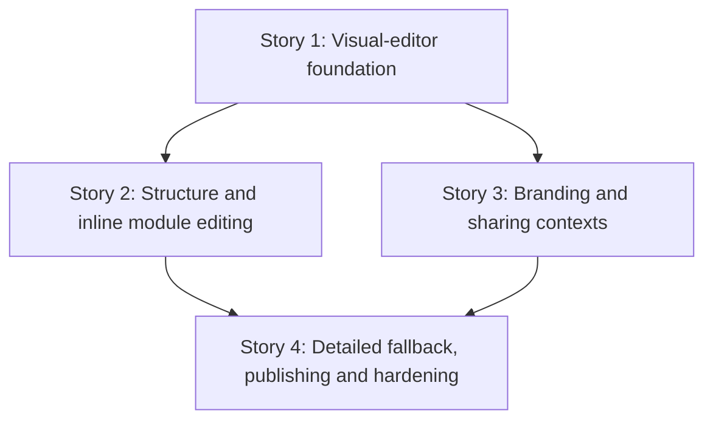

# TD55 — Hotsite visual-editor UX modernization

## Status

- **Type**: Technical Debt / product UX modernization
- **Priority**: Medium — hotsite configuration is not Ikaro's primary business flow, but the current split between forms and a separate Preview makes the outcome of an edit unnecessarily hard for a manager to understand.
- **Context**: `apps/web/features/platform/components/hotsite/`; manager hotsite journey
- **Created**: 2026-10-21
- **Discovered**: UX review of the shipped manager hotsite editor and its BeloAuto manifest, culminating in the approved visual-editor prototype.
- **Decision status**: Ready for `/story-discovery`, in the sequence below. This TD deliberately introduces no new hotsite schema, API, module type, template catalogue, or authorization model.
- **Related**: `journeys/manager/hotsite.md`; `journeys/manager/prototypes/hotsite/editor-vision/09-inline-realistic-editor.html`; `docs/15-HOTSITE_DYNAMIC_ARCHITECTURE.md`; `docs/16-DASHBOARD_FRONTEND_ARCHITECTURE.md`

## Problem

The delivered manager editor is powerful but asks the user to infer the result of a field from a tabbed form and then explicitly open a separate Preview. `HotsiteEditorMainView.tsx` makes Branding, Layout, SEO and Manifest the primary choices; Layout then sends a manager into a full-screen module drill-down. That preserves every capability but weakens orientation: a manager editing a Hero, Contact, colour or CTA cannot see its result where they are editing it.

The current implementation already has the right data model and most of the right safety behavior:

- one client-side `draft` is shared by Branding, Layout and SEO;
- a module panel owns local data until **Apply**, while **Cancel** asks before discarding changes;
- Layout supports ordering, enabled/disabled modules and Configure for all ten supported module types;
- Preview renders the draft without saving it; and
- image uploads, SEO limits, publish/unpublish and the raw Manifest editor already work.

The chosen direction is therefore a presentation and navigation change, not a replacement of the manifest system. The default manager journey becomes a persistent visual editor inside the existing Ikaro dashboard shell. Compact global actions sit above the preview; a contextual inspector remains visible at the right on desktop, including after the user scrolls to a lower section. The current tabbed editor remains available as **Edit in detail** for advanced work and Manifest access, with a clear route back to the visual editor.

## Chosen approach

Use the approved prototype as the behavioral target, not as a source of production markup:

- `journeys/manager/prototypes/hotsite/editor-vision/09-inline-realistic-editor.html` is the default visual-editor flow.
- `journeys/manager/prototypes/hotsite/01-hotsite-editor.html` represents the retained detailed-editor fallback. Its top bar now demonstrates **Back to visual editing**.
- The visual preview is always based on the in-memory draft. A field change is reflected immediately in that preview, but it is not public until the existing save/publish flow succeeds.
- Module editing keeps the existing local **Apply / Cancel / discard confirmation** contract: local edits can be previewed immediately, Apply commits them into the shared draft, and Cancel restores the last applied draft state.
- The detailed view is not a separate persisted draft or a reload. Switching between visual and detailed editing must retain the same in-memory draft and, on return, the manager's selected visual context.
- Manifest remains available only through the detailed-editor path for this migration. Restricting it to another role would be an authorization/product decision outside this TD.
- Site templates are intentionally deferred. They need their own product discovery, manifest catalogue and maintenance model after the editor foundation is stable.

The stories are deliberately sequential at the UI state boundary. They share the editor's draft and view model, so parallel implementation would create conflicting ownership of the same state. No backend, BFF or database work is expected.

## Stories

### Story 1 — Make the persistent visual editor the default manager experience 🟡

**Agent:** frontend-ts
**Complexity:** L
**Docs to load:** `docs/16-DASHBOARD_FRONTEND_ARCHITECTURE.md` § 1. Role-Based Rendering and § 3. Shared Component Library — shadcn/ui; `docs/ENGINEERING_RULES_FRONTEND.md` § Reuse the repo's UI primitives — never hand-roll a control that already exists; `docs/15-HOTSITE_DYNAMIC_ARCHITECTURE.md` § 1. The Hotsite Manifest Pattern and § 2. Branding & Design Token System
**Dependencies:** none
**Pattern:** reducer-owned editor state with plain composition — `HotsiteEditor` remains the sole owner of the loaded config and shared draft; visual subviews receive state and explicit callbacks rather than creating competing drafts.

**Description:**
Replace the current tabbed `HotsiteEditorMainView` as the default initial view with a dashboard-native visual editor. It renders the current `draft` as a persistent page preview and places a compact action row immediately above it: **Branding and style**, **Organize modules**, **Sharing**, **Edit in detail**, **Publish**, and **View published site**. The action row is an editor command row, not the old four-tab navigation. It must preserve the current dashboard shell/topbar behavior and must not use hotsite `--ba-*` branding tokens for the manager controls.

On desktop, the contextual editor panel is a sticky, independently scrollable right-side inspector. It must stay usable when a manager scrolls the preview to Contact, Footer or another lower module; selecting a preview section scrolls the inspector to its beginning but must not jump the browser page back to the top. On narrow screens, the preview comes before the inspector in normal document order. This story supplies the visual-editor frame and explicit context state; it does not yet move every real field into the contexts — that is Stories 2 and 3.

The old main tabbed composition is retained as a callable detailed view, not deleted. Existing preview-only navigation remains compatible until Story 4 replaces it with the final entry and return behavior.

**Prototype references:** `journeys/manager/prototypes/hotsite/editor-vision/09-inline-realistic-editor.html` (compact global actions, persistent preview and desktop inspector); `journeys/manager/prototypes/hotsite/editor-vision/vision.css` (responsive placement only — production must use repository primitives/styles)
**New migration / i18n keys / env vars / feature flags:** add localized visual-editor command, context, preview-status and accessibility-label keys to `packages/i18n/locales/pt-BR/web.json` and `packages/i18n/locales/en/web.json`; no migration, environment variable or feature flag.

**Files to create/modify:**
- `apps/web/features/platform/components/hotsite/HotsiteEditor.tsx` (modify — make visual editing the default and own the visual/detailed view state)
- `apps/web/features/platform/components/hotsite/HotsiteEditor.spec.tsx` (modify — pin default visual view and shared-draft ownership)
- `apps/web/features/platform/components/hotsite/HotsiteEditorMainView.tsx` (modify — preserve it as the detailed-editor composition boundary)
- `apps/web/features/platform/components/hotsite/HotsiteEditorMainView.spec.tsx` (modify — cover retained detailed view behavior)
- `apps/web/features/platform/components/hotsite/HotsitePreview.tsx` (modify — expose selectable preview sections without changing public hotsite rendering)
- `apps/web/features/platform/components/hotsite/HotsitePreview.spec.tsx` (modify — cover preview section selection affordances)
- `apps/web/features/platform/components/hotsite/hotsite-editor-views.tsx` (modify — extend the editor view/context model without duplicating draft state)
- `apps/web/features/platform/components/hotsite/hotsite-editor-views.spec.tsx` (modify — cover visual context transitions)
- `apps/web/features/platform/components/hotsite/VisualHotsiteEditorView.tsx` (new — visual-editor frame, command row, preview and inspector layout)
- `apps/web/features/platform/components/hotsite/VisualHotsiteEditorView.spec.tsx` (new)
- `packages/i18n/locales/pt-BR/web.json` (modify)
- `packages/i18n/locales/en/web.json` (modify)

**Acceptance criteria — product:**
- [ ] Opening `/dashboard/hotsite` as a manager starts in the visual editor, within the existing Ikaro dashboard shell, with a persistent draft preview and compact global actions above it.
- [ ] On desktop, the inspector remains visible and independently scrollable while a manager navigates lower preview sections; on mobile it follows the preview in normal reading order.
- [ ] The visual-editor command row offers Branding and style, Organize modules, Sharing, Edit in detail, Publish and View published site; none is represented as the former primary four-tab navigation.
- [ ] Selecting an enabled preview section establishes an editing context and visibly identifies that section without changing the public hotsite output.

**Acceptance criteria — technical:**
- Unit:
  - [ ] `VisualHotsiteEditorView.spec.tsx` proves the command row, selected-section state, desktop inspector semantics and mobile DOM order.
  - [ ] `HotsiteEditor.spec.tsx` proves visual editing is the default and that one shared draft survives context changes.
  - [ ] `HotsitePreview.spec.tsx` proves editor-only section selection wrappers do not change the module render plan or public module props.
- E2E:
  - [ ] `apps/web/e2e/hotsite-editor.spec.ts` verifies a manager lands in the visual editor and can select Hero and Contact from the persistent preview without navigating to a separate preview screen.
- [ ] Coverage ≥80% on changed code.
- [ ] `tsc --noEmit` clean, lint clean.

### Story 2 — Bring module structure and real fields into the contextual inspector 🟡

**Agent:** frontend-ts
**Complexity:** L
**Docs to load:** `docs/15-HOTSITE_DYNAMIC_ARCHITECTURE.md` § 3. Module Library and § 4. Module Data Contracts (TypeScript); `docs/ENGINEERING_RULES_FRONTEND.md` § Reuse the repo's UI primitives — never hand-roll a control that already exists; `docs/CODE_STANDARDS.md` § Next.js (`apps/web`): dialog and submit-handler conventions
**Dependencies:** Story 1
**Pattern:** local edit buffer plus explicit commit — reuse the existing `ModuleConfigView` Apply/Cancel/dirty-confirmation semantics while presenting its panels inside the visual inspector.

**Description:**
Make **Organize modules** the visual editor's structure context. It lists all currently supported module types in current layout order, provides the existing drag-and-drop/keyboard ordering behavior, enabled toggle and Configure action, and keeps disabled modules configurable from the list. Configuring a module or selecting its enabled preview section opens that module's real configuration panel in the right inspector. Do not create abbreviated replacement forms: every existing field, conditional field, validation and uploader in the ten panels remains reachable.

Group long existing panels only as a visual organization device: **Essential**, **Appearance and position**, and **Image and advanced options**. Groups must contain the existing editable controls; they are not summaries, read-only values, a new schema or a replacement configuration mode. The original field labels, defaults, validation and conditional rendering remain the source of truth. The exact grouping of a field is decided in each panel's story discovery against its existing component, not by heuristic text matching.

Edits update the persistent preview immediately from the module's local buffer. Apply merges the buffer into the shared draft using the existing merge behavior; Cancel discards it, with the current confirmation when dirty. Returning to Organize modules restores the list and its current order/enabled state. A click on the floating Chatbot control is treated as selecting CHATBOT. No module type is silently omitted: HERO, SERVICE_LIST, GALLERY, TESTIMONIALS, BOOKING_CTA, ABOUT, CONTACT, FOOTER, CHATBOT and LEAD_FORM all retain a structure entry and panel mapping.

**Prototype references:** `journeys/manager/prototypes/hotsite/editor-vision/09-inline-realistic-editor.html` and `journeys/manager/prototypes/hotsite/editor-vision/09-inline-interactions.js` (module selection, structure list, return to structure, contextual field grouping)
**New migration / i18n keys / env vars / feature flags:** add localized structure, inspector, Apply/Cancel, group-heading and selection-status keys to both `web.json` locales as required; no migration, environment variable or feature flag.

**Files to create/modify:**
- `apps/web/features/platform/components/hotsite/HotsiteEditor.tsx` (modify — route module selection and committed draft changes through the visual editor)
- `apps/web/features/platform/components/hotsite/HotsitePreview.tsx` (modify — dispatch module selection, including CHATBOT)
- `apps/web/features/platform/components/hotsite/LayoutTab.tsx` (modify — extract/reuse the existing structure behavior rather than fork it)
- `apps/web/features/platform/components/hotsite/LayoutTab.spec.tsx` (modify)
- `apps/web/features/platform/components/hotsite/hotsite-editor-lazy-panels.tsx` (modify only if a panel boundary must expose visual-inspector props; all ten mappings remain exhaustive)
- `apps/web/features/platform/components/hotsite/hotsite-editor-lazy-panels.spec.tsx` (modify — pin exhaustive panel coverage)
- `apps/web/features/platform/components/hotsite/hotsite-editor-views.tsx` (modify — keep local module buffer, Apply/Cancel and discard behavior intact)
- `apps/web/features/platform/components/hotsite/hotsite-editor-views.spec.tsx` (modify)
- `apps/web/features/platform/components/hotsite/modules/ModuleConfigShell.tsx` (modify — allow the existing detailed controls to render inside the contextual inspector without duplicating save semantics)
- `apps/web/features/platform/components/hotsite/VisualModuleInspector.tsx` (new — structure context, contextual panel host and accessible return-to-structure action)
- `apps/web/features/platform/components/hotsite/VisualModuleInspector.spec.tsx` (new)
- `packages/i18n/locales/pt-BR/web.json` (modify)
- `packages/i18n/locales/en/web.json` (modify)

**Acceptance criteria — product:**
- [ ] Organize modules shows all ten supported modules in persisted order, allows ordering and visibility changes, and makes disabled modules configurable.
- [ ] Configuring a module from the list or selecting it in the preview opens its real editable fields in the inspector; the user can return to the structure list without losing applied structure state.
- [ ] Every available current module field remains editable, including its conditional controls and upload controls; groups only make long forms easier to scan.
- [ ] A local module edit appears in the preview immediately, Apply makes it part of the shared draft, and Cancel restores the last applied draft after the existing dirty-discard confirmation.

**Acceptance criteria — technical:**
- Unit:
  - [ ] `VisualModuleInspector.spec.tsx` covers module-list order, enable/disable, Configure, preview selection, inspector reset-to-top and return-to-structure.
  - [ ] `hotsite-editor-views.spec.tsx` covers live local-buffer preview, Apply merge, Cancel discard and dirty confirmation.
  - [ ] `hotsite-editor-lazy-panels.spec.tsx` proves all ten `HotsiteModuleType` values have a visual-inspector-compatible panel mapping.
  - [ ] Existing module panel specs preserve their field, validation and conditional-rendering coverage after grouping.
- E2E:
  - [ ] `apps/web/e2e/hotsite-editor.spec.ts` enables/configures About and Testimonials, reorders a module, configures Contact from the lower preview, and verifies Apply/Cancel behavior before publish.
- [ ] Coverage ≥80% on changed code.
- [ ] `tsc --noEmit` clean, lint clean.

### Story 3 — Make branding and sharing consequences visible in place 🟡

**Agent:** frontend-ts
**Complexity:** M
**Docs to load:** `docs/15-HOTSITE_DYNAMIC_ARCHITECTURE.md` § 2. Branding & Design Token System, § 11. SEO & Discoverability (M12-S09) and § Implicit vs. explicit CSS defaults; `docs/ENGINEERING_RULES_FRONTEND.md` § Hotsite full-page components must explicitly paint `--ba-background`; `docs/CODE_STANDARDS.md` § Next.js (`apps/web`): localization-driven fields (address, phone, currency, dates)
**Dependencies:** Story 1
**Pattern:** controlled shared draft with derived preview — Branding and SEO inputs write to the existing draft; the hotsite preview and search/share cards derive display-only values from that draft.

**Description:**
Move the current Branding fields into **Branding and style** in the visual inspector. Preserve every existing color, typography, button and layout control and its default semantics. Editing one changes the draft preview immediately, so the manager sees where primary/secondary/background/text/button colors and visual choices affect the site. This is not a new styling system: it uses the current branding object and CSS-variable application path, including the explicit full-page background requirement.

Move SEO into **Sharing**. Preserve the existing title/description validation limits, Open Graph image upload and draft behavior. Beside those editable fields, show a clearly labelled simulation of a Google result and a WhatsApp share card. Both derive title, description, image and public site URL from the draft as the manager types; neither promises an exact rendering by Google, WhatsApp or another external consumer. The hotsite preview is replaced by the sharing simulation only while Sharing is selected, then returns to the site preview when another context is chosen.

**Prototype references:** `journeys/manager/prototypes/hotsite/editor-vision/09-inline-realistic-editor.html` (Branding and style / Sharing contexts and Google/WhatsApp cards); `journeys/manager/prototypes/hotsite/editor-vision/11-sharing-preview.html` (sharing-preview detail)
**New migration / i18n keys / env vars / feature flags:** add localized context names, simulation labels/disclaimers and image alternative text to both `web.json` locales; no migration, environment variable or feature flag.

**Files to create/modify:**
- `apps/web/features/platform/components/hotsite/BrandingTab.tsx` (modify — extract/reuse current controls for visual Branding and style context)
- `apps/web/features/platform/components/hotsite/BrandingTab.spec.tsx` (modify)
- `apps/web/features/platform/components/hotsite/SeoTab.tsx` (modify — extract/reuse current fields for Sharing context)
- `apps/web/features/platform/components/hotsite/SeoTab.spec.tsx` (modify)
- `apps/web/features/platform/components/hotsite/OgImageUpload.spec.tsx` (modify if UI labels or accessibility contract changes)
- `apps/web/features/platform/components/hotsite/HotsitePreview.tsx` (modify — switch between hotsite and sharing preview without changing the draft)
- `apps/web/features/platform/components/hotsite/VisualHotsiteEditorView.tsx` (modify — host Branding and Sharing contexts)
- `apps/web/features/platform/components/hotsite/HotsiteSharingPreview.tsx` (new — derived Google and WhatsApp simulations)
- `apps/web/features/platform/components/hotsite/HotsiteSharingPreview.spec.tsx` (new)
- `packages/i18n/locales/pt-BR/web.json` (modify)
- `packages/i18n/locales/en/web.json` (modify)

**Acceptance criteria — product:**
- [ ] A manager can edit all current branding controls from Branding and style and immediately see their effect in the draft hotsite preview.
- [ ] Sharing retains the current SEO fields, title/description limits and Open Graph image upload, and shows Google-result and WhatsApp-share simulations that update from the draft.
- [ ] The simulations are clearly identified as previews and never claim that an external channel will render an identical card.
- [ ] Switching between Branding and style, Sharing, Organize modules and a module context retains the unsaved shared draft.

**Acceptance criteria — technical:**
- Unit:
  - [ ] `HotsiteSharingPreview.spec.tsx` covers title, description, image fallback/uploaded image, URL and simulation disclaimer from the draft.
  - [ ] `BrandingTab.spec.tsx` and `SeoTab.spec.tsx` retain validation and draft-update coverage through their extracted visual contexts.
  - [ ] `HotsitePreview.spec.tsx` proves context switching does not mutate the draft and full-page preview components explicitly paint the background token.
- E2E:
  - [ ] `apps/web/e2e/hotsite-editor.spec.ts` changes the primary color and SEO title/description, observes the visual and sharing-preview updates, and confirms the saved/published hotsite semantics remain unchanged.
- [ ] Coverage ≥80% on changed code.
- [ ] `tsc --noEmit` clean, lint clean.

### Story 4 — Retain detailed editing, then complete publish and accessibility hardening 🟡

**Agent:** frontend-ts
**Complexity:** M
**Docs to load:** `docs/15-HOTSITE_DYNAMIC_ARCHITECTURE.md` § 1. The Hotsite Manifest Pattern, § 5. Next.js Routing & SSR Strategy and § 11. SEO & Discoverability (M12-S09); `docs/16-DASHBOARD_FRONTEND_ARCHITECTURE.md` § 3. Shared Component Library — shadcn/ui and § 4. Engineering Standards & Quality Gates; `docs/CODE_STANDARDS.md` § Next.js (`apps/web`): dialog and submit-handler conventions
**Dependencies:** Stories 2 and 3
**Pattern:** one editor session, two presentations — a single `HotsiteEditor` draft/view model switches between visual and detailed presentation; publish is an explicit command over that same draft.

**Description:**
Finish the migration without removing power-user capabilities. **Edit in detail** opens the retained detailed/tabbed editor from the visual command row; it continues to expose Branding, Layout, SEO and Manifesto exactly as today. Its dashboard top bar provides **Back to visual editing**. That command returns to the visual editor without a reload and preserves the current unsaved draft and selected visual context. The raw Manifest editor remains reachable through this detailed path and keeps its current validation/application behavior. Do not make it a primary visual-editor command, and do not change who is authorized to use it in this TD.

Wire Publish, Unpublish and View published site into the final visual command row using the current persistence and action behavior. A publish action saves the complete shared draft then performs the existing publish action; the public site never receives an uncommitted local module buffer. Preserve current success/error feedback, unpublish danger-zone confirmation and published URL behavior. Remove or redirect obsolete separate-preview entry points only after the equivalent visual and detailed paths are covered.

Make keyboard and screen-reader behavior first-class: global actions, preview selection, inspector return, Apply/Cancel, detailed-entry/back and publish controls must be reachable and announce meaningful context changes. Validate desktop, tablet and mobile layouts; a sticky inspector must never make controls inaccessible.

**Prototype references:** `journeys/manager/prototypes/hotsite/editor-vision/09-inline-realistic-editor.html` (Edit in detail command and publish actions); `journeys/manager/prototypes/hotsite/01-hotsite-editor.html` (Back to visual editing top-bar entry)
**New migration / i18n keys / env vars / feature flags:** add localized detailed-editor/back, publish status and accessible live-region labels to both `web.json` locales as needed; no migration, environment variable or feature flag.

**Files to create/modify:**
- `apps/web/features/platform/components/hotsite/HotsiteEditor.tsx` (modify — retain one session state across visual/detailed views and publish from that state)
- `apps/web/features/platform/components/hotsite/HotsiteEditor.spec.tsx` (modify)
- `apps/web/features/platform/components/hotsite/HotsiteEditorMainView.tsx` (modify — provide the detailed-editor top-bar return path)
- `apps/web/features/platform/components/hotsite/HotsiteEditorMainView.spec.tsx` (modify)
- `apps/web/features/platform/components/hotsite/HotsitePreview.tsx` (modify — remove/redirect obsolete standalone-preview navigation only after visual parity)
- `apps/web/features/platform/components/hotsite/HotsitePreview.spec.tsx` (modify)
- `apps/web/features/platform/components/hotsite/hotsite-editor-publish.ts` (modify only if the visual command needs an existing publish helper extension)
- `apps/web/features/platform/components/hotsite/hotsite-editor-publish.spec.ts` (modify if helper behavior changes)
- `apps/web/features/platform/components/hotsite/ManifestTab.tsx` (modify only if required to preserve detailed-only access and return state)
- `apps/web/features/platform/components/hotsite/ManifestTab.spec.tsx` (modify if its detailed access contract changes)
- `apps/web/e2e/hotsite-editor.spec.ts` (modify — migrate the current tab-and-separate-preview journey to the final visual/detailed journey)
- `packages/i18n/locales/pt-BR/web.json` (modify)
- `packages/i18n/locales/en/web.json` (modify)

**Acceptance criteria — product:**
- [ ] Edit in detail is available from the visual editor but is clearly secondary to visual editing; it keeps all current detailed tabs, including Manifesto.
- [ ] The detailed editor's top-bar Back to visual editing command returns to the same editor session, preserving unsaved shared-draft changes and the manager's visual context.
- [ ] Publish persists the complete shared draft before publishing; an unapplied module local buffer cannot be published accidentally.
- [ ] Unpublish, View published site, action feedback and failure behavior remain available from the final flow.
- [ ] The final editor is usable with keyboard and screen reader and does not lose action access on desktop, tablet or mobile.

**Acceptance criteria — technical:**
- Unit:
  - [ ] `HotsiteEditor.spec.tsx` proves visual → detailed → visual preserves draft and selected context, while a full reload restores only the saved server draft.
  - [ ] `HotsiteEditorMainView.spec.tsx` proves Manifesto remains detailed-only and Back to visual editing is keyboard-accessible.
  - [ ] `hotsite-editor-publish.spec.ts` proves publish receives only committed shared-draft data and retains existing save-then-publish/error behavior.
- E2E:
  - [ ] `apps/web/e2e/hotsite-editor.spec.ts` covers the full manager journey: visual branding edit, module Apply, Sharing edit, detailed-editor/Manifesto entry, return with draft retained, publish, reload persistence and published-site visibility.
  - [ ] The same E2E file covers keyboard activation for a preview section, Edit in detail, Back to visual editing and Publish.
- [ ] Coverage ≥80% on changed code.
- [ ] `tsc --noEmit` clean, lint clean.

## Deferred deliberately

- A selectable template/gallery catalogue and “start from a ready-made site” flow. This needs a separately owned collection of manifests, preview assets, migration/default rules and product decisions.
- New manifest fields, module types, backend/BFF endpoints or persistence schema changes.
- Changing Manifest access by role or removing it. The current manager behavior is preserved; any restriction needs its own authorization decision and discovery.
- Pixel-perfect parity with the HTML prototype. The acceptance target is equivalent fields, layout behavior and interaction semantics in the real Ikaro component system.
