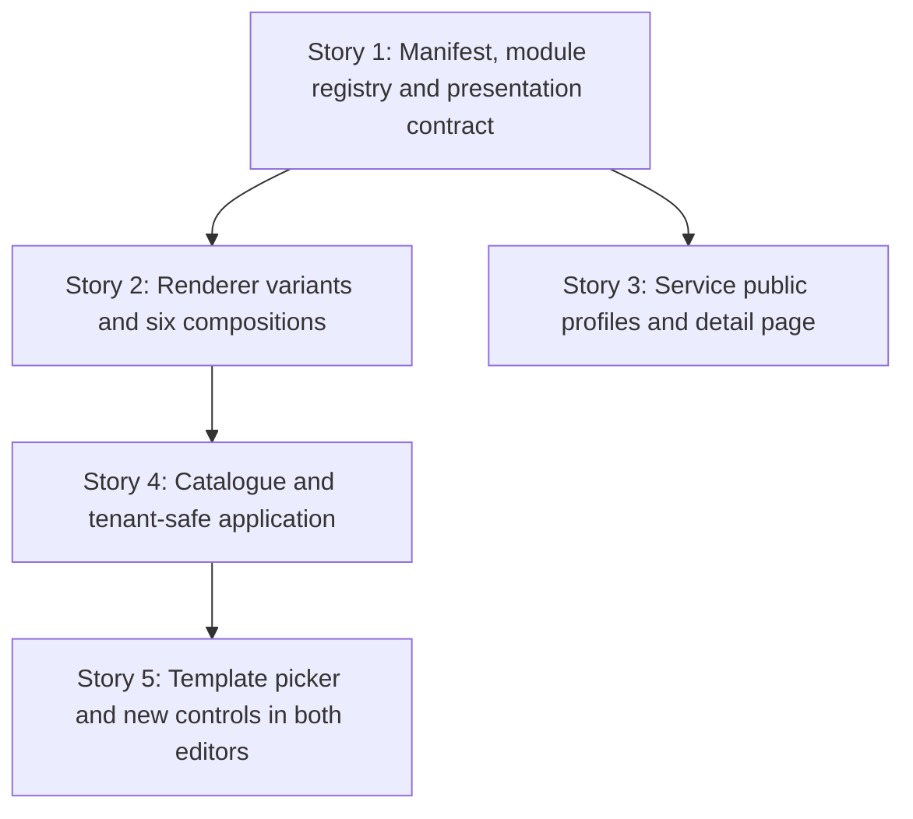

# TD56 — Hotsite template catalogue, flexible presentation engine, and service pages

## Status

- **Type:** Product-enabling technical debt / hotsite capability expansion
- **Priority:** High — this turns the existing hotsite editor from a field-by-field configuration tool into a guided way to reach materially different public-site compositions.
- **Created:** 2026-10-22
- **Decision status:** Ready for `/story-discovery`, in the sequence below. This TD follows TD55; it does not reopen TD55's visual-editor foundation.
- **Use cases:** extends UC-027 (manager manages hotsite) and adds the service-publication and visitor-detail flows described here before they are promoted into `docs/USE_CASES.md`.
- **Related:** `td/TD55-HOTSITE-VISUAL-EDITOR-UX.md` (all five stories done); `docs/HOTSITE_DYNAMIC_ARCHITECTURE.md`; `journeys/manager/hotsite.md`; `journeys/manager/prototypes/hotsite/editor-vision/09-inline-realistic-editor.html`; `journeys/manager/prototypes/hotsite/hotsite-impl/`.

## Decisions locked (2026-10-22 review — do not reopen in discovery)

1. **No new top-level manifest keys, no migration for the hotsite.** `hotsite_configs` stores `branding`, `layout` and `seo` as JSONB; everything new fits inside `layout`. Navigation is a **module** (`NAVIGATION`); the service-detail-page settings are a nested object inside `SERVICE_LIST.data`.
2. **Template images are shared, not copied.** Catalogue assets are platform-owned, public, versioned and immutable; every tenant manifest may reference the same path. There is no per-tenant asset copy, rollback or orphan cleanup.
3. **Templates keep their sample testimonials.** They are ordinary `TESTIMONIALS` data the manager sees and edits; the editor labels them as sample content (see *Template application contract*).
4. **Module registry grows by two types** — `NAVIGATION` and `CONTENT_BLOCK` — so a layout holds at most 12 modules (today 10).
5. **The backend validates every module's `data` in full (Story 1 discovery, 2026-10-23).** One canonical `discriminatedUnion('type')` in `@ikaro/validation` covers all twelve module types: new types use strict objects, the ten existing types use loose objects whose declared keys are fully validated (required fields, enums, bounds) and whose unknown keys are tolerated, as the web schemas tolerate them today. The web schemas stay an independent mirror, kept consistent by shared contract fixtures.
6. **The Manifesto tab stays consistent with today's split:** it rejects on the web what would break the client at once (shape, unique types, data and `presentation` validity, NAVIGATION first) and leaves business rules that need the whole layout (a navigation target must be an enabled module) to the backend, shown on Publish through the existing banner.
7. **An invalid `presentation` at render time is ignored** (the module renders with defaults); it never removes the module the way malformed `data` does.
8. **`NAVIGATION` is an ordinary module** (own `data`, own `enabled` toggle) with one exception: it is pinned first and cannot be dragged. Story 1 enforces that behaviour; the visible affordance is designed in Story 5, when the row first appears for a manager.

## Problem

The hotsite engine already supports a useful set of modules and branding controls, but the resulting sites tend toward the same visual structure. Managers begin with an empty or generic configuration and must understand module configuration before they can see what Ikaro can create.

The visual editor delivered by TD55 supplies the correct interaction foundation: a persistent draft preview, contextual right inspector, an advanced detailed editor, and one shared publish flow. TD55 deliberately deferred templates, new manifest capability, and new module types. Those pieces are necessary now.

The current public service list can show a short service description, price, duration, and loyalty information, but it cannot lead a visitor to a branded service page with a richer explanation and photos. Its current booking flow is intentionally service-first and may add duration, resource, intake, staff, availability, and confirmation steps. A hotsite must therefore never simulate a date/time booking form on its home page.

## Chosen approach

Build a versioned, platform-owned catalogue of six curated templates. A template is a controlled manifesto preset plus shared source assets and metadata, not a tenant-owned hotsite and not a second rendering system. Selecting it changes the existing manager draft and its persistent preview. The existing Publish action remains the only action that makes it public.

Templates must create visibly different sites through reusable presentation capabilities, rather than one-off HTML structures. Each module type remains a singleton in `layout`; this TD does not add repeatable modules. Extend the current manifest through closed, validated properties, all inside `layout[]` entries (`{ type, enabled, data, presentation? }`):

- a singleton `NAVIGATION` module — page chrome rendered **first, above Hero**; the manager can enable/disable and edit it but cannot drag it (the backend and the layout editor both enforce "NAVIGATION is always first");
- an optional `presentation` object, a **sibling of `data`** in the module entry (never a key inside `data`): semantic section presentation (`surface`, content width, minimum height, padding, optional background image and overlay), with contrast-safe branding tokens;
- controlled, module-specific layout variants for Hero, Service List, Gallery, Testimonials, About, Booking CTA, and Lead Form (extending the existing `variant`/`layout` fields — see Story 2);
- one singleton `CONTENT_BLOCK` module with a closed variant union for trust grids, image statements, immersive statements, process steps, collages, and technical callouts; and
- on `SERVICE_LIST.data`: `itemAction`, `itemCtaLabel` and a nested `detailPage` object that configures how every public service detail page looks.

Production sections remain viewport-wide. Their background, colour and divider belong to the full-width section; only the inner content receives a maximum width. This matches the current BeloAuto renderer. The former centered 1240px prototype showcase canvas has been removed from `template-compositions.css` for the same reason.

The manifest keeps module business data separate from optional `presentation` data. Presentation is a closed object: `surface` (`background | secondary | primary | custom`), `customColor` (required only for `custom`, strict `#RRGGBB`), `contentWidth` (`narrow | standard | wide | full`), `minHeight` (`auto | sm | md | lg | viewport`), `padding` (`none | compact | comfortable | spacious`), optional `background` (`imageUrl`, focal `position`) and optional, **separate** `overlay`. Overlay is a closed union: `none`, `solid` (`color`, `opacity`), or `linear-gradient` (`direction`, `fromColor`, `fromOpacity`, `toColor`, `toOpacity`). Directions are a fixed enum, colors are strict hex, opacity is 0–1, and irrelevant fields are rejected. `overlay` is a sibling of `background`, not nested inside it, because it must also work over a module's *own* background image (see below). Background image placement preserves existing focal-point behavior. New hotsite sections use a shared full-width section shell; module-specific variants arrange content inside it. Omitted presentation fields resolve to the current renderer defaults.

Which modules accept `presentation`: `HERO`, `SERVICE_LIST`, `GALLERY`, `TESTIMONIALS`, `BOOKING_CTA`, `ABOUT`, `CONTACT`, `LEAD_FORM`, `CONTENT_BLOCK`; it is rejected on `NAVIGATION`, `FOOTER` and `CHATBOT`. `presentation.background` is accepted only on modules that have no background image of their own (`SERVICE_LIST`, `GALLERY`, `TESTIMONIALS`, `ABOUT`, `CONTACT`, `CONTENT_BLOCK`); `HERO`, `BOOKING_CTA` and `LEAD_FORM` keep their existing `data.backgroundImageUrl`/`backgroundImagePosition` and reject `presentation.background`, so one section never has two competing background images. `presentation.overlay` is accepted on every module that accepts `presentation` and is drawn over whichever background image the section has (its own, or `presentation.background`); with no image it simply tints the section surface. This is what gives Hero, which today has **no overlay or scrim at all**, its gradient.

**Precedence with today's branding switches.** An explicit `presentation.surface` always wins. When it is absent, behaviour is exactly today's: `branding.alternateSectionBg` alternation (`bgVariant`), `branding.heroBgStyle`, and each module's own `bgStyle`. `NAVIGATION` is not a render-plan section: it is consumed by the page/preview and handed to `HotsiteAuthBar`, so it never takes part in alternation or dividers and the existing "first section has no divider" rule is unchanged. `CONTENT_BLOCK` alternates like `ABOUT`/`TESTIMONIALS` unless it sets `presentation.surface`.

`NAVIGATION` data is `{ items: { label: string (1–30 chars); target: 'service-list' | 'gallery' | 'testimonials' | 'about' | 'contact' }[] }`, at most 6 items. Targets are the existing same-page section anchors (`#service-list`, `#gallery`, `#testimonials`, `#about`, `#contact`); booking is never a navigation item (each module's own CTA reaches it) and the separate `/lead-form` route is not an anchor. Every item's target must be an **enabled** module in the same layout. The backend rejects a save that violates this, and the editor surfaces the same rule before saving (disabling a module referenced by the navigation explains why and offers to remove the item) — a disabled section never leaves a dead link. On the public page the navigation lives in the existing top bar region (`HotsiteAuthBar`: logo, Área da Equipe, Entrar) on desktop and collapses into a menu on mobile; there is never a second competing header. Confirm the exact bar integration in discovery against TD55 Story 5, but the one-header rule is fixed.

`SERVICE_LIST.data` gains: `itemAction?: 'details' | 'booking' | 'none'` (omitted ⇒ `none`, which is today's behaviour — service cards have no action), `itemCtaLabel?: string` (≤ 40 chars), and `detailPage?: { heroStyle: 'cover' | 'compact'; galleryLayout: 'grid' | 'featured'; showPrice: boolean; showDuration: boolean; showLoyaltyPoints: boolean; bookingCtaLabel?: string (≤ 40) }`. Omitted `detailPage` resolves to `{ heroStyle: 'cover', galleryLayout: 'grid', showPrice: true, showDuration: true, showLoyaltyPoints: true }`. The set is closed; adding a field later is a new story. If `SERVICE_LIST` is disabled or absent, detail pages remain reachable by direct URL using these defaults — they are simply not linked from the home page.

`CONTENT_BLOCK` remains one module entry and one selected variant at a time. Its closed variants are `trust-grid`, `image-statement`, `immersive-statement`, `process-steps`, `collage-callout`, and `technical-callout`. `data` is a discriminated union on `data.variant`, every variant a strict object (unknown keys rejected). Common to all six: `variant`; `align?: 'left' | 'center' | 'right'` (omitted ⇒ the variant's own default); `eyebrow?` ≤ 60 chars; `title` required, ≤ 120; `body?` ≤ 1000 (restricted Markdown, below); `cta?: { label ≤ 40; target: 'booking-form' | 'service-list' | 'gallery' | 'testimonials' | 'about' | 'contact' }` — the same target set as Hero's `ctaTarget`, not cross-checked against enabled modules, exactly like Hero. Variant-specific fields: `trust-grid` — `items` 2–6 × `{ label ≤ 60; description? ≤ 140 }`; `process-steps` — `items` 2–6 × `{ title ≤ 60; body ≤ 240 }`, the renderer numbers the steps (no stored number); `collage-callout` — `images` 2–4 × `{ url; alt? ≤ 120 }`, `url` a non-empty hotsite image path and an empty `alt` meaning decorative; `technical-callout` — `facts?` 0–4 × `{ value ≤ 20; label ≤ 40 }`; `image-statement` and `immersive-statement` — no extra fields, their imagery comes from `presentation.background`. `collage-callout.images[].url` is the only image slot inside `CONTENT_BLOCK.data`. Rich text is Markdown with a documented size bound; it is never arbitrary HTML. Everywhere this TD renders Markdown (CONTENT_BLOCK bodies and the service `longDescription`) it uses one shared, restricted renderer: `react-markdown` + `rehype-sanitize` (already in `apps/web`), allowing paragraphs, emphasis, lists and links only — **no raw HTML and no images** (images come only from the validated image slots), links get `rel="noopener noreferrer nofollow"`. The module does not introduce repeatable modules or arbitrary CSS.

**Story boundary rule (compile safety).** `HotsiteModuleType` feeds several exhaustive, non-partial maps — web `MODULE_SCHEMAS` in `page-model.ts` (`satisfies Record<HotsiteModuleType, …>`), `MODULE_CONFIG_PANELS` in `hotsite-editor-lazy-panels.tsx` (deliberately a non-partial `Record`), the `hotsite.layout.modules.*` i18n labels, the preview renderer — so adding the two types in Story 1 breaks `tsc` unless each map gets an entry in the same story. Therefore: Story 1 owns the data contract and adds the minimal entries those maps need (schema + parse entry, a labelled placeholder panel entry, i18n labels); Story 2 renders the two modules; **Story 5 owns the real panels and is what makes the two types visible in the editor.** Until Story 5, `materializeLayout` does **not** append `NAVIGATION`/`CONTENT_BLOCK` as disabled rows (otherwise the Layout list would show a row whose Configure opens a placeholder), so they exist only when a manifest already contains them (JSON editing, or an applied template once Story 4/5 ship). Story 5 flips that rule on.

A service owns its own marketable content. Add a `publicProfile` JSONB payload for rich copy and media, plus a normal `public_slug` column with a tenant-scoped partial unique index (`UNIQUE (tenant_id, public_slug) WHERE public_slug IS NOT NULL`). The JSONB is appropriate for a profile always read and written as one object; the slug requires a real column for a tenant-scoped uniqueness constraint. HotsiteConfig owns only the presentation and routing choices for those details (`SERVICE_LIST.data.itemAction`/`detailPage`).



### Template application contract

Template selection is an intentional presentation replacement. It must:

1. update only the in-memory hotsite draft until the manager publishes;
2. reference each catalogue image by its shared, immutable catalogue path `templates/<templateId>/v<version>/<file>` — no per-tenant copy is made, and a tenant that later replaces a template image with its own upload never touches the shared object;
3. preserve live services and their IDs, booking model/policy/intake/resource configuration, tenant business information, address, contact channels, manager-configured lead-form questions, and chatbot operational availability;
4. preserve tenant identity (`brandName`, `tagline`, `logoUrl`, tenant name and SEO identity) while applying the template's palette, typography, module sequence, generic editorial copy, surfaces, and variants;
5. materialize any generic template copy using tenant identity at application time, leaving no runtime interpolation language in the published manifest;
6. never seed fictional services, staff, booking slots, or contact details, and never name a real person or business in sample copy; and
7. never publish automatically.

**Sample testimonials are allowed.** A template may ship generic `TESTIMONIALS` items (generic author labels, no real people or businesses). They are ordinary manifest data the manager can edit or delete. Because they are not real tenant reviews, the editor must make that visible: manager previews label them as sample content, and applying a template that contains them shows a notice in the inspector ("this template includes sample testimonials — edit or remove them before publishing"). Publishing is not blocked.

**Catalogue assets** are platform-owned, public, immutable and versioned: a changed image ships as a new `v<version>` path, never an in-place overwrite. They are deployed and optimised separately from the checked-in prototype PNGs (`hotsite-impl/assets` is ~78 MB and is a design reference, not a deployable asset). Path rules: the manifest image-path validation accepts `tenants/<tenantId>/hotsite/...`, a promotable `tmp/` upload, **or** an exact path registered in the catalogue index (never a `templates/` wildcard); the image URL resolver resolves catalogue paths to their public URL; the superseded-image deletion logic only ever deletes `tenants/<tenantId>/...` paths, so a shared object can never be deleted through a tenant save.

The catalogue is versioned source code/configuration maintained by Ikaro. A manager's applied result becomes an ordinary editable tenant manifest, so later catalogue changes never mutate a tenant site without an explicit new application.

### Six template directions

| Template | Composition | Engine capabilities demonstrated |
|---|---|---|
| BeloAuto | Full-bleed automotive campaign; hero first, then trust strip, service cards, gallery and booking CTA | Image Hero (its own `backgroundImageUrl` and focal point) with a `presentation.overlay` linear-gradient; trust-grid CONTENT_BLOCK; grid Service List; featured Gallery; Booking CTA with `contentWidth: wide` |
| Casa47 | Dark luxury editorial; asymmetric split hero, numbered price menu, quote, then atelier story | NAVIGATION; left-aligned Hero with `rightPanel: image` (the "split"); numbered Service List; editorial-quote Testimonials; image-statement CONTENT_BLOCK; Booking CTA with `contentWidth: narrow` (the "compact") |
| Mimo Pet | Playful scrapbook; staggered mosaic, color bands, discovery gallery, services later | Image-free playful Hero; collage-callout CONTENT_BLOCK; masonry Gallery; feature-card Service List; testimonial carousel |
| Origem | Quiet wellness journal; typography-led opening, ritual menu and long-form editorial rhythm | No-image editorial Hero; numbered Service List; immersive-statement CONTENT_BLOCK; editorial quote; image-led About |
| Clínica Lume | Structured care pathway; calm split opening, specialty navigation, proof and contact | NAVIGATION; left-aligned Hero with `rightPanel: image`; trust-grid CONTENT_BLOCK; list Service List; testimonial grid; Contact with the existing `displayStyle: icon-cards`; no booking form on landing |
| Lume Studio | Art-directed portfolio; immersive image opening, project sequence, asymmetric work gallery and enquiry | Immersive Hero; process-steps CONTENT_BLOCK; portfolio Gallery; split About; immersive Lead Form |

The prototype HTML files remain visual references. Their bespoke markup is not production code; each difference must map to a validated reusable engine capability listed in this TD. Each template must differ in module order, enabled module set, at least one strong module variant, and at least one section presentation choice; palette and imagery alone do not qualify as distinct. Casa47's `NAVIGATION` module is the reference anchor mapping: **O ritual** → `testimonials`, **Serviços** → `service-list`, **A casa** → `about`, **Contato** → `contact`. The labels are tenant/editorial copy; the targets are only enabled same-page modules.

The six `manifesto-*.json` files in `hotsite-impl/` still use today's schema (no `presentation`, `NAVIGATION` or `CONTENT_BLOCK`), and `manifesto-v2-layout-proposal.json` is a superseded sketch whose shapes differ from this TD (for example it nests `cta` inside CONTENT_BLOCK and lists a `lead-form` target; this TD's contract wins). Story 2 owns rewriting the six fixtures to the final schema, and those fixtures — not the prose table above — are the source of truth for each template's exact module order, enabled set and variants.

### Service detail contract

A visitor reaches `/{tenantSlug}/servicos/{serviceSlug}` from a Service List whose `itemAction` is `details`. The page is branded with the same hotsite design tokens, publishes canonical metadata, provides a small “Voltar aos serviços” link, and shows only the configured content available for that service. Its look is controlled by `SERVICE_LIST.data.detailPage`. Its primary CTA uses the existing booking route with the service preselected (`/{tenantSlug}/booking?serviceId=<id>`, no date). The booking flow itself still determines every subsequent step from the live service model.

A Service List card whose action is `details` but whose service has no public slug/profile renders its booking action instead — never a dead link. For that, the public service list response exposes `publicSlug: string | null` per service (nothing else from the profile).

Visibility: the detail route is available only for a published hotsite and an active service that has a public slug and profile; otherwise it renders the same unavailable state as other missing public pages. Changing or clearing a slug makes the old URL unavailable — no redirects in this version.

Chrome: `app/[slug]/layout.tsx` already applies branding, locale and formatting to every child route, so the detail page inherits them. The page itself renders `HotsiteAuthBar` (with the NAVIGATION links, whose hrefs are absolute-to-home — `/{slug}#service-list` — so they work from this page too), the detail content, and the `Footer` when a FOOTER module is enabled; it does not render the chatbot widget.

SEO: it shares the existing `hotsiteServicesCacheTag(slug)` Next cache tag, so the existing service create/update revalidation (`revalidatePublicPages` → `/api/revalidate`) should invalidate it — discovery must prove that by test and, if the route's own cached output is not cleared by the tag, add a `revalidatePath` for the `servicos` segment to the revalidate route. Metadata goes through `buildHotsiteMetadata`, which today takes only `{ manifest, slug, path }` and derives title/description from the tenant's SEO — it gains an optional override (`title`, `description`, `ogImageUrl` from the service) and the page sets `path: '/servicos/<slug>'` so the canonical URL is the detail URL. Detail URLs are added to `sitemap.xml` by **web-side orchestration** (CLAUDE.md's preferred cross-context read): `sitemap.ts` already lists published hotsite slugs and, per slug, reuses the cached `fetchServices(slug)` (whose items now carry `publicSlug`), emitting one URL per service with a slug; `lastModified` is the hotsite's `updatedAt`. No new cross-tenant endpoint or index is introduced.

`publicProfile` is proposed as:

```ts
{
  coverImageUrl?: string;
  galleryImageUrls?: string[];
  longDescription?: string; // Markdown (restricted renderer, see CONTENT_BLOCK), bounded length
  inclusions?: string[];
  preparationNotes?: string;
}
```

Proposed bounds (confirm in Story 3 discovery, but they must exist and be enforced by the aggregate): `galleryImageUrls` ≤ 8; `longDescription` ≤ 4000 chars; `inclusions` ≤ 12 items × 120 chars; `preparationNotes` ≤ 1000 chars. `public_slug` is lowercase `[a-z0-9-]`, 3–60 chars, no leading/trailing hyphen, normalized on input. Both are domain-validated fields, so they are value objects (`ServicePublicSlug`, `ServicePublicProfile`) with `create()`/`reconstitute()` and typed domain errors — not inline checks in the 415-line `Service` aggregate. Markdown is rendered **at render time in apps/web** by the restricted renderer; the backend enforces only length bounds and never stores HTML.

All media uses existing public tenant storage rules. The short `description` remains the concise catalogue/card summary. A service with no public profile remains bookable and listable; it simply cannot expose a detail route until it has a public slug/profile.

## Stories

### Story 1 — Define the template-ready manifest, module registry and presentation contract

**Agent:** backend-ts + bff-ts + frontend-ts
**Complexity:** L
**Docs to load:** `docs/HOTSITE_DYNAMIC_ARCHITECTURE.md` § 1. The Hotsite Manifest Pattern, § 2. Branding & Design Token System, § 4. Module Data Contracts; `docs/DOMAIN_MODEL.md` § HotsiteConfig; `docs/API_CONTRACTS.md` hotsite endpoints; `docs/ENGINEERING_RULES_FRONTEND.md` § Hotsite full-page components; `docs/ENGINEERING_RULES_SHARED.md` § Schema-level enforcement.
**Dependencies:** TD55 (all stories done)
**Pattern:** versioned JSONB aggregate configuration with closed-schema discriminated unions; semantic design tokens derived once at the branding boundary.

**Description:**

Extend the shared validation/types, Platform HotsiteConfig aggregate, backend/BFF contracts, manager manifest schema, preview model, and renderer configuration so the hotsite can describe the reusable capabilities in *Chosen approach*. This story owns the **whole schema contract**; Stories 2, 3 and 5 only render or edit it.

1. **Module registry.** Add `NAVIGATION` and `CONTENT_BLOCK` to `HOTSITE_MODULE_TYPES` (`packages/validation/src/hotsite.ts`) **and** to `HotsiteModuleType` in `packages/types/src/enums.ts` in the same commit — the `closed-enum-registry` detector fails otherwise. Update web `MODULE_ORDER` (NAVIGATION first; it feeds validation and the count limit), `DEFAULT_MODULE_DATA`, and `manifest-schema.ts`'s "at most N modules" check (10 → 12). `materializeLayout` must keep **not** appending the two new types until Story 5 (*Story boundary rule*), but it appends from `MODULE_ORDER` today (as do `MODULE_TYPE_SET` and the count limit), so add `MATERIALIZED_MODULE_ORDER` (`MODULE_ORDER` minus `NAVIGATION` and `CONTENT_BLOCK`) and make `materializeLayout` iterate that; Story 5 deletes the exclusion. Every exhaustive map gets its minimal entry in this story. The layout editor (`LayoutTab`) pins NAVIGATION first and does not make it draggable; the backend rejects a layout where it is not first.
2. **Envelope.** Add optional `presentation` to the module entry, preserved through domain mapping, BFF mapping, storage round-trips, preview normalization, image path promotion/resolution, and public response serialization. Zod object schemas **strip unknown keys**, so `presentation` would be silently dropped at every hop that is not updated: `HotsiteModuleSchema` (`@ikaro/validation`, shared by backend DTO and BFF schema), the web `LayoutModuleEnvelopeSchema` in `manifest-schema.ts`, the domain `HotsiteModule`, `UpdateHotsiteContentUseCase.toDomainLayout()` (it rebuilds every module as `{ type, enabled, data }`, so it drops `presentation` silently even with every schema updated), `HotsiteModuleResponse`, `HotsiteImageUrlResolver`/`mapPaths` (they spread `...module`, which is safe, but need tests), and `page-model.ts`, whose `tryParseModule` parses only `data` and whose render-plan items carry only `{ parsed, bgVariant }` — the plan item must carry `presentation` to the renderers. A single round-trip test (Manifesto parse → draft → PATCH body → backend → DB → resolver → public response → render-plan item) is required.
3. **New data fields**, all optional and legacy-safe: `NAVIGATION.data`, `CONTENT_BLOCK.data` (closed variant union), the extended `variant`/`layout` enums owned by Story 2, `SERVICE_LIST.data.itemAction`/`itemCtaLabel`/`detailPage`, and `ABOUT.data.variant`.
4. **Backend validation — full, two layers, one owner per rule** (`docs/ENGINEERING_RULES_SHARED.md` § Single source of truth for a validation rule's code). Today the request schema's `HotsiteModuleSchema.data` is an unconstrained `z.record()` (only `LEAD_FORM` has a refine) and the aggregate's `MODULE_DATA_VALIDATORS` is deliberately sparse (only `BOOKING_CTA`'s carousel rule, raising `HotsiteCarouselDaysExceedsMaxAdvanceError`). This story replaces the unconstrained record with one canonical `z.discriminatedUnion('type', …)` in `@ikaro/validation` covering **all twelve module types** (verified with Zod 4.6.6: it emits native issues with correct paths such as `layout.0.data.itemAction`, which `deriveViolation` maps to `GenericErrorCode`; an unknown `type` yields `invalid_union`, the same `VALUE_INVALID` bucket as today's `z.enum`). Each entry is `{ type, enabled, data, presentation? }`: the two new types use `z.strictObject` for `data`; each of the ten existing types uses `z.looseObject` whose declared keys mirror the web schema in `module-schemas.ts` exactly (required fields, enums including the Story 2 extensions, bounds) while unknown keys pass; the existing `LEAD_FORM` refine (no `audienceMode`/`questions` inside `data`) is kept. Closed *shapes* live in `@ikaro/validation`; cross-field *business rules* (item 5) live in the aggregate. `apps/web` must never import `@ikaro/validation`, so the web schemas remain an independent mirror, and **consistency between the two is enforced by shared contract fixtures**: a data file of valid and invalid cases per module type, exported from `@ikaro/types` under a new subpath (`@ikaro/types/testing/hotsite-module-contract`, which needs a `package.json` `exports` and `typesVersions` entry like the existing `protocol/*` subpaths), consumed by both the `@ikaro/validation` spec and the web `module-schemas` spec so that a case accepted by one and rejected by the other fails a test. Because nothing seeds hotsite layouts and there is no production deployment, the legacy risk is bounded, but it is audited rather than assumed: every manifest fixture, spec literal, e2e helper layout and `DEFAULT_MODULE_DATA` entry in the repo must pass the new schemas (a test), and the PR notes that a stored layout violating the existing web schemas will be rejected on its next save.
5. **Cross-field rules enforced by the aggregate, each with a typed domain error:** NAVIGATION first; every NAVIGATION target is an enabled module; at most one entry per module type; `presentation` only on the module types listed in *Chosen approach*; `presentation.background` only where the module has no own background field. Each new error needs a `PlatformErrorCode` entry (`packages/types/src/error-codes.ts`), an entry in **both** `packages/i18n/locales/{pt-BR,en}/errors.json` (CI's exhaustiveness test fails otherwise), and — because `mapPlatformError` already maps any unmatched `PlatformDomainError` to `400` — no mapper change, only a `platform-error.mapper.spec.ts` case per new error pinning that status and code (`docs/ERROR_CATALOG.md` does not list individual codes, so it needs no row). Shape violations from zod and rule violations from the aggregate must not both report the same condition under different codes.
6. **Upload purposes.** New image slots need new signed-upload purposes, and that closed list is currently duplicated in four places: `HotsiteImagePurpose` (`packages/types/src/hotsite.ts`), the backend `generate-hotsite-image-signed-url.dto.ts`, the BFF `hotsite-admin.schemas.ts`, and the `TARGET_ASPECT_RATIO`/`MINIMUM_STORED_HEIGHT` tables in `SingleImageUploadField.tsx`. Add `'content-block'`, `'section-background'` (and, for Story 3, `'service-profile'`) to all four in this story, with a test that the lists agree. The tmp path shape `tmp/<tenantId>/<purpose>/<uuid>/<file>` already accommodates any purpose.

Defaults must preserve current public output for every existing stored manifest. Unknown variants, invalid anchor targets, duplicate singleton entries, arbitrary font names, malformed navigation, invalid presentation combinations and malformed nested image/overlay fields must fail at the backend request boundary before persistence; client-only validation is insufficient. No hotsite migration is needed: everything lives inside the existing `layout` JSONB.

Image handling: the backend field walkers (`HotsiteImagePathsService.collect`/`mapPaths`) and their web mirrors (`mapHotsiteImageFields` and friends) currently know only `backgroundImageUrl`, `imageUrl`, `avatarUrl`, gallery `images[].url` and testimonial items, and `collect` must stay field-for-field in sync with `mapPaths` and the frontend mirror. Extend all of them for `presentation.background.imageUrl` and every `CONTENT_BLOCK` image slot. Accepting shared catalogue paths (`templates/<id>/v<n>/...`) belongs to **Story 4**, because the catalogue index that says which paths are valid does not exist until then; until Story 4, `HotsiteImagePromotionService.checkAndPreparePath` keeps rejecting any path outside `tenants/<tenantId>/` and tmp uploads. (The URL resolver needs no catalogue change — it delegates to `storageService.getPublicUrl`, which works for any path in the public bucket.)

Navigation targets are a closed union of enabled section anchors only; links cannot be arbitrary URLs or separate routes in this first version. Booking remains available through each module’s dedicated CTA, never through global navigation. New fonts are added only through the controlled font registry. **Contrast — what is enforceable.** `applyBranding()` already has `contrastRatio()` (WCAG relative luminance) and derives hero text colour from the hero background. A surface colour (`background`, `secondary`, `primary`, `custom`) is always computable, so for each surface `applyBranding()` derives the section's text, card and divider tokens by the same method (pick the better-contrasting of the branding background/text colours, target ≥ 4.5:1) — nothing is rejected, and Hero-only foreground tokens are not reused for other sections. Section-level tokens are exposed as scoped custom properties on the section element, not by overriding the global `--ba-*` variables. Text over a **photo** cannot be measured, so it is not "validated": instead the rule is that a section with a background image (own or `presentation.background`) and `overlay: none` gets a built-in minimum scrim in the renderer, and an explicit overlay is accepted as written. The overlay is a separate layer so it does not change image focal point or intercept links. Button colours stay on the existing tenant branding tokens.

Rendering (the shared section shell, full-width surfaces, the NAVIGATION/CONTENT_BLOCK components) belongs to **Story 2**. This story only parses and carries the new data and derives the tokens; an enabled `NAVIGATION` or `CONTENT_BLOCK` entry simply renders nothing until Story 2.

**Backend HTTP surface:** extends existing `PATCH /v1/tenants/hotsite` and the existing public manifest response; no new endpoint.
**BFF endpoint spec:** extends manager `PATCH /v1/tenants/hotsite`, MANAGER-only, and its corresponding public hotsite manifest mapping with the validated optional properties.
**Prototype references:** `journeys/manager/prototypes/hotsite/hotsite-impl/beloauto.html`; `casa47.html`; `mimo-pet.html`; `origem.html`; `clinica-lume.html`; `lume-studio.html`; their `manifesto-*.json` fixtures.
**New migration / i18n keys / env vars / feature flags:** migration none — everything lives inside the existing `layout` JSONB; i18n keys in both web locales for the new manifest-parse error reasons shown by the detailed Manifesto tab (guided-control labels belong to Story 5); no environment variable or feature flag.

**Files to create/modify:**

- `packages/types/src/hotsite.ts` (modify — shared manifest and module-response presentation contract)
- `packages/types/src/enums.ts` (modify — `HotsiteModuleType` gains `NAVIGATION`, `CONTENT_BLOCK`)
- `packages/validation/src/hotsite.ts` and `hotsite.spec.ts` (modify — `HOTSITE_MODULE_TYPES`, closed schemas for the new fields)
- `apps/backend/src/contexts/platform/domain/services/hotsite-image-paths.service.ts` and spec (modify — nested image slots)
- `apps/backend/src/contexts/platform/domain/services/hotsite-image-url-resolver.service.ts` and spec (modify — nested slots)
- `apps/backend/src/contexts/platform/application/services/hotsite-image-promotion.service.ts` and spec (modify — nested slots; catalogue paths come in Story 4)
- `apps/backend/src/contexts/platform/application/services/hotsite-content-reader.service.ts` and spec (modify)
- `apps/web/features/platform/hotsite/map-hotsite-image-fields.ts`, `strip-resolved-image-urls.ts`, `resolve-draft-image-urls.ts` and specs (modify — mirror the backend walk)
- `apps/web/features/platform/components/hotsite/hotsite-editor-publish.ts` and spec (modify)
- `apps/web/features/platform/components/hotsite/LayoutTab.tsx` and spec (modify — NAVIGATION pinned first, not draggable)
- `apps/backend/src/contexts/platform/domain/hotsite-config.types.ts` (modify)
- `apps/backend/src/contexts/platform/domain/hotsite-config.aggregate.ts` (modify)
- `apps/backend/src/contexts/platform/domain/hotsite-config.spec.ts` (modify — the aggregate's spec; there is no `hotsite-config.aggregate.spec.ts`)
- `apps/backend/src/contexts/platform/application/use-cases/update-hotsite-content.use-case.ts`, its `.spec.ts` and `.integration.spec.ts` (modify — `toDomainLayout` carries `presentation`; round-trip through a real row)
- `apps/backend/src/contexts/platform/application/dtos/update-hotsite-content.dto.ts` (no code change expected — it composes the shared schema; confirm and keep its spec green)
- `apps/backend/src/contexts/platform/infrastructure/controllers/hotsite-admin.controller.integration.spec.ts` and `hotsite-admin.controller.gcs-promotion.integration.spec.ts` (modify — new-contract round trip, cross-field error codes, cross-tenant nested-image rejection)
- `packages/types/src/testing/hotsite-module-contract.ts` (new — shared valid/invalid fixtures per module type) and `packages/types/package.json` (modify — `exports` and `typesVersions` entries for `./testing/hotsite-module-contract`)
- `packages/validation/src/hotsite-modules.ts` and spec (new — the canonical per-module `data` schemas, composed into `HotsiteModuleSchema`; split out so `hotsite.ts` stays within the file-length cap)
- `apps/bff/src/features/platform/hotsite-admin.controller.ts` (modify)
- `apps/bff/src/features/platform/hotsite-admin.schemas.ts` (modify)
- `apps/bff/src/features/platform/hotsite-admin.controller.spec.ts` (modify)
- `apps/web/features/platform/hotsite/manifest-schema.ts` (modify)
- `apps/web/features/platform/hotsite/module-schemas.ts` (modify — closed CONTENT_BLOCK variants and nested presentation validation)
- `apps/web/features/platform/hotsite/default-layout.ts` (modify — backward-compatible defaults)
- `apps/web/features/platform/hotsite/font-config.ts` (modify)
- `apps/web/features/platform/hotsite/apply-branding.ts` (modify)
- `apps/web/features/platform/hotsite/apply-branding.spec.ts` (modify)
- `apps/web/features/platform/components/hotsite/ManifestTab.tsx` (modify)
- `apps/web/features/platform/components/hotsite/ManifestTab.spec.tsx` (modify)
- `apps/web/features/platform/hotsite/page-model.ts` and `page-model.spec.ts` (modify — `MODULE_SCHEMAS`/`HotsiteModuleParsed` entries, render-plan items carry `presentation`, NAVIGATION is not a section plan item, new exported `resolveHotsiteNavigation(layout, plan)` returning only items whose target section is in the render plan)
- `apps/web/features/platform/components/hotsite/hotsite-editor-lazy-panels.tsx` and spec (modify — minimal placeholder entries for the two new types so the non-partial `Record` compiles)
- `apps/web/features/platform/components/hotsite/renderHotsitePreviewModule.spec.tsx` (modify — pin that an enabled NAVIGATION or CONTENT_BLOCK renders nothing; the renderer itself needs no change because it already ends in `return null`)
- `apps/backend/src/contexts/platform/domain/errors/platform-domain.error.ts` (modify — typed errors for the new cross-field rules)
- `apps/backend/src/contexts/platform/infrastructure/http/platform-error.mapper.spec.ts` (modify — pin the generic 400 for each new error)
- `packages/types/src/error-codes.ts` (modify — new `PlatformErrorCode` entries)
- `packages/i18n/locales/pt-BR/errors.json` and `packages/i18n/locales/en/errors.json` (modify — one entry per new code)
- `apps/backend/src/contexts/platform/application/dtos/generate-hotsite-image-signed-url.dto.ts`, `apps/bff/src/features/platform/hotsite-admin.schemas.ts`, `apps/web/features/platform/components/hotsite/SingleImageUploadField.tsx` and specs (modify — new upload purposes and their aspect/min-height table entries)
- `docs/HOTSITE_DYNAMIC_ARCHITECTURE.md` (modify — §1 envelope with `presentation`, §3 module table and `HotsiteModuleType` union, §4 the new data interfaces, §7 checklist wording if it changed), `docs/DOMAIN_MODEL.md` (modify — the HotsiteConfig layout-module list and `presentation`), `docs/API_CONTRACTS.md` (modify — `PATCH /v1/tenants/hotsite` validation rules and the upload-purpose list). The editor-facing "10 module types" counts (`docs/USE_CASES.md` UC-027 Section B, `journeys/manager/hotsite.md`, `journeys/manager/prototypes/hotsite/dev-notes.md`) stay true until Story 5 exposes the types and are flipped there.
- `packages/i18n/locales/pt-BR/web.json` (modify — new manifest-parse error reasons and `hotsite.layout.modules.NAVIGATION/CONTENT_BLOCK` labels)
- `packages/i18n/locales/en/web.json` (modify — same)
- `apps/backend/http/platform/hotsite-admin.http` (modify)
- `apps/bff/http/platform/hotsite-admin.http` (modify)

**Acceptance criteria — product:**

- [ ] Existing published manifests render as they did before this story.
- [ ] A manager can configure only enabled same-page section anchors, surface, and presentation choices through the manifesto/detailed contract; disabled sections never leave a dead navigation item.
- [ ] Every manifest the current editors can produce (panels, Manifesto tab, `materializeLayout` defaults, the repo's fixtures) still validates, saves and renders unchanged; only layouts that already violate the existing web schemas are newly rejected.
- [ ] Unsupported values and violated cross-field rules are rejected before persistence with RFC 9457 details and a localized message for each new error code.

**Acceptance criteria — technical:**

- Unit:
  - [ ] Shared and backend request schemas accept each supported variant and enabled-section anchor, and reject unknown/disabled navigation targets, a NAVIGATION module that is not first, duplicate singleton types, invalid customColor combinations, malformed overlay unions, `presentation` on NAVIGATION/FOOTER/CHATBOT, `presentation.background` on HERO/BOOKING_CTA/LEAD_FORM, out-of-bound CONTENT_BLOCK content, and invalid surface cases.
  - [ ] Image walkers: `collect`, `mapPaths`, the URL resolver and the web mirrors cover `presentation.background.imageUrl` and every CONTENT_BLOCK image slot and stay field-for-field in sync (a single table-driven test enumerates every image-bearing field and runs it through all five walkers); a nested tmp upload is promoted and a foreign-tenant nested path is rejected.
  - [ ] Legacy audit: every manifest fixture, spec literal, e2e helper layout and `DEFAULT_MODULE_DATA` entry in the repo passes the new full schemas (one test enumerates them).
  - [ ] Contract parity: the shared `hotsite-module-contract` fixtures give the same accept/reject verdict in the `@ikaro/validation` spec and the web `module-schemas` spec for every module type, including each CONTENT_BLOCK variant's bounds (min/max items, text lengths, strict unknown-key rejection) and every existing module's required fields and enums.
  - [ ] The backend rejects invalid `variant`/`layout`/enum values and missing required fields on existing modules (e.g. a HERO without `ctaLabel`, a GALLERY with `layout: 'zzz'`) with `GenericErrorCode` violations, and still accepts unknown extra keys on them.
  - [ ] Negative guarantees: `materializeLayout` does not append `NAVIGATION`/`CONTENT_BLOCK` (and still appends the other types as today); an enabled `NAVIGATION` or `CONTENT_BLOCK` renders nothing in the preview renderer; `reorderLayout` refuses any move involving NAVIGATION or placing a module above it; an invalid `presentation` is ignored at render while the module still renders.
  - [ ] `resolveHotsiteNavigation` returns only items whose target section is in the render plan (a target whose module data is malformed is dropped) and nothing when NAVIGATION is absent or disabled.
  - [ ] Manifesto parse: new reasons `invalidPresentation` and `navigationNotFirst` are returned and localized in both locales; a navigation target that is not enabled is accepted by the parser (the backend owns that rule).
  - [ ] `applyBranding` derives text/card/divider tokens meeting ≥ 4.5:1 for each of the four surfaces (including a `custom` colour) and leaves every current `--ba-*` output unchanged for existing branding.
  - [ ] `page-model` tests: the two new types are handled exhaustively; NAVIGATION never becomes a section plan item; existing module ordering, alternation (`bgVariant`) and divider output are unchanged for a manifest without the new types; `presentation` reaches the plan item.
  - [ ] Upload-purpose lists agree across the shared type, backend DTO, BFF schema and `SingleImageUploadField` tables.
  - [ ] Each new domain error maps to its code, HTTP status and a present entry in both `errors.json` files.
- Integration:
  - [ ] Platform hotsite update endpoint persists and round-trips the new contract, including `presentation` on a module and a NAVIGATION entry, through a real DB row.
  - [ ] A save that violates each cross-field rule returns the matching error code; a save with a malformed new-module or legacy-module `data` returns the matching `violations[]` entry.
- Tenant isolation:
  - [ ] A manager cannot update another tenant’s manifest through the extended payload, and a manager of tenant B submitting tenant A's `tmp/<tenantA>/…` path in `presentation.background.imageUrl` or a `collage-callout` image receives `400 PLATFORM_HOTSITE_IMAGE_NOT_UPLOADED` and nothing is persisted or promoted.
- E2E:
  - [ ] Detailed Manifesto editing accepts a valid new presentation field and rejects an invalid one without mutating the draft.
- [ ] Coverage ≥80% on changed code.
- [ ] `tsc --noEmit` clean, lint clean.

### Story 2 — Render reusable presentation variants and the six template compositions

**Agent:** frontend-ts
**Complexity:** L
**Docs to load:** `docs/HOTSITE_DYNAMIC_ARCHITECTURE.md` § 2. Branding & Design Token System, § 3. Module Library, § 4. Module Data Contracts; `docs/ENGINEERING_RULES_FRONTEND.md` § Hotsite full-page components and § Reuse the repo's UI primitives.
**Dependencies:** Story 1
**Pattern:** strategy selection by closed module variant, composed within existing public module boundaries.

**Description:**

Implement the public and editor-preview renderers for the approved variants. Do not add template-name conditionals to public components. A shared section shell consumes validated module presentation and applies full-width surface/background, overlay, min-height and spacing while each module renderer controls its internal composition. Add a `ContentBlockModule` renderer for the six CONTENT_BLOCK variants. Strong variants extend the **existing** fields — no renames, and today's values keep today's rendering:

| Module | Field (existing unless noted) | Values (new in bold) |
|---|---|---|
| Hero | `variant` | `centered`, `left-aligned`, **`immersive`** — a "split" opening is `left-aligned` + the existing `rightPanel: image`, not a new variant |
| Service List | `layout` | `grid`, `list`, **`numbered`**, **`feature-cards`** |
| Gallery | `layout` | `grid`, `masonry`, `featured`, **`portfolio`** |
| Testimonials | `layout` | `grid`, `carousel`, **`editorial-quote`** |
| About | **`variant` (new field, optional, omitted ⇒ `split`, today's behaviour)** | `split`, **`editorial`**; `imagePosition` keeps working inside `split` |
| Booking CTA, Lead Form | `variant` | `centered`, `left-aligned`, **`immersive`** |

These are closed enums backed by explicit layouts, not cosmetic labels. Story 1 owns their schema; this story owns the renderers. `Contact.displayStyle` (`list`/`icon-cards`) already exists and is reused as is.

Map the six example manifests to these renderers and rewrite their fixtures to the final schema until each has a distinct hierarchy and visual rhythm, module order, enabled set, section treatment and strong variant (these fixtures are the source of truth, see *Six template directions*). Every module type is singleton; variety comes from composition, not repeated instances. Preserve live service data in every Service List; template content provides structure and labels, never fictional services. Booking CTAs describe the service-first journey and link to the real booking route. Template testimonials are kept as ordinary sample `TESTIMONIALS` data (generic labels, no real people); the manager preview labels them as sample content per *Template application contract*. A template's Service List uses `itemAction: 'booking'` or `'none'`, never `'details'` (a new tenant's services have no public slug yet).

**Shell and wiring (this story owns all public rendering).** Today each module already paints its own full-width `<section>` with `padding: var(--ba-section-py) 1.5rem` and a bounded inner `max-w-*` div (e.g. `ServiceListModule`), choosing its background from `bgVariant`. The shared `HotsiteSectionShell` replaces that per-module boilerplate: it reads `presentation` (falling back to today's `bgVariant`/`bgStyle`/`--ba-section-py` behaviour, see *Precedence*), maps `contentWidth` to the inner max-width, paints surface, optional background image and overlay as separate layers, applies min-height and padding, and sets the scoped contrast tokens Story 1 derives. Migrating each existing module onto the shell must leave its default output unchanged (regression assertions per module). The public page and the editor preview each hand-map module type → component today (`app/[slug]/page.tsx` and `renderHotsitePreviewModule.tsx`), so both must be updated together and a parity test must enumerate every `HotsiteModuleType` through both so they cannot drift. `HotsiteNavigation` is not placed in the section flow: `page.tsx` and the preview pass the items returned by Story 1's `resolveHotsiteNavigation(layout, plan)` (it already drops items whose target section did not make it into the render plan) to `HotsiteAuthBar` (a client component that today takes only `slug`, `logoUrl`, `tenantName`), which renders the links on desktop and a keyboard-operable menu on mobile; on `/booking` and the service detail page the same bar renders with `/{slug}#…` hrefs.

**Backend HTTP surface:** none — consumes Story 1 contract.
**BFF endpoint spec:** none — consumes current public manifest/services reads.
**Prototype references:** all six HTML/manifest pairs in `journeys/manager/prototypes/hotsite/hotsite-impl/`.
**New migration / i18n keys / env vars / feature flags:** i18n labels/descriptions for variants and the sample-testimonial preview label in both locales; no migration, environment variable, or feature flag.

**Files to create/modify:**

- `apps/web/shells/hotsite/components/HeroModule.tsx` and `HeroModule.spec.tsx` (modify)
- `apps/web/shells/hotsite/components/ServiceListModule.tsx` and `ServiceListModule.spec.tsx` (modify)
- `apps/web/shells/hotsite/components/GalleryModule.tsx` and `GalleryModule.spec.tsx` (modify)
- `apps/web/shells/hotsite/components/TestimonialsModule.tsx` and `TestimonialsModule.spec.tsx` (modify)
- `apps/web/shells/hotsite/components/BookingCtaModule.tsx` and `BookingCtaModule.spec.tsx` (modify)
- `apps/web/app/[slug]/page.tsx` (modify — render NAVIGATION via the auth bar, CONTENT_BLOCK, presentation-aware modules)
- `apps/web/shells/hotsite/components/AboutModule.tsx` and `AboutModule.spec.tsx` (modify — `split`/`editorial`)
- `apps/web/shells/hotsite/components/ContactModule.tsx` and spec (modify — adopt the section shell)
- `apps/web/shells/hotsite/components/LeadFormModule.tsx` and `LeadFormModule.spec.tsx` (modify — `immersive`)
- `apps/web/shells/hotsite/components/HotsiteAuthBar.tsx` and spec (modify — hosts the NAVIGATION links and mobile menu, one header only)
- `apps/web/shells/hotsite/components/HotsiteNavigation.tsx` and `HotsiteNavigation.spec.tsx` (new — NAVIGATION module renderer)
- `apps/web/shells/hotsite/components/ContentBlockModule.tsx` and `ContentBlockModule.spec.tsx` (new — all six closed variants)
- `apps/web/shells/hotsite/components/HotsiteSectionShell.tsx` and its spec (new — required shared full-width presentation/overlay behavior)
- `apps/web/features/platform/components/hotsite/renderHotsitePreviewModule.tsx` and its spec (modify)
- `apps/web/features/platform/components/hotsite/HotsitePreviewCanvas.tsx` and its spec (modify)
- `apps/web/features/platform/components/hotsite/modules/` (modify/add variant controls and specs)
- `apps/web/features/platform/hotsite/module-styles.ts` and its spec (modify)
- `journeys/manager/prototypes/hotsite/hotsite-impl/template-compositions.css` (modify only to keep prototype reference aligned)
- six `manifesto-*.json` fixtures under `journeys/manager/prototypes/hotsite/hotsite-impl/` (modify)
- `packages/i18n/locales/pt-BR/web.json` (modify)
- `packages/i18n/locales/en/web.json` (modify)

**Acceptance criteria — product:**

- [ ] The six catalogue manifests produce recognizably different public compositions on desktop and mobile.
- [ ] A template’s colours and surfaces span the viewport; text/cards/media remain constrained and legible.
- [ ] Service displays always use the tenant’s active services and details; no sample service becomes tenant data.
- [ ] Booking CTAs enter the existing service-first booking flow without date/time controls on the hotsite home page.

**Acceptance criteria — technical:**

- Unit:
  - [ ] Each supported variant has a direct module-render test and an unsupported variant has no fallback branch.
  - [ ] `renderHotsitePreviewModule` uses the same variant component contract as the public route.
  - [ ] Full-width shell test proves surface fills the root while the inner content uses the shared max-width boundary, `contentWidth`/`minHeight`/`padding` each change the output, an explicit `surface` beats `bgVariant`, and an absent `presentation` reproduces today's markup/styles for every existing module.
  - [ ] Parity test: every `HotsiteModuleType` is handled by both the public page mapping and `renderHotsitePreviewModule`, with identical component and props.
  - [ ] `HotsiteAuthBar` renders NAVIGATION links (desktop) and a menu (mobile) with correct `/{slug}#id` hrefs, adds nothing when NAVIGATION is absent/disabled, and keeps its signed-in/out behaviour; axe is clean for the bar and for every CONTENT_BLOCK variant.
  - [ ] Overlay is a separate non-interactive layer (`pointer-events: none`) and a background image with `overlay: none` still gets the built-in minimum scrim.
  - [ ] Each CONTENT_BLOCK variant validates its own bounded data shape and renders semantic, accessible markup; `process-steps` is an ordered list.
  - [ ] Every supported variant has a visibly different layout; section presentation controls width, height, padding, surface and overlay without hiding content or breaking keyboard/focus behavior.
  - [ ] Fixture review proves each composition differs by module order, enabled set, one strong variant and one section presentation choice, not just palette/images.
- E2E:
  - [ ] Public hotsite fixtures cover all six compositions, one desktop and one narrow viewport assertion each, including service-first CTA destinations and the NAVIGATION anchors/mobile menu where a template enables it. Catalogue images do not exist in storage until Story 4, so these Story 2 fixtures use tenant-owned test images (uploaded by the e2e helper) or none; catalogue-path rendering is exercised in Story 4's E2E. Keep this in one spec file with fixture-served manifests so it stays cheap in CI.
  - [ ] Existing pre-TD56 variants (`centered`/`left-aligned`, `grid`/`list`, etc.) render exactly as before (regression assertions per module).
- [ ] Coverage ≥80% on changed code.
- [ ] `tsc --noEmit` clean, lint clean.

### Story 3 — Add rich service profiles and branded public service-detail pages

**Agent:** backend-ts + bff-ts + frontend-ts
**Complexity:** L
**Docs to load:** `docs/DOMAIN_MODEL.md` § Aggregate: Service; `docs/DATABASE_SCHEMA.md` booking service table/index conventions; `docs/API_CONTRACTS.md` Booking service endpoints; `docs/HOTSITE_DYNAMIC_ARCHITECTURE.md` § 11. SEO & Discoverability; `docs/ENGINEERING_RULES_BACKEND.md` § Transactions, § Migration backfills; `docs/ENGINEERING_RULES_SHARED.md` § Adding a new error — checklist; `docs/ERROR_CATALOG.md` § Code Origins; `docs/BOUNDED_CONTEXTS.md` § Rule 2 — Communication via Events or BFF Only; `docs/ENGINEERING_RULES_FRONTEND.md` § Hotsite full-page components; `docs/ENGINEERING_RULES_TESTING.md` § Standalone index for a cross-tenant (read to confirm why this story needs none); `docs/VALUE_OBJECTS_REFERENCE.md`; `docs/ANTI_PATTERNS.md` (full table — value-object and port rules).
**Dependencies:** Story 1
**Pattern:** Service aggregate owns its public profile; hotsite consumes it through existing cross-context HTTP/BFF composition, never a cross-context SQL join.

**Description:**

**Domain and persistence.** Add `public_profile JSONB` and `public_slug` to the Service aggregate/entity. The profile includes cover image, gallery images, long Markdown description, inclusions, and preparation notes (bounds in *Service detail contract*). `public_slug` is nullable until a manager chooses to publish the service profile; it is unique within the tenant when present. Existing short description remains the Service List summary. Both are value objects (`ServicePublicSlug`, `ServicePublicProfile`: `create()` validates and normalizes, `reconstitute()` does not, typed domain errors so the `vo-bare-error` and `vo-construction-validation` detectors pass), which also keeps `service.aggregate.ts` (415 lines today) from growing. **Update semantics:** `UpdateServiceSchema` is a partial PATCH, so `publicSlug` and `publicProfile` are optional and nullable — omitted leaves them unchanged, `null` clears them (and clearing the slug unpublishes the page without deleting a stored profile). Types to extend in `packages/types/src/service.dto.ts`: `CreateServiceRequest`, `UpdateServiceRequest`, the manager read shape `StaffServiceResponse` (the edit form needs the stored values back) and, in `hotsite.ts`, `HotsiteServiceResponse` (`publicSlug` only).

**Migration.** A nullable `public_profile`/`public_slug` column add is metadata-only. The unique partial index is created with a plain `CREATE UNIQUE INDEX` inside the migration, **not** `CONCURRENTLY` — the repo's established precedent (e.g. `1748500000015-AddEndsAtIndexToResourceOccupancy`, `…037-AddResourceOccupancyHoldExpiryIndex`, which explain why: migrations run transactionally). No CHECK constraint is added (the slug format is enforced by the value object); if discovery adds one, it must use the `NOT VALID` + `VALIDATE` split from `docs/ANTI_PATTERNS.md`. The index leads with `tenant_id`; no standalone cross-tenant index is needed because the sitemap reads through the BFF per tenant. The repository port gains `findByPublicSlug(tenantId, slug)` (tenant-scoped, active services only for the public read), the TypeORM repository and `CachingServiceRepository` implement it with the same invalidation as other service writes, and a unique-violation on the partial index maps to a new typed domain error and error code (`BOOKING_SERVICE_PUBLIC_SLUG_TAKEN`, 409) added to `packages/types/src/error-codes.ts` with an entry in **both** `packages/i18n/locales/{pt-BR,en}/errors.json` (CI's exhaustiveness test fails otherwise; `docs/ERROR_CATALOG.md` lists no individual codes).

**Service images.** Cover and gallery images are tenant-scoped public media. Service create/update must validate and promote them exactly like hotsite images do: accept an already-permanent `tenants/<tenantId>/...` path or a same-tenant `tmp/` staging upload, check existence, move tmp → permanent only after the save commits (`scheduleAfterCommit`, never inside `txManager.run()`), and delete superseded objects. That logic lives today in the **Platform** context (`HotsiteImagePromotionService`), and Booking must not import it (cross-context rule). Discovery decides between extracting the generic tmp-promotion step into `src/shared/` behind the existing `IStorageService` port or giving Booking its own small service on that same port — never a cross-context import. Record the chosen option and, if one is needed, the `architecture-policy.json` entry. Uploads reuse the existing manager signed-upload endpoint with the `'service-profile'` purpose added in Story 1 (so the purpose lists stay in sync); promoted files land under `tenants/<tenantId>/hotsite/service-profile/...` in the public bucket. Because those objects are not in the hotsite manifest, the hotsite's superseded-image deletion never sees them; the service use cases own deleting superseded service images, and a test pins that a hotsite save never deletes a service image and vice versa. A removed image the manager cancels before saving is deleted from `tmp/` through the existing delete-image use case.

**Manager UI.** Extend the service create and edit screens (`ServiceCreatePage`, `ServiceEditDetailsTab`, `ServiceFormFields`) with a clear “Página pública do serviço” card — slug (auto-suggested from the name, editable, live uniqueness error from the 409), cover image, gallery images, long description (Markdown with preview), inclusions list, preparation notes — using the same image-upload components the hotsite editor uses. Clearing the slug unpublishes the detail page without deleting the profile.

**Public read.** Extend the public service list response with `publicSlug` (null when none) and add one safe lookup by tenant+slug that returns only profile-facing fields (name, short description, price, duration, loyalty points, profile) — never manager booking configuration. The new route is registered before the `:id/...` routes so `by-slug/...` can never be shadowed or confused with an id.

**Public page.** Build `/[slug]/servicos/[serviceSlug]`: it loads the hotsite manifest, live service profile, business information, and renders the configured branded detail page (look from `SERVICE_LIST.data.detailPage`). It uses the exact hotsite metadata helpers and has its own `generateMetadata` (sharing the fetch via React `cache()` with the page body), canonical URL, and indexability policy. The route returns unavailable for unpublished hotsites, inactive/missing services, or services without a public profile. Add the detail URLs to `sitemap.ts` by the web-side orchestration described in *Service detail contract* (no new endpoint). Markdown goes through the shared restricted renderer (no raw HTML, no images).

**List action.** `SERVICE_LIST.itemAction`/`itemCtaLabel` are defined by Story 1; this story renders `details` (link to the detail page using `publicSlug`, falling back to booking when the service has none) while Story 2 renders `booking`/`none`. Booking receives the service ID only. `buildBookingDeepLinkUrl` (`packages/types/src/booking-deep-link.ts`) still requires `date` in `BookingDeepLinkInput` and always writes it, while the parser (`parseBookingDeepLink`) and the web seed resolver (`resolveBookingDeepLinkSeed`) already treat `date` as nullable. Make `date` optional in the builder and omit the query parameter when absent, so a service-only link carries no fake date; the builder works unchanged with a relative base such as `/{slug}` (it only returns the input untouched when the base is empty), so no relative-URL change is needed. The existing backend caller (availability-alert emails) is unaffected because it still passes a date. The booking page only honours the seed when the service is in its bookable list, so an inactive service's link falls through to the normal form.

**Backend HTTP surface:** extend authenticated service create/update (`ServiceController`, DTOs `create-service.dto.ts`/`update-service.dto.ts`) and the service read results with the profile fields; add `GET /v1/services/by-slug/:publicSlug` to `ServicePublicController` (tenant from the `X-Tenant-ID` set by the BFF, like its existing routes).
**BFF endpoint spec:** extend manager `POST/PATCH /services`; add public `GET /public/services/by-slug/:publicSlug` in `ServicesPublicController`, tenant resolved exclusively from the `x-tenant-slug` header via `withPublicTenant`, response excludes manager-only booking configuration; extend `GET /public/services` items with `publicSlug`.
**Prototype references:** `journeys/manager/prototypes/hotsite/hotsite-impl/origem.html` (ritual detail intent and service-first CTA); `casa47.html`; `clinica-lume.html`.
**New migration / i18n keys / env vars / feature flags:** migration (booking context) adds `public_profile JSONB NULL`, `public_slug VARCHAR NULL`, and the tenant-first unique partial index (`UNIQUE (tenant_id, public_slug) WHERE public_slug IS NOT NULL`, plain `CREATE UNIQUE INDEX` per the repo precedent above); i18n keys for the service-profile form, validation messages, the public detail page, and the new error code in both locales; no environment variable or feature flag.

**Files to create/modify:**

- `apps/backend/src/contexts/booking/domain/service.types.ts` (modify)
- `apps/backend/src/contexts/booking/domain/errors/` (new typed `ServicePublicSlugTakenError` — confirm the existing errors file in discovery)
- value objects for the slug and the profile — `service-public-slug.vo.ts`, `service-public-profile.vo.ts` and specs (new; place per `docs/VALUE_OBJECTS_REFERENCE.md` — `src/shared/value-objects/` only if shared, otherwise the booking domain)
- `apps/backend/src/contexts/booking/domain/service.aggregate.ts` and `service.spec.ts` (modify — hold and update the two VOs)
- `apps/backend/src/contexts/booking/application/dtos/create-service.dto.ts` and `update-service.dto.ts` (modify — profile and slug fields, bounds, `null` clears on update)
- `apps/backend/src/contexts/booking/application/ports/service-repository.port.ts` (modify — `findByPublicSlug`)
- `apps/backend/src/contexts/booking/application/use-cases/create-service.use-case.ts` and spec (modify)
- `apps/backend/src/contexts/booking/application/use-cases/update-service.use-case.ts` and spec (modify)
- `apps/backend/src/contexts/booking/application/use-cases/get-public-service-by-slug.use-case.ts` and spec (new — returns profile-facing fields only)
- `apps/backend/src/contexts/booking/application/use-cases/service-result.mapper.ts` and spec (modify)
- the service-image tmp-promotion step per *Service images* (new or extracted, with specs; location decided in discovery)
- `apps/backend/src/contexts/booking/infrastructure/entities/service.entity.ts` (modify)
- `apps/backend/src/contexts/booking/infrastructure/repositories/typeorm-service.mapper.ts` (modify — lossless JSONB mapping)
- `apps/backend/src/contexts/booking/infrastructure/repositories/typeorm-service.repository.ts` and spec, `caching-service.repository.ts` and spec, `service.repository.integration.spec.ts` (modify — `findByPublicSlug`, unique-violation mapping, cache invalidation)
- `apps/backend/src/contexts/booking/infrastructure/migrations/` (new migration)
- `apps/backend/src/contexts/booking/infrastructure/http/booking-error.mapper.ts` (modify — map the new error to 409; confirm path)
- `apps/backend/src/contexts/booking/infrastructure/controllers/service.controller.ts` and specs (modify)
- `apps/backend/src/contexts/booking/infrastructure/controllers/service-public.controller.ts` and specs (modify — `by-slug/:publicSlug`)
- `apps/backend/src/test/builders/booking/service.builder.ts` and `service-entity.builder.ts` (modify — `withPublicSlug()`/`withPublicProfile()`; the entity builder is covered by the `test-builder-coverage` and `entity-builder-pk-uuidv7-default` detectors)
- `apps/backend/http/booking/services.http` (modify)
- `packages/types/src/service.dto.ts` (modify — profile/slug on the service DTOs)
- `packages/types/src/hotsite.ts` (modify — `HotsiteServiceResponse.publicSlug`, public service detail response)
- `packages/types/src/error-codes.ts` (modify — `BOOKING_SERVICE_PUBLIC_SLUG_TAKEN`)
- `packages/types/src/booking-deep-link.ts` and `booking-deep-link.spec.ts` (modify — `date` optional in the builder)
- `packages/i18n/locales/pt-BR/errors.json` and `packages/i18n/locales/en/errors.json` (modify — new error code)
- `apps/bff/src/features/booking/services.controller.ts`, `services.schemas.ts`, `services.types.ts`, `services.mapper.ts`, and specs (modify)
- `apps/bff/src/features/booking/services.public.controller.ts` and specs (modify — `by-slug`, `publicSlug` on the list)
- `apps/bff/http/services/services.http` (modify)
- `apps/web/features/booking/components/dashboard/services/ServiceCreatePage.tsx`, `ServiceEditDetailsTab.tsx`, `ServiceFormFields.tsx` and specs (modify — mount the public-profile card)
- `apps/web/features/booking/components/dashboard/services/ServicePublicProfileCard.tsx` and `.spec.tsx` (new — slug, images, Markdown, inclusions, notes)
- `apps/web/features/booking/api/services.ts` and spec (modify)
- `apps/web/features/platform/hotsite/api/services.server.ts` and spec (modify — by-slug fetch, same cache tag)
- `apps/web/features/platform/hotsite/seo.ts` and spec (modify — optional `title`/`description`/`ogImageUrl` override on `buildHotsiteMetadata`)
- `apps/web/app/sitemap.ts` and `sitemap.spec.ts` (modify — detail URLs via per-slug `fetchServices`)
- `apps/web/app/api/revalidate/route.ts` and spec (modify only if discovery shows the shared tag does not clear the detail route's cached output)
- `apps/web/app/[slug]/servicos/[serviceSlug]/page.tsx` (new)
- `apps/web/app/[slug]/servicos/[serviceSlug]/page.spec.tsx` only if page-level unit coverage is practical; otherwise extract and test presentation under `apps/web/shells/hotsite/components/`
- `apps/web/shells/hotsite/components/ServiceDetailPage.tsx` and `.spec.tsx` (new)
- `apps/web/shells/hotsite/components/ServiceListModule.tsx` and spec (modify — `details` rendering and fallback)
- `packages/i18n/locales/pt-BR/web.json` (modify)
- `packages/i18n/locales/en/web.json` (modify)

**Acceptance criteria — product:**

- [ ] A manager can give a service a public slug, long description, cover/gallery images, inclusions, and preparation notes.
- [ ] A visitor can open a branded service page, return to the service list, and begin booking with that exact service preselected.
- [ ] The service detail never exposes unpublished/tenant-external service data or manager booking configuration.
- [ ] A service without a public profile remains available in existing booking/service-list flows.
- [ ] A Service List card set to `details` for a service without a public slug falls back to its booking action — never a dead link.
- [ ] Choosing a slug already used by another service of the same tenant shows a localized conflict error; the same slug in another tenant is accepted.
- [ ] Clearing a service's slug removes its detail page (and sitemap entry) without deleting the saved profile.

**Acceptance criteria — technical:**

- Unit:
  - [ ] `ServicePublicSlug` and `ServicePublicProfile` value objects validate bounds, normalize the slug, reject malformed media paths, and expose typed errors; the aggregate keeps them across `update()` and treats `null` as clear.
  - [ ] Detail-page metadata: canonical URL is the detail URL, title/description come from the service, indexable only for published hotsite + active service; `sitemap.ts` lists one entry per service with a slug and none for services without.
  - [ ] Booking deep-link builder has a named service-only test (`date` omitted) and does not add a fake date; the existing availability-alert link output is unchanged.
  - [ ] Service detail presentation handles every optional profile field, every `detailPage` option and branded surface safely; Markdown is rendered through `rehype-sanitize` (a `<script>`/`javascript:` payload renders inert).
  - [ ] `ServicePublicProfileCard` covers slug auto-suggest, conflict error display, image add/remove, inclusions add/remove, and Markdown preview.
  - [ ] Service create/update use cases promote tmp images after commit (not inside the transaction), reject a foreign-tenant or booking-shaped tmp path, and delete superseded objects.
- Integration:
  - [ ] Service persistence enforces tenant-scoped unique public slug (two NULL slugs coexist), maps profile JSONB losslessly, and the 409 error code reaches the HTTP response.
  - [ ] Public service endpoint returns only one service for the resolved tenant and rejects inactive/missing/profileless cases, and never includes manager booking configuration.
  - [ ] `CachingServiceRepository` returns the new slug/profile after an update (invalidation test).
- Tenant isolation:
  - [ ] The same public slug may exist in two tenants, while a request resolved for tenant A can never read tenant B’s profile.
- E2E:
  - [ ] Manager creates/edits a profile; visitor opens its branded detail page, uses Back, and enters booking with the correct selected service.
- [ ] Coverage ≥80% on changed code.
- [ ] `tsc --noEmit` clean, lint clean.

### Story 4 — Build the versioned template catalogue and tenant-safe application service

**Agent:** backend-ts + bff-ts + frontend-ts + devops
**Complexity:** L
**Docs to load:** `docs/HOTSITE_DYNAMIC_ARCHITECTURE.md` § 1. The Hotsite Manifest Pattern and image-storage rules; `docs/DOMAIN_MODEL.md` § HotsiteConfig and Service; `docs/ENGINEERING_RULES_SHARED.md` § Schema-level enforcement; `docs/BFF_ARCHITECTURE.md` § Web → BFF Transport Layer; `infra/terraform/README.md` § Layout and § New-resource PR-sequencing playbook (only if catalogue assets are delivered through Terraform/CI — see below).
**Dependencies:** Story 2 (and, through it, Story 1). Story 3 is **not** required — templates never use `itemAction: 'details'` and the schema fields are Story 1's — so Stories 3 and 4 can run in parallel; they share no files except `packages/types/src/hotsite.ts`, `packages/types/src/error-codes.ts`, and the two `errors.json` files (additive edits; merge, never rebase, per `CLAUDE.md` §9).
**Pattern:** immutable versioned preset catalogue plus a pure application service that materializes a tenant-owned draft manifest; catalogue images are shared, public and referenced by path.

**Description:**

Create six platform-owned template definitions with a stable ID, version, manager-facing metadata, thumbnail, supported use cases, source manifest, and shared source assets. The definitions live in the backend (a platform-context catalogue adapter behind a catalogue port) so they are validated by the same `@ikaro/validation` schema as a tenant manifest — a unit test loads every definition and runs it through that schema. The source manifests in `journeys/manager/prototypes/hotsite/hotsite-impl/` are fixture/reference inputs (Story 2 rewrites them to the final schema); catalogue definitions are normalized from them and every referenced image must exist in the catalogue asset registry.

**Catalogue assets (shared, no copy).** Images are not copied per tenant: the materialized manifest references the shared path `templates/<templateId>/v<version>/<file>` (rules in *Template application contract*), so applying a template performs no storage write and needs no rollback or orphan cleanup. The catalogue index (the set of valid shared paths) is derived from the definitions and used by path validation. Image traversal for the index and materialization is schema-aware and reuses Story 1's walkers (`presentation.background.imageUrl`, every CONTENT_BLOCK image slot, existing module fields) — never a shallow field list. **Path acceptance (moved here from Story 1).** `HotsiteImagePromotionService.checkAndPreparePath` today throws `HotsiteImageNotUploadedError` for any path that is neither a same-tenant `tmp/` upload nor under `tenants/<tenantId>/`. It gains a first branch: an exact path present in the catalogue index is accepted as-is, with no tenant-prefix check and **no per-save storage existence call** (existence is guaranteed by the deployment check below, and a call per image per save would add latency for every template tenant); every other path behaves as today. `computeDeletions` already filters to `tenants/<tenantId>/` and `DeleteHotsiteImageUseCase` rejects anything whose `extractTenantIdFromPath` is not the caller's tenant (it returns `null` for `templates/…`), so a shared object can never be deleted; add tests that pin both.

**Delivery of the files** is part of this story and has three environments:
- **Deployed (staging/prod):** the optimised assets (WebP/AVIF, each well under ~300 KB, long-lived immutable cache headers) must exist in the public bucket `ikaro-public-<env>` (Terraform `modules/storage`; it has deliberately **no lifecycle rules**, so `templates/` objects are permanent, and the bucket-level `allUsers` viewer grant already makes them anonymously readable; its CORS allows `GET` from any origin). Discovery picks the mechanism — a CI/CD sync step from a checked-in asset directory, or Terraform-managed objects — and records it. A CI sync needs a writer role on that bucket for the deploy identity, which is IAM owned by Foundation (`infra/terraform/foundation/modules/static-resource-iam`), and `docs/STORY_SCHEMA.md` forbids mixing `foundation/**` with other `infra/terraform/**` paths in one PR, so the story needs a **PR sequence** per `infra/terraform/README.md`'s playbook. This makes the story infra-touching: the `CLAUDE.md` §9 live-verification gate applies — run a real check (fetch every registered path through the public URL) before presenting the PR as merge-ready, and add the *IAM / permissions*, *Live-verification check* and *PR sequence* fields from `docs/STORY_SCHEMA.md` once the mechanism is chosen.
- **Local dev, integration and E2E:** storage is the GCS emulator from `docker/docker-compose.yml` (`integration-global-setup.ts` creates buckets against its `apiEndpoint`). The catalogue images must be seeded there too — a script (and the E2E/integration global setup calling it) that uploads the same asset directory — or every local/CI render of an applied template shows broken images and the Story 4/5 E2E cannot assert them. List the script in the file list.
- **No CSP / Next image change is expected:** catalogue images are served from the same public-bucket origin that `NEXT_PUBLIC_HOTSITE_IMAGE_BASE_URL` already allows in `proxy.ts` and `next.config.ts` (`remotePatterns` is origin-only); the story verifies this rather than assuming it.

**Apply operation.** Expose a manager-only catalogue list and an apply operation. Apply is a **pure function of its input**: the request body carries the manager's *current draft* (it may be unsaved), the server resolves the preservation rules in *Template application contract* (identity and operational module data are taken from that draft; the template supplies palette, typography, module order/variants/presentation and generic copy), validates the result against the shared schema, and returns an ordinary draft-shaped manifest. It never persists, never sets `isPublished`, and does not create or modify Services. The client previews the returned manifest through TD55's client-side preview mechanism; "preview" and "apply" are the same operation — the manager sees the result as the live draft. The editor today has no per-change undo (only the whole-draft discard-on-leave confirmation), so Story 5 adds a one-step **Undo template** that restores the draft held just before the apply. Selecting a template while the draft is unsaved replaces the draft's presentation only (the preservation rules decide what stays).

The template catalogue must never embed a template business’s literal name, address, booking availability, staff, real customer names, or another tenant's asset path in a tenant result. Template testimonials are generic sample items (see *Template application contract*) and are kept.

**Errors.** An unknown `templateId` returns 404 (`PLATFORM_HOTSITE_TEMPLATE_NOT_FOUND`); a draft that cannot be materialized into a valid manifest returns the existing validation error. New code(s) follow the checklist in `docs/ENGINEERING_RULES_SHARED.md` § Adding a new error — `error-codes.ts`, both `errors.json` locale files, and a `404` mapping in the platform error mapper (`mapPlatformError`'s not-found branch; unlike Story 1's 400s this one needs a real mapper change).

**Backend HTTP surface:** add manager-only `GET /v1/tenants/hotsite/templates` and `POST /v1/tenants/hotsite/templates/:templateId/apply` (body: the current draft content); the latter returns materialized draft content and does not persist/publish it. Use cases follow the naming rule (`…UseCaseInput`/`…UseCaseResult`), the BFF response types live in `.types.ts`/`.schemas.ts` (not inline in the controller), and the `@ikaro/types` shapes the web consumes are added there (the `ikaro-types-drift` detector).
**BFF endpoint spec:** `GET /hotsite/templates`, MANAGER JWT, response `{ id, version, name, description, thumbnailUrl, capabilities }[]`; `POST /hotsite/templates/:id/apply`, MANAGER JWT, request `{ content: HotsiteAdminContentResponse }` (the current draft), response `{ content: HotsiteAdminContentResponse, appliedTemplate: { id, version } }`; tenant derived from JWT only.
**Prototype references:** six `manifesto-*.json` files and six HTML files in `journeys/manager/prototypes/hotsite/hotsite-impl/`.
**New migration / i18n keys / env vars / feature flags:** migration none; i18n names/descriptions/errors in both locales; no feature flag. Template source assets are checked-in, optimised, deployed catalogue assets, never generated per request.

**Files to create/modify:**

- `apps/backend/src/contexts/platform/application/services/` (new template-catalogue resolver and manifest materializer with specs)
- `apps/backend/src/contexts/platform/application/ports/` (new catalogue port; no asset-copy port is needed)
- `apps/backend/src/contexts/platform/infrastructure/` (new catalogue adapter holding the six definitions, with specs)
- `apps/backend/src/contexts/platform/infrastructure/controllers/` (new/modified hotsite template controller and specs)
- `apps/backend/src/contexts/platform/platform.module.ts` (modify — wire the catalogue port and use cases)
- `apps/backend/http/platform/hotsite-templates.http` (new)
- `apps/bff/src/features/platform/hotsite-templates.controller.ts` and component/unit specs (new)
- `apps/bff/src/features/platform/hotsite-templates.schemas.ts` and `.types.ts` (new)
- `apps/bff/src/features/platform/platform.module.ts` (modify if controller registration needs it)
- `apps/bff/http/platform/hotsite-templates.http` (new)
- `apps/web/features/platform/hotsite/api/templates.ts` and spec (new)
- `apps/web/features/platform/hotsite/template-catalogue.ts` and spec (new client mapping only; source definitions stay server-side)
- `journeys/manager/prototypes/hotsite/hotsite-impl/manifesto-*.json` (modify/finalize as catalogue fixtures — owned by Story 2, consumed here)
- the optimised catalogue asset directory and its delivery mechanism (new — location and mechanism decided in discovery; `hotsite-impl/assets/` PNGs stay design references), plus the local/CI seeding script and its hook in `apps/backend/src/test/integration-global-setup.ts` and the E2E setup
- `apps/backend/src/contexts/platform/application/services/hotsite-image-promotion.service.ts` and spec (modify — accept catalogue-index paths, see *Path acceptance*)
- `apps/backend/src/contexts/platform/application/use-cases/delete-hotsite-image.use-case.ts` spec (modify — pins that a `templates/…` path is rejected)
- `packages/types/src/hotsite.ts` (modify — template list/apply response shapes), `packages/types/src/error-codes.ts`, `packages/i18n/locales/{pt-BR,en}/errors.json` (modify — template error code), `apps/backend/src/contexts/platform/infrastructure/http/platform-error.mapper.ts` and spec (modify — 404 for the template-not-found error)
- the Terraform/CI files for asset delivery if that mechanism is chosen (`infra/terraform/**`, `.github/workflows/**`; per the PR-sequence rule these never share a PR with `apps/**`/`packages/**` without the `infra-app-mix-ok` label)
- `packages/i18n/locales/pt-BR/web.json` (modify)
- `packages/i18n/locales/en/web.json` (modify)

**Acceptance criteria — product:**

- [ ] A manager can see six named, visually distinct template choices with meaningful descriptions of their composition.
- [ ] Applying a template updates only the manager draft/preview and does not publish.
- [ ] Applying a template preserves tenant identity, operational business data, services, and booking configuration.
- [ ] Every image in an applied manifest — including nested presentation and CONTENT_BLOCK images — is a registered shared catalogue path or a tenant-owned path; no source filesystem path remains and every registered path actually resolves over its public URL.
- [ ] Refreshing the editor before saving discards an applied template and leaves the saved config and the public site unchanged.
- [ ] Applying a template that contains sample testimonials keeps them and shows the sample-content notice.

**Acceptance criteria — technical:**

- Unit:
  - [ ] Every catalogue definition validates against the shared manifest schema.
  - [ ] Every image path in every catalogue definition is in the catalogue index, and each index entry corresponds to a deployed asset (a check against the asset directory/manifest).
  - [ ] Materialization tests pin the preservation matrix for identity, services, contact, booking, lead form, chatbot, and SEO identity — applying template B over template A keeps the same tenant data.
  - [ ] A template cannot materialize a foreign-tenant asset path, literal example business identity, `itemAction: 'details'`, or fictional service ID.
  - [ ] The apply function is pure: same input draft ⇒ same output, no storage calls (the storage port is not injected).
- Integration:
  - [ ] Apply endpoint returns a draft with registered catalogue paths, does not alter `isPublished`, and persists no HotsiteConfig mutation (row `version` unchanged).
  - [ ] Saving the applied draft through `PATCH /v1/tenants/hotsite` accepts the catalogue paths (no storage existence call for them), rejects an unregistered `templates/…` path, and the superseded-image deletion and `DeleteHotsiteImageUseCase` never delete a `templates/` object.
  - [ ] Unknown `templateId` returns 404 with the new code and a localized message.
- Deployment / live check (delivery mechanism):
  - [ ] Every path in the catalogue index returns HTTP 200 anonymously from the target environment's public bucket URL, with immutable cache headers (run against staging before merge review).
  - [ ] The local/CI seed makes every indexed path resolvable in the GCS emulator.
- Tenant isolation:
  - [ ] A manager from tenant A cannot list/apply through tenant B context; the apply result is derived only from the body draft and the JWT tenant, never from another tenant's saved config.
- E2E:
  - [ ] A manager applies Casa47 and then Lume Studio, sees each draft in preview, refreshes before publish, and confirms the public site remains unchanged.
- [ ] Coverage ≥80% on changed code.
- [ ] `tsc --noEmit` clean, lint clean.

### Story 5 — Add the template picker to visual and detailed hotsite editing

**Agent:** frontend-ts
**Complexity:** L
**Docs to load:** `td/TD55-HOTSITE-VISUAL-EDITOR-UX.md` § Editor state model and Story 2; `docs/DASHBOARD_FRONTEND_ARCHITECTURE.md` § Shared Component Library; `docs/ENGINEERING_RULES_FRONTEND.md` § Reuse the repo's UI primitives; `docs/HOTSITE_DYNAMIC_ARCHITECTURE.md` relevant manager manifest controls.
**Dependencies:** Story 4 (and, through it, Stories 1–2); the `itemAction`/`detailPage` controls edit Story 1's schema and do not need Story 3 to be merged, though their E2E assertion that a `details` card links to a detail page needs Story 3 — keep that single assertion in Story 3's own E2E instead.
**Pattern:** shared editor-draft reducer with a catalogue selection context and explicit local-to-draft apply transition.

**Description:**

Add **Templates** to TD55’s visual command row. It opens the existing right-side inspector in a template-gallery context, not a modal. The gallery shows six thumbnail cards, selected state, template name, concise composition description, and the capabilities it enables. Selecting a card obtains the materialized draft through Story 4, then updates the in-memory draft and preview. It uses TD55’s dirty-module protection: a dirty module buffer must be applied or discarded before the context changes, and selection failures keep the existing draft intact.

The detailed editor receives the same gallery. **Every new manifest field gets a guided control in both the inline inspector and the detailed editor** — both render the same `modules/*ConfigPanel.tsx` panels (registered in `hotsite-editor-lazy-panels.tsx`), so one panel change serves both modes. Concretely:

- **New panels:** `NavigationConfigPanel` (add/remove/reorder items — label + target chosen from the *enabled* modules only, max 6, with the inline "this section is disabled" explanation) and `ContentBlockConfigPanel` (variant switcher showing only the selected variant's fields, bounded item counts, image slots via the existing single-image upload field, Markdown body with the same preview as the service form). Both are registered in the panel map, in `HotsiteEditorMainView`, and in the visual structure list / inspector; the layout list shows NAVIGATION pinned first without a drag handle.
- **Existing panels extended:** Hero, Service List, Gallery, Testimonials, About, Booking CTA and Lead Form panels gain their new variant/layout choices (Hero `immersive`, About `variant`, etc.); `ServiceListConfigPanel` gains `itemAction`, `itemCtaLabel` and the `detailPage` fields (hero style, gallery layout, show price/duration/points, booking CTA label), and explains that `details` falls back to booking for services without a public slug.
- **Shared section-presentation control** (one reusable component mounted by every module panel that accepts `presentation`): surface/custom color, width, minimum height, padding, and — only on modules that allow it — background image/focal point and overlay type/color/direction/opacity. It exposes only the closed enums and validated values and is not shown for NAVIGATION, FOOTER or CHATBOT.
- Because the detailed **Manifesto JSON tab** also edits the same contract, Story 1's validation covers it; this story does not add a second path.

**Exposure switch (Story boundary rule).** This story replaces Story 1's placeholder panel entries with the real `NavigationConfigPanel`/`ContentBlockConfigPanel` and turns on `materializeLayout`'s appending of `NAVIGATION`/`CONTENT_BLOCK` as disabled rows (deleting Story 1's `MATERIALIZED_MODULE_ORDER` exclusion), which is what makes them appear in the Layout list and the visual structure list. It also designs the visible "pinned first" affordance for NAVIGATION's layout row (Story 1 only removes its drag handle and blocks moves), builds the `ContentBlockConfigPanel` fields from the shapes in *Chosen approach* (including `align`, `cta`, trust-grid `description`, collage `alt`, technical-callout `facts`), and flips the editor-facing "10 module types" counts in `docs/USE_CASES.md` UC-027 Section B, `journeys/manager/hotsite.md` and `journeys/manager/prototypes/hotsite/dev-notes.md`. New-module buffers follow the existing buffer contract (`hotsite-module-buffer.ts`, `useVisualModuleBuffer.ts`: Apply merges into `draft.layout`, Cancel discards); neither new module has aggregate-split data like `LEAD_FORM`, so no special-casing is expected — a test pins that.

None of this duplicates template application state or creates a second draft. Managers can still edit every field after choosing a template. **Undo template:** the session keeps the draft held just before the last apply; the gallery shows an Undo action (one step, cleared when another template is applied, when the manager publishes, or when they leave the editor). A template that contains sample testimonials shows the sample-content notice in the inspector after apply. Publish uses the normal TD55 single draft flow.

The inline prototype becomes authoritative for visual hierarchy only: `09-inline-realistic-editor.html`, `09-inline-interactions.js`, and `vision.css` must be updated to show all six real options and the full-width preview behaviour. The prototype must route its buttons/anchors to meaningful local states; it must not show fake availability slots.

**Backend HTTP surface:** none — consumes Story 4 BFF endpoints.
**BFF endpoint spec:** none — consumes Story 4 endpoints through `bffClient` hooks.
**Prototype references:** `journeys/manager/prototypes/hotsite/editor-vision/09-inline-realistic-editor.html`, `09-inline-interactions.js`, `vision.css`; `journeys/manager/prototypes/hotsite/hotsite-impl/`.
**New migration / i18n keys / env vars / feature flags:** add template-gallery labels, loading/error, selection and preservation-copy keys in both locales; no migration, environment variable, or feature flag.

**Files to create/modify:**

- `apps/web/features/platform/components/hotsite/VisualCommandRow.tsx` and `.spec.tsx` (modify)
- `apps/web/features/platform/components/hotsite/VisualHotsiteEditorView.tsx` and `.spec.tsx` (modify)
- `apps/web/features/platform/components/hotsite/VisualModuleInspector.tsx` and `.spec.tsx` (modify)
- `apps/web/features/platform/components/hotsite/HotsiteEditor.tsx` and `.spec.tsx` (modify)
- `apps/web/features/platform/components/hotsite/useHotsiteEditorSession.ts` and `.spec.ts` (modify)
- `apps/web/features/platform/components/hotsite/HotsiteTemplateGallery.tsx` and `.spec.tsx` (new)
- `apps/web/features/platform/components/hotsite/hotsite-template-application.ts` and `.spec.ts` (new, reducer/helper boundary)
- `apps/web/features/platform/components/hotsite/HotsiteEditorMainView.tsx` and `.spec.tsx` (modify — detailed-editor entry)
- `apps/web/features/platform/components/hotsite/hotsite-editor-lazy-panels.tsx` and spec (modify — replace the placeholder entries with the two real panels)
- `apps/web/features/platform/hotsite/default-layout.ts` and spec (modify — `materializeLayout` now appends the two new types as disabled rows)
- `apps/web/features/platform/components/hotsite/hotsite-module-buffer.ts`, `useVisualModuleBuffer.ts` and specs (modify only if the new modules need buffer handling; otherwise add the pinning test)
- `apps/web/features/platform/components/hotsite/modules/NavigationConfigPanel.tsx` and `.spec.tsx` (new)
- `apps/web/features/platform/components/hotsite/modules/ContentBlockConfigPanel.tsx` and `.spec.tsx` (new)
- `apps/web/features/platform/components/hotsite/modules/SectionPresentationFields.tsx` and `.spec.tsx` (new — shared surface/width/height/padding/background/overlay control)
- `apps/web/features/platform/components/hotsite/modules/{Hero,ServiceList,Gallery,Testimonials,About,BookingCta,LeadForm}ConfigPanel.tsx` and specs (modify — new variants; ServiceList also `itemAction`/`itemCtaLabel`/`detailPage`; each mounts `SectionPresentationFields` where allowed)
- `apps/web/e2e/hotsite-editor.spec.ts` (modify)
- `journeys/manager/prototypes/hotsite/editor-vision/09-inline-realistic-editor.html` (modify)
- `journeys/manager/prototypes/hotsite/editor-vision/09-inline-interactions.js` (modify)
- `journeys/manager/prototypes/hotsite/editor-vision/vision.css` (modify)
- `packages/i18n/locales/pt-BR/web.json` (modify)
- `packages/i18n/locales/en/web.json` (modify)

**Acceptance criteria — product:**

- [ ] Templates is visible in the visual editor command row and opens the right inspector gallery.
- [ ] All six options show distinct composition previews and explain their main visual approach.
- [ ] Selecting a template changes the local preview and draft without publishing.
- [ ] A manager can edit any applied template in both visual and detailed editors and then publish through the existing flow.
- [ ] Switching away from a dirty module edit before choosing a template follows TD55’s Apply-or-discard rule.

**Acceptance criteria — technical:**

- Unit:
  - [ ] Gallery renders catalogue loading, success, error, selected, and retry states accessibly.
  - [ ] Editor session tests prove template selection replaces only the materialized draft after dirty-buffer resolution and preserves the one shared draft across visual/detailed round trips.
  - [ ] A failed apply result leaves the current draft reference/content unchanged.
  - [ ] New module panels cover every Story 1 presentation and overlay field, NAVIGATION lists only enabled targets, ServiceList covers `itemAction`/`itemCtaLabel`/every `detailPage` field, and CONTENT_BLOCK exposes only the selected variant's validated fields.
  - [ ] Field-coverage guard: a test enumerates the Story 1 schema keys per module and fails if a key has no control in its panel (so a future field cannot ship editable only through the JSON tab).
  - [ ] Undo template restores the exact pre-apply draft, is cleared by a second apply and by publish, and a failed apply never creates an undo entry.
  - [ ] Applying a template with sample testimonials shows the sample-content notice; one without them does not.
  - [ ] Until a manager enables them, the new modules appear as disabled rows with working panels; NAVIGATION has no drag handle and cannot be moved; the visual structure list and the detailed Layout tab both list them.
  - [ ] Overlay controls expose accessible color/direction/opacity inputs, show the resulting preview immediately, and remain keyboard operable.
  - [ ] Axe check covers command row, gallery cards, keyboard selection, and inspector focus movement.
- E2E:
  - [ ] Manager opens Templates, previews Mimo Pet, applies Origem, edits a service-list action, enters detailed editing and returns with the same draft, then publishes.
  - [ ] A dirty Hero edit prompts before a template can replace the draft; Cancel keeps Hero, Discard allows replacement.
- [ ] Coverage ≥80% on changed code.
- [ ] `tsc --noEmit` clean, lint clean.

## Documentation and journey updates after implementation

The stories above must promote the finalized decisions into the canonical documents, without duplicating rules across them:

- `docs/HOTSITE_DYNAMIC_ARCHITECTURE.md`: the two new module types (12-module limit, NAVIGATION pinned first), manifest/module response fields, CONTENT_BLOCK variant matrix, section presentation/overlay behavior, `SERVICE_LIST` `itemAction`/`detailPage`, renderer variants, nested asset handling, shared catalogue asset paths, and detail-page SEO/sitemap.
- `docs/DOMAIN_MODEL.md`: Service public profile and slug, HotsiteConfig module additions.
- `docs/DATABASE_SCHEMA.md`: Service profile fields and unique partial index.
- `docs/API_CONTRACTS.md`: template catalogue/application, `by-slug` public service endpoint, `publicSlug` on the public list, and the new 409 error.
- `docs/USE_CASES.md`: extend UC-027 (“Tenant Admin Manages Hotsite Content & Branding”) and add service-publication / visitor-detail use cases; assign the new UC numbers from the table's next free IDs when promoting.
- `journeys/manager/hotsite.md` and prototype dev notes: Templates flow and service-profile editing journey.

## Out of scope

- Arbitrary custom HTML/CSS or tenant-authored module templates.
- Dragging arbitrary navigation items into the ordered page layout.
- Per-template tenant analytics, A/B experiments, marketplace distribution, or paid templates.
- Home-page booking calendars, manually presented availability slots, or changes to the booking state machine.
- Replacing the current booking flow or importing template businesses’ fictional services, staff, contacts, availability, or customer reviews.
- Automatic template upgrades after a manager has applied one.
