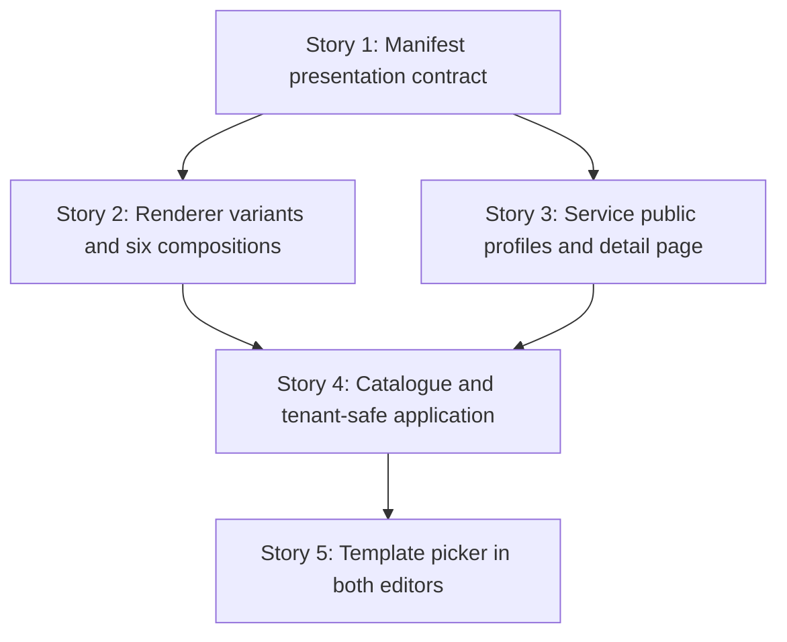

# TD56 — Hotsite template catalogue, flexible presentation engine, and service pages

## Status

- **Type:** Product-enabling technical debt / hotsite capability expansion
- **Priority:** High — this turns the existing hotsite editor from a field-by-field configuration tool into a guided way to reach materially different public-site compositions.
- **Created:** 2026-10-22
- **Decision status:** Ready for `/story-discovery`, in the sequence below. This TD follows TD55; it does not reopen TD55's visual-editor foundation.
- **Use cases:** extends UC-027 (manager manages hotsite) and adds the service-publication and visitor-detail flows described here before they are promoted into `docs/USE_CASES.md`.
- **Related:** `td/TD55-HOTSITE-VISUAL-EDITOR-UX.md`; `docs/HOTSITE_DYNAMIC_ARCHITECTURE.md`; `journeys/manager/hotsite.md`; `journeys/manager/prototypes/hotsite/editor-vision/09-inline-realistic-editor.html`; `journeys/manager/prototypes/hotsite/hotsite-impl/`.

## Problem

The hotsite engine already supports a useful set of modules and branding controls, but the resulting sites tend toward the same visual structure. Managers begin with an empty or generic configuration and must understand module configuration before they can see what Ikaro can create.

The visual editor delivered by TD55 supplies the correct interaction foundation: a persistent draft preview, contextual right inspector, an advanced detailed editor, and one shared publish flow. TD55 deliberately deferred templates, new manifest capability, and new module types. Those pieces are necessary now.

The current public service list can show a short service description, price, duration, and loyalty information, but it cannot lead a visitor to a branded service page with a richer explanation and photos. Its current booking flow is intentionally service-first and may add duration, resource, intake, staff, availability, and confirmation steps. A hotsite must therefore never simulate a date/time booking form on its home page.

## Chosen approach

Build a versioned, platform-owned catalogue of six curated templates. A template is a controlled manifesto preset plus source assets and metadata, not a tenant-owned hotsite and not a second rendering system. Selecting it changes the existing manager draft and its persistent preview. The existing Publish action remains the only action that makes it public.

Templates must create visibly different sites through reusable presentation capabilities, rather than one-off HTML structures. Extend the current manifest through closed, validated properties:

- global `navigation`, outside ordered `layout` because it is page chrome, singleton, and not independently draggable;
- semantic module `surface` choices with contrast-safe branding tokens;
- controlled presentation variants for Hero, Service List, Gallery, Testimonials, and Booking CTA;
- one reusable `PROCESS_STEPS` module; and
- a top-level `serviceDetailPage` presentation configuration for the public service subpage.

Production sections remain viewport-wide. Their background, colour and divider belong to the full-width section; only the inner content receives a maximum width. This matches the current BeloAuto renderer. The former centered 1240px prototype showcase canvas has been removed from `template-compositions.css` for the same reason.

A service owns its own marketable content. Add a `publicProfile` JSONB payload for rich copy and media, plus a normal indexed `public_slug` column with `UNIQUE (tenant_id, public_slug)`. The JSONB is appropriate for a profile always read and written as one object; the slug requires a real column for a tenant-scoped uniqueness constraint. HotsiteConfig owns only the presentation and routing choices for those details.



### Template application contract

Template selection is an intentional presentation replacement. It must:

1. update only the in-memory hotsite draft until the manager publishes;
2. copy each selected catalogue asset into `tenants/<tenantId>/hotsite/...` before its tenant manifest references it;
3. preserve live services and their IDs, booking model/policy/intake/resource configuration, tenant business information, address, contact channels, manager-configured lead-form questions, and chatbot operational availability;
4. preserve tenant identity (`brandName`, `tagline`, `logoUrl`, tenant name and SEO identity) while applying the template's palette, typography, module sequence, generic editorial copy, surfaces, and variants;
5. materialize any generic template copy using tenant identity at application time, leaving no runtime interpolation language in the published manifest;
6. never seed fictional services, staff, booking slots, reviews presented as real, or contact details; and
7. never publish automatically.

The catalogue is versioned source code/configuration maintained by Ikaro. A manager's applied result becomes an ordinary editable tenant manifest, so later catalogue changes never mutate a tenant site without an explicit new application.

### Six template directions

| Template | Composition | Engine capabilities demonstrated |
|---|---|---|
| BeloAuto | Professional, service catalogue and gallery-led | Current grid/service/gallery baseline, trusted conversion path |
| Casa47 | Dark split hero, price-menu services, editorial quote, atelier story | Split-media Hero, price-menu Service List, editorial Testimonials, About, compact booking CTA |
| Mimo Pet | Playful mosaic, rounded cards, visual discovery | Mosaic Hero/Gallery, feature-card Service List |
| Origem | Quiet editorial hierarchy and numbered rituals | Editorial Hero, numbered Service List, editorial testimonial |
| Clínica Lume | Care pathway, specialties, trust and contact | Navigation, specialty navigator, testimonials, contact surfaces |
| Lume Studio | Immersive portfolio and project enquiry | Immersive Hero, portfolio Gallery, PROCESS_STEPS, Lead Form |

The prototype HTML files remain visual references. Their bespoke markup is not production code; each difference must map to a validated reusable engine capability listed in this TD. Casa47 navigation is the reference anchor mapping: **O ritual** → TESTIMONIALS, **Serviços** → SERVICE_LIST, **A casa** → ABOUT, **Contato** → CONTACT. The labels are tenant/editorial copy; the targets are only enabled same-page modules.

### Service detail contract

A visitor reaches `/{tenantSlug}/servicos/{serviceSlug}` from a Service List whose `itemAction` is `details`. The page is branded with the same hotsite design tokens, publishes canonical metadata, provides a small “Voltar aos serviços” link, and shows only the configured content available for that service. Its primary CTA uses the existing booking route with the service preselected. The booking flow itself still determines every subsequent step from the live service model.

`publicProfile` is proposed as:

```ts
{
  coverImageUrl?: string;
  galleryImageUrls?: string[];
  longDescription?: string; // sanitized Markdown, bounded length
  inclusions?: string[];
  preparationNotes?: string;
}
```

All media uses existing public tenant storage rules. The short `description` remains the concise catalogue/card summary. A service with no public profile remains bookable and listable; it simply cannot expose a detail route until it has a public slug/profile.

## Stories

### Story 1 — Define the template-ready manifest and presentation contract

**Agent:** backend-ts + bff-ts + frontend-ts
**Complexity:** L
**Docs to load:** `docs/HOTSITE_DYNAMIC_ARCHITECTURE.md` § 1. The Hotsite Manifest Pattern, § 2. Branding & Design Token System, § 4. Module Data Contracts; `docs/DOMAIN_MODEL.md` § HotsiteConfig; `docs/API_CONTRACTS.md` hotsite endpoints; `docs/ENGINEERING_RULES_FRONTEND.md` § Hotsite full-page components; `docs/ENGINEERING_RULES_SHARED.md` § Schema-level enforcement.
**Dependencies:** TD55 Stories 1–4
**Pattern:** versioned JSONB aggregate configuration with closed-schema discriminated unions; semantic design tokens derived once at the branding boundary.

**Description:**

Extend the shared validation/types, Platform HotsiteConfig aggregate, backend/BFF contracts, manager manifest schema, preview model, and renderer configuration so the hotsite can describe the reusable capabilities in *Chosen approach*. Add `navigation`, `serviceDetailPage`, module `surface`, the closed variant enums, and the singleton `PROCESS_STEPS` module. Defaults must preserve current public output for every existing stored manifest. Unknown variants, invalid anchor targets, duplicate singleton entries, arbitrary font names, and malformed navigation must fail at the request boundary.

Navigation targets are a closed union of enabled section anchors only; links cannot be arbitrary URLs or separate routes in this first version. Booking remains available through each module’s dedicated CTA, never through global navigation. New fonts are added only through the controlled font registry. `surface` needs a semantic contrast derivation in `applyBranding()`; it must not reuse Hero-only foreground tokens for every coloured section.

Every public hotsite module section must paint its own full-width `backgroundColor` and place bounded content within it. The preview canvas and public route must share this shell behaviour. Existing defaults must remain byte-for-byte equivalent in semantic appearance.

**Backend HTTP surface:** extends existing `PATCH /v1/tenants/hotsite` and the existing public manifest response; no new endpoint.
**BFF endpoint spec:** extends manager `PATCH /v1/tenants/hotsite`, MANAGER-only, and its corresponding public hotsite manifest mapping with the validated optional properties.
**Prototype references:** `journeys/manager/prototypes/hotsite/hotsite-impl/beloauto.html`; `casa47.html`; `mimo-pet.html`; `origem.html`; `clinica-lume.html`; `lume-studio.html`; their `manifesto-*.json` fixtures.
**New migration / i18n keys / env vars / feature flags:** migration none — HotsiteConfig already stores manifest fields in JSONB; i18n keys for new guided controls in both web locales; no environment variable or feature flag.

**Files to create/modify:**

- `packages/types/src/hotsite.ts` (modify — shared manifest contract)
- `packages/validation/src/hotsite.ts` (modify — closed request schemas; confirm exact export path in discovery)
- `apps/backend/src/contexts/platform/domain/hotsite-config.types.ts` (modify)
- `apps/backend/src/contexts/platform/domain/hotsite-config.aggregate.ts` (modify)
- `apps/backend/src/contexts/platform/domain/hotsite-config.aggregate.spec.ts` (modify)
- `apps/backend/src/contexts/platform/application/` (modify existing hotsite update DTO/mapper/use case discovered in Story Discovery)
- `apps/backend/src/contexts/platform/infrastructure/controllers/` (modify existing hotsite controller/schema and specs)
- `apps/bff/src/features/platform/hotsite-admin.controller.ts` (modify)
- `apps/bff/src/features/platform/hotsite-admin.schemas.ts` (modify)
- `apps/bff/src/features/platform/hotsite-admin.controller.spec.ts` (modify)
- `apps/web/features/platform/hotsite/manifest-schema.ts` (modify)
- `apps/web/features/platform/hotsite/module-schemas.ts` (modify)
- `apps/web/features/platform/hotsite/default-layout.ts` (modify — backward-compatible defaults)
- `apps/web/features/platform/hotsite/font-config.ts` (modify)
- `apps/web/features/platform/hotsite/apply-branding.ts` (modify)
- `apps/web/features/platform/hotsite/apply-branding.spec.ts` (modify)
- `apps/web/features/platform/components/hotsite/ManifestTab.tsx` (modify)
- `apps/web/features/platform/components/hotsite/ManifestTab.spec.tsx` (modify)
- `apps/web/shells/hotsite/components/` (modify existing module shells as the full-width section shell is extracted)
- `apps/web/app/[slug]/page.tsx` (modify — navigation and PROCESS_STEPS render-plan branch)
- `packages/i18n/locales/pt-BR/web.json` (modify)
- `packages/i18n/locales/en/web.json` (modify)
- `apps/backend/http/platform/hotsite.http` (modify — confirm exact existing request-file path)
- `apps/bff/http/platform/hotsite.http` (modify — confirm exact existing request-file path)

**Acceptance criteria — product:**

- [ ] Existing published manifests render as they did before this story.
- [ ] A manager can configure only enabled same-page section anchors, surface, and presentation choices through the manifesto/detailed contract; disabled sections never leave a dead navigation item.
- [ ] Every public section paints its surface across the viewport while content remains readable and bounded.
- [ ] Unsupported values are rejected before persistence with RFC 9457 validation details.

**Acceptance criteria — technical:**

- Unit:
  - [ ] Shared schemas accept each supported variant and enabled-section anchor, and reject unknown/disabled navigation targets, duplicate singleton, and invalid surface cases.
  - [ ] Branding token tests prove readable derived tokens for each semantic surface and preserve current defaults.
  - [ ] Render-plan tests prove navigation and PROCESS_STEPS are exhaustive without changing existing module ordering.
- Integration:
  - [ ] Platform hotsite update endpoint persists and round-trips the new contract.
- Tenant isolation:
  - [ ] A manager cannot update another tenant’s manifest through the extended payload.
- E2E:
  - [ ] Detailed Manifesto editing accepts a valid new presentation field and rejects an invalid one without mutating the draft.
- [ ] Coverage ≥80% on changed code.
- [ ] `tsc --noEmit` clean, lint clean.

### Story 2 — Render reusable presentation variants and the six template compositions

**Agent:** frontend-ts
**Complexity:** L
**Docs to load:** `docs/HOTSITE_DYNAMIC_ARCHITECTURE.md` § 2. Branding & Design Token System, § 3. Module Library, § 4. Module Data Contracts; `docs/ENGINEERING_RULES_FRONTEND.md` § Hotsite full-page components and § Reuse the repo's UI primitives.
**Dependencies:** Story 1
**Pattern:** strategy selection by closed module variant, composed within existing public module boundaries.

**Description:**

Implement the public and editor-preview renderers for the approved variants. Do not add template-name conditionals to public components. A Hero, Service List, Gallery, Testimonial, Booking CTA, Navigation, and Process Steps renderer receives only its validated module data and branding tokens.

Map the six example manifests to these renderers and refine their fixtures until each has a distinct hierarchy and visual rhythm. Preserve live service data in every Service List; template content provides structure and labels, never fictional services. Booking CTAs describe the service-first journey and link to the real booking route. Testimonials used as template content must be visibly marked as sample/demonstrative in manager previews and cannot be silently presented as real tenant testimonials after applying a template; the catalogue must either omit them from a tenant result or require manager confirmation/editing before publication.

**Backend HTTP surface:** none — consumes Story 1 contract.
**BFF endpoint spec:** none — consumes current public manifest/services reads.
**Prototype references:** all six HTML/manifest pairs in `journeys/manager/prototypes/hotsite/hotsite-impl/`.
**New migration / i18n keys / env vars / feature flags:** i18n labels/descriptions for variants in both locales; no migration, environment variable, or feature flag.

**Files to create/modify:**

- `apps/web/shells/hotsite/components/HeroModule.tsx` and `HeroModule.spec.tsx` (modify)
- `apps/web/shells/hotsite/components/ServiceListModule.tsx` and `ServiceListModule.spec.tsx` (modify)
- `apps/web/shells/hotsite/components/GalleryModule.tsx` and `GalleryModule.spec.tsx` (modify)
- `apps/web/shells/hotsite/components/TestimonialsModule.tsx` and `TestimonialsModule.spec.tsx` (modify)
- `apps/web/shells/hotsite/components/BookingCtaModule.tsx` and `BookingCtaModule.spec.tsx` (modify)
- `apps/web/shells/hotsite/components/HotsiteNavigation.tsx` and `HotsiteNavigation.spec.tsx` (new)
- `apps/web/shells/hotsite/components/ProcessStepsModule.tsx` and `ProcessStepsModule.spec.tsx` (new)
- `apps/web/shells/hotsite/components/hotsite-section-shell.tsx` and its spec (new, if shared shell extraction is warranted)
- `apps/web/features/platform/components/hotsite/renderHotsitePreviewModule.tsx` and its spec (modify)
- `apps/web/features/platform/components/hotsite/HotsitePreviewCanvas.tsx` and its spec (modify)
- `apps/web/features/platform/components/hotsite/modules/` (modify/add variant controls and specs)
- `apps/web/features/platform/hotsite/module-styles.ts` and its spec (modify)
- `journeys/manager/prototypes/hotsite/hotsite-impl/template-compositions.css` (modify only to keep prototype reference aligned)
- six `manifesto-*.json` fixtures under `journeys/manager/prototypes/hotsite/hotsite-impl/` (modify)
- `packages/i18n/locales/pt-BR/web.json` (modify)
- `packages/i18n/locales/en/web.json` (modify)

**Acceptance criteria — product:**

- [ ] The six catalogue manifests produce recognizably different public compositions on desktop and mobile.
- [ ] A template’s colours and surfaces span the viewport; text/cards/media remain constrained and legible.
- [ ] Service displays always use the tenant’s active services and details; no sample service becomes tenant data.
- [ ] Booking CTAs enter the existing service-first booking flow without date/time controls on the hotsite home page.

**Acceptance criteria — technical:**

- Unit:
  - [ ] Each supported variant has a direct module-render test and an unsupported variant has no fallback branch.
  - [ ] `renderHotsitePreviewModule` uses the same variant component contract as the public route.
  - [ ] Full-width shell test proves surface fills the root while the inner content uses the shared max-width boundary.
  - [ ] PROCESS_STEPS validates its items and renders an accessible ordered process.
- E2E:
  - [ ] Public hotsite fixtures cover all six compositions, one desktop and one narrow viewport assertion each, including service-first CTA destinations.
- [ ] Coverage ≥80% on changed code.
- [ ] `tsc --noEmit` clean, lint clean.

### Story 3 — Add rich service profiles and branded public service-detail pages

**Agent:** backend-ts + bff-ts + frontend-ts
**Complexity:** L
**Docs to load:** `docs/DOMAIN_MODEL.md` § Aggregate: Service; `docs/DATABASE_SCHEMA.md` booking service table/index conventions; `docs/API_CONTRACTS.md` Booking service endpoints; `docs/HOTSITE_DYNAMIC_ARCHITECTURE.md` § 11. SEO & Discoverability; `docs/ENGINEERING_RULES_BACKEND.md` § Transactions; `docs/ENGINEERING_RULES_FRONTEND.md` § Hotsite full-page components.
**Dependencies:** Story 1
**Pattern:** Service aggregate owns its public profile; hotsite consumes it through existing cross-context HTTP/BFF composition, never a cross-context SQL join.

**Description:**

Add `public_profile JSONB` and `public_slug` to the Service aggregate/entity. The profile includes cover image, gallery images, long sanitized Markdown description, inclusions, and preparation notes. `public_slug` is nullable until a manager chooses to publish the service profile; it is unique within the tenant when present. Existing short description remains the Service List summary.

Extend manager service create/edit UI with a clear “Página pública do serviço” area, using tenant-scoped hotsite media storage. Extend the public service read surface with one safe lookup by tenant+slug. Build `/[slug]/servicos/[serviceSlug]`: it loads the hotsite manifest, live service profile, business information, and renders the configured branded detail page. It uses the exact hotsite metadata helpers and has its own `generateMetadata`, canonical URL, and indexability policy. The public route returns unavailable for unpublished hotsites, inactive/missing services, or services without a public profile.

Add `SERVICE_LIST.itemAction` (`details | booking | none`) and a manager-facing CTA label. `details` uses the live service slug; booking receives the service ID only. Make the shared booking deep-link URL builder accept a service-only seed instead of forcing every caller to invent a date query parameter.

**Backend HTTP surface:** extend authenticated service create/update and public services with profile fields; add `GET /v1/public/services/:publicSlug` scoped by the tenant resolved from the public request.
**BFF endpoint spec:** extend manager `POST/PATCH /services`; add public `GET /public/services/:publicSlug`, tenant resolved exclusively from the hotsite slug/server context, response excludes manager-only booking configuration.
**Prototype references:** `journeys/manager/prototypes/hotsite/hotsite-impl/origem.html` (ritual detail intent and service-first CTA); `casa47.html`; `clinica-lume.html`.
**New migration / i18n keys / env vars / feature flags:** migration adds `public_profile JSONB NULL`, `public_slug VARCHAR NULL`, and tenant-first unique partial index; i18n keys for service profile and public detail page in both locales; no environment variable or feature flag.

**Files to create/modify:**

- `apps/backend/src/contexts/booking/domain/service.aggregate.ts` and `service.spec.ts` (modify)
- `apps/backend/src/contexts/booking/domain/service.types.ts` (modify)
- `apps/backend/src/contexts/booking/application/use-cases/create-service.use-case.ts` and spec (modify)
- `apps/backend/src/contexts/booking/application/use-cases/update-service.use-case.ts` and spec (modify)
- `apps/backend/src/contexts/booking/application/use-cases/service-result.mapper.ts` and spec (modify)
- `apps/backend/src/contexts/booking/infrastructure/entities/service.entity.ts` (modify)
- `apps/backend/src/contexts/booking/infrastructure/repositories/typeorm-service.mapper.ts` (modify)
- `apps/backend/src/contexts/booking/infrastructure/migrations/` (new migration)
- `apps/backend/src/contexts/booking/infrastructure/controllers/service.controller.ts` and specs (modify)
- `apps/backend/src/contexts/booking/infrastructure/controllers/service-public.controller.ts` and specs (modify)
- `apps/backend/http/booking/services.http` (modify — confirm existing path in discovery)
- `apps/bff/src/features/booking/services.controller.ts`, `.schemas.ts`, `.types.ts`, `.mapper.ts`, and specs (modify)
- `apps/bff/src/features/booking/services.public.controller.ts` and specs (modify)
- `apps/bff/http/booking/services.http` (modify — confirm existing path in discovery)
- `apps/web/features/booking/components/dashboard/` service form component and spec (modify exact current sibling after discovery)
- `apps/web/features/booking/api/services.ts` and spec (modify)
- `apps/web/features/platform/hotsite/api/services.server.ts` and spec (modify)
- `apps/web/features/platform/hotsite/seo.ts` and spec (modify)
- `apps/web/features/platform/hotsite/booking-deep-link.ts` or the existing shared deep-link module and spec (modify exact owner after discovery)
- `apps/web/app/[slug]/servicos/[serviceSlug]/page.tsx` (new)
- `apps/web/app/[slug]/servicos/[serviceSlug]/page.spec.tsx` only if page-level unit coverage is practical; otherwise extract and test presentation under `apps/web/shells/hotsite/components/`
- `apps/web/shells/hotsite/components/ServiceDetailPage.tsx` and `.spec.tsx` (new)
- `apps/web/shells/hotsite/components/ServiceListModule.tsx` and spec (modify)
- `packages/i18n/locales/pt-BR/web.json` (modify)
- `packages/i18n/locales/en/web.json` (modify)

**Acceptance criteria — product:**

- [ ] A manager can give a service a public slug, long description, cover/gallery images, inclusions, and preparation notes.
- [ ] A visitor can open a branded service page, return to the service list, and begin booking with that exact service preselected.
- [ ] The service detail never exposes unpublished/tenant-external service data or manager booking configuration.
- [ ] A service without a public profile remains available in existing booking/service-list flows.

**Acceptance criteria — technical:**

- Unit:
  - [ ] Service aggregate validates profile bounds, normalized slug, and profile/media shape.
  - [ ] Booking deep-link builder has a named service-only seed test and does not add a fake date.
  - [ ] Service detail presentation handles every optional profile field and branded surface safely.
- Integration:
  - [ ] Service persistence enforces tenant-scoped unique public slug and maps profile JSONB losslessly.
  - [ ] Public service endpoint returns only one service for the resolved tenant and rejects inactive/missing/profileless cases.
- Tenant isolation:
  - [ ] The same public slug may exist in two tenants, while a request resolved for tenant A can never read tenant B’s profile.
- E2E:
  - [ ] Manager creates/edits a profile; visitor opens its branded detail page, uses Back, and enters booking with the correct selected service.
- [ ] Coverage ≥80% on changed code.
- [ ] `tsc --noEmit` clean, lint clean.

### Story 4 — Build the versioned template catalogue and tenant-safe application service

**Agent:** backend-ts + bff-ts + frontend-ts
**Complexity:** L
**Docs to load:** `docs/HOTSITE_DYNAMIC_ARCHITECTURE.md` § 1. The Hotsite Manifest Pattern and image-storage rules; `docs/DOMAIN_MODEL.md` § HotsiteConfig and Service; `docs/ENGINEERING_RULES_BACKEND.md` § Transactions; `docs/ENGINEERING_RULES_SHARED.md` § Schema-level enforcement; `docs/BFF_ARCHITECTURE.md` § Web → BFF Transport Layer.
**Dependencies:** Stories 2 and 3
**Pattern:** immutable versioned preset catalogue plus application service that materializes a tenant-owned manifest and copies assets before atomic configuration save.

**Description:**

Create six platform-owned template definitions with a stable ID, version, manager-facing metadata, thumbnail, supported use cases, source manifest, and source assets. Source manifests must pass the same shared validation as a tenant manifest. Catalogue images are not emitted into tenant manifests directly: applying a template copies them through an explicit storage port to the tenant’s public hotsite namespace, validates resulting paths, then materializes the target manifest.

Expose a manager-only catalogue list and a preview/apply operation. The apply operation receives the tenant’s current manifest and identity/business data, resolves the preservation rules in *Template application contract*, returns an ordinary draft-shaped manifest, and does not set `isPublished`. It does not create or modify Services. A temporary preview uses the returned manifest through TD55’s client-side preview mechanism. If asset copying fails, no manifest update is persisted and temporary copied objects are cleaned up best-effort.

The template catalogue must never embed a template business’s literal name, address, booking availability, staff, fake customer testimonials, or cross-tenant asset path in a tenant result. Catalogue testimonial examples are excluded on application unless the manager explicitly converts them into clearly labelled placeholder copy before publish; the safest initial catalogue outcome is to disable Testimonials where no tenant-provided data exists.

**Backend HTTP surface:** add manager-only `GET /v1/tenants/hotsite/templates` and `POST /v1/tenants/hotsite/templates/:templateId/apply`; the latter returns materialized draft content and does not persist/publish it.
**BFF endpoint spec:** `GET /hotsite/templates`, MANAGER JWT, response `{ id, version, name, description, thumbnailUrl, capabilities }[]`; `POST /hotsite/templates/:id/apply`, MANAGER JWT, response `{ content: HotsiteAdminContentResponse, appliedTemplate: { id, version } }`; tenant derived from JWT only.
**Prototype references:** six `manifesto-*.json` files and six HTML files in `journeys/manager/prototypes/hotsite/hotsite-impl/`.
**New migration / i18n keys / env vars / feature flags:** migration none unless discovery proves durable per-application audit metadata is a product requirement; i18n names/descriptions/errors in both locales; no feature flag. Template source assets are checked-in/deployed catalogue assets, never generated per request.

**Files to create/modify:**

- `apps/backend/src/contexts/platform/application/services/` (new template-catalogue resolver and manifest materializer with specs)
- `apps/backend/src/contexts/platform/application/ports/` (new catalogue and asset-copy ports if no suitable existing storage port exists)
- `apps/backend/src/contexts/platform/infrastructure/` (new catalogue adapter and storage-copy adapter with specs)
- `apps/backend/src/contexts/platform/infrastructure/controllers/` (new/modified hotsite template controller and specs)
- `apps/backend/src/contexts/platform/platform.module-providers.ts` (modify — wire ports; confirm actual provider file)
- `apps/backend/http/platform/hotsite-templates.http` (new)
- `apps/bff/src/features/platform/hotsite-templates.controller.ts` and component/unit specs (new)
- `apps/bff/src/features/platform/hotsite-templates.schemas.ts` and `.types.ts` (new)
- `apps/bff/src/features/platform/platform.module.ts` (modify if controller registration needs it)
- `apps/bff/http/platform/hotsite-templates.http` (new)
- `apps/web/features/platform/hotsite/api/templates.ts` and spec (new)
- `apps/web/features/platform/hotsite/template-catalogue.ts` and spec (new client mapping only; source definitions stay server-side)
- `journeys/manager/prototypes/hotsite/hotsite-impl/manifesto-*.json` (modify/finalize as catalogue fixtures)
- `journeys/manager/prototypes/hotsite/hotsite-impl/assets/` (modify/finalize source visual assets)
- `packages/i18n/locales/pt-BR/web.json` (modify)
- `packages/i18n/locales/en/web.json` (modify)

**Acceptance criteria — product:**

- [ ] A manager can see six named, visually distinct template choices with meaningful descriptions of their composition.
- [ ] Applying a template updates only the manager draft/preview and does not publish.
- [ ] Applying a template preserves tenant identity, operational business data, services, and booking configuration.
- [ ] Every applied image is a valid tenant-owned public hotsite asset path.
- [ ] A failed asset copy leaves the published site and saved draft unchanged.

**Acceptance criteria — technical:**

- Unit:
  - [ ] Every catalogue definition validates against the shared manifest schema.
  - [ ] Materialization tests pin the preservation matrix for identity, services, contact, booking, lead form, chatbot, and SEO identity.
  - [ ] A template cannot materialize a foreign-tenant asset path, literal example business identity, or fictional service ID.
- Integration:
  - [ ] Apply endpoint copies assets, returns a tenant-scoped draft, and does not alter `isPublished` or persist a HotsiteConfig mutation.
  - [ ] Asset-copy failure rolls back the logical operation and performs best-effort cleanup.
- Tenant isolation:
  - [ ] A manager from tenant A cannot list/apply through tenant B context or obtain B’s copied asset path.
- E2E:
  - [ ] A manager applies Casa47 and then Lume Studio, sees each draft in preview, refreshes before publish, and confirms the public site remains unchanged.
- [ ] Coverage ≥80% on changed code.
- [ ] `tsc --noEmit` clean, lint clean.

### Story 5 — Add the template picker to visual and detailed hotsite editing

**Agent:** frontend-ts
**Complexity:** L
**Docs to load:** `td/TD55-HOTSITE-VISUAL-EDITOR-UX.md` § Editor state model and Story 2; `docs/DASHBOARD_FRONTEND_ARCHITECTURE.md` § Shared Component Library; `docs/ENGINEERING_RULES_FRONTEND.md` § Reuse the repo's UI primitives; `docs/HOTSITE_DYNAMIC_ARCHITECTURE.md` relevant manager manifest controls.
**Dependencies:** Story 4
**Pattern:** shared editor-draft reducer with a catalogue selection context and explicit local-to-draft apply transition.

**Description:**

Add **Templates** to TD55’s visual command row. It opens the existing right-side inspector in a template-gallery context, not a modal. The gallery shows six thumbnail cards, selected state, template name, concise composition description, and the capabilities it enables. Selecting a card obtains the materialized draft through Story 4, then updates the in-memory draft and preview. It uses TD55’s dirty-module protection: a dirty module buffer must be applied or discarded before the context changes, and selection failures keep the existing draft intact.

The detailed editor receives the same gallery and a path to all new navigation, presentation, process-step, and service-detail controls. It does not duplicate template application state or create a second draft. Managers can still edit every field after choosing a template. Publish uses the normal TD55 single draft flow.

The inline prototype becomes authoritative for visual hierarchy only: `09-inline-realistic-editor.html`, `09-inline-interactions.js`, and `vision.css` must be updated to show all six real options and the full-width preview behaviour. The prototype must route its buttons/anchors to meaningful local states; it must not show fake availability slots.

**Backend HTTP surface:** none — consumes Story 4 BFF endpoints.
**BFF endpoint spec:** none — consumes Story 4 endpoints through `bffClient` hooks.
**Prototype references:** `journeys/manager/prototypes/hotsite/editor-vision/09-inline-realistic-editor.html`, `09-inline-interactions.js`, `vision.css`; `journeys/manager/prototypes/hotsite/hotsite-impl/`.
**New migration / i18n keys / env vars / feature flags:** add template-gallery labels, loading/error, selection and preservation-copy keys in both locales; no migration, environment variable, or feature flag.

**Files to create/modify:**

- `apps/web/features/platform/components/hotsite/VisualCommandRow.tsx` and `.spec.tsx` (modify)
- `apps/web/features/platform/components/hotsite/VisualHotsiteEditorView.tsx` and `.spec.tsx` (modify)
- `apps/web/features/platform/components/hotsite/VisualModuleInspector.tsx` and `.spec.tsx` (modify)
- `apps/web/features/platform/components/hotsite/HotsiteEditor.tsx` and `.spec.tsx` (modify)
- `apps/web/features/platform/components/hotsite/useHotsiteEditorSession.ts` and `.spec.ts` (modify)
- `apps/web/features/platform/components/hotsite/HotsiteTemplateGallery.tsx` and `.spec.tsx` (new)
- `apps/web/features/platform/components/hotsite/hotsite-template-application.ts` and `.spec.ts` (new, reducer/helper boundary)
- `apps/web/features/platform/components/hotsite/HotsiteEditorMainView.tsx` and `.spec.tsx` (modify — detailed-editor entry)
- `apps/web/features/platform/components/hotsite/modules/` (modify/add controls for navigation, surfaces, variants, process steps, service-detail page)
- `apps/web/e2e/hotsite-editor.spec.ts` (modify)
- `journeys/manager/prototypes/hotsite/editor-vision/09-inline-realistic-editor.html` (modify)
- `journeys/manager/prototypes/hotsite/editor-vision/09-inline-interactions.js` (modify)
- `journeys/manager/prototypes/hotsite/editor-vision/vision.css` (modify)
- `packages/i18n/locales/pt-BR/web.json` (modify)
- `packages/i18n/locales/en/web.json` (modify)

**Acceptance criteria — product:**

- [ ] Templates is visible in the visual editor command row and opens the right inspector gallery.
- [ ] All six options show distinct composition previews and explain their main visual approach.
- [ ] Selecting a template changes the local preview and draft without publishing.
- [ ] A manager can edit any applied template in both visual and detailed editors and then publish through the existing flow.
- [ ] Switching away from a dirty module edit before choosing a template follows TD55’s Apply-or-discard rule.

**Acceptance criteria — technical:**

- Unit:
  - [ ] Gallery renders catalogue loading, success, error, selected, and retry states accessibly.
  - [ ] Editor session tests prove template selection replaces only the materialized draft after dirty-buffer resolution and preserves the one shared draft across visual/detailed round trips.
  - [ ] A failed apply result leaves the current draft reference/content unchanged.
  - [ ] New module panels exhaustively cover each Story 1 presentation field.
  - [ ] Axe check covers command row, gallery cards, keyboard selection, and inspector focus movement.
- E2E:
  - [ ] Manager opens Templates, previews Mimo Pet, applies Origem, edits a service-list action, enters detailed editing and returns with the same draft, then publishes.
  - [ ] A dirty Hero edit prompts before a template can replace the draft; Cancel keeps Hero, Discard allows replacement.
- [ ] Coverage ≥80% on changed code.
- [ ] `tsc --noEmit` clean, lint clean.

## Documentation and journey updates after implementation

The stories above must promote the finalized decisions into the canonical documents, without duplicating rules across them:

- `docs/HOTSITE_DYNAMIC_ARCHITECTURE.md`: manifest fields, renderer variants, asset handling, and detail-page SEO.
- `docs/DOMAIN_MODEL.md`: Service public profile and HotsiteConfig additions.
- `docs/DATABASE_SCHEMA.md`: Service profile fields and unique partial index.
- `docs/API_CONTRACTS.md`: template catalogue/application and public service-detail endpoints.
- `docs/USE_CASES.md`: extend UC-027 and add service-publication/visitor-detail use cases.
- `journeys/manager/hotsite.md` and prototype dev notes: Templates flow and service-profile editing journey.

## Out of scope

- Arbitrary custom HTML/CSS or tenant-authored module templates.
- Dragging arbitrary navigation items into the ordered page layout.
- Per-template tenant analytics, A/B experiments, marketplace distribution, or paid templates.
- Home-page booking calendars, manually presented availability slots, or changes to the booking state machine.
- Replacing the current booking flow or importing template businesses’ fictional services, staff, contacts, availability, or customer reviews.
- Automatic template upgrades after a manager has applied one.
