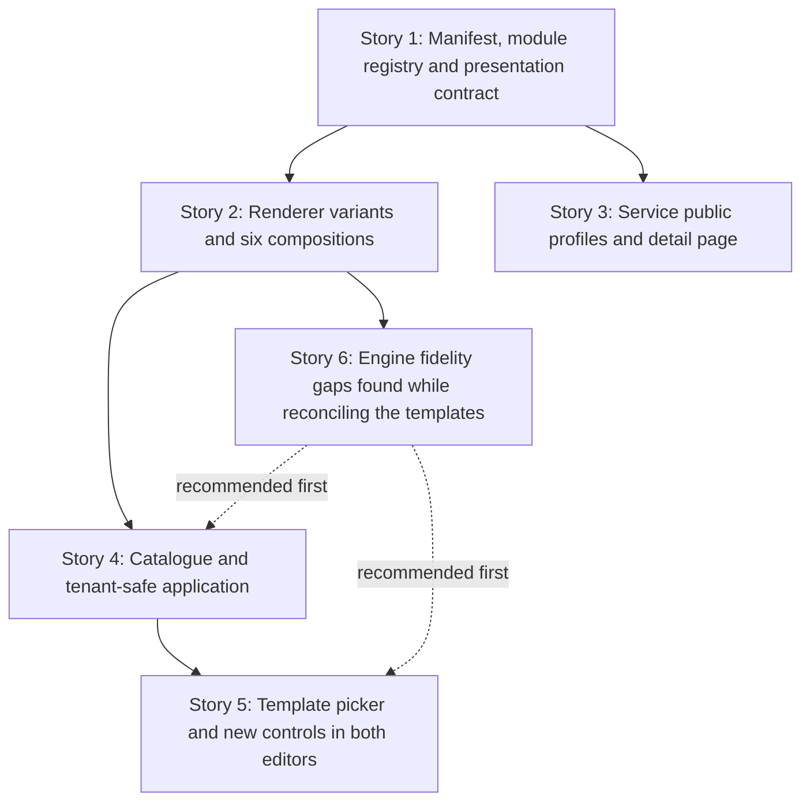

# TD56 — Hotsite template catalogue, flexible presentation engine, and service pages

## Status

- **Type:** Product-enabling technical debt / hotsite capability expansion
- **Priority:** High — this turns the existing hotsite editor from a field-by-field configuration tool into a guided way to reach materially different public-site compositions.
- **Created:** 2026-10-22
- **Decision status:** Ready for `/story-discovery`, in the sequence below. This TD follows TD55; it does not reopen TD55's visual-editor foundation.
- **Use cases:** extends UC-027 (manager manages hotsite) and adds the service-publication and visitor-detail flows described here before they are promoted into `docs/USE_CASES.md`.
- **Related:** `td/TD55-HOTSITE-VISUAL-EDITOR-UX.md` (all five stories done); `docs/HOTSITE_DYNAMIC_ARCHITECTURE.md`; `journeys/manager/hotsite.md`; `journeys/manager/prototypes/hotsite/editor-vision/09-inline-realistic-editor.html`; `journeys/manager/prototypes/hotsite/hotsite-impl/`.

## Decisions locked (2026-10-22 review — do not reopen in discovery)

1. **No new top-level manifest keys, no migration for the hotsite.** `hotsite_configs` stores `branding`, `layout` and `seo` as JSONB; everything new fits inside `layout`. Navigation is a **module** (`NAVIGATION`); the service-detail-page settings are a nested object inside `SERVICE_LIST.data`.
2. **Template images are shared, not copied.** Catalogue assets are platform-owned, public, versioned and immutable; every tenant manifest may reference the same path. There is no per-tenant asset copy, rollback or orphan cleanup. (Story 4 discovery, 2026-10-23: they live in `ikaro-public-<env>` under `shared/hotsite-templates/<templateId>/v<n>/<file>`, are delivered by a create-only CI sync inside the existing deploy jobs, and the path index is append-only across every released version — see Story 4's *Decisions locked at story-discovery*.)
3. **Templates keep their sample testimonials.** They are ordinary `TESTIMONIALS` data the manager sees and edits; the editor labels them as sample content (see *Template application contract*).
4. **Module registry grows by two types** — `NAVIGATION` and `CONTENT_BLOCK` — so a layout holds at most 12 modules (today 10).
5. **The backend validates every module's `data` in full (Story 1, shipped 2026-10-23, PR #659).** One canonical `discriminatedUnion('type')` in `@ikaro/validation` covers all twelve module types. The strict shapes (`NAVIGATION`, `CONTENT_BLOCK`, `presentation`, `SERVICE_LIST.data.detailPage`) are defined **once** in `@ikaro/types` (`packages/types/src/hotsite-schemas.ts`) and imported by both `@ikaro/validation` and `apps/web` — a duplicate in each app failed SonarCloud's duplication gate. The ten existing types use loose objects (declared keys fully validated, unknown keys tolerated) and stay an independent web mirror, held together by the shared contract fixtures (`@ikaro/types/testing/hotsite-module-contract`). Also shipped: the branding font allow-list (`HOTSITE_FONT_FAMILIES` plus the legacy `'Inter, sans-serif'` default) and one `HOTSITE_IMAGE_PURPOSES` tuple.
6. **The Manifesto tab stays consistent with today's split:** it rejects on the web what would break the client at once (shape, unique types, data and `presentation` validity, NAVIGATION first) and leaves business rules that need the whole layout (a navigation target must be an enabled module) to the backend, shown on Publish through the existing banner.
7. **An invalid `presentation` at render time is ignored** (the module renders with defaults); it never removes the module the way malformed `data` does.
8. **`NAVIGATION` is an ordinary module** (own `data`, own `enabled` toggle) with one exception: it is pinned first and cannot be dragged. Story 1 enforces that behaviour; the visible affordance is designed in Story 5, when the row first appears for a manager.

## Problem

The hotsite engine already supports a useful set of modules and branding controls, but the resulting sites tend toward the same visual structure. Managers begin with an empty or generic configuration and must understand module configuration before they can see what Ikaro can create.

The visual editor delivered by TD55 supplies the correct interaction foundation: a persistent draft preview, contextual right inspector, an advanced detailed editor, and one shared publish flow. TD55 deliberately deferred templates, new manifest capability, and new module types. Those pieces are necessary now.

The current public service list can show a short service description, price, duration, and loyalty information, but it cannot lead a visitor to a branded service page with a richer explanation and photos. Its current booking flow is intentionally service-first and may add duration, resource, intake, staff, availability, and confirmation steps. A hotsite must therefore never simulate a date/time booking form on its home page.

## Chosen approach

Build a versioned, platform-owned catalogue of six curated templates. A template is a controlled manifesto preset plus shared source assets and metadata, not a tenant-owned hotsite and not a second rendering system. Selecting it changes the existing manager draft and its persistent preview. The existing Publish action remains the only action that makes it public.

Templates must create visibly different sites through reusable presentation capabilities, rather than one-off HTML structures. Each module type remains a singleton in `layout`; this TD does not add repeatable modules. Extend the current manifest through closed, validated properties, all inside `layout[]` entries (`{ type, enabled, data, presentation? }`):

- a singleton `NAVIGATION` module — page chrome rendered **first, above Hero**; the manager can enable/disable and edit it but cannot drag it (the backend and the layout editor both enforce "NAVIGATION is always first");
- an optional `presentation` object, a **sibling of `data`** in the module entry (never a key inside `data`): semantic section presentation (`surface`, content width, minimum height, padding, optional background image and overlay), with contrast-safe branding tokens;
- controlled, module-specific layout variants for Hero, Service List, Gallery, Testimonials, About, Booking CTA, and Lead Form (extending the existing `variant`/`layout` fields — see Story 2);
- one singleton `CONTENT_BLOCK` module with a closed variant union for trust grids, image statements, immersive statements, process steps, collages, and technical callouts; and
- on `SERVICE_LIST.data`: `itemAction`, `itemCtaLabel` and a nested `detailPage` object that configures how every public service detail page looks.

Production sections remain viewport-wide. Their background, colour and divider belong to the full-width section; only the inner content receives a maximum width. This matches the current BeloAuto renderer. The former centered 1240px prototype showcase canvas has been removed from `template-compositions.css` for the same reason.

The manifest keeps module business data separate from optional `presentation` data. Presentation is a closed object: `surface` (`background | secondary | primary | custom`), `customColor` (required only for `custom`, strict `#RRGGBB`), `contentWidth` (`narrow | standard | wide | full`), `minHeight` (`auto | sm | md | lg | viewport`), `padding` (`none | compact | comfortable | spacious`), optional `background` (`imageUrl`, focal `position`) and optional, **separate** `overlay`. Overlay is a closed union: `none`, `solid` (`color`, `opacity`), or `linear-gradient` (`direction`, `fromColor`, `fromOpacity`, `toColor`, `toOpacity`). Directions are a fixed enum, colors are strict hex, opacity is 0–1, and irrelevant fields are rejected. `overlay` is a sibling of `background`, not nested inside it, because it must also work over a module's *own* background image (see below). Background image placement preserves existing focal-point behavior. New hotsite sections use a shared full-width section shell; module-specific variants arrange content inside it. Omitted presentation fields resolve to the current renderer defaults.

Which modules accept `presentation`: `HERO`, `SERVICE_LIST`, `GALLERY`, `TESTIMONIALS`, `BOOKING_CTA`, `ABOUT`, `CONTACT`, `LEAD_FORM`, `CONTENT_BLOCK`; it is rejected on `NAVIGATION`, `FOOTER` and `CHATBOT`. `presentation.background` is accepted only on modules that have no background image of their own (`SERVICE_LIST`, `GALLERY`, `TESTIMONIALS`, `ABOUT`, `CONTACT`, `CONTENT_BLOCK`); `HERO`, `BOOKING_CTA` and `LEAD_FORM` keep their existing `data.backgroundImageUrl`/`backgroundImagePosition` and reject `presentation.background`, so one section never has two competing background images. `presentation.overlay` is accepted on every module that accepts `presentation` and is drawn over whichever background image the section has (its own, or `presentation.background`); with no image it simply tints the section surface. This is what gives Hero, which today has **no overlay or scrim at all**, its gradient.

**Precedence with today's branding switches.** An explicit `presentation.surface` always wins. When it is absent, behaviour is exactly today's: `branding.alternateSectionBg` alternation (`bgVariant`), `branding.heroBgStyle`, and each module's own `bgStyle`. `NAVIGATION` is not a render-plan section: it is consumed by the page/preview and handed to `HotsiteAuthBar`, so it never takes part in alternation or dividers and the existing "first section has no divider" rule is unchanged. `CONTENT_BLOCK` alternates like `ABOUT`/`TESTIMONIALS` unless it sets `presentation.surface`.

`NAVIGATION` data is `{ items: { label: string (1–30 chars); target: 'service-list' | 'gallery' | 'testimonials' | 'about' | 'contact' }[] }`, at most 6 items. Targets are the existing same-page section anchors (`#service-list`, `#gallery`, `#testimonials`, `#about`, `#contact`); booking is never a navigation item (each module's own CTA reaches it) and the separate `/lead-form` route is not an anchor. Every item's target must be an **enabled** module in the same layout. The backend rejects a save that violates this, and the editor surfaces the same rule before saving (disabling a module referenced by the navigation explains why and offers to remove the item) — a disabled section never leaves a dead link. On the public page the navigation lives in the existing top bar region (`HotsiteAuthBar`: logo, Área da Equipe, Entrar) on desktop and collapses into a menu on mobile; there is never a second competing header. Confirm the exact bar integration in discovery against TD55 Story 5, but the one-header rule is fixed.

`SERVICE_LIST.data` gains: `itemAction?: 'details' | 'booking' | 'none'` (omitted ⇒ `none`, which is today's behaviour — service cards have no action), `itemCtaLabel?: string` (≤ 40 chars), and `detailPage?: { heroStyle: 'cover' | 'compact'; galleryLayout: 'grid' | 'featured'; showPrice: boolean; showDuration: boolean; showLoyaltyPoints: boolean; bookingCtaLabel?: string (≤ 40) }`. Omitted `detailPage` resolves to `{ heroStyle: 'cover', galleryLayout: 'grid', showPrice: true, showDuration: true, showLoyaltyPoints: true }`. The set is closed; adding a field later is a new story. If `SERVICE_LIST` is disabled or absent, detail pages remain reachable by direct URL using these defaults — they are simply not linked from the home page.

`CONTENT_BLOCK` remains one module entry and one selected variant at a time. Its closed variants are `trust-grid`, `image-statement`, `immersive-statement`, `process-steps`, `collage-callout`, and `technical-callout`. `data` is a discriminated union on `data.variant`, every variant a strict object (unknown keys rejected). Common to all six: `variant`; `align?: 'left' | 'center' | 'right'` (omitted ⇒ the variant's own default); `eyebrow?` ≤ 60 chars; `title` required, ≤ 120; `body?` ≤ 1000 (restricted Markdown, below); `cta?: { label ≤ 40; target: 'booking-form' | 'service-list' | 'gallery' | 'testimonials' | 'about' | 'contact' }` — the same target set as Hero's `ctaTarget`, not cross-checked against enabled modules, exactly like Hero. Variant-specific fields: `trust-grid` — `items` 2–6 × `{ label ≤ 60; description? ≤ 140 }`; `process-steps` — `items` 2–6 × `{ title ≤ 60; body ≤ 240 }`, the renderer numbers the steps (no stored number); `collage-callout` — `images` 2–4 × `{ url; alt? ≤ 120 }`, `url` a non-empty hotsite image path and an empty `alt` meaning decorative; `technical-callout` — `facts?` 0–4 × `{ value ≤ 20; label ≤ 40 }`; `image-statement` and `immersive-statement` — no extra fields, their imagery comes from `presentation.background`. `collage-callout.images[].url` is the only image slot inside `CONTENT_BLOCK.data`. Rich text is Markdown with a documented size bound; it is never arbitrary HTML. Everywhere this TD renders Markdown (CONTENT_BLOCK bodies and the service `longDescription`) it uses one shared, restricted renderer: `react-markdown` + `rehype-sanitize` (already in `apps/web`), allowing paragraphs, emphasis, lists and links only — **no raw HTML and no images** (images come only from the validated image slots), links get `rel="noopener noreferrer nofollow"`. The module does not introduce repeatable modules or arbitrary CSS.

**Story boundary rule (compile safety).** `HotsiteModuleType` feeds several exhaustive, non-partial maps — web `MODULE_SCHEMAS` in `page-model.ts` (`satisfies Record<HotsiteModuleType, …>`), `MODULE_CONFIG_PANELS` in `hotsite-editor-lazy-panels.tsx` (deliberately a non-partial `Record`), the `hotsite.layout.modules.*` i18n labels, the preview renderer — so adding the two types in Story 1 breaks `tsc` unless each map gets an entry in the same story. Therefore: Story 1 owns the data contract and adds the minimal entries those maps need (schema + parse entry, a labelled placeholder panel entry, i18n labels); Story 2 renders the two modules; **Story 5 owns the real panels and is what makes the two types visible in the editor.** Until Story 5, `materializeLayout` does **not** append `NAVIGATION`/`CONTENT_BLOCK` as disabled rows (otherwise the Layout list would show a row whose Configure opens a placeholder), so they exist only when a manifest already contains them (JSON editing, or an applied template once Story 4/5 ship). Story 5 flips that rule on.

A service owns its own marketable content. Add a `publicProfile` JSONB payload for rich copy and media, plus a `public_page_published` boolean (the manager's publish switch), plus a normal `public_slug` column — generated by the system on first publish, never typed by a manager — with a tenant-scoped partial unique index (`UNIQUE (tenant_id, public_slug) WHERE public_slug IS NOT NULL`). The JSONB is appropriate for a profile always read and written as one object; the slug requires a real column for a tenant-scoped uniqueness constraint. HotsiteConfig owns only the presentation and routing choices for those details (`SERVICE_LIST.data.itemAction`/`detailPage`).



### Template application contract

Template selection is an intentional presentation replacement. It must:

1. update only the in-memory hotsite draft until the manager publishes;
2. reference each catalogue image by its shared, immutable catalogue path `shared/hotsite-templates/<templateId>/v<assetVersion>/<file>` — no per-tenant copy is made, and a tenant that later replaces a template image with its own upload never touches the shared object;
3. preserve live services and their IDs, booking model/policy/intake/resource configuration, tenant business information, address, contact channels, manager-configured lead-form questions, and chatbot operational availability;
4. preserve tenant identity (`brandName`, `tagline`, `logoUrl`, tenant name and SEO identity) while applying the template's palette, typography, module sequence, generic editorial copy, surfaces, and variants;
5. materialize any generic template copy using tenant identity at application time, leaving no runtime interpolation language in the published manifest;
6. never seed fictional services, staff, booking slots, or contact details, and never name a real person or business in sample copy; and
7. never publish automatically.

**Sample testimonials are allowed.** A template may ship generic `TESTIMONIALS` items (generic author labels, no real people or businesses). They are ordinary manifest data the manager can edit or delete. Because they are not real tenant reviews, the editor must make that visible: manager previews label them as sample content, and applying a template that contains them shows a notice in the inspector ("this template includes sample testimonials — edit or remove them before publishing"). Publishing is not blocked.

**Catalogue assets** are platform-owned, public, immutable and versioned: a changed image ships as a new `v<version>` path, never an in-place overwrite. They are deployed and optimised separately from the checked-in prototype PNGs (`hotsite-impl/assets` is ~78 MB and is a design reference, not a deployable asset). Path rules: the manifest image-path validation accepts `tenants/<tenantId>/hotsite/...`, a promotable `tmp/` upload, **or** an exact path registered in the catalogue index (never a `shared/` wildcard); the catalogue index is the append-only `asset-manifest.json` covering every released version, not only the current definitions; the image URL resolver resolves catalogue paths to their public URL with no change; the superseded-image deletion logic only ever deletes `tenants/<tenantId>/...` paths, so a shared object can never be deleted through a tenant save.

The catalogue is versioned source code/configuration maintained by Ikaro. A manager's applied result becomes an ordinary editable tenant manifest, so later catalogue changes never mutate a tenant site without an explicit new application.

### Six template directions

| Template | Composition | Engine capabilities demonstrated |
|---|---|---|
| BeloAuto | Full-bleed automotive campaign; hero first, then trust strip, service cards, gallery and booking CTA | Image Hero (its own `backgroundImageUrl` and focal point) with a `presentation.overlay` linear-gradient; trust-grid CONTENT_BLOCK; grid Service List; featured Gallery; Booking CTA with `contentWidth: wide` |
| Casa47 | Dark luxury editorial; asymmetric split hero, numbered price menu, quote, then atelier story | NAVIGATION; left-aligned Hero with `rightPanel: image` (the "split"); numbered Service List; editorial-quote Testimonials; image-statement CONTENT_BLOCK; Booking CTA with `contentWidth: narrow` (the "compact") |
| Mimo Pet | Playful scrapbook; staggered mosaic, color bands, discovery gallery, services later | Image-free playful Hero; collage-callout CONTENT_BLOCK; masonry Gallery; feature-card Service List; testimonial carousel |
| Origem | Quiet wellness journal; typography-led opening, ritual menu and long-form editorial rhythm | No-image editorial Hero; numbered Service List; immersive-statement CONTENT_BLOCK; editorial quote; image-led About |
| Clínica Lume | Structured care pathway; calm split opening, specialty navigation, proof and contact | NAVIGATION; left-aligned Hero with `rightPanel: image`; trust-grid CONTENT_BLOCK; list Service List; testimonial grid; Contact with the existing `displayStyle: icon-cards`; no booking form on landing |
| Lume Studio | Art-directed portfolio; immersive image opening, project sequence, asymmetric work gallery and enquiry | Immersive Hero; process-steps CONTENT_BLOCK; portfolio Gallery; split About; immersive Lead Form |

The prototype HTML files remain visual references. Their bespoke markup is not production code; each difference must map to a validated reusable engine capability listed in this TD. Each template must differ in its ordered module sequence, at least one strong module variant, and at least one section presentation choice; palette and imagery alone do not qualify as distinct. (Decided 2026-10-23: two templates may enable the same *set* of modules — the prototypes themselves do — so the bare enabled set is not a distinctness criterion; `template-fixtures.spec.ts` no longer asserts it. Every prototype shows a header with links, so every template carries an enabled `NAVIGATION` module whose items mirror the prototype's links; the header's booking button is not part of `NAVIGATION` (see Story 6, G11).) Casa47's `NAVIGATION` module is the reference anchor mapping: **O ritual** → `testimonials`, **Serviços** → `service-list`, **A casa** → `about`, **Contato** → `contact`. The labels are tenant/editorial copy; the targets are only enabled same-page modules.

The six `manifesto-*.json` files in `hotsite-impl/` still use today's schema (no `presentation`, `NAVIGATION` or `CONTENT_BLOCK`), and `manifesto-v2-layout-proposal.json` is a superseded sketch whose shapes differ from this TD (for example it nests `cta` inside CONTENT_BLOCK and lists a `lead-form` target; this TD's contract wins). Story 2 owns rewriting the six fixtures to the final schema (done, PR #660), and those fixtures — not the prose table above — are the source of truth for each template's exact module order, enabled set and variants. Story 4 moves them into `packages/hotsite-templates/definitions/` (structure) and `copy/<locale>/` (strings), replaces their fictional image URLs with catalogue paths and their literal business names with placeholders, and drops their `seo.ogImageUrl`; their module order, enabled set and variants do not change.

### Service detail contract

A visitor reaches `/{tenantSlug}/servicos/{serviceSlug}` from a Service List whose `itemAction` is `details`. The page is branded with the same hotsite design tokens, publishes canonical metadata, provides a small “Voltar aos serviços” link, and shows only the configured content available for that service. Its look is controlled by `SERVICE_LIST.data.detailPage`. Its primary CTA uses the existing booking route with the service preselected (`/{tenantSlug}/booking?serviceId=<id>`, no date). The booking flow itself still determines every subsequent step from the live service model.

A Service List card whose action is `details` but whose service's page is not published renders its booking action instead — never a dead link. For that, the public service list response exposes `publicSlug: string | null` per service, **non-null only when the service's page is published** (nothing else from the profile).

Visibility: the detail route is available only for a published hotsite and an active service whose public page is **published** (the service's own switch); otherwise it renders the same unavailable state as other missing public pages. Unpublishing makes the URL unavailable at once and keeps the slug, so republishing restores the same URL — no redirects are needed in this version.

Chrome: `app/[slug]/layout.tsx` already applies branding, locale and formatting to every child route, so the detail page inherits them. The page itself renders `HotsiteAuthBar` (with the NAVIGATION links, whose hrefs are absolute-to-home — `/{slug}#service-list` — so they work from this page too), the detail content, and the `Footer` when a FOOTER module is enabled; it does not render the chatbot widget.

SEO: it shares the existing `hotsiteServicesCacheTag(slug)` Next cache tag, so the existing service create/update revalidation (`revalidatePublicPages` → `/api/revalidate`) should invalidate it — discovery must prove that by test and, if the route's own cached output is not cleared by the tag, add a `revalidatePath` for the `servicos` segment to the revalidate route. Metadata goes through `buildHotsiteMetadata`, which today takes only `{ manifest, slug, path }` and derives title/description from the tenant's SEO — it gains an optional override (`title`, `description`, `ogImageUrl` from the service) and the page sets `path: '/servicos/<slug>'` so the canonical URL is the detail URL. Detail URLs are added to `sitemap.xml` by **web-side orchestration** (CLAUDE.md's preferred cross-context read): `sitemap.ts` already lists published hotsite slugs and, per slug, reuses the cached `fetchServices(slug)` (whose items now carry `publicSlug`), emitting one URL per service with a slug; `lastModified` is the hotsite's `updatedAt`. No new cross-tenant endpoint or index is introduced.

`publicProfile` is proposed as:

```ts
{
  coverImageUrl?: string;
  galleryImageUrls?: string[];
  longDescription?: string; // Markdown (restricted renderer, see CONTENT_BLOCK), bounded length
  inclusions?: string[];
  preparationNotes?: string;
}
```

Proposed bounds (confirm in Story 3 discovery, but they must exist and be enforced by the aggregate): `galleryImageUrls` ≤ 8; `longDescription` ≤ 4000 chars; `inclusions` ≤ 12 items × 120 chars; `preparationNotes` ≤ 1000 chars. `public_slug` is lowercase `[a-z0-9-]`, 3–60 chars, no leading/trailing hyphen, normalized on input. Both are domain-validated fields, so they are value objects (`ServicePublicSlug`, `ServicePublicProfile`) with `create()`/`reconstitute()` and typed domain errors — not inline checks in the 415-line `Service` aggregate. Markdown is rendered **at render time in apps/web** by the restricted renderer; the backend enforces only length bounds and never stores HTML.

All media uses existing public tenant storage rules. The short `description` remains the concise catalogue/card summary. A service whose page is unpublished remains bookable and listable; it simply exposes no detail route.

## Stories

### Story 1 — Define the template-ready manifest, module registry and presentation contract ✅ Done

**Agent:** backend-ts + bff-ts + frontend-ts
**Complexity:** L
**Docs to load:** `docs/HOTSITE_DYNAMIC_ARCHITECTURE.md` § 1. The Hotsite Manifest Pattern, § 2. Branding & Design Token System, § 4. Module Data Contracts; `docs/DOMAIN_MODEL.md` § HotsiteConfig; `docs/API_CONTRACTS.md` hotsite endpoints; `docs/ENGINEERING_RULES_FRONTEND.md` § Hotsite full-page components; `docs/ENGINEERING_RULES_SHARED.md` § Schema-level enforcement.
**Dependencies:** TD55 (all stories done)
**Pattern:** versioned JSONB aggregate configuration with closed-schema discriminated unions; semantic design tokens derived once at the branding boundary.

**Description:**

Extend the shared validation/types, Platform HotsiteConfig aggregate, backend/BFF contracts, manager manifest schema, preview model, and renderer configuration so the hotsite can describe the reusable capabilities in *Chosen approach*. This story owns the **whole schema contract**; Stories 2, 3 and 5 only render or edit it.

1. **Module registry.** Add `NAVIGATION` and `CONTENT_BLOCK` to `HOTSITE_MODULE_TYPES` (`packages/validation/src/hotsite.ts`) **and** to `HotsiteModuleType` in `packages/types/src/enums.ts` in the same commit — the `closed-enum-registry` detector fails otherwise. Update web `MODULE_ORDER` (NAVIGATION first; it feeds validation and the count limit), `DEFAULT_MODULE_DATA`, and `manifest-schema.ts`'s "at most N modules" check (10 → 12). `materializeLayout` must keep **not** appending the two new types until Story 5 (*Story boundary rule*), but it appends from `MODULE_ORDER` today (as do `MODULE_TYPE_SET` and the count limit), so add `MATERIALIZED_MODULE_ORDER` (`MODULE_ORDER` minus `NAVIGATION` and `CONTENT_BLOCK`) and make `materializeLayout` iterate that; Story 5 deletes the exclusion. Every exhaustive map gets its minimal entry in this story. The layout editor (`LayoutTab`) pins NAVIGATION first and does not make it draggable; the backend rejects a layout where it is not first.
2. **Envelope.** Add optional `presentation` to the module entry, preserved through domain mapping, BFF mapping, storage round-trips, preview normalization, image path promotion/resolution, and public response serialization. Zod object schemas **strip unknown keys**, so `presentation` would be silently dropped at every hop that is not updated: `HotsiteModuleSchema` (`@ikaro/validation`, shared by backend DTO and BFF schema), the web `LayoutModuleEnvelopeSchema` in `manifest-schema.ts`, the domain `HotsiteModule`, `UpdateHotsiteContentUseCase.toDomainLayout()` (it rebuilds every module as `{ type, enabled, data }`, so it drops `presentation` silently even with every schema updated), `HotsiteModuleResponse`, `HotsiteImageUrlResolver`/`mapPaths` (they spread `...module`, which is safe, but need tests), and `page-model.ts`, whose `tryParseModule` parses only `data` and whose render-plan items carry only `{ parsed, bgVariant }` — the plan item must carry `presentation` to the renderers. A single round-trip test (Manifesto parse → draft → PATCH body → backend → DB → resolver → public response → render-plan item) is required.
3. **New data fields**, all optional and legacy-safe: `NAVIGATION.data`, `CONTENT_BLOCK.data` (closed variant union), the extended `variant`/`layout` enums owned by Story 2, `SERVICE_LIST.data.itemAction`/`itemCtaLabel`/`detailPage`, and `ABOUT.data.variant`.
4. **Backend validation — full, two layers, one owner per rule** (`docs/ENGINEERING_RULES_SHARED.md` § Single source of truth for a validation rule's code). Today the request schema's `HotsiteModuleSchema.data` is an unconstrained `z.record()` (only `LEAD_FORM` has a refine) and the aggregate's `MODULE_DATA_VALIDATORS` is deliberately sparse (only `BOOKING_CTA`'s carousel rule, raising `HotsiteCarouselDaysExceedsMaxAdvanceError`). This story replaces the unconstrained record with one canonical `z.discriminatedUnion('type', …)` in `@ikaro/validation` covering **all twelve module types** (verified with Zod 4.6.6: it emits native issues with correct paths such as `layout.0.data.itemAction`, which `deriveViolation` maps to `GenericErrorCode`; an unknown `type` yields `invalid_union`, the same `VALUE_INVALID` bucket as today's `z.enum`). Each entry is `{ type, enabled, data, presentation? }`: the two new types use `z.strictObject` for `data`; each of the ten existing types uses `z.looseObject` whose declared keys mirror the web schema in `module-schemas.ts` exactly (required fields, enums including the Story 2 extensions, bounds) while unknown keys pass; the existing `LEAD_FORM` refine (no `audienceMode`/`questions` inside `data`) is kept. Closed *shapes* live in `@ikaro/validation`; cross-field *business rules* (item 5) live in the aggregate. `apps/web` must never import `@ikaro/validation`, so the web schemas remain an independent mirror, and **consistency between the two is enforced by shared contract fixtures**: a data file of valid and invalid cases per module type, exported from `@ikaro/types` under a new subpath (`@ikaro/types/testing/hotsite-module-contract`, which needs a `package.json` `exports` and `typesVersions` entry like the existing `protocol/*` subpaths), consumed by both the `@ikaro/validation` spec and the web `module-schemas` spec so that a case accepted by one and rejected by the other fails a test. Because nothing seeds hotsite layouts and there is no production deployment, the legacy risk is bounded, but it is audited rather than assumed: every manifest fixture, spec literal, e2e helper layout and `DEFAULT_MODULE_DATA` entry in the repo must pass the new schemas (a test), and the PR notes that a stored layout violating the existing web schemas will be rejected on its next save.
5. **Cross-field rules enforced by the aggregate, each with a typed domain error:** NAVIGATION first; every NAVIGATION target is an enabled module; at most one entry per module type; `presentation` only on the module types listed in *Chosen approach*; `presentation.background` only where the module has no own background field. Each new error needs a `PlatformErrorCode` entry (`packages/types/src/error-codes.ts`), an entry in **both** `packages/i18n/locales/{pt-BR,en}/errors.json` (CI's exhaustiveness test fails otherwise), and — because `mapPlatformError` already maps any unmatched `PlatformDomainError` to `400` — no mapper change, only a `platform-error.mapper.spec.ts` case per new error pinning that status and code (`docs/ERROR_CATALOG.md` does not list individual codes, so it needs no row). Shape violations from zod and rule violations from the aggregate must not both report the same condition under different codes.
6. **Upload purposes.** New image slots need new signed-upload purposes, and that closed list is currently duplicated in four places: `HotsiteImagePurpose` (`packages/types/src/hotsite.ts`), the backend `generate-hotsite-image-signed-url.dto.ts`, the BFF `hotsite-admin.schemas.ts`, and the `TARGET_ASPECT_RATIO`/`MINIMUM_STORED_HEIGHT` tables in `SingleImageUploadField.tsx`. Add `'content-block'`, `'section-background'` (and, for Story 3, `'service-profile'`) to all four in this story, with a test that the lists agree. The tmp path shape `tmp/<tenantId>/<purpose>/<uuid>/<file>` already accommodates any purpose.

Defaults must preserve current public output for every existing stored manifest. Unknown variants, invalid anchor targets, duplicate singleton entries, arbitrary font names, malformed navigation, invalid presentation combinations and malformed nested image/overlay fields must fail at the backend request boundary before persistence; client-only validation is insufficient. No hotsite migration is needed: everything lives inside the existing `layout` JSONB.

Image handling: the backend field walkers (`HotsiteImagePathsService.collect`/`mapPaths`) and their web mirrors (`mapHotsiteImageFields` and friends) currently know only `backgroundImageUrl`, `imageUrl`, `avatarUrl`, gallery `images[].url` and testimonial items, and `collect` must stay field-for-field in sync with `mapPaths` and the frontend mirror. Extend all of them for `presentation.background.imageUrl` and every `CONTENT_BLOCK` image slot. Accepting shared catalogue paths (`templates/<id>/v<n>/...`) belongs to **Story 4**, because the catalogue index that says which paths are valid does not exist until then; until Story 4, `HotsiteImagePromotionService.checkAndPreparePath` keeps rejecting any path outside `tenants/<tenantId>/` and tmp uploads. (The URL resolver needs no catalogue change — it delegates to `storageService.getPublicUrl`, which works for any path in the public bucket.)

Navigation targets are a closed union of enabled section anchors only; links cannot be arbitrary URLs or separate routes in this first version. Booking remains available through each module’s dedicated CTA, never through global navigation. New fonts are added only through the controlled font registry. **Contrast — what is enforceable.** `applyBranding()` already has `contrastRatio()` (WCAG relative luminance) and derives hero text colour from the hero background. A surface colour (`background`, `secondary`, `primary`, `custom`) is always computable, so for each surface `applyBranding()` derives the section's text, card and divider tokens by the same method (pick the better-contrasting of the branding background/text colours, target ≥ 4.5:1) — nothing is rejected, and Hero-only foreground tokens are not reused for other sections. Section-level tokens are exposed as scoped custom properties on the section element, not by overriding the global `--ba-*` variables. Text over a **photo** cannot be measured, so it is not "validated": instead the rule is that a section with a background image (own or `presentation.background`) and `overlay: none` gets a built-in minimum scrim in the renderer, and an explicit overlay is accepted as written. The overlay is a separate layer so it does not change image focal point or intercept links. Button colours stay on the existing tenant branding tokens.

Rendering (the shared section shell, full-width surfaces, the NAVIGATION/CONTENT_BLOCK components) belongs to **Story 2**. This story only parses and carries the new data and derives the tokens; an enabled `NAVIGATION` or `CONTENT_BLOCK` entry simply renders nothing until Story 2.

**Backend HTTP surface:** extends existing `PATCH /v1/tenants/hotsite` and the existing public manifest response; no new endpoint.
**BFF endpoint spec:** extends manager `PATCH /v1/tenants/hotsite`, MANAGER-only, and its corresponding public hotsite manifest mapping with the validated optional properties.
**Prototype references:** `journeys/manager/prototypes/hotsite/hotsite-impl/beloauto.html`; `casa47.html`; `mimo-pet.html`; `origem.html`; `clinica-lume.html`; `lume-studio.html`; their `manifesto-*.json` fixtures.
**New migration / i18n keys / env vars / feature flags:** migration none — everything lives inside the existing `layout` JSONB; i18n keys in both web locales for the new manifest-parse error reasons shown by the detailed Manifesto tab (guided-control labels belong to Story 5); no environment variable or feature flag.

**Files to create/modify:**

- `packages/types/src/hotsite.ts` (modify — shared manifest and module-response presentation contract)
- `packages/types/src/enums.ts` (modify — `HotsiteModuleType` gains `NAVIGATION`, `CONTENT_BLOCK`)
- `packages/validation/src/hotsite.ts` and `hotsite.spec.ts` (modify — `HOTSITE_MODULE_TYPES`, closed schemas for the new fields)
- `apps/backend/src/contexts/platform/domain/services/hotsite-image-paths.service.ts` and spec (modify — nested image slots)
- `apps/backend/src/contexts/platform/domain/services/hotsite-image-url-resolver.service.ts` and spec (modify — nested slots)
- `apps/backend/src/contexts/platform/application/services/hotsite-image-promotion.service.ts` and spec (modify — nested slots; catalogue paths come in Story 4)
- `apps/backend/src/contexts/platform/application/services/hotsite-content-reader.service.ts` and spec (modify)
- `apps/web/features/platform/hotsite/map-hotsite-image-fields.ts`, `strip-resolved-image-urls.ts`, `resolve-draft-image-urls.ts` and specs (modify — mirror the backend walk)
- `apps/web/features/platform/components/hotsite/hotsite-editor-publish.ts` and spec (modify)
- `apps/web/features/platform/components/hotsite/LayoutTab.tsx` and spec (modify — NAVIGATION pinned first, not draggable)
- `apps/backend/src/contexts/platform/domain/hotsite-config.types.ts` (modify)
- `apps/backend/src/contexts/platform/domain/hotsite-config.aggregate.ts` (modify)
- `apps/backend/src/contexts/platform/domain/hotsite-config.spec.ts` (modify — the aggregate's spec; there is no `hotsite-config.aggregate.spec.ts`)
- `apps/backend/src/contexts/platform/application/use-cases/update-hotsite-content.use-case.ts`, its `.spec.ts` and `.integration.spec.ts` (modify — `toDomainLayout` carries `presentation`; round-trip through a real row)
- `apps/backend/src/contexts/platform/application/dtos/update-hotsite-content.dto.ts` (no code change expected — it composes the shared schema; confirm and keep its spec green)
- `apps/backend/src/contexts/platform/infrastructure/controllers/hotsite-admin.controller.integration.spec.ts` and `hotsite-admin.controller.gcs-promotion.integration.spec.ts` (modify — new-contract round trip, cross-field error codes, cross-tenant nested-image rejection)
- `packages/types/src/testing/hotsite-module-contract.ts` (new — shared valid/invalid fixtures per module type) and `packages/types/package.json` (modify — `exports` and `typesVersions` entries for `./testing/hotsite-module-contract`)
- `packages/validation/src/hotsite-modules.ts` and spec (new — `HotsiteModuleSchema` composed from the older loose schemas plus the shared strict ones; split out so `hotsite.ts` stays within the file-length cap)
- `packages/types/src/hotsite-schemas.ts` (new — the strict NAVIGATION, CONTENT_BLOCK, presentation and detail-page schemas shared by `@ikaro/validation` and `apps/web`); `apps/web/features/platform/hotsite/presentation-schema.ts` (new — re-exports it with `isValidPresentation`)
- `apps/bff/src/features/platform/hotsite-admin.controller.ts` (modify)
- `apps/bff/src/features/platform/hotsite-admin.schemas.ts` (modify)
- `apps/bff/src/features/platform/hotsite-admin.controller.spec.ts` (modify)
- `apps/web/features/platform/hotsite/manifest-schema.ts` (modify)
- `apps/web/features/platform/hotsite/module-schemas.ts` (modify — closed CONTENT_BLOCK variants and nested presentation validation)
- `apps/web/features/platform/hotsite/default-layout.ts` (modify — backward-compatible defaults)
- `apps/web/features/platform/hotsite/font-config.ts` (modify)
- `apps/web/features/platform/hotsite/apply-branding.ts` (modify)
- `apps/web/features/platform/hotsite/apply-branding.spec.ts` (modify)
- `apps/web/features/platform/components/hotsite/ManifestTab.tsx` (modify)
- `apps/web/features/platform/components/hotsite/ManifestTab.spec.tsx` (modify)
- `apps/web/features/platform/hotsite/page-model.ts` and `page-model.spec.ts` (modify — `MODULE_SCHEMAS`/`HotsiteModuleParsed` entries, render-plan items carry `presentation`, NAVIGATION is not a section plan item, new exported `resolveHotsiteNavigation(layout, plan)` returning only items whose target section is in the render plan)
- `apps/web/features/platform/components/hotsite/hotsite-editor-lazy-panels.tsx` and spec (modify — minimal placeholder entries for the two new types so the non-partial `Record` compiles)
- `apps/web/features/platform/components/hotsite/renderHotsitePreviewModule.spec.tsx` (modify — pin that an enabled NAVIGATION or CONTENT_BLOCK renders nothing; the renderer itself needs no change because it already ends in `return null`)
- `apps/backend/src/contexts/platform/domain/errors/platform-domain.error.ts` (modify — typed errors for the new cross-field rules)
- `apps/backend/src/contexts/platform/infrastructure/http/platform-error.mapper.spec.ts` (modify — pin the generic 400 for each new error)
- `packages/types/src/error-codes.ts` (modify — new `PlatformErrorCode` entries)
- `packages/i18n/locales/pt-BR/errors.json` and `packages/i18n/locales/en/errors.json` (modify — one entry per new code)
- `apps/backend/src/contexts/platform/application/dtos/generate-hotsite-image-signed-url.dto.ts`, `apps/bff/src/features/platform/hotsite-admin.schemas.ts`, `apps/web/features/platform/components/hotsite/SingleImageUploadField.tsx` and specs (modify — new upload purposes and their aspect/min-height table entries)
- `docs/HOTSITE_DYNAMIC_ARCHITECTURE.md` (modify — §1 envelope with `presentation`, §3 module table and `HotsiteModuleType` union, §4 the new data interfaces, §7 checklist wording if it changed), `docs/DOMAIN_MODEL.md` (modify — the HotsiteConfig layout-module list and `presentation`), `docs/API_CONTRACTS.md` (modify — `PATCH /v1/tenants/hotsite` validation rules and the upload-purpose list). The editor-facing "10 module types" counts (`docs/USE_CASES.md` UC-027 Section B, `journeys/manager/hotsite.md`, `journeys/manager/prototypes/hotsite/dev-notes.md`) stay true until Story 5 exposes the types and are flipped there.
- `packages/i18n/locales/pt-BR/web.json` (modify — new manifest-parse error reasons and `hotsite.layout.modules.NAVIGATION/CONTENT_BLOCK` labels)
- `packages/i18n/locales/en/web.json` (modify — same)
- `apps/backend/http/platform/hotsite-admin.http` (modify)
- `apps/bff/http/platform/hotsite-admin.http` (modify)

**Acceptance criteria — product:**

- [ ] Existing published manifests render as they did before this story.
- [ ] A manager can configure only enabled same-page section anchors, surface, and presentation choices through the manifesto/detailed contract; disabled sections never leave a dead navigation item.
- [ ] Every manifest the current editors can produce (panels, Manifesto tab, `materializeLayout` defaults, the repo's fixtures) still validates, saves and renders unchanged; only layouts that already violate the existing web schemas are newly rejected.
- [ ] Unsupported values and violated cross-field rules are rejected before persistence with RFC 9457 details and a localized message for each new error code.

**Acceptance criteria — technical:**

- Unit:
  - [ ] Shared and backend request schemas accept each supported variant and enabled-section anchor, and reject unknown/disabled navigation targets, a NAVIGATION module that is not first, duplicate singleton types, invalid customColor combinations, malformed overlay unions, `presentation` on NAVIGATION/FOOTER/CHATBOT, `presentation.background` on HERO/BOOKING_CTA/LEAD_FORM, out-of-bound CONTENT_BLOCK content, and invalid surface cases.
  - [ ] Image walkers: `collect`, `mapPaths`, the URL resolver and the web mirrors cover `presentation.background.imageUrl` and every CONTENT_BLOCK image slot and stay field-for-field in sync (a single table-driven test enumerates every image-bearing field and runs it through all five walkers); a nested tmp upload is promoted and a foreign-tenant nested path is rejected.
  - [ ] Legacy audit: every manifest fixture, spec literal, e2e helper layout and `DEFAULT_MODULE_DATA` entry in the repo passes the new full schemas (one test enumerates them).
  - [ ] Contract parity: the shared `hotsite-module-contract` fixtures give the same accept/reject verdict in the `@ikaro/validation` spec and the web `module-schemas` spec for every module type, including each CONTENT_BLOCK variant's bounds (min/max items, text lengths, strict unknown-key rejection) and every existing module's required fields and enums.
  - [ ] The backend rejects invalid `variant`/`layout`/enum values and missing required fields on existing modules (e.g. a HERO without `ctaLabel`, a GALLERY with `layout: 'zzz'`) with `GenericErrorCode` violations, and still accepts unknown extra keys on them.
  - [ ] Negative guarantees: `materializeLayout` does not append `NAVIGATION`/`CONTENT_BLOCK` (and still appends the other types as today); an enabled `NAVIGATION` or `CONTENT_BLOCK` renders nothing in the preview renderer; `reorderLayout` refuses any move involving NAVIGATION or placing a module above it; an invalid `presentation` is ignored at render while the module still renders.
  - [ ] `resolveHotsiteNavigation` returns only items whose target section is in the render plan (a target whose module data is malformed is dropped) and nothing when NAVIGATION is absent or disabled.
  - [ ] Manifesto parse: new reasons `invalidPresentation` and `navigationNotFirst` are returned and localized in both locales; a navigation target that is not enabled is accepted by the parser (the backend owns that rule).
  - [ ] `applyBranding` derives text/card/divider tokens meeting ≥ 4.5:1 for each of the four surfaces (including a `custom` colour) and leaves every current `--ba-*` output unchanged for existing branding.
  - [ ] `page-model` tests: the two new types are handled exhaustively; NAVIGATION never becomes a section plan item; existing module ordering, alternation (`bgVariant`) and divider output are unchanged for a manifest without the new types; `presentation` reaches the plan item.
  - [ ] Upload-purpose lists agree across the shared type, backend DTO, BFF schema and `SingleImageUploadField` tables.
  - [ ] Each new domain error maps to its code, HTTP status and a present entry in both `errors.json` files.
- Integration:
  - [ ] Platform hotsite update endpoint persists and round-trips the new contract, including `presentation` on a module and a NAVIGATION entry, through a real DB row.
  - [ ] A save that violates each cross-field rule returns the matching error code; a save with a malformed new-module or legacy-module `data` returns the matching `violations[]` entry.
- Tenant isolation:
  - [ ] A manager cannot update another tenant’s manifest through the extended payload, and a manager of tenant B submitting tenant A's `tmp/<tenantA>/…` path in `presentation.background.imageUrl` or a `collage-callout` image receives `400 PLATFORM_HOTSITE_IMAGE_NOT_UPLOADED` and nothing is persisted or promoted.
- E2E:
  - [ ] Detailed Manifesto editing accepts a valid new presentation field and rejects an invalid one without mutating the draft.
- [ ] Coverage ≥80% on changed code.
- [ ] `tsc --noEmit` clean, lint clean.

### Story 2 — Render reusable presentation variants and the six template compositions ✅ Done

  - Shipped in PR #660 with two deliberate deviations from the file list below: the variant controls under `features/platform/components/hotsite/modules/` are Story 5's (the guided-control labels belong there), and `template-compositions.css` needed no change.

**Agent:** frontend-ts
**Complexity:** L
**Docs to load:** `docs/HOTSITE_DYNAMIC_ARCHITECTURE.md` § 2. Branding & Design Token System, § 3. Module Library, § 4. Module Data Contracts; `docs/ENGINEERING_RULES_FRONTEND.md` § Hotsite full-page components and § Reuse the repo's UI primitives.
**Dependencies:** Story 1
**Pattern:** strategy selection by closed module variant, composed within existing public module boundaries.

**Description:**

Implement the public and editor-preview renderers for the approved variants. Do not add template-name conditionals to public components. A shared section shell consumes validated module presentation and applies full-width surface/background, overlay, min-height and spacing while each module renderer controls its internal composition. Add a `ContentBlockModule` renderer for the six CONTENT_BLOCK variants. Strong variants extend the **existing** fields — no renames, and today's values keep today's rendering:

| Module | Field (existing unless noted) | Values (new in bold) |
|---|---|---|
| Hero | `variant` | `centered`, `left-aligned`, **`immersive`** — a "split" opening is `left-aligned` + the existing `rightPanel: image`, not a new variant |
| Service List | `layout` | `grid`, `list`, **`numbered`**, **`feature-cards`** |
| Gallery | `layout` | `grid`, `masonry`, `featured`, **`portfolio`** |
| Testimonials | `layout` | `grid`, `carousel`, **`editorial-quote`** |
| About | **`variant` (new field, optional, omitted ⇒ `split`, today's behaviour)** | `split`, **`editorial`**; `imagePosition` keeps working inside `split` |
| Booking CTA, Lead Form | `variant` | `centered`, `left-aligned`, **`immersive`** |

These are closed enums backed by explicit layouts, not cosmetic labels. Story 1 owns their schema; this story owns the renderers. `Contact.displayStyle` (`list`/`icon-cards`) already exists and is reused as is.

Map the six example manifests to these renderers and rewrite their fixtures to the final schema until each has a distinct hierarchy and visual rhythm, module order, enabled set, section treatment and strong variant (these fixtures are the source of truth, see *Six template directions*). Every module type is singleton; variety comes from composition, not repeated instances. Preserve live service data in every Service List; template content provides structure and labels, never fictional services. Booking CTAs describe the service-first journey and link to the real booking route. Template testimonials are kept as ordinary sample `TESTIMONIALS` data (generic labels, no real people). The "sample content" preview label and the apply-time inspector notice from *Template application contract* are **not** built here: S01's closed schema has no sample marker, so this story's renderer cannot tell sample from real. They belong to Story 4/5, where applying a template knows what it inserted — carry them there as explicit acceptance criteria. A template's Service List uses `itemAction: 'booking'` or `'none'`, never `'details'` (a new tenant's services have no published public page yet).

**Shell and wiring (this story owns all public rendering).** Today each module already paints its own full-width `<section>` with `padding: var(--ba-section-py) 1.5rem` and a bounded inner `max-w-*` div (e.g. `ServiceListModule`), choosing its background from `bgVariant`. The shared `HotsiteSectionShell` replaces that per-module boilerplate: it reads `presentation` (falling back to today's `bgVariant`/`bgStyle`/`--ba-section-py` behaviour, see *Precedence*), maps `contentWidth` to the inner max-width, paints surface, optional background image and overlay as separate layers, applies min-height and padding, and sets the scoped contrast tokens Story 1 derives. Migrating each existing module onto the shell must leave its default output unchanged (regression assertions per module). The public page and the editor preview each hand-map module type → component today (`app/[slug]/page.tsx` and `renderHotsitePreviewModule.tsx`), so both must be updated together and a parity test must enumerate every `HotsiteModuleType` through both so they cannot drift. `HotsiteNavigation` is not placed in the section flow: `page.tsx` and the preview pass the items returned by Story 1's `resolveHotsiteNavigation(layout, plan)` (it already drops items whose target section did not make it into the render plan) to `HotsiteAuthBar` (a client component that today takes only `slug`, `logoUrl`, `tenantName`), which renders the links on desktop and a keyboard-operable menu on mobile; on `/booking` and the service detail page the same bar renders with `/{slug}#…` hrefs.

**Locked in discovery (2026-10-23):**

1. **One shared renderer.** Extract a single `HotsiteModuleView` (type → component switch) in `apps/web/shells/hotsite/components/`. `app/[slug]/page.tsx` and `renderHotsitePreviewModule` both call it; the preview adds only the selection wrapper. This replaces two hand-written if-chains, so the public page and the editor preview cannot drift.
2. **Section tokens.** `buildHotsiteModuleRenderPlan(layout, alternateSectionBg, branding)` computes S01's `deriveSectionTokens()` once per section that sets `presentation.surface`, and the plan item becomes `{ parsed, bgVariant, presentation?, sectionTokens? }`. `HotsiteSectionShell` puts the tokens on the `<section>` only; modules read `var(--ba-section-text, var(--ba-text))`-style fallbacks, so the global `--ba-*` layer and every section without `presentation` are unchanged. Both callers (the page and `HotsitePreviewCanvas`) pass branding.
3. **Explicit surface wins on HERO, BOOKING_CTA and LEAD_FORM.** With `presentation.surface` set, their text and button-contrast tokens come from the section tokens instead of `--ba-hero-*` / `bgStyle`; without it nothing changes.
4. **Navigation reach.** NAVIGATION links render on `/[slug]`, `/[slug]/booking` and `/[slug]/booking/availability-alert` (each builds the render plan and calls `resolveHotsiteNavigation`, hrefs `/{slug}#id`), and in the editor preview through the inert `HotsiteAuthBarSignedOut`. `/lead-form` shows none (its public manifest stubs `layout: []`). Links appear in all three `HotsiteAuthBar` states (skeleton, signed-out, signed-in) so they never flash. The mobile menu reuses `HotsiteAuthBarDropdown`'s `<details>/<summary>` mechanic with `--ba-*` styling (not the dashboard `popover`), plus a small client handler that closes it on Escape, outside click and link tap.
5. **Fixtures.** The six `manifesto-*.json` files are render-only here (absolute prototype image URLs); Story 4 converts them to catalogue paths. A vitest spec in `apps/web` loads all six and parses them with the real full-manifest schema, so a fixture that breaks the S01 contract fails CI.
6. **E2E mechanism.** The public pages fetch the manifest server-side, so Playwright cannot serve fixtures. One spec, one tenant, sequential: for each template apply the fixture through the real `PATCH /v1/tenants/hotsite` and publish, then assert on the public page at desktop and 390px. The e2e helper uploads one tenant-owned image and substitutes its path into the fixture image slots.

**Backend HTTP surface:** none — consumes Story 1 contract.
**BFF endpoint spec:** none — consumes current public manifest/services reads.
**Prototype references:** all six HTML/manifest pairs in `journeys/manager/prototypes/hotsite/hotsite-impl/`.
**New migration / i18n keys / env vars / feature flags:** i18n keys in both locales, public strings only: `hotsite.navigation.ariaLabel`, `hotsite.navigation.openMenu`, `hotsite.navigation.closeMenu` (variant and guided-control labels belong to Story 5); no migration, environment variable, or feature flag.

**Files to create/modify:**

- `apps/web/shells/hotsite/components/HeroModule.tsx` and `HeroModule.spec.tsx` (modify)
- `apps/web/shells/hotsite/components/ServiceListModule.tsx` and `ServiceListModule.spec.tsx` (modify)
- `apps/web/shells/hotsite/components/GalleryModule.tsx` and `GalleryModule.spec.tsx` (modify)
- `apps/web/shells/hotsite/components/TestimonialsModule.tsx` and `TestimonialsModule.spec.tsx` (modify)
- `apps/web/shells/hotsite/components/BookingCtaModule.tsx` and `BookingCtaModule.spec.tsx` (modify)
- `apps/web/app/[slug]/page.tsx` (modify — render NAVIGATION via the auth bar, CONTENT_BLOCK, presentation-aware modules)
- `apps/web/shells/hotsite/components/AboutModule.tsx` and `AboutModule.spec.tsx` (modify — `split`/`editorial`)
- `apps/web/shells/hotsite/components/ContactModule.tsx` and spec (modify — adopt the section shell)
- `apps/web/shells/hotsite/components/LeadFormModule.tsx` and `LeadFormModule.spec.tsx` (modify — `immersive`)
- `apps/web/shells/hotsite/components/HotsiteAuthBar.tsx` and spec (modify — hosts the NAVIGATION links and mobile menu in all three states, one header only)
- `apps/web/shells/hotsite/components/HotsiteAuthBarSignedOut.tsx` and spec (modify — the same links, used by the inert editor preview bar)
- `apps/web/shells/hotsite/components/HotsiteModuleView.tsx` and `HotsiteModuleView.spec.tsx` (new — the shared type → component renderer)
- `apps/web/app/[slug]/booking/page.tsx` and `apps/web/app/[slug]/booking/availability-alert/page.tsx` (modify — build the render plan and pass the navigation items to the bar)
- `apps/web/features/platform/hotsite/page-model.ts` and `page-model.spec.ts` (modify — branding argument, `sectionTokens` on the plan item)
- `apps/web/features/platform/hotsite/template-fixtures.spec.ts` (new — parses the six `manifesto-*.json` fixtures with the full manifest schema)
- `apps/web/e2e/hotsite-templates.spec.ts` and `apps/web/e2e/helpers/hotsite/` (new/modify — the single six-composition spec and its apply-fixture helper)
- `docs/HOTSITE_DYNAMIC_ARCHITECTURE.md` (modify — §7 step 2 content-width rule now owned by the shell, §7 step 4 render branch now `HotsiteModuleView`, §3 module notes)
- `apps/web/shells/hotsite/components/HotsiteNavigation.tsx` and `HotsiteNavigation.spec.tsx` (new — NAVIGATION module renderer)
- `apps/web/shells/hotsite/components/ContentBlockModule.tsx` and `ContentBlockModule.spec.tsx` (new — all six closed variants)
- `apps/web/shells/hotsite/components/HotsiteSectionShell.tsx` and its spec (new — required shared full-width presentation/overlay behavior)
- `apps/web/features/platform/components/hotsite/renderHotsitePreviewModule.tsx` and its spec (modify)
- `apps/web/features/platform/components/hotsite/HotsitePreviewCanvas.tsx` and its spec (modify)
- `apps/web/features/platform/components/hotsite/modules/` (modify/add variant controls and specs)
- `apps/web/features/platform/hotsite/module-styles.ts` and its spec (modify)
- `journeys/manager/prototypes/hotsite/hotsite-impl/template-compositions.css` (modify only to keep prototype reference aligned)
- six `manifesto-*.json` fixtures under `journeys/manager/prototypes/hotsite/hotsite-impl/` (modify)
- `packages/i18n/locales/pt-BR/web.json` (modify)
- `packages/i18n/locales/en/web.json` (modify)

**Acceptance criteria — product:**

- [ ] The six catalogue manifests produce recognizably different public compositions on desktop and mobile.
- [ ] A template’s colours and surfaces span the viewport; text/cards/media remain constrained and legible.
- [ ] Service displays always use the tenant’s active services and details; no sample service becomes tenant data.
- [ ] Booking CTAs enter the existing service-first booking flow without date/time controls on the hotsite home page.

**Acceptance criteria — technical:**

- Unit:
  - [ ] Each supported variant has a direct module-render test and an unsupported variant has no fallback branch.
  - [ ] `renderHotsitePreviewModule` uses the same variant component contract as the public route.
  - [ ] Full-width shell test proves surface fills the root while the inner content uses the shared max-width boundary, `contentWidth`/`minHeight`/`padding` each change the output, an explicit `surface` beats `bgVariant`, and an absent `presentation` reproduces today's markup/styles for every existing module.
  - [ ] `HotsiteModuleView` handles every `HotsiteModuleType` exhaustively (a `never` check, no fallback branch); the public page and `renderHotsitePreviewModule` both render through it, so there is no second mapping to keep in parity.
  - [ ] `buildHotsiteModuleRenderPlan` with branding attaches `sectionTokens` only to a section whose `presentation.surface` is set; a manifest without `presentation` yields the same plan items as before (negative guarantee, named test).
  - [ ] On HERO, BOOKING_CTA and LEAD_FORM an explicit `presentation.surface` takes text/button tokens from the section tokens; without it the output is unchanged.
  - [ ] `template-fixtures.spec.ts`: all six fixtures parse with the full manifest schema.
  - [ ] The mobile navigation menu opens and closes by keyboard, on Escape, on outside click and on link tap.
  - [ ] Negative guarantee, named test: the home page of every composition renders no date or time input.
  - [ ] `HotsiteAuthBar` renders NAVIGATION links (desktop) and a menu (mobile) with correct `/{slug}#id` hrefs, adds nothing when NAVIGATION is absent/disabled, and keeps its signed-in/out behaviour; axe is clean for the bar and for every CONTENT_BLOCK variant.
  - [ ] Overlay is a separate non-interactive layer (`pointer-events: none`) and a background image with `overlay: none` still gets the built-in minimum scrim.
  - [ ] Each CONTENT_BLOCK variant validates its own bounded data shape and renders semantic, accessible markup; `process-steps` is an ordered list.
  - [ ] Every supported variant has a visibly different layout; section presentation controls width, height, padding, surface and overlay without hiding content or breaking keyboard/focus behavior.
  - [ ] Fixture review proves each composition differs by its ordered module sequence, one strong variant and one section presentation choice, not just palette/images (the bare enabled set may coincide between templates).
- E2E:
  - [ ] Public hotsite fixtures cover all six compositions, one desktop and one narrow viewport assertion each, including service-first CTA destinations and the NAVIGATION anchors/mobile menu where a template enables it. Catalogue images do not exist in storage until Story 4, so these Story 2 fixtures use tenant-owned test images (uploaded by the e2e helper) or none; catalogue-path rendering is exercised in Story 4's E2E. Keep this in one spec file (`hotsite-templates.spec.ts`, one tenant, sequential, each fixture applied through the real PATCH and publish) so it stays cheap in CI.
  - [ ] Existing pre-TD56 variants (`centered`/`left-aligned`, `grid`/`list`, etc.) render exactly as before (regression assertions per module).
- [ ] Coverage ≥80% on changed code.
- [ ] `tsc --noEmit` clean, lint clean.

### Story 3 — Add rich service profiles and branded public service-detail pages

**Agent:** backend-ts + bff-ts + frontend-ts
**Complexity:** L
**Docs to load:** `docs/DOMAIN_MODEL.md` § Aggregate: Service; `docs/DATABASE_SCHEMA.md` booking service table/index conventions; `docs/API_CONTRACTS.md` Booking service endpoints; `docs/HOTSITE_DYNAMIC_ARCHITECTURE.md` § 11. SEO & Discoverability; `docs/ENGINEERING_RULES_BACKEND.md` § Transactions, § Migration backfills; `docs/ENGINEERING_RULES_SHARED.md` § Adding a new error — checklist; `docs/ERROR_CATALOG.md` § Code Origins; `docs/BOUNDED_CONTEXTS.md` § Rule 2 — Communication via Events or BFF Only; `docs/ENGINEERING_RULES_FRONTEND.md` § Hotsite full-page components; `docs/ENGINEERING_RULES_TESTING.md` § Standalone index for a cross-tenant (read to confirm why this story needs none); `docs/VALUE_OBJECTS_REFERENCE.md`; `docs/ANTI_PATTERNS.md` (full table — value-object and port rules).
**Dependencies:** Story 1
**Pattern:** Service aggregate owns its public profile; hotsite consumes it through existing cross-context HTTP/BFF composition, never a cross-context SQL join.

**Description:**

**Domain and persistence.** Add `public_profile JSONB`, `public_slug` and `public_page_published BOOLEAN NOT NULL DEFAULT false` to the Service aggregate/entity. The profile includes cover image, gallery images, long Markdown description, inclusions, and preparation notes (bounds in *Service detail contract*). The manager never sees or types an address: on the first publish the system generates `public_slug` from the service name (`ServicePublicSlug.fromName()`: lowercase, accents stripped, non-alphanumerics → hyphen, trimmed to 60; a base shorter than 3 characters becomes `servico`) and, if that slug is already used by another service of the tenant, appends `-<first 6 characters of the service id>`. The slug is then immutable — renaming the service or unpublishing never changes it, so a published URL stays stable and republishing restores it. It is unique within the tenant when present. The page is public only while `public_page_published` is true; publishing needs no profile content (a service with only its name and short description gets the minimal page, prototype `01c`). Existing short description remains the Service List summary. Both are value objects (`ServicePublicSlug`, `ServicePublicProfile`: `create()` validates and normalizes, `reconstitute()` does not, typed domain errors so the `vo-bare-error` and `vo-construction-validation` detectors pass), which also keeps `service.aggregate.ts` (415 lines today) from growing. **Update semantics:** `UpdateServiceSchema` is a partial PATCH, so `publicPagePublished` (boolean) and `publicProfile` (object or `null`) are optional — omitted leaves them unchanged, `null` clears the profile; `publicSlug` is **not** accepted on create or update. Types to extend in `packages/types/src/service.dto.ts`: `CreateServiceRequest`, `UpdateServiceRequest`, the manager read shape `StaffServiceResponse` (the edit tab needs `publicPagePublished` and the stored profile back; `publicSlug` is returned read-only) and, in `hotsite.ts`, `HotsiteServiceResponse` (`publicSlug`, non-null only when published).

**Migration.** The nullable `public_profile`/`public_slug` column adds and the `public_page_published BOOLEAN NOT NULL DEFAULT false` add are metadata-only (a constant default needs no table rewrite). The unique partial index is created with a plain `CREATE UNIQUE INDEX` inside the migration, **not** `CONCURRENTLY` — the repo's established precedent (e.g. `1748500000015-AddEndsAtIndexToResourceOccupancy`, `…037-AddResourceOccupancyHoldExpiryIndex`, which explain why: migrations run transactionally). No CHECK constraint is added (the slug format is enforced by the value object); if discovery adds one, it must use the `NOT VALID` + `VALIDATE` split from `docs/ANTI_PATTERNS.md`. The index leads with `tenant_id`; no standalone cross-tenant index is needed because the sitemap reads through the BFF per tenant. The repository port gains `findByPublicSlug(tenantId, slug)` (tenant-scoped, active services only for the public read), the TypeORM repository and `CachingServiceRepository` implement it with the same invalidation as other service writes, and a unique-violation on the partial index — only reachable when two same-named services are first published at the same instant — maps to a new typed domain error and error code (`BOOKING_SERVICE_PUBLIC_SLUG_TAKEN`, 409, retryable; the tab shows a generic "try again" message, there is no slug-conflict screen) added to `packages/types/src/error-codes.ts` with an entry in **both** `packages/i18n/locales/{pt-BR,en}/errors.json` (CI's exhaustiveness test fails otherwise; `docs/ERROR_CATALOG.md` lists no individual codes).

**Service images.** Cover and gallery images are tenant-scoped public media. Service create/update must validate and promote them exactly like hotsite images do: accept an already-permanent `tenants/<tenantId>/...` path or a same-tenant `tmp/` staging upload, check existence, move tmp → permanent only after the save commits (`scheduleAfterCommit`, never inside `txManager.run()`), and delete superseded objects. That logic lives today in the **Platform** context (`HotsiteImagePromotionService`), and Booking must not import it (cross-context rule). Discovery decides between extracting the generic tmp-promotion step into `src/shared/` behind the existing `IStorageService` port or giving Booking its own small service on that same port — never a cross-context import. Record the chosen option and, if one is needed, the `architecture-policy.json` entry. Uploads reuse the existing manager signed-upload endpoint with the `'service-profile'` purpose added in Story 1 (so the purpose lists stay in sync); promoted files land under `tenants/<tenantId>/hotsite/service-profile/...` in the public bucket. Because those objects are not in the hotsite manifest, the hotsite's superseded-image deletion never sees them; the service use cases own deleting superseded service images, and a test pins that a hotsite save never deletes a service image and vice versa. A removed image the manager cancels before saving is deleted from `tmp/` through the existing delete-image use case.

**Manager UI.** A new fifth tab, **Página pública**, on the service edit page (`ServiceEditPage` tab bar; own save button, like the other tabs). It holds the publish switch ("Publicar página do serviço"), a "Ver página pública ↗" link that opens in a **new browser tab** (`target="_blank" rel="noopener noreferrer"`, disabled while unpublished) so the manager stays in the editor, cover image, gallery images, long description (Markdown with preview), inclusions list and preparation notes — using the same image-upload components the hotsite editor uses. No address field is shown. The tab saves with `PATCH /v1/services/:id` (`publicPagePublished` + `publicProfile`). The create page does not get the tab: the service must exist first, as for the other config tabs. Content stays editable while the switch is off so a page can be prepared before publishing.

**Public read.** Extend the public service list response with `publicSlug` (null unless the page is published) and add one safe lookup by tenant+slug that returns only a **published**, active service's profile-facing fields (name, short description, price, duration, loyalty points, profile) — never manager booking configuration. The new route is registered before the `:id/...` routes so `by-slug/...` can never be shadowed or confused with an id.

**Public page.** Build `/[slug]/servicos/[serviceSlug]`: it loads the hotsite manifest, live service profile, business information, and renders the configured branded detail page (look from `SERVICE_LIST.data.detailPage`). It uses the exact hotsite metadata helpers and has its own `generateMetadata` (sharing the fetch via React `cache()` with the page body), canonical URL, and indexability policy. The route returns unavailable for unpublished hotsites and for inactive, missing or unpublished services. Add the detail URLs to `sitemap.ts` by the web-side orchestration described in *Service detail contract* (no new endpoint). Markdown goes through the shared restricted renderer (no raw HTML, no images).

**List action.** `SERVICE_LIST.itemAction`/`itemCtaLabel` are defined by Story 1; this story renders `details` (link to the detail page using `publicSlug`, falling back to booking when the service's page is not published) while Story 2 renders `booking`/`none`. Booking receives the service ID only. `buildBookingDeepLinkUrl` (`packages/types/src/booking-deep-link.ts`) still requires `date` in `BookingDeepLinkInput` and always writes it, while the parser (`parseBookingDeepLink`) and the web seed resolver (`resolveBookingDeepLinkSeed`) already treat `date` as nullable. Make `date` optional in the builder and omit the query parameter when absent, so a service-only link carries no fake date; the builder works unchanged with a relative base such as `/{slug}` (it only returns the input untouched when the base is empty), so no relative-URL change is needed. The existing backend caller (availability-alert emails) is unaffected because it still passes a date. The booking page only honours the seed when the service is in its bookable list, so an inactive service's link falls through to the normal form.

**Locked in discovery (2026-10-23):**

1. **Image promotion is extracted, not duplicated.** The generic tmp → permanent step of `HotsiteImagePromotionService` (validate the `tmp/<tenantId>/<purpose>/<uuid>/<file>` shape, check existence, compute the permanent path, copy + delete after commit, delete superseded objects) moves into `src/shared/` behind `IStorageService`, parametrised by the target prefix and a caller-supplied error. `HotsiteImagePromotionService` delegates to it with unchanged behaviour (its existing specs and the integration spec are the regression net); Booking's create/update service use cases use the same shared step with the `service-profile` purpose. No cross-context import, so no `architecture-policy.json` entry. A test pins that a hotsite save never deletes a service image and the reverse.
2. **Image upload is MANAGER-only.** Service create/edit stays STAFF | MANAGER, but the signed-upload endpoint is `@Roles('MANAGER')`. STAFF see the cover/gallery controls disabled with a note and can use the publish switch and every text field (prototype `03i`). The backend does not need a role check on the paths: a STAFF save can only reference an image already stored or a tmp path a manager uploaded in the same tenant.
3. **Prototype first (revised 2026-10-23 after review).** The page is a **fifth tab** "Página pública" with its own save: `03g` (published, manager), `03h` (publish switch off), `03i` (STAFF) in `journeys/staff/prototypes/servicos/`; the other editor screens carry the extra tab; the visitor journey `journeys/guest/service-detail.md` with prototype `guest/prototypes/service-detail/` (`01`–`01d`, `02`); UC-013 A5 and UC-109 are documented. The implementation matches these screens and their `dev-notes.md` sections.
4. **Cache key bump.** `CachingServiceRepository`'s `ServiceCacheRecord` gains `publicSlug` and `publicProfile`; `CACHE_KEY_PREFIX` goes `booking:service:v4:` → `v5:` with the usual comment, so no v4 entry (missing the fields) is read back during a rolling deploy.
5. **Slug uniqueness primitive.** No new lock. `UpdateServiceUseCase` keeps its `findByIdForUpdate`; cross-service slug uniqueness is the DB partial unique index. The use case checks for a clash before choosing the `-<id prefix>` fallback; only a simultaneous first publish of two same-named services can reach the index, and that unique violation maps to `BOOKING_SERVICE_PUBLIC_SLUG_TAKEN` (409, retryable), the same way `typeorm-resource.repository.ts` maps its constraint. `docs/LOCK_CATALOG.md` needs no entry; the PR notes say so.
6. **Error plumbing.** The class lives in `booking-service.error.ts` and the code as a new `BookingErrorCode` member in `packages/types/src/error-codes.ts` (value `BOOKING_SERVICE_PUBLIC_SLUG_TAKEN`), with an entry in both locale `errors.json` files.
7. **Sitemap is failure-isolated.** `sitemap.ts` wraps each tenant's `fetchServices(slug)` in try/catch and skips that tenant on failure (logged), so one bad tenant never breaks `/sitemap.xml`.
8. **No manager-visible address (decided 2026-10-23).** The slug is generated server-side on first publish and is immutable (see *Domain and persistence*); the tab has a publish/unpublish switch instead of an address field and a slug-conflict screen. Unpublished services expose no `publicSlug` to the public list, so the card shows its booking action — never a dead "Ver detalhes".
9. **Public read gate.** The backend/BFF by-slug lookup returns a published, active service's profile regardless of hotsite publication (like the existing `/public/services` list); the web page enforces "published hotsite only" and `noindex`.
10. **Reachability.** The detail page and the card ship in this story, but nothing in the shipped UI sets `itemAction: 'details'` until Story 5's controls. Until then the page is reachable by URL and sitemap, or through manifest JSON; the PR body says so and gives an API recipe to try it.
11. **Docs ship with the code.** `docs/DOMAIN_MODEL.md`, `docs/DATABASE_SCHEMA.md`, `docs/API_CONTRACTS.md`, `docs/VALUE_OBJECTS_REFERENCE.md`, `docs/HOTSITE_DYNAMIC_ARCHITECTURE.md` and the journeys' `dev-notes.md` + GAP→Built status flips (`staff/servicos.md`, `guest/service-detail.md`, `journeys/README.md`) are updated in the implementing PR. UC-013 A5 and UC-109 are already in `docs/USE_CASES.md`.

**Backend HTTP surface:** extend authenticated service update (`ServiceController`, `update-service.dto.ts`; create accepts the same optional fields but the UI only edits them on the existing service) and the service read results with `publicPagePublished`, `publicSlug` (read-only) and `publicProfile`; add `GET /v1/services/by-slug/:publicSlug` to `ServicePublicController` (tenant from the `X-Tenant-ID` set by the BFF, like its existing routes).
**BFF endpoint spec:** extend manager `POST/PATCH /services`; add public `GET /public/services/by-slug/:publicSlug` in `ServicesPublicController`, tenant resolved exclusively from the `x-tenant-slug` header via `withPublicTenant`, response excludes manager-only booking configuration; extend `GET /public/services` items with `publicSlug` (published only).
**Prototype references:** `journeys/staff/prototypes/servicos/03g-service-edit-public-page.html`, `03h-service-edit-public-page-unpublished.html`, `03i-service-edit-public-page-staff.html` and their `dev-notes.md` section (the Página pública tab); `journeys/guest/prototypes/service-detail/` (`index.html`, `01`–`01d`, `02`; visitor page and list action); intent also in `journeys/manager/prototypes/hotsite/hotsite-impl/origem.html`, `casa47.html`, `clinica-lume.html`.
**New migration / i18n keys / env vars / feature flags:** migration (booking context) adds `public_profile JSONB NULL`, `public_slug VARCHAR NULL`, `public_page_published BOOLEAN NOT NULL DEFAULT false`, and the tenant-first unique partial index (`UNIQUE (tenant_id, public_slug) WHERE public_slug IS NOT NULL`, plain `CREATE UNIQUE INDEX` per the repo precedent above); i18n keys for the service public-page tab, validation messages, the public detail page, and the new error code in both locales; no environment variable or feature flag.

**Files to create/modify:**

- `apps/backend/src/contexts/booking/domain/service.types.ts` (modify)
- `apps/backend/src/contexts/booking/domain/errors/` (new typed `ServicePublicSlugTakenError` — confirm the existing errors file in discovery)
- value objects for the slug and the profile — `service-public-slug.vo.ts`, `service-public-profile.vo.ts` and specs (new; place per `docs/VALUE_OBJECTS_REFERENCE.md` — `src/shared/value-objects/` only if shared, otherwise the booking domain)
- `apps/backend/src/contexts/booking/domain/service.aggregate.ts` and `service.spec.ts` (modify — hold and update the two VOs)
- `apps/backend/src/contexts/booking/application/dtos/create-service.dto.ts` and `update-service.dto.ts` (modify — profile and slug fields, bounds, `null` clears on update)
- `apps/backend/src/contexts/booking/application/ports/service-repository.port.ts` (modify — `findByPublicSlug`)
- `apps/backend/src/contexts/booking/application/use-cases/create-service.use-case.ts` and spec (modify)
- `apps/backend/src/contexts/booking/application/use-cases/update-service.use-case.ts` and spec (modify)
- `apps/backend/src/contexts/booking/application/use-cases/get-public-service-by-slug.use-case.ts` and spec (new — returns profile-facing fields only)
- `apps/backend/src/contexts/booking/application/use-cases/service-result.mapper.ts` and spec (modify)
- `apps/backend/src/shared/**` — the extracted generic tmp-promotion step (new, with spec; decision 1) and `apps/backend/src/contexts/platform/application/services/hotsite-image-promotion.service.ts` + spec (modify — delegates to it, behaviour unchanged); the service create/update use cases consume the same step
- `apps/backend/src/contexts/booking/infrastructure/entities/service.entity.ts` (modify)
- `apps/backend/src/contexts/booking/infrastructure/repositories/typeorm-service.mapper.ts` (modify — lossless JSONB mapping)
- `apps/backend/src/contexts/booking/infrastructure/repositories/typeorm-service.repository.ts` and spec, `caching-service.repository.ts` and spec (cache key `v4` → `v5`), `service.repository.integration.spec.ts` (modify — `findByPublicSlug`, unique-violation mapping, cache invalidation)
- `apps/backend/src/contexts/booking/infrastructure/migrations/` (new migration)
- `apps/backend/src/contexts/booking/infrastructure/http/booking-error.mapper.ts` (modify — map the new error to 409; confirm path)
- `apps/backend/src/contexts/booking/infrastructure/controllers/service.controller.ts` and specs (modify)
- `apps/backend/src/contexts/booking/infrastructure/controllers/service-public.controller.ts` and specs (modify — `by-slug/:publicSlug`)
- `apps/backend/src/test/builders/booking/service.builder.ts` and `service-entity.builder.ts` (modify — `withPublicSlug()`/`withPublicProfile()`; the entity builder is covered by the `test-builder-coverage` and `entity-builder-pk-uuidv7-default` detectors)
- `apps/backend/http/booking/services.http` (modify)
- `packages/types/src/service.dto.ts` (modify — profile/slug on the service DTOs)
- `packages/types/src/hotsite.ts` (modify — `HotsiteServiceResponse.publicSlug`, public service detail response)
- `packages/types/src/error-codes.ts` (modify — `BOOKING_SERVICE_PUBLIC_SLUG_TAKEN`)
- `packages/types/src/booking-deep-link.ts` and `booking-deep-link.spec.ts` (modify — `date` optional in the builder)
- `packages/i18n/locales/pt-BR/errors.json` and `packages/i18n/locales/en/errors.json` (modify — new error code)
- `apps/bff/src/features/booking/services.controller.ts`, `services.schemas.ts`, `services.types.ts`, `services.mapper.ts`, and specs (modify)
- `apps/bff/src/features/booking/services.public.controller.ts` and specs (modify — `by-slug`, `publicSlug` on the list)
- `apps/bff/http/services/services.http` (modify)
- `apps/web/features/booking/components/dashboard/services/ServiceCreatePage.tsx`, `ServiceEditDetailsTab.tsx`, `ServiceFormFields.tsx` and specs (modify — mount the public-page tab; the create page gets no tab)
- `apps/web/features/booking/components/dashboard/services/ServicePublicPageTab.tsx` and `.spec.tsx` (new — publish switch, new-tab link, images, Markdown, inclusions, notes)
- `apps/web/features/booking/api/services.ts` and spec (modify)
- `apps/web/features/platform/hotsite/api/services.server.ts` and spec (modify — by-slug fetch, same cache tag)
- `apps/web/features/platform/hotsite/seo.ts` and spec (modify — optional `title`/`description`/`ogImageUrl` override on `buildHotsiteMetadata`)
- `apps/web/app/sitemap.ts` and `sitemap.spec.ts` (modify — detail URLs via per-slug `fetchServices`)
- `apps/web/app/api/revalidate/route.ts` and spec (modify only if discovery shows the shared tag does not clear the detail route's cached output)
- `apps/web/app/[slug]/servicos/[serviceSlug]/page.tsx` (new)
- `apps/web/app/[slug]/servicos/[serviceSlug]/page.spec.tsx` only if page-level unit coverage is practical; otherwise extract and test presentation under `apps/web/shells/hotsite/components/`
- `apps/web/shells/hotsite/components/ServiceDetailPage.tsx` and `.spec.tsx` (new)
- `apps/web/shells/hotsite/components/ServiceListModule.tsx` and spec (modify — `details` rendering and fallback)
- docs and journeys per decision 11: `docs/DOMAIN_MODEL.md`, `docs/DATABASE_SCHEMA.md`, `docs/API_CONTRACTS.md`, `docs/VALUE_OBJECTS_REFERENCE.md`, `docs/HOTSITE_DYNAMIC_ARCHITECTURE.md`, `journeys/staff/servicos.md`, `journeys/staff/prototypes/servicos/dev-notes.md`, `journeys/guest/service-detail.md`, `journeys/guest/prototypes/service-detail/dev-notes.md`, `journeys/README.md`
- `packages/i18n/locales/pt-BR/web.json` (modify)
- `packages/i18n/locales/en/web.json` (modify)

**Acceptance criteria — product:**

- [ ] A manager can publish and unpublish a service's public page with a switch on its own **Página pública** tab, and give it a long description, cover/gallery images, inclusions, and preparation notes. No address is typed or shown.
- [ ] A visitor can open a branded service page, return to the service list, and begin booking with that exact service preselected.
- [ ] The service detail never exposes unpublished/tenant-external service data or manager booking configuration.
- [ ] A service without a public profile remains available in existing booking/service-list flows.
- [ ] A Service List card set to `details` for a service whose page is not published falls back to its booking action — never a dead link.
- [ ] Two same-named services of one tenant both publish and get different URLs; the same name in another tenant gets the plain slug.
- [ ] Unpublishing removes the detail page (and its sitemap entry) at once without deleting the saved profile, and republishing restores the same URL.
- [ ] "Ver página pública" opens in a new browser tab and is disabled while the page is unpublished.
- [ ] A STAFF user can use the publish switch and edit every text field of the profile but cannot upload or replace images (controls disabled with the explanatory note); a MANAGER can do both.

**Acceptance criteria — technical:**

- Unit:
  - [ ] `ServicePublicSlug` and `ServicePublicProfile` value objects validate bounds, derive the slug from a name (accents, symbols, too-short and 60-char cases; the id-suffix fallback), reject malformed media paths, and expose typed errors; the aggregate keeps the slug across renames and unpublish/republish, and treats a `null` profile as clear.
  - [ ] Detail-page metadata: canonical URL is the detail URL, title/description come from the service, indexable only for published hotsite + active + published service; `sitemap.ts` lists one entry per service with a slug (published only) and none for the rest.
  - [ ] Booking deep-link builder has a named service-only test (`date` omitted) and does not add a fake date; the existing availability-alert link output is unchanged.
  - [ ] Service detail presentation handles every optional profile field, every `detailPage` option and branded surface safely; Markdown is rendered through `rehype-sanitize` (a `<script>`/`javascript:` payload renders inert).
  - [ ] `ServicePublicPageTab` covers the publish switch (chip, helper text and new-tab link state), the STAFF image lock, image add/remove, inclusions add/remove, and Markdown preview.
  - [ ] The extracted shared promotion step has direct specs (valid, foreign-tenant, booking-shaped and missing tmp paths); `HotsiteImagePromotionService`'s existing specs pass unchanged. Negative guarantee, named test: a hotsite save never deletes a service image and a service save never deletes a hotsite image.
  - [ ] `CachingServiceRepository` writes and reads `v5` records and ignores a leftover `v4` entry.
  - [ ] `sitemap.ts` skips a tenant whose service fetch throws and still lists the others (named test).
  - [ ] Service create/update use cases promote tmp images after commit (not inside the transaction), reject a foreign-tenant or booking-shaped tmp path, and delete superseded objects.
- Integration:
  - [ ] Service persistence enforces tenant-scoped unique public slug (two NULL slugs coexist), maps profile JSONB losslessly, and the 409 error code reaches the HTTP response (simultaneous first publish).
  - [ ] Public service endpoint returns only one service for the resolved tenant and rejects inactive/missing/profileless cases, and never includes manager booking configuration.
  - [ ] `CachingServiceRepository` returns the new slug/profile after an update (invalidation test).
- Tenant isolation:
  - [ ] The same public slug may exist in two tenants, while a request resolved for tenant A can never read tenant B’s profile.
- E2E:
  - [ ] Manager creates/edits a profile; visitor opens its branded detail page, uses Back, and enters booking with the correct selected service.
- [ ] Coverage ≥80% on changed code.
- [ ] `tsc --noEmit` clean, lint clean.

### Story 4 — Build the versioned template catalogue, its shared assets and the tenant-safe application service

**Agent:** backend-ts + bff-ts + frontend-ts (API/mapping layer only, no UI) + devops
**Complexity:** L
**Docs to load:** `docs/HOTSITE_DYNAMIC_ARCHITECTURE.md` § 1. The Hotsite Manifest Pattern and image-storage rules; `docs/DOMAIN_MODEL.md` § HotsiteConfig and Service; `docs/ENGINEERING_RULES_SHARED.md` § Schema-level enforcement; `docs/BFF_ARCHITECTURE.md` § Web → BFF Transport Layer; `infra/terraform/README.md` § Layout, § New-resource PR-sequencing playbook and § IAM binding review discipline; `infra/terraform/foundation/README.md`; `docs/RUNBOOKS.md` (the release path); `docs/TENANTS_SETTINGS_SCHEMA.md` § `language`.
**Dependencies:** Story 2 (and, through it, Story 1). **Soft ordering:** Story 6 (engine fidelity gaps) is recommended first, so the `v1` definitions can use its new fields; if Story 4 goes first, the affected definitions get a later version when Story 6 lands. Story 3 is **not** required — templates never use `itemAction: 'details'` and the schema fields are Story 1's — so Stories 3 and 4 can run in parallel; they share no files except `packages/types/src/hotsite.ts`, `packages/types/src/error-codes.ts`, and the two `errors.json` files (additive edits; merge, never rebase, per `CLAUDE.md` §9).
**Pattern:** immutable versioned preset catalogue (structure + per-locale copy, bundled in the backend) plus a pure application service that materializes a tenant-owned draft manifest; catalogue images are shared, public, append-only objects delivered by the deploy pipelines and referenced by path. No named GoF pattern applies beyond that; there is no strategy/factory per template — the six templates are data, not code.

**Decisions locked at story-discovery (2026-10-23):**

1. **One story, two PRs in a fixed order** (PR A = Foundation IAM grant only; PR B = everything else — see *PR sequence*).
2. **Assets live in the existing public bucket** `ikaro-public-<env>` under `shared/hotsite-templates/<templateId>/v<assetVersion>/<file>` (not `templates/…`, not a new bucket). The `shared/` prefix leaves room for other platform-owned assets later. The resolvers already build `${GCS_PUBLIC_BASE_URL}/${bucket}/${path}` (backend `GcsSignedUrlAdapter.getPublicUrl`) and `${NEXT_PUBLIC_HOTSITE_IMAGE_BASE_URL}/${path}` (web `resolveHotsiteImageUrl`) for any non-absolute path, so **no resolver, CSP, `next.config` or env-var change is needed** (the story verifies this rather than assuming it). A separate platform bucket would harden "the app can never write there" at IAM level, but it needs a second URL-resolution path, a second `remotePatterns`/CSP origin, new env vars through `env-contract` and a multi-PR Terraform/Foundation sequence; deferred — revisit if more shared assets appear.
3. **One new workspace package, `packages/hotsite-templates/` (`@ikaro/hotsite-templates`)** owns everything that defines the catalogue, so structure, copy and images version together. The backend imports only `definitions/`, `copy/` and `asset-manifest.json` through a typed loader; the image binaries are **not** part of the published package (`files` whitelist) and never reach the backend image. The six prototype `manifesto-*.json` move out of `journeys/` into `definitions/` (they stop being a runtime dependency of a prototype folder); the three specs that read them are repointed. The prototype PNGs in `hotsite-impl/assets/` stay as design references.
4. **Delivery is a CI sync with a create-only IAM grant, not Terraform-managed objects.** Terraform objects are rejected: `tf-deployer`'s custom role has no `storage.objects.*` (it would need broadening), plans would read binaries from disk, removing a file from the repo would make Terraform delete a permanent tenant-referenced object, and state would track ~40 blobs per environment. The grant is `roles/storage.objectCreator` for `ikaro-app-deployer@<project>` on `ikaro-public-<env>`, with an IAM condition limiting it to `resource.name.startsWith('projects/_/buckets/ikaro-public-<env>/objects/shared/')`. `objectCreator` cannot overwrite (overwriting needs `storage.objects.delete`) and reading is already granted by the bucket's `allUsers` viewer, so **immutability is enforced by IAM, not just by convention** — the live check proves it with a negative overwrite attempt.
5. **The path-validation index is append-only across every released version.** A tenant that applied `v1` holds `…/v1/…` paths in its manifest forever; deriving the index from the *current* definitions would make that tenant's next `PATCH` fail with `HotsiteImageNotUploadedError` the day `v2` ships. The index is therefore the committed `asset-manifest.json` (every released bucket key with its sha256 and size), which keeps every old version's entry. A definition may reference assets of any released version; the catalogue list returns only the current definition per template. Removing a released asset is a review-time rule documented in the runbook (no CI guard — decided).
6. **Template copy follows the tenant's language.** Structure is in `definitions/<id>.json` (module order, enabled set, variants, `presentation`, image paths, no user-visible strings); the strings are in `copy/pt-BR/<id>.json` and `copy/en/<id>.json`, keyed `<MODULE_TYPE>.<dotted.path>` (for example `HERO.title`, `NAVIGATION.items.0.label`, `TESTIMONIALS.items.0.text`). The language is the tenant's own `tenants.settings.language` (`pt-BR` | `en`, set at provisioning, read-only), resolved with `resolveSupportedLocale()` (`@ikaro/i18n`) — so any other value falls back to **`pt-BR`**, the repo's existing defensive rule (not `en`). It is **not** the manager's UI language. A parity test fails CI if the two locales do not have exactly the same keys, if a key points at a path the definition does not have, or if the merged manifest of either locale fails the shared schema.
7. **Placeholders and generic copy.** Copy may use exactly two placeholders, `{{brandName}}` and `{{tagline}}`, replaced at apply time from the draft's `branding.brandName`/`brandTagline`. A test fails on an unknown placeholder and on any `{{` left in the output. No literal business name, city, year or real-sounding person is allowed anywhere in a definition or copy file ("CASA 47", "São Paulo, SP", "desde 2014", "Rafael M." are rewritten; testimonial authors become generic labels such as "Cliente satisfeito").
8. **No SEO or Open Graph image per template.** The six fixtures' `seo.ogImageUrl` is removed; SEO is preserved from the draft anyway. Each template does ship one picker thumbnail.
9. **Preservation matrix (what the draft keeps vs. what the template supplies).** Anything that is real tenant data never lives in the manifest and is untouched: services (the `SERVICE_LIST` module only holds display settings; cards come from live services), address/phone/WhatsApp/email/map/social values (the `CONTACT` module only holds which items to show; values come from tenant business info), booking model/policy/intake/resources, staff.
   - *Branding:* `brandName`, `brandTagline`, `logoUrl` from the draft; palette, fonts, shape, spacing, shadow, `heroBgStyle`, `alternateSectionBg`, `dividerStyle` and button colours from the template.
   - *SEO:* entirely from the draft (definitions carry no `seo`).
   - *Layout:* order, `enabled`, variants, `presentation`, copy and images from the template, **except** `LEAD_FORM` and `CHATBOT`, whose `data` **and** `enabled` come from the draft when the draft has them (otherwise the template's disabled default). Every definition lists all twelve module types (a test pins it).
   - *Tenant-authored collections are kept when present:* the draft's `GALLERY.images` and `TESTIMONIALS.items` survive an apply (the template still supplies the module's layout, title and `enabled`); when the draft has none, the template's sample gallery images / sample testimonials are used. The sample-testimonial notice (see *Template application contract*) is shown only when samples were actually applied.
   - *Other image slots* (hero, about, booking/lead background, `presentation.background`) are replaced by the template's shared images. The existing save logic then deletes the tenant's superseded `tenants/<id>/…` uploads — irreversible after Save (Undo is client-side and only works before Save). **Story 5's apply flow must warn about this** (see Story 5).
10. **Delivery runs inside the existing deploy jobs, not in a new job and not as a PR check.** Both `migrate-and-deploy` jobs already hold the `app-deployer` identity (and, in production, the environment approval); the sync is steps in those jobs (so no second approval and no new concurrency group). PR CI only runs unit tests (and the emulator seed in the E2E job); nothing new needs to run on a PR to publish assets.
11. **Save must round-trip the template's own values (validated against `apps/web` at the Story 5 discovery, 2026-10-23).** `GET /tenants/hotsite` returns every stored image path resolved to an absolute public URL, and the editor sends raw paths back on `PATCH` by running `stripResolvedImageUrls` (`apps/web/features/platform/hotsite/strip-resolved-image-urls.ts`), which recovers a path **only** by locating the `tenants/<tenantId>/` marker inside the URL. A resolved catalogue URL (`…/ikaro-public-<env>/shared/hotsite-templates/…`) has no such marker, so it would go back unchanged as an absolute URL and the backend would reject it — a manager could not save even a colour change once a template was applied. This story therefore (a) extends the strip function (and the `mapHotsiteImageFields` consumers' tests) to also recover a path from the `shared/hotsite-templates/` marker, and (b) sends the **apply request** through the same strip, so the backend always receives paths, exactly like a save.
12. **The apply response uses the GET representation**: image fields resolved to public URLs with the same `HotsiteImageUrlResolver` the GET use case uses (a pure string build via `getPublicUrl`, no storage call, so the "no storage calls" criterion holds). The editor draft and the persistent preview already hold that form, so applying a template needs no extra conversion in the web.
13. **`capabilities` is a closed token set** defined once in `@ikaro/types` (for example `navigation`, `content-block`, `trust-grid`, `process-steps`, `collage`, `immersive-hero`, `featured-gallery`, `masonry-gallery`, `carousel-testimonials`, `lead-form`, `chatbot` — the exact list is derived from the six definitions and pinned by a test), so the Story 5 gallery shows localized chips from an exhaustive map and never prints a raw token.

**Description:**

Create six platform-owned template definitions with a stable ID, current version, thumbnail, capabilities, structure, per-locale copy and shared source assets, in `packages/hotsite-templates/`. The backend loads them through a catalogue port (`ITemplateCatalogue`, adapter in the platform context) so they are validated by the same `@ikaro/validation` schema as a tenant manifest — a unit test loads every definition in both locales and runs it through that schema. Definitions are normalized from Story 2's fixtures (module order, enabled set and variants are unchanged — those fixtures are the source of truth, `template-fixtures.spec.ts` and `hotsite-legacy-layouts.audit.spec.ts` keep guarding them from their new location); the image URLs become catalogue paths and the strings move to the copy files.

**Source images and what is missing.** The prototype assets in `journeys/manager/prototypes/hotsite/hotsite-impl/assets/` are the source (about 38 PNGs, 78 MB). The manifests reference about 30 of them (hero, about, booking, gallery-1..3, lead). Found at discovery: `og.png` is referenced by every manifest but exists nowhere (dropped, decision 8); `mimo-pet-hero.png`, `mimo-pet-hero-v2.png` and `origem-hero.png` are unreferenced (those heroes are image-free); `clinica-lume` uses `hero-v2` in the validated HTML prototype, so the definition references that file. Picker thumbnails do not exist and are derived by the conversion script from each template's hero (or first gallery image when the hero is image-free), about 640 px wide. A conversion script in the package (`scripts/build-assets`, using `sharp`, already an allowed build dependency) converts the referenced PNGs to WebP (max 1600 px wide, each file ≤ ~300 KB) into `assets/<id>/v1/`, and regenerates `asset-manifest.json`. The PNG provenance/licensing was confirmed by the product owner at discovery.

**The convert script, concretely.** `pnpm --filter @ikaro/hotsite-templates build-assets -- --template <id> --source <dir> [--version <n>]` (default version = the template's next unreleased asset version). For every `<name>.png|jpg` in `<dir>` it: resizes to at most 1600 px wide (never upscales), encodes WebP lowering the quality step by step until the file is ≤ ~300 KB (fails with the file name if it cannot get there), writes `assets/<id>/v<n>/<name>.webp`, derives `thumbnail.webp` (~640 px wide) from `hero` or, when the template has no hero image, from `gallery-1`, then recomputes sha256 and size for the new files and appends their entries to `asset-manifest.json` (key `shared/hotsite-templates/<id>/v<n>/<name>.webp`). It **refuses** to write into a version directory that is already listed in the manifest, and re-running it never changes an existing entry — so a released file cannot be altered by accident. It is a developer tool only: it never talks to GCS, and the deploy pipelines do not run it (they upload the committed files).

**Which script runs where.** Two tools, never confused: `build-assets` (the convert script above) is a developer tool run by hand when adding a template or a version — never by CI or a deploy, and it never talks to a bucket. `sync-hotsite-template-assets` (in `packages/infra-scripts`) only makes a bucket match the committed manifest and never converts anything:

| Tool / mode | Staging / prod buckets | Local emulator | PR E2E job |
|---|---|---|---|
| `build-assets` | no | by hand, when adding a template or version | no |
| `sync` `--emulator` | no | yes — `pnpm infra:up` / `pnpm hotsite-templates:seed` | yes — seed step after "Seed database" |
| `sync` (real upload) | **yes — CI deploy pipelines only** (never run by hand; no gcloud or personal credentials) | no | no |
| `sync` `--verify` | **yes — right after the upload, in the same deploy job** | no | no |

**Package README (`packages/hotsite-templates/README.md`, part of this story).** It is the day-to-day guide for whoever maintains the catalogue: what the package contains and what ships where (definitions/copy/manifest into the backend; images only to the bucket); the folder layout; the placeholder and copy-key rules; **how to add a template**, **how to ship a new version of one** (never edit a released file) and **how to retire a template from the picker** (remove it from the catalogue list; keep its assets forever); how to run `build-assets` with an example; how to seed the local emulator (`pnpm infra:up` does it; `pnpm hotsite-templates:seed` on its own), and the "which script runs where" table above; what the package tests enforce and what their failures mean; how the deploy works (the new sync and `--verify` steps in the staging and production `migrate-and-deploy` jobs, no manual bucket step, why a changed hash fails the deploy); and the PR checklist. `docs/RUNBOOKS.md` links to it and holds only the production-facing parts (verifying a release, what to do when the sync step fails).

**Catalogue assets (shared, no copy).** Images are not copied per tenant: the materialized manifest references the shared path (rules in *Template application contract*), so applying a template performs no storage write and needs no rollback or orphan cleanup. The catalogue index is `asset-manifest.json` (decision 5). Image traversal for the index and materialization is schema-aware and reuses Story 1's walkers (`presentation.background.imageUrl`, every CONTENT_BLOCK image slot, existing module fields) — never a shallow field list. **Path acceptance (moved here from Story 1).** `HotsiteImagePromotionService.checkAndPreparePath` today throws `HotsiteImageNotUploadedError` for any path that is neither a same-tenant `tmp/` upload nor under `tenants/<tenantId>/`. It gains a first branch: an exact path present in the catalogue index is accepted as-is, with no tenant-prefix check and **no per-save storage existence call** (existence is guaranteed by the deployment check below, and a call per image per save would add latency for every template tenant); every other path behaves as today — in particular there is **no `shared/` wildcard**. `computeDeletions` already filters to `tenants/<tenantId>/` and `DeleteHotsiteImageUseCase` rejects anything whose `extractTenantIdFromPath` is not the caller's tenant (it returns `null` for `shared/…`), so a shared object can never be deleted; add tests that pin both. **Validated against the code:** the shared request schemas constrain only `branding.logoUrl` and `seo.ogImageUrl` (`HOTSITE_LOGO_URL_REGEX`: empty, `tenants/<id>/hotsite/…` or a hotsite `tmp/` shape); module image fields have no shape validation in `@ikaro/validation`. Templates set neither `logoUrl` nor `ogImageUrl` (both come from the draft), so **no change to `packages/validation` is needed** — a unit test pins that a definition never sets them.

**Delivery of the files** has three environments:

- **Deployed (staging/prod) — the sync tool.** A CLI in `packages/infra-scripts` (`sync-hotsite-template-assets`, the existing home for standalone CI tooling; it gains the `@google-cloud/storage` dependency, which the backend already uses). It reads `packages/hotsite-templates/asset-manifest.json` and the files under `assets/`, and for every manifest entry asks the bucket for that one object's metadata (the bucket is public, so no listing permission is needed): **absent** → upload with `ifGenerationMatch: 0` (fails if it appeared in the meantime), `Cache-Control: public, max-age=31536000, immutable` and the right content type; **present with the same hash** → skip; **present with a different hash** → fail the job with "a changed image must ship as a new `v<n>`". It keeps no state and is safe to re-run, and a `--verify` mode fetches every path anonymously over the public URL and compares status, content type, cache header and hash (this is the live-verification check and also the post-sync smoke). Credentials come from the Application Default Credentials that `google-github-actions/auth` already provides; no keys. It runs on **every** deploy, not behind a path-diff filter (a path filter checks a static fact about one commit, never live state — `docs/CI_TRAPS.md`); it is ~35 metadata requests, so the cost is the checkout and a filtered install.
  - `deploy-staging.yml` `migrate-and-deploy` has no checkout today; add `actions/checkout` (default ref = the run's SHA), `pnpm/action-setup` + `actions/setup-node` (same pinned actions as `pr-tests.yml`, `.nvmrc`), a **filtered** install (`pnpm install --frozen-lockfile --filter @ikaro/infra-scripts...`; verify at implementation that the root `postinstall` → `build:libs` does not run for a filtered install, or the install time is acceptable) and the sync step **after the `app-deployer` authentication and before `Run ikaro-migrate`**, so no code that references a new path deploys before its image exists. Staging's `paths:` filter already includes `packages/**`, so a change to the new package triggers the deploy.
  - `deploy-production.yml` `migrate-and-deploy` promotes images by digest and has no checkout either. Add the same steps, with `ref: ${{ needs.validate-and-summarize.outputs.image_sha }}` (already verified to be an ancestor of `main`, and the prod credentials can only be minted from `main` workflows, so this does not widen who can run code with prod credentials), authenticated as `app-deployer (prod)` against `ikaro-public-prod`. Promoting a SHA therefore syncs exactly the assets that SHA's catalogue needs; a rollback re-runs the same SHA and the sync is a no-op (assets are additive, never removed).
  - `.github/workflows` is neither "infra" nor "app" for `no-infra-app-mix` (it filters `infra/terraform/**` vs `apps/**`/`packages/**`), so PR B needs no `infra-app-mix-ok` label (this corrects an earlier assumption in this TD).
- **Local dev and E2E:** the GCS emulator (`fsouza/fake-gcs-server`, `-backend memory`) loses all data on every restart, `pnpm db:seed` never touches storage, and the buckets are created only when the backend boots (`GcsSignedUrlAdapter.onApplicationBootstrap`). The same CLI therefore has a `--emulator` mode that creates the public bucket if missing and uploads the manifest's files to `GCS_EMULATOR_HOST` (idempotent). Wire it as a root script (`pnpm hotsite-templates:seed`) and chain it into the root `infra:up` script: `docker compose -f docker/docker-compose.yml up -d --wait && pnpm hotsite-templates:seed` (`--wait` blocks until every service's healthcheck passes — the emulator has one — so the seed finds it ready; `pnpm up` is `infra:up && dev`, so one command starts the stack with the template images in place; re-running `pnpm infra:up` after a container restart reseeds, and the standalone script stays available when only the emulator was restarted). Also add a step **after "Seed database"** in `pr-tests.yml`'s `e2e` job (the emulator is already up at that point). `integration-global-setup.ts` does **not** need it: no backend integration test needs the image bytes (path acceptance makes no storage existence call), so adding it there would be dead code.
- **No CSP / Next image change is expected** (decision 2).

**Apply operation.** Expose a manager-only catalogue list and an apply operation. Apply is a **pure function of its input**: the request body carries the manager's *current draft* (it may be unsaved), the server resolves the preservation matrix (decision 9) and the tenant's language, merges the locale copy, replaces placeholders, validates the result against the shared schema, and returns an ordinary draft-shaped manifest. The only read is the tenant's `settings.language` (through the platform context's own tenant repository); it never persists, never sets `isPublished`, writes nothing to storage (the storage port is not injected) and does not create or modify Services. The client previews the returned manifest through TD55's client-side preview mechanism; "preview" and "apply" are the same operation — the manager sees the result as the live draft. The editor today has no per-change undo (only the whole-draft discard-on-leave confirmation), so Story 5 adds a one-step **Undo template** that restores the draft held just before the apply.

The template catalogue must never embed a template business's literal name, address, booking availability, staff, real customer names, or another tenant's asset path in a tenant result.

**Errors.** An unknown `templateId` returns 404 (`PLATFORM_HOTSITE_TEMPLATE_NOT_FOUND`); a draft that cannot be materialized into a valid manifest returns the existing validation error. New code(s) follow the checklist in `docs/ENGINEERING_RULES_SHARED.md` § Adding a new error — `error-codes.ts`, both `errors.json` locale files, and a `404` mapping in the platform error mapper (`mapPlatformError`'s not-found branch; unlike Story 1's 400s this one needs a real mapper change).

**Backend HTTP surface:** add manager-only `GET /v1/tenants/hotsite/templates` and `POST /v1/tenants/hotsite/templates/:templateId/apply` (body: the current draft content) on the existing `@Controller('tenants/hotsite')` (`@Roles('MANAGER')`); the latter returns materialized draft content and does not persist/publish it. Use cases follow the naming rule (`…UseCaseInput`/`…UseCaseResult`), the BFF response types live in `.types.ts`/`.schemas.ts` (not inline in the controller), and the `@ikaro/types` shapes the web consumes are added there (the `ikaro-types-drift` detector).
**BFF endpoint spec:** (the BFF's hotsite admin controller is `@Controller('tenants/hotsite')` and the web calls `/tenants/hotsite/...`, so the new routes sit under the same prefix) `GET /tenants/hotsite/templates`, MANAGER JWT, response `{ id, version, thumbnailUrl, capabilities }[]` — **no `name`/`description`**: display strings belong to the web (`packages/i18n/locales/{pt-BR,en}/web.json`, keyed by template id), per the presentation-layer boundary; `capabilities` is derived from the definition (enabled module types and their variants) and pinned by a test; `thumbnailUrl` is the resolved public URL. `POST /tenants/hotsite/templates/:id/apply`, MANAGER JWT, request `{ content }` — the current draft **with image fields as storage paths** (the web strips them first, decision 11), response (image fields resolved, decision 12) `{ content: HotsiteAdminContentResponse, appliedTemplate: { id, version }, appliedSampleTestimonials: boolean }`; tenant derived from JWT only.
**Prototype references:** six `manifesto-*.json` files (moved into the package) and six HTML files in `journeys/manager/prototypes/hotsite/hotsite-impl/`.
**New migration / i18n keys / env vars / feature flags:** migration none; i18n: template names/descriptions (keyed by id) and errors in both locales; **no new env var** (`NEXT_PUBLIC_HOTSITE_IMAGE_BASE_URL`, `GCS_PUBLIC_BUCKET_NAME` and `GCS_PUBLIC_BASE_URL` already exist); no feature flag.

**IAM / permissions (PR A — Foundation only):**

| Principal | Role | Target | Condition | Why |
|---|---|---|---|---|
| `ikaro-app-deployer@ikaro-staging` | `roles/storage.objectCreator` | bucket `ikaro-public-staging` | `resource.name.startsWith('projects/_/buckets/ikaro-public-staging/objects/shared/')` | create-only sync of catalogue assets; cannot overwrite or delete |
| `ikaro-app-deployer@ikaro-prod` | `roles/storage.objectCreator` | bucket `ikaro-public-prod` | same, prod bucket | same |

Implemented in `infra/terraform/foundation/modules/static-resource-iam` (new `public_bucket_members` variable, `google_storage_bucket_iam_member` with an optional condition; extend `tests/static_resource_iam_unit_test.tftest.hcl`) and passed from `foundation/envs/{staging,prod}/main.tf` for that env's own deployer only — the staging deployer gets no grant on the prod bucket. The target bucket already exists live, so this is the playbook row "a new IAM grant on an already-live resource" (Foundation only, no 404 hazard). Not `allUsers`, so `CKV_IKARO_1` does not fire; the binding is called out in review per the IAM review discipline.

**PR sequence:**

1. **PR A — Foundation only** (`infra/terraform/foundation/**`; the `no-foundation-plus-other-infra-mix` rule forbids anything else in `infra/terraform/**` in the same PR). After it merges: dispatch `foundation-deploy.yml` with `apply=true` from `main`, review the staging and prod plans, approve `staging-foundation` then `production-foundation` (a merged Foundation PR applies nothing), then verify `gcloud storage buckets get-iam-policy gs://ikaro-public-staging` and `…-prod` list the conditional `objectCreator` binding. Nothing in CI fails if this step is skipped (`foundation-applied-check` only looks at the last Foundation commit).
2. **PR B — everything else** (new package, backend, BFF, web API layer, sync tool, workflow steps, `pr-tests.yml` seed step, docs). It must not merge before PR A is **applied** in both projects, or the first staging deploy fails the sync step with a 403. No `infra-app-mix-ok` label is needed (no `infra/terraform/**` path in PR B). The §9 live-verification gate applies to PR B before it is presented as merge-ready.

**Live-verification check:** after PR A is applied and PR B's staging deploy has run: (a) `sync-hotsite-template-assets --verify` against staging — every path in `asset-manifest.json` returns HTTP 200 anonymously from `https://storage.googleapis.com/ikaro-public-staging/<key>` with `Cache-Control` containing `immutable`, the right content type and a matching hash; (b) **negative test**: as `app-deployer`, an attempt to overwrite one existing object (and to delete it) is rejected with 403 — this proves the IAM-level immutability; (c) a second deploy run is a no-op (all entries skipped). Repeat (a) and (c) for production at promote time; the prod pipeline runs `--verify` after the sync step and fails the job on any mismatch. A failed or un-runnable check is a stuck condition (§9).

**Releasing a new template, or a new version of one (the runbook this story adds to `docs/RUNBOOKS.md`):**

1. Put the source art in a scratch folder; run the package's `build-assets` script for the template id. It writes WebP files and the thumbnail to `assets/<id>/v<n>/` and regenerates `asset-manifest.json` (new entries only; existing entries must be byte-identical).
2. Add `definitions/<id>.json` plus `copy/pt-BR/<id>.json` and `copy/en/<id>.json`, and register the id in the package's catalogue list. Add the picker name/description keys for the id to both `web.json` files.
3. The package's tests are the gate: schema validity in both locales, copy parity, placeholders, "every definition lists all twelve modules", "every referenced image is in the manifest", "manifest ⇔ files on disk (both directions, hashes match)".
4. Open a PR (touches `packages/**` and `apps/web` locale keys only — no infra). Merge → the existing staging deploy pipeline runs, **its new sync steps upload the new objects first**, then deploys the backend that references them. Promote to production with the existing promote workflow; its sync steps upload to the prod bucket first, then deploy.
5. To change an existing template's art or structure: **never edit a released file.** Add `v<n+1>` assets (only the changed files are needed; the definition may keep referencing unchanged older-version files), bump the definition `version`, and leave every older asset in place — tenants that applied an earlier version still reference those paths.
6. There is no manual bucket step and no per-template pipeline change. A mistake (a changed hash under an existing key) is caught by the sync step's hash check and fails the deploy before any code ships.

**Files to create/modify:**

- `packages/hotsite-templates/` (new workspace package): `package.json` (`files` whitelist excludes `assets/`), `tsconfig.json`, `jest.config.ts`, `eslint.config.js`, `definitions/*.json` (moved/normalized from the six fixtures), `copy/{pt-BR,en}/*.json`, `assets/<id>/v1/*.webp` (+ thumbnails), `asset-manifest.json`, `scripts/build-assets.*` and its spec, `README.md` (maintainer guide, see *Package README*), `src/` (typed loader/catalogue list, copy merge helpers) with specs
- package registration — `pnpm-workspace.yaml` already globs `packages/*`; add the package to root `package.json` `build:libs`, to `apps/backend/Dockerfile` (a `COPY packages/hotsite-templates/package.json` line and a `pnpm --filter @ikaro/hotsite-templates build` before the backend build), `scripts/attw-packages.cjs`, `scripts/knip-workspaces.cjs`, `scripts/dependency-cruiser-projects.cjs`, and consumers' tsconfig `paths` if a subpath export is used (`docs/CI_TRAPS.md` § `moduleResolution: "Node"` and `exports`)
- `apps/backend/package.json` (modify — workspace dependency on `@ikaro/hotsite-templates`)
- `apps/backend/src/contexts/platform/application/ports/` (new catalogue port; no asset-copy port is needed)
- `apps/backend/src/contexts/platform/application/services/` (new template materializer — preservation matrix, copy merge, placeholder replacement — with specs; extend `hotsite-image-promotion.service.ts` and its spec for the catalogue-index branch)
- `apps/backend/src/contexts/platform/application/use-cases/` (new list/apply use cases and specs; `delete-hotsite-image.use-case.spec.ts` modify — pins that a `shared/…` path is rejected)
- `apps/backend/src/contexts/platform/infrastructure/` (catalogue adapter wrapping the package loader, with specs; controller routes on the existing hotsite controller and specs)
- `apps/backend/src/contexts/platform/platform.module.ts` (modify — wire the catalogue port and use cases)
- `apps/backend/src/contexts/platform/infrastructure/http/platform-error.mapper.ts` and spec (modify — 404 for the template-not-found error); `apps/backend/src/contexts/platform/domain/errors/platform-domain.error.ts` (new error class)
- `apps/backend/src/contexts/platform/domain/hotsite-legacy-layouts.audit.spec.ts` (modify — read the fixtures from their new location)
- `apps/backend/http/platform/hotsite-templates.http` (new)
- `apps/bff/src/features/platform/hotsite-templates.controller.ts` and component/unit specs (new)
- `apps/bff/src/features/platform/hotsite-templates.schemas.ts` and `.types.ts` (new)
- `apps/bff/src/features/platform/platform.module.ts` (modify if controller registration needs it)
- `apps/bff/http/platform/hotsite-templates.http` (new)
- `apps/web/features/platform/api/tenant-settings.ts` and spec (modify — `listHotsiteTemplates`, `applyHotsiteTemplate` via `bffClient`; `features/platform/hotsite/api/` holds the *public-page* fetchers and is not used), `apps/web/features/platform/hotsite/useHotsite.ts` and spec (modify — `useHotsiteTemplates`, `useApplyHotsiteTemplate`)
- `apps/web/features/platform/hotsite/strip-resolved-image-urls.ts` and spec (modify — recover `shared/hotsite-templates/…` paths, decision 11)
- `apps/web/features/platform/hotsite/template-fixtures.spec.ts` and `apps/web/e2e/helpers/hotsite/template-fixtures.ts` (modify — new fixture location)
- `apps/web/e2e/hotsite-templates-api.spec.ts` (new — API-level E2E, see AC) and `apps/web/e2e/helpers/hotsite/` helper additions
- `packages/infra-scripts/src/sync-hotsite-template-assets.ts` and spec (new), `packages/infra-scripts/package.json` (modify — `@google-cloud/storage` dependency and a script entry), root `package.json` (modify — `hotsite-templates:seed` script and `infra:up` chained with `--wait` + the seed)
- `.github/workflows/deploy-staging.yml`, `.github/workflows/deploy-production.yml` (modify — checkout, setup, filtered install, sync and `--verify` steps in `migrate-and-deploy`), `.github/workflows/pr-tests.yml` (modify — seed step in the `e2e` job after "Seed database")
- `infra/terraform/foundation/modules/static-resource-iam/{main.tf,variables.tf,tests/…}` and `infra/terraform/foundation/envs/{staging,prod}/main.tf` (modify — **PR A only**)
- `packages/types/src/hotsite.ts` (modify — template list/apply response shapes and the closed `capabilities` token set), `packages/types/src/error-codes.ts`, `packages/i18n/locales/{pt-BR,en}/errors.json` (modify — template error code)
- `packages/i18n/locales/pt-BR/web.json` and `packages/i18n/locales/en/web.json` (modify — template names/descriptions keyed by id)
- `docs/RUNBOOKS.md` (modify — the release procedure above); the other canonical docs listed under *Documentation and journey updates* are updated by this story's completion as before

**Acceptance criteria — product:**

- [ ] A manager can see six named, visually distinct template choices with meaningful descriptions of their composition (names and descriptions in the manager's UI language, from web i18n by template id).
- [ ] Applying a template updates only the manager draft/preview and does not publish.
- [ ] Applying a template preserves tenant identity (brand name, tagline, logo, SEO), operational business data, services, contact values and booking configuration, and produces copy in the tenant's own language with the tenant's brand name — never a template business's name.
- [ ] A tenant's existing Gallery images and testimonials survive an apply; the template's sample gallery images and sample testimonials appear only when the tenant has none.
- [ ] Every image in an applied manifest — including nested presentation and CONTENT_BLOCK images — is a registered shared catalogue path or a tenant-owned path; no source filesystem path remains and every registered path actually resolves over its public URL.
- [ ] Refreshing the editor before saving discards an applied template and leaves the saved config and the public site unchanged.
- [ ] Applying a template that contains sample testimonials (and the draft has none) keeps them and flags it (`appliedSampleTestimonials`) so Story 5 can show the sample-content notice.

**Acceptance criteria — technical:**

- Unit:
  - [ ] Every catalogue definition validates against the shared manifest schema in both `pt-BR` and `en`, lists all twelve module types, sets neither `logoUrl` nor `ogImageUrl`, and never uses `itemAction: 'details'`.
  - [ ] Copy parity: both locales have identical key sets; every key resolves to a path in its definition; unknown `{{placeholder}}` and any leftover `{{` fail; no literal business name/city/year from the old fixtures remains (a deny-list test).
  - [ ] The tenant's `settings.language` selects the copy; any value other than `en` resolves to `pt-BR` through `resolveSupportedLocale()`.
  - [ ] Every image path in every definition is in `asset-manifest.json`; the manifest and `assets/` match in both directions (no missing file, no orphan file, hashes equal); every released entry's path matches `shared/hotsite-templates/<id>/v<n>/<file>`.
  - [ ] Materialization tests pin the preservation matrix (decision 9) for identity, SEO, services, contact, booking, LEAD_FORM, CHATBOT, Gallery images and testimonials — applying template B over template A keeps the same tenant data, and applying over a draft with no gallery/testimonials uses the template's samples.
  - [ ] A template cannot materialize a foreign-tenant asset path, a literal example business identity, `itemAction: 'details'`, or a fictional service ID.
  - [ ] The apply function is pure: same draft + same language ⇒ same output, no storage calls (the storage port is not injected).
  - [ ] `HotsiteImagePromotionService` accepts an exact catalogue-index path without a storage call, rejects an unregistered `shared/…` path and a `shared/` prefix wildcard, and `computeDeletions`/`DeleteHotsiteImageUseCase` never delete a `shared/…` object (**negative guarantees, each pinned by a named test**).
  - [ ] `stripResolvedImageUrls` recovers `shared/hotsite-templates/…` paths from resolved catalogue URLs, still recovers `tenants/<tenantId>/…` paths, and passes anything else through unchanged (**negative guarantee**: a URL of another tenant is not rewritten into this tenant's prefix).
  - [ ] `capabilities` tokens: every token a definition derives is in the closed `@ikaro/types` set, and each of the six definitions' derived list is pinned.
  - [ ] Sync tool: uploads an absent object with `ifGenerationMatch: 0`, skips a same-hash object, fails on a different-hash object, sets the cache and content-type metadata, and `--emulator` creates the bucket when missing and is idempotent (tested against a fake storage double, not `jest.fn()` on a port).
- Integration:
  - [ ] Apply endpoint returns a draft whose catalogue image fields are the GET-form URLs of registered catalogue paths (mapping them back through the strip yields exactly registered paths), does not alter `isPublished`, and persists no HotsiteConfig mutation (row `version` unchanged).
  - [ ] Saving the applied draft through `PATCH /v1/tenants/hotsite` accepts the catalogue paths (no storage existence call for them), rejects an unregistered `shared/…` path, and the superseded-image deletion and `DeleteHotsiteImageUseCase` never delete a `shared/` object.
  - [ ] An applied draft whose previous hotsite had tenant-owned hero/about images schedules deletion of exactly those superseded `tenants/<id>/…` objects on save (documents decision 9), and never of the preserved Gallery images.
  - [ ] Unknown `templateId` returns 404 with the new code and a localized message.
- Deployment / live check (delivery mechanism):
  - [ ] The *Live-verification check* above passes against staging before merge review: every manifest path returns 200 anonymously with immutable headers and a matching hash, an overwrite/delete attempt as `app-deployer` returns 403, and a second deploy run is a no-op.
  - [ ] Production's promote workflow runs the sync and `--verify` steps against `ikaro-public-prod` and fails on any mismatch.
  - [ ] The local/CI seed makes every manifest path resolvable in the GCS emulator (asserted in the E2E below).
- Tenant isolation:
  - [ ] A manager from tenant A cannot list/apply through tenant B context; the apply result is derived only from the body draft, the JWT tenant and that tenant's own `language`, never from another tenant's saved config.
- E2E (API level; the UI journey is Story 5):
  - [ ] Through the real BFF and backend, a manager applies Casa47 and then Lume Studio to a draft, the returned drafts contain catalogue image URLs (GET form) and the tenant's own brand name, a catalogue image URL returns 200 from the emulator, and `GET /tenants/hotsite` afterwards shows the saved config and `isPublished` unchanged.
  - [ ] **Save round trip:** the applied draft is stripped and saved with `PATCH /tenants/hotsite`, read back with `GET`, stripped and saved again — the second save succeeds and the stored manifest equals the template's values plus the tenant's preserved data (this is the test that fails if decision 11 is missing).
- [ ] Coverage ≥80% on changed code.
- [ ] `tsc --noEmit` clean, lint clean; `pnpm dep-cruise`, knip and attw pass with the new package registered.

### Story 5 — Add the template picker and the guided controls for the new manifest fields to visual and detailed hotsite editing

**Agent:** frontend-ts
**Complexity:** L (large single story, built in three ordered parts — see *Build order*)
**Docs to load:** `td/TD55-HOTSITE-VISUAL-EDITOR-UX.md` § Editor state model (locked contract for all stories) and Story 2; `docs/DASHBOARD_FRONTEND_ARCHITECTURE.md` § 3. Shared Component Library — shadcn/ui; `docs/ENGINEERING_RULES_FRONTEND.md` § Reuse the repo's UI primitives; `docs/HOTSITE_DYNAMIC_ARCHITECTURE.md` relevant manager manifest controls; `docs/ENGINEERING_RULES_SHARED.md` § Authoring new i18n UI copy keys; `journeys/manager/hotsite.md` and `journeys/manager/prototypes/hotsite/editor-vision/dev-notes.md`.
**Dependencies:** Story 4 (and, through it, Stories 1–2) — all assumed merged when this story starts; **soft ordering:** Story 6 (engine fidelity gaps) is recommended before this story — if it merges first, Part A builds the guided controls for its new fields, otherwise Story 6 adds them; the `itemAction`/`detailPage` controls edit Story 1's schema and do not need Story 3 to be merged, though their E2E assertion that a `details` card links to a detail page needs Story 3 — keep that single assertion in Story 3's own E2E instead. Story 3 is **not** a dependency of anything below (in particular the Markdown preview in `ContentBlockConfigPanel` reuses Story 2's `shells/hotsite/components/RestrictedMarkdown.tsx`, not Story 3's service-form preview).
**Pattern:** shared editor-draft reducer with a catalogue selection context and an explicit local-to-draft apply transition. Templates is a **fourth global `VisualContext` kind** (next to `structure`, `branding`, `sharing`), so it enters through the existing `requestGlobalContext()` Apply-or-discard guard in `useVisualModuleBuffer` and inherits the TD55 dirty-module rule with no new mechanism. No named GoF pattern applies.

**Decisions locked at story-discovery (2026-10-23, product owner approved):**

1. **One story, one branch, three ordered parts** (*Build order* below), each with its own commit(s).
2. **Behaviour in one sentence:** the manager picks a template card, the whole presentation (palette, typography, shapes, section order and variants, images, sample copy) is applied to the in-memory draft and shown in the persistent preview at once; their identity, services, contacts and booking configuration stay; then they keep editing with the normal Branding / Organize modules / module panels (replace or remove images, upload their own, or keep the template's) and publish through the existing flow. There is **no separate preview step** — "preview" and "apply" are the same operation (Story 4); an earlier E2E wording ("previews Mimo Pet, applies Origem") means "applies Mimo Pet, then Origem".
3. **Placement.** Visual editor: **Templates** is a new first command in `VisualCommandRow` (before Branding), opening the right inspector in a template-gallery context (not a modal). Detailed editor: a new first tab **Templates** in `HotsiteEditorMainView` rendering the **same** `HotsiteTemplateGallery` component against the same shared draft; the Manifesto tab remains last.
4. **Apply flow.** Clicking a card applies at once. A confirmation (`alert-dialog` through a small `ApplyTemplateDialog`, same composition as `DiscardChangesDialog`) appears **only** when the current draft references a tenant-owned image (`tenants/<tenantId>/…`) outside the Gallery module — applying replaces those slots (hero, about, booking/lead background, `presentation.background`) with the template's shared images, and the existing save logic then deletes the superseded uploads (irreversible after Save; see Story 4 decision 9). Re-selecting the template that is already applied is an ordinary apply (it resets the manager's edits to the template and is covered by Undo).
5. **Selected state is session-only.** The manifest stores no template marker (TD decision 1), so the card applied during this session is highlighted ("Selecionado") and nothing is highlighted after a reload. The state is `appliedTemplate` from the apply response, held with the editor session.
6. **Undo template** is one step and session-scoped: the session keeps the draft held just before the last successful apply and the gallery shows an Undo action. It is cleared by another apply, by a successful Publish and by leaving the editor, and a failed apply never creates an entry. **If the draft changed since the apply**, Undo first asks for confirmation ("this also discards the edits made since applying the template"); an unchanged draft is restored directly. The separate `leadFormConfigDraft` is untouched by apply and undo (LEAD_FORM data is preserved by the backend).
7. **Loading and failure.** The catalogue list is a React Query read (`['hotsite-templates', tenantId]`, long `staleTime` — the catalogue only changes on deploy). While an apply is pending the clicked card shows a busy state and every card is disabled. A failed list or apply shows an inline alert with a Retry action in the gallery, and the current draft is unchanged (reference-equal).
8. **Capabilities** render as localized chips (at most four per card) from an exhaustive `Record<TemplateCapability, string-key>` over the closed `@ikaro/types` set (Story 4, decision 13); the template name and description come from `web.json` keyed by the catalogue id.
9. **Control choices for the new fields (primitives, no new shared control):** surface, content width, minimum height, padding, overlay type, focal position and the enum-valued variant choices use `PillSelect`; custom colour and overlay colours use `color-picker`; overlay direction uses `select`; **overlay opacity is a 0–100 % number input** stored as 0–1 (there is no slider primitive and none is added); toggles use `SwitchField`; images use `SingleImageUploadField`; Markdown text uses `textarea` with the Story 2 `RestrictedMarkdown` preview. Reorderable lists (NAVIGATION items) use dnd-kit sortable with the keyboard sensor, as `LayoutTab` and `LeadFormSortableQuestion` already do.
10. **NAVIGATION dependency dialog.** In `LayoutTab.handleToggle`, turning **off** a module that an enabled NAVIGATION item targets opens an `alert-dialog` with "Remover link e desativar" and "Cancelar"; confirming removes those items and disables the module in one `onChange`. The dialog lives in `LayoutTab`, so the visual structure list and the detailed Layout tab both get it. The pinned affordance on the NAVIGATION row is an inline lock SVG (the same inline-SVG style as the drag handle) with an accessible label (`pinnedLabel`) replacing the spacer.

**Approved pt-BR copy** (the English keys are translations of the same text; both locale files change in the same commit): heading "Comece com um template"; intro "Escolha uma base visual para o seu hotsite. Seu nome, logo, serviços, contatos e horários continuam os mesmos; você pode personalizar tudo depois."; note "O template substitui cores, fontes, ordem das seções e textos de exemplo. Revise os textos antes de publicar."; badge "Selecionado"; samples notice "Este template inclui depoimentos de exemplo — edite ou remova antes de publicar."; images warning "As imagens que você enviou nestas seções serão substituídas e removidas quando você salvar." The prototype's old note ("O template preenche uma base de conteúdo demonstrativa. Revise os textos, imagens, serviços e dados de contato…") is wrong for the real behaviour (services and contacts are preserved) and is replaced by the note above.

**Description:**

*Part A — guided controls (build first).* **Every new manifest field gets a guided control in both the inline inspector and the detailed editor** — both render the same `modules/*ConfigPanel.tsx` panels (registered in `hotsite-editor-lazy-panels.tsx`), so one panel change serves both modes. Concretely:

- **New panels:** `NavigationConfigPanel` (add/remove/reorder items — label 1–30 chars + target chosen from the *enabled* modules only, max 6, with the inline "this section is disabled" explanation) and `ContentBlockConfigPanel` (variant switcher showing only the selected variant's fields, bounded item counts, image slots via the existing single-image upload field, Markdown body with a `RestrictedMarkdown` preview). Both are registered in the panel map, in `HotsiteEditorMainView`, and in the visual structure list / inspector; the layout list shows NAVIGATION pinned first without a drag handle and with the pinned affordance (decision 10).
- **Existing panels extended:** Hero, Service List, Gallery, Testimonials, About, Booking CTA and Lead Form panels gain their new variant/layout choices (Hero `immersive`, About `variant`, etc.); `ServiceListConfigPanel` gains `itemAction`, `itemCtaLabel` and the `detailPage` fields (hero style, gallery layout, show price/duration/points, booking CTA label), and explains that `details` falls back to booking for services whose public page is not published.
- **Shared section-presentation control** (`SectionPresentationFields`, mounted by every module panel that accepts `presentation`): surface/custom colour, width, minimum height, padding, and — only on modules that allow it — background image/focal point and overlay type/colour/direction/opacity. It exposes only the closed enums and validated values and is not shown for NAVIGATION, FOOTER or CHATBOT.
- Because the detailed **Manifesto JSON tab** also edits the same contract, Story 1's validation covers it; this story does not add a second path.

**Exposure switch (Story boundary rule).** This story replaces Story 1's placeholder panel entries (`PlaceholderConfigPanel`) with the real `NavigationConfigPanel`/`ContentBlockConfigPanel` and turns on `materializeLayout`'s appending of `NAVIGATION`/`CONTENT_BLOCK` as disabled rows (deleting `NOT_YET_MATERIALIZED`/`MATERIALIZED_MODULE_ORDER`'s exclusion in `apps/web/features/platform/hotsite/default-layout.ts`), which is what makes them appear in the Layout list and the visual structure list. It also builds the `ContentBlockConfigPanel` fields from the shapes in *Chosen approach* (including `align`, `cta`, trust-grid `description`, collage `alt`, technical-callout `facts`), and flips the editor-facing "10 module types" counts in `docs/USE_CASES.md` UC-027 Section B, `journeys/manager/hotsite.md` and `journeys/manager/prototypes/hotsite/dev-notes.md`. New-module buffers follow the existing buffer contract (`hotsite-module-buffer.ts`, `useVisualModuleBuffer.ts`: Apply merges into `draft.layout`, Cancel discards); neither new module has aggregate-split data like `LEAD_FORM`, so no special-casing is expected — a test pins that.

*Part B — the template picker (build second).* Add **Templates** to TD55's visual command row (`CONTEXT_COMMANDS` gains `'templates'`; `VisualContext`'s global kinds gain `'templates'`; `useHotsiteEditorSession.showGlobalContext` already accepts any global kind). The gallery shows six cards (thumbnail, localized name and concise description, localized capability chips, selected state) and the notes above. Selecting a card calls the Story 4 apply operation through `useApplyHotsiteTemplate` — the request body is the current draft with its image fields run through `stripResolvedImageUrls` (Story 4, decision 11) — and replaces `draft.branding`, `draft.layout` and `draft.seo` with the returned content through `updateEditorDraft` (the same boundary the Manifesto tab's apply uses); `materializeLayout` is not re-run (every definition lists all twelve modules). Selection failures keep the existing draft intact. The dirty-module protection is the existing guard: entering the Templates context while a module buffer is dirty parks behind the Apply-or-discard confirmation, and choosing a template never runs with a dirty buffer open (the Templates context carries no buffer).

State lives in `HotsiteEditor` (the owner of `draft`): `appliedTemplate`, the undo snapshot and the pending-apply flag, driven by the pure helpers in `hotsite-template-application.ts` (`countTenantOwnedImagesOutsideGallery`, `applyTemplateResult`, `shouldConfirmUndo`, `undoSnapshotAfter…`). None of this duplicates template application state or creates a second draft. Managers can still edit every field after choosing a template. A template that contains sample testimonials (`appliedSampleTestimonials` in the apply response) shows the sample-content notice in the inspector after apply. Publish uses the normal TD55 single draft flow.

*Part C — prototype and docs (build last).* The inline prototype becomes authoritative for visual hierarchy only: `09-inline-realistic-editor.html`, `09-inline-interactions.js`, and `vision.css` are updated to the six real catalogue ids and names (`beloauto`, `casa47`, `mimo-pet`, `origem`, `clinica-lume`, `lume-studio` — the prototype's `barbearia`/`pet`/`wellness`/`clinic`/`studio` ids are retired), to list NAVIGATION and CONTENT_BLOCK in the structure list, and to show the approved copy, the sample-testimonials notice, the replace-images dialog and Undo. The prototype must route its buttons/anchors to meaningful local states; it must not show fake availability slots. **Stale-reference sweep (DoD):** `journeys/manager/hotsite.md` (line 105, "Modelos de hotsite continuam fora do escopo…") and `journeys/manager/prototypes/hotsite/editor-vision/dev-notes.md` (the same sentence) are rewritten to describe Templates as shipped; grep `docs/`, `journeys/` and `plan/*_IMPLEMENTATION_DETAILS_*.md` for "Modelos"/"templates fora do escopo"/"10 module types" before closing.

**Reachability.** The Templates command is always visible in the visual editor and is the first tab of the detailed editor; the NAVIGATION and CONTENT_BLOCK rows are always visible in the Layout list once the exposure switch is on. No screen depends on data this story cannot create.

**Backend HTTP surface:** none — consumes Story 4 BFF endpoints.
**BFF endpoint spec:** none — consumes Story 4 endpoints (`/tenants/hotsite/templates…`) through `bffClient` hooks.
**Prototype references:** `journeys/manager/prototypes/hotsite/editor-vision/09-inline-realistic-editor.html`, `09-inline-interactions.js`, `vision.css`; `journeys/manager/prototypes/hotsite/hotsite-impl/`.
**New migration / i18n keys / env vars / feature flags:** add keys in both locales under `dashboard.hotsitePage` — `visual.commands.templates`; `templates.*` (heading, intro, note, selected, sampleNotice, imagesWarning, undo, undoConfirm, loading, error, retry, per-id `items.<id>.name|description`, capability chips); `layout.panels.navigation.*`, `layout.panels.contentBlock.*`, `layout.panels.presentation.*`, `layout.pinnedLabel`, `layout.navigationDependency.*` (dialog title, description, confirm, cancel); no migration, environment variable, or feature flag.

**UI reuse inventory (`apps/web/shared/components/ui/`, checked by listing the directory):** cards → `card` (real usage: `HotsiteEditorMainView`); badges/chips → `badge`; buttons → `button`; confirmations → `alert-dialog` composed like `shared/components/DiscardChangesDialog`; enum choices → `pill-select` / `pill-multi-select`; selects → `select`; toggles → `switch-field`; colours → `color-picker`; Markdown text → `textarea`; image slots → `SingleImageUploadField`; sortable lists → dnd-kit as in `LayoutTab`. No control lacks a primitive (opacity is a number input by decision, so no slider is ported).

**Files to create/modify:**

- `apps/web/features/platform/components/hotsite/VisualCommandRow.tsx` and `.spec.tsx` (modify — Templates first command)
- `apps/web/features/platform/components/hotsite/VisualHotsiteEditorView.tsx` and `.spec.tsx` (modify — render the gallery for the `templates` context)
- `apps/web/features/platform/components/hotsite/VisualModuleInspector.tsx` and `.spec.tsx` (modify only if the gallery is mounted there; otherwise the view mounts it)
- `apps/web/features/platform/components/hotsite/HotsiteEditor.tsx` and `.spec.tsx` (modify — applied-template, undo and pending state; wire apply/undo)
- `apps/web/features/platform/components/hotsite/useHotsiteEditorSession.ts` and `.spec.ts` (modify — `templates` global context)
- `apps/web/features/platform/components/hotsite/hotsite-editor-views.tsx` and `.spec.tsx` (modify — `VisualContext` gains `'templates'`)
- `apps/web/features/platform/components/hotsite/HotsiteTemplateGallery.tsx` and `.spec.tsx` (new), `ApplyTemplateDialog.tsx` and `.spec.tsx` (new)
- `apps/web/features/platform/components/hotsite/hotsite-template-application.ts` and `.spec.ts` (new, pure reducer/helper boundary)
- `apps/web/features/platform/components/hotsite/HotsiteEditorMainView.tsx` and `.spec.tsx` (modify — first `templates` tab)
- `apps/web/features/platform/components/hotsite/LayoutTab.tsx` and `.spec.tsx` (modify — pinned affordance, NAVIGATION dependency dialog)
- `apps/web/features/platform/components/hotsite/hotsite-editor-lazy-panels.tsx` and spec (modify — replace the placeholder entries with the two real panels)
- `apps/web/features/platform/components/hotsite/modules/PlaceholderConfigPanel.tsx` and spec (delete — no longer referenced)
- `apps/web/features/platform/hotsite/default-layout.ts` and spec (modify — `materializeLayout` now appends the two new types as disabled rows)
- `apps/web/features/platform/components/hotsite/hotsite-module-buffer.ts`, `useVisualModuleBuffer.ts` and specs (modify only if the new modules need buffer handling; otherwise add the pinning test)
- `apps/web/features/platform/components/hotsite/modules/NavigationConfigPanel.tsx` and `.spec.tsx` (new)
- `apps/web/features/platform/components/hotsite/modules/ContentBlockConfigPanel.tsx` and `.spec.tsx` (new)
- `apps/web/features/platform/components/hotsite/modules/SectionPresentationFields.tsx` and `.spec.tsx` (new — shared surface/width/height/padding/background/overlay control)
- `apps/web/features/platform/components/hotsite/modules/{Hero,ServiceList,Gallery,Testimonials,About,BookingCta,LeadForm}ConfigPanel.tsx` and specs (modify — new variants; ServiceList also `itemAction`/`itemCtaLabel`/`detailPage`; each mounts `SectionPresentationFields` where allowed)
- `apps/web/features/platform/hotsite/module-field-coverage.spec.ts` (new — the field-coverage guard)
- `apps/web/e2e/hotsite-editor.spec.ts` (modify), `apps/web/e2e/helpers/hotsite/` (helper additions for the template steps)
- `journeys/manager/prototypes/hotsite/editor-vision/09-inline-realistic-editor.html`, `09-inline-interactions.js`, `vision.css`, `dev-notes.md` (modify); `journeys/manager/hotsite.md` and `journeys/manager/prototypes/hotsite/dev-notes.md` (modify); `docs/USE_CASES.md` UC-027 (modify — Templates flow, 12 module types)
- `packages/i18n/locales/pt-BR/web.json` and `packages/i18n/locales/en/web.json` (modify)

**Acceptance criteria — product:**

- [ ] Templates is visible as the first command in the visual editor and opens the right inspector gallery; the detailed editor has the same gallery as its first tab.
- [ ] All six options show distinct composition previews, a localized name and description, and capability chips.
- [ ] Selecting a template changes the local preview and draft (colours, fonts, section order, images, sample copy) without publishing, and keeps the tenant's name, tagline, logo, services, contacts and booking configuration.
- [ ] The manager can keep editing any applied template in both editors — replace or remove images, upload their own, or keep the template's — and then publish through the existing flow; saving works with the template's shared images still in place.
- [ ] Applying over a draft that has the manager's own uploaded images outside the Gallery asks for confirmation first; otherwise it applies at once.
- [ ] Undo template restores the previous presentation, and asks first when edits were made since the apply.
- [ ] Switching away from a dirty module edit before choosing a template follows TD55's Apply-or-discard rule.
- [ ] NAVIGATION and CONTENT_BLOCK are visible and editable in the Layout list and the module panels; NAVIGATION cannot be dragged and is visibly marked as always first.

**Acceptance criteria — technical:**

- Unit:
  - [ ] Gallery renders catalogue loading, success, error (with Retry), selected, busy (all cards disabled while an apply is pending) and empty-capabilities states accessibly, with localized names, descriptions and chips from `web.json`; the capability map is exhaustive over the `@ikaro/types` set.
  - [ ] Editor session tests prove template selection replaces only branding/layout/seo from the returned content after dirty-buffer resolution, preserves the one shared draft across visual/detailed round trips, and never triggers `materializeLayout`.
  - [ ] **Negative guarantee:** a failed apply leaves the current draft reference/content unchanged and creates no undo entry.
  - [ ] **Negative guarantee:** entering the Templates context with a dirty module buffer parks behind the discard confirmation; Cancel keeps the buffer, Discard proceeds.
  - [ ] The apply request body carries image fields as storage paths (the strip ran), including a catalogue URL recovered to its `shared/hotsite-templates/…` path.
  - [ ] `countTenantOwnedImagesOutsideGallery` counts hero, about, booking/lead background and `presentation.background` slots and ignores Gallery images, catalogue paths and `tmp/` entries correctly; the confirmation shows only when it is greater than zero.
  - [ ] Undo restores the exact pre-apply draft, is cleared by a second apply and by publish, asks first only when the draft changed since the apply, and a failed apply never creates an entry.
  - [ ] Applying a template with sample testimonials shows the sample-content notice; one without them (or where the draft's own testimonials were kept) does not.
  - [ ] New module panels cover every Story 1 presentation and overlay field; NAVIGATION lists only enabled targets, caps at 6 items, enforces label length and reorders by keyboard; ServiceList covers `itemAction`/`itemCtaLabel`/every `detailPage` field; CONTENT_BLOCK exposes only the selected variant's validated fields and caps its item counts.
  - [ ] **Negative guarantee:** turning off a module that an enabled NAVIGATION item targets opens the dialog; Cancel changes nothing, confirm removes those items and disables the module; turning off an unreferenced module needs no dialog.
  - [ ] Field-coverage guard: a test enumerates the Story 1 schema keys per module (the strict shapes from `@ikaro/types`, the loose mirrors from `module-schemas.ts`) and fails if a key has no control in its panel, with an explicit allow-list for keys edited elsewhere (so a future field cannot ship editable only through the JSON tab).
  - [ ] Until the exposure switch, nothing changes; after it the new modules appear as disabled rows with working panels, NAVIGATION has no drag handle, cannot be moved, and shows the pinned affordance; the visual structure list and the detailed Layout tab both list them; the new-module buffers need no special-casing (pinning test).
  - [ ] Overlay controls expose accessible colour/direction/opacity inputs (opacity as 0–100 %), show the resulting preview immediately, and remain keyboard operable.
  - [ ] Axe check covers the command row, gallery cards, keyboard selection, the two dialogs and inspector focus movement.
- E2E (no new route is introduced; each scenario below touches the editor contexts this story adds):
  - [ ] Manager opens Templates, applies Mimo Pet, then Origem (images render from the seeded emulator bucket), edits a service-list action, enters detailed editing (the Templates tab shows the same selection) and returns with the same draft, then publishes and the public page shows the Origem composition with the tenant's own brand name and services.
  - [ ] Apply Casa47, refresh before publishing: the saved config and the public site are unchanged and no card is highlighted. (Moved from Story 4.)
  - [ ] Apply Casa47, publish, reload, change the brand colour and publish again: the second save succeeds (the save round trip of Story 4, decision 11, through the real UI).
  - [ ] A dirty Hero edit prompts before the Templates context opens; Cancel keeps Hero, Discard allows it.
  - [ ] A tenant with an uploaded hero image sees the replace-images dialog when applying; Cancel leaves the draft untouched, confirming applies; a tenant without uploads is not asked.
  - [ ] Undo after an apply restores the previous presentation; Undo after an edit asks for confirmation first.
  - [ ] Enable NAVIGATION, add an item targeting Gallery, then turn Gallery off: the dependency dialog appears and confirming removes the link.
  - [ ] STAFF has no access to the editor (the existing STAFF describe keeps passing).
- Tenant isolation: not applicable to this story's own code (a client of Story 4); isolation of list/apply is enforced and tested in Story 4.
- [ ] Coverage ≥80% on changed code.
- [ ] `tsc --noEmit` clean, lint clean.

**Build order inside the branch:** (1) Part A — exposure switch, panels, presentation fields, extended panels, field-coverage guard; (2) Part B — session context, gallery, dialogs, apply/undo, detailed tab; (3) Part C — prototype, journeys, UC-027, stale sweep. Commit per part. If bot review reaches the round-5 stuck condition (CLAUDE.md §9), stop and ask rather than pushing a sixth round.

### Story 6 — Close the engine fidelity gaps found while reconciling the six template manifests with their prototypes

**Agent:** frontend-ts + backend-ts
**Complexity:** L
**Docs to load:** `docs/HOTSITE_DYNAMIC_ARCHITECTURE.md` § 4. Module Data Contracts (TypeScript) and § 7. Adding a New Module (Developer Checklist); `docs/ENGINEERING_RULES_SHARED.md` § Single source of truth for a validation rule's code; `docs/ENGINEERING_RULES_FRONTEND.md` § Reuse the repo's UI primitives; `journeys/manager/prototypes/hotsite/hotsite-impl/` (`template-compositions.css` and the six template HTML files).
**Dependencies:** Story 1 and Story 2 (both done). **Soft ordering, not a hard dependency:** recommended to merge before Story 4 and Story 5 (default order 6 → 4 → 5). Story 4 can ship without it, but its `v1` definitions then cannot use the new fields and the affected templates need a later definition version; Story 5 can ship without it, but Story 6 then adds the guided controls for its own new fields (Story 5's field-coverage guard fails any schema key with no control).
**Pattern:** plain composition — extend the existing module data contracts with optional, closed, additive fields; an omitted field renders exactly as today. No new named pattern applies.

**Decisions locked at story-discovery (2026-10-23, product owner approved):** add Manrope and DM Sans; add heading weight/case, technical-callout `factsPlacement`, NAVIGATION header CTA, contrast-safe header/navigation/footer tokens, and `FOOTER.presentation.surface`; accept filled testimonial cards rather than adding an outlined-card option. If Story 6 merges before Story 5, Story 5 provides the guided controls for every new field in both the inline inspector and detailed editor. If Story 5 has already merged, Story 6 adds those controls to the same shared panels in both editors; the Manifesto tab is never the final editor-only path.

**Discovered:** 2026-10-23, TD56 Story 4/5 discovery — the Casa 47 and Mimo Pet manifests were applied to a tenant and compared with `casa47.html` / `mimo-pet.html`.
**Root cause:** Story 2 built the renderer variants from the prototype CSS but nothing compared each shipped template with its prototype. Traced in code: `ServiceListCards.tsx:226-232` (feature-cards use one `cardBg`, `md:grid-cols-2`); `ContentBlockModule.tsx:106-128` (`trust-grid` is a centered title over a ruled list); `AboutModule.tsx:80-92` (the photo is a rounded 4:3 box inside the content-width grid); `packages/types/src/hotsite.ts:303-312` and `font-config.ts` (no Manrope); `GalleryModule.tsx:185-190` (`featured` needs ≥5 images, else renders as `grid`); `HeroModule.tsx:188-243` (`left-aligned` paints its photo only as the right-hand panel).

**Description:**

Reconciling the six template manifests with their prototype HTML (done template by template, with a visual check by the product owner) exposes places where the engine cannot reproduce what the prototype shows. This story is the **gap register** plus the engine work it justifies. The register is complete; `/story-discovery` confirms the decision for every row with the product owner. The fixture spec guards each template's distinct **ordered composition**, strong variants and presentation choices; it deliberately does not require distinct enabled-module sets because BeloAuto and Mimo Pet share one.

**Decision rule per gap:** (1) *add an engine capability* when the gap defines a template's identity or two or more templates need it, and a closed, optional, additive field can express it; (2) *adjust the prototype* when the prototype uses something the product should not offer; (3) *accept the difference* when the engine already reaches an equivalent look. Every added field is optional and an omitted field renders **identically to today** (CLAUDE.md §7: check whether today's behaviour is an explicit value or an implicit engine default before wording it).

| # | Prototype shows | Engine today | Proposed decision |
|---|---|---|---|
| G1 | Mimo Pet: three pastel service cards (peach, green, lilac), 3 columns | `feature-cards`: one card colour, 2 columns | **Add** optional `cardColumns` (2 \| 3) and `cardTone` (`plain` \| `tinted`; tinted cycles three tints derived from the branding colours with `color-mix`, no new colour fields) on `SERVICE_LIST.data`. The staggered middle card is **accepted** (dropped). |
| G2 | Mimo Pet: "O jeito Mimo" — copy left, a 2×2 grid of coloured tiles with big numbers 01–04 | `trust-grid`: centered title over a ruled list, no numbers | **Add** one optional `appearance` (`rule` \| `tiles`) on the `trust-grid` variant: `tiles` = split layout, tinted tiles, numbered. One enum instead of three fields. |
| G3 | Mimo Pet: a photo that fills half the section edge to edge beside the copy | `About` `split`: photo in a rounded 4:3 box inside the content width | **Add** value `bleed` to `ABOUT.data.variant` (`split` \| `editorial` \| `bleed`); stacks on mobile. |
| G4 | Mimo Pet headings in Manrope; prototypes use DM Sans for body text | `HOTSITE_FONT_FAMILIES` has neither font | **Add** Manrope and DM Sans (type list, validation copy, `font-config.ts` via `next/font`). |
| G5 | Five templates show a four-image featured mosaic; Lume Studio a three-image mosaic | `featured` is a fixed five-slot grid (fewer images fall back to `grid`); `portfolio` is a different, zig-zag composition | **Add**: `featured` renders 3, 4 or 5 images with an area template for each (no contract change). |
| G6 | Mimo Pet: copy on the left over a full-bleed photo | `left-aligned` paints the photo only as a right panel | **Accept**: the supported combination is `centered` + `contentPositionX: 'left'` + `backgroundImageUrl` + an overlay (already used by the Mimo Pet manifest); document it in `docs/HOTSITE_DYNAMIC_ARCHITECTURE.md`. |
| G7 | BeloAuto: headings in uppercase Montserrat at weight 900 | no text-case or heading-weight control; headings are normal-case and bold | **Add** branding tokens for heading case and weight. |
| G8 | BeloAuto: service cards in three columns with a gold top border and a small "01/02/03" label | `grid` has no number label; `feature-cards` has the top border but only two columns | columns fall under G1; **accept** the number label |
| G9 | BeloAuto: technical callout with a big gold "01 — PROTEÇÃO DE VERDADE" kicker line **above** the heading | `technical-callout` renders its `facts` in a right-hand column next to the copy | **Add** a `factsPlacement` option (`side` \| `kicker`) on the variant. |
| G10 | BeloAuto: testimonial cards transparent with a dark 2px outline on the gold section | filled cards in a darker tint of the section colour | **Accept** filled cards; the outline is not a reusable identity-critical distinction. |
| G11 | All six: the header also carries a booking button ("AGENDAR", "RESERVAR", "COMEÇAR PROJETO") | `NAVIGATION` links only point at same-page sections (booking is never a navigation item); the standard top bar has no booking button | **Add** an optional header call-to-action to `NAVIGATION.data` (label + target). |
| G12 | Origem: a "Horários" opening-hours card in Contact | `HotsiteBusinessInfoResponse` has no hours | **Accept** (needs a new data source) |
| G13 | Origem: a section with only a quote and no heading | an absent title shows a default heading | **Add**: an explicit empty `title` hides the heading |
| G14 | Header and footer colours (Origem's header was invisible; dark footers in three prototypes) | bar, navigation and footer use `--ba-secondary` / `--ba-text` directly | **Add** contrast-safe tokens and `FOOTER.presentation.surface` for intentional footer surfaces. |
| G15 | Origem: a hero title with a line break | plain string titles | **Accept** |
| G16 | Clínica Lume: specialty cards as transparent columns with a 1 px vertical rule, a "01" marker and a "COMEÇAR →" link | `grid` cards are filled, with radius and shadow and a button-style action | **Add** a `ruled` value to G1's `cardTone` |
| G17 | Clínica Lume: process steps with column dividers and a teal "01 · ESCUTA" label | big faint number, no dividers, no label | **Add** `appearance: 'ruled'` and an optional per-step `label` |
| G18 | Clínica Lume: hero media filling half the section edge to edge | photo panel inside the content width | **Accept** |
| G19 | Mimo Pet: pill buttons with 24-28 px card and image corners | one `--ba-radius` for everything; `pill` makes cards capsules | **Add** an optional `buttonRadius` and a `soft` surface radius |
| G20 | Booking blocks and statements with a dark overlay on a light palette | the overlay never changes the text colour, so dark text sits on a dark photo | **Add** overlay-aware text tokens (fixtures use a dark `surface` meanwhile) |
| G21+ | *appended if further gaps are found after the visual review of all six* | | |

**Gap details (read before implementing; one subsection per register row).** Each row states the prototype evidence, today's engine behaviour (file:line, verified 2026-10-23), the target, the exact contract change, the renderer change, the fixtures to update and the tests. Rows marked **Accept** have no engine work; they are recorded so nobody re-opens them. `/story-discovery` confirms the *Decision* of every row with the product owner before any code is written; the *Proposed decision* is the default. Common rules for every **Add**: the new field is optional, additive and closed (enum/bounded); an omitted field renders **identically to today** (pin it with a markup-equality test); all copies of the contract change together (see *Closed-enum copies*); the guided control is added by Story 5 (or by this story if it merges after Story 5); and the field is documented in `docs/HOTSITE_DYNAMIC_ARCHITECTURE.md` § 4. Module Data Contracts (TypeScript).

**Shared helper for G1 and G2 — `sectionTints`.** One pure function in `apps/web/features/platform/hotsite/` (new `section-tints.ts` and spec) returning three background tints derived from the branding colours and the section surface (CSS `color-mix(in srgb, <colour> <percent>%, var(--ba-section-bg))` for primary, secondary and a neutral), each paired with a text colour that passes WCAG AA against it (reuse the contrast helper behind `deriveSectionTokens` in `apply-branding.ts:129-141`). It never reads a new colour field. A unit test runs it over the palettes of all six `manifesto-*.json` files and asserts the contrast.

**G1 — Service cards: three columns and tinted cards.**
- *Prototype:* `mimo-pet.html` `.pet-cards` (3 columns, `.pet-card` backgrounds `#fce4d3` / `#dcefdc` / `#ecdffd`, the second card `translateY(20px)`); `beloauto.html` `.auto-service-grid` (3 columns, 2 px gap, `border-top:3px` gold, a small "01/02/03" label).
- *Engine today:* `apps/web/shells/hotsite/components/ServiceListCards.tsx` — `FeatureServiceCard` (lines 145-195) uses one `cardBg` and `border-t-4`; `ServiceItems` renders feature-cards in `<ul className="grid ... md:grid-cols-2">` (lines 226-233); `grid` layout is `grid-cols-1 md:grid-cols-2 lg:grid-cols-3` (lines 235-238) with `ServiceCard` (line 52), which has no top border or number.
- *Target:* Mimo Pet's three pastel cards; BeloAuto stays on `grid` (the number label and top border are **accepted**; the stagger is **accepted**).
- *Contract:* optional `cardColumns` (`2 | 3`, only read when `layout === 'feature-cards'`, default `2` = today) and `cardTone` (`'plain' | 'tinted'`, default `'plain'` = today) on `SERVICE_LIST.data` (`packages/types/src/hotsite.ts` `ServiceListModuleData`, `apps/web/features/platform/hotsite/module-schemas.ts`, `packages/validation/src/hotsite.ts`, `apps/backend/src/contexts/platform/domain/hotsite-config.types.ts`).
- *Renderer:* `ServiceItems` passes `columns` and `tone`; `FeatureServiceCard` takes an `index` and, when `tone === 'tinted'`, uses `sectionTints()[index % 3]` as background and text colour.
- *Fixtures:* `manifesto-mimo-pet.json` SERVICE_LIST gets `cardColumns: 3`, `cardTone: 'tinted'`.
- *Tests:* schema accept/reject in every copy; renderer: 3-column class, tint cycling, contrast; **negative guarantee** — a feature-cards module without the fields renders markup identical to today.

**G2 — Trust grid as numbered tiles.**
- *Prototype:* `mimo-pet.html` `.mimo-trust` (grid `1.1fr .9fr`: copy left, `.mimo-trust-points` 2×2 tinted tiles with large numbers 01-04).
- *Engine today:* `apps/web/shells/hotsite/components/ContentBlockModule.tsx` lines 106-128 — `trust-grid` is the shared `Copy` block centered, then a `<ul>` of items with a `border-t-2` rule in the primary colour (`grid-cols-1 sm:2 lg:3`), no numbers.
- *Target:* `appearance: 'tiles'` — a two-column section (copy left, tiles right in 2 columns), each tile tinted with `sectionTints()` and numbered `01…` from its index; stacks on mobile.
- *Contract:* optional `appearance` (`'rule' | 'tiles'`, default `'rule'` = today) on the `trust-grid` variant of the strict `CONTENT_BLOCK` shape in `packages/types/src/hotsite-schemas.ts` (defined once, imported by `@ikaro/validation` and `apps/web`).
- *Fixtures:* `manifesto-mimo-pet.json` CONTENT_BLOCK `appearance: 'tiles'`.
- *Tests:* strict-shape accept/reject; renderer: tiles layout, numbering, contrast; **negative guarantee** — a `trust-grid` without `appearance` is unchanged.

**G3 — About with an edge-to-edge photo (needed by up to six templates).**
- *Prototype:* `.casa-about`, `.auto-about`, `.pet-about`, `.origem-about`, `.clinic-about`, `.studio-about` — `.split` is `grid-template-columns:1fr 1fr`; `.split-media` is `min-height:540px` with `background: url() center/cover` and no radius; `.split-copy` is `padding:90px 9%`.
- *Engine today:* `apps/web/shells/hotsite/components/AboutModule.tsx` lines 80-92 — the photo is a `relative aspect-[4/3] w-full overflow-hidden` box with `border-radius: var(--ba-radius)` inside `HotsiteSectionShell contentClassName="grid gap-10 md:grid-cols-2 md:items-center"` (the `max-w-7xl` content container with gutters); `variant: 'editorial'` is a single column (line 40).
- *Target:* new `variant: 'bleed'` — a full-width two-column section on md+ with no section padding, the image column filling the full height (`min-h-[540px]`, `object-cover`, no radius), the copy column padded (`py` = `var(--ba-section-py)`, `px` ≈ 9%); honours `imagePosition` and the section surface (the surface paints the copy side); on mobile it stacks with the image as a full-width `aspect-[4/3]` block.
- *Contract:* add `'bleed'` to `ABOUT.data.variant` (`'split' | 'editorial'` today) in `packages/types/src/hotsite.ts`, `module-schemas.ts` (line ~125), `packages/validation/src/hotsite.ts` and the backend types.
- *Fixtures:* `manifesto-casa47.json`, `-beloauto`, `-mimo-pet`, `-origem` (ABOUT) and later Clínica Lume / Lume Studio set `variant: 'bleed'`.
- *Tests:* enum accept/reject in every copy; renderer: layout, image position, mobile stacking; **negative guarantee** — `split` and `editorial` unchanged.

**G4 — Fonts: Manrope (Mimo Pet headings) and DM Sans (every prototype's body text).**
- *Engine today:* `HOTSITE_FONT_FAMILIES` is `Inter, Poppins, Playfair Display, Montserrat, Raleway, Oswald, Lato, Roboto` (`packages/types/src/hotsite.ts:303-312`); `apps/web/features/platform/hotsite/font-config.ts` imports each family from `next/font/google` (lines 1-12) and maps it in two registries (around lines 45-56); `packages/validation/src/hotsite.ts` keeps an allow-list built from the same tuple.
- *Target:* add Manrope and DM Sans (a bounded two-font addition; each is one `next/font/google` import with the weights the prototypes use, one registry entry and one tuple entry).
- *Tests:* font tuple accepted by validation and the picker; `font-config` maps both registries (existing spec pattern); fixtures set the new headings font where the register says add.

**G5 — The `featured` gallery only knows five images (needed by all six templates) — Add.**
- *Prototype:* `.featured-gallery` (Casa 47, BeloAuto, Mimo Pet, Origem, Clínica Lume) shows **four** images: columns `1.45fr .72fr .72fr`, two rows of 210 px, image 1 spans both rows, image 4 spans columns 2-3 of row 2. Lume Studio's `.studio-gallery` shows **three**: columns `1.35fr .65fr .65fr`, two rows of 300 px, image 1 spans both rows, image 3 spans columns 2-3 of row 2 (the prototype leaves one cell empty).
- *Engine today:* `apps/web/shells/hotsite/components/GalleryModule.tsx` — `FEATURED_GRID_AREAS = ['big','s1','s2','s3','s4']` (line 44) and `.gallery-featured-grid` in `apps/web/app/globals.css` define a fixed five-slot mosaic; with fewer than five images the module falls back to `grid` (lines 185-190). The manifests worked around it by padding to five images, and Lume Studio used the `portfolio` layout (a 12-column zig-zag of wide and narrow tiles, `PORTFOLIO_SLOTS`, lines 49-54), which is a **different composition** from the prototype's mosaic (found live on Lume Studio, 2026-10-23).
- *Target:* `featured` renders three, four or five images with a defined grid-area template for each count (3: big left spanning two rows, two stacked on the right; 4: big left, two top-right, one wide bottom-right, exactly the prototype; 5: today's template). Fewer than three still falls back to `grid`. No contract change: `layout: 'featured'` and `maxVisible` already exist; the editor gate that requires five images (the config panel, see the comment at `GalleryModule.tsx:185`) is relaxed to three.
- *Fixtures:* the six manifests use the number of images their prototype shows (Casa 47, BeloAuto, Mimo Pet, Origem, Clínica Lume: 4; Lume Studio: 3) and Lume Studio switches from `portfolio` to `featured`.
- *Tests:* renderer test per image count (areas assigned, no empty cell, `grid` fallback below three); the gallery config panel gate; **negative guarantee** — a five-image `featured` gallery renders exactly as today.

**G6 — Hero copy on the left over a full-bleed photo — Accept.** `left-aligned` (`HeroModule.tsx`, lines ~188-243) draws its photo only as the right-hand panel. The supported combination is `variant: 'centered'` + `contentPositionX: 'left'` (+ `contentPositionY`) + `backgroundImageUrl` + `presentation.overlay` (`HeroCentered`, lines ~107-160, paints `backgroundImageUrl` full-bleed). Used by the Mimo Pet and BeloAuto heroes. **The same rule holds for `BOOKING_CTA`** (`BookingCtaModule.tsx` lines ~100-150: `left-aligned` draws the photo as a rounded right-hand panel; `centered` + `contentPositionX` paints it full-bleed behind the copy), used by the Casa 47, BeloAuto, Mimo Pet, Origem and Clínica Lume booking sections (found live on Clínica Lume, 2026-10-23). Document both in `docs/HOTSITE_DYNAMIC_ARCHITECTURE.md`.

**G7 — Heading case and weight (BeloAuto identity).**
- *Prototype:* `.auto h1,.auto h2{font-family:Montserrat;font-weight:900;text-transform:uppercase}`; Casa/Origem use Playfair 500, Mimo Manrope 800.
- *Engine today:* headings are styled by `sectionHeadingStyle` (`apps/web/features/platform/hotsite/module-styles.ts:13`) and the hero/title elements through `--ba-heading-font`; branding has fonts but no weight or case.
- *Target:* two optional branding tokens, `headingWeight` (`400 | 500 | 600 | 700 | 800 | 900`, default today's `700`) and `headingTransform` (`'none' | 'uppercase'`, default `'none'`), exposed as `--ba-heading-weight` / `--ba-heading-transform` in `apply-branding.ts` and read by `sectionHeadingStyle`, the hero title and the booking/lead titles.
- *Contract:* branding is a closed object in `packages/validation/src/hotsite.ts` (`HotsiteBrandingSchema`), `packages/types/src/hotsite.ts`, the backend aggregate/mapper and the BFF response — all copies change together; the branding tab control is Story 5's.
- *Decision:* **Add** — BeloAuto's uppercase identity is part of the intended template composition.

**G8 — Service card number label and top border — Accept** (columns fall under G1). The prototype's small "01/02/03" and the gold top border are decorative; `feature-cards` already has the top border.

**G9 — Technical callout kicker above the heading.**
- *Prototype:* `beloauto.html` `.auto-manifest-kicker` — a large gold "01" and "PROTEÇÃO DE VERDADE" on one line above the title.
- *Engine today:* `ContentBlockModule.tsx` line 182 onward — `technical-callout` renders the copy and its `facts` as a right-hand `<dl>` (value above label) in a `md:grid-cols-2` grid with a `border-l-4`.
- *Target:* optional `factsPlacement` (`'side' | 'kicker'`, default `'side'` = today) on the `technical-callout` variant (`packages/types/src/hotsite-schemas.ts`, strict shape); `kicker` renders the first fact above the title as one row (value large in the primary colour, label small caps).
- *Fixtures:* `manifesto-beloauto.json` CONTENT_BLOCK `factsPlacement: 'kicker'`.
- *Tests:* strict-shape accept/reject; renderer for both placements; **negative guarantee** — default unchanged. *Decision:* **Add**.

**G10 — Outlined testimonial cards — Accept.** *Prototype:* `.auto .testimonial{border:2px solid #090909}` on a gold section (also `.casa .testimonial`). *Engine today:* `TestimonialCard.tsx:37` fills the card with `cardBg` derived from the section surface (a darker tint of gold). Filled cards remain: the outline is not a reusable identity-critical distinction, so no `cardStyle` field is added.

**G11 — Header call-to-action button.**
- *Prototype:* every template's `.mini-nav` ends with a button ("AGENDAR", "RESERVAR ↗", "AGENDAR BANHO", "AGENDAR CONSULTA", "COMEÇAR PROJETO").
- *Engine today:* `HotsiteNavigation.tsx` (links) and `HotsiteAuthBar.tsx` (the bar; lines 69 and 106) — the bar shows the logo, the navigation links, "Área da Equipe"/"Entrar"; navigation items may only target same-page sections, never booking.
- *Target:* optional `cta` on `NAVIGATION.data` — `{ label: string (1-30), target: 'booking-form' | 'lead-form' }` — rendered as a primary button at the right of the bar on desktop and inside the mobile menu, linking to the booking route (`/{slug}/booking`) or the lead-form route.
- *Contract:* the strict `NAVIGATION` shape in `packages/types/src/hotsite-schemas.ts`.
- *Fixtures:* all six `manifesto-*.json` NAVIGATION entries get the prototype's label.
- *Tests:* strict-shape accept/reject; renderer on desktop and in the mobile menu; **negative guarantee** — navigation without `cta` unchanged. *Decision:* **Add**.

**G12 — Opening hours in Contact — Accept (for now).** *Prototype:* `origem.html` has a "Horários · Ter–Sáb · 9h às 19h" card. *Engine today:* `ContactModule.tsx` renders address, phone, e-mail, WhatsApp and the social links; `HotsiteBusinessInfoResponse` (`packages/types/src/hotsite.ts:382-387`) has no hours, so a new data source would be needed first. Not worth a data-model change for one prototype card; revisit if a tenant opening-hours setting exists.

**G13 — Hiding a section heading.**
- *Prototype:* `origem.html` `.origem-story` shows only a large quote, with no eyebrow or title.
- *Engine today:* `ContactModule.tsx:33`, `GalleryModule.tsx:183`, `ServiceListModule.tsx:33` and `TestimonialsModule.tsx:69` use `data.title ?? t('<module>.defaultTitle')`, so an absent title shows a default heading; `title: ''` renders an empty `<h2>` with its bottom margin.
- *Target:* an explicit empty `title` hides the heading (no `<h2>`, no margin) and an absent `title` keeps today's default, so existing tenants are unaffected. No schema change (`title` stays an optional string); the editor panel states "leave empty to hide" in Story 5.
- *Tests:* renderer per module (empty hides, absent keeps default); **negative guarantee** — absent title unchanged. *Decision:* **Add** (small).

**G14 — Header and footer colours are derived from two global tokens (a latent bug).**
- *Evidence:* the header bar paints `var(--ba-secondary)` and draws its links and logo in `var(--ba-text)` (`HotsiteAuthBar.tsx:69,106`, `HotsiteNavigation.tsx:69,83,105,106,115`); `Footer.tsx:57-58` does the same. A palette whose `textColor` equals or approaches its `secondaryColor` makes the header invisible. Found live on Origem (both `#26372F`), worked around by making Origem's `secondaryColor` light.
- *Consequence in the prototypes:* light pages with dark footers (BeloAuto `#050505`, Casa 47 `#0C0A08`, Origem `#18231E`) cannot be reproduced, because the footer takes the same two tokens.
- *Target:* (a) **fix** the bar, navigation and footer to use contrast-safe tokens the way sections already do (`deriveSectionTokens(branding, 'secondary')`, `apply-branding.ts:129-141`, `page-model.ts:184`), so text is always readable whatever the palette; (b) let `FOOTER` accept `presentation.surface` so a template can choose its intentional dark footer colour.
- *Tests:* header, navigation and footer text contrast over all six template palettes and over a `textColor == secondaryColor` palette; `FOOTER.presentation.surface` accept/reject and renderer tests; **negative guarantee** — existing palettes that already contrast render unchanged. *Decision:* **Add (a) and (b)**.

**G15 — Hero title line break — Accept.** The prototype breaks "Um tempo inteiro / para você." over two lines; titles are plain strings.

**G16 — Specialty cards with vertical rules and number markers (extends G1).**
- *Prototype:* `clinica-lume.html` `.clinic-specialties` (3 columns) with `.specialty{padding:28px;border-left:1px solid #9bc8d2}` — transparent cards separated by a 1 px vertical rule, a teal "01/02/03" marker, the title, one line of copy and a teal "COMEÇAR →" link.
- *Engine today:* `ServiceListCards.tsx` — `ServiceCard` (line 52) is a filled card with radius and shadow; no rules, no marker; the action link renders as a bordered button (`data-testid="service-action"`).
- *Target:* a third value for G1's `cardTone`: `'ruled'` (`'plain' | 'tinted' | 'ruled'`, default `plain`). `ruled` = transparent background, no radius or shadow, a 1 px left rule in the section divider colour on every card but the first, a small primary-colour index marker ("01") above the title, and the action rendered as a text link in the primary colour.
- *Contract:* the same `SERVICE_LIST.data.cardTone` field as G1 (one field, three values); copies as in G1.
- *Fixtures:* `manifesto-clinica-lume.json` SERVICE_LIST `cardTone: 'ruled'`, `cardColumns` is not needed (`grid` is already three columns).
- *Tests:* as G1, plus the rule/marker/link rendering; **negative guarantee** — `plain` unchanged.

**G17 — Process steps with column dividers and a step label.**
- *Prototype:* `clinica-lume.html` `.clinic-process-grid` — three columns with `border-top`/`border-bottom` on the grid and `border-left:1px solid #9bc8d2` between the columns; each step has a teal kicker "01 · ESCUTA", a bold line and a short paragraph.
- *Engine today:* `ContentBlockModule.tsx` lines 131-150 — `process-steps` renders a large faint "01" (`text-4xl font-light opacity-50`), the title and the body, in plain columns without dividers; a step has only `title` and `body`.
- *Target:* optional `appearance` (`'plain' | 'ruled'`, default `'plain'` = today) on the `process-steps` variant (`ruled` = the top/bottom rules and column dividers), and an optional `label` per step (≤ 30 characters) that, when present, renders as "01 · LABEL" in the primary colour in place of the large number.
- *Contract:* the strict `CONTENT_BLOCK` `process-steps` shape in `packages/types/src/hotsite-schemas.ts` (`appearance`, and `label` on the item).
- *Fixtures:* `manifesto-clinica-lume.json` CONTENT_BLOCK `appearance: 'ruled'` and labels "Escuta", "Orientação", "Continuidade"; `manifesto-lume-studio.json` is unaffected (it uses `collage-callout`).
- *Tests:* strict-shape accept/reject (label length, enum); renderer for `ruled`, with and without labels; **negative guarantee** — a `process-steps` block without the new fields is unchanged.

**G18 — Hero media filling half the section edge to edge — Accept.** `clinica-lume.html` `.clinic-hero` is a `.split` whose media fills half the section; the engine's `left-aligned` hero places the photo as a rounded panel inside the content width (same family as G3, for the hero). The look is close enough; revisit only if G3's `bleed` pattern is extended to the hero.

**G19 — One corner-radius token for buttons and surfaces.**
- *Prototype:* Mimo Pet has pill buttons (`.pet .cta{border-radius:999px}`) but 24-28 px corners on cards, gallery images, testimonials and contact cards (`.pet-card{border-radius:28px}`, `.pet-gallery img,.pet .testimonial,.pet .contact-card{border-radius:24px}`); Clínica Lume has 8 px buttons and 12 px surfaces; Casa 47, BeloAuto, Origem and Lume Studio are square.
- *Engine today:* `branding.borderRadius` is `sharp | rounded | pill` mapped to `0px | 8px | 9999px` in one CSS variable, `--ba-radius` (`apps/web/features/platform/hotsite/apply-branding.ts:6,176`), and every card, image tile and button reads that same variable. `pill` therefore turns every card and image into a capsule (found live on Mimo Pet, 2026-10-23), so the Mimo Pet manifest uses `rounded` as an interim.
- *Target:* split the two roles. Add an optional `buttonRadius` (`'sharp' | 'rounded' | 'pill'`, default = follows `borderRadius`, i.e. today's behaviour) and extend `borderRadius` with `'soft'` (24 px) for surfaces. Exposed as `--ba-btn-radius` alongside `--ba-radius`; the button styles in the hotsite modules (`border-radius: var(--ba-radius)` on every CTA) switch to `--ba-btn-radius`.
- *Contract:* branding is a closed object — `packages/types/src/hotsite.ts`, `packages/validation/src/hotsite.ts` (`HotsiteBrandingSchema`), the backend aggregate and mapper, the BFF response; the branding tab control is Story 5's.
- *Fixtures:* Mimo Pet `borderRadius: 'soft'`, `buttonRadius: 'pill'`; Clínica Lume `borderRadius: 'rounded'` with 8 px buttons is already close.
- *Tests:* schema accept/reject in every copy; `apply-branding` emits both variables; **negative guarantee** — a branding without `buttonRadius` renders buttons with the same radius as surfaces, as today.

**G20 — Text colour over an overlay is not derived from the overlay.**
- *Evidence:* `apps/web/features/platform/hotsite/section-presentation.ts` (`resolveOverlayBackground`, `resolveSectionScrim`) only builds the overlay's background layer; the section text keeps `var(--ba-section-text, var(--ba-text))`, so on a light palette (dark `textColor`) a dark overlay or scrim leaves dark text on a dark photo (found live on Clínica Lume's booking section, 2026-10-23; the same applies to the Mimo Pet and Origem booking sections and Origem's immersive statement).
- *Manifest workaround used today (legitimate, not a hack):* the section also carries `presentation.surface: 'custom'` with the overlay's own dark colour, which makes the scoped section tokens (`--ba-section-text`, card and divider colours) light; the surface paints behind the photo. The fixtures do this.
- *Target:* when a section has a background photo with an explicit overlay, derive the section tokens from the overlay's colour (the mean of `fromColor`/`toColor` weighted by opacity, composited over the section surface) with the same contrast helper as `deriveSectionTokens` (`apply-branding.ts:129-141`), so no surface is needed and the text is always readable. No new field.
- *Tests:* a dark overlay on a light palette yields light text tokens; a light overlay on a dark palette yields dark tokens; a section without an overlay is unchanged (**negative guarantee**); contrast over all six template palettes.

**Order of work inside this story** (once the decisions are confirmed): (1) the shared `sectionTints` helper and the G14 contrast fix (they affect rendering for everything else); (2) contract changes, one gap at a time, in every copy with the parity spec; (3) renderers with their tests, each including the negative-guarantee test; (4) update the six `manifesto-*.json` fixtures to use the new fields and extend `apps/web/e2e/hotsite-templates.spec.ts` to assert them; (5) document the new fields and the G6 combination in `docs/HOTSITE_DYNAMIC_ARCHITECTURE.md`. Keep one commit per gap.

**Closed-enum copies (CLAUDE.md §3 shared closed-enum rule).** The `ABOUT.data.variant` values, the `trust-grid` fields, the `SERVICE_LIST` fields and the font list each have independent copies: `packages/types/src/hotsite.ts` + `hotsite-schemas.ts`, `packages/validation/src/hotsite.ts`, `apps/backend/src/contexts/platform/domain/hotsite-config.types.ts`, and the web mirror `apps/web/features/platform/hotsite/module-schemas.ts`. They change together, held by the shared contract fixtures (`@ikaro/types/testing/hotsite-module-contract`) and `module-contract.parity.spec.ts`.

**Scope boundary.** This story adds schema, validation, renderer and tests. When Story 6 merges before Story 5, Story 5 adds every guided control through its shared panels, which serve both the inline inspector and detailed editor. When Story 6 merges after Story 5, this story adds controls for each of its new fields through those same shared panels in both editors. The Manifesto tab is an advanced path, never the sole final editing path. After the engine changes, the six fixtures are updated to use the new fields where the register says "add".

**Backend HTTP surface:** none (the existing `PATCH /v1/tenants/hotsite` accepts the extended `data`; no route change).
**BFF endpoint spec:** none.
**Prototype references:** `journeys/manager/prototypes/hotsite/hotsite-impl/` (`template-compositions.css`, the six `*.html`, the six `manifesto-*.json`).
**New migration / i18n keys / env vars / feature flags:** none (no migration — fields live inside the `layout` JSONB; panel copy is Story 5).

**Files to create/modify:** (verified to exist)

- `packages/types/src/hotsite.ts`, `packages/types/src/hotsite-schemas.ts`, `packages/types/src/testing/hotsite-module-contract.ts` (modify)
- `packages/validation/src/hotsite.ts` and spec (modify)
- `apps/backend/src/contexts/platform/domain/hotsite-config.types.ts` and its specs (modify)
- `apps/web/features/platform/hotsite/module-schemas.ts`, `font-config.ts`, `module-contract.parity.spec.ts` and specs (modify)
- `apps/web/shells/hotsite/components/ServiceListCards.tsx`, `ServiceListModule.tsx`, `ContentBlockModule.tsx`, `AboutModule.tsx` and their `.spec.tsx` (modify)
- `journeys/manager/prototypes/hotsite/hotsite-impl/manifesto-*.json` (modify — use the new fields)
- `apps/web/e2e/hotsite-templates.spec.ts` (modify — assert the reconciled compositions)
- `docs/HOTSITE_DYNAMIC_ARCHITECTURE.md` (modify — new fields, the G6 combination)
- `scripts/apply-hotsite-template.py` (new — the local simulation tool described in *After the story is done*, promoted from the throwaway script)

**Acceptance criteria — product:**

- [ ] Each template the register marks "add" renders the feature its prototype shows (tinted three-column cards, numbered tiles, edge-to-edge About photo, Manrope headings) when its manifest uses the new field.
- [ ] A manifest that does not use any new field renders exactly as before.
- [ ] Every register row has a recorded decision (add / adjust / accept) before implementation starts.
- [ ] The reconciliation is re-run after the engine changes (*After the story is done*): every interim workaround is removed, the fixtures use the new fields, and the product owner signs off each of the six templates against its prototype.

**Acceptance criteria — technical:**

- Unit:
  - [ ] Each new field is accepted and invalid values rejected, in every copy (types, validation, backend, web mirror), pinned by the shared contract fixtures and the parity spec.
  - [ ] **Negative guarantee:** a module without the new field renders byte-identical markup to today (one test per module).
  - [ ] Renderer tests: tinted cards and three columns; `tiles` numbering and split layout; `bleed` About image and mobile stacking; Manrope variable applied to headings.
  - [ ] Tinted tiles and cards keep readable text contrast on every branding palette in the six templates.
- Integration:
  - [ ] `PATCH /v1/tenants/hotsite` accepts the extended `data` and rejects unknown values.
- Tenant isolation: none — the change is manifest shape only, no tenant data access.
- E2E:
  - [ ] The existing `hotsite-templates.spec.ts` renders each reconciled composition and asserts the new feature for the templates that use it.
- [ ] Coverage ≥80% on changed code
- [ ] `tsc --noEmit` clean, lint clean

**After the story is done — re-running the reconciliation (read this when Story 6 has merged).**

The six `manifesto-*.json` fixtures were reconciled with their prototype HTML on 2026-10-23 *before* the engine gaps above existed, so they carry **interim workarounds**. When the engine capabilities land, the reconciliation is run again to (1) remove every workaround, (2) switch the fixtures to the new fields, and (3) re-verify each template visually. It is a deliverable of this story, not an optional follow-up: Story 4 turns these fixtures into the catalogue definitions, so they must be right first.

*Tool.* `scripts/apply-hotsite-template.py` (added by this story; promoted from the throwaway script used during the reconciliation). It PATCHes one fixture into a **local** tenant through the local backend, and uploads the prototype images to the **local** GCS emulator. If the file is missing, recreate it from this description: take the template name; read `journeys/manager/prototypes/hotsite/hotsite-impl/manifesto-<name>.json`; drop its `seo` block; `GET /tenants/hotsite` and save the response to `/tmp/hotsite-backup.json`; for every `https://storage.googleapis.com/ikaro-template-assets/<template>/<file>.png` in the manifest, find `hotsite-impl/assets/<template>-<file>.png` (falling back to `-hero`, `-hero-v2`, `-gallery-1`), `POST /tenants/hotsite/images/signed-url` (`fileName`, `contentType: image/png`, a `purpose` from `HOTSITE_IMAGE_PURPOSES`), **abort unless the signed URL host is `localhost`/`127.0.0.1`**, `PUT` the file to it, and substitute the returned `tmp/…` path; with `KEEP_BRAND=1` (default) keep the tenant's `brandName`, `brandTagline` and `logoUrl` (turn the resolved logo URL back into its `tenants/…` path); `PATCH /tenants/hotsite` with `{ branding, layout }`; `POST /tenants/hotsite/publish` unless `PUBLISH=0`. Local headers: `X-Tenant-ID`, `X-Actor-ID`, `X-Actor-Type: STAFF`, `X-Actor-Role: MANAGER`, `X-Internal-Key` (read from the `INTERNAL_KEY` environment variable — set it from the backend's local `INTERNAL_API_KEY` in `apps/backend/.env`; the script never embeds a credential).

*Preconditions.* Story 6 merged; the local stack running (`pnpm infra:up`, backend on 3001, BFF, web on 3000), the GCS emulator up (`GCS_EMULATOR_HOST` set — its data is lost on every emulator restart, so re-run after a restart), a seeded tenant with a few real services (the seed tenant `lavacar-beloauto` works) and a manager login. Starting the stack or a browser needs the product owner's yes (CLAUDE.md §0). The product owner saves each rendered page (`Save page as` HTML) for the comparison.

*Step 1 — remove the interim workarounds* (each one is in the fixtures today because of a register row):

| Workaround today | Register row | After the engine change |
|---|---|---|
| `GALLERY` padded to five images and `layout: featured` | G5 | use the prototype's image count: Casa 47, BeloAuto, Mimo Pet, Origem, Clínica Lume = 4; Lume Studio = 3 |
| `presentation.surface: custom` in the same colour as a dark overlay (BOOKING_CTA in Clínica Lume, Mimo Pet, Origem; CONTENT_BLOCK in Origem) | G20 | remove the surface; confirm the text is still light over the photo |
| Origem `secondaryColor: #E9E3D6` (light, so the header text is visible) with About and Contact on a custom dark green | G14 | restore the prototype's dark green `secondaryColor`; confirm header, navigation and footer are readable; give the footer the dark colours the prototypes show (via the footer surface if G14(b) is added) |
| Mimo Pet `borderRadius: rounded` | G19 | `borderRadius: soft`, `buttonRadius: pill` |
| Mimo Pet, BeloAuto `cardTone`/`cardColumns` absent | G1 | Mimo Pet `cardColumns: 3`, `cardTone: tinted`; Clínica Lume `cardTone: ruled` (G16) |
| Mimo Pet `trust-grid` without tiles | G2 | `appearance: tiles` |
| `ABOUT` as `split` everywhere | G3 | `variant: bleed` for the six templates whose prototype shows an edge-to-edge photo |
| Clínica Lume `process-steps` without labels | G17 | `appearance: ruled` and labels Escuta / Orientação / Continuidade |
| BeloAuto callout facts in the side column | G9 | `factsPlacement: kicker` |
| Origem testimonial section with a default heading | G13 | an empty `title` (and no eyebrow) |
| `NAVIGATION` without the header button | G11 | the `cta` object with the prototype's label ("AGENDAR", "RESERVAR", "AGENDAR BANHO", "AGENDAR CONSULTA", "COMEÇAR PROJETO") |
| Heading font Montserrat/Poppins/Inter instead of the prototype's Manrope / DM Sans | G4 | the new fonts where the register says add |
| Headings in normal case on BeloAuto and Lume Studio | G7 | `headingWeight: 900`, `headingTransform: uppercase` |

Rows the register records as **Accept** (G6, G8, G12, G15, G18) need no change; reviewers must not reopen them.

*Step 2 — verify each template, one at a time.* For `casa47`, `beloauto`, `mimo-pet`, `origem`, `clinica-lume`, `lume-studio`: run `REPO=<repo path> python3 scripts/apply-hotsite-template.py <name>`; **reload** `/dashboard/hotsite` (every run deletes the previous run's uploaded images, so an open editor tab shows "image not found" until it is reloaded); open the public page; compare it section by section with `hotsite-impl/<name>.html` and with the saved page. The expected enabled order is:

| Template | Expected section order (matches the prototype) | Content block |
|---|---|---|
| casa47 | navigation, hero, services, about, statement, gallery, testimonials, booking, contact, footer | `image-statement` |
| beloauto | navigation, hero, services, gallery, callout, about, testimonials, booking, contact, footer | `technical-callout` |
| mimo-pet | navigation, hero, services, trust, about, gallery, testimonials, booking, contact, footer | `trust-grid` |
| origem | navigation, hero, about, statement, services, gallery, quote, booking, contact, footer | `immersive-statement` |
| clinica-lume | navigation, hero, services, process, gallery, testimonials, about, booking, contact, footer (+ chatbot) | `process-steps` |
| lume-studio | navigation, hero, gallery, services, collage, about, testimonials, lead form, contact, footer (+ chatbot) | `collage-callout` |

A quick automated check of the saved page: list its `<section>` ids and `data-variant` values in order and compare with the table; check that every section's inline `--ba-section-bg` is the surface the fixture sets; check that the booking, lead-form and statement sections have a full-bleed `` with `data-testid="section-overlay"` and light `--ba-section-text`; check `iframes` is 0 where the fixture turns the map off.

*Step 3 — record the sign-off.* The product owner confirms each template ("looks right" or a short list of remaining differences). A remaining difference is either a manifest edit (do it now) or a new register row (decide add / adjust / accept before closing the story). Then run `template-fixtures.spec.ts` (web) and `hotsite-legacy-layouts.audit.spec.ts` (backend), commit the six fixtures with the register updated, and hand over to Story 4.

*Lessons learned in the first pass (so they are not rediscovered):*
- The `left-aligned` variant of `HERO` and `BOOKING_CTA` draws the photo as a rounded side panel; for copy over a full-bleed photo use `centered` with `contentPositionX` (G6).
- `NAVIGATION` renders nothing when `items` is empty, and every item must target an enabled module; the booking button is not part of it until G11.
- `featured` falls back to `grid` below five images until G5; `portfolio` is a different, zig-zag composition (Lume Studio's prototype is a mosaic, not a zig-zag).
- The header, navigation and footer use `--ba-secondary` / `--ba-text` directly (G14): never set both to similar colours.
- A dark overlay does not change the text colour (G20): use a dark surface until the fix.
- Each prototype HTML declares its intended Content Block variant (`data-proposed-module="CONTENT_BLOCK" data-variant="…"`); that, not the TD's prose table, is the source of truth.
- The prototype `*.html` files use sample data (three curated services, a fictional address); the engine shows the tenant's real services and contacts. That difference is by design.
- The GCS emulator keeps data in memory; after a restart, re-run the script.
- The fixture spec requires distinct ordered module sequences and distinct strong variants and presentation choices; it no longer requires distinct enabled sets (decided 2026-10-23).

## Documentation and journey updates after implementation

The stories above must promote the finalized decisions into the canonical documents, without duplicating rules across them:

- `docs/HOTSITE_DYNAMIC_ARCHITECTURE.md`: the two new module types (12-module limit, NAVIGATION pinned first), manifest/module response fields, CONTENT_BLOCK variant matrix, section presentation/overlay behavior, `SERVICE_LIST` `itemAction`/`detailPage`, renderer variants, nested asset handling, shared catalogue asset paths, and detail-page SEO/sitemap.
- `docs/DOMAIN_MODEL.md`: Service public profile and slug, HotsiteConfig module additions.
- `docs/DATABASE_SCHEMA.md`: Service profile fields and unique partial index.
- `docs/API_CONTRACTS.md`: template catalogue/application, `by-slug` public service endpoint, `publicSlug` on the public list, and the new 409 error.
- `docs/USE_CASES.md`: extend UC-027 (“Tenant Admin Manages Hotsite Content & Branding”) and add service-publication / visitor-detail use cases; assign the new UC numbers from the table's next free IDs when promoting.
- `journeys/manager/hotsite.md` and prototype dev notes: Templates flow and service-profile editing journey.
- `docs/RUNBOOKS.md`: the template release procedure (new template, new version of a template; never edit a released asset) — written by Story 4.
- `infra/terraform/foundation/README.md` (or the static-resource-iam module docs): the conditional create-only grant for catalogue assets, written by Story 4's PR A.

## Out of scope

- Arbitrary custom HTML/CSS or tenant-authored module templates.
- Dragging arbitrary navigation items into the ordered page layout.
- Per-template tenant analytics, A/B experiments, marketplace distribution, or paid templates.
- Home-page booking calendars, manually presented availability slots, or changes to the booking state machine.
- Replacing the current booking flow or importing template businesses’ fictional services, staff, contacts, availability, or customer reviews.
- Automatic template upgrades after a manager has applied one.
