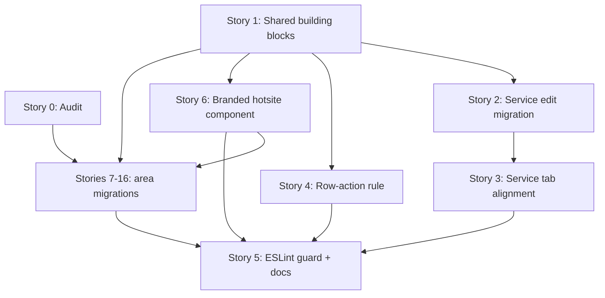

# TD57 — INLINE-FEEDBACK-AND-ACTION-PANE-PATTERN

## Status

- **Type**: Technical Debt / Frontend UX consistency
- **Priority**: Medium (a production UX defect — a save error rendered where nobody sees it — with no data or security risk; the inconsistency is spread across the whole `apps/web` dashboard and customer account)
- **Context**: `apps/web` (dashboard shell, customer account, platform settings/hotsite editor), `packages/i18n` (error-code copy). No backend, BFF or `@ikaro/types` change.
- **Created**: 2026-10-29
- **Discovered**: Manager report on the service edit screen: saving the Políticas tab with `durationPolicy = CUSTOMER_SELECTED` and empty min/max/increment returned a 422 whose message rendered at the very bottom of a long form; follow-up read-only audit of `apps/web` showed the problem is systemic.
- **Decision status**: Pattern decided in the 2026-10-29 session (see "Chosen approach"). Ready for discovery in the dependency order below; Story 0 produces the migration list that scopes Stories 7+ (Story 6 is the branded hotsite counterpart, decided in discovery); every story still begins with `/story-discovery`.
- **Related**: `docs/ENGINEERING_RULES_FRONTEND.md` § Reuse the repo's UI primitives; `docs/ANTI_PATTERNS.md` (the "hand-built control" row); `docs/DASHBOARD_FRONTEND_ARCHITECTURE.md`; TD23 (error-code → i18n pipeline, `resolveErrorMessage`)

## Problem

Ikaro's web app has no feedback pattern. A baseline read-only survey of `apps/web` (2026-10-29) found:

- **No shared feedback component** in `shared/components/ui/` and no toast library. 43 files draw their own `role="alert"` box; 103 files carry ad-hoc red styling; dozens of divergent `data-testid` names express the same concept (`service-submit-error`, `settings-submit-error`, `resource-create-submit-error`, `invite-submit-error`, `policy-error`, …).
- **The form-level error is never in or beside the action pane.** It renders in five different places: bottom of the main card (`ResourceCreateForm`, `ResourceEditFormFields`, `InviteForm`, `StaffDetailPage`, `ServiceFormFields`, the four service config tabs); a top-of-form banner plus `window.scrollTo(top)` (`SettingsForm`, `hotsite-editor-views.tsx:110`, `hotsite-editor-publish.ts:69`); above the content in the main column (`CancelConfirmPage`, `RecurringScheduleEndConfirm`, `AvailabilityAlertCancelConfirm`, `ResourceDeactivateConfirm`, `ServiceDeactivatePage`); a card at the top (`BookingDetailPage` `inlineError`, `NewBookingErrorBanner`); a bare `<p role="alert">` with no pane (hotsite module panels, `HotsiteActionBanner`, `ManifestTab`, several public forms).
- **The sticky action pane already exists (~25 screens, `lg:sticky lg:top-6`) but in three unrelated implementations**: the dashboard `<aside>` + `Card`, the customer `data-testid="action-pane-desktop"` div, and inline versions in the hotsite editor. `ServiceEditPanels` and `SettingsFormActions` have a `fixed inset-x-0 bottom-0 lg:hidden` mobile bar; the customer screens render `action-pane-mobile lg:hidden` in normal flow (not sticky).
- **Nothing scrolls to or focuses the first invalid field.** Focus-on-error exists in only three places (`ErrorAlert`, `NewBookingErrorBanner`, the intake summary).
- **Server field errors never reach inputs.** `ProblemDetail.field` already flows end to end (`buildProblemDetail`, the BFF `problem-detail.ts`, `ApiError.field` in `apps/web/shared/lib/api/errors.ts`), but `resolveErrorMessageFromApiError` returns only the message string and drops it. ~21 files set `aria-invalid` from client-side validation, so field marking exists, but only for errors the browser detected itself.
- **Dead success messages.** `ResourceRow.tsx`'s `ReactivateResourceAction` sets `reactivateState = 'success'` but renders only for `!resource.isActive`; after the refetch flips `isActive` the component unmounts, so `resource-row-reactivate-success` can never be seen. `MemberRow.tsx`'s `ActivateMemberAction` has the same defect (confirmed in code by Story 0, Appendix A finding 3).
- **Layout misalignment on the service edit screen.** `ServiceEditPage` puts the tab content and `ServiceEditActionPanels` in one grid (`lg:grid-cols-[minmax(0,1fr)_22rem] lg:items-start`), so the pane aligns with whatever the tab starts with. Detalhes and Página pública start with a `Card` (aligned). Políticas starts with a bare `<p>{t('politicasIntro')}</p>` (`ServiceBookingPolicyPanel.tsx:95`), Formulário with a bare `<p>{t('formularioIntro')}</p>` (`ServiceIntakeSchemaPanel.tsx:204`), Recursos with `ServiceResourceModePicker`'s loose `<label>` and two option buttons with no card — so the first box sits lower than the pane. Confirmed in a browser on 2026-10-29 (Appendix A finding 4): pane card top 145 px on every tab; first box 265 px on Recursos, 181 px on Políticas and Formulário, 145 px on Detalhes and Página pública.

The triggering report: `BOOKING_SERVICE_BOOKING_POLICY_INVALID` (422, `field: "durationMinMinutes"`, detail "durationPolicy=CUSTOMER_SELECTED requires durationMinMinutes, durationMaxMinutes, and durationIncrementMinutes"). The catalog text (`packages/i18n/locales/{pt-BR,en}/errors.json:114`) lists duration, pricing and window and adds an unrelated booking-window sentence; the box rendered after four cards (`ServiceBookingPolicyPanel.tsx` ~101–110) so the manager saw nothing without scrolling.

### Why this matters

A save that fails silently from the user's viewpoint is a support ticket and a lost configuration. The same defect class (error out of view, no field highlight, success unseen) repeats on every form because each screen reinvents the box; fixing one screen leaves the product inconsistent, and nothing stops the next screen from adding a 44th variant.

## Chosen approach (decided in this session, 2026-10-29)

1. **Inline only — no toasts, no new dependency.**
2. **Forms with a primary action**: the form-level error *and* success message render in a feedback box **below the buttons, inside the action pane**. On desktop the pane is sticky (`lg:sticky lg:top-6`), so the feedback follows the scroll and is never scrolled away. On mobile the existing fixed bottom bar surfaces the same feedback.
3. **Field level**: the offending input gets a red outline and an inline message (`aria-invalid` + `aria-describedby`), driven by the backend `ProblemDetail.field` for server errors as well as by client validation. The first invalid field is scrolled to and focused. Errors use `role="alert"`, success uses `role="status"`. Success persists until the next edit (the panels' existing `patch()` already clears it) — no auto-fade.
4. **Row actions on lists**: when the action changes a status the row already displays (activate, deactivate, approve), the changed badge/button *is* the confirmation — no extra success text. An action with no visible change (resend invite) keeps a short inline confirmation beside the button. Row failures show the backend-resolved message inline beside the row, not a fixed string.
5. **One shared implementation**: a feedback component and a shared `ActionPane` with a feedback slot in `apps/web/shared/components/ui/`, a `useFormFeedback` hook in `apps/web/shared/lib/`, and a resolver that returns `{ message, field }`. The feedback component is Tailwind-only (no `--ba-*`), usable in the dashboard and the customer account. The public hotsite gets its own branded counterpart (Story 6, built on `ErrorAlert variant="hotsite"`, reads `--ba-*`) covering error, success and field-level messages — CLAUDE.md's web styling boundary forbids one component reading both branding systems. Both skins reuse the skin-agnostic `useFormFeedback` and `{ message, field }` resolver, so the pattern lives in the hook and only the markup differs. `ErrorAlert` and the Story 6 component are the only files allowed to draw a feedback box in the branded tree; no other branded file keeps hand-rolled markup.
5a. **Surface classification (decided in discovery, 2026-10-29):** the *public hotsite* (`app/[slug]/`, `features/*/components/public/`, `features/platform/components/public/`) has no shell and no `ActionPane`; it uses the branded component only. The *hotsite editor* (`features/platform/components/hotsite/`) is dashboard-side: inline module panels use `FeedbackMessage` with no pane; only detail screens (`ModuleConfigShell`) use `ActionPane`. Route `error.tsx` files and load-failure states are page-level `FeedbackMessage` (or the branded component under `app/[slug]/`) with a retry — migrated, never exempt, so the Story 5 lint rule carries no path exemptions.
6. **Layout rule**: every tab/section body starts with a card level with the action pane's card; intro text lives *inside* that card; only the tab bar sits above the grid.
7. **Enforcement last**: an ESLint `no-restricted-syntax` selector blocking new hand-rolled `role="alert"` boxes, added only after the migration stories so it does not fail on unmigrated files.

### Open items for `/story-discovery` (not decided here)

- ~~Whether any branded public hotsite surface should adopt the shared component or keep `ErrorAlert`~~ — resolved: branded surfaces use the Story 6 component (see 5a).
- Branded error colour (Story 6): a fixed semantic red or derived from tenant `--ba-*` tokens, and how contrast is guaranteed against an arbitrary tenant background.
- ~~Whether the window-narrowing hint dropped from `BOOKING_SERVICE_BOOKING_POLICY_INVALID`'s catalog text should become a static hint or a separate backend error code~~ — resolved (2026-10-30): the code is split per reason in Story 2, window codes carry the business limit in `params`; no static hint.
- The exact mobile-bar layout when the feedback is long (Story 1).

### Story 0 — Audit every error/success surface and fix the migration scope ⚪ ✅ Done

**Agent:** frontend-ts
**Complexity:** M
**Docs to load:** `docs/ENGINEERING_RULES_FRONTEND.md` § Reuse the repo's UI primitives; `docs/DASHBOARD_FRONTEND_ARCHITECTURE.md` §2–§3; `docs/STORY_SCHEMA.md` (the appended migration stories are drafted to it); `docs/REPOSITORY_STRUCTURE.md` § Web placement rules
**Dependencies:** none
**Pattern:** plain composition — no named pattern applies (docs-only inventory)

**Description:**
The 2026-10-29 survey was deliberately not exhaustive: it read ~15 representative screens of the 43 `role="alert"` files and did not cover the public booking flow, the hotsite module panels or `app/` routes in depth. This story produces the authoritative inventory and, from it, the exact list of migration stories.

For every error or success surface under `apps/web/features/`, `apps/web/shells/` and `apps/web/app/`, record one row classified **form** (has a primary action), **row action** (list-row mutation) or **page-level** (load failure, route `error.tsx`), with: where the message renders; `role`; focus/scroll behaviour; whether the offending input is marked (`aria-invalid` *and* a visible red outline, verified in the field component, not by file-level grep — the survey's "fieldErrors without `aria-invalid`" grep produced 11 mostly false positives because forms delegate to child field components); whether an action pane exists, its implementation (dashboard `<aside>`, customer `action-pane-desktop`, hotsite inline), desktop stickiness and mobile behaviour; the first-box alignment against the pane; and every `data-testid` plus the Playwright specs that reference it (known: `e2e/team-invite.spec.ts`, `e2e/team-deactivate.spec.ts`, `e2e/services-resource-config.spec.ts`, `e2e/settings.spec.ts`).

**Classification rules (see "Chosen approach" 5a):** each row also records its *skin* — SaaS (`FeedbackMessage`) or branded (reads `--ba-*`, Story 6 component) — decided by what the file actually reads, not by its folder. Rows already owned by Stories 2, 3 or 4 (service edit, `ResourceRow`, `MemberRow`) are marked "covered by Story N" and get no migration story. `error.tsx` and load-failure surfaces are rows of class page-level and are migrated by an area story, never marked exempt. The Appendix is split into one table per area.

The output is an appendix to this file (`## Appendix A — Audit inventory`) and a set of migration stories appended with `/create-story`, one per area (candidates from the survey: resources, staff, settings, hotsite editor + module panels, customer account screens, bookings dashboard incl. `BookingDetailPage`/`BookingDecisionPanel`, public booking/lead forms, platform/loyalty tabs). Each migration story must list non-overlapping `Files to create/modify` so `/run-batch` can run them concurrently, and must state which `data-testid`s change and which E2E specs it updates. Visual alignment findings are marked "from structure" unless confirmed in a browser; a browser check needs the user's yes first (CLAUDE.md §0 local verification gate).

**Files to create/modify:**
- `td/TD57-INLINE-FEEDBACK-AND-ACTION-PANE-PATTERN.md` (append Appendix A and the migration stories)

**Acceptance criteria — product:**
- [ ] Appendix A lists every file returned by `grep -rl 'role="alert"' apps/web/features apps/web/shells apps/web/shared apps/web/app` plus every file containing an `<aside>` action pane or `data-testid="action-pane-*"`, each with all columns above. The audit widened this floor to the union of five greps (role-less coloured boxes, feedback testids and red text as well, 149 files), because the original two missed most surfaces; the widened enumeration and its completeness check are recorded in Appendix A.
- [ ] Each migration story is appended with real, existing paths, a per-story testid/E2E impact list, and `Dependencies: Story 0, Story 1` (and Story 2 where it reuses the service-edit slot; Story 6 for every story that migrates a branded file).
- [ ] Story 5's `Dependencies` is updated to include every appended migration story.
- [ ] Any screen where the first box is not level with its pane is listed with the structural reason.
  - ⚠️ Only the service edit tabs were measured; the other pane screens are measured by an acceptance criterion in Stories 7–16 of this TD — tracked in TD57, 2026-10-29
- [ ] The first-box alignment of the service edit tabs (Recursos, Políticas, Formulário) is confirmed in a browser (Playwright or the dev stack; approved in discovery, `/tmp` cleared first, anything started is stopped afterwards) and marked "confirmed" instead of "from structure".
- [ ] Every `error.tsx` under `apps/web/app` and every load-failure surface is a row, assigned to a migration story; none is marked exempt.
- [ ] Every file with `role="alert"` that reads `--ba-*` is assigned to the Story 6 follow-up migration story.

**Acceptance criteria — technical:**
- Unit: none — docs-only story
- Integration: none — docs-only story
- Tenant isolation: none — no data access
- E2E: none — docs-only story
- [ ] The commands used to enumerate files are recorded in Appendix A so the inventory is reproducible
- [ ] Completeness check: re-running the recorded enumeration commands and diffing their output against the paths in Appendix A shows zero missing files (the objective pin for "every file is covered")
- [ ] `doc-link-integrity` / `docs-audit` clean for the edited file

### Story 1 — Shared feedback component, `ActionPane`, `useFormFeedback` and the `{ message, field }` resolver 🔴 ✅ Done

**Agent:** frontend-ts
**Complexity:** L
**Docs to load:** `docs/ENGINEERING_RULES_FRONTEND.md` § Reuse the repo's UI primitives; `docs/DASHBOARD_FRONTEND_ARCHITECTURE.md` §2 (colour system), §3 (shared components); `docs/CODE_STANDARDS.md`; `docs/TESTING_STRATEGY.md` § apps/web Testing Infrastructure; `docs/ENGINEERING_RULES_SHARED.md` § Authoring new i18n UI copy keys; `docs/ENGINEERING_RULES_TESTING.md` § `scrollIntoView({ block: 'start' })`
**Dependencies:** none
**Pattern:** compound component (an `ActionPane` with a feedback slot) plus a custom hook owning feedback state — no GoF pattern applies

**Description:**
Build the shared pieces every later story consumes, following the decisions in "Chosen approach".

1. **`FeedbackMessage`** (`shared/components/ui/feedback-message.tsx`): variants `error` and `success`, plus an `inline` size for row actions. Error renders `role="alert"`, success `role="status"`. Required `title`, optional `children` body (the prototype's `.fb-title` + body), optional `hint`, `onRetry`/`retryLabel` and `focusOnMount` (the behaviours of today's `ErrorAlert` and `NewBookingErrorBanner`). `testId` passthrough. The five New-booking callers pass their message as `title`; the shared skin is the prototype's `.fb` look, slightly different from the old banner (decided in discovery, 2026-10-30). Tailwind-only; never reads `--ba-*`. It replaces `NewBookingErrorBanner` (its 5 caller step components are migrated here and the old file is deleted); `ErrorAlert`'s `dashboard` variant callers (`CustomerReschedulePage`, `ReschedulePicker`, `NewBookingAvailabilityStep`, `RescheduleBookingPage`) move to it in the migration stories; `ErrorAlert` keeps only the branded `hotsite` variant, which Story 6 turns into the full branded pattern.
2. **`ActionPane`** (`shared/components/ui/action-pane.tsx`): one component for the desktop sticky pane (`hidden lg:block lg:sticky lg:top-6`, `Card`) and the mobile fixed bar (extracted from `ServiceEditPanels.tsx` / `SettingsFormActions.tsx`). Props: `actions` (the buttons), `feedback` (a `FeedbackMessage` model) and `mobileOffsetClassName` (default `bottom-0`; a caller above the dashboard `BottomNav` passes `MOBILE_ACTION_BAR_CLEARANCE_CLASS` from `shells/dashboard/utils/mobile-action-bar.ts`, so `shared/` never imports `shells/`). Only the fixed bottom bar ships; whether the customer account adopts it or needs an inline mobile mode is decided in Story 11. The feedback renders **below the buttons** in the pane; in the mobile bar it renders above the buttons inside the fixed bar with `max-height` about 6.5rem and scroll (the prototype's values, `07-mobile-barra-fixa.html`) so a long message never pushes the bar off-screen.
3. **`useFormFeedback`** (`shared/lib/feedback/use-form-feedback.ts`): holds `{ error, success, fieldErrors }`; `setFromApiError(err, locale)` resolves message and `field`; `setSuccess(message)`; `clear()` (called by the panels on edit); `registerField(name)` returning a ref-callback that accepts any `HTMLElement` (a composite control attaches it to its wrapper); `fieldProps(name)` returning `{ ref, 'aria-invalid', 'aria-describedby' }`; `focusFirstInvalid()` which scrolls with `block: 'center'` and focuses the element itself if focusable, otherwise its first focusable descendant. A `field` the form does not register falls back to the form-level message only.
3a. **`FieldFeedback`** (`shared/components/ui/field-feedback.tsx`): the inline message under an invalid input (`role` none, referenced by `aria-describedby`; the prototype's `.fb-field-msg`) plus the shared red-outline class for `aria-invalid` inputs, so Story 2 and the migration stories do not each invent one. Tailwind-only.
4. **Resolver** (`shared/lib/i18n/resolve-error-message.ts`): add `resolveApiErrorFeedback(err, locale): { message: string; field?: string }` built on `extractProblemDetailShape`; `resolveErrorMessageFromApiError` delegates to it so its 30 callers are untouched.
5. **Docs**: new section in `docs/ENGINEERING_RULES_FRONTEND.md` stating the pattern (placement, roles, focus, row-action rule, alignment rule) and a pointer from `docs/DASHBOARD_FRONTEND_ARCHITECTURE.md` §3.

No screen is migrated in this story except the `NewBookingErrorBanner` callers (a mechanical swap that lets the old file be deleted rather than left as a second implementation).

**Backend use case steps:** none
**Backend HTTP surface:** none
**BFF endpoint spec:** none
**Prototype references:** `journeys/manager/prototypes/feedback-pane/` (screens 01, 01b, 01c, 01d, 06, 07; `dev-notes.md`; shared CSS `journeys/shared/feedback-pane.css`); journey `journeys/manager/feedback-pane.md`
**New migration / i18n keys / env vars / feature flags:** i18n keys only if the retry/dismiss labels are not already in `common` — decided in discovery, both `pt-BR` and `en` in the same change; no migration, env var or flag

**Files to create/modify:**
- `apps/web/shared/components/ui/feedback-message.tsx` + `feedback-message.spec.tsx` (new)
- `apps/web/shared/components/ui/action-pane.tsx` + `action-pane.spec.tsx` (new)
- `apps/web/shared/components/ui/field-feedback.tsx` + `field-feedback.spec.tsx` (new)
- `apps/web/shared/lib/feedback/use-form-feedback.ts` + `use-form-feedback.spec.tsx` (new)
- `apps/web/shared/lib/i18n/resolve-error-message.ts` + `resolve-error-message.spec.ts`
- `apps/web/features/booking/components/dashboard/bookings/new-booking/NewBookingErrorBanner.tsx` + spec (delete)
- `apps/web/features/booking/components/dashboard/bookings/new-booking/NewBookingAvailabilityStep.tsx`, `NewBookingResourcePickerStep.tsx`, `NewBookingIntakeStep.tsx`, `NewBookingServicesStep.tsx`, `NewBookingDurationStep.tsx` (swap import)
- `docs/ENGINEERING_RULES_FRONTEND.md`, `docs/DASHBOARD_FRONTEND_ARCHITECTURE.md`
- stale-reference sweep for `NewBookingErrorBanner` across `docs/*.md`, `plan/*_IMPLEMENTATION_DETAILS_*.md`, `.claude/**`, `scripts/**` (fix any hit in the same change)
- `packages/i18n/locales/pt-BR/web.json`, `packages/i18n/locales/en/web.json` (only if new keys; `common`/`tryAgain`-style retry keys already exist and callers pass `retryLabel`, so none are expected)

**Acceptance criteria — product:**
- [ ] The five New-booking step errors look and behave as before (message, hint, retry, focus on return) using the shared component.
- [ ] `docs/ENGINEERING_RULES_FRONTEND.md` states the pattern precisely enough that a story author can apply it without reading this TD.

**Acceptance criteria — technical:**
- Unit:
  - [ ] `feedback-message.spec.tsx`: error → `role="alert"`, success → `role="status"`; `focusOnMount` focuses; hint and retry render and fire; `inline` size; no `--ba-` class or variable in the rendered output
  - [ ] `action-pane.spec.tsx`: feedback renders below the actions; desktop wrapper carries the sticky classes; mobile bar carries `fixed` and renders the feedback; no feedback → no empty box
  - [ ] `use-form-feedback.spec.tsx`: a `field` mapped to a registered input marks it, scrolls (`block: 'center'`) and focuses it; an unregistered `field` leaves only the form-level message; `clear()` removes error and success; two invalid fields focus the first in DOM order
  - [ ] `registerField` also works for a control that does not forward a ref (`color-picker`, `pill-multi-select`, `time-picker`): decided — wrapper ref, focus falls back to the first focusable descendant; a spec proves marking and focus for one such control (Appendix A finding 10)
  - [ ] `field-feedback.spec.tsx`: the message renders under the input and is referenced by `aria-describedby`; `fieldProps` sets `aria-invalid` only for a field with an error
  - [ ] `action-pane.spec.tsx` also: `mobileOffsetClassName` default is `bottom-0` and a passed class replaces it
  - [ ] `shared/` imports nothing from `@/shells`: pinned by the dependency-cruiser rule `no-web-shared-to-shell-import` (`scripts/dependency-cruiser.config.cjs`) and its fixture tests in `scripts/dependency-cruiser-config.spec.cjs`, not by `action-pane.spec.tsx` (PR #696)
  - [ ] `resolve-error-message.spec.ts`: returns `{ message, field }` for an `ApiError` with `field`; returns the fallback and no `field` for a plain `Error`; `resolveErrorMessageFromApiError` output is unchanged for existing inputs
  - [ ] An unmigrated `ErrorAlert variant="hotsite"` still renders unchanged (negative guarantee: the branded variant is not touched)
- Integration: none — frontend story, no `.integration.spec.ts` tier
- Tenant isolation: none — no data access
- E2E: no new scenario (covered in Story 2's). Regression run (approved in discovery, 2026-10-30; `/tmp/jest_rs` cleared first, stack stopped afterwards): the existing specs that reference the New-booking step testids — `booking-journey-basket`, `booking-chosen-resource`, `booking-auto-journey`, `booking-submit-routing`, `guest-booking` and `helpers/booking/staff-new-booking.ts` — pass unchanged, since `testId` passthrough keeps `step1-error`, `step2-error`, `duration-quote-error`, `picker-load-error`, …
- [ ] Coverage ≥80% on changed code
- [ ] `tsc --noEmit` clean, lint clean

### Story 2 — Service edit screen: feedback in the pane, specific policy errors, pre-send validation 🔴 ✅ Done

**Agent:** backend-ts + frontend-ts
**Complexity:** L
**Docs to load:** `docs/ENGINEERING_RULES_FRONTEND.md` § A form's error or success message lives in the action pane; `docs/AGENT_PATTERNS.md` Pattern #25; `docs/ENGINEERING_RULES_SHARED.md` § Adding a new error — checklist; `docs/ERROR_CATALOG.md` § Code Origins; `docs/ENGINEERING_RULES_BACKEND.md` (error mapping); `docs/TESTING_STRATEGY.md` § Running Playwright locally; `docs/USE_CASES.md` UC-055 (the service booking policy) and its A5 flow; `docs/API_CONTRACTS.md` § Service Extensions — M22 Cluster 2 (UC-050–056) (the `PATCH /services/:id/booking-policy` entry); `docs/BUSINESS_LOGIC_REFERENCE.md` (the booking-window rule)
**Dependencies:** Story 1
**Pattern:** extend the existing registered-action descriptor (`useRegisterTabAction` / `ServiceTabAction`) with a `feedback` field; one `ServiceBookingPolicyInvalidError` class whose `reason` selects the code, the `field` and the `params` (the precedent is `RecurringBookingScheduleTermExceededError`); plain composition otherwise
**Discovered:** 2026-10-29, manager report on the service edit screen
**Root cause:** `ServiceBookingPolicyPanel.tsx` keeps a local `error` state and renders it after the four policy cards (~lines 101–110); `resolveErrorMessageFromApiError` drops `ProblemDetail.field`; nothing validates the `CUSTOMER_SELECTED` precondition client-side even though the backend enforces it; `ServiceBookingPolicyInvalidError` carries seven different reasons under one code, so the catalog can hold only one vague sentence for all of them (the window-widening sentence was a patch for three of the seven).

**Decisions locked in discovery (2026-10-30):**
- **One story, full-stack.** The vague catalog text is fixed at its root: the code is split per reason in this story, not in a follow-up. The old code `BOOKING_SERVICE_BOOKING_POLICY_INVALID` is removed outright (no production yet; its only consumers are the web app and one integration spec), not kept as an alias.
- **The backend `detail` is never shown** (developer English, unlocalized). Specificity comes from per-reason codes, from `params` interpolated into the translated text, and from client-side validation.
- **No static booking-window hint.** The window codes carry the business limit in their text, so a permanent hint would repeat it.
- **Pane copy follows the prototype:** error title "Não foi possível salvar" (one shared key) with the resolved message as body; success title "Alterações salvas" with a short per-tab body (for example "As políticas do serviço foram atualizadas."). Detalhes gets a success message too (it has none today). The panels build the `FeedbackModel` themselves, since `useFormFeedback().feedback` carries a title only.
- **Detalhes:** only its form-level result (server error, activate error, the new success) moves to the pane. Its field-level errors (`service-name-error`, `service-price-error`, …) stay as they are, because `ServiceFormFields` is shared with `ServiceCreatePage`; Story 13 migrates that component once, with the create page, and owns Detalhes' field marking from a server `field`.
- **Pre-send validation** covers the three rules the web can check itself (see below). Zero or negative values are left to the backend, whose `field` marks the input.
- **Field messages:** a server error with a `field` shows the same translated text under the input as in the pane. Field-level `role="alert"` messages in the panels become `FieldFeedback` (no role, `aria-describedby`); `EligiblePoolPicker`'s stale-pool text is a section notice and keeps its text without the role.

**Description:**
Migrate every tab of `ServiceEditPage` to the shared pattern and make the policy errors specific.

*Backend and types*
- `ServiceBookingPolicyInvalidError` keeps one class. Its reason selects the code, the `field` and (for the window reasons) `params`:

| Reason | New code | `field` | `params` |
|---|---|---|---|
| `custom-duration-details-required` | `BOOKING_SERVICE_POLICY_DURATION_DETAILS_REQUIRED` | `durationMinMinutes` | none |
| `duration-range-invalid` | `BOOKING_SERVICE_POLICY_DURATION_RANGE_INVALID` | `durationMaxMinutes` | none |
| `pricing-increment-details-required` | `BOOKING_SERVICE_POLICY_PRICING_DETAILS_REQUIRED` | `pricingIncrementMinutes` | none |
| `per-time-increment-requires-custom-duration` | `BOOKING_SERVICE_POLICY_INCREMENT_PRICING_REQUIRES_CUSTOM_DURATION` | `durationPolicy` | none |
| `max-advance-exceeds-tenant` | `BOOKING_SERVICE_POLICY_MAX_ADVANCE_EXCEEDS_TENANT` | `maxBookingAdvanceDaysOverride` | `{ maxAdvanceDays }` (the business limit) |
| `min-advance-below-tenant` | `BOOKING_SERVICE_POLICY_MIN_ADVANCE_BELOW_TENANT` | `minBookingAdvanceHoursOverride` | `{ minAdvanceHours }` (the business limit) |
| `booking-window-empty` | `BOOKING_SERVICE_POLICY_WINDOW_EMPTY` | `minBookingAdvanceHoursOverride` | the effective `minAdvanceHours` and `maxAdvanceDays` |

- `SERVICE_BOOKING_POLICY_INVALID` leaves `BookingErrorCode` and `packages/types/src/error-codes.ts`; the seven new codes join the same union. The error-mapper entry (422) stays class-based, so it needs no new branch. `assertBookingWindowOverridesValid` passes the tenant limits to the error. Each code gets a pt-BR and an en text in `errors.json` (placeholders matching `params`), both in the same change.
- Docs synced in the same change: `docs/API_CONTRACTS.md` (the booking-policy PATCH 422 list), `docs/USE_CASES.md` (UC-055 A5), `docs/BUSINESS_LOGIC_REFERENCE.md` (the booking-window section), and the old code's name in `plan/M22-MULTIVERTICAL-SERVICE-AVAILABILITY_IMPLEMENTATION_DETAILS_IA.md`.

*Web*
- `ServiceTabAction` (`service-tab-action.ts`) gains an optional `feedback` (the `FeedbackModel` from Story 1). `useRegisterTabAction` registers it with the action; `ServiceEditActionPanels` renders it through the shared `ActionPane` (desktop aside and mobile bar; the existing 2-column button grid becomes `mobileActions`). The four config panels (`ServiceResourceRequirementsPanel`, `ServiceBookingPolicyPanel`, `ServiceIntakeSchemaPanel`, `ServicePublicPageTab`) stop rendering their own bottom boxes (`policy-error`, `policy-saved`, `public-page-error`, `public-page-saved`, `resource-requirements-error`, `resource-requirements-saved`, `intake-error`, `intake-published`); their existing "clear on next edit" logic is kept. Detalhes's `service-submit-error` moves to the same pane slot for the edit screen (the create page keeps its own until Story 13).
- **Server field errors:** each panel owns a `useFormFeedback`; the Políticas inputs register with `fieldProps` so any of the six `field` values above marks and focuses its input.
- **Pre-send validation** (a new `policy-validation.ts`, unit-tested): the save is blocked, with no API call, and every failing field is marked together with the first focused, when
  1. `durationPolicy === 'CUSTOMER_SELECTED'` and any of `durationMinMinutes`, `durationMaxMinutes`, `durationIncrementMinutes` is empty ("Informe a duração mínima." and the like);
  2. `durationMaxMinutes < durationMinMinutes` ("A duração máxima deve ser maior ou igual à mínima.");
  3. `pricingPolicy === 'PER_TIME_INCREMENT'` and `pricingIncrementMinutes` or `pricePerIncrementAmount` is empty.
  A `FIXED` duration is never blocked by rule 1 or 2. The backend rules remain the safety net.

**Backend use case steps:** none new — `UpdateServiceBookingPolicyUseCase` and the aggregate keep their flow; only the error they raise changes shape
**Backend HTTP surface:** none new — `PATCH /v1/services/:id/booking-policy` keeps its path and body; its 422 now carries one of the seven codes (and `params` for the window ones)
**BFF endpoint spec:** none — the BFF already forwards `code`, `field` and `params` of a backend problem unchanged (precedent: `RECURRING_SCHEDULE_TERM_EXCEEDED`); implementation confirms it with the window case end to end
**Prototype references:** `journeys/manager/prototypes/feedback-pane/` screens 01, 01b, 01c, 01d, 07 and `dev-notes.md` (Screen 01 / 01b / 01c / 01d section); journey `journeys/manager/feedback-pane.md`
**New migration / i18n keys / env vars / feature flags:** no migration, env var or flag. Seven new codes in `packages/i18n/locales/{pt-BR,en}/errors.json` (the old key removed); `web.json` (both locales): the shared error title, the success title, one success body per tab, the pre-send validation messages

**Files to create/modify:**
- Backend and types:
  - `packages/types/src/error-codes.ts`
  - `apps/backend/src/contexts/booking/domain/errors/booking-service-policy.error.ts`
  - `apps/backend/src/contexts/booking/application/use-cases/booking-window.helpers.ts` + its spec
  - `apps/backend/src/contexts/booking/domain/service.spec.ts`
  - `apps/backend/src/contexts/booking/application/use-cases/update-service-booking-policy.use-case.spec.ts`
  - `apps/backend/src/contexts/booking/infrastructure/http/booking-error.mapper.spec.ts`
  - `apps/backend/src/contexts/booking/infrastructure/controllers/service.controller.integration.spec.ts`
  - an `.http` request file only if the policy PATCH already has one
- Web, services folder `apps/web/features/booking/components/dashboard/services/`:
  - `service-tab-action.ts` + `service-tab-action.spec.tsx`
  - `ServiceEditPanels.tsx` + `ServiceEditPanels.spec.tsx`
  - `ServiceEditPage.tsx` + `ServiceEditPage.spec.tsx`
  - `ServiceBookingPolicyPanel.tsx` + `ServiceBookingPolicyPanel.spec.tsx`
  - `PolicyDurationPricingCard.tsx` + spec, `PolicyDurationPolicyField.tsx` + spec, `PolicyConfirmationAndWindowCards.tsx` + spec
  - a new `policy-validation.ts` + `policy-validation.spec.ts`
  - `ServiceResourceRequirementsPanel.tsx`, `ServiceIntakeSchemaPanel.tsx`, `ServicePublicPageTab.tsx` + specs
  - `ServiceEditDetailsTab.tsx` + spec (it stops passing `submit`; `ServiceFormFields.tsx` is not changed)
  - the field-level files owned by Story 2 + 3 in Appendix A.1 (`PolicyWhoHowCard`, `ServiceBufferAfterMinutesField`, `ServiceResourceTypeFields`, `IntakeQuestionsCard`, `EligiblePoolPicker`) + specs, for their error `role` and field marking
- `packages/i18n/locales/pt-BR/errors.json`, `packages/i18n/locales/en/errors.json`, `packages/i18n/locales/pt-BR/web.json`, `packages/i18n/locales/en/web.json`
- `apps/web/e2e/services-resource-config.spec.ts` (all the `*-saved`, `*-error`, `intake-published` assertions move to `form-feedback`; add the two scenarios below) and `apps/web/e2e/service-public-page.spec.ts` (`public-page-saved` → `form-feedback`)
- Docs: `docs/API_CONTRACTS.md`, `docs/USE_CASES.md`, `docs/BUSINESS_LOGIC_REFERENCE.md`, `plan/M22-MULTIVERTICAL-SERVICE-AVAILABILITY_IMPLEMENTATION_DETAILS_IA.md`; the journey sync (`journeys/manager/feedback-pane.md` Pages table row for the service edit page, `dev-notes.md` status and file map)
- Stale-reference sweep for `BOOKING_SERVICE_BOOKING_POLICY_INVALID`, `policy-error`, `policy-saved`, `public-page-saved`, `resource-requirements-saved`, `intake-published` across `docs/*.md`, `plan/*_IMPLEMENTATION_DETAILS_*.md`, `.claude/**`, `scripts/**` (fix any hit in the same change)

**Acceptance criteria — product:**
- [ ] Saving Políticas with `CUSTOMER_SELECTED` and any duration field empty does not call the API; the missing fields get a red outline and a specific message, the first is focused, and the pane shows the form-level error without scrolling.
- [ ] Saving with a maximum duration below the minimum, or with per-increment pricing missing its increment or price, is blocked the same way, with a message naming the problem.
- [ ] A backend 422 with a `field` marks and focuses that input and shows the translated message in the pane; a window violation names the business limit ("… até {maxAdvanceDays} dias …").
- [ ] After a successful save, the pane shows "Alterações salvas" with the tab's body, and the message disappears on the next edit.
- [ ] Every other tab (Detalhes, Recursos, Formulário, Página pública) shows its error/success in the pane, on desktop and in the mobile bar.
- [ ] Scrolling the middle column keeps the pane and its feedback in view.
- [ ] No message mentions the old catch-all wording; the backend `detail` text is never rendered.

**Acceptance criteria — technical:**
- Unit (backend):
  - [ ] `service.spec.ts`: each of the four aggregate reasons throws `ServiceBookingPolicyInvalidError` with its own code and `field`
  - [ ] `booking-window.helpers` spec: the three window reasons carry their code, `field` and the tenant limits in `params`
  - [ ] `booking-error.mapper.spec.ts`: the error maps to 422 with `code`, `field` and `params` (window case)
  - [ ] `update-service-booking-policy.use-case.spec.ts` keeps passing with the new codes
- Unit (web):
  - [ ] `policy-validation.spec.ts`: each of the three rules, with all failing fields reported together; `FIXED` with empty min/max/increment is not blocked (negative guarantee, own test)
  - [ ] `ServiceBookingPolicyPanel.spec.tsx`: a blocked save makes no mutation call and marks and focuses; a server `field: durationMinMinutes` marks only that input; a server `field: maxBookingAdvanceDaysOverride` marks the window input; success then edit clears the message
  - [ ] `service-tab-action.spec.tsx`: the registered action carries `feedback` and updates when it changes; unmount registers `null`
  - [ ] `ServiceEditPanels.spec.tsx`: feedback renders below the buttons in the aside and above them in the mobile bar
  - [ ] one spec per migrated panel asserting its old box (`policy-error`, `policy-saved`, …) no longer renders
  - [ ] `error-codes-exhaustiveness.spec.ts` passes with the seven codes in both locales and the old key gone
- Integration: `service.controller.integration.spec.ts` — the existing "override looser than the tenant window" case asserts the new code and the limit in `params`; one case per remaining aggregate reason is covered at unit level (the HTTP path is the same)
- Tenant isolation: unchanged — no new data access; the existing isolated-tenant case in the integration spec still asserts that nothing is stored after the 422
- E2E (local run only after asking — approved in discovery, 2026-10-30; `/tmp/jest_rs` cleared first, stack stopped afterwards):
  - [ ] `services-resource-config.spec.ts`: Políticas with `CUSTOMER_SELECTED` and empty fields → error visible in the pane without scrolling, first invalid field focused; filling them and saving → "Alterações salvas" in the pane
  - [ ] `services-resource-config.spec.ts`: a maximum advance above the business limit → the specific message with the limit in the pane and the input marked
  - [ ] the existing assertions in `services-resource-config.spec.ts` and `service-public-page.spec.ts` pass with the new `form-feedback` ids
- [ ] Coverage ≥80% on changed code
- [ ] `tsc --noEmit` clean, lint clean

### Story 3 — Service edit tabs start with a card level with the action pane 🟡 ✅ Done

**Agent:** frontend-ts
**Complexity:** M
**Docs to load:** `docs/ENGINEERING_RULES_FRONTEND.md` (alignment rule added by Story 1); `docs/DASHBOARD_FRONTEND_ARCHITECTURE.md` §3; `docs/TESTING_STRATEGY.md` § apps/web Testing Infrastructure
**Dependencies:** Story 2 (same files — `ServiceBookingPolicyPanel`, `ServiceIntakeSchemaPanel`, `ServiceResourceRequirementsPanel` — so sequential, not batchable with Story 2)
**Pattern:** plain composition — no named pattern applies
**Discovered:** 2026-10-29, manager report (pane and first box at different heights on Recursos, Políticas and Formulário)
**Root cause:** `ServiceBookingPolicyPanel.tsx:95` and `ServiceIntakeSchemaPanel.tsx:204` render a bare `<p>` intro above the first card; `ServiceResourceModePicker.tsx` starts with a loose `<label>` and option buttons that are not inside any card; the grid in `ServiceEditPage.tsx` (`lg:items-start`) aligns the pane with whatever the panel starts with.

**Description:**
Every tab body of the service edit screen starts with a card that is level with the action pane's card. The intro text (`politicasIntro`, `formularioIntro`) moves inside the first card; Recursos wraps `ServiceResourceModePicker` in a card (`SectionCard`, title `recursosModeLabel` "Como este serviço usa recursos?") and drops the loose label. Only the tab bar remains above the grid. Existing locale keys are reused, none are added.

**Decisions locked in discovery (2026-10-30):**
- **Intro placement:** `PolicyDurationPricingCard` and `IntakeQuestionsCard` gain an optional `intro?: string` prop; the card renders it as a paragraph under its title, so any card that shows an intro does it one way. The panels pass `politicasIntro` / `formularioIntro` and drop their bare `<p>`. The prop is optional: a card without it renders unchanged, and no card is forced to have one.
- **Recursos picker card:** a plain `Card` (not `SectionCard`) with an `h2` at `text-sm font-semibold`, the heading style of every sibling card; visual consistency across the project wins over `SectionCard`'s larger `text-base font-bold` title. The `h2` replaces the loose `<label>`; the `resource-mode-flat` / `resource-mode-legs` testids stay. In both flat and legs mode the picker card is the first box.
- **Spacing:** each panel keeps its own `space-y-*`; not harmonised here.
- **Buffer field:** `ServiceBufferAfterMinutesField` (the last loose control on Recursos, below the cards) goes in a plain `Card` with an `h2` at `text-sm font-semibold` replacing its label; input, hint, placeholder and `resource-buffer-input` testid unchanged. Added after the PR opened, found by the user.
- **Browser check:** approved in discovery. After the change, measure the first-box top against the pane top on the five service edit tabs (`/tmp/jest_rs` cleared first, anything started is stopped afterwards) and move the Appendix A.1 alignment rows from "from structure" to "confirmed".

The audit (Story 0) decides whether the same rule applies to other multi-tab or intro-text screens (settings sections, hotsite module panels, `ModuleConfigShell`); those become migration stories, not scope here. Layout is concluded from structure; confirm visually in a browser after the change (ask first, CLAUDE.md §0).

**Backend use case steps:** none
**Backend HTTP surface:** none
**BFF endpoint spec:** none
**Prototype references:** none
**New migration / i18n keys / env vars / feature flags:** none

**Files to create/modify:**
- `apps/web/features/booking/components/dashboard/services/ServiceResourceModePicker.tsx` + `ServiceResourceModePicker.spec.tsx`
- `apps/web/features/booking/components/dashboard/services/ServiceBufferAfterMinutesField.tsx` + spec
- `docs/ENGINEERING_RULES_FRONTEND.md` (Alignment rule extended to cards, headings and loose controls)
- `apps/web/features/booking/components/dashboard/services/ServiceResourceRequirementsPanel.tsx` + spec
- `apps/web/features/booking/components/dashboard/services/ServiceBookingPolicyPanel.tsx` + spec
- `apps/web/features/booking/components/dashboard/services/PolicyDurationPricingCard.tsx` + spec (optional `intro`)
- `apps/web/features/booking/components/dashboard/services/ServiceIntakeSchemaPanel.tsx` + spec
- `apps/web/features/booking/components/dashboard/services/IntakeQuestionsCard.tsx` + spec (optional `intro`)
- Journey sync: `journeys/manager/feedback-pane.md` Pages table row for the service edit page and `dev-notes.md` status
- `td/TD57-INLINE-FEEDBACK-AND-ACTION-PANE-PATTERN.md` Appendix A.1 (alignment rows confirmed in the browser)

**Acceptance criteria — product:**
- [ ] On Recursos, Políticas and Formulário the first box starts at the same height as the action pane's card (desktop), matching Detalhes and Página pública.
- [ ] The intro sentences are still shown, now inside the first card.
- [ ] The Recursos mode picker appears inside a card titled "Como este serviço usa recursos?", with the same heading style as the other cards.

**Acceptance criteria — technical:**
- Unit:
  - [ ] one spec per tab (Recursos, Políticas, Formulário): the first element of the panel's root is a card and no bare `<p>` or `<label>` precedes it
  - [ ] `ServiceResourceModePicker.spec.tsx`: renders inside the card with the heading; mode selection and `legsLockedOnServer` behaviour unchanged
  - [ ] `PolicyDurationPricingCard.spec.tsx` and `IntakeQuestionsCard.spec.tsx`: the intro renders under the title when `intro` is passed
  - [ ] the same two specs: without `intro` no empty paragraph renders and the card is unchanged (negative guarantee, own test)
- Integration: none — frontend story
- Tenant isolation: none — no data access
- E2E: no new Playwright scenario — structural change covered by unit specs; existing service E2E scenarios must stay green
- [ ] Browser check (approved in discovery, 2026-10-30; `/tmp/jest_rs` cleared first, anything started is stopped afterwards): on the five service edit tabs the first box's top equals the pane card's top; Appendix A.1 updated to "confirmed"
- [ ] Coverage ≥80% on changed code
- [ ] `tsc --noEmit` clean, lint clean

### Story 4 — Row actions: the status change is the confirmation 🟡 ✅ Done

**Agent:** frontend-ts
**Complexity:** S
**Docs to load:** `docs/ENGINEERING_RULES_FRONTEND.md` (row-action rule added by Story 1); `docs/ENGINEERING_RULES_FRONTEND.md` § A mutation that changes server state owned by another feature must invalidate that feature's query keys; `docs/TESTING_STRATEGY.md`
**Dependencies:** Story 1
**Pattern:** plain composition — no named pattern applies
**Discovered:** 2026-10-29, read-only audit
**Root cause:** `ResourceRow.tsx` `ReactivateResourceAction` renders only for `!resource.isActive`, so the refetch that flips `isActive` unmounts the component holding the success state; `MemberRow.tsx` `ActivateMemberAction` has the same defect: `MemberAction` renders it only for `DEACTIVATED`, and after `router.refresh()` the status is `ACTIVE` so the slot renders the deactivate link (confirmed in code by TD57 Story 0, Appendix A finding 3).

**Description:**
Apply the row-action rule. Remove the unreachable success branches: `resource-row-reactivate-success` (`ResourceRow.tsx`) and, after confirming the same unmount in `MemberRow.tsx`, `activate-member-success`, together with the `activateSuccess` keys they use (pt-BR/en `web.json`, both resource and staff namespaces) if nothing else references them. Keep `resend-invite-success` — resending changes nothing visible, so a short inline confirmation beside the button is correct. Row errors (`resource-row-reactivate-error`, `activate-member-error`, `resend-invite-error`) render through `FeedbackMessage` (`inline`) with the backend-resolved message from `resolveApiErrorFeedback`, replacing the fixed strings `activateError` / `resendInviteError` (those keys are removed if unreferenced). E2E specs referencing the removed ids (`team-invite.spec.ts`, `team-deactivate.spec.ts`) are updated.

**Backend use case steps:** none
**Backend HTTP surface:** none
**BFF endpoint spec:** none
**Prototype references:** none
**New migration / i18n keys / env vars / feature flags:** removes unused `activateSuccess`, `activateError`, `resendInviteError` keys in both locales when unreferenced; no additions

**Files to create/modify:**
- `apps/web/features/booking/components/dashboard/resources/ResourceRow.tsx` + `ResourceRow.spec.tsx`
- `apps/web/features/booking/components/dashboard/resources/ResourceListPage.spec.tsx`
- `apps/web/features/staff/components/team/MemberRow.tsx` + spec
- `packages/i18n/locales/pt-BR/web.json`, `packages/i18n/locales/en/web.json`
- `apps/web/e2e/team-deactivate.spec.ts` (drops the `activate-member-success` assertion; the badge/Desativar assertions already cover the flip). `team-invite.spec.ts` (asserts `resend-invite-success`, which stays) and `resources-manage.spec.ts` (already asserts the status flip) need no change.

**Acceptance criteria — product:**
- [ ] Reactivating a resource or activating a member flips the badge and button; no extra success text is expected or shown.
- [ ] Resending an invite shows a short confirmation beside the button.
- [ ] A failed row action shows the backend-resolved message beside the row.

**Acceptance criteria — technical:**
- Unit:
  - [ ] `ResourceRow.spec.tsx`: reactivate success → the row re-renders as active with no leftover success text; failure → inline error with the resolved message
  - [ ] `MemberRow.spec.tsx`: the same for activate; resend invite success confirmation present (negative guarantee: it is not removed with the others)
- Integration: none — frontend story
- Tenant isolation: none — no data access
- E2E:
  - [ ] `team-deactivate.spec.ts` asserts the status change instead of the removed success id; no new scenario
- Locked in discovery (2026-10-30): resend success = `FeedbackMessage variant="success" size="inline"` (testid `resend-invite-success` kept); row errors = `FeedbackMessage size="inline"` titled with the `resolveApiErrorFeedback` message, locale from `useLocale()`, existing error testids kept; unit specs assert the removed success copy is absent after the flip (negative guarantee), `ResourceListPage.spec.tsx` reactivate test asserts the mutation call and the absent success id
- [ ] Coverage ≥80% on changed code
- [ ] `tsc --noEmit` clean, lint clean

### Story 5 — ESLint guard against new hand-rolled alert boxes, plus anti-pattern docs 🟡

**Agent:** frontend-ts
**Complexity:** M
**Docs to load:** `docs/ENGINEERING_RULES_SHARED.md` § `no-restricted-syntax` selectors must be checked against every already-documented bypass shape; `docs/ANTI_PATTERNS.md`; `docs/AGENT_CONTEXT_TRAP_SCENARIOS.md` § How to edit `context.md`
**Dependencies:** Story 3, Story 4, Story 6, Stories 7 to 16 (the migration stories appended by Story 0; the selector must not fail on an unmigrated file)
**Pattern:** plain composition — no named pattern applies (an ESLint config entry with tests)

**Description:**
Add a `no-restricted-syntax` selector in `apps/web/eslint.config.js` (alongside `LOCALE_LITERAL_SELECTOR`) that flags a JSX element with `role="alert"` or `role="status"` outside `shared/components/ui/feedback-message.tsx` (and the Story 6 branded component, the only other file listed by an explicit `ignores`/`files` override with the rationale — no path-based exemptions; `error.tsx` and load-failure surfaces are migrated, not exempt). Before considering it done, check it against the three bypass classes documented in `docs/ENGINEERING_RULES_SHARED.md` § `no-restricted-syntax` selectors (an expression-container value `role={'alert'}`, a spread `{...{ role: 'alert' }}`, and `createElement`/non-JSX construction) and cover each in `shared/lib/eslint/restricted-syntax.eslint.spec.ts`. **Audit finding (Story 0, Appendix A finding 1):** 76 of the 119 files that draw their own feedback message do so with no `role` at all, so a selector keyed on `role` alone misses them. The detection must also flag a JSX `className` that combines a red/green/emerald `bg-*-50` or `border-*-200/300` token on a feedback box outside the shared components; the files listed as `not feedback` in Appendix A (status badges, field style strings) must stay unflagged, so decide in this story's discovery whether the rule keys on those class tokens, on a forbidden-markup shape, or on requiring the shared component by import. Add the `ANTI_PATTERNS.md` row (hand-rolled feedback box; fix: `FeedbackMessage` / `ActionPane` / `useFormFeedback`; **CI-enforced**) and, following the context-editing rules (a bullet stays in `.copilot/context.md` only if CI-enforced: name + one line), one `CI-enforced` bullet in §7 pointing at the `ENGINEERING_RULES_FRONTEND` section.

**Backend use case steps:** none
**Backend HTTP surface:** none
**BFF endpoint spec:** none
**Prototype references:** none
**New migration / i18n keys / env vars / feature flags:** none

**Files to create/modify:**
- `apps/web/eslint.config.js`
- `apps/web/shared/lib/eslint/restricted-syntax.eslint.spec.ts`
- `docs/ANTI_PATTERNS.md`
- `docs/ENGINEERING_RULES_FRONTEND.md`
- `.copilot/context.md` (never through the `CLAUDE.md` symlink)

**Acceptance criteria — product:**
- [ ] A new `role="alert"` or `role="status"` box outside the shared component fails lint with a message naming `FeedbackMessage`.

**Acceptance criteria — technical:**
- Unit:
  - [ ] `restricted-syntax.eslint.spec.ts`: literal `role="alert"` flagged; `role={'alert'}` flagged; spread-object `role` flagged; `createElement('div', { role: 'alert' })` flagged; `role="status"` flagged
  - [ ] a role-less box carrying the red/green token pattern is flagged (the audit's main gap)
  - [ ] the `not feedback` files of Appendix A (status badge map, input style strings) are not flagged (negative guarantee, own test)
  - [ ] the shared component file and the Story 6 branded component are not flagged (negative guarantee, own test)
- Integration: none — lint configuration
- Tenant isolation: none — no data access
- E2E: none — lint rule
- [ ] `pnpm lint` over `apps/web` is clean on the final tree (proves every migration story landed)
- [ ] `agent-context-file` and `doc-link-integrity` checks clean
- [ ] `tsc --noEmit` clean

### Story 6 — Branded hotsite feedback component 🔴 ✅ Done

**Agent:** frontend-ts
**Complexity:** M
**Docs to load:** `docs/ENGINEERING_RULES_FRONTEND.md` (the section added by Story 1); `docs/HOTSITE_DYNAMIC_ARCHITECTURE.md` (the section on `--ba-*` branding and § implicit vs. explicit CSS defaults); `docs/TESTING_STRATEGY.md` § apps/web Testing Infrastructure
**Dependencies:** Story 1 (reuses `useFormFeedback` and the `{ message, field }` resolver)
**Pattern:** plain composition — a second skin over the Story 1 behaviour layer; no named pattern applies

**Description:**
The public hotsite has no shell and no action pane, but its forms (booking info, intake answers, availability alerts, lead form, login) need the same behaviour as the SaaS side: error and success announced with the right role, the offending field marked and focused, a retry where one applies. Today only `ErrorAlert variant="hotsite"` is shared; eight other `--ba-*` files draw their own `role="alert"` box. Build the branded counterpart (error, success, field-level message, `focusOnMount`, `onRetry`) reusing `useFormFeedback` and the resolver from Story 1. The migration of the eight branded files is Story 16.

**Locked in discovery (2026-10-30):**
- **Component:** new `BrandedFeedbackMessage` (`variant: 'error' | 'success'`, `title`, optional body, `hint`, `onRetry`, `retryLabel` required with `onRetry` and with no hardcoded default, `focusOnMount`, `testId`), plus `BrandedFieldFeedback` and `BRANDED_FIELD_INVALID_CLASS`, in `apps/web/shared/components/hotsite/` (new directory, shared by `booking` and `platform` public forms). `ErrorAlert` is not renamed, extended or touched; its callers migrate in Story 16. Error renders `<div role="alert">`, success `<output>` (SonarCloud S6819).
- **Colour: a fixed semantic palette, never derived from tenant tokens.** Only `--ba-radius`, `--ba-body-font` and `--ba-heading-font` are branded. The box paints its own white surface and sets border, 4px left accent bar and text as one fixed pair; it never inherits `--ba-text` or `--ba-background` and never reads `--ba-primary`/`--ba-secondary` for colour. A fixed dark 1px ring and a faint shadow keep the edge visible even when a tenant colour equals the border colour (the white surface alone falls under 3:1 on mid-tone tenants; the surface or the ring always reaches 3:1). Rationale: a tenant-derived colour can make the box vanish or an error look like normal branding (`docs/ENGINEERING_RULES_FRONTEND.md` § Hotsite full-page components).
- **Contrast guard (pure unit test, jsdom axe cannot compute contrast):** text on surface at least 4.5:1 and border/accent bar on white at least 3:1, for error and success; a sweep over the template palettes (`template-palette-contrast.spec.ts` precedent) and adversarial tenants (red, green, white, near-black background) asserting that for every tenant background the white surface, the fixed dark 1px ring or the variant border stands out by at least 3:1 (the surface equalling a white tenant background is expected and fine: the ring and border then carry the edge).
- **Real-browser check** against one dark and one light tenant is a reviewer step in the PR body (local verification gate, CLAUDE.md §0).
- Knip is report-only, so the component being unused until Story 16 is not a gate failure.

**Backend use case steps:** none
**Backend HTTP surface:** none
**BFF endpoint spec:** none
**Prototype references:** `journeys/guest/prototypes/lead-form/01j-erro-feedback.html`, `01k-sucesso-feedback.html`; `journeys/shared/feedback-pane.css` (`.fb-ba*`); `journeys/guest/prototypes/lead-form/dev-notes.md` § Branded inline feedback
**New migration / i18n keys / env vars / feature flags:** none expected; any new copy key in both locales

**Files to create/modify:**
- `apps/web/shared/components/hotsite/branded-feedback-message.tsx` + `.spec.tsx`
- `apps/web/shared/components/hotsite/branded-feedback-palette.ts` (the fixed colours, shared by the component and the contrast spec)
- `apps/web/shared/components/hotsite/branded-field-feedback.tsx` + `.spec.tsx` (`BrandedFieldFeedback`, `BRANDED_FIELD_INVALID_CLASS`)
- `apps/web/shared/components/hotsite/branded-feedback-contrast.spec.ts`
- `docs/ENGINEERING_RULES_FRONTEND.md` (Public hotsite row; hotsite-feedback rule)
- `docs/AGENT_PATTERNS.md` (Pattern #25)
- `journeys/guest/prototypes/lead-form/dev-notes.md`, `journeys/manager/prototypes/feedback-pane/dev-notes.md` (flip the branded-component gap rows)

**Acceptance criteria — product:**
- [ ] Public forms can show an error, a success and a field-level message in the tenant's branding with the same behaviour as the SaaS pattern.

**Acceptance criteria — technical:**
- Unit:
  - [ ] error → `role="alert"`, success → `role="status"`; `focusOnMount`, retry and field marking covered
  - [ ] the output reads only `--ba-radius`, `--ba-body-font`, `--ba-heading-font`; it never references `--ba-primary`, `--ba-text`, `--ba-background` or a shadcn token (`primary`, `destructive`, `muted`); fixed red/green are the intended exception (negative guarantee, own test)
  - [ ] contrast: text on surface at least 4.5:1, border and accent bar on white at least 3:1, error and success; palette sweep plus red/green/white/near-black tenants: for each, the white surface, the fixed dark 1px ring or the variant border has at least 3:1 against the tenant background, and a sweep over every gray level proves the surface or the ring always reaches 3:1 (own test)
  - [ ] the field message and invalid class: `aria-describedby` target id, fixed red outline
  - [ ] `ErrorAlert` and its callers are untouched (negative guarantee: `ErrorAlert.spec.tsx` unchanged and green)
- Integration: none — frontend story
- Tenant isolation: none — no data access
- E2E: none — covered by the public-forms migration story
- [ ] Coverage ≥80% on changed code
- [ ] `tsc --noEmit` clean, lint clean

### Story 7 — Migrate Resources dashboard forms and load states to the feedback pattern 🟡

**Agent:** frontend-ts
**Complexity:** M
**Docs to load:** `docs/ENGINEERING_RULES_FRONTEND.md` (the section added by Story 1); `docs/DASHBOARD_FRONTEND_ARCHITECTURE.md` §3; `docs/TESTING_STRATEGY.md` § apps/web Testing Infrastructure; this TD's Appendix A.2
**Dependencies:** Story 0, Story 1
**Pattern:** plain composition over the Story 1 building blocks — no named pattern applies

**Description:**
Replace every hand-rolled error/success box listed for this area in Appendix A with the shared pattern (see "Chosen approach"): forms with a primary action show their form-level feedback below the buttons in `ActionPane` (SaaS skin) and route the offending `field` through `useFormFeedback`; page-level load failures use a page-level `FeedbackMessage` with a retry; field-level messages keep `aria-invalid` + `aria-describedby` and gain the red outline where Appendix A shows none. Every feedback box gets a `role` (the audit found most had none, so they were never announced). Row actions in `ResourceRow.tsx` belong to Story 4 and are not touched here.

**Backend use case steps:** none
**Backend HTTP surface:** none
**BFF endpoint spec:** none
**Prototype references:** none
**New migration / i18n keys / env vars / feature flags:** none expected; any new copy key in both locales in the same change

**Files to create/modify:**
- `apps/web/features/booking/components/dashboard/resources/ResourceCreateForm.tsx` + `ResourceCreateForm.spec.tsx`
- `apps/web/features/booking/components/dashboard/resources/ResourceDeactivateConfirm.tsx` + `ResourceDeactivateConfirm.spec.tsx`
- `apps/web/features/booking/components/dashboard/resources/ResourceDeactivatePage.tsx` + `ResourceDeactivatePage.spec.tsx`
- `apps/web/features/booking/components/dashboard/resources/ResourceEditForm.tsx` + `ResourceEditForm.spec.tsx`
- `apps/web/features/booking/components/dashboard/resources/ResourceEditFormFields.tsx` + `ResourceEditFormFields.spec.tsx`
- `apps/web/features/booking/components/dashboard/resources/ResourceIdentityFields.tsx` + `ResourceIdentityFields.spec.tsx`
- `apps/web/features/booking/components/dashboard/resources/ResourceListPage.tsx` + `ResourceListPage.spec.tsx`
- `apps/web/e2e/resources-manage.spec.ts` (update ids if the migration renames a `data-testid`)

**Acceptance criteria — product:**
- [ ] Every error and success message of these screens appears in the place Appendix A prescribes (the pane under the buttons, the field, or the page), announced with `role="alert"` / `role="status"`.
- [ ] A backend `field` marks and focuses the offending input; the first invalid field is scrolled to and focused.
- [ ] Every screen this story owns follows the visual pattern (`docs/ENGINEERING_RULES_FRONTEND.md` § Alignment and cards): every control sits inside a card (no loose label, input or button on the page background), intro text is inside the first card, card headings use the shared `text-sm font-semibold` style, and on desktop the first box starts level with the action pane's card. The Story 0 audit measured only the service edit tabs, so inspect each screen here, top to bottom, and fix what is out of pattern.

**Acceptance criteria — technical:**
- Unit:
  - [ ] one spec per migrated file asserting the old hand-rolled box no longer renders and the shared component does, with the right `role`
  - [ ] a server `field` error marks and focuses its input; an unknown `field` falls back to the form-level message (own test)
- Integration: none — frontend story
- Tenant isolation: none — no data access
- E2E:
  - [ ] existing specs updated for any renamed `data-testid`: `resources-manage.spec.ts`; no new scenario unless a route has none (then one scenario per such route)
- [ ] Coverage ≥80% on changed code
- [ ] `tsc --noEmit` clean, lint clean

### Story 8 — Migrate Staff and team forms to the feedback pattern 🟡

**Agent:** frontend-ts
**Complexity:** M
**Docs to load:** `docs/ENGINEERING_RULES_FRONTEND.md` (the section added by Story 1); `docs/DASHBOARD_FRONTEND_ARCHITECTURE.md` §3; `docs/TESTING_STRATEGY.md` § apps/web Testing Infrastructure; this TD's Appendix A.3
**Dependencies:** Story 0, Story 1
**Pattern:** plain composition over the Story 1 building blocks — no named pattern applies

**Description:**
Replace every hand-rolled error/success box listed for this area in Appendix A with the shared pattern (see "Chosen approach"): forms with a primary action show their form-level feedback below the buttons in `ActionPane` (SaaS skin) and route the offending `field` through `useFormFeedback`; page-level load failures use a page-level `FeedbackMessage` with a retry; field-level messages keep `aria-invalid` + `aria-describedby` and gain the red outline where Appendix A shows none. Every feedback box gets a `role` (the audit found most had none, so they were never announced). Row actions in `MemberRow.tsx` belong to Story 4 and are not touched here.

**Backend use case steps:** none
**Backend HTTP surface:** none
**BFF endpoint spec:** none
**Prototype references:** none
**New migration / i18n keys / env vars / feature flags:** none expected; any new copy key in both locales in the same change

**Files to create/modify:**
- `apps/web/features/staff/components/SelectStaffTenantClient.tsx` + `SelectStaffTenantClient.spec.tsx`
- `apps/web/features/staff/components/team/DeactivateConfirmPage.tsx` + `DeactivateConfirmPage.spec.tsx`
- `apps/web/features/staff/components/team/InviteForm.tsx` + `InviteForm.spec.tsx`
- `apps/web/features/staff/components/team/StaffDetailPage.tsx` + `StaffDetailPage.spec.tsx`
- `apps/web/features/staff/components/team/TeamListPage.tsx` + `TeamListPage.spec.tsx`
- `apps/web/e2e/team-deactivate.spec.ts` (update ids if the migration renames a `data-testid`)
- `apps/web/e2e/team-invite.spec.ts` (update ids if the migration renames a `data-testid`)
- `apps/web/e2e/team-manage.spec.ts` (update ids if the migration renames a `data-testid`)

**Acceptance criteria — product:**
- [ ] Every error and success message of these screens appears in the place Appendix A prescribes (the pane under the buttons, the field, or the page), announced with `role="alert"` / `role="status"`.
- [ ] A backend `field` marks and focuses the offending input; the first invalid field is scrolled to and focused.
- [ ] Every screen this story owns follows the visual pattern (`docs/ENGINEERING_RULES_FRONTEND.md` § Alignment and cards): every control sits inside a card (no loose label, input or button on the page background), intro text is inside the first card, card headings use the shared `text-sm font-semibold` style, and on desktop the first box starts level with the action pane's card. The Story 0 audit measured only the service edit tabs, so inspect each screen here, top to bottom, and fix what is out of pattern.

**Acceptance criteria — technical:**
- Unit:
  - [ ] one spec per migrated file asserting the old hand-rolled box no longer renders and the shared component does, with the right `role`
  - [ ] a server `field` error marks and focuses its input; an unknown `field` falls back to the form-level message (own test)
- Integration: none — frontend story
- Tenant isolation: none — no data access
- E2E:
  - [ ] existing specs updated for any renamed `data-testid`: `team-deactivate.spec.ts`, `team-invite.spec.ts`, `team-manage.spec.ts`; no new scenario unless a route has none (then one scenario per such route)
- [ ] Coverage ≥80% on changed code
- [ ] `tsc --noEmit` clean, lint clean

### Story 9 — Migrate Tenant settings form to the feedback pattern 🟡

**Agent:** frontend-ts
**Complexity:** S
**Docs to load:** `docs/ENGINEERING_RULES_FRONTEND.md` (the section added by Story 1); `docs/DASHBOARD_FRONTEND_ARCHITECTURE.md` §3; `docs/TESTING_STRATEGY.md` § apps/web Testing Infrastructure; this TD's Appendix A.4
**Dependencies:** Story 0, Story 1
**Pattern:** plain composition over the Story 1 building blocks — no named pattern applies

**Description:**
Replace every hand-rolled error/success box listed for this area in Appendix A with the shared pattern (see "Chosen approach"): forms with a primary action show their form-level feedback below the buttons in `ActionPane` (SaaS skin) and route the offending `field` through `useFormFeedback`; page-level load failures use a page-level `FeedbackMessage` with a retry; field-level messages keep `aria-invalid` + `aria-describedby` and gain the red outline where Appendix A shows none. Every feedback box gets a `role` (the audit found most had none, so they were never announced). 

**Backend use case steps:** none
**Backend HTTP surface:** none
**BFF endpoint spec:** none
**Prototype references:** none
**New migration / i18n keys / env vars / feature flags:** none expected; any new copy key in both locales in the same change

**Files to create/modify:**
- `apps/web/features/platform/components/settings/SettingsForm.tsx` + `SettingsForm.spec.tsx`
- `apps/web/features/platform/components/settings/SettingsFormActions.tsx` + `SettingsFormActions.spec.tsx`
- `apps/web/features/platform/components/settings/SettingsFormFields.tsx` + `SettingsFormFields.spec.tsx`
- `apps/web/e2e/settings.spec.ts` (update ids if the migration renames a `data-testid`)

**Acceptance criteria — product:**
- [ ] Every error and success message of these screens appears in the place Appendix A prescribes (the pane under the buttons, the field, or the page), announced with `role="alert"` / `role="status"`.
- [ ] A backend `field` marks and focuses the offending input; the first invalid field is scrolled to and focused.
- [ ] Every screen this story owns follows the visual pattern (`docs/ENGINEERING_RULES_FRONTEND.md` § Alignment and cards): every control sits inside a card (no loose label, input or button on the page background), intro text is inside the first card, card headings use the shared `text-sm font-semibold` style, and on desktop the first box starts level with the action pane's card. The Story 0 audit measured only the service edit tabs, so inspect each screen here, top to bottom, and fix what is out of pattern.

**Acceptance criteria — technical:**
- Unit:
  - [ ] one spec per migrated file asserting the old hand-rolled box no longer renders and the shared component does, with the right `role`
  - [ ] a server `field` error marks and focuses its input; an unknown `field` falls back to the form-level message (own test)
- Integration: none — frontend story
- Tenant isolation: none — no data access
- E2E:
  - [ ] existing specs updated for any renamed `data-testid`: `settings.spec.ts`; no new scenario unless a route has none (then one scenario per such route)
- [ ] Coverage ≥80% on changed code
- [ ] `tsc --noEmit` clean, lint clean

### Story 10 — Migrate Hotsite editor and module panels to the feedback pattern 🟡

**Agent:** frontend-ts
**Complexity:** L
**Docs to load:** `docs/ENGINEERING_RULES_FRONTEND.md` (the section added by Story 1); `docs/DASHBOARD_FRONTEND_ARCHITECTURE.md` §3; `docs/TESTING_STRATEGY.md` § apps/web Testing Infrastructure; this TD's Appendix A.5
**Dependencies:** Story 0, Story 1, Story 6
**Pattern:** plain composition over the Story 1 building blocks and the Story 6 branded component — no named pattern applies

**Description:**
Replace every hand-rolled error/success box listed for this area in Appendix A with the shared pattern (see "Chosen approach"): forms with a primary action show their form-level feedback below the buttons in `ActionPane` (SaaS skin) and route the offending `field` through `useFormFeedback`; page-level load failures use a page-level `FeedbackMessage` with a retry; field-level messages keep `aria-invalid` + `aria-describedby` and gain the red outline where Appendix A shows none. Every feedback box gets a `role` (the audit found most had none, so they were never announced). Inline module panels use `FeedbackMessage` with no `ActionPane`; only `ModuleConfigShell` and the editor main views use `ActionPane`. `HotsitePreviewCanvas.tsx` renders the tenant hotsite preview and reads `--ba-*`, so it uses the Story 6 branded component, not `FeedbackMessage`.

**Backend use case steps:** none
**Backend HTTP surface:** none
**BFF endpoint spec:** none
**Prototype references:** none
**New migration / i18n keys / env vars / feature flags:** none expected; any new copy key in both locales in the same change

**Files to create/modify:**
- `apps/web/features/platform/components/hotsite/HotsiteActionBanner.tsx` + `HotsiteActionBanner.spec.tsx`
- `apps/web/features/platform/components/hotsite/HotsiteEditorMainView.tsx` + `HotsiteEditorMainView.spec.tsx`
- `apps/web/features/platform/components/hotsite/HotsitePreview.tsx` + `HotsitePreview.spec.tsx`
- `apps/web/features/platform/components/hotsite/HotsitePreviewCanvas.tsx` + `HotsitePreviewCanvas.spec.tsx`
- `apps/web/features/platform/components/hotsite/HotsiteTemplateGallery.tsx` + `HotsiteTemplateGallery.spec.tsx`
- `apps/web/features/platform/components/hotsite/ManifestTab.tsx` + `ManifestTab.spec.tsx`
- `apps/web/features/platform/components/hotsite/SingleImageUploadField.tsx` + `SingleImageUploadField.spec.tsx`
- `apps/web/features/platform/components/hotsite/VisualHotsiteEditorView.tsx` + `VisualHotsiteEditorView.spec.tsx`
- `apps/web/features/platform/components/hotsite/modules/BookingPhotoPicker.tsx` + `BookingPhotoPicker.spec.tsx`
- `apps/web/features/platform/components/hotsite/modules/ChatbotConfigPanel.tsx` + `ChatbotConfigPanel.spec.tsx`
- `apps/web/features/platform/components/hotsite/modules/GalleryImageManager.tsx` + `GalleryImageManager.spec.tsx`
- `apps/web/features/platform/components/hotsite/modules/LeadFormConfigPanel.tsx` + `LeadFormConfigPanel.spec.tsx`
- `apps/web/features/platform/components/hotsite/modules/ModuleConfigShell.tsx` + `ModuleConfigShell.spec.tsx`
- `apps/web/e2e/helpers/hotsite/hotsite-editor-navigation.ts` (helper referencing a migrated id; update if renamed)
- `apps/web/e2e/hotsite-editor.spec.ts` (update ids if the migration renames a `data-testid`)
- `apps/web/e2e/hotsite-template-picker.spec.ts` (update ids if the migration renames a `data-testid`)
- `apps/web/e2e/service-public-page.spec.ts` (update ids if the migration renames a `data-testid`)
- **Shared E2E files:** this story and Story 12, 16 edit some of the same E2E files (see the lists), so `/run-batch` must not run them concurrently; merge them one after the other.

**Acceptance criteria — product:**
- [ ] Every error and success message of these screens appears in the place Appendix A prescribes (the pane under the buttons, the field, or the page), announced with `role="alert"` / `role="status"`.
- [ ] A backend `field` marks and focuses the offending input; the first invalid field is scrolled to and focused.
- [ ] Every screen this story owns follows the visual pattern (`docs/ENGINEERING_RULES_FRONTEND.md` § Alignment and cards): every control sits inside a card (no loose label, input or button on the page background), intro text is inside the first card, card headings use the shared `text-sm font-semibold` style, and on desktop the first box starts level with the action pane's card. The Story 0 audit measured only the service edit tabs, so inspect each screen here, top to bottom, and fix what is out of pattern.

**Acceptance criteria — technical:**
- Unit:
  - [ ] one spec per migrated file asserting the old hand-rolled box no longer renders and the shared component does, with the right `role`
  - [ ] a server `field` error marks and focuses its input; an unknown `field` falls back to the form-level message (own test)
- Integration: none — frontend story
- Tenant isolation: none — no data access
- E2E:
  - [ ] existing specs updated for any renamed `data-testid`: `helpers/hotsite/hotsite-editor-navigation.ts`, `hotsite-editor.spec.ts`, `hotsite-template-picker.spec.ts`, `service-public-page.spec.ts`; no new scenario unless a route has none (then one scenario per such route)
- [ ] Coverage ≥80% on changed code
- [ ] `tsc --noEmit` clean, lint clean

### Story 11 — Migrate Customer account screens to the feedback pattern 🟡

**Agent:** frontend-ts
**Complexity:** L
**Docs to load:** `docs/ENGINEERING_RULES_FRONTEND.md` (the section added by Story 1); `docs/DASHBOARD_FRONTEND_ARCHITECTURE.md` §3; `docs/TESTING_STRATEGY.md` § apps/web Testing Infrastructure; this TD's Appendix A.6
**Dependencies:** Story 0, Story 1, Story 6
**Pattern:** plain composition over the Story 1 building blocks and the Story 6 branded component — no named pattern applies

**Description:**
Replace every hand-rolled error/success box listed for this area in Appendix A with the shared pattern (see "Chosen approach"): forms with a primary action show their form-level feedback below the buttons in `ActionPane` (SaaS skin) and route the offending `field` through `useFormFeedback`; page-level load failures use a page-level `FeedbackMessage` with a retry; field-level messages keep `aria-invalid` + `aria-describedby` and gain the red outline where Appendix A shows none. Every feedback box gets a `role` (the audit found most had none, so they were never announced). `InformationCompletionPrompt.tsx` is rendered under the hotsite theme and reads `--ba-*`, so it uses the Story 6 branded component. Includes `app/[slug]/my-account/error.tsx` and `app/[slug]/my-account/alerts/error.tsx` (route error pages, page-level, SaaS skin: they read no `--ba-*`).

**Backend use case steps:** none
**Backend HTTP surface:** none
**BFF endpoint spec:** none
**Prototype references:** none
**New migration / i18n keys / env vars / feature flags:** none expected; any new copy key in both locales in the same change

**Files to create/modify:**
- `apps/web/app/[slug]/my-account/error.tsx` + `error.spec.tsx` (new spec)
- `apps/web/features/customer/components/InformationCompletionPrompt.tsx` + `InformationCompletionPrompt.spec.tsx`
- `apps/web/features/customer/components/SwitchTenantClient.tsx` + `SwitchTenantClient.spec.tsx`
- `apps/web/features/customer/components/my-account/AvailabilityAlertCancelConfirm.tsx` + `AvailabilityAlertCancelConfirm.spec.tsx`
- `apps/web/features/customer/components/my-account/AvailabilityAlertDetail.tsx` + `AvailabilityAlertDetail.spec.tsx`
- `apps/web/features/customer/components/my-account/AvailabilityAlertListStates.tsx` + `AvailabilityAlertListStates.spec.tsx`
- `apps/web/features/customer/components/my-account/BookingDetailMain.tsx` + `BookingDetailMain.spec.tsx`
- `apps/web/features/customer/components/my-account/BookingDetailPage.tsx` + `BookingDetailPage.spec.tsx`
- `apps/web/features/customer/components/my-account/CancelConfirmPage.tsx` + `CancelConfirmPage.spec.tsx`
- `apps/web/features/customer/components/my-account/CustomerPhotoUpload.tsx` + `CustomerPhotoUpload.spec.tsx`
- `apps/web/features/customer/components/my-account/CustomerReschedulePage.tsx` + `CustomerReschedulePage.spec.tsx`
- `apps/web/features/customer/components/my-account/InfoSubmitForm.tsx` + `InfoSubmitForm.spec.tsx`
- `apps/web/features/customer/components/my-account/NewRecurringScheduleRenewalNotice.tsx` + `NewRecurringScheduleRenewalNotice.spec.tsx`
- `apps/web/features/customer/components/my-account/NewRecurringScheduleResult.tsx` + `NewRecurringScheduleResult.spec.tsx`
- `apps/web/features/customer/components/my-account/RecurringScheduleDetail.tsx` + `RecurringScheduleDetail.spec.tsx`
- `apps/web/features/customer/components/my-account/RecurringScheduleEndConfirm.tsx` + `RecurringScheduleEndConfirm.spec.tsx`
- `apps/web/features/customer/components/my-account/RecurringSchedulePendingView.tsx` + `RecurringSchedulePendingView.spec.tsx`
- `apps/web/features/customer/components/my-account/RescheduleSuccessView.tsx` + `RescheduleSuccessView.spec.tsx`
- `apps/web/features/customer/components/my-account/RescheduleWindowExpiredView.tsx` + `RescheduleWindowExpiredView.spec.tsx`
- `apps/web/e2e/authenticated-booking.spec.ts` (update ids if the migration renames a `data-testid`)
- `apps/web/e2e/booking-appointment-end.spec.ts` (update ids if the migration renames a `data-testid`)
- `apps/web/e2e/booking-detail.spec.ts` (update ids if the migration renames a `data-testid`)
- `apps/web/e2e/helpers/recurring-schedule.ts` (helper referencing a migrated id; update if renamed)
- `apps/web/e2e/information-completion-prompt.spec.ts` (update ids if the migration renames a `data-testid`)
- `apps/web/e2e/my-account-alerts.spec.ts` (update ids if the migration renames a `data-testid`)
- `apps/web/e2e/my-account-detail-cancel.spec.ts` (update ids if the migration renames a `data-testid`)
- `apps/web/e2e/my-account-home-widgets.spec.ts` (update ids if the migration renames a `data-testid`)
- `apps/web/e2e/my-account-recurring-schedule-bundle.spec.ts` (update ids if the migration renames a `data-testid`)
- `apps/web/e2e/my-account-recurring-schedule-create.spec.ts` (update ids if the migration renames a `data-testid`)
- `apps/web/e2e/my-account-recurring-schedule-renew.spec.ts` (update ids if the migration renames a `data-testid`)
- `apps/web/e2e/my-account-recurring-schedules.spec.ts` (update ids if the migration renames a `data-testid`)
- `apps/web/e2e/my-account-reschedule.spec.ts` (update ids if the migration renames a `data-testid`)
- `apps/web/e2e/staff-no-show.spec.ts` (update ids if the migration renames a `data-testid`)
- `apps/web/e2e/switch-tenant.spec.ts` (update ids if the migration renames a `data-testid`)
- **Shared E2E files:** this story and Story 12, 14, 16 edit some of the same E2E files (see the lists), so `/run-batch` must not run them concurrently; merge them one after the other.

**Acceptance criteria — product:**
- [ ] Every error and success message of these screens appears in the place Appendix A prescribes (the pane under the buttons, the field, or the page), announced with `role="alert"` / `role="status"`.
- [ ] A backend `field` marks and focuses the offending input; the first invalid field is scrolled to and focused.
- [ ] Every screen this story owns follows the visual pattern (`docs/ENGINEERING_RULES_FRONTEND.md` § Alignment and cards): every control sits inside a card (no loose label, input or button on the page background), intro text is inside the first card, card headings use the shared `text-sm font-semibold` style, and on desktop the first box starts level with the action pane's card. The Story 0 audit measured only the service edit tabs, so inspect each screen here, top to bottom, and fix what is out of pattern.

**Acceptance criteria — technical:**
- Unit:
  - [ ] one spec per migrated file asserting the old hand-rolled box no longer renders and the shared component does, with the right `role`
  - [ ] a server `field` error marks and focuses its input; an unknown `field` falls back to the form-level message (own test)
- Integration: none — frontend story
- Tenant isolation: none — no data access
- E2E:
  - [ ] existing specs updated for any renamed `data-testid`: `authenticated-booking.spec.ts`, `booking-appointment-end.spec.ts`, `booking-detail.spec.ts`, `helpers/recurring-schedule.ts`, `information-completion-prompt.spec.ts`, `my-account-alerts.spec.ts`, `my-account-detail-cancel.spec.ts`, `my-account-home-widgets.spec.ts`, `my-account-recurring-schedule-bundle.spec.ts`, `my-account-recurring-schedule-create.spec.ts`, `my-account-recurring-schedule-renew.spec.ts`, `my-account-recurring-schedules.spec.ts`, `my-account-reschedule.spec.ts`, `staff-no-show.spec.ts`, `switch-tenant.spec.ts`; no new scenario unless a route has none (then one scenario per such route)
- [ ] Coverage ≥80% on changed code
- [ ] `tsc --noEmit` clean, lint clean

### Story 12 — Migrate Bookings dashboard, schedule and scheduling exceptions to the feedback pattern 🟡

**Agent:** frontend-ts
**Complexity:** L
**Docs to load:** `docs/ENGINEERING_RULES_FRONTEND.md` (the section added by Story 1); `docs/DASHBOARD_FRONTEND_ARCHITECTURE.md` §3; `docs/TESTING_STRATEGY.md` § apps/web Testing Infrastructure; this TD's Appendix A.7
**Dependencies:** Story 0, Story 1
**Pattern:** plain composition over the Story 1 building blocks — no named pattern applies

**Description:**
Replace every hand-rolled error/success box listed for this area in Appendix A with the shared pattern (see "Chosen approach"): forms with a primary action show their form-level feedback below the buttons in `ActionPane` (SaaS skin) and route the offending `field` through `useFormFeedback`; page-level load failures use a page-level `FeedbackMessage` with a retry; field-level messages keep `aria-invalid` + `aria-describedby` and gain the red outline where Appendix A shows none. Every feedback box gets a `role` (the audit found most had none, so they were never announced). 

**Backend use case steps:** none
**Backend HTTP surface:** none
**BFF endpoint spec:** none
**Prototype references:** none
**New migration / i18n keys / env vars / feature flags:** none expected; any new copy key in both locales in the same change

**Files to create/modify:**
- `apps/web/features/booking/components/dashboard/bookings/AfterServicePhotoUpload.tsx` + `AfterServicePhotoUpload.spec.tsx`
- `apps/web/features/booking/components/dashboard/bookings/BookingActionSheetShell.tsx` + `BookingActionSheetShell.spec.tsx`
- `apps/web/features/booking/components/dashboard/bookings/BookingCompletionSummary.tsx` + `BookingCompletionSummary.spec.tsx`
- `apps/web/features/booking/components/dashboard/bookings/BookingDecisionBanner.tsx` + `BookingDecisionBanner.spec.tsx`
- `apps/web/features/booking/components/dashboard/bookings/BookingDecisionPanel.tsx` + `BookingDecisionPanel.spec.tsx`
- `apps/web/features/booking/components/dashboard/bookings/BookingDetailMainBanner.tsx` + `BookingDetailMainBanner.spec.tsx`
- `apps/web/features/booking/components/dashboard/bookings/BookingDetailPage.tsx` + `BookingDetailPage.spec.tsx`
- `apps/web/features/booking/components/dashboard/bookings/BookingNoShowBanner.tsx` + `BookingNoShowBanner.spec.tsx`
- `apps/web/features/booking/components/dashboard/bookings/BookingOutcomeActionRail.tsx` + `BookingOutcomeActionRail.spec.tsx`
- `apps/web/features/booking/components/dashboard/bookings/BookingOutcomeLayout.tsx` + `BookingOutcomeLayout.spec.tsx`
- `apps/web/features/booking/components/dashboard/bookings/BookingQueueActionNeeded.tsx` + `BookingQueueActionNeeded.spec.tsx`
- `apps/web/features/booking/components/dashboard/bookings/BookingQueuePage.tsx` + `BookingQueuePage.spec.tsx`
- `apps/web/features/booking/components/dashboard/bookings/CustomerSearchPanel.tsx` + `CustomerSearchPanel.spec.tsx`
- `apps/web/features/booking/components/dashboard/bookings/GuestContactForm.tsx` + `GuestContactForm.spec.tsx`
- `apps/web/features/booking/components/dashboard/bookings/MarkCompleteActionRail.tsx` + `MarkCompleteActionRail.spec.tsx`
- `apps/web/features/booking/components/dashboard/bookings/NewBookingOutcome.tsx` + `NewBookingOutcome.spec.tsx`
- `apps/web/features/booking/components/dashboard/bookings/NewRecurringScheduleForStaffResult.tsx` + `NewRecurringScheduleForStaffResult.spec.tsx`
- `apps/web/features/booking/components/dashboard/bookings/RecurringApprovalBanner.tsx` + `RecurringApprovalBanner.spec.tsx`
- `apps/web/features/booking/components/dashboard/bookings/RecurringApprovalLoadError.tsx` + `RecurringApprovalLoadError.spec.tsx`
- `apps/web/features/booking/components/dashboard/bookings/RecurringScheduleApprovalDetail.tsx` + `RecurringScheduleApprovalDetail.spec.tsx`
- `apps/web/features/booking/components/dashboard/bookings/RescheduleActionRail.tsx` + `RescheduleActionRail.spec.tsx`
- `apps/web/features/booking/components/dashboard/bookings/SlotConflictAlert.tsx` + `SlotConflictAlert.spec.tsx`
- `apps/web/features/booking/components/dashboard/bookings/new-booking/NewBookingServiceCard.tsx` + `NewBookingServiceCard.spec.tsx`
- `apps/web/features/booking/components/dashboard/schedule/ResourceFilterMenu.tsx` + `ResourceFilterMenu.spec.tsx`
- `apps/web/features/booking/components/dashboard/schedule/ResourceSelectField.tsx` + `ResourceSelectField.spec.tsx`
- `apps/web/features/booking/components/dashboard/schedule/SchedulePage.tsx` + `SchedulePage.spec.tsx`
- `apps/web/features/booking/components/dashboard/schedule/ScheduleResourceColumnsBoard.tsx` + `ScheduleResourceColumnsBoard.spec.tsx`
- `apps/web/features/booking/components/dashboard/scheduling-exceptions/BulkResultList.tsx` + `BulkResultList.spec.tsx`
- `apps/web/features/booking/components/dashboard/scheduling-exceptions/SchedulingExceptionWorklistPage.tsx` + `SchedulingExceptionWorklistPage.spec.tsx`
- `apps/web/e2e/authenticated-booking.spec.ts` (update ids if the migration renames a `data-testid`)
- `apps/web/e2e/booking-chosen-resource.spec.ts` (update ids if the migration renames a `data-testid`)
- `apps/web/e2e/booking-detail.spec.ts` (update ids if the migration renames a `data-testid`)
- `apps/web/e2e/booking-submit-routing.spec.ts` (update ids if the migration renames a `data-testid`)
- `apps/web/e2e/dashboard-recurring-schedule-create.spec.ts` (update ids if the migration renames a `data-testid`)
- `apps/web/e2e/guest-booking.spec.ts` (update ids if the migration renames a `data-testid`)
- `apps/web/e2e/helpers/booking-form/flow.ts` (helper referencing a migrated id; update if renamed)
- `apps/web/e2e/helpers/booking-form/index.ts` (helper referencing a migrated id; update if renamed)
- `apps/web/e2e/helpers/booking/complete-booking.ts` (helper referencing a migrated id; update if renamed)
- `apps/web/e2e/helpers/booking/detail-seed.ts` (helper referencing a migrated id; update if renamed)
- `apps/web/e2e/helpers/booking/staff-new-booking.ts` (helper referencing a migrated id; update if renamed)
- `apps/web/e2e/helpers/localization/index.ts` (helper referencing a migrated id; update if renamed)
- `apps/web/e2e/helpers/recurring-approval.ts` (helper referencing a migrated id; update if renamed)
- `apps/web/e2e/helpers/recurring-staff-create.ts` (helper referencing a migrated id; update if renamed)
- `apps/web/e2e/hotsite-editor.spec.ts` (update ids if the migration renames a `data-testid`)
- `apps/web/e2e/schedule-resource-columns.spec.ts` (update ids if the migration renames a `data-testid`)
- `apps/web/e2e/schedule.spec.ts` (update ids if the migration renames a `data-testid`)
- `apps/web/e2e/scheduling-exceptions.spec.ts` (update ids if the migration renames a `data-testid`)
- `apps/web/e2e/staff-booking-lifecycle.spec.ts` (update ids if the migration renames a `data-testid`)
- `apps/web/e2e/staff-new-booking.spec.ts` (update ids if the migration renames a `data-testid`)
- `apps/web/e2e/staff-no-show.spec.ts` (update ids if the migration renames a `data-testid`)
- `apps/web/e2e/staff-recurring-approval.spec.ts` (update ids if the migration renames a `data-testid`)
- **Shared E2E files:** this story and Story 10, 11, 14, 16 edit some of the same E2E files (see the lists), so `/run-batch` must not run them concurrently; merge them one after the other.

**Acceptance criteria — product:**
- [ ] Every error and success message of these screens appears in the place Appendix A prescribes (the pane under the buttons, the field, or the page), announced with `role="alert"` / `role="status"`.
- [ ] A backend `field` marks and focuses the offending input; the first invalid field is scrolled to and focused.
- [ ] Every screen this story owns follows the visual pattern (`docs/ENGINEERING_RULES_FRONTEND.md` § Alignment and cards): every control sits inside a card (no loose label, input or button on the page background), intro text is inside the first card, card headings use the shared `text-sm font-semibold` style, and on desktop the first box starts level with the action pane's card. The Story 0 audit measured only the service edit tabs, so inspect each screen here, top to bottom, and fix what is out of pattern.

**Acceptance criteria — technical:**
- Unit:
  - [ ] one spec per migrated file asserting the old hand-rolled box no longer renders and the shared component does, with the right `role`
  - [ ] a server `field` error marks and focuses its input; an unknown `field` falls back to the form-level message (own test)
- Integration: none — frontend story
- Tenant isolation: none — no data access
- E2E:
  - [ ] existing specs updated for any renamed `data-testid`: `authenticated-booking.spec.ts`, `booking-chosen-resource.spec.ts`, `booking-detail.spec.ts`, `booking-submit-routing.spec.ts`, `dashboard-recurring-schedule-create.spec.ts`, `guest-booking.spec.ts`, `helpers/booking-form/flow.ts`, `helpers/booking-form/index.ts`, `helpers/booking/complete-booking.ts`, `helpers/booking/detail-seed.ts`, `helpers/booking/staff-new-booking.ts`, `helpers/localization/index.ts`, `helpers/recurring-approval.ts`, `helpers/recurring-staff-create.ts`, `hotsite-editor.spec.ts`, `schedule-resource-columns.spec.ts`, `schedule.spec.ts`, `scheduling-exceptions.spec.ts`, `staff-booking-lifecycle.spec.ts`, `staff-new-booking.spec.ts`, `staff-no-show.spec.ts`, `staff-recurring-approval.spec.ts`; no new scenario unless a route has none (then one scenario per such route)
- [ ] Coverage ≥80% on changed code
- [ ] `tsc --noEmit` clean, lint clean

### Story 13 — Migrate Service create, deactivate and list screens to the feedback pattern 🟡

**Agent:** frontend-ts
**Complexity:** S
**Docs to load:** `docs/ENGINEERING_RULES_FRONTEND.md` (the section added by Story 1); `docs/DASHBOARD_FRONTEND_ARCHITECTURE.md` §3; `docs/TESTING_STRATEGY.md` § apps/web Testing Infrastructure; this TD's Appendix A.8
**Dependencies:** Story 0, Story 1
**Pattern:** plain composition over the Story 1 building blocks — no named pattern applies

**Description:**
Replace every hand-rolled error/success box listed for this area in Appendix A with the shared pattern (see "Chosen approach"): forms with a primary action show their form-level feedback below the buttons in `ActionPane` (SaaS skin) and route the offending `field` through `useFormFeedback`; page-level load failures use a page-level `FeedbackMessage` with a retry; field-level messages keep `aria-invalid` + `aria-describedby` and gain the red outline where Appendix A shows none. Every feedback box gets a `role` (the audit found most had none, so they were never announced). **Detalhes' field-level marking from a server `field` is owned here:** Story 2 deliberately left `ServiceFormFields` untouched (it is shared with `ServiceCreatePage`), so this story migrates the component once for both the create and the edit screens (`fieldProps`/`FieldFeedback`, `setFromApiError`) and extends `ServiceEditDetailsTab`/`ServiceEditPage` to match. 

**Backend use case steps:** none
**Backend HTTP surface:** none
**BFF endpoint spec:** none
**Prototype references:** none
**New migration / i18n keys / env vars / feature flags:** none expected; any new copy key in both locales in the same change

**Files to create/modify:**
- `apps/web/features/booking/components/dashboard/services/ServiceCreatePage.tsx` + `ServiceCreatePage.spec.tsx`
- `apps/web/features/booking/components/dashboard/services/ServiceDeactivatePage.tsx` + `ServiceDeactivatePage.spec.tsx`
- `apps/web/features/booking/components/dashboard/services/ServiceListPage.tsx` + `ServiceListPage.spec.tsx`
- `apps/web/e2e/services-create.spec.ts` (update ids if the migration renames a `data-testid`)

**Acceptance criteria — product:**
- [ ] Every error and success message of these screens appears in the place Appendix A prescribes (the pane under the buttons, the field, or the page), announced with `role="alert"` / `role="status"`.
- [ ] A backend `field` marks and focuses the offending input; the first invalid field is scrolled to and focused.
- [ ] Every screen this story owns follows the visual pattern (`docs/ENGINEERING_RULES_FRONTEND.md` § Alignment and cards): every control sits inside a card (no loose label, input or button on the page background), intro text is inside the first card, card headings use the shared `text-sm font-semibold` style, and on desktop the first box starts level with the action pane's card. The Story 0 audit measured only the service edit tabs, so inspect each screen here, top to bottom, and fix what is out of pattern.

**Acceptance criteria — technical:**
- Unit:
  - [ ] one spec per migrated file asserting the old hand-rolled box no longer renders and the shared component does, with the right `role`
  - [ ] a server `field` error marks and focuses its input; an unknown `field` falls back to the form-level message (own test)
- Integration: none — frontend story
- Tenant isolation: none — no data access
- E2E:
  - [ ] existing specs updated for any renamed `data-testid`: `services-create.spec.ts`; no new scenario unless a route has none (then one scenario per such route)
- [ ] Coverage ≥80% on changed code
- [ ] `tsc --noEmit` clean, lint clean

### Story 14 — Migrate Recurring schedule form fields to the feedback pattern 🟡

**Agent:** frontend-ts
**Complexity:** S
**Docs to load:** `docs/ENGINEERING_RULES_FRONTEND.md` (the section added by Story 1); `docs/DASHBOARD_FRONTEND_ARCHITECTURE.md` §3; `docs/TESTING_STRATEGY.md` § apps/web Testing Infrastructure; this TD's Appendix A.9
**Dependencies:** Story 0, Story 1
**Pattern:** plain composition over the Story 1 building blocks — no named pattern applies

**Description:**
Replace every hand-rolled error/success box listed for this area in Appendix A with the shared pattern (see "Chosen approach"): forms with a primary action show their form-level feedback below the buttons in `ActionPane` (SaaS skin) and route the offending `field` through `useFormFeedback`; page-level load failures use a page-level `FeedbackMessage` with a retry; field-level messages keep `aria-invalid` + `aria-describedby` and gain the red outline where Appendix A shows none. Every feedback box gets a `role` (the audit found most had none, so they were never announced). 

**Backend use case steps:** none
**Backend HTTP surface:** none
**BFF endpoint spec:** none
**Prototype references:** none
**New migration / i18n keys / env vars / feature flags:** none expected; any new copy key in both locales in the same change

**Files to create/modify:**
- `apps/web/features/booking/components/recurring/NewRecurringScheduleDateField.tsx` + `NewRecurringScheduleDateField.spec.tsx`
- `apps/web/features/booking/components/recurring/NewRecurringScheduleLayout.tsx` + `NewRecurringScheduleLayout.spec.tsx`
- `apps/web/features/booking/components/recurring/NewRecurringScheduleServiceFields.tsx` + `NewRecurringScheduleServiceFields.spec.tsx`
- `apps/web/features/booking/components/recurring/RecurringScheduleFields.tsx` + `RecurringScheduleFields.spec.tsx`
- `apps/web/e2e/booking-appointment-end.spec.ts` (update ids if the migration renames a `data-testid`)
- `apps/web/e2e/dashboard-recurring-schedule-create.spec.ts` (update ids if the migration renames a `data-testid`)
- `apps/web/e2e/helpers/recurring-schedule.ts` (helper referencing a migrated id; update if renamed)
- `apps/web/e2e/my-account-detail-cancel.spec.ts` (update ids if the migration renames a `data-testid`)
- `apps/web/e2e/my-account-recurring-schedule-bundle.spec.ts` (update ids if the migration renames a `data-testid`)
- `apps/web/e2e/my-account-recurring-schedule-default-service.spec.ts` (update ids if the migration renames a `data-testid`)
- `apps/web/e2e/my-account-recurring-schedules.spec.ts` (update ids if the migration renames a `data-testid`)
- `apps/web/e2e/my-account-reschedule.spec.ts` (update ids if the migration renames a `data-testid`)
- **Shared E2E files:** this story and Story 11, 12, 16 edit some of the same E2E files (see the lists), so `/run-batch` must not run them concurrently; merge them one after the other.

**Acceptance criteria — product:**
- [ ] Every error and success message of these screens appears in the place Appendix A prescribes (the pane under the buttons, the field, or the page), announced with `role="alert"` / `role="status"`.
- [ ] A backend `field` marks and focuses the offending input; the first invalid field is scrolled to and focused.
- [ ] Every screen this story owns follows the visual pattern (`docs/ENGINEERING_RULES_FRONTEND.md` § Alignment and cards): every control sits inside a card (no loose label, input or button on the page background), intro text is inside the first card, card headings use the shared `text-sm font-semibold` style, and on desktop the first box starts level with the action pane's card. The Story 0 audit measured only the service edit tabs, so inspect each screen here, top to bottom, and fix what is out of pattern.

**Acceptance criteria — technical:**
- Unit:
  - [ ] one spec per migrated file asserting the old hand-rolled box no longer renders and the shared component does, with the right `role`
  - [ ] a server `field` error marks and focuses its input; an unknown `field` falls back to the form-level message (own test)
- Integration: none — frontend story
- Tenant isolation: none — no data access
- E2E:
  - [ ] existing specs updated for any renamed `data-testid`: `booking-appointment-end.spec.ts`, `dashboard-recurring-schedule-create.spec.ts`, `helpers/recurring-schedule.ts`, `my-account-detail-cancel.spec.ts`, `my-account-recurring-schedule-bundle.spec.ts`, `my-account-recurring-schedule-default-service.spec.ts`, `my-account-recurring-schedules.spec.ts`, `my-account-reschedule.spec.ts`; no new scenario unless a route has none (then one scenario per such route)
- [ ] Coverage ≥80% on changed code
- [ ] `tsc --noEmit` clean, lint clean

### Story 15 — Migrate Loyalty tabs and route-level error pages to the feedback pattern 🟡

**Agent:** frontend-ts
**Complexity:** S
**Docs to load:** `docs/ENGINEERING_RULES_FRONTEND.md` (the section added by Story 1); `docs/DASHBOARD_FRONTEND_ARCHITECTURE.md` §3; `docs/TESTING_STRATEGY.md` § apps/web Testing Infrastructure; this TD's Appendix A.10
**Dependencies:** Story 0, Story 1
**Pattern:** plain composition over the Story 1 building blocks — no named pattern applies

**Description:**
Replace every hand-rolled error/success box listed for this area in Appendix A with the shared pattern (see "Chosen approach"): forms with a primary action show their form-level feedback below the buttons in `ActionPane` (SaaS skin) and route the offending `field` through `useFormFeedback`; page-level load failures use a page-level `FeedbackMessage` with a retry; field-level messages keep `aria-invalid` + `aria-describedby` and gain the red outline where Appendix A shows none. Every feedback box gets a `role` (the audit found most had none, so they were never announced). Includes `app/dashboard/loyalty/[customerId]/error.tsx`; every route `error.tsx` is migrated, none is exempt.

**Backend use case steps:** none
**Backend HTTP surface:** none
**BFF endpoint spec:** none
**Prototype references:** none
**New migration / i18n keys / env vars / feature flags:** none expected; any new copy key in both locales in the same change

**Files to create/modify:**
- `apps/web/app/dashboard/loyalty/[customerId]/error.tsx` + `error.spec.tsx`
- `apps/web/features/loyalty/components/dashboard/CustomerLoyaltyEntriesTab.tsx` + `CustomerLoyaltyEntriesTab.spec.tsx`
- `apps/web/features/loyalty/components/dashboard/CustomerLoyaltyRedemptionsTab.tsx` + `CustomerLoyaltyRedemptionsTab.spec.tsx`
- `apps/web/e2e/loyalty-screen.spec.ts` (update ids if the migration renames a `data-testid`)

**Acceptance criteria — product:**
- [ ] Every error and success message of these screens appears in the place Appendix A prescribes (the pane under the buttons, the field, or the page), announced with `role="alert"` / `role="status"`.
- [ ] A backend `field` marks and focuses the offending input; the first invalid field is scrolled to and focused.
- [ ] Every screen this story owns follows the visual pattern (`docs/ENGINEERING_RULES_FRONTEND.md` § Alignment and cards): every control sits inside a card, intro text is inside the first card, card headings use the shared `text-sm font-semibold` style, and on desktop the first box starts level with the action pane's card when the screen has a pane. Route error pages have no pane: they only need the shared card and feedback look. Inspect each screen top to bottom and fix what is out of pattern.

**Acceptance criteria — technical:**
- Unit:
  - [ ] one spec per migrated file asserting the old hand-rolled box no longer renders and the shared component does, with the right `role`
  - [ ] a server `field` error marks and focuses its input; an unknown `field` falls back to the form-level message (own test)
- Integration: none — frontend story
- Tenant isolation: none — no data access
- E2E:
  - [ ] existing specs updated for any renamed `data-testid`: `loyalty-screen.spec.ts`; no new scenario unless a route has none (then one scenario per such route)
- [ ] Coverage ≥80% on changed code
- [ ] `tsc --noEmit` clean, lint clean

### Story 16 — Migrate Public hotsite booking, lead and login forms to the feedback pattern 🟡

**Agent:** frontend-ts
**Complexity:** L
**Docs to load:** `docs/ENGINEERING_RULES_FRONTEND.md` (the section added by Story 1); `docs/DASHBOARD_FRONTEND_ARCHITECTURE.md` §3; `docs/TESTING_STRATEGY.md` § apps/web Testing Infrastructure; this TD's Appendix A.11
**Dependencies:** Story 0, Story 1, Story 6
**Pattern:** plain composition over the Story 1 building blocks and the Story 6 branded component — no named pattern applies

**Description:**
Replace every hand-rolled error/success box listed for this area in Appendix A with the shared pattern (see "Chosen approach"): forms with a primary action show their form-level feedback below the buttons in `ActionPane` (SaaS skin) and route the offending `field` through `useFormFeedback`; page-level load failures use a page-level `FeedbackMessage` with a retry; field-level messages keep `aria-invalid` + `aria-describedby` and gain the red outline where Appendix A shows none. Every feedback box gets a `role` (the audit found most had none, so they were never announced). Uses the Story 6 branded component and `ErrorAlert variant="hotsite"`; no `ActionPane` here because the public hotsite has no shell. Includes `app/[slug]/login/page.tsx` and `shells/hotsite/components/ChatbotPanel.tsx`.

**Backend use case steps:** none
**Backend HTTP surface:** none
**BFF endpoint spec:** none
**Prototype references:** none
**New migration / i18n keys / env vars / feature flags:** none expected; any new copy key in both locales in the same change

**Files to create/modify:**
- `apps/web/app/[slug]/login/page.tsx` + `page.spec.tsx` (new spec)
- `apps/web/features/booking/components/public/AvailabilityAlertFields.tsx` + `AvailabilityAlertFields.spec.tsx`
- `apps/web/features/booking/components/public/AvailabilityAlertOutcomeViews.tsx` + `AvailabilityAlertOutcomeViews.spec.tsx`
- `apps/web/features/booking/components/public/AvailabilityStep.tsx` + `AvailabilityStep.spec.tsx`
- `apps/web/features/booking/components/public/BookingForm.tsx` + `BookingForm.spec.tsx`
- `apps/web/features/booking/components/public/ConfirmationStep.tsx` + `ConfirmationStep.spec.tsx`
- `apps/web/features/booking/components/public/ErrorAlert.tsx` + `ErrorAlert.spec.tsx`
- `apps/web/features/booking/components/public/IntakeAnswersStep.tsx` + `IntakeAnswersStep.spec.tsx`
- `apps/web/features/booking/components/public/IntakeQuestionField.tsx` + `IntakeQuestionField.spec.tsx`
- `apps/web/features/booking/components/public/NewAvailabilityAlertForm.tsx` + `NewAvailabilityAlertForm.spec.tsx`
- `apps/web/features/booking/components/public/PersonalInfoStep.tsx` + `PersonalInfoStep.spec.tsx`
- `apps/web/features/booking/components/public/PhotoUpload.tsx` + `PhotoUpload.spec.tsx`
- `apps/web/features/booking/components/public/ResourcePicker.tsx` + `ResourcePicker.spec.tsx`
- `apps/web/features/booking/components/public/ServiceCard.tsx` + `ServiceCard.spec.tsx`
- `apps/web/features/booking/components/public/ServiceSelectionStep.tsx` + `ServiceSelectionStep.spec.tsx`
- `apps/web/features/booking/components/public/SubmitInfoForm.tsx` + `SubmitInfoForm.spec.tsx`
- `apps/web/features/booking/components/public/SubmitInfoSuccessView.tsx` + `SubmitInfoSuccessView.spec.tsx`
- `apps/web/features/booking/components/public/VariableDurationStep.tsx` + `VariableDurationStep.spec.tsx`
- `apps/web/features/platform/components/public/ContactField.tsx` + `ContactField.spec.tsx`
- `apps/web/features/platform/components/public/LeadFormFields.tsx` + `LeadFormFields.spec.tsx`
- `apps/web/features/platform/components/public/LeadFormPhoneField.tsx` + `LeadFormPhoneField.spec.tsx`
- `apps/web/features/platform/components/public/LeadFormQuestionField.tsx` + `LeadFormQuestionField.spec.tsx`
- `apps/web/features/platform/components/public/LeadFormSuccess.tsx` + `LeadFormSuccess.spec.tsx`
- `apps/web/features/platform/components/public/LeadFormTerminalCard.tsx` + `LeadFormTerminalCard.spec.tsx`
- `apps/web/shells/hotsite/components/ChatbotPanel.tsx` + `ChatbotPanel.spec.tsx`
- `apps/web/e2e/authenticated-booking.spec.ts` (update ids if the migration renames a `data-testid`)
- `apps/web/e2e/authenticated-lead-form.spec.ts` (update ids if the migration renames a `data-testid`)
- `apps/web/e2e/availability-alert-email-link.spec.ts` (update ids if the migration renames a `data-testid`)
- `apps/web/e2e/availability-alert.spec.ts` (update ids if the migration renames a `data-testid`)
- `apps/web/e2e/booking-appointment-end.spec.ts` (update ids if the migration renames a `data-testid`)
- `apps/web/e2e/booking-auto-journey.spec.ts` (update ids if the migration renames a `data-testid`)
- `apps/web/e2e/booking-chosen-resource.spec.ts` (update ids if the migration renames a `data-testid`)
- `apps/web/e2e/booking-intake.spec.ts` (update ids if the migration renames a `data-testid`)
- `apps/web/e2e/booking-journey-basket.spec.ts` (update ids if the migration renames a `data-testid`)
- `apps/web/e2e/booking-submit-routing.spec.ts` (update ids if the migration renames a `data-testid`)
- `apps/web/e2e/booking-variable-duration.spec.ts` (update ids if the migration renames a `data-testid`)
- `apps/web/e2e/chatbot-widget.spec.ts` (update ids if the migration renames a `data-testid`)
- `apps/web/e2e/guest-booking.spec.ts` (update ids if the migration renames a `data-testid`)
- `apps/web/e2e/guest-lead-form.spec.ts` (update ids if the migration renames a `data-testid`)
- `apps/web/e2e/guest-submit-info.spec.ts` (update ids if the migration renames a `data-testid`)
- `apps/web/e2e/helpers/booking-form/flow.ts` (helper referencing a migrated id; update if renamed)
- `apps/web/e2e/helpers/booking-form/index.ts` (helper referencing a migrated id; update if renamed)
- `apps/web/e2e/helpers/booking/staff-new-booking.ts` (helper referencing a migrated id; update if renamed)
- `apps/web/e2e/helpers/localization/index.ts` (helper referencing a migrated id; update if renamed)
- `apps/web/e2e/hotsite-auth-bar.spec.ts` (update ids if the migration renames a `data-testid`)
- `apps/web/e2e/hotsite-editor.spec.ts` (update ids if the migration renames a `data-testid`)
- `apps/web/e2e/leads-golden-path.spec.ts` (update ids if the migration renames a `data-testid`)
- `apps/web/e2e/leads-search.spec.ts` (update ids if the migration renames a `data-testid`)
- `apps/web/e2e/staff-new-booking.spec.ts` (update ids if the migration renames a `data-testid`)
- **Shared E2E files:** this story and Story 10, 11, 12, 14 edit some of the same E2E files (see the lists), so `/run-batch` must not run them concurrently; merge them one after the other.

**Acceptance criteria — product:**
- [ ] Every error and success message of these screens appears in the place Appendix A prescribes (the pane under the buttons, the field, or the page), announced with `role="alert"` / `role="status"`.
- [ ] A backend `field` marks and focuses the offending input; the first invalid field is scrolled to and focused.
- [ ] The branded forms are consistent with each other: their cards, headings and feedback use the Story 6 branded component and the tenant's `--ba-*` tokens, with no dashboard `Card` styling copied in, and no control sits outside its card. They have no action pane, so there is no alignment check. Inspect each screen top to bottom and fix what is out of pattern.

**Acceptance criteria — technical:**
- Unit:
  - [ ] one spec per migrated file asserting the old hand-rolled box no longer renders and the shared component does, with the right `role`
  - [ ] a server `field` error marks and focuses its input; an unknown `field` falls back to the form-level message (own test)
- Integration: none — frontend story
- Tenant isolation: none — no data access
- E2E:
  - [ ] existing specs updated for any renamed `data-testid`: `authenticated-booking.spec.ts`, `authenticated-lead-form.spec.ts`, `availability-alert-email-link.spec.ts`, `availability-alert.spec.ts`, `booking-appointment-end.spec.ts`, `booking-auto-journey.spec.ts`, `booking-chosen-resource.spec.ts`, `booking-intake.spec.ts`, `booking-journey-basket.spec.ts`, `booking-submit-routing.spec.ts`, `booking-variable-duration.spec.ts`, `chatbot-widget.spec.ts`, `guest-booking.spec.ts`, `guest-lead-form.spec.ts`, `guest-submit-info.spec.ts`, `helpers/booking-form/flow.ts`, `helpers/booking-form/index.ts`, `helpers/booking/staff-new-booking.ts`, `helpers/localization/index.ts`, `hotsite-auth-bar.spec.ts`, `hotsite-editor.spec.ts`, `leads-golden-path.spec.ts`, `leads-search.spec.ts`, `staff-new-booking.spec.ts`; no new scenario unless a route has none (then one scenario per such route)
- [ ] Coverage ≥80% on changed code
- [ ] `tsc --noEmit` clean, lint clean

## Dependency graph



Stories 0 and 1 are independent and can run in parallel; Stories 2 and 3 share files and must be sequential. Story 6 follows Story 1; Stories 10, 11 and 16 (they touch branded files) also follow Story 6. Stories 7 to 16 touch disjoint source files, but some edit the same E2E files, so these pairs must not run concurrently in `/run-batch` (merge them one after the other): 10 and 12; 10 and 16; 11 and 12; 11 and 14; 11 and 16; 12 and 14; 12 and 16; 14 and 16. The other stories can run concurrently once Stories 0 and 1 (and 6 where needed) are merged.

## Appendix A — Audit inventory

Audited 2026-10-29 by TD57 Story 0 (read-only; no code changed). **149 files** under `apps/web/features`, `apps/web/shells`, `apps/web/shared` and `apps/web/app`: 128 feedback surfaces in 11 areas (Service edit plus the 10 migration areas) and 21 reviewed files that are not feedback surfaces (table A.12).

### Enumeration commands (reproducible)

Run from `apps/web`. The union of the five greps is the audited set (non-test files only):

```bash
grep -rl --exclude='*.spec.*' 'role="alert"' features shells shared app                                                  # 43 files (the TD's original survey)
grep -rlE --exclude='*.spec.*' 'data-testid="action-pane-|<aside' features shells shared app                             # 27 files (action panes)
grep -rlE --exclude='*.spec.*' 'bg-red-50|bg-emerald-50|bg-green-50|border-red-(200|300)' features shells shared app    # 67 files (role-less coloured boxes)
grep -rlE --exclude='*.spec.*' 'data-testid="[^"]*(-error|-saved|-success|-banner)"' features shells shared app          # 72 files (feedback test ids)
grep -rlE --exclude='*.spec.*' 'text-red-[3-8]00' features shells shared app                                             # 99 files (red text: field errors, upload errors, plus destructive links and status colours)
```

Completeness check (must print nothing): every enumerated path is listed in a table below.

```bash
cd apps/web
{ grep -rl 'role="alert"' features shells shared app; grep -rlE 'data-testid="action-pane-|<aside' features shells shared app; grep -rlE 'bg-red-50|bg-emerald-50|bg-green-50|border-red-(200|300)' features shells shared app; grep -rlE 'data-testid="[^"]*(-error|-saved|-success|-banner)"' features shells shared app; grep -rlE 'text-red-[3-8]00' features shells shared app; } | grep -v '\.spec\.' | sort -u > /tmp/td57-enum.txt
grep -o '^| `[^`]*`' ../../td/TD57-INLINE-FEEDBACK-AND-ACTION-PANE-PATTERN.md | tr -d '|` ' | sort -u > /tmp/td57-listed.txt
comm -23 /tmp/td57-enum.txt /tmp/td57-listed.txt
```

### How the columns were derived

- **Class**, **Skin**, **Role**, **Field marking**, **Action pane**, **testids** and **E2E specs** are derived mechanically per file (regex over the source, imports followed one level inside the same folder) and spot-verified by hand on the files named in the findings below. Class is a heuristic: `form` (submits a mutation), `row action`, `page-level` (load failure, route error page, banners), `field / section message`, `pane only` (renders a pane without feedback of its own), `not feedback` (status badge, field style, nav).
- **Message placement** compares the position of the file's first feedback message (a `role="alert"` or a feedback `data-testid`) with the position of its pane markup: `main column, before the pane markup` means the message is rendered in the content column ahead of the pane, `in or after the pane markup` means it is inside the pane or rail. **Scroll / focus** is `scroll` when the file calls `scrollIntoView`/`scrollTo` and `focus` when it calls `.focus()` or sets `autoFocus`; `none` means neither.
- **Skin** is `branded (--ba-*)` when the file reads `--ba-*` or sits in the public hotsite tree, else `SaaS`.
- **Field marking**: `aria-invalid+red outline` means both appear in the file (not that the outline is conditional on `aria-invalid`); `via X` means a same-folder component imported by the file carries `aria-invalid`; `none` means no field marking was found in the file or its same-folder imports.
- **E2E specs** lists the specs (and helpers) under `apps/web/e2e` that contain any `data-testid` of the file (not only its feedback ids: replacing a hand-rolled pane with `ActionPane` can move the save/cancel button ids too) as an exact quoted string. A `-` means no exact reference was found: ids built from template strings or reached only through `getByTestId` on a prefix are not detected, so a migration story re-greps before renaming any id. The "Feedback `data-testid`s" column still lists only the ids that carry a message.
- **Owner** is the story that migrates the file. `Story 1`, `Story 2 + 3`, `Story 4` are existing stories (Story 1 deletes `NewBookingErrorBanner.tsx` and swaps the five New-booking step components, so Story 12 does not list them); `new story (...)` rows belong to the area stories appended below (Stories 7 to 16).

### Findings

1. **The original `role="alert"` survey under-counted the problem.** 43 files draw `role="alert"`, but 76 of the 119 files that draw their own feedback message (128 feedback surfaces minus 9 that only render a pane) do so with no `role` at all (for example `ResourceCreateForm.tsx` draws `resource-create-submit-error` as a bare red `<div>`, and the three photo-upload components render red text), so screen readers never announce it. The audit therefore enumerates the union of five greps; the fifth (`text-red-[3-8]00`) was added after a second read-through found upload errors, `ContactField`, `SelectStaffTenantClient` and `LeadFormTerminalCard` that the first four missed. **Story 5 is affected**: a lint selector keyed on `role="alert"` would not flag a role-less red box; Story 5's description and acceptance criteria were extended.
2. **Action panes**: 26 feedback-bearing files carry a pane (17 dashboard `<aside>`, 9 customer `action-pane-*`). All 26 are sticky on desktop. Mobile: 15 use a fixed bottom bar, 9 (the customer screens) render in normal flow, 2 have no mobile bar (`BookingDetailPage.tsx`, `RecurringScheduleApprovalDetail.tsx` under `dashboard/bookings`).
3. **Dead success messages, confirmed in code.** `ResourceRow.tsx` renders `ReactivateResourceAction` only for `!resource.isActive` (line 129), so the refetch that flips `isActive` unmounts the component holding `reactivateState`. `MemberRow.tsx` has the same defect: `MemberAction` renders `ActivateMemberAction` only for `DEACTIVATED`; after `router.refresh()` the status is `ACTIVE` and the same slot renders the deactivate link, so `activate-member-success` can never be seen. Story 4's scope is confirmed.
4. **Service edit tab alignment, confirmed in a browser** (Playwright, 1440x900, 2026-10-29, local isolated stack, torn down afterward). Action-pane card top is y=145 on every tab. First box top: Detalhes 145 and Página pública 145 (level); Recursos 265 (120 px lower: loose `<label>` above the mode buttons, no card); Políticas de reserva 181 and Formulário de reserva 181 (36 px lower: the bare intro `<p>` above the first card). Story 3 is confirmed. **After TD57-S03** (same method, 2026-10-30): the pane card top and the first box top are both y=145 on all five tabs, so every tab is level with the pane.
5. **Branded files outside the public tree**: `HotsitePreviewCanvas.tsx` (Hotsite editor) and `InformationCompletionPrompt.tsx` (Customer account, rendered under the hotsite theme) read `--ba-*`, so their area stories depend on Story 6.
6. **Service-edit files beyond Story 2's original list** carry feedback too (`PolicyWhoHowCard`, `ServiceBufferAfterMinutesField`, `ServiceResourceTypeFields`, `IntakeQuestionsCard`, `ServiceLegsPanel`, `ServicePriceDurationFields`, `EligiblePoolPicker`, `ServiceEditDetailsTab`); they are owned by Story 2 + 3 (see A.1) and Story 2's file list now points at them.
7. **Route error pages** (`app/dashboard/loyalty/[customerId]/error.tsx`, `app/[slug]/my-account/error.tsx`, `app/[slug]/my-account/alerts/error.tsx`) and every load-failure surface are rows with class `page-level` and an owner; none is exempt. `app/[slug]/my-account/alerts/error.tsx` is not a table row because none of the five greps matches it; it only renders `AvailabilityAlertListError` from `AvailabilityAlertListStates.tsx`, a row owned by Story 11.
8. **Alignment of the other pane screens was not measured.** The browser pass covered only the five service edit tabs (the reported screen). The other pane files were not measured in a browser and no structural verdict is recorded for them here; each area story that owns pane screens carries an acceptance criterion to measure its own screens and fix any bare intro or loose control above the first card.
9. **Not feedback surfaces** (21 files, table A.12; listed so Story 5's selector can leave them alone): status badge and event colours (`booking-status.ts`, `BookingStatusIcon.tsx`, `ScheduleTimelineEventRenderer.tsx`, `RecurringConflictList.tsx`, `NewRecurringScheduleConflictList.tsx`, `RecurringScheduleCard.tsx`, `SchedulingExceptionRow.tsx`), shared input style strings and primitives (`color-picker.tsx`, `pill-multi-select.tsx`, `new-booking-styles.ts`), an invalid border on a card (`LeadFormSortableQuestion.tsx`), destructive links and buttons (`RecurringApprovalActions.tsx`, `CustomerTopbar.tsx`, `AvailabilityAlertList.tsx`, `BookingListItem.tsx`, `RecurringScheduleOccurrences.tsx`, `TestimonialsConfigPanel.tsx`, `MoreSheet.tsx`), an icon and an amount (`LeadFormAdvancedFilters.tsx`, `LoyaltyRedemptionsPanel.tsx`) and navigation (`Sidebar.tsx`). `ResourceIdentityFields.tsx` and `SettingsFormFields.tsx` are not here: they hold the inputs with `aria-invalid`, so they belong to the Resources and Settings stories.
10. **Field components and shared primitives.** The form-level hook needs a ref to every input it must mark and focus. `select.tsx` and `textarea.tsx` forward refs; `color-picker.tsx`, `pill-multi-select.tsx` and `time-picker.tsx` do not. Story 1's `registerField` must therefore cover an input without ref forwarding (wrapper ref or a `focus` handle), and Story 1 carries an acceptance criterion for it.
11. **Size risk**: the Bookings dashboard area (Story 12) is the largest, with more than 30 files across the booking queue and detail, the new-booking flow, the schedule and the scheduling exceptions. Its `/story-discovery` should consider splitting it by sub-area before implementation, since a single story that large is hard to review and cannot be batched.

### A.1 Service edit

| File | Class | Skin | Role | Field marking | Action pane | Feedback `data-testid`s | E2E specs | Owner | Message placement | Scroll / focus |
|---|---|---|---|---|---|---|---|---|---|---|
| `features/booking/components/dashboard/services/EligiblePoolPicker.tsx` | field / section message | SaaS | alert | none | - | - | `services-resource-config.spec.ts` | Story 2 + 3 | inline in content (no pane) | none |
| `features/booking/components/dashboard/services/IntakeQuestionsCard.tsx` | field / section message | SaaS | none | none | - | `intake-blank-label-error`, `intake-duplicate-fieldkey-error`, `intake-empty-key-error` | `services-resource-config.spec.ts` | Story 2 + 3 | inline in content (no pane) | none |
| `features/booking/components/dashboard/services/PolicyWhoHowCard.tsx` | field / section message | SaaS | alert | aria-invalid | - | `policy-availability-alert-eligible`, `policy-recurring-horizon-error` | `services-resource-config.spec.ts` | Story 2 + 3 | inline in content (no pane) | none |
| `features/booking/components/dashboard/services/ServiceBookingPolicyPanel.tsx` | form | SaaS | alert | via PolicyWhoHowCard | - | `policy-error`, `policy-saved` | `services-resource-config.spec.ts` | Story 2 + 3 | inline in content (no pane) | none |
| `features/booking/components/dashboard/services/ServiceBufferAfterMinutesField.tsx` | field / section message | SaaS | alert | aria-invalid | - | - | `services-resource-config.spec.ts` | Story 2 + 3 | inline in content (no pane) | none |
| `features/booking/components/dashboard/services/ServiceEditDetailsTab.tsx` | page-level | SaaS | none | via ServiceFormFields | - | `service-created-banner` | `services-create.spec.ts` | Story 2 + 3 | inline in content (no pane) | none |
| `features/booking/components/dashboard/services/ServiceEditPanels.tsx` | form | SaaS | none | red outline only | dashboard aside, sticky, fixed mobile bar | - | `services-resource-config.spec.ts` | Story 2 + 3 | no own message (pane/layout only) | none |
| `features/booking/components/dashboard/services/ServiceFormFields.tsx` | form | SaaS | none | aria-invalid+red outline | - | `service-description-error`, `service-name-error`, `service-points-error`, `service-submit-error` | `services-create.spec.ts`, `services-manage.spec.ts`, `services-resource-config.spec.ts` | Story 2 + 3 | inline in content (no pane) | none |
| `features/booking/components/dashboard/services/ServiceIntakeSchemaPanel.tsx` | form | SaaS | alert | red outline only | - | `intake-error` | `services-resource-config.spec.ts` | Story 2 + 3 | inline in content (no pane) | none |
| `features/booking/components/dashboard/services/ServiceLegsPanel.tsx` | page-level | SaaS | none | via ServiceResourceTypeFields | - | `legs-min-required-error` | `services-resource-config.spec.ts` | Story 2 + 3 | inline in content (no pane) | none |
| `features/booking/components/dashboard/services/ServicePriceDurationFields.tsx` | field / section message | SaaS | none | aria-invalid+red outline | - | `service-duration-error`, `service-price-error` | `services-create.spec.ts`, `services-manage.spec.ts`, `services-resource-config.spec.ts` | Story 2 + 3 | inline in content (no pane) | none |
| `features/booking/components/dashboard/services/ServicePublicPageTab.tsx` | form | SaaS | alert | red outline only | - | `public-page-error`, `public-page-saved` | `service-public-page.spec.ts` | Story 2 + 3 | inline in content (no pane) | none |
| `features/booking/components/dashboard/services/ServiceResourceRequirementsPanel.tsx` | page-level | SaaS | alert | via ServiceBufferAfterMinutesField | - | `resource-requirements-error`, `resource-requirements-saved` | `services-resource-config.spec.ts` | Story 2 + 3 | inline in content (no pane) | none |
| `features/booking/components/dashboard/services/ServiceResourceTypeFields.tsx` | field / section message | SaaS | alert | aria-invalid | - | `resource-type-quantity-error` | `services-resource-config.spec.ts` | Story 2 + 3 | inline in content (no pane) | none |

### A.2 Resources

| File | Class | Skin | Role | Field marking | Action pane | Feedback `data-testid`s | E2E specs | Owner | Message placement | Scroll / focus |
|---|---|---|---|---|---|---|---|---|---|---|
| `features/booking/components/dashboard/resources/ResourceCreateForm.tsx` | form | SaaS | none | via ResourceIdentityFields | dashboard aside, sticky, fixed mobile bar | `resource-create-submit-error` | `resources-manage.spec.ts` | new story (Resources) | main column, before the pane markup | none |
| `features/booking/components/dashboard/resources/ResourceDeactivateConfirm.tsx` | form | SaaS | none | red outline only | dashboard aside, sticky, fixed mobile bar | `resource-deactivate-error` | - | new story (Resources) | main column, before the pane markup | none |
| `features/booking/components/dashboard/resources/ResourceDeactivatePage.tsx` | page-level | SaaS | none | none | - | `resource-deactivate-load-error` | - | new story (Resources) | inline in content (no pane) | none |
| `features/booking/components/dashboard/resources/ResourceEditForm.tsx` | page-level | SaaS | none | none | - | `resource-edit-load-error` | - | new story (Resources) | inline in content (no pane) | none |
| `features/booking/components/dashboard/resources/ResourceEditFormFields.tsx` | form | SaaS | none | via ResourceIdentityFields | dashboard aside, sticky, fixed mobile bar | `resource-edit-submit-error` | `resources-manage.spec.ts` | new story (Resources) | main column, before the pane markup | none |
| `features/booking/components/dashboard/resources/ResourceIdentityFields.tsx` | field / section message | SaaS | none | aria-invalid+red outline | - | - | `resources-manage.spec.ts` | new story (Resources) | n/a | none |
| `features/booking/components/dashboard/resources/ResourceListPage.tsx` | page-level | SaaS | none | none | - | `resource-list-error` | - | new story (Resources) | inline in content (no pane) | none |
| `features/booking/components/dashboard/resources/ResourceRow.tsx` | row action | SaaS | none | none | - | `resource-row-reactivate-error`, `resource-row-reactivate-success` | `resources-manage.spec.ts`, `scheduling-exceptions.spec.ts` | Story 4 | inline in content (no pane) | none |

### A.3 Staff and team

| File | Class | Skin | Role | Field marking | Action pane | Feedback `data-testid`s | E2E specs | Owner | Message placement | Scroll / focus |
|---|---|---|---|---|---|---|---|---|---|---|
| `features/staff/components/SelectStaffTenantClient.tsx` | page-level | SaaS | none | none | - | - | - | new story (Staff and team) | n/a | none |
| `features/staff/components/team/DeactivateConfirmPage.tsx` | form | SaaS | none | red outline only | dashboard aside, sticky, fixed mobile bar | `deactivate-error-body` | `team-deactivate.spec.ts` | new story (Staff and team) | main column, before the pane markup | none |
| `features/staff/components/team/InviteForm.tsx` | form | SaaS | none | aria-invalid+red outline | dashboard aside, sticky, fixed mobile bar | `invite-email-error`, `invite-first-name-error`, `invite-last-name-error`, `invite-submit-error` | `team-invite.spec.ts` | new story (Staff and team) | main column, before the pane markup | none |
| `features/staff/components/team/MemberRow.tsx` | row action | SaaS | none | none | - | `activate-member-error`, `activate-member-success`, `resend-invite-error`, `resend-invite-success` | `team-deactivate.spec.ts`, `team-invite.spec.ts` | Story 4 | inline in content (no pane) | none |
| `features/staff/components/team/StaffDetailPage.tsx` | form | SaaS | none | aria-invalid+red outline | dashboard aside, sticky, fixed mobile bar | `staff-detail-name-error`, `staff-detail-submit-error` | `team-manage.spec.ts` | new story (Staff and team) | main column, before the pane markup | none |
| `features/staff/components/team/TeamListPage.tsx` | page-level | SaaS | none | none | - | `team-invite-success-banner` | `team-invite.spec.ts` | new story (Staff and team) | inline in content (no pane) | none |

### A.4 Settings

| File | Class | Skin | Role | Field marking | Action pane | Feedback `data-testid`s | E2E specs | Owner | Message placement | Scroll / focus |
|---|---|---|---|---|---|---|---|---|---|---|
| `features/platform/components/settings/SettingsForm.tsx` | form | SaaS | alert | via SettingsHoursSection,SettingsLoyaltySection | - | `settings-saved-banner`, `settings-submit-error` | `settings.spec.ts` | new story (Settings) | inline in content (no pane) | scroll |
| `features/platform/components/settings/SettingsFormActions.tsx` | form | SaaS | none | none | dashboard aside, sticky, fixed mobile bar | - | `settings.spec.ts` | new story (Settings) | no own message (pane/layout only) | none |
| `features/platform/components/settings/SettingsFormFields.tsx` | field / section message | SaaS | none | aria-invalid+red outline | - | - | - | new story (Settings) | n/a | none |

### A.5 Hotsite editor

| File | Class | Skin | Role | Field marking | Action pane | Feedback `data-testid`s | E2E specs | Owner | Message placement | Scroll / focus |
|---|---|---|---|---|---|---|---|---|---|---|
| `features/platform/components/hotsite/HotsiteActionBanner.tsx` | page-level | SaaS | alert | red outline only | - | `hotsite-action-error-banner`, `hotsite-action-success-banner` | `hotsite-editor.spec.ts`, `hotsite-template-picker.spec.ts` | new story (Hotsite editor) | inline in content (no pane) | none |
| `features/platform/components/hotsite/HotsiteEditorMainView.tsx` | pane only (no feedback of its own) | SaaS | none | red outline only | dashboard aside, sticky, fixed mobile bar | - | `hotsite-editor.spec.ts` | new story (Hotsite editor) | no own message (pane/layout only) | none |
| `features/platform/components/hotsite/HotsitePreview.tsx` | pane only (no feedback of its own) | SaaS | none | none | dashboard aside, sticky, fixed mobile bar | - | `hotsite-editor.spec.ts` | new story (Hotsite editor) | no own message (pane/layout only) | none |
| `features/platform/components/hotsite/HotsitePreviewCanvas.tsx` | page-level | branded (--ba-*) | alert | none | - | `hotsite-preview-load-error` | `helpers/hotsite/hotsite-editor-navigation.ts`, `hotsite-editor.spec.ts`, `hotsite-template-picker.spec.ts` | new story (Hotsite editor) | inline in content (no pane) | none |
| `features/platform/components/hotsite/HotsiteTemplateGallery.tsx` | page-level | SaaS | alert | none | - | `template-apply-error`, `template-load-error` | `hotsite-template-picker.spec.ts` | new story (Hotsite editor) | inline in content (no pane) | none |
| `features/platform/components/hotsite/ManifestTab.tsx` | page-level | SaaS | alert | none | - | `hotsite-manifest-error` | `hotsite-editor.spec.ts` | new story (Hotsite editor) | inline in content (no pane) | none |
| `features/platform/components/hotsite/SingleImageUploadField.tsx` | page-level | SaaS | none | none | - | `single-image-upload-error` | `hotsite-editor.spec.ts`, `hotsite-template-picker.spec.ts`, `service-public-page.spec.ts` | new story (Hotsite editor) | inline in content (no pane) | none |
| `features/platform/components/hotsite/VisualHotsiteEditorView.tsx` | pane only (no feedback of its own) | SaaS | none | none | dashboard aside, sticky, fixed mobile bar | `visual-banner-slot` | `hotsite-editor.spec.ts`, `hotsite-template-picker.spec.ts` | new story (Hotsite editor) | in or after the pane markup | scroll |
| `features/platform/components/hotsite/modules/BookingPhotoPicker.tsx` | field / section message | SaaS | alert | none | - | `booking-photo-picker-error` | - | new story (Hotsite editor) | inline in content (no pane) | none |
| `features/platform/components/hotsite/modules/ChatbotConfigPanel.tsx` | page-level | SaaS | alert | red outline only | - | `chatbot-cap-reached-banner` | `hotsite-editor.spec.ts` | new story (Hotsite editor) | inline in content (no pane) | none |
| `features/platform/components/hotsite/modules/GalleryImageManager.tsx` | page-level | SaaS | none | none | - | `gallery-upload-error` | `hotsite-editor.spec.ts` | new story (Hotsite editor) | inline in content (no pane) | none |
| `features/platform/components/hotsite/modules/LeadFormConfigPanel.tsx` | page-level | SaaS | alert | none | - | - | `hotsite-editor.spec.ts` | new story (Hotsite editor) | inline in content (no pane) | none |
| `features/platform/components/hotsite/modules/LeadFormSortableQuestion.tsx` | not feedback | SaaS | - | red outline only | - | - | `authenticated-lead-form.spec.ts`, `guest-lead-form.spec.ts`, `hotsite-editor.spec.ts`, `leads-golden-path.spec.ts`, `leads-search.spec.ts` | new story (Hotsite editor) | n/a | none |
| `features/platform/components/hotsite/modules/ModuleConfigShell.tsx` | pane only (no feedback of its own) | SaaS | none | none | dashboard aside, sticky, fixed mobile bar | - | `hotsite-editor.spec.ts` | new story (Hotsite editor) | no own message (pane/layout only) | none |
| `features/platform/components/hotsite/modules/TestimonialsConfigPanel.tsx` | not feedback | SaaS | - | none | - | - | `hotsite-editor.spec.ts` | new story (Hotsite editor) | n/a | none |

### A.6 Customer account

| File | Class | Skin | Role | Field marking | Action pane | Feedback `data-testid`s | E2E specs | Owner | Message placement | Scroll / focus |
|---|---|---|---|---|---|---|---|---|---|---|
| `app/[slug]/my-account/error.tsx` | page-level | SaaS | alert | none | - | - | - | new story (Customer account) | inline in content (no pane) | none |
| `features/customer/components/CustomerTopbar.tsx` | not feedback | SaaS | - | none | - | - | `my-account-detail-cancel.spec.ts`, `my-account-loyalty.spec.ts`, `my-account-reschedule.spec.ts` | new story (Customer account) | n/a | none |
| `features/customer/components/InformationCompletionPrompt.tsx` | form | branded (--ba-*) | none | none | - | `information-completion-error` | `authenticated-booking.spec.ts`, `information-completion-prompt.spec.ts` | new story (Customer account) | inline in content (no pane) | none |
| `features/customer/components/SwitchTenantClient.tsx` | page-level | SaaS | none | none | - | `switch-tenant-error`, `switch-tenant-fetch-error` | `switch-tenant.spec.ts` | new story (Customer account) | inline in content (no pane) | none |
| `features/customer/components/my-account/AvailabilityAlertCancelConfirm.tsx` | form | SaaS | alert | red outline only | customer action-pane-*, sticky, in-flow mobile | `action-pane-desktop`, `action-pane-mobile`, `alert-cancel-confirm`, `cancel-alert-confirm`, `cancel-alert-error` | `booking-appointment-end.spec.ts`, `helpers/recurring-schedule.ts`, `my-account-alerts.spec.ts`, `my-account-detail-cancel.spec.ts`, `my-account-recurring-schedules.spec.ts`, `my-account-reschedule.spec.ts` | new story (Customer account) | main column, before the pane markup | none |
| `features/customer/components/my-account/AvailabilityAlertDetail.tsx` | pane only (no feedback of its own) | SaaS | none | red outline only | customer action-pane-*, sticky, in-flow mobile | `action-pane-desktop`, `action-pane-mobile`, `alert-detail`, `alert-new-booking`, `alert-status-badge`, `cancel-alert-link` | `booking-appointment-end.spec.ts`, `helpers/recurring-schedule.ts`, `my-account-alerts.spec.ts`, `my-account-detail-cancel.spec.ts`, `my-account-recurring-schedules.spec.ts`, `my-account-reschedule.spec.ts` | new story (Customer account) | main column, before the pane markup | none |
| `features/customer/components/my-account/AvailabilityAlertList.tsx` | not feedback | SaaS | - | none | - | `alert-status-badge`, `alerts-empty`, `alerts-empty-cta`, `alerts-list`, `cancel-alert-action` | `my-account-alerts.spec.ts` | new story (Customer account) | inline in content (no pane) | none |
| `features/customer/components/my-account/AvailabilityAlertListStates.tsx` | page-level | SaaS | alert | red outline only | - | `alerts-load-error`, `alerts-loading` | - | new story (Customer account) | inline in content (no pane) | none |
| `features/customer/components/my-account/BookingDetailMain.tsx` | page-level | SaaS | none | none | - | `points-earned-banner` | `my-account-detail-cancel.spec.ts` | new story (Customer account) | inline in content (no pane) | none |
| `features/customer/components/my-account/BookingDetailPage.tsx` | form | SaaS | none | red outline only | customer action-pane-*, sticky, in-flow mobile | `action-pane-desktop`, `action-pane-mobile` | `booking-appointment-end.spec.ts`, `booking-detail.spec.ts`, `helpers/recurring-schedule.ts`, `my-account-detail-cancel.spec.ts`, `my-account-recurring-schedules.spec.ts`, `my-account-reschedule.spec.ts`, `staff-no-show.spec.ts` | new story (Customer account) | main column, before the pane markup | none |
| `features/customer/components/my-account/BookingListItem.tsx` | not feedback | SaaS | - | none | - | - | `my-account-bookings.spec.ts`, `my-account-recurring-schedule-default-service.spec.ts` | new story (Customer account) | n/a | none |
| `features/customer/components/my-account/BookingStatusIcon.tsx` | not feedback | SaaS | - | none | - | - | - | new story (Customer account) | n/a | none |
| `features/customer/components/my-account/CancelConfirmPage.tsx` | form | SaaS | alert | none | customer action-pane-*, sticky, in-flow mobile | `action-pane-desktop`, `action-pane-mobile`, `cancel-confirm-error` | `booking-appointment-end.spec.ts`, `helpers/recurring-schedule.ts`, `my-account-detail-cancel.spec.ts`, `my-account-recurring-schedules.spec.ts`, `my-account-reschedule.spec.ts` | new story (Customer account) | main column, before the pane markup | none |
| `features/customer/components/my-account/CustomerPhotoUpload.tsx` | form | SaaS | none | none | - | - | - | new story (Customer account) | n/a | none |
| `features/customer/components/my-account/CustomerReschedulePage.tsx` | page-level | SaaS | none | none | customer action-pane-*, sticky, in-flow mobile | `action-pane-desktop`, `action-pane-mobile`, `reschedule-error` | `booking-appointment-end.spec.ts`, `helpers/recurring-schedule.ts`, `my-account-detail-cancel.spec.ts`, `my-account-recurring-schedules.spec.ts`, `my-account-reschedule.spec.ts` | new story (Customer account) | main column, before the pane markup | none |
| `features/customer/components/my-account/InfoSubmitForm.tsx` | form | SaaS | alert | none | - | `info-validation-error` | `my-account-detail-cancel.spec.ts` | new story (Customer account) | inline in content (no pane) | none |
| `features/customer/components/my-account/LoyaltyRedemptionsPanel.tsx` | not feedback | SaaS | - | none | - | - | `my-account-loyalty.spec.ts` | new story (Customer account) | n/a | none |
| `features/customer/components/my-account/NewRecurringScheduleRenewalNotice.tsx` | page-level | SaaS | none | none | - | `new-schedule-renewal-banner` | `my-account-home-widgets.spec.ts`, `my-account-recurring-schedule-renew.spec.ts` | new story (Customer account) | inline in content (no pane) | none |
| `features/customer/components/my-account/NewRecurringScheduleResult.tsx` | form | SaaS | alert | red outline only | - | - | `helpers/recurring-schedule.ts`, `my-account-recurring-schedule-create.spec.ts` | new story (Customer account) | inline in content (no pane) | none |
| `features/customer/components/my-account/RecurringScheduleDetail.tsx` | pane only (no feedback of its own) | SaaS | none | red outline only | customer action-pane-*, sticky, in-flow mobile | `action-pane-desktop`, `action-pane-mobile` | `booking-appointment-end.spec.ts`, `helpers/recurring-schedule.ts`, `my-account-detail-cancel.spec.ts`, `my-account-recurring-schedules.spec.ts`, `my-account-reschedule.spec.ts` | new story (Customer account) | main column, before the pane markup | none |
| `features/customer/components/my-account/RecurringScheduleEndConfirm.tsx` | form | SaaS | alert | none | customer action-pane-*, sticky, in-flow mobile | `action-pane-desktop`, `action-pane-mobile`, `end-schedule-error` | `booking-appointment-end.spec.ts`, `helpers/recurring-schedule.ts`, `my-account-detail-cancel.spec.ts`, `my-account-recurring-schedules.spec.ts`, `my-account-reschedule.spec.ts` | new story (Customer account) | main column, before the pane markup | none |
| `features/customer/components/my-account/RecurringScheduleOccurrences.tsx` | not feedback | SaaS | - | none | - | - | `my-account-recurring-schedules.spec.ts` | new story (Customer account) | n/a | none |
| `features/customer/components/my-account/RecurringSchedulePendingView.tsx` | pane only (no feedback of its own) | SaaS | none | none | customer action-pane-*, sticky, in-flow mobile | `action-pane-desktop`, `action-pane-mobile` | `booking-appointment-end.spec.ts`, `helpers/recurring-schedule.ts`, `my-account-detail-cancel.spec.ts`, `my-account-recurring-schedule-bundle.spec.ts`, `my-account-recurring-schedule-create.spec.ts`, `my-account-recurring-schedules.spec.ts`, `my-account-reschedule.spec.ts` | new story (Customer account) | main column, before the pane markup | none |
| `features/customer/components/my-account/RescheduleSuccessView.tsx` | page-level | SaaS | none | none | - | `reschedule-success` | `my-account-reschedule.spec.ts` | new story (Customer account) | inline in content (no pane) | none |
| `features/customer/components/my-account/RescheduleWindowExpiredView.tsx` | page-level | SaaS | alert | red outline only | - | `reschedule-window-error` | `my-account-reschedule.spec.ts` | new story (Customer account) | inline in content (no pane) | none |

### A.7 Bookings dashboard

| File | Class | Skin | Role | Field marking | Action pane | Feedback `data-testid`s | E2E specs | Owner | Message placement | Scroll / focus |
|---|---|---|---|---|---|---|---|---|---|---|
| `features/booking/components/dashboard/bookings/AfterServicePhotoUpload.tsx` | page-level | SaaS | none | none | - | - | - | new story (Bookings dashboard) | n/a | none |
| `features/booking/components/dashboard/bookings/BookingActionSheetShell.tsx` | form | SaaS | none | none | - | `action-sheet-error` | `schedule.spec.ts` | new story (Bookings dashboard) | inline in content (no pane) | none |
| `features/booking/components/dashboard/bookings/BookingCompletionSummary.tsx` | page-level | SaaS | none | none | - | - | `booking-detail.spec.ts`, `staff-booking-lifecycle.spec.ts` | new story (Bookings dashboard) | n/a | none |
| `features/booking/components/dashboard/bookings/BookingDecisionBanner.tsx` | page-level | SaaS | none | none | - | `booking-decision-banner` | `scheduling-exceptions.spec.ts` | new story (Bookings dashboard) | inline in content (no pane) | none |
| `features/booking/components/dashboard/bookings/BookingDecisionPanel.tsx` | form | SaaS | alert | none | - | - | `scheduling-exceptions.spec.ts` | new story (Bookings dashboard) | inline in content (no pane) | none |
| `features/booking/components/dashboard/bookings/BookingDetailMainBanner.tsx` | form | SaaS | none | red outline only | - | - | `booking-detail.spec.ts`, `helpers/booking/detail-seed.ts`, `staff-booking-lifecycle.spec.ts`, `staff-no-show.spec.ts` | new story (Bookings dashboard) | n/a | none |
| `features/booking/components/dashboard/bookings/BookingDetailPage.tsx` | form | SaaS | none | red outline only | dashboard aside, sticky, no mobile bar | - | `staff-new-booking.spec.ts`, `staff-no-show.spec.ts` | new story (Bookings dashboard) | no own message (pane/layout only) | none |
| `features/booking/components/dashboard/bookings/BookingNoShowBanner.tsx` | page-level | SaaS | none | red outline only | - | - | - | new story (Bookings dashboard) | n/a | none |
| `features/booking/components/dashboard/bookings/BookingOutcomeActionRail.tsx` | pane only (no feedback of its own) | SaaS | none | none | dashboard aside, sticky, fixed mobile bar | - | - | new story (Bookings dashboard) | no own message (pane/layout only) | none |
| `features/booking/components/dashboard/bookings/BookingOutcomeLayout.tsx` | page-level | SaaS | none | red outline only | - | `outcome-banner-title` | `helpers/booking/complete-booking.ts`, `helpers/booking/staff-new-booking.ts`, `staff-booking-lifecycle.spec.ts`, `staff-new-booking.spec.ts` | new story (Bookings dashboard) | inline in content (no pane) | none |
| `features/booking/components/dashboard/bookings/BookingQueueActionNeeded.tsx` | page-level | SaaS | none | red outline only | - | `recurrences-load-error` | - | new story (Bookings dashboard) | inline in content (no pane) | none |
| `features/booking/components/dashboard/bookings/BookingQueuePage.tsx` | form | SaaS | none | red outline only | - | - | `staff-recurring-approval.spec.ts` | new story (Bookings dashboard) | n/a | none |
| `features/booking/components/dashboard/bookings/CustomerSearchPanel.tsx` | page-level | SaaS | none | red outline only | - | `customer-search-error` | `helpers/booking/staff-new-booking.ts` | new story (Bookings dashboard) | inline in content (no pane) | none |
| `features/booking/components/dashboard/bookings/GuestContactForm.tsx` | field / section message | SaaS | alert | aria-invalid | - | `guest-error` | `helpers/booking/staff-new-booking.ts` | new story (Bookings dashboard) | inline in content (no pane) | none |
| `features/booking/components/dashboard/bookings/MarkCompleteActionRail.tsx` | form | SaaS | none | red outline only | - | - | - | new story (Bookings dashboard) | n/a | none |
| `features/booking/components/dashboard/bookings/NewBookingOutcome.tsx` | page-level | SaaS | none | red outline only | - | `outcome-banner-title` | `helpers/booking/complete-booking.ts`, `helpers/booking/staff-new-booking.ts`, `staff-booking-lifecycle.spec.ts`, `staff-new-booking.spec.ts` | new story (Bookings dashboard) | inline in content (no pane) | none |
| `features/booking/components/dashboard/bookings/NewRecurringScheduleForStaffResult.tsx` | page-level | SaaS | none | red outline only | - | - | `dashboard-recurring-schedule-create.spec.ts`, `helpers/recurring-staff-create.ts` | new story (Bookings dashboard) | n/a | none |
| `features/booking/components/dashboard/bookings/RecurringApprovalActions.tsx` | not feedback | SaaS | - | red outline only | - | - | `staff-recurring-approval.spec.ts` | new story (Bookings dashboard) | n/a | none |
| `features/booking/components/dashboard/bookings/RecurringApprovalBanner.tsx` | page-level | SaaS | none | red outline only | - | `recurring-hold-banner`, `recurring-hold-expired-banner` | `staff-recurring-approval.spec.ts` | new story (Bookings dashboard) | inline in content (no pane) | none |
| `features/booking/components/dashboard/bookings/RecurringApprovalLoadError.tsx` | page-level | SaaS | none | none | - | `recurring-approval-error` | - | new story (Bookings dashboard) | inline in content (no pane) | none |
| `features/booking/components/dashboard/bookings/RecurringConflictList.tsx` | not feedback | SaaS | - | none | - | - | `dashboard-recurring-schedule-create.spec.ts`, `my-account-recurring-schedule-bundle.spec.ts`, `my-account-recurring-schedule-create.spec.ts` | new story (Bookings dashboard) | n/a | none |
| `features/booking/components/dashboard/bookings/RecurringScheduleApprovalDetail.tsx` | page-level | SaaS | none | none | dashboard aside, sticky, no mobile bar | - | `helpers/recurring-approval.ts`, `staff-recurring-approval.spec.ts` | new story (Bookings dashboard) | no own message (pane/layout only) | none |
| `features/booking/components/dashboard/bookings/RecurringScheduleCard.tsx` | not feedback | SaaS | - | none | - | - | `helpers/recurring-approval.ts` | new story (Bookings dashboard) | n/a | none |
| `features/booking/components/dashboard/bookings/RescheduleActionRail.tsx` | form | SaaS | none | red outline only | - | - | - | new story (Bookings dashboard) | n/a | none |
| `features/booking/components/dashboard/bookings/SlotConflictAlert.tsx` | page-level | SaaS | none | red outline only | - | - | - | new story (Bookings dashboard) | n/a | none |
| `features/booking/components/dashboard/bookings/new-booking/NewBookingErrorBanner.tsx` | page-level | SaaS | alert | red outline only | - | - | - | Story 1 (deletes the banner, swaps the step imports) | inline in content (no pane) | focus |
| `features/booking/components/dashboard/bookings/new-booking/NewBookingServiceCard.tsx` | field / section message | SaaS | alert | red outline only | - | - | `authenticated-booking.spec.ts`, `booking-chosen-resource.spec.ts`, `booking-submit-routing.spec.ts`, `guest-booking.spec.ts`, `helpers/booking-form/flow.ts`, `helpers/booking-form/index.ts`, `helpers/booking/staff-new-booking.ts`, `helpers/localization/index.ts`, `hotsite-editor.spec.ts` | new story (Bookings dashboard) | inline in content (no pane) | none |
| `features/booking/components/dashboard/bookings/new-booking/new-booking-styles.ts` | not feedback | SaaS | - | red outline only | - | - | - | new story (Bookings dashboard) | n/a | none |
| `features/booking/components/dashboard/schedule/ResourceFilterMenu.tsx` | row action | SaaS | none | none | - | `resource-filter-error` | `schedule-resource-columns.spec.ts` | new story (Bookings dashboard) | inline in content (no pane) | none |
| `features/booking/components/dashboard/schedule/ResourceSelectField.tsx` | field / section message | SaaS | none | none | - | `resource-select-field-error` | `schedule.spec.ts` | new story (Bookings dashboard) | inline in content (no pane) | none |
| `features/booking/components/dashboard/schedule/SchedulePage.tsx` | page-level | SaaS | none | red outline only | - | `schedule-fetch-error` | - | new story (Bookings dashboard) | inline in content (no pane) | none |
| `features/booking/components/dashboard/schedule/ScheduleResourceColumnsBoard.tsx` | page-level | SaaS | none | red outline only | - | `day-grid-fetch-error`, `schedule-column-spillover-banner` | `schedule-resource-columns.spec.ts` | new story (Bookings dashboard) | inline in content (no pane) | none |
| `features/booking/components/dashboard/schedule/ScheduleTimelineEventRenderer.tsx` | not feedback | SaaS | - | none | - | - | `schedule-resource-columns.spec.ts`, `schedule.spec.ts` | new story (Bookings dashboard) | n/a | none |
| `features/booking/components/dashboard/scheduling-exceptions/BulkResultList.tsx` | page-level | SaaS | none | none | - | - | `scheduling-exceptions.spec.ts` | new story (Bookings dashboard) | n/a | none |
| `features/booking/components/dashboard/scheduling-exceptions/SchedulingExceptionRow.tsx` | not feedback | SaaS | - | none | - | - | - | new story (Bookings dashboard) | n/a | none |
| `features/booking/components/dashboard/scheduling-exceptions/SchedulingExceptionWorklistPage.tsx` | page-level | SaaS | alert | red outline only | - | `scheduling-exceptions-load-error` | `scheduling-exceptions.spec.ts` | new story (Bookings dashboard) | inline in content (no pane) | none |

### A.8 Services create/deactivate/list

| File | Class | Skin | Role | Field marking | Action pane | Feedback `data-testid`s | E2E specs | Owner | Message placement | Scroll / focus |
|---|---|---|---|---|---|---|---|---|---|---|
| `features/booking/components/dashboard/services/ServiceCreatePage.tsx` | form | SaaS | none | via ServiceFormFields | dashboard aside, sticky, fixed mobile bar | - | `services-create.spec.ts` | new story (Services create/deactivate/list) | no own message (pane/layout only) | none |
| `features/booking/components/dashboard/services/ServiceDeactivatePage.tsx` | form | SaaS | none | red outline only | dashboard aside, sticky, fixed mobile bar | - | - | new story (Services create/deactivate/list) | no own message (pane/layout only) | none |
| `features/booking/components/dashboard/services/ServiceListPage.tsx` | page-level | SaaS | none | none | - | - | - | new story (Services create/deactivate/list) | n/a | none |

### A.9 Recurring schedule forms

| File | Class | Skin | Role | Field marking | Action pane | Feedback `data-testid`s | E2E specs | Owner | Message placement | Scroll / focus |
|---|---|---|---|---|---|---|---|---|---|---|
| `features/booking/components/recurring/NewRecurringScheduleConflictList.tsx` | not feedback | SaaS | - | none | - | - | `dashboard-recurring-schedule-create.spec.ts`, `my-account-recurring-schedule-bundle.spec.ts`, `my-account-recurring-schedule-create.spec.ts` | new story (Recurring schedule forms) | n/a | none |
| `features/booking/components/recurring/NewRecurringScheduleDateField.tsx` | field / section message | SaaS | alert | aria-invalid+red outline | - | - | - | new story (Recurring schedule forms) | inline in content (no pane) | none |
| `features/booking/components/recurring/NewRecurringScheduleLayout.tsx` | pane only (no feedback of its own) | SaaS | none | none | customer action-pane-*, sticky, in-flow mobile | `action-pane-desktop`, `action-pane-mobile` | `booking-appointment-end.spec.ts`, `helpers/recurring-schedule.ts`, `my-account-detail-cancel.spec.ts`, `my-account-recurring-schedules.spec.ts`, `my-account-reschedule.spec.ts` | new story (Recurring schedule forms) | main column, before the pane markup | none |
| `features/booking/components/recurring/NewRecurringScheduleServiceFields.tsx` | field / section message | SaaS | alert | none | - | - | `dashboard-recurring-schedule-create.spec.ts`, `helpers/recurring-schedule.ts`, `my-account-recurring-schedule-bundle.spec.ts`, `my-account-recurring-schedule-default-service.spec.ts` | new story (Recurring schedule forms) | inline in content (no pane) | none |
| `features/booking/components/recurring/RecurringScheduleFields.tsx` | field / section message | SaaS | alert | via NewRecurringScheduleDateField | - | - | `dashboard-recurring-schedule-create.spec.ts` | new story (Recurring schedule forms) | inline in content (no pane) | none |

### A.10 Loyalty and page-level

| File | Class | Skin | Role | Field marking | Action pane | Feedback `data-testid`s | E2E specs | Owner | Message placement | Scroll / focus |
|---|---|---|---|---|---|---|---|---|---|---|
| `app/dashboard/loyalty/[customerId]/error.tsx` | page-level | SaaS | alert | none | - | - | - | new story (Loyalty and page-level) | inline in content (no pane) | none |
| `features/loyalty/components/dashboard/CustomerLoyaltyEntriesTab.tsx` | page-level | SaaS | alert | none | - | - | `loyalty-screen.spec.ts` | new story (Loyalty and page-level) | inline in content (no pane) | none |
| `features/loyalty/components/dashboard/CustomerLoyaltyRedemptionsTab.tsx` | page-level | SaaS | alert | none | - | - | `loyalty-screen.spec.ts` | new story (Loyalty and page-level) | inline in content (no pane) | none |

### A.11 Public hotsite

| File | Class | Skin | Role | Field marking | Action pane | Feedback `data-testid`s | E2E specs | Owner | Message placement | Scroll / focus |
|---|---|---|---|---|---|---|---|---|---|---|
| `app/[slug]/login/page.tsx` | page-level | branded (--ba-*) | alert | red outline only | - | - | `hotsite-auth-bar.spec.ts` | new story (Public hotsite, after Story 6) | inline in content (no pane) | none |
| `features/booking/components/public/AvailabilityAlertFields.tsx` | field / section message | branded (--ba-*) | alert | none | - | `alert-field-error`, `alert-weekday` | `availability-alert.spec.ts` | new story (Public hotsite, after Story 6) | inline in content (no pane) | none |
| `features/booking/components/public/AvailabilityAlertOutcomeViews.tsx` | page-level | branded (--ba-*) | alert | red outline only | - | `availability-alert-back-to-site`, `availability-alert-view-alerts` | `availability-alert.spec.ts` | new story (Public hotsite, after Story 6) | inline in content (no pane) | none |
| `features/booking/components/public/AvailabilityStep.tsx` | field / section message | branded (--ba-*) | none | none | - | `step2-error` | `authenticated-booking.spec.ts`, `availability-alert.spec.ts`, `booking-auto-journey.spec.ts`, `booking-chosen-resource.spec.ts`, `booking-journey-basket.spec.ts`, `booking-submit-routing.spec.ts`, `guest-booking.spec.ts`, `helpers/booking-form/flow.ts`, `helpers/booking-form/index.ts`, `helpers/booking/staff-new-booking.ts`, `helpers/localization/index.ts`, `hotsite-editor.spec.ts` | new story (Public hotsite, after Story 6) | inline in content (no pane) | none |
| `features/booking/components/public/BookingForm.tsx` | form | branded (--ba-*) | none | via IntakeAnswersStep | - | `step3-submit-error` | `guest-booking.spec.ts` | new story (Public hotsite, after Story 6) | inline in content (no pane) | none |
| `features/booking/components/public/ConfirmationStep.tsx` | form | branded (--ba-*) | none | none | - | `booking-success`, `confirmation-error` | `authenticated-booking.spec.ts`, `booking-appointment-end.spec.ts`, `booking-auto-journey.spec.ts`, `booking-chosen-resource.spec.ts`, `booking-intake.spec.ts`, `booking-journey-basket.spec.ts`, `booking-submit-routing.spec.ts`, `booking-variable-duration.spec.ts`, `guest-booking.spec.ts`, `helpers/booking-form/flow.ts`, `helpers/localization/index.ts` | new story (Public hotsite, after Story 6) | inline in content (no pane) | none |
| `features/booking/components/public/ErrorAlert.tsx` | page-level | branded (--ba-*) | alert | red outline only | - | - | - | new story (Public hotsite, after Story 6) | inline in content (no pane) | focus |
| `features/booking/components/public/IntakeAnswersStep.tsx` | form | branded (--ba-*) | alert | aria-invalid | - | `intake-consent-error`, `intake-error-summary`, `intake-field-error-participants` | `authenticated-booking.spec.ts`, `availability-alert.spec.ts`, `booking-intake.spec.ts`, `booking-variable-duration.spec.ts`, `guest-booking.spec.ts`, `helpers/booking-form/flow.ts`, `helpers/booking-form/index.ts`, `helpers/booking/staff-new-booking.ts`, `helpers/localization/index.ts`, `hotsite-editor.spec.ts` | new story (Public hotsite, after Story 6) | inline in content (no pane) | focus |
| `features/booking/components/public/IntakeQuestionField.tsx` | field / section message | branded (--ba-*) | none | aria-invalid | - | `intake-field-error` | `booking-intake.spec.ts`, `booking-variable-duration.spec.ts` | new story (Public hotsite, after Story 6) | inline in content (no pane) | none |
| `features/booking/components/public/NewAvailabilityAlertForm.tsx` | form | branded (--ba-*) | none | none | - | `alert-composite-note`, `alert-resource-error`, `alert-submit`, `alert-submit-error` | `availability-alert.spec.ts` | new story (Public hotsite, after Story 6) | inline in content (no pane) | none |
| `features/booking/components/public/PersonalInfoStep.tsx` | field / section message | branded (--ba-*) | none | via ContactInfoFields | - | `personal-info-error` | `authenticated-booking.spec.ts`, `availability-alert.spec.ts`, `guest-booking.spec.ts`, `helpers/booking-form/flow.ts`, `helpers/booking-form/index.ts`, `helpers/booking/staff-new-booking.ts`, `helpers/localization/index.ts`, `hotsite-editor.spec.ts` | new story (Public hotsite, after Story 6) | inline in content (no pane) | none |
| `features/booking/components/public/PhotoUpload.tsx` | page-level | branded (--ba-*) | none | none | - | - | `guest-submit-info.spec.ts` | new story (Public hotsite, after Story 6) | n/a | none |
| `features/booking/components/public/ResourcePicker.tsx` | page-level | branded (--ba-*) | none | none | - | `picker-load-error`, `picker-reselect-error` | `booking-auto-journey.spec.ts`, `booking-chosen-resource.spec.ts`, `booking-journey-basket.spec.ts`, `staff-new-booking.spec.ts` | new story (Public hotsite, after Story 6) | inline in content (no pane) | none |
| `features/booking/components/public/ServiceCard.tsx` | field / section message | branded (--ba-*) | alert | none | - | - | `authenticated-booking.spec.ts`, `booking-chosen-resource.spec.ts`, `booking-submit-routing.spec.ts`, `guest-booking.spec.ts`, `helpers/booking-form/flow.ts`, `helpers/booking-form/index.ts`, `helpers/booking/staff-new-booking.ts`, `helpers/localization/index.ts`, `hotsite-editor.spec.ts` | new story (Public hotsite, after Story 6) | inline in content (no pane) | none |
| `features/booking/components/public/ServiceSelectionStep.tsx` | page-level | branded (--ba-*) | none | none | - | `step1-error`, `step1-form-error`, `step1-submit-error` | `authenticated-booking.spec.ts`, `availability-alert-email-link.spec.ts`, `availability-alert.spec.ts`, `booking-intake.spec.ts`, `booking-submit-routing.spec.ts`, `guest-booking.spec.ts`, `helpers/booking-form/flow.ts`, `helpers/booking-form/index.ts`, `helpers/booking/staff-new-booking.ts`, `helpers/localization/index.ts`, `hotsite-editor.spec.ts` | new story (Public hotsite, after Story 6) | inline in content (no pane) | none |
| `features/booking/components/public/SubmitInfoForm.tsx` | form | branded (--ba-*) | alert | aria-invalid | - | - | `guest-submit-info.spec.ts` | new story (Public hotsite, after Story 6) | inline in content (no pane) | none |
| `features/booking/components/public/SubmitInfoSuccessView.tsx` | form | branded (--ba-*) | none | none | - | `submit-info-success` | `guest-submit-info.spec.ts` | new story (Public hotsite, after Story 6) | inline in content (no pane) | none |
| `features/booking/components/public/VariableDurationStep.tsx` | form | branded (--ba-*) | none | none | - | `duration-error`, `duration-quote-error` | `authenticated-booking.spec.ts`, `availability-alert.spec.ts`, `booking-journey-basket.spec.ts`, `booking-variable-duration.spec.ts`, `guest-booking.spec.ts`, `helpers/booking-form/flow.ts`, `helpers/booking-form/index.ts`, `helpers/booking/staff-new-booking.ts`, `helpers/localization/index.ts`, `hotsite-editor.spec.ts` | new story (Public hotsite, after Story 6) | inline in content (no pane) | none |
| `features/platform/components/public/ContactField.tsx` | field / section message | branded (--ba-*) | none | none | - | - | - | new story (Public hotsite, after Story 6) | n/a | none |
| `features/platform/components/public/LeadFormFields.tsx` | form | branded (--ba-*) | alert | red outline only | - | `lead-form-captcha-banner`, `lead-form-validation-banner` | `authenticated-lead-form.spec.ts`, `guest-lead-form.spec.ts`, `leads-golden-path.spec.ts`, `leads-search.spec.ts` | new story (Public hotsite, after Story 6) | inline in content (no pane) | none |
| `features/platform/components/public/LeadFormPhoneField.tsx` | field / section message | branded (--ba-*) | none | none | - | `lead-form-phone-error` | `authenticated-lead-form.spec.ts`, `guest-lead-form.spec.ts`, `leads-golden-path.spec.ts`, `leads-search.spec.ts` | new story (Public hotsite, after Story 6) | inline in content (no pane) | none |
| `features/platform/components/public/LeadFormQuestionField.tsx` | field / section message | branded (--ba-*) | none | none | - | `lead-form-question-error` | `authenticated-lead-form.spec.ts`, `guest-lead-form.spec.ts`, `leads-golden-path.spec.ts`, `leads-search.spec.ts` | new story (Public hotsite, after Story 6) | inline in content (no pane) | none |
| `features/platform/components/public/LeadFormSuccess.tsx` | page-level | branded (--ba-*) | none | none | - | `lead-form-success` | `authenticated-lead-form.spec.ts`, `guest-lead-form.spec.ts`, `leads-golden-path.spec.ts`, `leads-search.spec.ts` | new story (Public hotsite, after Story 6) | inline in content (no pane) | none |
| `features/platform/components/public/LeadFormTerminalCard.tsx` | field / section message | branded (--ba-*) | none | none | - | - | - | new story (Public hotsite, after Story 6) | n/a | none |
| `shells/hotsite/components/ChatbotPanel.tsx` | page-level | branded (--ba-*) | none | none | - | `chatbot-validation-error` | `chatbot-widget.spec.ts` | new story (Public hotsite, after Story 6) | inline in content (no pane) | none |

### A.12 Other

| File | Class | Skin | Role | Field marking | Action pane | Feedback `data-testid`s | E2E specs | Owner | Message placement | Scroll / focus |
|---|---|---|---|---|---|---|---|---|---|---|
| `features/booking/model/booking-status.ts` | not feedback | SaaS | - | none | - | - | - | - | n/a | none |
| `features/platform/components/leads/LeadFormAdvancedFilters.tsx` | not feedback | SaaS | - | none | - | - | `leads-search.spec.ts` | - | n/a | none |
| `shared/components/ui/color-picker.tsx` | not feedback | SaaS | - | aria-invalid+red outline | - | - | - | - | n/a | none |
| `shared/components/ui/pill-multi-select.tsx` | not feedback | SaaS | - | red outline only | - | - | - | - | n/a | none |
| `shells/dashboard/components/MoreSheet.tsx` | not feedback | SaaS | - | none | - | - | - | - | n/a | none |
| `shells/dashboard/components/Sidebar.tsx` | not feedback | SaaS | - | none | dashboard aside, sticky, no mobile bar | - | - | - | no own message (pane/layout only) | none |

