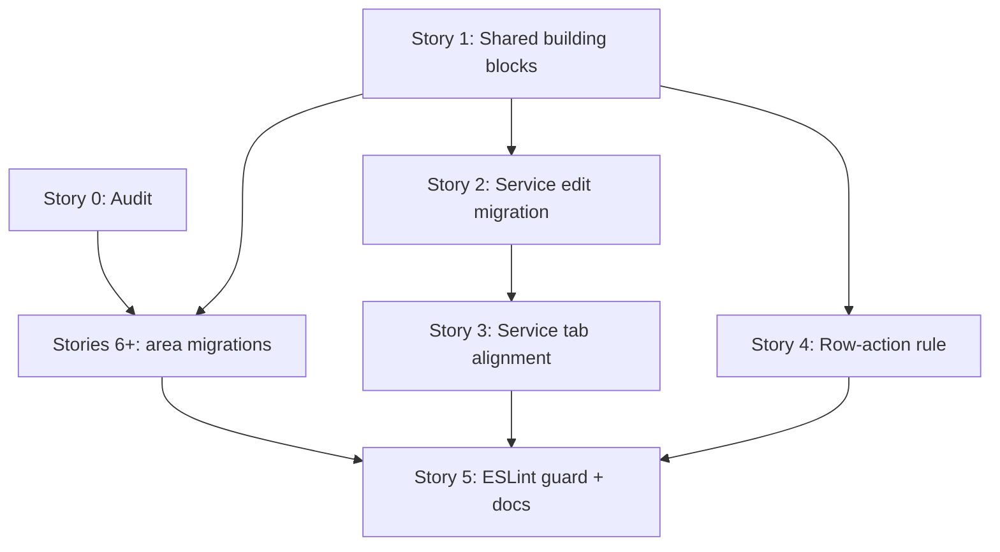

# TD57 — INLINE-FEEDBACK-AND-ACTION-PANE-PATTERN

## Status

- **Type**: Technical Debt / Frontend UX consistency
- **Priority**: Medium (a production UX defect — a save error rendered where nobody sees it — with no data or security risk; the inconsistency is spread across the whole `apps/web` dashboard and customer account)
- **Context**: `apps/web` (dashboard shell, customer account, platform settings/hotsite editor), `packages/i18n` (error-code copy). No backend, BFF or `@ikaro/types` change.
- **Created**: 2026-10-29
- **Discovered**: Manager report on the service edit screen: saving the Políticas tab with `durationPolicy = CUSTOMER_SELECTED` and empty min/max/increment returned a 422 whose message rendered at the very bottom of a long form; follow-up read-only audit of `apps/web` showed the problem is systemic.
- **Decision status**: Pattern decided in the 2026-10-29 session (see "Chosen approach"). Ready for discovery in the dependency order below; Story 0 produces the migration list that scopes Stories 6+; every story still begins with `/story-discovery`.
- **Related**: `docs/ENGINEERING_RULES_FRONTEND.md` § Reuse the repo's UI primitives; `docs/ANTI_PATTERNS.md` (the "hand-built control" row); `docs/DASHBOARD_FRONTEND_ARCHITECTURE.md`; TD23 (error-code → i18n pipeline, `resolveErrorMessage`)

## Problem

Ikaro's web app has no feedback pattern. A baseline read-only survey of `apps/web` (2026-10-29) found:

- **No shared feedback component** in `shared/components/ui/` and no toast library. 43 files draw their own `role="alert"` box; 103 files carry ad-hoc red styling; dozens of divergent `data-testid` names express the same concept (`service-submit-error`, `settings-submit-error`, `resource-create-submit-error`, `invite-submit-error`, `policy-error`, …).
- **The form-level error is never in or beside the action pane.** It renders in five different places: bottom of the main card (`ResourceCreateForm`, `ResourceEditFormFields`, `InviteForm`, `StaffDetailPage`, `ServiceFormFields`, the four service config tabs); a top-of-form banner plus `window.scrollTo(top)` (`SettingsForm`, `hotsite-editor-views.tsx:110`, `hotsite-editor-publish.ts:69`); above the content in the main column (`CancelConfirmPage`, `RecurringScheduleEndConfirm`, `AvailabilityAlertCancelConfirm`, `ResourceDeactivateConfirm`, `ServiceDeactivatePage`); a card at the top (`BookingDetailPage` `inlineError`, `NewBookingErrorBanner`); a bare `
` with no pane (hotsite module panels, `HotsiteActionBanner`, `ManifestTab`, several public forms).
- **The sticky action pane already exists (~25 screens, `lg:sticky lg:top-6`) but in three unrelated implementations**: the dashboard `<aside>` + `Card`, the customer `data-testid="action-pane-desktop"` div, and inline versions in the hotsite editor. `ServiceEditPanels` and `SettingsFormActions` have a `fixed inset-x-0 bottom-0 lg:hidden` mobile bar; the customer screens render `action-pane-mobile lg:hidden` in normal flow (not sticky).
- **Nothing scrolls to or focuses the first invalid field.** Focus-on-error exists in only three places (`ErrorAlert`, `NewBookingErrorBanner`, the intake summary).
- **Server field errors never reach inputs.** `ProblemDetail.field` already flows end to end (`buildProblemDetail`, the BFF `problem-detail.ts`, `ApiError.field` in `apps/web/shared/lib/api/errors.ts`), but `resolveErrorMessageFromApiError` returns only the message string and drops it. ~21 files set `aria-invalid` from client-side validation, so field marking exists, but only for errors the browser detected itself.
- **Dead success messages.** `ResourceRow.tsx`'s `ReactivateResourceAction` sets `reactivateState = 'success'` but renders only for `!resource.isActive`; after the refetch flips `isActive` the component unmounts, so `resource-row-reactivate-success` can never be seen. `MemberRow.tsx`'s `ActivateMemberAction` carries a comment describing the same refetch flip and very likely has the same defect.
- **Layout misalignment on the service edit screen.** `ServiceEditPage` puts the tab content and `ServiceEditActionPanels` in one grid (`lg:grid-cols-[minmax(0,1fr)_22rem] lg:items-start`), so the pane aligns with whatever the tab starts with. Detalhes and Página pública start with a `Card` (aligned). Políticas starts with a bare `
{t('politicasIntro')}
` (`ServiceBookingPolicyPanel.tsx:95`), Formulário with a bare `
{t('formularioIntro')}
` (`ServiceIntakeSchemaPanel.tsx:204`), Recursos with `ServiceResourceModePicker`'s loose `<label>` and two option buttons with no card — so the first box sits lower than the pane. Concluded from code structure; not yet confirmed in a browser.

The triggering report: `BOOKING_SERVICE_BOOKING_POLICY_INVALID` (422, `field: "durationMinMinutes"`, detail "durationPolicy=CUSTOMER_SELECTED requires durationMinMinutes, durationMaxMinutes, and durationIncrementMinutes"). The catalog text (`packages/i18n/locales/{pt-BR,en}/errors.json:114`) lists duration, pricing and window and adds an unrelated booking-window sentence; the box rendered after four cards (`ServiceBookingPolicyPanel.tsx` ~101–110) so the manager saw nothing without scrolling.

### Why this matters

A save that fails silently from the user's viewpoint is a support ticket and a lost configuration. The same defect class (error out of view, no field highlight, success unseen) repeats on every form because each screen reinvents the box; fixing one screen leaves the product inconsistent, and nothing stops the next screen from adding a 44th variant.

## Chosen approach (decided in this session, 2026-10-29)

1. **Inline only — no toasts, no new dependency.**
2. **Forms with a primary action**: the form-level error *and* success message render in a feedback box **below the buttons, inside the action pane**. On desktop the pane is sticky (`lg:sticky lg:top-6`), so the feedback follows the scroll and is never scrolled away. On mobile the existing fixed bottom bar surfaces the same feedback.
3. **Field level**: the offending input gets a red outline and an inline message (`aria-invalid` + `aria-describedby`), driven by the backend `ProblemDetail.field` for server errors as well as by client validation. The first invalid field is scrolled to and focused. Errors use `role="alert"`, success uses `role="status"`. Success persists until the next edit (the panels' existing `patch()` already clears it) — no auto-fade.
4. **Row actions on lists**: when the action changes a status the row already displays (activate, deactivate, approve), the changed badge/button *is* the confirmation — no extra success text. An action with no visible change (resend invite) keeps a short inline confirmation beside the button. Row failures show the backend-resolved message inline beside the row, not a fixed string.
5. **One shared implementation**: a feedback component and a shared `ActionPane` with a feedback slot in `apps/web/shared/components/ui/`, a `useFormFeedback` hook in `apps/web/shared/lib/`, and a resolver that returns `{ message, field }`. The feedback component is Tailwind-only (no `--ba-*`), usable in the dashboard and the customer account. The hotsite-branded `ErrorAlert` (`variant="hotsite"`, reads `--ba-radius`) stays as the branded counterpart — CLAUDE.md's web styling boundary forbids one component reading both branding systems.
6. **Layout rule**: every tab/section body starts with a card level with the action pane's card; intro text lives *inside* that card; only the tab bar sits above the grid.
7. **Enforcement last**: an ESLint `no-restricted-syntax` selector blocking new hand-rolled `role="alert"` boxes, added only after the migration stories so it does not fail on unmigrated files.

### Open items for `/story-discovery` (not decided here)

- Whether any branded public hotsite surface should adopt the shared component or keep `ErrorAlert` (decided per screen in Story 0's inventory).
- Whether the window-narrowing hint dropped from `BOOKING_SERVICE_BOOKING_POLICY_INVALID`'s catalog text should become a static hint on the booking-window card, or whether the backend should split the window violation into its own error code (Story 2).
- The exact mobile-bar layout when the feedback is long (Story 1).

### Story 0 — Audit every error/success surface and fix the migration scope ⚪

**Agent:** frontend-ts
**Complexity:** M
**Docs to load:** `docs/ENGINEERING_RULES_FRONTEND.md` § Reuse the repo's UI primitives; `docs/DASHBOARD_FRONTEND_ARCHITECTURE.md` §2–§3; `docs/STORY_SCHEMA.md` (the appended migration stories are drafted to it); `docs/REPOSITORY_STRUCTURE.md` § Web placement rules
**Dependencies:** none
**Pattern:** plain composition — no named pattern applies (docs-only inventory)

**Description:**
The 2026-10-29 survey was deliberately not exhaustive: it read ~15 representative screens of the 43 `role="alert"` files and did not cover the public booking flow, the hotsite module panels or `app/` routes in depth. This story produces the authoritative inventory and, from it, the exact list of migration stories.

For every error or success surface under `apps/web/features/`, `apps/web/shells/` and `apps/web/app/`, record one row classified **form** (has a primary action), **row action** (list-row mutation) or **page-level** (load failure, route `error.tsx`), with: where the message renders; `role`; focus/scroll behaviour; whether the offending input is marked (`aria-invalid` *and* a visible red outline, verified in the field component, not by file-level grep — the survey's "fieldErrors without `aria-invalid`" grep produced 11 mostly false positives because forms delegate to child field components); whether an action pane exists, its implementation (dashboard `<aside>`, customer `action-pane-desktop`, hotsite inline), desktop stickiness and mobile behaviour; the first-box alignment against the pane; and every `data-testid` plus the Playwright specs that reference it (known: `e2e/team-invite.spec.ts`, `e2e/team-deactivate.spec.ts`, `e2e/services-resource-config.spec.ts`, `e2e/settings.spec.ts`).

The output is an appendix to this file (`## Appendix A — Audit inventory`) and a set of migration stories appended with `/create-story`, one per area (candidates from the survey: resources, staff, settings, hotsite editor + module panels, customer account screens, bookings dashboard incl. `BookingDetailPage`/`BookingDecisionPanel`, public booking/lead forms, platform/loyalty tabs). Each migration story must list non-overlapping `Files to create/modify` so `/run-batch` can run them concurrently, and must state which `data-testid`s change and which E2E specs it updates. Visual alignment findings are marked "from structure" unless confirmed in a browser; a browser check needs the user's yes first (CLAUDE.md §0 local verification gate).

**Files to create/modify:**
- `td/TD57-INLINE-FEEDBACK-AND-ACTION-PANE-PATTERN.md` (append Appendix A and the migration stories)

**Acceptance criteria — product:**
- [ ] Appendix A lists every file returned by `grep -rl 'role="alert"' apps/web/features apps/web/shells apps/web/shared apps/web/app` plus every file containing an `<aside>` action pane or `data-testid="action-pane-*"`, each with all columns above.
- [ ] Each migration story is appended with real, existing paths, a per-story testid/E2E impact list, and `Dependencies: Story 1` (and Story 2 where it reuses the service-edit slot).
- [ ] Story 5's `Dependencies` is updated to include every appended migration story.
- [ ] Any screen where the first box is not level with its pane is listed with the structural reason.

**Acceptance criteria — technical:**
- Unit: none — docs-only story
- Integration: none — docs-only story
- Tenant isolation: none — no data access
- E2E: none — docs-only story
- [ ] The commands used to enumerate files are recorded in Appendix A so the inventory is reproducible
- [ ] `doc-link-integrity` / `docs-audit` clean for the edited file

### Story 1 — Shared feedback component, `ActionPane`, `useFormFeedback` and the `{ message, field }` resolver 🔴

**Agent:** frontend-ts
**Complexity:** L
**Docs to load:** `docs/ENGINEERING_RULES_FRONTEND.md` § Reuse the repo's UI primitives; `docs/DASHBOARD_FRONTEND_ARCHITECTURE.md` §2 (colour system), §3 (shared components); `docs/CODE_STANDARDS.md`; `docs/TESTING_STRATEGY.md` § apps/web Testing Infrastructure; `docs/ENGINEERING_RULES_SHARED.md` § Authoring new i18n UI copy keys; `docs/ENGINEERING_RULES_TESTING.md` § `scrollIntoView({ block: 'start' })`
**Dependencies:** none
**Pattern:** compound component (an `ActionPane` with a feedback slot) plus a custom hook owning feedback state — no GoF pattern applies

**Description:**
Build the shared pieces every later story consumes, following the decisions in "Chosen approach".

1. **`FeedbackMessage`** (`shared/components/ui/feedback-message.tsx`): variants `error` and `success`, plus an `inline` size for row actions. Error renders `role="alert"`, success `role="status"`. Optional `hint`, `onRetry`/`retryLabel` and `focusOnMount` (the behaviours of today's `ErrorAlert` and `NewBookingErrorBanner`). `testId` passthrough. Tailwind-only; never reads `--ba-*`. It replaces `NewBookingErrorBanner` (its 5 caller step components are migrated here and the old file is deleted); `ErrorAlert`'s `dashboard` variant callers (`CustomerReschedulePage`, `ReschedulePicker`, `NewBookingAvailabilityStep`, `RescheduleBookingPage`) move to it in the migration stories; `ErrorAlert` keeps only the branded `hotsite` variant.
2. **`ActionPane`** (`shared/components/ui/action-pane.tsx`): one component for the desktop sticky pane (`hidden lg:block lg:sticky lg:top-6`, `Card`) and the mobile fixed bar (extracted from `ServiceEditPanels.tsx` / `SettingsFormActions.tsx`, reusing `MOBILE_ACTION_BAR_CLEARANCE_CLASS` from `shells/dashboard/utils/mobile-action-bar.ts`). Props: `actions` (the buttons) and `feedback` (a `FeedbackMessage` model). The feedback renders **below the buttons** in the pane; in the mobile bar it renders above the buttons inside the fixed bar with a bounded height and scroll so a long message never pushes the bar off-screen.
3. **`useFormFeedback`** (`shared/lib/feedback/use-form-feedback.ts`): holds `{ error, success, fieldErrors }`; `setFromApiError(err, locale)` resolves message and `field`; `setSuccess(message)`; `clear()` (called by the panels on edit); `registerField(name)` returning a ref-callback; `focusFirstInvalid()` which scrolls with `block: 'center'` and focuses the input. A `field` the form does not register falls back to the form-level message only.
4. **Resolver** (`shared/lib/i18n/resolve-error-message.ts`): add `resolveApiErrorFeedback(err, locale): { message: string; field?: string }` built on `extractProblemDetailShape`; `resolveErrorMessageFromApiError` delegates to it so its 30 callers are untouched.
5. **Docs**: new section in `docs/ENGINEERING_RULES_FRONTEND.md` stating the pattern (placement, roles, focus, row-action rule, alignment rule) and a pointer from `docs/DASHBOARD_FRONTEND_ARCHITECTURE.md` §3.

No screen is migrated in this story except the `NewBookingErrorBanner` callers (a mechanical swap that lets the old file be deleted rather than left as a second implementation).

**Backend use case steps:** none
**Backend HTTP surface:** none
**BFF endpoint spec:** none
**Prototype references:** none (no journey; a visual spec is part of `/story-discovery`)
**New migration / i18n keys / env vars / feature flags:** i18n keys only if the retry/dismiss labels are not already in `common` — decided in discovery, both `pt-BR` and `en` in the same change; no migration, env var or flag

**Files to create/modify:**
- `apps/web/shared/components/ui/feedback-message.tsx` + `feedback-message.spec.tsx` (new)
- `apps/web/shared/components/ui/action-pane.tsx` + `action-pane.spec.tsx` (new)
- `apps/web/shared/lib/feedback/use-form-feedback.ts` + `use-form-feedback.spec.tsx` (new)
- `apps/web/shared/lib/i18n/resolve-error-message.ts` + `resolve-error-message.spec.ts`
- `apps/web/features/booking/components/dashboard/bookings/new-booking/NewBookingErrorBanner.tsx` + spec (delete)
- `apps/web/features/booking/components/dashboard/bookings/new-booking/NewBookingAvailabilityStep.tsx`, `NewBookingResourcePickerStep.tsx`, `NewBookingIntakeStep.tsx`, `NewBookingServicesStep.tsx`, `NewBookingDurationStep.tsx` (swap import)
- `docs/ENGINEERING_RULES_FRONTEND.md`, `docs/DASHBOARD_FRONTEND_ARCHITECTURE.md`
- `packages/i18n/locales/pt-BR/web.json`, `packages/i18n/locales/en/web.json` (only if new keys)

**Acceptance criteria — product:**
- [ ] The five New-booking step errors look and behave as before (message, hint, retry, focus on return) using the shared component.
- [ ] `docs/ENGINEERING_RULES_FRONTEND.md` states the pattern precisely enough that a story author can apply it without reading this TD.

**Acceptance criteria — technical:**
- Unit:
  - [ ] `feedback-message.spec.tsx`: error → `role="alert"`, success → `role="status"`; `focusOnMount` focuses; hint and retry render and fire; `inline` size; no `--ba-` class or variable in the rendered output
  - [ ] `action-pane.spec.tsx`: feedback renders below the actions; desktop wrapper carries the sticky classes; mobile bar carries `fixed` and renders the feedback; no feedback → no empty box
  - [ ] `use-form-feedback.spec.tsx`: a `field` mapped to a registered input marks it, scrolls (`block: 'center'`) and focuses it; an unregistered `field` leaves only the form-level message; `clear()` removes error and success; two invalid fields focus the first in DOM order
  - [ ] `resolve-error-message.spec.ts`: returns `{ message, field }` for an `ApiError` with `field`; returns the fallback and no `field` for a plain `Error`; `resolveErrorMessageFromApiError` output is unchanged for existing inputs
  - [ ] An unmigrated `ErrorAlert variant="hotsite"` still renders unchanged (negative guarantee: the branded variant is not touched)
- Integration: none — frontend story, no `.integration.spec.ts` tier
- Tenant isolation: none — no data access
- E2E: none — covered in Story 2's scenario
- [ ] Coverage ≥80% on changed code
- [ ] `tsc --noEmit` clean, lint clean

### Story 2 — Service edit screen: feedback in the pane, `CUSTOMER_SELECTED` validation, reworded error 🔴

**Agent:** frontend-ts
**Complexity:** L
**Docs to load:** `docs/ENGINEERING_RULES_FRONTEND.md` (the section added by Story 1); `docs/ENGINEERING_RULES_SHARED.md` § Adding a new error — checklist; `docs/ERROR_CATALOG.md` § Code Origins; `docs/TESTING_STRATEGY.md` § Running Playwright locally; `docs/USE_CASES.md` (the service booking-policy UC — `grep -n 'booking policy'`)
**Dependencies:** Story 1
**Pattern:** extend the existing registered-action descriptor (`useRegisterTabAction` / `ServiceTabAction`) with a `feedback` field; plain composition otherwise
**Discovered:** 2026-10-29, manager report on the service edit screen
**Root cause:** `ServiceBookingPolicyPanel.tsx` keeps a local `error` state and renders it after the four policy cards (~lines 101–110); `resolveErrorMessageFromApiError` drops `ProblemDetail.field`; nothing validates the `CUSTOMER_SELECTED` precondition client-side even though the backend enforces it; the catalog text for `BOOKING_SERVICE_BOOKING_POLICY_INVALID` carries an unrelated sentence.

**Description:**
Migrate every tab of `ServiceEditPage` to the shared pattern.

- `ServiceTabAction` (`service-tab-action.ts`) gains an optional `feedback` (the `FeedbackMessage` model from Story 1). `useRegisterTabAction` registers it with the action; `ServiceEditActionPanels` renders it through the shared `ActionPane` (desktop aside and mobile bar). The four config panels (`ServiceResourceRequirementsPanel`, `ServiceBookingPolicyPanel`, `ServiceIntakeSchemaPanel`, `ServicePublicPageTab`) stop rendering their own bottom boxes (`policy-error`, `policy-saved`, `public-page-saved`, `intake-published`, …); their existing "clear on next edit" logic is kept. Detalhes's `service-submit-error` (`ServiceFormFields`) and `fieldErrors` (`mapSubmitErrors`) move to the same pane slot.
- **Server field errors**: `useFormFeedback` maps `ProblemDetail.field` to the panel's input; the Políticas fields register themselves so `durationMinMinutes` marks and focuses the min-duration input.
- **Pre-send validation**: when `durationPolicy === 'CUSTOMER_SELECTED'` and any of `durationMinMinutes`, `durationMaxMinutes`, `durationIncrementMinutes` is empty, the save is blocked client-side and all missing fields are marked together with the first focused. The backend rule remains the safety net. A policy with `FIXED` duration is never blocked by this check.
- **Reworded catalog text** for `BOOKING_SERVICE_BOOKING_POLICY_INVALID` in both `packages/i18n/locales/pt-BR/errors.json` and `en/errors.json`: keep "incomplete or invalid — check the duration, pricing and booking-window fields", drop the booking-window-widening sentence. That guidance moves to a static hint on the booking-window card (or a dedicated error code — open item from "Chosen approach", resolved in discovery). The exhaustiveness spec requires both locales in the same change.

**Backend use case steps:** none
**Backend HTTP surface:** none — reuses `PUT`/`PATCH` service booking-policy endpoint unchanged
**BFF endpoint spec:** none — reuses the existing endpoint
**Prototype references:** `journeys/manager/prototypes/` service-edit prototype, if present — checked in discovery
**New migration / i18n keys / env vars / feature flags:** reworded `BOOKING_SERVICE_BOOKING_POLICY_INVALID` (both locales); possibly one static window hint key in `web.json` (both locales); no migration, env var or flag

**Files to create/modify:**
- `apps/web/features/booking/components/dashboard/services/service-tab-action.ts` + `service-tab-action.spec.tsx`
- `apps/web/features/booking/components/dashboard/services/ServiceEditPanels.tsx` + `ServiceEditPanels.spec.tsx`
- `apps/web/features/booking/components/dashboard/services/ServiceEditPage.tsx` + `ServiceEditPage.spec.tsx`
- `apps/web/features/booking/components/dashboard/services/ServiceBookingPolicyPanel.tsx` + `ServiceBookingPolicyPanel.spec.tsx`
- `apps/web/features/booking/components/dashboard/services/PolicyDurationPricingCard.tsx` + spec
- `apps/web/features/booking/components/dashboard/services/policy-card-helpers.ts` (or a new `policy-validation.ts` + spec)
- `apps/web/features/booking/components/dashboard/services/ServiceResourceRequirementsPanel.tsx`, `ServiceIntakeSchemaPanel.tsx`, `ServicePublicPageTab.tsx` + specs
- `apps/web/features/booking/components/dashboard/services/ServiceFormFields.tsx` + spec
- `packages/i18n/locales/pt-BR/errors.json`, `packages/i18n/locales/en/errors.json`; `web.json` (both locales) if the hint key is added
- `apps/web/e2e/services-manage.spec.ts` and `apps/web/e2e/services-resource-config.spec.ts` (update ids; add the `CUSTOMER_SELECTED` scenario)

**Acceptance criteria — product:**
- [ ] Saving Políticas with `CUSTOMER_SELECTED` and any duration field empty does not call the API; the missing fields get a red outline and message, the first is focused, and the pane shows the form-level error without scrolling.
- [ ] A backend 422 with a `field` marks and focuses that input and shows the message in the pane.
- [ ] After a successful save, the pane shows "Políticas salvas" and the message disappears on the next edit.
- [ ] Every other tab (Detalhes, Recursos, Formulário, Página pública) shows its error/success in the pane, on desktop and in the mobile bar.
- [ ] Scrolling the middle column keeps the pane and its feedback in view.
- [ ] The reworded catalog text no longer mentions widening the booking window; the window-narrowing hint remains visible on the booking-window card.

**Acceptance criteria — technical:**
- Unit:
  - [ ] `ServiceBookingPolicyPanel.spec.tsx`: `CUSTOMER_SELECTED` + empty min/max/increment blocks the mutation and marks all three; a server `field: durationMinMinutes` marks only that input and focuses it
  - [ ] `ServiceBookingPolicyPanel.spec.tsx`: `FIXED` duration with empty min/max/increment is not blocked (negative guarantee, own test)
  - [ ] `ServiceBookingPolicyPanel.spec.tsx`: success then edit clears the success message
  - [ ] `service-tab-action.spec.tsx`: the registered action carries `feedback` and updates when it changes; unmount registers `null`
  - [ ] `ServiceEditPanels.spec.tsx`: feedback renders below the buttons in the aside and in the mobile bar
  - [ ] one spec per migrated panel asserting its old bottom box (`policy-error`, `policy-saved`, …) no longer renders
  - [ ] `error-codes-exhaustiveness.spec.ts` passes with the reworded text in both locales
- Integration: none — frontend story
- Tenant isolation: none — no data access
- E2E:
  - [ ] Playwright (`services-manage.spec.ts`): Políticas with `CUSTOMER_SELECTED` and empty fields → error visible in the pane without scrolling, first invalid field focused; filling them and saving → "Políticas salvas" in the pane. Local run only after asking (CLAUDE.md §0)
- [ ] Coverage ≥80% on changed code
- [ ] `tsc --noEmit` clean, lint clean

### Story 3 — Service edit tabs start with a card level with the action pane 🟡

**Agent:** frontend-ts
**Complexity:** M
**Docs to load:** `docs/ENGINEERING_RULES_FRONTEND.md` (alignment rule added by Story 1); `docs/DASHBOARD_FRONTEND_ARCHITECTURE.md` §3; `docs/TESTING_STRATEGY.md` § apps/web Testing Infrastructure
**Dependencies:** Story 2 (same files — `ServiceBookingPolicyPanel`, `ServiceIntakeSchemaPanel`, `ServiceResourceRequirementsPanel` — so sequential, not batchable with Story 2)
**Pattern:** plain composition — no named pattern applies
**Discovered:** 2026-10-29, manager report (pane and first box at different heights on Recursos, Políticas and Formulário)
**Root cause:** `ServiceBookingPolicyPanel.tsx:95` and `ServiceIntakeSchemaPanel.tsx:204` render a bare `
` intro above the first card; `ServiceResourceModePicker.tsx` starts with a loose `<label>` and option buttons that are not inside any card; the grid in `ServiceEditPage.tsx` (`lg:items-start`) aligns the pane with whatever the panel starts with.

**Description:**
Every tab body of the service edit screen starts with a card that is level with the action pane's card. The intro text (`politicasIntro`, `formularioIntro`) moves inside the first card; Recursos wraps `ServiceResourceModePicker` in a card (`SectionCard`, title `recursosModeLabel` "Como este serviço usa recursos?") and drops the loose label. Only the tab bar remains above the grid. Reuse `shared/components/ui/section-card.tsx` or `Card`; no new primitive. Existing locale keys are reused, none are added.

The audit (Story 0) decides whether the same rule applies to other multi-tab or intro-text screens (settings sections, hotsite module panels, `ModuleConfigShell`); those become migration stories, not scope here. Layout is concluded from structure; confirm visually in a browser after the change (ask first, CLAUDE.md §0).

**Backend use case steps:** none
**Backend HTTP surface:** none
**BFF endpoint spec:** none
**Prototype references:** none
**New migration / i18n keys / env vars / feature flags:** none

**Files to create/modify:**
- `apps/web/features/booking/components/dashboard/services/ServiceResourceModePicker.tsx` + `ServiceResourceModePicker.spec.tsx`
- `apps/web/features/booking/components/dashboard/services/ServiceResourceRequirementsPanel.tsx` + spec
- `apps/web/features/booking/components/dashboard/services/ServiceBookingPolicyPanel.tsx` + spec
- `apps/web/features/booking/components/dashboard/services/ServiceIntakeSchemaPanel.tsx` + spec

**Acceptance criteria — product:**
- [ ] On Recursos, Políticas and Formulário the first box starts at the same height as the action pane's card (desktop), matching Detalhes and Página pública.
- [ ] The intro sentences are still shown, now inside the first card.
- [ ] The Recursos mode picker appears inside a card titled "Como este serviço usa recursos?".

**Acceptance criteria — technical:**
- Unit:
  - [ ] one spec per tab (Recursos, Políticas, Formulário): the first element of the panel's root is a card and no bare `
` or `<label>` precedes it
  - [ ] `ServiceResourceModePicker.spec.tsx`: renders inside the card with the heading; mode selection and `legsLockedOnServer` behaviour unchanged
- Integration: none — frontend story
- Tenant isolation: none — no data access
- E2E: none — structural change covered by unit specs; existing service E2E scenarios must stay green
- [ ] Coverage ≥80% on changed code
- [ ] `tsc --noEmit` clean, lint clean

### Story 4 — Row actions: the status change is the confirmation 🟡

**Agent:** frontend-ts
**Complexity:** S
**Docs to load:** `docs/ENGINEERING_RULES_FRONTEND.md` (row-action rule added by Story 1); `docs/ENGINEERING_RULES_FRONTEND.md` § A mutation that changes server state owned by another feature must invalidate that feature's query keys; `docs/TESTING_STRATEGY.md`
**Dependencies:** Story 1
**Pattern:** plain composition — no named pattern applies
**Discovered:** 2026-10-29, read-only audit
**Root cause:** `ResourceRow.tsx` `ReactivateResourceAction` renders only for `!resource.isActive`, so the refetch that flips `isActive` unmounts the component holding the success state; `MemberRow.tsx` `ActivateMemberAction` is documented as flipping on refetch and is verified in this story.

**Description:**
Apply the row-action rule. Remove the unreachable success branches: `resource-row-reactivate-success` (`ResourceRow.tsx`) and, after confirming the same unmount in `MemberRow.tsx`, `activate-member-success`, together with the `activateSuccess` keys they use (pt-BR/en `web.json`, both resource and staff namespaces) if nothing else references them. Keep `resend-invite-success` — resending changes nothing visible, so a short inline confirmation beside the button is correct. Row errors (`resource-row-reactivate-error`, `activate-member-error`, `resend-invite-error`) render through `FeedbackMessage` (`inline`) with the backend-resolved message from `resolveApiErrorFeedback`, replacing the fixed strings `activateError` / `resendInviteError` (those keys are removed if unreferenced). E2E specs referencing the removed ids (`team-invite.spec.ts`, `team-deactivate.spec.ts`) are updated.

**Backend use case steps:** none
**Backend HTTP surface:** none
**BFF endpoint spec:** none
**Prototype references:** none
**New migration / i18n keys / env vars / feature flags:** removes unused `activateSuccess`, `activateError`, `resendInviteError` keys in both locales when unreferenced; no additions

**Files to create/modify:**
- `apps/web/features/booking/components/dashboard/resources/ResourceRow.tsx` + `ResourceRow.spec.tsx`
- `apps/web/features/booking/components/dashboard/resources/ResourceListPage.spec.tsx`
- `apps/web/features/staff/components/team/MemberRow.tsx` + spec
- `packages/i18n/locales/pt-BR/web.json`, `packages/i18n/locales/en/web.json`
- `apps/web/e2e/team-invite.spec.ts`, `apps/web/e2e/team-deactivate.spec.ts`, `apps/web/e2e/resources-manage.spec.ts` (as referencing the changed ids)

**Acceptance criteria — product:**
- [ ] Reactivating a resource or activating a member flips the badge and button; no extra success text is expected or shown.
- [ ] Resending an invite shows a short confirmation beside the button.
- [ ] A failed row action shows the backend-resolved message beside the row.

**Acceptance criteria — technical:**
- Unit:
  - [ ] `ResourceRow.spec.tsx`: reactivate success → the row re-renders as active with no leftover success text; failure → inline error with the resolved message
  - [ ] `MemberRow.spec.tsx`: the same for activate; resend invite success confirmation present (negative guarantee: it is not removed with the others)
- Integration: none — frontend story
- Tenant isolation: none — no data access
- E2E:
  - [ ] existing specs updated to assert the status change instead of the removed success ids; no new scenario
- [ ] Coverage ≥80% on changed code
- [ ] `tsc --noEmit` clean, lint clean

### Story 5 — ESLint guard against new hand-rolled alert boxes, plus anti-pattern docs 🟡

**Agent:** frontend-ts
**Complexity:** M
**Docs to load:** `docs/ENGINEERING_RULES_SHARED.md` § `no-restricted-syntax` selectors must be checked against every already-documented bypass shape; `docs/ANTI_PATTERNS.md`; `docs/AGENT_CONTEXT_TRAP_SCENARIOS.md` § How to edit `context.md`
**Dependencies:** Story 3, Story 4, and every migration story appended by Story 0 (the selector must not fail on an unmigrated file)
**Pattern:** plain composition — no named pattern applies (an ESLint config entry with tests)

**Description:**
Add a `no-restricted-syntax` selector in `apps/web/eslint.config.js` (alongside `LOCALE_LITERAL_SELECTOR`) that flags a JSX element with `role="alert"` or `role="status"` outside `shared/components/ui/feedback-message.tsx` (and the branded `ErrorAlert`, listed by an explicit `ignores`/`files` override with the rationale). Before considering it done, check it against the three bypass classes documented in `docs/ENGINEERING_RULES_SHARED.md` § `no-restricted-syntax` selectors (an expression-container value `role={'alert'}`, a spread `{...{ role: 'alert' }}`, and `createElement`/non-JSX construction) and cover each in `shared/lib/eslint/restricted-syntax.eslint.spec.ts`. Add the `ANTI_PATTERNS.md` row (hand-rolled feedback box; fix: `FeedbackMessage` / `ActionPane` / `useFormFeedback`; **CI-enforced**) and, following the context-editing rules (a bullet stays in `.copilot/context.md` only if CI-enforced: name + one line), one `CI-enforced` bullet in §7 pointing at the `ENGINEERING_RULES_FRONTEND` section.

**Backend use case steps:** none
**Backend HTTP surface:** none
**BFF endpoint spec:** none
**Prototype references:** none
**New migration / i18n keys / env vars / feature flags:** none

**Files to create/modify:**
- `apps/web/eslint.config.js`
- `apps/web/shared/lib/eslint/restricted-syntax.eslint.spec.ts`
- `docs/ANTI_PATTERNS.md`
- `docs/ENGINEERING_RULES_FRONTEND.md`
- `.copilot/context.md` (never through the `CLAUDE.md` symlink)

**Acceptance criteria — product:**
- [ ] A new `role="alert"` or `role="status"` box outside the shared component fails lint with a message naming `FeedbackMessage`.

**Acceptance criteria — technical:**
- Unit:
  - [ ] `restricted-syntax.eslint.spec.ts`: literal `role="alert"` flagged; `role={'alert'}` flagged; spread-object `role` flagged; `createElement('div', { role: 'alert' })` flagged; `role="status"` flagged
  - [ ] the shared component file and the branded `ErrorAlert` are not flagged (negative guarantee, own test)
- Integration: none — lint configuration
- Tenant isolation: none — no data access
- E2E: none — lint rule
- [ ] `pnpm lint` over `apps/web` is clean on the final tree (proves every migration story landed)
- [ ] `agent-context-file` and `doc-link-integrity` checks clean
- [ ] `tsc --noEmit` clean

## Dependency graph

Stories 0 and 1 are independent and can run in parallel; Stories 2 and 3 share files and must be sequential.

## Appendix A — Audit inventory

_Filled by Story 0._
