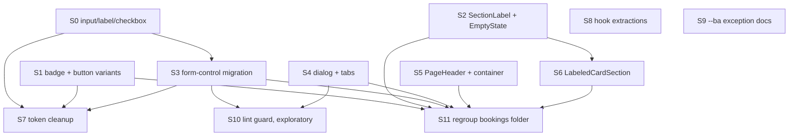

# TD58 — Atomic-Design UI Maturity (apps/web)

## Status
- **Type**: Technical Debt / Frontend maintainability (design-system foundation)
- **Priority**: Medium (no user-facing defect and nothing blocked; it is the maintainability debt that makes every future screen slower to build and visually drift-prone)
- **Context**: `apps/web` only — `shared/components/ui/`, `features/{booking,customer,platform,loyalty,staff}/components`, `shells/dashboard`, `app/globals.css`. No backend, BFF, migration or event change.
- **Created**: 2026-11-05
- **Discovered**: read-only atomic-design audit of `apps/web` (three parallel structural audits plus a premise-verification pass, 2026-11-05). Grade given at the time: C+ overall (tokens C, atoms C−, molecules B, organisms B+, templates C+, pages A−, tests A).
- **Decision status**: Ready for discovery and implementation in the dependency order below; every story still begins with `/story-discovery`. The sequence and scope below were confirmed with the user on 2026-11-05; no story-level discovery has run yet, so each story's "Pattern" is a starting decision that `/story-discovery` Step 4q may refine.
- **Related**: `docs/ENGINEERING_RULES_FRONTEND.md` § Reuse the repo's UI primitives; TD57 (inline feedback + action-pane pattern, the precedent for promoting a repeated UI pattern into `ui/`); `docs/ANTI_PATTERNS.md`; `.copilot/context.md` §8 (the `--ba-*` boundary row).

---

## Problem

`apps/web` has the right *structure* for atomic design — domain slices for organisms, shells as templates, thin `app/` pages, a fetch boundary that holds (no component calls `bffClient`), no component file over 300 lines (max 289), and 482 specs for 423 components. What it lacks is the bottom layer: `shared/components/ui/` has 23 primitives but no input, label, checkbox, dialog, tabs, empty-state, section-label or page-header, and the dashboard largely ignores the semantic tokens that `app/globals.css` defines. Every screen therefore rebuilds the missing pieces by hand, and the copies drift.

Verified evidence (grep, non-spec files, 2026-11-05):

- **Form controls.** The literal `w-full rounded-md border border-gray-300 px-3 py-2 text-sm` appears **32 times in 16 files**, all in `features/platform/components/hotsite/modules/` (the hotsite *editor*, an admin surface). **70 files** outside `ui/` contain a raw `<input`, **91** a raw `<label`, **14** a raw `<select`, **24** a raw `<textarea`. 37 files use `<select>`/`<textarea>` although `ui/select` and `ui/textarea` exist (5 of those are branded public-hotsite forms and are legitimately separate — see Story 3).
- **Variants.** `ui/badge.tsx` has only default/secondary/destructive/outline; 35 of 36 `Badge` usages carry a `className` override. `ui/button.tsx` has no variant for two patterns that repeat verbatim: `w-full border-0 bg-white text-gray-900 shadow-sm hover:bg-gray-50` appears **8 times in 8 files** (some as local consts: `BookingActionPanel.tsx:39`, `NewBookingOutcome.tsx:13`, `BookingDecisionPanel.tsx:14`) and `w-full border-red-200 text-red-700 hover:bg-red-50` (`RecurringApprovalActions.tsx:63`). The gray badge string `border-0 bg-gray-100 text-[0.6875rem] font-semibold text-gray-600` repeats 4 times in 3 `booking-detail/*Card` files; 7 more files hand-build `rounded-full bg-*-100` pills instead of `Badge`.
- **Section eyebrow.** `text-xs font-bold uppercase tracking-[0.07em] text-gray-400` appears **25 times in 17 `features/booking` files**, with about 45 further near-variants (`tracking-wide/wider/widest/0.06em`, gray-400 vs gray-500, plus a `text-blue-700` form) — the same intent drifting.
- **Empty state.** Three structurally identical copies (`customer/my-account/BookingEmptyState.tsx`, and inline in `RecurringScheduleList.tsx:~143` and `AvailabilityAlertList.tsx:~122`): a `rounded-2xl border border-gray-100 bg-white px-6 py-12 text-center shadow-sm` section, an `h-10 w-10 text-gray-300` icon, title, body, optional CTA link. They differ only in icon, i18n keys, CTA href, `data-testid` and an `mt-6`.
- **Page template.** 40 files render their own `<h1>`; about 20 of them are branded public/auth pages (out of scope) and about 20 are dashboard/account pages (in scope). `DashboardSectionShell` has 3 importers, container widths are ad hoc (`max-w-md/lg/none`), and no `PageHeader`-style component exists.
- **Hand-rolled dialog and tabs.** 5 hand-rolled `role="tablist"` implementations (`ServiceEditTabBar`, `HotsiteEditorMainView`, `ServicePublicPageContent`, `CustomerChooserStep`, `LoyaltyPage`); 2 hand-rolled modals (`BookingActionSheetShell`, used by 10 sheets, and `IntakeVersionModal`) while `ui/alert-dialog` exists.
- **Tokens.** Hardcoded hex in unbranded surfaces: `bg-[#f9fafb]` at `SchedulePage.tsx:106`, `DashboardShell.tsx:42`, `CustomerShell.tsx:24`; `bg-[#111827]` at `Sidebar.tsx:70`; `stroke="#dc2626"` at `app/auth/error/page.tsx:89` and `features/booking/components/public/InvalidLinkView.tsx:60`. `globals.css` defines no `--surface-*` or `--sidebar*` token. Beyond hex, the `ui/` primitives themselves (`pill-select`, `color-picker`, `select`, `pill-multi-select`, `calendar`) use raw palette classes.
- **Mixed state.** `ServiceEditPage.tsx` (15 `useState` calls), `LeadFormWidget.tsx` (11), `AvailabilityCalendar.tsx` (4 plus effects) mix form/selection state with presentation.
- **Flat folders.** `features/booking/components/dashboard/bookings/` holds 60 non-spec files directly (10 more in `new-booking/`) mixing route-level pages with tiny pieces; `booking/components/public/` holds 40.
- **A rule that is documentation-only.** The `--ba-*` boundary ("a dashboard or account component must not use `--ba-*`", `.copilot/context.md` §8) has **no enforcement** (no ESLint selector, no `architecture-check` detector). Three customer files use it legitimately: `TenantOptionRow.tsx`, `InformationCompletionPrompt.tsx`, `InformationCompletionPhoneField.tsx` — the customer information-completion flow is reached from the hotsite and must honor tenant branding. The rule's wording is simply too broad.

### Why this matters

The cost is not a bug; it is drag. A new form screen copies one of 32 input strings and picks the wrong border shade; a new status pill invents a fourth gray; a new list screen writes its own empty state and `<h1>`. Each copy is individually harmless, collectively they make the UI inconsistent, make a visual change a 70-file edit, and make "reuse the primitive" (`docs/ENGINEERING_RULES_FRONTEND.md`) impossible to follow because the primitive does not exist. The healthy layers (organisms, pages, tests) mean the fix is bounded: add and adopt the missing primitives, not restructure the app.

## Chosen approach (decided in this session, 2026-11-05 — `/story-discovery` has NOT yet run)

Promote, in dependency order, only patterns with **3+ real, structurally identical copies** into `shared/components/ui/`, then migrate call sites incrementally; add structure (page template, dialog, tabs, folder regroup) after the atoms exist; finish with token cleanup and hygiene. Each new primitive is a shadcn-style `forwardRef` + `cva` component (or a plain function component for composites), born on the **semantic tokens** (`border-input`, `bg-background`, `text-muted-foreground`, …) rather than raw palette classes, and ships its `.spec.tsx` (jsdom + `@testing-library/react`, plus an axe check where it is interactive) in the same commit.

Decisions already made (do not re-open in discovery unless a premise breaks):

1. **The public/branded hotsite stays separate.** `ui/` primitives are dashboard/account (Tailwind + shadcn). Branded public flows (`booking/components/public/*`, `platform/components/public/*`, `shells/hotsite/*`, `app/[slug]/*`, auth pages) keep their own `--ba-*` building blocks. No story here migrates a branded view to a `ui/` primitive. A branded input is out of scope. (`CLAUDE.md` §7: "build separate implementations rather than one component reading both branding systems.")
2. **`--ba-*` in `features/customer` information-completion files is a named, documented exception**, not a violation to move (Story 9). The rule is not enforced in code, so the fix is wording only — no allowlist entry is needed unless Story 10 introduces enforcement.
3. **`ui/input` matches the existing `ui/textarea` look** (same border, background, focus ring, shadow) so the two controls are consistent, expressed via semantic tokens where they resolve to the same or visually equivalent value. The call-site copies use `border-gray-300`, `ui/textarea` uses `border-gray-200`; the one-shade border change on the 16 migrated hotsite-editor files is accepted and must be browser-verified.
4. **Placement:** pure atoms and domain-free molecules go in `shared/components/ui/`; `BookingActionSheetShell` stays in `booking` unless a non-booking slice needs it (it has none today).
5. **Bulk migration of the ~2,000 raw Tailwind palette sites to semantic tokens, and dark mode, are out of scope** (zero `dark:` variants exist). Only the `ui/` primitives and the 6 hex sites are aligned (Story 7).

## Considered and rejected (not debt — do not re-raise without new evidence)

| Item | Why it stays |
|---|---|
| Merging `ServiceCard` public vs dashboard | Public is `--ba-*` branded, dashboard is Tailwind; different data types. Merging breaks the two-brand rule. |
| Merging staff vs customer `BookingDetailPage`/`BookingDetailMain`/`RescheduleSuccessView`, or `OutcomePage` vs `BookingOutcomeLayout` | Different response types, actions and layout; the genuinely shared cards are already extracted to `booking/booking-detail/*Card`. Revisit only if a third consumer appears. |
| A unified key-value/detail row | Three existing layouts differ; `BookingDetailRow` is already shared where it fits. Premature abstraction. |
| A shared skeleton primitive | Only 7 files use `animate-pulse`, each a different shape. |
| Hex colors in hotsite branding code, `SwitchTenantClient` fallbacks, the Google logo SVG | Tenant branding / brand-mandated colors. |
| 189 arbitrary pixel values (`w-[Npx]`, `top-[3.375rem]`) | Layout offsets; only 1 is a `text-[Npx]`. The one worthwhile exception (`text-[0.6875rem]` on badges) is absorbed by Story 1. |
| Splitting files by line count alone; renaming `Modal`/`Sheet`/`Dialog` suffixes | No file exceeds 300 lines; only 4 of 11 large files carry mixed state (those are Story 8). |
| Storybook | `docs/ENGINEERING_RULES_FRONTEND.md`'s primitives table already names all 23 `ui/` primitives and is the catalog; each atom story adds its row. |
| Migrating all 108 raw `<button>` to `ui/button` | Many are icon, tab, row or backdrop buttons with deliberate a11y structure. Only plain action buttons move (Stories 1, 3). |
| A dark-mode / dashboard re-theming migration | No product goal. Revisit if dark mode or dashboard re-theming becomes one. |
| The `ui/` primitives table being incomplete | Verified false: it names all 23. It only needs rows for the new primitives. |

## Method and confidence key

Method: a read-only audit by three independent structural agents (primitives/tokens, duplication/promotion, organism/layering), followed by a separate premise-verification pass that re-counted every number cited here with `grep` and corrected the audit where it drifted (surface-button string 3→8 sites, eyebrow 28→25 sites, gray badge string "widespread"→4 sites, `useState` counts, hex 5→6 sites, and the retracted "docs table incomplete" claim).

Confidence marker, used on story headers: 🔴 proven recurring failure / 🟡 documented-but-unenforced rule / ⚪ exploratory, ships non-blocking first. Most stories here are unmarked (plain maintainability debt); Story 10 is ⚪.

## Stories — dependency order

Stories 0, 1, 2, 4, 5, 8 and 9 have no dependency on each other and can run in any order or (file-overlap permitting) as a `/run-batch`. Story 11 runs last because it moves files that Stories 1–6 edit.

**Documentation policy for the whole TD:** docs change in the same PR as the code they describe, never before — the primitives table in `docs/ENGINEERING_RULES_FRONTEND.md` must not name a primitive that does not exist yet. Each story lists its own doc edits in `Files to create/modify` (each needs an explicit yes at implementation time). Story 11 owns the closing sweep that checks the whole table and runs `/docs-audit` on the frontend docs. Until Story 0 merges, any other frontend story still hand-rolls inputs (nothing exists to reuse); its discovery should note that it must not add a further copy of the `w-full rounded-md border border-gray-300 px-3 py-2 text-sm` string.

---

### Story 0 — `ui/input`, `ui/label`, `ui/checkbox` atoms and first adoption

**Agent:** frontend-ts
**Complexity:** M
**Docs to load:** `docs/ENGINEERING_RULES_FRONTEND.md` § Reuse the repo's UI primitives; `docs/CODE_STANDARDS.md`; `docs/TESTING_STRATEGY.md` § apps/web Testing Infrastructure
**Dependencies:** none (foundational)
**Pattern:** shadcn `forwardRef` primitive (the same shape as `ui/textarea.tsx`), no named GoF pattern

**Description:** There is no `Input`, `Label` or `Checkbox` in `ui/`, so 70 files hand-build `<input>` and 91 hand-build `<label>`. Add the three atoms, built like `shared/components/ui/textarea.tsx`: `forwardRef`, `cn()`-merged classes, spreading native props, and the look of `ui/textarea` (decision 3 above). `Checkbox` must remain a native `<input type="checkbox">` (or a Radix checkbox only if the discovery proves a native one cannot meet the existing usages' a11y and test queries) so existing `getByRole('checkbox')` specs keep passing. Then adopt them in the 16 hotsite-editor files that carry the identical `w-full rounded-md border border-gray-300 px-3 py-2 text-sm` string — the one place the duplication is mechanical and concentrated — and add the three rows to the primitives table. Do **not** migrate other raw controls here (Story 3) and do **not** touch branded public views (decision 1).

New migration / i18n keys / env vars / feature flags: none.
Backend HTTP surface: none (web only). Prototype references: none (no new screen; the existing editor must look unchanged apart from the one-shade border, decision 3).

**Files to create/modify:**
- `apps/web/shared/components/ui/input.tsx` + `input.spec.tsx` (new)
- `apps/web/shared/components/ui/label.tsx` + `label.spec.tsx` (new)
- `apps/web/shared/components/ui/checkbox.tsx` + `checkbox.spec.tsx` (new)
- `apps/web/features/platform/components/hotsite/modules/`: `GalleryConfigPanel.tsx`, `LeadFormSortableQuestion.tsx`, `ServiceListActionFields.tsx`, `ContentBlockConfigPanel.tsx`, `NavigationCtaFields.tsx`, `NavigationItemRow.tsx`, `presentation-field-parts.tsx`, `ConfigTextField.tsx`, `LeadFormTeaserFields.tsx`, `ServiceListConfigPanel.tsx`, `TestimonialsConfigPanel.tsx`, `ChatbotConfigPanel.tsx`, `ContactConfigPanel.tsx`, `AboutConfigPanel.tsx`, `FooterConfigPanel.tsx`, `ContentBlockFieldParts.tsx` (modify; existing specs must pass unchanged)
- `docs/ENGINEERING_RULES_FRONTEND.md` (add table rows — doc gate: explicit yes before editing)

**Acceptance criteria — product:**
- [ ] The hotsite editor's text inputs look and behave as before, apart from the accepted one-shade border change (browser-verified).
- [ ] A developer building a new dashboard form finds `Input`, `Label` and `Checkbox` in `ui/` and the docs table.

**Acceptance criteria — technical:**
- Unit:
  - [ ] `input.spec.tsx`: renders, forwards ref and native props, merges `className`, disabled state, `aria-invalid` styling hook
  - [ ] `label.spec.tsx`: associates with a control via `htmlFor`
  - [ ] `checkbox.spec.tsx`: toggles via click and keyboard, `checked`/`onChange`, disabled; axe check passes for all three
  - [ ] Existing specs of the 16 migrated files pass unchanged
- E2E:
  - [ ] none — covered by unit; the hotsite-editor screens are browser-verified after asking per `CLAUDE.md` §0 (local verification gate)
- [ ] The literal `w-full rounded-md border border-gray-300 px-3 py-2 text-sm` no longer appears anywhere in `apps/web` (grep proof)
- [ ] Coverage ≥80% on changed code
- [ ] `tsc --noEmit` clean, lint clean

---

### Story 1 — `Badge` tone and `Button` surface/destructive-outline variants

**Agent:** frontend-ts
**Complexity:** M
**Docs to load:** `docs/ENGINEERING_RULES_FRONTEND.md` § Reuse the repo's UI primitives; `docs/TESTING_STRATEGY.md` § apps/web Testing Infrastructure
**Dependencies:** none
**Pattern:** `cva` variant axis (extends the existing atoms; no new component)

**Description:** `ui/badge.tsx` has only the four shadcn variants, so 35 of 36 usages override with `className`; `ui/button.tsx` lacks two variants the app repeats. Extend the existing `cva` definitions: `Badge` gains a `tone` axis (neutral, info, success, warning; destructive already exists) and a small `size` that absorbs `text-[0.6875rem]`; `Button` gains `surface` (`border-0 bg-white text-gray-900 shadow-sm hover:bg-gray-50`, expressed on tokens where they match) and `destructive-outline` (`border-red-200 text-red-700 hover:bg-red-50`). Then migrate the verified call sites. The booking status → colour map stays exactly where it is (`features/booking/model/booking-status.ts`); do **not** fold it into `Badge`. `LeadFormTerminalCard` (branded public) is excluded from the pill migration.

New migration / i18n keys / env vars / feature flags: none. Backend HTTP surface: none.

**Files to create/modify:**
- `apps/web/shared/components/ui/badge.tsx`, `badge.spec.tsx` (new spec if absent), `button.tsx`, `button.spec.tsx`
- Surface-button sites (modify): `features/booking/components/dashboard/bookings/{BookingOutcomeLayout,NewBookingOutcome,RescheduleActionRail,BookingActionPanel,BookingDecisionPanel,CustomerChooserStep,MarkCompleteActionRail}.tsx`, `.../bookings/new-booking/NewBookingStepLayout.tsx`
- Destructive-outline site: `.../bookings/RecurringApprovalActions.tsx`
- Gray-badge sites: `features/booking/components/booking-detail/{BookingParticipantsCard,BookingResourcesCard,BookingIntakeCard}.tsx`
- Hand-built pill sites (modify, verify each is unbranded before migrating): `features/booking/components/dashboard/bookings/CustomerSearchPanel.tsx`, `.../new-booking/NewBookingResourcePickerStep.tsx`, `.../dashboard/schedule/ScheduleTimelineBoard.tsx`, `features/customer/components/my-account/LoyaltyEntriesPanel.tsx`, `features/loyalty/components/dashboard/{LoyaltyHistoryHelpers,LoyaltySearchResults}.tsx`
- `docs/ENGINEERING_RULES_FRONTEND.md` (badge/button table rows — doc gate)

**Acceptance criteria — product:**
- [ ] Every migrated badge, pill and button renders visually as before (browser-verified on the booking action rails and booking detail).

**Acceptance criteria — technical:**
- Unit:
  - [ ] `badge.spec.tsx`: each tone and size renders its classes; default behaviour unchanged
  - [ ] `button.spec.tsx`: `surface` and `destructive-outline` render their classes; existing variants unchanged
  - [ ] Existing specs of all migrated files pass unchanged
- E2E:
  - [ ] none — covered by unit; the booking action screens are browser-verified after asking per `CLAUDE.md` §0
- [ ] The verbatim override strings named in this TD no longer appear in `features/` (grep proof)
- [ ] Coverage ≥80% on changed code
- [ ] `tsc --noEmit` clean, lint clean

---

### Story 2 — `SectionLabel` atom and `EmptyState` molecule

**Agent:** frontend-ts
**Complexity:** M
**Docs to load:** `docs/ENGINEERING_RULES_FRONTEND.md` § Reuse the repo's UI primitives; `docs/TESTING_STRATEGY.md` § apps/web Testing Infrastructure; `docs/ENGINEERING_RULES_SHARED.md` § Authoring new i18n UI copy keys
**Dependencies:** none
**Pattern:** plain composition — no named pattern applies (`SectionLabel` is a thin styled element with `as` and `tone`; `EmptyState` is a composition of icon + title + body + action slot)

**Description:** Two repeated patterns. (1) The uppercase section eyebrow: 25 identical occurrences plus ~45 drifting near-variants. **First decision for discovery, before any code:** the single canonical look (size, weight, tracking, colour) — the near-variants disagree and normalising them is a design call, so migrate the 25 exact matches mechanically and only normalise the drifting ones after the canonical look is chosen. Add `ui/section-label.tsx` (`as`, `tone`, `className`). (2) The empty-state card: add `ui/empty-state.tsx` (icon, title, body, optional action slot) covering only the **three** structurally identical copies; do not absorb the divergent loyalty, worklist and tab variants. The component takes already-translated strings, so it adds no i18n keys of its own.

New migration / i18n keys / env vars / feature flags: none (copy stays in the callers' existing keys). Backend HTTP surface: none.

**Files to create/modify:**
- `apps/web/shared/components/ui/section-label.tsx` + `section-label.spec.tsx` (new)
- `apps/web/shared/components/ui/empty-state.tsx` + `empty-state.spec.tsx` (new)
- Eyebrow sites (modify): `features/booking/components/booking-detail/{BookingDetailSection,BookingItineraryCard}.tsx`; `.../dashboard/services/{ServicePickupSwitch,ServiceCreatePage}.tsx`; `.../dashboard/bookings/{MarkCompleteSummaryCard,MarkCompleteBookingPage,BookingDetailMain,RecurringDecisionExplainer,RescheduleSuccessView,CustomerSearchPanel,RecurringApprovalActions,MarkCompleteLoyaltyPanel,MarkCompleteLineFields,MarkCompleteSuccessView,RecurringScheduleRequestSummary,NewRecurringScheduleForStaffResult,BookingStatusHistory}.tsx`
- Empty-state sites (modify): `features/customer/components/my-account/{BookingEmptyState,RecurringScheduleList,AvailabilityAlertList}.tsx` (preserve the two inline copies' `data-testid`s)
- `docs/ENGINEERING_RULES_FRONTEND.md` (table rows — doc gate)

**Acceptance criteria — product:**
- [ ] Section eyebrows look identical across the booking screens (one canonical style), and the three customer empty states are visually unchanged.

**Acceptance criteria — technical:**
- Unit:
  - [ ] `section-label.spec.tsx`: renders the chosen element via `as`, applies tone, merges `className`
  - [ ] `empty-state.spec.tsx`: renders icon/title/body, renders and omits the action slot, forwards `data-testid`; axe check passes
  - [ ] Existing specs of all migrated files pass unchanged
- E2E:
  - [ ] none — covered by unit; browser-verified after asking per `CLAUDE.md` §0
- [ ] The 25 exact eyebrow strings no longer appear in `features/booking` (grep proof)
- [ ] Coverage ≥80% on changed code
- [ ] `tsc --noEmit` clean, lint clean

---

### Story 3 — Form-control migration (dashboard, editor and account only)

**Agent:** frontend-ts
**Complexity:** L
**Docs to load:** `docs/ENGINEERING_RULES_FRONTEND.md` § Reuse the repo's UI primitives (and its two-shells form paragraph); `docs/TESTING_STRATEGY.md` § apps/web Testing Infrastructure
**Dependencies:** Story 0
**Pattern:** plain composition — no named pattern applies

**Description:** After Story 0, migrate the remaining raw controls in **unbranded** surfaces (dashboard, hotsite editor, customer account) to `Input`, `Label`, `Checkbox`, and the existing `ui/select` and `ui/textarea`: the 37 files with a raw `<select>`/`<textarea>` minus the 5 branded public ones, plus the remaining raw `<input>`/`<label>`/`type="checkbox"` sites there. Only convert a control when the primitive reproduces its behaviour (Radix `Select` is not a drop-in for a native `<select>` in every test and a11y query; where it is not, record the deviation per the Procedure item 4, do not force it). Dedupe `SettingsFormFields.tsx` (`TextField`, `TextareaField`, `SelectField`, `ReadOnlyField`, `INPUT_CLASS`) against the primitives: keep only what is settings-specific (suffix/read-only/feedback wiring) and compose the primitives inside. Raw `<button>` conversion is limited to plain action buttons. **Out of scope and must not be touched:** branded public forms — `booking/components/public/{IntakeQuestionField,AvailabilityAlertPickers,SubmitInfoForm,VariableDurationStep}.tsx`, `platform/components/public/LeadFormQuestionField.tsx` and anything under `shells/hotsite`, `app/[slug]`. Discovery must produce the exact per-file in/out list (verify each file's brand surface) and may split this story by slice (booking dashboard / platform editor / customer account) into separate PRs.

New migration / i18n keys / env vars / feature flags: none. Backend HTTP surface: none.

**Files to create/modify:** (unbranded candidates from the 2026-11-05 grep; discovery confirms each)
- `features/platform/components/settings/{SettingsFormFields,SettingsHoursSection}.tsx`; `features/platform/components/hotsite/{SeoTab}.tsx`; `.../hotsite/modules/{LeadFormSortableQuestion,BookingPhotoPicker,TestimonialsConfigPanel,AboutConfigPanel,ContentBlockConfigPanel,LeadFormTeaserFields,ChatbotConfigPanel}.tsx`
- `features/booking/components/dashboard/schedule/{ClosureFormSheet,ResourceSelectField,ScheduleDateTimeRangeSheet}.tsx`; `.../dashboard/services/{PolicyDurationPolicyField,PolicyDurationPricingCard,IntakeParticipantsAndConsentCards,ServiceFormFields,EligiblePoolPicker,IntakeQuestionCard}.tsx`; `.../dashboard/bookings/{RejectBookingSheet,MarkCompleteBookingPage,NoShowSheet,AdminCancelBookingSheet,RequestInfoSheet,CorrectNoShowSheet,RescheduleNotesCard}.tsx`; `.../bookings/new-booking/{NewBookingDurationStep,NewBookingIntakeStep}.tsx`; `.../dashboard/resources/ResourceIdentityFields.tsx`; `.../dashboard/scheduling-exceptions/{ReassignSheet,CancelSheet}.tsx`
- `features/customer/components/my-account/InfoSubmitForm.tsx`
- Specs for each modified file stay and must pass unchanged unless a deviation is recorded

**Acceptance criteria — product:**
- [ ] Every migrated form behaves as before (validation messages, keyboard, mobile), browser-verified on one screen per slice.

**Acceptance criteria — technical:**
- Unit:
  - [ ] Existing specs of every migrated file pass unchanged (no relaxed queries); any `<select>`→`ui/select` conversion keeps its change/selection test
  - [ ] `SettingsFormFields` spec covers the composed primitives and the settings-specific wiring
  - [ ] No new `eslint-disable` or `as unknown as` introduced
- E2E:
  - [ ] none — covered by unit and existing E2E on the touched screens; browser-verified after asking per `CLAUDE.md` §0
- [ ] None of the 5 branded public files appears in the diff
- [ ] Coverage ≥80% on changed code
- [ ] `tsc --noEmit` clean, lint clean

---

### Story 4 — `ui/dialog` and `ui/tabs`

**Agent:** frontend-ts
**Complexity:** L
**Docs to load:** `docs/ENGINEERING_RULES_FRONTEND.md` § Reuse the repo's UI primitives (Procedure item 3: fetch the library's current reference source, do not reconstruct from memory); `docs/ANTI_PATTERNS.md` ("reconstructed from memory" row); `docs/TESTING_STRATEGY.md` § apps/web Testing Infrastructure
**Dependencies:** none
**Pattern:** shadcn/Radix wrapper primitive (Dialog, Tabs), ported from the upstream reference source

**Description:** Five tab bars and two modals are hand-built. Add `ui/tabs` (Radix Tabs, shadcn wrapper) and `ui/dialog` (Radix Dialog; `ui/alert-dialog` already exists and stays for confirmations). **Fetch the current shadcn/Radix reference source and port it wholesale** — never reconstruct from memory (Procedure item 3). Adopt `ui/tabs` in the five tablists, preserving their roles, ARIA wiring, keyboard behaviour and existing test queries. Adopt `ui/dialog` in `BookingActionSheetShell` (10 consumers) and `IntakeVersionModal` **only if** the shell's mobile bottom-sheet behaviour, backdrop semantics (including `IntakeVersionModal`'s documented Sonar S6819 rationale) and focus handling are preserved; otherwise keep the hand-rolled shell and record the reason — a partial adoption with a documented deviation is acceptable, a regression is not. `BookingActionSheetShell` stays in `booking` (it is a booking molecule built on the new `ui/dialog`).

New migration / i18n keys / env vars / feature flags: none (adds the Radix packages to `apps/web/package.json` only if not already present — config-file change, needs the explicit yes at implementation time). Backend HTTP surface: none.

**Files to create/modify:**
- `apps/web/shared/components/ui/tabs.tsx` + `tabs.spec.tsx`; `dialog.tsx` + `dialog.spec.tsx` (new)
- Tablist sites (modify): `features/booking/components/dashboard/services/{ServiceEditTabBar,ServicePublicPageContent}.tsx`, `features/platform/components/hotsite/HotsiteEditorMainView.tsx`, `features/booking/components/dashboard/bookings/CustomerChooserStep.tsx`, `features/customer/components/my-account/LoyaltyPage.tsx`
- Dialog sites (modify, conditional): `features/booking/components/dashboard/bookings/BookingActionSheetShell.tsx`, `features/booking/components/dashboard/services/IntakeVersionModal.tsx`
- `apps/web/package.json` (only if a Radix package is missing — explicit yes required)
- `docs/ENGINEERING_RULES_FRONTEND.md` (table rows — doc gate)

**Acceptance criteria — product:**
- [ ] All five tab bars switch with mouse, touch and arrow keys exactly as before; every action sheet opens, traps focus, closes on Escape and returns focus.

**Acceptance criteria — technical:**
- Unit:
  - [ ] `tabs.spec.tsx` and `dialog.spec.tsx`: roles, controlled/uncontrolled, keyboard, focus return, Escape; axe check passes
  - [ ] Existing specs of the 5 tablist files and the 10 sheet consumers pass unchanged
- E2E:
  - [ ] Existing Playwright coverage of the booking action sheets and service-edit tabs passes (run in the story's worktree via `pnpm infra:e2e` after asking per `CLAUDE.md` §0)
- [ ] A deviation (a shell kept hand-rolled) is recorded in the PR with the reason, never silent
- [ ] Coverage ≥80% on changed code
- [ ] `tsc --noEmit` clean, lint clean

---

### Story 5 — Dashboard and account `PageHeader` and content container

**Agent:** frontend-ts
**Complexity:** M
**Docs to load:** `docs/DASHBOARD_FRONTEND_ARCHITECTURE.md`; `docs/ENGINEERING_RULES_FRONTEND.md` § Reuse the repo's UI primitives and the action-pane section; `docs/TESTING_STRATEGY.md` § apps/web Testing Infrastructure
**Dependencies:** none
**Pattern:** Template Method by composition (a fixed page frame with slots for title, description, actions, body) — plain composition, no inheritance

**Description:** About 20 dashboard/account pages render their own `<h1>` and pick their own container width. Add a `PageHeader` (title, optional description, optional actions slot) and a content-container wrapper with a small set of named widths (the set is decided in discovery from the widths actually in use: `max-w-md/lg/none` and the others found), then adopt them in the **unbranded** pages only. Branded public/auth pages (`app/[slug]/login`, `app/auth/error`, `app/dashboard/login`, `app/not-found`, `booking/components/public/*`, `platform/components/public/*`, `shells/hotsite/*`) are out of scope (decision 1). Route-scoped chrome visible in the topbar stays in its provider (`DASHBOARD_FRONTEND_ARCHITECTURE.md`), not in `PageHeader`. This is **not** a replacement for `DashboardSectionShell` (a provider wrapper); do not merge them.

New migration / i18n keys / env vars / feature flags: none. Backend HTTP surface: none.

**Files to create/modify:**
- `apps/web/shared/components/ui/page-header.tsx` + `page-header.spec.tsx`; a container component alongside it or in `shells/dashboard/components/` (discovery locks the location) + spec (new)
- Adopters (modify; confirm each is unbranded): `features/booking/components/dashboard/bookings/{NewRecurringScheduleForStaff,NewRecurringScheduleForStaffNoServices}.tsx`, `features/booking/components/dashboard/schedule/ScheduleDayHeader.tsx`, `features/customer/components/my-account/{AvailabilityAlertDetail,AvailabilityAlertListStates,AvailabilityAlertList,BookingsList,ConfirmPage,CustomerReschedulePage,HomeDashboard,LoyaltyPage,NewRecurringScheduleForm,NewRecurringScheduleNoServices,NewRecurringScheduleResult,NewRecurringScheduleReview,RecurringScheduleDetail,RecurringScheduleList,RecurringSchedulePendingView}.tsx`, `features/staff/components/SelectStaffTenantClient.tsx`, `features/customer/components/SwitchTenantClient.tsx` (the last two are tenant-selection screens; discovery decides whether they count as branded)
- `docs/ENGINEERING_RULES_FRONTEND.md`, `docs/DASHBOARD_FRONTEND_ARCHITECTURE.md` (table rows / template note — doc gate)

**Acceptance criteria — product:**
- [ ] Dashboard and account pages share one header and a small set of container widths; no page changes its visible title or actions.

**Acceptance criteria — technical:**
- Unit:
  - [ ] `page-header.spec.tsx` and the container spec: title as `h1`, optional description and actions, width variants; axe check passes
  - [ ] Existing specs of every adopting page pass unchanged
- E2E:
  - [ ] none — covered by unit; browser-verified after asking per `CLAUDE.md` §0
- [ ] No branded public/auth file appears in the diff
- [ ] Coverage ≥80% on changed code
- [ ] `tsc --noEmit` clean, lint clean

---

### Story 6 — `LabeledCardSection` promotion

**Agent:** frontend-ts
**Complexity:** S
**Docs to load:** `docs/ENGINEERING_RULES_FRONTEND.md` § Reuse the repo's UI primitives; `docs/TESTING_STRATEGY.md` § apps/web Testing Infrastructure
**Dependencies:** Story 2
**Pattern:** plain composition — no named pattern applies

**Description:** `booking/booking-detail/BookingDetailSection.tsx` (eyebrow → card with divided rows → optional note) is the frame that several staff-side blocks hand-roll as `<section>
<Card><CardContent>`. Promote it to a generic `LabeledCardSection` built on `SectionLabel` (Story 2) and `Card`, and migrate the hand-rolled blocks. Customer `DetailSection` (heading inside the card) is a deliberate, different alignment per `docs/ENGINEERING_RULES_FRONTEND.md`'s alignment rule and stays untouched. Placement (`ui/` vs the booking slice) is decided in discovery: it is domain-free, so `ui/` unless it needs booking types.

New migration / i18n keys / env vars / feature flags: none. Backend HTTP surface: none.

**Files to create/modify:**
- `apps/web/shared/components/ui/labeled-card-section.tsx` + spec (new) — or promote in place; discovery decides
- `features/booking/components/booking-detail/BookingDetailSection.tsx` (modify/re-export); `features/booking/components/dashboard/bookings/{BookingDetailMain,BookingStatusHistory,MarkCompleteSummaryCard,RecurringScheduleRequestSummary}.tsx` (modify)

**Acceptance criteria — product:**
- [ ] The staff booking detail and mark-complete screens render exactly as before.

**Acceptance criteria — technical:**
- Unit:
  - [ ] Spec for the section: eyebrow + card + optional note, with and without note
  - [ ] Existing specs of all migrated files pass unchanged
- E2E:
  - [ ] none — covered by unit
- [ ] Coverage ≥80% on changed code
- [ ] `tsc --noEmit` clean, lint clean

---

### Story 7 — Token cleanup: remaining hex and `ui/` primitives onto semantic tokens

**Agent:** frontend-ts
**Complexity:** M
**Docs to load:** `docs/ENGINEERING_RULES_FRONTEND.md` (hotsite fixed-palette feedback rules); `docs/DASHBOARD_FRONTEND_ARCHITECTURE.md`; `docs/TESTING_STRATEGY.md` § apps/web Testing Infrastructure
**Dependencies:** Story 0, Story 1, Story 3 (they touch `ui/` files this story also edits; run after to avoid conflicts)
**Pattern:** plain composition — no named pattern applies (design tokens)

**Description:** (1) Replace the six hardcoded hex sites with tokens: define `--surface-app` (`#f9fafb`) and `--sidebar` (`#111827`) in `app/globals.css` plus their `@theme inline` aliases and use them at `SchedulePage.tsx:106`, `DashboardShell.tsx:42`, `CustomerShell.tsx:24` and `Sidebar.tsx:70`; the two `stroke="#dc2626"` sites (`app/auth/error/page.tsx:89`, `booking/components/public/InvalidLinkView.tsx:60`) use `currentColor`/`text-destructive` **unless** the hotsite fixed-palette rule makes the fixed red intentional on the branded one, in which case record it and leave it. (2) Align the existing `ui/` primitives that use raw palette classes (`pill-select`, `color-picker`, `select`, `pill-multi-select`, `calendar`) to semantic tokens **without changing the rendered colour** (pick the token that resolves to the same value, or add a token; a visible change is a regression). This is a targeted fix at the leak point; the ~2,000 palette sites in features stay as-is (decision 5). Dark mode is not introduced.

New migration / i18n keys / env vars / feature flags: none (`globals.css` is a config-shaped file — explicit yes at implementation time).
Backend HTTP surface: none.

**Files to create/modify:**
- `apps/web/app/globals.css` (modify — explicit yes)
- `features/booking/components/dashboard/schedule/SchedulePage.tsx`, `shells/dashboard/components/{DashboardShell,Sidebar}.tsx`, `features/customer/components/CustomerShell.tsx`, `apps/web/app/auth/error/page.tsx`, `features/booking/components/public/InvalidLinkView.tsx` (conditional)
- `apps/web/shared/components/ui/{pill-select,color-picker,select,pill-multi-select,calendar}.tsx` and their specs (modify)

**Acceptance criteria — product:**
- [ ] The dashboard and account shells and all five primitives look pixel-equivalent to before (browser-verified).

**Acceptance criteria — technical:**
- Unit:
  - [ ] Existing specs of the five primitives and the shells pass unchanged; a spec asserts the shell background/sidebar use the new tokens
- E2E:
  - [ ] none — covered by unit; browser-verified after asking per `CLAUDE.md` §0
- [ ] No hex literal remains in `shells/dashboard`, `features/customer/components/CustomerShell.tsx`, `SchedulePage.tsx` (grep proof)
- [ ] Coverage ≥80% on changed code
- [ ] `tsc --noEmit` clean, lint clean

---

### Story 8 — Extract state hooks from three mixed-concern components

**Agent:** frontend-ts
**Complexity:** M
**Docs to load:** `docs/CODE_STANDARDS.md`; `docs/ENGINEERING_RULES_FRONTEND.md`; `docs/TESTING_STRATEGY.md` § apps/web Testing Infrastructure
**Dependencies:** none
**Pattern:** custom React hook extraction (container/presentational separation by hook)

**Description:** Only these three of the 11 largest components genuinely mix form/selection state with presentation: `ServiceEditPage.tsx` (15 `useState`), `LeadFormWidget.tsx` (11 `useState`, 4 effects, form state + validation + submit), `AvailabilityCalendar.tsx` (4 `useState` + effects, month/selection state). Extract `useServiceEditForm`, `useLeadFormState` and an availability-calendar state hook into the owning slice's `hooks/`, each with its own spec. Behaviour must not change. The other large files (`HotsiteEditor`, `ScheduleTimelineEventRenderer`, `HeroModule`, `NewBookingForStaffPage`, `RecurringScheduleDetail`) were judged cohesive and are explicitly left alone.

New migration / i18n keys / env vars / feature flags: none. Backend HTTP surface: none.

**Files to create/modify:**
- `features/booking/components/dashboard/services/ServiceEditPage.tsx`, `features/booking/hooks/useServiceEditForm.ts` + spec (new)
- `features/platform/components/public/LeadFormWidget.tsx`, `features/platform/hooks/useLeadFormState.ts` + spec (new; confirm the `hooks/` dir exists in `platform`)
- `features/booking/components/public/AvailabilityCalendar.tsx`, `features/booking/hooks/useAvailabilityCalendarState.ts` + spec (new)

**Acceptance criteria — product:**
- [ ] The three screens behave exactly as before.

**Acceptance criteria — technical:**
- Unit:
  - [ ] A spec per new hook covering its state transitions; existing component specs pass unchanged
- E2E:
  - [ ] none — covered by unit and existing E2E
- [ ] Each component file is measurably smaller and holds no more than a handful of `useState` calls
- [ ] Coverage ≥80% on changed code
- [ ] `tsc --noEmit` clean, lint clean

---

### Story 9 — Document the `--ba-*` customer information-completion exception

**Agent:** frontend-ts
**Complexity:** S
**Docs to load:** `.copilot/context.md` §8; `docs/ENGINEERING_RULES_FRONTEND.md` § Hotsite full-page components; `docs/HOTSITE_DYNAMIC_ARCHITECTURE.md`
**Dependencies:** none
**Pattern:** plain composition — no named pattern applies (documentation)
**Discovered:** 2026-11-05, audit of `apps/web`. User decision the same day: the information-completion flow is reached from the hotsite and must follow tenant branding, so the files stay where they are.
**Root cause:** `.copilot/context.md:270` states the `--ba-*` rule as "dashboard or account component", with no mention that three `features/customer` files are hotsite-branded by design. The rule has no code enforcement (no ESLint selector, no `architecture-check` detector — verified by grep of `packages/architecture-check` and `apps/web/eslint.config.js`).

**Description:** Reword the §8 row and add a short note to `docs/ENGINEERING_RULES_FRONTEND.md` naming `TenantOptionRow`, `InformationCompletionPrompt` and `InformationCompletionPhoneField` as the explicit exception (customer information completion, reached from the hotsite, tenant-branded), and state the test: a `features/customer` component may read `--ba-*` only if it renders inside the hotsite-branded information-completion flow. Doc-only; `.copilot/context.md` is edited directly, never through the symlinks. Both files are doc/config and need the explicit yes before editing.

New migration / i18n keys / env vars / feature flags: none. Backend HTTP surface: none.

**Files to create/modify:**
- `.copilot/context.md` (§8 row — explicit yes; the `agent-context-file` CI guard must stay green: no PR# or ISO-date literals, section budget)
- `docs/ENGINEERING_RULES_FRONTEND.md`

**Acceptance criteria — product:**
- [ ] A reader of §8 learns the exception and its test without opening the code.

**Acceptance criteria — technical:**
- Unit:
  - [ ] none — documentation only
- E2E:
  - [ ] none — documentation only
- [ ] `pnpm architecture-check` (`agent-context-file`, `doc-link-integrity`) passes
- [ ] Coverage ≥80% on changed code (n/a — no code)
- [ ] `tsc --noEmit` clean, lint clean

---

### Story 10 — Guard against regrowth: lint rule for raw controls outside `ui/` ⚪

**Agent:** frontend-ts
**Complexity:** M
**Docs to load:** `docs/ENGINEERING_RULES_SHARED.md` § `no-restricted-syntax` selectors must be checked against the 3 bypass classes; `docs/ENGINEERING_RULES_FRONTEND.md`; `docs/ANTI_PATTERNS.md`
**Dependencies:** Story 3, Story 4
**Pattern:** plain composition — no named pattern applies (ESLint `no-restricted-syntax` selector, the repo's existing mechanism)

**Description:** Exploratory and optional — decide in discovery whether it is worth it. Once the primitives exist and the call sites are migrated, a new raw `<input>`/`<label>`/`<select>`/`<textarea>` in dashboard/account code silently regrows the debt. Add an ESLint `no-restricted-syntax` selector in `apps/web/eslint.config.js` that flags those JSX elements in unbranded paths, with the same shape as the existing `FEEDBACK_ROLE_SELECTOR`. Exempt `shared/components/ui/**`, specs, and the branded public/hotsite paths (they legitimately use their own controls); allow `type="hidden"` and `type="file"`. The selector **must be checked against the 3 documented bypass classes** before it is considered complete. If the exemption list needs more than a handful of entries, the rule is the wrong tool — stop and propose a docs-only rule instead (mounting-complexity signal, `CLAUDE.md` §7). Ship non-blocking (warn) first if discovery cannot reach zero existing violations.

New migration / i18n keys / env vars / feature flags: none. Backend HTTP surface: none.

**Files to create/modify:**
- `apps/web/eslint.config.js` (config-shaped — explicit yes)
- an ESLint spec file next to it following the pattern of `apps/web/eslint-next-plugin.eslint.spec.ts` (new)
- `docs/ANTI_PATTERNS.md` (one row — doc gate)

**Acceptance criteria — product:**
- [ ] Adding a raw `<input>` in a dashboard component fails lint with a message pointing at `ui/input`.

**Acceptance criteria — technical:**
- Unit:
  - [ ] Rule spec: flags `<input>`/`<label>`/`<select>`/`<textarea>` in a dashboard path; does not flag `ui/**`, specs, branded paths, `type="hidden"`/`"file"`; the 3 bypass classes are each tested
- E2E:
  - [ ] none — lint only
- [ ] Zero lint violations on `main` after the story (or the rule ships as warn with the remaining count recorded)
- [ ] Coverage ≥80% on changed code
- [ ] `tsc --noEmit` clean, lint clean

---

### Story 11 — Regroup `booking/components/dashboard/bookings/` by flow

**Agent:** frontend-ts
**Complexity:** M
**Docs to load:** `docs/REPOSITORY_STRUCTURE.md` § Web placement rules; `docs/CODE_STANDARDS.md`; `docs/CI_TRAPS.md` (path-sensitive CI entries — `architecture-policy.json` exceptions are keyed by exact path)
**Dependencies:** Stories 1, 2, 3, 4, 5, 6 (all edit files in this folder; a pure move must run after them or every in-flight branch conflicts)
**Pattern:** plain composition — no named pattern applies (pure file move)

**Description:** The folder holds 60 non-spec files (plus their 60 specs) directly, mixing route-level pages with tiny pieces; only `new-booking/` is grouped. Group by flow, moving each component with its spec: `mark-complete/` (`MarkComplete*`), `reschedule/` (`Reschedule*`), `recurring/` (`Recurring*`, `NewRecurringScheduleForStaff*`), `detail/` (`BookingDetail*`, `BookingStatus*`). Pure move: no content change, no renamed exports. Update imports, and update every `packages/architecture-check/architecture-policy.json` entry whose exact path points at a moved file (entries are keyed by exact path, no wildcards — policy/registry JSON needs the explicit yes). Also **consider** grouping `booking/components/public/` (40 flat files) the same way; discovery decides whether it is worth it. The final grouping names are locked in discovery against the folder's contents after Stories 1–6 land.

New migration / i18n keys / env vars / feature flags: none. Backend HTTP surface: none.

**Files to create/modify:**
- `features/booking/components/dashboard/bookings/**` (move; the exact file list is generated at discovery time by `ls`, after Stories 1–6)
- every importer of a moved file (found by `tsc`/grep)
- `packages/architecture-check/architecture-policy.json` (only if it references a moved path — explicit yes)
- `docs/REPOSITORY_STRUCTURE.md` (§ Web placement rules / Web target structure — only if it describes the `bookings/` folder shape or a flow-folder convention; discovery checks and records "none needed" if it does not — doc gate)

**Closing documentation sweep (this is the last story, so it owns the TD-wide doc check):** after the move, verify that `docs/ENGINEERING_RULES_FRONTEND.md`'s primitives table has a row for **every** file in `shared/components/ui/` (the new `input`, `label`, `checkbox`, `tabs`, `dialog`, `section-label`, `empty-state`, `page-header` and, if promoted there, `labeled-card-section`, plus the existing 23) and that no row names a primitive that does not exist; then run `/docs-audit` on the frontend docs (`ENGINEERING_RULES_FRONTEND.md`, `DASHBOARD_FRONTEND_ARCHITECTURE.md`, `REPOSITORY_STRUCTURE.md`, `.copilot/context.md` §8) and fix any drift it reports.

**Acceptance criteria — product:**
- [ ] No behaviour change anywhere; the booking dashboard works exactly as before.

**Acceptance criteria — technical:**
- Unit:
  - [ ] All existing specs pass with only their import paths changed (diff review confirms no assertion changed)
- E2E:
  - [ ] Existing Playwright suite for the booking dashboard passes
- [ ] `git diff -M --stat` shows renames, not deletions plus additions
- [ ] `pnpm architecture-check` clean (no stale exact-path exception)
- [ ] Closing documentation sweep (above) done: every `ui/` file has a primitives-table row, and `/docs-audit` on the frontend docs reports no drift
- [ ] Coverage ≥80% on changed code
- [ ] `tsc --noEmit` clean, lint clean
