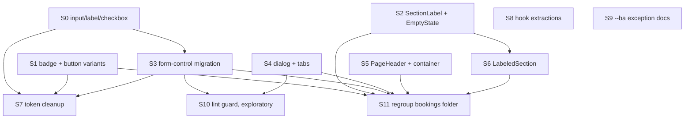

# TD58 — Atomic-Design UI Maturity (apps/web)

## Status
- **Type**: Technical Debt / Frontend maintainability (design-system foundation)
- **Priority**: Medium (no user-facing defect and nothing blocked; it is the maintainability debt that makes every future screen slower to build and visually drift-prone)
- **Context**: `apps/web` only — `shared/components/ui/`, `features/{booking,customer,platform,loyalty,staff}/components`, `shells/dashboard`, `app/globals.css`. No backend, BFF, migration or event change.
- **Created**: 2026-11-05
- **Discovered**: read-only atomic-design audit of `apps/web` (three parallel structural audits plus a premise-verification pass, 2026-11-05). Grade given at the time: C+ overall (tokens C, atoms C−, molecules B, organisms B+, templates C+, pages A−, tests A).
- **Decision status**: Ready for discovery and implementation in the dependency order below; every story still begins with `/story-discovery`. The sequence and scope below were confirmed with the user on 2026-11-05; each story's "Pattern" is a starting decision that its own `/story-discovery` Step 4q may refine, and a story's block records what was locked there.
- **Progress (2026-11-07)**: Stories 0–7 and 9 ✅ Done; 8, 10 and 11 remain (11 last: it moves files the others edit).
- **Related**: `docs/ENGINEERING_RULES_FRONTEND.md` § Reuse the repo's UI primitives; TD57 (inline feedback + action-pane pattern, the precedent for promoting a repeated UI pattern into `ui/`); `docs/ANTI_PATTERNS.md`; `.copilot/context.md` §8 (the `--ba-*` boundary row).

---

## Problem

`apps/web` has the right *structure* for atomic design — domain slices for organisms, shells as templates, thin `app/` pages, a fetch boundary that holds (no component calls `bffClient`), no component file over 300 lines (max 289), and 482 specs for 423 components. What it lacks is the bottom layer: `shared/components/ui/` has 23 primitives but no input, label, checkbox, dialog, tabs, empty-state, section-label or page-header, and the dashboard largely ignores the semantic tokens that `app/globals.css` defines. Every screen therefore rebuilds the missing pieces by hand, and the copies drift.

Verified evidence (grep, non-spec files, 2026-11-05):

- **Form controls.** The literal `w-full rounded-md border border-gray-300 px-3 py-2 text-sm` appears **32 times in 16 files**, all in `features/platform/components/hotsite/modules/` (the hotsite *editor*, an admin surface). **70 files** outside `ui/` contain a raw `<input`, **91** a raw `<label`, **14** a raw `<select`, **24** a raw `<textarea`. 37 files use `<select>`/`<textarea>` although `ui/select` and `ui/textarea` exist (5 of those are branded public-hotsite forms and are legitimately separate — see Story 3).
- **Variants.** `ui/badge.tsx` has only default/secondary/destructive/outline; 35 of 36 `Badge` usages carry a `className` override. `ui/button.tsx` has no variant for two patterns that repeat verbatim: `w-full border-0 bg-white text-gray-900 shadow-sm hover:bg-gray-50` appears **8 times in 8 files** (some as local consts: `BookingActionPanel.tsx:39`, `NewBookingOutcome.tsx:13`, `BookingDecisionPanel.tsx:14`) and `w-full border-red-200 text-red-700 hover:bg-red-50` (`RecurringApprovalActions.tsx:63`). The gray badge string `border-0 bg-gray-100 text-[0.6875rem] font-semibold text-gray-600` repeats 4 times in 3 `booking-detail/*Card` files; 7 more files hand-build `rounded-full bg-*-100` pills instead of `Badge`.
- **Section eyebrow.** `text-xs font-bold uppercase tracking-[0.07em] text-gray-400` appears **25 times in 17 `features/booking` files**, with about 45 further near-variants (`tracking-wide/wider/widest/0.06em`, gray-400 vs gray-500, plus a `text-blue-700` form) — the same intent drifting.
- **Empty state.** Three structurally identical copies (`customer/my-account/BookingEmptyState.tsx`, and inline in `RecurringScheduleList.tsx:~143` and `AvailabilityAlertList.tsx:~122`): a `rounded-2xl border border-gray-100 bg-white px-6 py-12 text-center shadow-sm` section, an `h-10 w-10 text-gray-300` icon, title, body, optional CTA link. They differ only in icon, i18n keys, CTA href, `data-testid` and an `mt-6`.
- **Page template.** 40 files render their own `<h1>`; about 20 of them are branded public/auth pages (out of scope) and about 20 are dashboard/account pages (in scope). `DashboardSectionShell` has 3 importers, container widths are ad hoc (`max-w-md/lg/none`), and no `PageHeader`-style component exists.
- **Hand-rolled dialog and tabs.** 5 hand-rolled `role="tablist"` implementations (`ServiceEditTabBar`, `HotsiteEditorMainView`, `ServicePublicPageContent`, `CustomerChooserStep`, `LoyaltyPage`); 2 hand-rolled modals (`BookingActionSheetShell`, used by 10 sheets, and `IntakeVersionModal`) while `ui/alert-dialog` exists.
- **Tokens.** Hardcoded hex in unbranded surfaces: `bg-[#f9fafb]` at `SchedulePage.tsx:106`, `DashboardShell.tsx:42`, `CustomerShell.tsx:24`; `bg-[#111827]` at `Sidebar.tsx:70`; `stroke="#dc2626"` at `app/auth/error/page.tsx:89` and `features/booking/components/public/InvalidLinkView.tsx:60`. `globals.css` defines no `--surface-*` or `--sidebar*` token. Beyond hex, the `ui/` primitives themselves (`pill-select`, `color-picker`, `select`, `pill-multi-select`, `calendar`) use raw palette classes.
- **Mixed state.** `ServiceEditPage.tsx` (15 `useState` calls), `LeadFormWidget.tsx` (11), `AvailabilityCalendar.tsx` (4 plus effects) mix form/selection state with presentation.
- **Flat folders.** `features/booking/components/dashboard/bookings/` holds 60 non-spec files directly (10 more in `new-booking/`) mixing route-level pages with tiny pieces; `booking/components/public/` holds 40.
- **A rule that is documentation-only.** The `--ba-*` boundary ("a dashboard or account component must not use `--ba-*`", `.copilot/context.md` §8) has **no enforcement** (no ESLint selector, no `architecture-check` detector). Three customer files use it legitimately: `TenantOptionRow.tsx`, `InformationCompletionPrompt.tsx`, `InformationCompletionPhoneField.tsx` — the customer information-completion flow is reached from the hotsite and must honor tenant branding. The rule's wording is simply too broad.

### Why this matters

The cost is not a bug; it is drag. A new form screen copies one of 32 input strings and picks the wrong border shade; a new status pill invents a fourth gray; a new list screen writes its own empty state and `<h1>`. Each copy is individually harmless, collectively they make the UI inconsistent, make a visual change a 70-file edit, and make "reuse the primitive" (`docs/ENGINEERING_RULES_FRONTEND.md`) impossible to follow because the primitive does not exist. The healthy layers (organisms, pages, tests) mean the fix is bounded: add and adopt the missing primitives, not restructure the app.

## Chosen approach (decided in this session, 2026-11-05 — `/story-discovery` has NOT yet run)

Promote, in dependency order, only patterns with **3+ real, structurally identical copies** into `shared/components/ui/`, then migrate call sites incrementally; add structure (page template, dialog, tabs, folder regroup) after the atoms exist; finish with token cleanup and hygiene. Each new primitive is a shadcn-style `forwardRef` + `cva` component (or a plain function component for composites), born on the **semantic tokens** (`border-input`, `bg-background`, `text-muted-foreground`, …) rather than raw palette classes, and ships its `.spec.tsx` (jsdom + `@testing-library/react`, plus an axe check where it is interactive) in the same commit.

Decisions already made (do not re-open in discovery unless a premise breaks):

1. **The public/branded hotsite stays separate.** `ui/` primitives are dashboard/account (Tailwind + shadcn). Branded public flows (`booking/components/public/*`, `platform/components/public/*`, `shells/hotsite/*`, `app/[slug]/*`, auth pages) keep their own `--ba-*` building blocks. No story here migrates a branded view to a `ui/` primitive. A branded input is out of scope. (`CLAUDE.md` §7: "build separate implementations rather than one component reading both branding systems.")
2. **`--ba-*` in `features/customer` information-completion files is a named, documented exception**, not a violation to move (Story 9). The rule is not enforced in code, so the fix is wording only — no allowlist entry is needed unless Story 10 introduces enforcement.
3. **`ui/input` matches the existing `ui/textarea` look** (same border, background, focus ring, shadow) so the two controls are consistent, expressed via semantic tokens where they resolve to the same or visually equivalent value. The call-site copies use `border-gray-300`, `ui/textarea` uses `border-gray-200`; the one-shade border change on the 16 migrated hotsite-editor files is accepted and must be browser-verified.
4. **Placement:** pure atoms and domain-free molecules go in `shared/components/ui/`; `BookingActionSheetShell` stays in `booking` unless a non-booking slice needs it (it has none today).
5. **Bulk migration of the ~2,000 raw Tailwind palette sites to semantic tokens, and dark mode, are out of scope** (zero `dark:` variants exist). Only the `ui/` primitives and the 6 hex sites are aligned (Story 7).

## Considered and rejected (not debt — do not re-raise without new evidence)

| Item | Why it stays |
|---|---|
| Merging `ServiceCard` public vs dashboard | Public is `--ba-*` branded, dashboard is Tailwind; different data types. Merging breaks the two-brand rule. |
| Merging staff vs customer `BookingDetailPage`/`BookingDetailMain`/`RescheduleSuccessView`, or `OutcomePage` vs `BookingOutcomeLayout` | Different response types, actions and layout; the genuinely shared cards are already extracted to `booking/booking-detail/*Card`. Revisit only if a third consumer appears. |
| A unified key-value/detail row | Three existing layouts differ; `BookingDetailRow` is already shared where it fits. Premature abstraction. |
| A shared skeleton primitive | Only 7 files use `animate-pulse`, each a different shape. |
| Hex colors in hotsite branding code, `SwitchTenantClient` fallbacks, the Google logo SVG | Tenant branding / brand-mandated colors. |
| 189 arbitrary pixel values (`w-[Npx]`, `top-[3.375rem]`) | Layout offsets; only 1 is a `text-[Npx]`. The one worthwhile exception (`text-[0.6875rem]` on badges) is absorbed by Story 1. |
| Splitting files by line count alone; renaming `Modal`/`Sheet`/`Dialog` suffixes | No file exceeds 300 lines; only 4 of 11 large files carry mixed state (those are Story 8). |
| Storybook | `docs/ENGINEERING_RULES_FRONTEND.md`'s primitives table already names all 23 `ui/` primitives and is the catalog; each atom story adds its row. |
| Migrating all 108 raw `<button>` to `ui/button` | Many are icon, tab, row or backdrop buttons with deliberate a11y structure. Only plain action buttons move (Stories 1, 3). |
| A dark-mode / dashboard re-theming migration | No product goal. Revisit if dark mode or dashboard re-theming becomes one. |
| The `ui/` primitives table being incomplete | Verified false: it names all 23. It only needs rows for the new primitives. |

## Method and confidence key

Method: a read-only audit by three independent structural agents (primitives/tokens, duplication/promotion, organism/layering), followed by a separate premise-verification pass that re-counted every number cited here with `grep` and corrected the audit where it drifted (surface-button string 3→8 sites, eyebrow 28→25 sites, gray badge string "widespread"→4 sites, `useState` counts, hex 5→6 sites, and the retracted "docs table incomplete" claim).

Confidence marker, used on story headers: 🔴 proven recurring failure / 🟡 documented-but-unenforced rule / ⚪ exploratory, ships non-blocking first. Most stories here are unmarked (plain maintainability debt); Story 10 is ⚪.

## Stories — dependency order

Stories 0, 1, 2, 4, 5, 8 and 9 have no dependency on each other and can run in any order or (file-overlap permitting) as a `/run-batch`. Story 11 runs last because it moves files that Stories 1–6 edit.

**Documentation policy for the whole TD:** docs change in the same PR as the code they describe, never before — the primitives table in `docs/ENGINEERING_RULES_FRONTEND.md` must not name a primitive that does not exist yet. Each story lists its own doc edits in `Files to create/modify` (each needs an explicit yes at implementation time). Story 11 owns the closing sweep that checks the whole table and runs `/docs-audit` on the frontend docs. Until Story 0 merges, any other frontend story still hand-rolls inputs (nothing exists to reuse); its discovery should note that it must not add a further copy of the `w-full rounded-md border border-gray-300 px-3 py-2 text-sm` string.

---

### Story 0 — `ui/input`, `ui/label`, `ui/checkbox` atoms and first adoption ✅ Done

**Agent:** frontend-ts
**Complexity:** M
**Docs to load:** `docs/ENGINEERING_RULES_FRONTEND.md` § Reuse the repo's UI primitives; `docs/CODE_STANDARDS.md`; `docs/TESTING_STRATEGY.md` § apps/web Testing Infrastructure
**Dependencies:** none (foundational)
**Pattern:** shadcn `forwardRef` primitive (the same shape as `ui/textarea.tsx`), no named GoF pattern

**Description:** There is no `Input`, `Label` or `Checkbox` in `ui/`, so 70 files hand-build `<input>` and 91 hand-build `<label>`. Add the three atoms, built like `shared/components/ui/textarea.tsx`: `forwardRef`, `cn()`-merged classes, spreading native props, and the look of `ui/textarea` (decision 3 above). `Checkbox` must remain a native `<input type="checkbox">` (or a Radix checkbox only if the discovery proves a native one cannot meet the existing usages' a11y and test queries) so existing `getByRole('checkbox')` specs keep passing. Then adopt them in the 16 hotsite-editor files that carry the identical `w-full rounded-md border border-gray-300 px-3 py-2 text-sm` string — the one place the duplication is mechanical and concentrated — and add the three rows to the primitives table. Do **not** migrate other raw controls here (Story 3) and do **not** touch branded public views (decision 1).

**Locked in discovery (2026-11-05):**
- **Real breakdown of the 32 string occurrences** (grep): about 26 `<input>`, 5 `<textarea>` (`ChatbotConfigPanel`, `AboutConfigPanel`, `ContentBlockConfigPanel`, `TestimonialsConfigPanel`, `LeadFormTeaserFields`) and 1 `<select>` (`LeadFormSortableQuestion`, question type). The 5 textareas move to the existing `ui/textarea` (its `min-h-[80px]` and `shadow-sm` are accepted, browser-verified). The `<select>` stays raw here and belongs to Story 3 (Radix `Select` is not a drop-in).
- **`Label`** is a plain `forwardRef` `<label>` (no Radix package) whose default class is `mb-1.5 block text-sm font-semibold text-gray-900`. Every `<label htmlFor>` carrying that exact class in the 16 files migrates; the checkbox wrapper label in `LeadFormSortableQuestion` stays and wraps the new `Checkbox`.
- **`Input` tokens:** `border-input` and `bg-background`; raw `text-gray-950`, `placeholder:text-gray-400` and `focus:border-blue-500 focus:ring-blue-500` stay (no token resolves to an equivalent value; `--ring` is blue-600 and `--muted-foreground` is far darker than gray-400), with a one-line file comment saying why. Story 7 can tokenise `Input` and `Textarea` together.
- **`Checkbox`** is a native `<input type="checkbox">` with a light default style (`h-4 w-4 rounded border-gray-300 accent-blue-600`); the small visible change on the one existing checkbox is accepted.
- **Docs:** the primitives-table rows (`input`, `label`, `checkbox`) land in this story's PR, not before (documentation policy above).

New migration / i18n keys / env vars / feature flags: none.
Backend HTTP surface: none (web only). Prototype references: none (no new screen; the existing editor must look unchanged apart from the one-shade border, decision 3).

**Files to create/modify:**
- `apps/web/shared/components/ui/input.tsx` + `input.spec.tsx` (new)
- `apps/web/shared/components/ui/label.tsx` + `label.spec.tsx` (new)
- `apps/web/shared/components/ui/checkbox.tsx` + `checkbox.spec.tsx` (new)
- `apps/web/features/platform/components/hotsite/modules/`: `GalleryConfigPanel.tsx`, `LeadFormSortableQuestion.tsx`, `ServiceListActionFields.tsx`, `ContentBlockConfigPanel.tsx`, `NavigationCtaFields.tsx`, `NavigationItemRow.tsx`, `presentation-field-parts.tsx`, `ConfigTextField.tsx`, `LeadFormTeaserFields.tsx`, `ServiceListConfigPanel.tsx`, `TestimonialsConfigPanel.tsx`, `ChatbotConfigPanel.tsx`, `ContactConfigPanel.tsx`, `AboutConfigPanel.tsx`, `FooterConfigPanel.tsx`, `ContentBlockFieldParts.tsx` (modify; existing specs must pass unchanged)
- `docs/ENGINEERING_RULES_FRONTEND.md` (add table rows — doc gate: explicit yes before editing)

**Acceptance criteria — product:**
- [ ] The hotsite editor's text inputs look and behave as before, apart from the accepted one-shade border change (browser-verified).
- [ ] A developer building a new dashboard form finds `Input`, `Label` and `Checkbox` in `ui/` and the docs table.

**Acceptance criteria — technical:**
- Unit:
  - [ ] `input.spec.tsx`: renders, forwards ref and native props, merges `className`, disabled state, `aria-invalid` styling hook
  - [ ] `label.spec.tsx`: associates with a control via `htmlFor`
  - [ ] `checkbox.spec.tsx`: toggles via click and keyboard, `checked`/`onChange`, disabled; axe check passes for all three
  - [ ] Existing specs of the 16 migrated files pass unchanged
- E2E:
  - [ ] none — covered by unit; the hotsite-editor screens are browser-verified after asking per `CLAUDE.md` §0 (local verification gate)
- [ ] No `<input>` or `<textarea>` in `apps/web` carries the literal `w-full rounded-md border border-gray-300 px-3 py-2 text-sm` (grep proof); the single `<select>` in `LeadFormSortableQuestion.tsx` still does and is Story 3's
- [ ] `Checkbox` stays a native `getByRole('checkbox')` control (named test: toggles and is found by role, so the negative guarantee "still a native checkbox" is pinned)
- [ ] Coverage ≥80% on changed code
- [ ] `tsc --noEmit` clean, lint clean

---

### Story 1 — `Badge` tone and `Button` surface/destructive-outline variants ✅ Done

**Agent:** frontend-ts
**Complexity:** M
**Docs to load:** `docs/ENGINEERING_RULES_FRONTEND.md` § Reuse the repo's UI primitives; `docs/TESTING_STRATEGY.md` § apps/web Testing Infrastructure
**Dependencies:** none
**Pattern:** `cva` variant axis (extends the existing atoms; no new component)

**Description:** `ui/badge.tsx` has only the four shadcn variants, so 35 of 36 usages override with `className`; `ui/button.tsx` lacks two variants the app repeats. Extend the existing `cva` definitions: `Badge` gains a `tone` axis (neutral, info, success, warning; destructive already exists) and a small `size` that absorbs `text-[0.6875rem]`; `Button` gains `surface` (`border-0 bg-white text-gray-900 shadow-sm hover:bg-gray-50`, expressed on tokens where they match) and `destructive-outline` (`border-red-200 text-red-700 hover:bg-red-50`). Then migrate the verified call sites. The booking status → colour map stays exactly where it is (`features/booking/model/booking-status.ts`); do **not** fold it into `Badge`. `LeadFormTerminalCard` (branded public) is excluded from the pill migration.

**Locked in discovery (2026-11-05; supersedes the "tone axis" wording above where they differ):**
- **Badge shape:** the tones are new values on the existing `variant` axis (`neutral`, `info`, `success`, `warning`), not a second axis, so an invalid combination such as `destructive` plus `info` cannot exist. Each tone keeps the borderless look the call sites use (`border-0`). Values: neutral `bg-gray-100 text-gray-600`, info `bg-blue-100 text-blue-800`, success `bg-green-100 text-green-800`, warning `bg-orange-100 text-orange-800`. A new `size` axis (`default`, `sm`) carries `text-[0.6875rem]` for `sm`. Migrate every static call site that matches a tone exactly (about 8: the 4 gray sites, `BookingDetailMain` and `RecurringScheduleCard` blue, `SchedulingExceptionRow` green, `BookingCard:101` orange). The teal chip in `RecurringScheduleCard` and every dynamic class map (`BOOKING_STATUS_CLASSES`, `ALERT_STATUS_CLASSES`, `typeClass`) keep `className`, so most of the 36 usages still pass one.
- **Button shape:** `surface` is `border-0 bg-white text-gray-900 shadow-sm hover:bg-gray-50` and callers keep `className="w-full"`; the 8 sites use `variant="surface"` and the three local constants (`SECONDARY_BUTTON_CLASS`, `SECONDARY_BUTTON` x2) are deleted. `BookingDecisionPanel` picks by index: `variant={index === 0 ? 'default' : 'surface'}`. `destructive-outline` is `border border-red-200 bg-background text-red-700 shadow-sm hover:bg-red-50 hover:text-red-700`: the text stays red on hover (today it turns dark because outline's `hover:text-foreground` survives the override; this hover-only change is accepted).
- **The "hand-built pill" list was corrected:** `CustomerSearchPanel` and `NewBookingResourcePickerStep` render avatar-initials circles, and `ScheduleTimelineBoard`, `LoyaltyHistoryHelpers` and `LoyaltySearchResults` render icon circles and skeletons. None is a pill and none is touched. The real pills are `LoyaltyEntriesPanel:43` (the "expired" label) and `MemberRow.tsx:194` (the role label); both move to `Badge variant="neutral"` at the **default** size, not `sm` (their originals were `text-xs`, and `sm` is 0.6875rem, which would shrink them), with a one-shade drift accepted (gray-500 to gray-600, slate to gray); `MemberRow` adds `className="py-1"` to keep its row height. `EligiblePoolPicker`'s removable chip is not a `Badge` and stays.
- **Docs:** the `ui/badge` and `ui/button` table rows are updated in this story's PR.

New migration / i18n keys / env vars / feature flags: none. Backend HTTP surface: none.

**Files to create/modify:**
- `apps/web/shared/components/ui/badge.tsx`, `button.tsx`, and **new** `badge.spec.tsx` and `button.spec.tsx` (neither spec exists today; each also pins the existing variants unchanged)
- Surface-button sites (modify): `features/booking/components/dashboard/bookings/{BookingOutcomeLayout,NewBookingOutcome,RescheduleActionRail,BookingActionPanel,BookingDecisionPanel,CustomerChooserStep,MarkCompleteActionRail}.tsx`, `.../bookings/new-booking/NewBookingStepLayout.tsx`
- Destructive-outline site: `.../bookings/RecurringApprovalActions.tsx`
- Gray-badge sites: `features/booking/components/booking-detail/{BookingParticipantsCard,BookingResourcesCard,BookingIntakeCard}.tsx`
- Real pill sites (modify): `features/customer/components/my-account/LoyaltyEntriesPanel.tsx`, `features/staff/components/team/MemberRow.tsx`
- Static Badge sites that match a tone exactly (modify): `features/booking/components/dashboard/bookings/{BookingDetailMain,RecurringScheduleCard,BookingCard}.tsx`, `.../dashboard/scheduling-exceptions/SchedulingExceptionRow.tsx` (plus the three `booking-detail/*Card` files above)
- `docs/ENGINEERING_RULES_FRONTEND.md` (badge/button table rows — doc gate)

**Acceptance criteria — product:**
- [ ] Every migrated badge, pill and button renders visually as before (browser-verified on the booking action rails and booking detail).

**Acceptance criteria — technical:**
- Unit:
  - [ ] `badge.spec.tsx`: each tone and size renders its classes; default behaviour unchanged
  - [ ] `button.spec.tsx`: `surface` and `destructive-outline` render their classes; existing variants unchanged
  - [ ] Existing specs of all migrated files pass unchanged, with one recorded exception: `BookingCard.spec.tsx` mocks `Badge` with a stub that renders only `className`, so a tone moved into `variant` would never reach its colour assertions. Its mock now wraps the real `Badge` (forcing the same `data-testid="badge"`); every assertion in the spec is unchanged
- E2E:
  - [ ] none — covered by unit; the booking action screens are browser-verified after asking per `CLAUDE.md` §0
- [ ] The verbatim override strings named in this TD no longer appear in `features/` (grep proof)
- [ ] Negative guarantees, each pinned: `features/booking/model/booking-status.ts` and `features/platform/components/public/LeadFormTerminalCard.tsx` are not in the diff (the existing `booking-status.spec.ts` still passes unchanged); no branded public file appears in the diff; `EligiblePoolPicker.tsx` is unchanged
- [ ] Coverage ≥80% on changed code
- [ ] `tsc --noEmit` clean, lint clean

---

### Story 2 — `SectionLabel` atom and `EmptyState` molecule ✅ Done

**Agent:** frontend-ts
**Complexity:** M
**Docs to load:** `docs/ENGINEERING_RULES_FRONTEND.md` § Reuse the repo's UI primitives; `docs/TESTING_STRATEGY.md` § apps/web Testing Infrastructure; `docs/ENGINEERING_RULES_SHARED.md` § Authoring new i18n UI copy keys
**Dependencies:** none
**Pattern:** plain composition — no named pattern applies (`SectionLabel` is a thin styled element with `as` and `tone`; `EmptyState` is a composition of icon + title + body + action slot)

**Description:** Two repeated patterns. (1) The uppercase section eyebrow: 25 identical occurrences plus ~45 drifting near-variants. **First decision for discovery, before any code:** the single canonical look (size, weight, tracking, colour) — the near-variants disagree and normalising them is a design call, so migrate the 25 exact matches mechanically and only normalise the drifting ones after the canonical look is chosen. Add `ui/section-label.tsx` (`as`, `tone`, `className`). (2) The empty-state card: add `ui/empty-state.tsx` (icon, title, body, optional action slot) covering only the **three** structurally identical copies; do not absorb the divergent loyalty, worklist and tab variants. The component takes already-translated strings, so it adds no i18n keys of its own.

**Locked in discovery (2026-11-05; supersedes the wording above where they differ):**
- **Canonical eyebrow look:** `text-xs font-bold uppercase tracking-[0.07em] text-gray-500`. Size, weight and tracking are those of the 25 exact sites (they also match the validated prototype's `.bottom-sheet-label`). The colour is one shade darker than those sites' `text-gray-400`: gray-400 is about 2.5:1 on white, below the WCAG 2.1 AA that `docs/DASHBOARD_FRONTEND_ARCHITECTURE.md` requires of every UI component (jest-axe cannot see it in jsdom), and gray-500 is about 4.8:1. Decided in `/pr-land` round 1 (originally kept at gray-400 at discovery as a no-visual-change refactor, then reversed because a new primitive should not ship failing the project's own rule). The other places that use `text-gray-400` (the ~17 deferred near-variants and about 77 files across `features` and `shells`) are older debt this story does not touch.
- **`SectionLabel`:** `as` is one of `p | h2 | h3 | span | legend | div | dt`, default `p` (`dt` was added at implementation: `NewRecurringScheduleForStaffResult`'s eyebrow is a definition-list term); `tone` is `default` (gray-500) or `info` (`text-blue-700`); `className` merges via `cn()` so a caller's margin still applies.
- **Migration set:** the 25 exact sites in 17 files, plus the blue form `text-xs font-bold uppercase tracking-[0.07em] text-blue-700` (9 sites in `NewBookingSummaryCard`, `MarkCompleteSummaryCard`, `RescheduleActionRail`) as `tone="info"`. This is a no-visual-change refactor.
- **Deferred, left untouched (not drift to fix here):** about 17 gray eyebrows in `features/booking` that differ only by tracking, weight or shade (for example `BookingQueueSection`, `BulkResultList`, `SchedulingExceptionGroups`, `FloatingFilterMenu`, `AgendaFilterMenu`, `ScheduleDayHeader`, `ScheduleRemovalSummary`, `ServiceEditPanels`); table headers and uppercase field labels (`ResourceListPage`, `EligiblePoolPicker`, `ServiceResourceTypeFields`); coloured outcome headings; `shells/hotsite` and other branded files; and the customer-account copies.
- **`EmptyState`:** renders its own `<section>` rather than composing `Card`, because the three copies are `rounded-2xl border-gray-100` and `Card` is `rounded-lg border-border`. It takes translated strings and an icon node, and forwards `data-testid` and `className` (the two inline copies keep `mt-6` through `className`). The CTA is an action slot: callers keep their own `<Link className="mt-5 rounded-lg bg-blue-600 px-4 py-2 text-sm font-semibold text-white hover:bg-blue-700">`, so that string stays duplicated three times (a later pass could move the CTAs to `Button asChild`; that changes radius and hover slightly). `BookingEmptyState` stays as a thin wrapper around `EmptyState`, so its two consumers (`HomeDashboard`, `BookingsList`) and its spec are untouched.

New migration / i18n keys / env vars / feature flags: none (copy stays in the callers' existing keys). Backend HTTP surface: none.

**Files to create/modify:**
- `apps/web/shared/components/ui/section-label.tsx` + `section-label.spec.tsx` (new)
- `apps/web/shared/components/ui/empty-state.tsx` + `empty-state.spec.tsx` (new)
- Eyebrow sites (modify): `features/booking/components/booking-detail/{BookingDetailSection,BookingItineraryCard}.tsx`; `.../dashboard/services/{ServicePickupSwitch,ServiceCreatePage}.tsx`; `.../dashboard/bookings/{MarkCompleteSummaryCard,MarkCompleteBookingPage,BookingDetailMain,RecurringDecisionExplainer,RescheduleSuccessView,CustomerSearchPanel,RecurringApprovalActions,MarkCompleteLoyaltyPanel,MarkCompleteLineFields,MarkCompleteSuccessView,RecurringScheduleRequestSummary,NewRecurringScheduleForStaffResult,BookingStatusHistory}.tsx`
- Blue (`tone="info"`) eyebrow sites (modify): `.../dashboard/bookings/{NewBookingSummaryCard,RescheduleActionRail}.tsx` (`MarkCompleteSummaryCard` is already listed above)
- Empty-state sites (modify): `features/customer/components/my-account/{BookingEmptyState,RecurringScheduleList,AvailabilityAlertList}.tsx` (preserve the two inline copies' `data-testid`s)
- `docs/ENGINEERING_RULES_FRONTEND.md` (table rows — doc gate)

**Acceptance criteria — product:**
- [ ] Every migrated eyebrow and the three customer empty states render as before, except that the gray eyebrows are one shade darker (gray-500, for AA contrast) (browser-verified: booking detail, mark-complete and its success view, reschedule success, the recurring approval pages, `/dashboard/services/new`, and the bookings, recurring-schedules and alerts empty states).

**Acceptance criteria — technical:**
- Unit:
  - [ ] `section-label.spec.tsx`: renders the chosen element via `as`, applies tone, merges `className`
  - [ ] `empty-state.spec.tsx`: renders icon/title/body, renders and omits the action slot, forwards `data-testid`; axe check passes
  - [ ] Existing specs of all migrated files pass unchanged
- E2E:
  - [ ] none — covered by unit; browser-verified after asking per `CLAUDE.md` §0
- [ ] The 25 exact eyebrow strings and the 9 blue-700 ones no longer appear in `features/booking` (grep proof)
- [ ] Negative guarantee, pinned by the diff: no `shells/hotsite`, `booking/components/public` or other branded file appears in the diff, and the deferred near-variants listed above are unchanged
- [ ] Coverage ≥80% on changed code
- [ ] `tsc --noEmit` clean, lint clean

---

### Story 3 — Form-control migration (dashboard, editor and account only) ✅ Done

**Agent:** frontend-ts
**Complexity:** L
**Docs to load:** `docs/ENGINEERING_RULES_FRONTEND.md` § Reuse the repo's UI primitives (and its two-shells form paragraph); `docs/TESTING_STRATEGY.md` § apps/web Testing Infrastructure
**Dependencies:** Story 0
**Pattern:** plain composition — no named pattern applies

**Description:** After Story 0, migrate the remaining raw controls in **unbranded** surfaces (dashboard, hotsite editor, customer account) to `Input`, `Label`, `Checkbox`, and the existing `ui/select` and `ui/textarea`: the 37 files with a raw `<select>`/`<textarea>` minus the 5 branded public ones, plus the remaining raw `<input>`/`<label>`/`type="checkbox"` sites there. Only convert a control when the primitive reproduces its behaviour (Radix `Select` is not a drop-in for a native `<select>` in every test and a11y query; where it is not, record the deviation per the Procedure item 4, do not force it). Dedupe `SettingsFormFields.tsx` (`TextField`, `TextareaField`, `SelectField`, `ReadOnlyField`, `INPUT_CLASS`) against the primitives: keep only what is settings-specific (suffix/read-only/feedback wiring) and compose the primitives inside. Raw `<button>` conversion is limited to plain action buttons. **Out of scope and must not be touched:** branded public forms — `booking/components/public/{IntakeQuestionField,AvailabilityAlertPickers,SubmitInfoForm,VariableDurationStep}.tsx`, `platform/components/public/LeadFormQuestionField.tsx` and anything under `shells/hotsite`, `app/[slug]`. Discovery must produce the exact per-file in/out list (verify each file's brand surface) and may split this story by slice (booking dashboard / platform editor / customer account) into separate PRs.

**Locked in discovery (2026-11-06; supersedes the wording above and the file list below where they differ):**
- **Real scope:** an inventory of the whole unbranded `apps/web` found about 45 files with raw controls, not the 37 counted above. Six files named below are already clean (`ChatbotConfigPanel`, `TestimonialsConfigPanel`, `AboutConfigPanel`, `ContentBlockConfigPanel`, `LeadFormTeaserFields`, `ServiceListActionFields`) and about 30 files are missing from the list (see the per-PR lists). Complexity stays L, delivered as **three sequential PRs under this one story**.
- **A second input look the TD missed.** Twelve files (two shared constants, `INPUT_CLASS` in `new-booking-styles.ts` and `SettingsFormFields.tsx`, plus about nine local copies) use a "form look": `py-2.5`, `focus:ring-2 focus:ring-blue-100`, no shadow, a colour transition and `aria-invalid` red styling. The `Input` atom (Story 0) copies `Textarea` (`py-2`, `shadow-sm`, `focus:ring-1 focus:ring-blue-500`). **Decision: unify on the atom look** (what `Textarea` and the `Select` trigger, `h-9`, already agree on). Visible change, accepted: every migrated dashboard input is about 4px shorter (about 42px to 38px) and the focus ring is a crisp 1px blue-500 instead of a soft halo. The atom gains the `aria-invalid` red border and pink background the form look carried; callers keep adding `FIELD_INVALID_CLASS` where they do today. Likewise `Label` replaces `LABEL_CLASS` (`font-medium text-gray-700` becomes `font-semibold text-gray-900`).
- **Selects:** a new `ui/native-select` (shadcn's `NativeSelect`, fetched from the current reference source, not reconstructed from memory) is a styled native `<select>`. Eleven specs drive native selects with `selectOptions` (`NewBookingDurationStep`, `ClosureFormSheet`, `ResourceSelectField`, `PolicyDurationPolicyField`, `PolicyDurationPricingCard`, `EligiblePoolPicker`, `IntakeQuestionCard`, `ResourceIdentityFields`, `SettingsFormFields`, `SettingsHoursSection`, `BookingPhotoPicker`) and `ResourceSelectField` uses `value=""`, which Radix `Select` rejects; `native-select` is a drop-in, so those specs stay unchanged. Radix `ui/select` stays for custom pickers. The branded `VariableDurationStep` select is untouched.
- **Radio:** a new `ui/radio` atom, a native `<input type="radio">` like `Checkbox` (`getByRole('radio')` keeps working). Radios drawn as clickable cards (`ReassignSheet`, `CustomerSearchPanel`, `NewBookingResourcePickerStep`, `NewBookingServiceCard`, `NewBookingIntakeStep`, `ServiceResourceTypeFields`, `PolicyConfirmationAndWindowCards`) use `Radio` and `Checkbox` inside; the wrapping label that is the card stays hand-written.
- **File input:** a new `ui/file-input` atom (a native `<input type="file">`, `sr-only` by default, forwards `ref` and native props) and a new `ui/file-dropzone` molecule (the `<label>` card with the hidden `FileInput`, title, hint, optional preview slot, `invalid` flag; takes translated strings and forwards the input's `data-testid`). Canonical look: dashed `border-gray-200`, `bg-gray-50`, hover `border-blue-300 bg-blue-50/50`, `rounded-md`, `px-6 py-8`. Three copies migrate: `SingleImageUploadField` (closest to canonical), `AfterServicePhotoUpload` (loses some radius) and `CustomerPhotoUpload` (gains the gray background and blue hover). `GalleryImageManager`'s button-style label keeps its look and its input becomes `FileInput`. The branded `booking/components/public/PhotoUpload.tsx` is untouched.
- **Deviations, recorded:** label-only files that wrap a Radix or custom control (`TimeSelectField`, `ServiceFlatRequirementsCard`, `HeroConfigPanel`, `SectionOverlayFields`) swap to `Label` only where the label keeps its association; otherwise they stay. `SettingsFormFields` keeps `settingsFieldWiring`, the suffix, hint and read-only wiring and composes the primitives; its `INPUT_CLASS` export and `new-booking-styles.ts`'s `INPUT_CLASS` and `LABEL_CLASS` are deleted, as are the nine local `INPUT_CLASS` copies.
- **`NewRecurringScheduleResult`:** the four `SECONDARY_BUTTON` links become `Button asChild variant="outline"`; the small radius, padding and colour drift is accepted.
- **Slicing, in order:** **PR 1** (platform editor and settings) carries all five new `ui/` pieces (`native-select`, `radio`, `file-input`, `file-dropzone`, plus the atom changes) with their specs and primitives-table rows, so they land with real usage. **PR 2** is the booking dashboard. **PR 3** is the customer account, staff and loyalty. Each PR is browser-verified on one screen per slice after asking per `CLAUDE.md` §0.
- **Per-PR file lists** (every file: confirm its controls with a grep at implementation):
  - **PR 1:** `settings/{SettingsFormFields,SettingsHoursSection,SettingsGeneralSection,SettingsLoyaltySection,SettingsFormAdvancedFields}`; `hotsite/{SeoTab,BrandingTab,SingleImageUploadField}`; `hotsite/modules/{LeadFormSortableQuestion,BookingPhotoPicker,GalleryImageManager,BookingCtaConfigPanel,HeroConfigPanel,SectionOverlayFields}`; `leads/{LeadFormSearchPanel,LeadFormAdvancedFilters}`.
  - **PR 2:** `bookings/{RejectBookingSheet,RequestInfoSheet,NoShowSheet,CorrectNoShowSheet,AdminCancelBookingSheet,MarkCompleteBookingPage,RescheduleNotesCard,MarkCompleteLineFields,MarkCompleteLoyaltyPanel,GuestContactForm,CustomerSearchPanel,AfterServicePhotoUpload}`; `bookings/new-booking/{NewBookingDurationStep,NewBookingIntakeStep,NewBookingAddressFields,NewBookingServiceCard,NewBookingResourcePickerStep,new-booking-styles.ts}`; `dashboard/FilterCheckboxOption`; `schedule/{ClosureFormSheet,ResourceSelectField,ScheduleDateTimeRangeSheet,TimeSelectField}`; `services/{PolicyDurationPolicyField,PolicyDurationPricingCard,IntakeParticipantsAndConsentCards,ServiceFormFields,EligiblePoolPicker,IntakeQuestionCard,PolicyNumberField,PolicyConfirmationAndWindowCards,PolicyWhoHowCard,ServiceBufferAfterMinutesField,ServiceFlatRequirementsCard,ServiceLegsPanel,ServicePriceDurationFields,ServicePublicPageContent,ServiceResourceTypeFields}`; `resources/{ResourceIdentityFields,ResourceCreateForm,ResourceEditFormFields}`; `scheduling-exceptions/{ReassignSheet,CancelSheet,SchedulingExceptionRow}`.
  - **PR 3:** `customer/my-account/{InfoSubmitForm,CustomerPhotoUpload,NewRecurringScheduleResult}`; `staff/team/{InviteForm,StaffDetailPage}`; `loyalty/dashboard/LoyaltySearchPage`.
  - **Not touched:** every branded public file (`booking/components/public/*`, `platform/components/public/*`, `shells/hotsite/*`, `customer/InformationCompletionPhoneField.tsx`), and the label-card wrappers named above.
- **Stale-reference sweep (in PR 3):** grep `docs/`, `plan/`, `journeys/` and `.claude/` for the deleted constants and the old looks.
- **Docs:** each PR adds the primitives-table rows for the pieces it creates (`docs/ENGINEERING_RULES_FRONTEND.md`); the doc edit needs an explicit yes at implementation time.

New migration / i18n keys / env vars / feature flags: none. Backend HTTP surface: none.

**Files to create/modify:** (original 2026-11-05 candidate list, superseded by the per-PR lists above; kept for traceability)
- `features/platform/components/settings/{SettingsFormFields,SettingsHoursSection}.tsx`; `features/platform/components/hotsite/{SeoTab}.tsx`; `.../hotsite/modules/{LeadFormSortableQuestion,BookingPhotoPicker,TestimonialsConfigPanel,AboutConfigPanel,ContentBlockConfigPanel,LeadFormTeaserFields,ChatbotConfigPanel}.tsx`
- `features/booking/components/dashboard/schedule/{ClosureFormSheet,ResourceSelectField,ScheduleDateTimeRangeSheet}.tsx`; `.../dashboard/services/{PolicyDurationPolicyField,PolicyDurationPricingCard,IntakeParticipantsAndConsentCards,ServiceFormFields,EligiblePoolPicker,IntakeQuestionCard}.tsx`; `.../dashboard/bookings/{RejectBookingSheet,MarkCompleteBookingPage,NoShowSheet,AdminCancelBookingSheet,RequestInfoSheet,CorrectNoShowSheet,RescheduleNotesCard}.tsx`; `.../bookings/new-booking/{NewBookingDurationStep,NewBookingIntakeStep}.tsx`; `.../dashboard/resources/ResourceIdentityFields.tsx`; `.../dashboard/scheduling-exceptions/{ReassignSheet,CancelSheet}.tsx`
- `features/customer/components/my-account/InfoSubmitForm.tsx`
- Also in scope (found in Story 0 discovery, missing from the list above): the raw controls still left in `features/platform/components/hotsite/modules/` after Story 0 — `GalleryImageManager.tsx`, `BookingCtaConfigPanel.tsx` (number input), the remaining raw inputs in `ContentBlockConfigPanel.tsx` and `ServiceListActionFields.tsx`, and the `<select>` in `LeadFormSortableQuestion.tsx`. Discovery re-greps the folder for the exact list.
- Also in scope (left over from Story 1): `features/customer/components/my-account/NewRecurringScheduleResult.tsx` — four `<Link className={SECONDARY_BUTTON}>` sites with a hand-written bordered gray link-button style (not `surface`, which is borderless white). Discovery decides between `Button asChild variant="outline"` and a new variant after a visual comparison; it belongs to the customer-account slice if the story is split.
- Specs for each modified file stay and must pass unchanged unless a deviation is recorded

**Acceptance criteria — product:**
- [ ] Every migrated form behaves as before (validation messages, keyboard, mobile), browser-verified on one screen per slice.

**Acceptance criteria — technical:**
- Unit:
  - [ ] Existing specs of every migrated file pass unchanged (no relaxed queries); native `<select>` sites move to `ui/native-select`, so their `selectOptions` tests stay as they are
  - [ ] New specs: `native-select.spec.tsx` (native `selectOptions`, empty value, `aria-invalid`), `radio.spec.tsx` (found by `getByRole('radio')`, pinned: still a native radio), `file-input.spec.tsx`, `file-dropzone.spec.tsx` (renders title, hint, preview slot, `invalid`, forwards `data-testid`; axe check); `input.spec.tsx` gains a pinned `aria-invalid` styling test
  - [ ] `SettingsFormFields` spec covers the composed primitives and the settings-specific wiring
  - [ ] No new `eslint-disable` or `as unknown as` introduced
- E2E:
  - [ ] none — covered by unit and existing E2E on the touched screens; browser-verified after asking per `CLAUDE.md` §0
- [ ] None of the 5 branded public files appears in the diff, and no file under `booking/components/public`, `platform/components/public`, `shells/hotsite` or `app/[slug]` does either (pinned by the diff)
- [ ] Grep proof after PR 3: no raw `<textarea>` or `<select>` in unbranded files outside `ui/`; the only remaining raw `<input>` are inside the primitives and the label-card wrappers; no `INPUT_CLASS`, `LABEL_CLASS` or `SECONDARY_BUTTON` constants remain
- [ ] Coverage ≥80% on changed code
- [ ] `tsc --noEmit` clean, lint clean

---

### Story 4 — `ui/dialog` and `ui/tabs` ✅ Done

**Agent:** frontend-ts
**Complexity:** L
**Docs to load:** `docs/ENGINEERING_RULES_FRONTEND.md` § Reuse the repo's UI primitives (Procedure item 3: fetch the library's current reference source, do not reconstruct from memory); `docs/ANTI_PATTERNS.md` ("reconstructed from memory" row); `docs/TESTING_STRATEGY.md` § apps/web Testing Infrastructure
**Dependencies:** none
**Pattern:** shadcn/Radix wrapper primitive (Dialog, Tabs), ported from the upstream reference source

**Description:** Five tab bars and two modals are hand-built. Add `ui/tabs` (Radix Tabs, shadcn wrapper) and `ui/dialog` (Radix Dialog; `ui/alert-dialog` already exists and stays for confirmations). **Fetch the current shadcn/Radix reference source and port it wholesale** — never reconstruct from memory (Procedure item 3).

**Locked in discovery (2026-11-06):**
- **Full dialog adoption.** `BookingActionSheetShell` is rebuilt on `ui/dialog` and its props change from `dialogRef` to `open` + `onClose` (state-driven Radix Dialog, portal, no ref). Its sheets stop calling `useModalDialog` and pass `open`: `NoShowSheet`, `CorrectNoShowSheet`, `RejectBookingSheet`, `RequestInfoSheet`, `RecurringDecisionSheet`, `AdminCancelBookingSheet`, `ReassignSheet`, `CancelSheet`, `ScheduleDateTimeRangeSheet`, `ScheduleRemovalDialog` (with `use-confirm-removal.ts`), plus `IntakeVersionModal`. Once nothing uses it, `features/booking/hooks/use-modal-dialog.ts` and its spec are deleted. The shell keeps the mobile bottom-sheet layout (`items-end` on mobile, centred from `sm`), the `bg-black/40` backdrop and click-to-close. `BookingActionSheetShell` stays in `booking`.
- **`IntakeVersionModal`** keeps its `data-testid`s (`intake-version-modal`, `-backdrop`, `-close`) and the click-to-close backdrop; the Sonar S6819 concern is moot once the hand-built `<dialog>`/backdrop button is replaced by the Radix overlay, but the backdrop test id must survive.
- **`ui/tabs`** exposes `Tabs`/`TabsList`/`TabsTrigger`/`TabsContent` with one `variant` on `TabsList`: `underline` (the three underline bars) and `segmented` (`CustomerChooserStep`; `ServicePublicPageContent`'s pill toggle moves to it, a small visual change to confirm in the browser). `ServiceEditTabBar` keeps its dirty dot and its `overflow-x-auto overflow-y-hidden` handling through `className`.
- **Panels.** The two service-edit sites (`ServiceEditPage`, `ServiceEditConfigTabPanels`) keep all five panels mounted-but-hidden through `TabsContent` with `forceMount` + `hidden`, so a tab switch never drops unsaved drafts. Existing ids (`service-edit-tab-*`, `service-edit-tabpanel-*`, `hotsite-tab-*`, `loyalty-tab-*`) are preserved through id props. Sites with no panel wiring today (`ServicePublicPageContent`, `CustomerChooserStep`) get a real `TabsContent` per mode, so each tab controls a labelled `role="tabpanel"` (a tab without a panel is not a valid tabs pattern).
- **Behaviour change, accepted:** the hand-rolled bars had no arrow-key or roving-tabindex handling; Radix adds arrow keys, Home/End and roving focus.

**Shipped differently from the text above (decided during implementation, recorded here so a reviewer is not the first to find it):**
- **No `open` prop on `BookingActionSheetShell`.** Its props are `onClose` and the rest; the shell is always open because every sheet already returns `null` when closed and mounts it only while open. A prop no caller would ever set `false` was dead surface. `titleId` / `descriptionId` are gone too: Radix links the title and description to the dialog by its own ids, and overriding the title `id` makes Radix warn about a missing title.
- **The service-edit and Loyalty panels are not `TabsContent`.** They are separate components that own their `role="tabpanel"` and fixed ids (`ServiceEditDetailsTab`, `ServiceEditConfigTabPanels`, `LoyaltyEntriesPanel`, `LoyaltyRedemptionsPanel`), and their specs assert on both, so wrapping them would nest two tabpanel roles. Those sites use `Tabs` / `TabsList` / `TabsTrigger` with the existing `id` and `aria-controls` kept as overrides, and the panels stay mounted-but-hidden exactly as before (the draft-keeping tests at `ServiceEditPage.spec.tsx` pin it). Loyalty sets `aria-controls` only on the tab whose panel is the mounted one, so no tab points at a missing element. `HotsiteEditorMainView`, `ServicePublicPageContent` and `CustomerChooserStep`, whose panels are inline, use `TabsContent` (one per tab or mode); the hotsite's tab and panel ids are now Radix-generated.
- **`ui/dialog` carries three things upstream does not:** `aria-modal="true"` (the native sheets exposed it), focus returned to the element that had it when the dialog opened (Radix restores focus only to a `DialogTrigger`, and every sheet here opens from state, so focus would otherwise fall to `<body>`), and `overlayTestId` / `overlayClassName` (the backdrop test id of `IntakeVersionModal`). `BookingActionSheetShell` also takes a `contentRef` so `ScheduleDateTimeRangeSheet`'s calendar popover can portal into the dialog.
- `use-modal-dialog.ts` and its spec are deleted; `use-confirm-removal` no longer takes `open`. Stale native-`<dialog>` guidance in `CODE_STANDARDS.md`, `DASHBOARD_FRONTEND_ARCHITECTURE.md` and `TESTING_STRATEGY.md` was updated (the branded hotsite lightbox `GalleryGrid` is the one native `<dialog>` left).

New migration / i18n keys / env vars / feature flags: none. Adds `@radix-ui/react-tabs` and `@radix-ui/react-dialog` to `apps/web/package.json` and the lockfile (config-file change; the explicit yes was given in discovery). Backend HTTP surface: none.

**UI reuse inventory:** dialog and tabs have no existing primitive, so both are ported (never one-off in a feature). Real usages to copy for style: `ui/alert-dialog.tsx` (Radix wrapper shape, overlay `z-[70]`), `ui/popover.tsx`. Confirmations stay on `ui/alert-dialog`.

**Files to create/modify:**
- `apps/web/shared/components/ui/tabs.tsx` + `tabs.spec.tsx`; `dialog.tsx` + `dialog.spec.tsx` (new)
- Tablist sites (modify): `features/booking/components/dashboard/services/{ServiceEditTabBar,ServicePublicPageContent,ServiceEditPage,ServiceEditConfigTabPanels}.tsx`, `features/platform/components/hotsite/HotsiteEditorMainView.tsx`, `features/booking/components/dashboard/bookings/CustomerChooserStep.tsx`, `features/customer/components/my-account/LoyaltyPage.tsx` (+ `LoyaltyEntriesPanel`/`LoyaltyRedemptionsPanel` if panel ids move)
- Dialog sites (modify): `features/booking/components/dashboard/bookings/{BookingActionSheetShell,NoShowSheet,CorrectNoShowSheet,RejectBookingSheet,RequestInfoSheet,RecurringDecisionSheet,AdminCancelBookingSheet}.tsx` and their specs; `.../scheduling-exceptions/{ReassignSheet,CancelSheet}.tsx`; `.../schedule/{ScheduleDateTimeRangeSheet,ScheduleRemovalDialog,use-confirm-removal}.ts(x)`; `.../services/IntakeVersionModal.tsx`
- Delete: `features/booking/hooks/use-modal-dialog.ts` + `.spec.tsx` (after a final grep shows no user left; `shells/hotsite/components/GalleryGrid.tsx` uses a native `<dialog>` of its own and is out of scope, branded hotsite)
- `apps/web/package.json` + `pnpm-lock.yaml`
- `docs/ENGINEERING_RULES_FRONTEND.md` (table rows for `ui/dialog`, `ui/tabs`; the dialog row notes `ui/alert-dialog` for confirmations)

**Acceptance criteria — product:**
- [ ] All five tab bars switch with mouse, touch and keyboard (arrow keys, Home/End), keep their look (the pill toggle becomes the segmented look), and the service-edit tabs keep unsaved drafts across switches.
- [ ] Every action sheet and `IntakeVersionModal` opens, traps focus, closes on Escape, backdrop click and Cancel, returns focus to the opener, and keeps the mobile bottom-sheet layout.

**Acceptance criteria — technical:**
- Unit:
  - [ ] `tabs.spec.tsx` and `dialog.spec.tsx`: roles, controlled/uncontrolled, keyboard (arrows, Home/End), focus return, Escape, `forceMount` keeps content mounted; axe check passes
  - [ ] `BookingActionSheetShell.spec.tsx` rewritten for the shell's new props (`onClose`, `contentRef`; no `dialogRef` or ids) and covering Escape, backdrop click, focus return and axe; the 10 sheet specs and the 5 tablist specs pass with only the mechanical changes the new props require (queries by role and name unchanged)
  - [ ] Negative guarantee: a service-edit tab switch does not unmount a dirty panel (pinned by a test)
- E2E (run in the story's worktree via `pnpm infra:e2e` after the user's yes, given in discovery; stop with `pnpm infra:e2e:down`):
  - [ ] Existing Playwright coverage of the booking action sheets, service-edit tabs, hotsite editor tabs, loyalty tabs and the customer chooser passes; `getByRole('tab', { name })` queries unchanged
- [ ] `use-modal-dialog.ts` deleted with no remaining importer
- [ ] Coverage ≥80% on changed code
- [ ] `tsc --noEmit` clean, lint clean

---

### Story 5 — Dashboard and account `PageHeader` ✅ Done

**Agent:** frontend-ts
**Complexity:** S
**Docs to load:** `docs/DASHBOARD_FRONTEND_ARCHITECTURE.md`; `docs/ENGINEERING_RULES_FRONTEND.md` § Reuse the repo's UI primitives and the action-pane section; `docs/TESTING_STRATEGY.md` § apps/web Testing Infrastructure
**Dependencies:** none
**Pattern:** slot-based presentational atom (plain composition: eyebrow, title, description, actions) — no inheritance, no named pattern beyond that

**Locked at `/story-discovery` (2026-11-07):**
- **No content container.** Verified: no dashboard or account page sets a page-level width. The pages use `
` (a no-op, 8 copies); the `max-w-*` hits are dialogs, auth cards and empty-state text. The only centred page container is `mx-auto w-full max-w-lg py-10` in two error boundaries (`MyAccountRouteError`, `app/dashboard/loyalty/[customerId]/error.tsx`), below the TD's "3+ identical copies" bar. The story ships `PageHeader` only; revisit a container if a third consumer appears.
- **`ui/page-header`** (`shared/components/ui/`, domain-free, takes translated strings). Props: `title` (always an `h1`, `text-lg font-bold text-gray-900`), optional `eyebrow` (rendered with `ui/section-label`), optional `description` (`text-sm text-gray-500`), optional `actions` slot (right of the title row), root HTML props (`className`, `data-testid`). No heading-level prop. It draws no card chrome: callers keep their `Card` and put `PageHeader` inside it.
- **Eyebrow look change accepted.** The five eyebrow copies (`text-xs font-semibold tracking-wide text-gray-400`) move to `SectionLabel` (`font-bold tracking-[0.07em] text-gray-500`), as in Stories 2 and 6. Browser-verified.
- **Adoption set (18 files):** bare titles `BookingsList`, `RecurringScheduleList` (with the mobile new-menu in `actions`), `AvailabilityAlertList`, `AvailabilityAlertListStates` (2 headings), `LoyaltyPage`, `HomeDashboard`, `NewRecurringScheduleNoServices`, `NewRecurringScheduleForStaffNoServices`; eyebrow plus title `NewRecurringScheduleForm`, `NewRecurringScheduleReview`, `RecurringSchedulePendingView`, `NewRecurringScheduleResult` (`ResultHeader`), `NewRecurringScheduleForStaff`; title inside a card `AvailabilityAlertDetail` (badge in `actions`), `RecurringScheduleDetail` (subtitle in `description`, badge in `actions`), `ConfirmPage`, `CustomerReschedulePage`.
- **Left out, on purpose:** `NewRecurringScheduleResult:105` (`sr-only` h1, not a visible header); `ScheduleDayHeader` (a date title with a count badge beside it and a view toolbar: a header API would need extra slots for one caller); `SwitchTenantClient` (branded, paints tenant colours inline); `SelectStaffTenantClient` (a standalone auth-flow card outside both shells, `text-xl` heading); the `Topbar` title (stays in its provider).

**Description:** About 18 dashboard/account pages render their own `<h1>` with the same class string. Add `ui/page-header` and adopt it in the unbranded pages listed above. Branded public/auth pages (`app/[slug]/login`, `app/auth/error`, `app/dashboard/login`, `app/not-found`, `booking/components/public/*`, `platform/components/public/*`, `shells/hotsite/*`) are out of scope (decision 1). Route-scoped chrome visible in the topbar stays in its provider (`DASHBOARD_FRONTEND_ARCHITECTURE.md`), not in `PageHeader`. This is **not** a replacement for `DashboardSectionShell` (a provider wrapper); do not merge them.

New migration / i18n keys / env vars / feature flags: none. Backend HTTP surface: none.

**Files to create/modify:**
- `apps/web/shared/components/ui/page-header.tsx` + `page-header.spec.tsx` (new)
- Adopters (modify): the 18 files in the adoption set above, under `features/customer/components/my-account/` and `features/booking/components/dashboard/bookings/`
- `docs/ENGINEERING_RULES_FRONTEND.md` (a `ui/page-header` row in the primitives table), `docs/DASHBOARD_FRONTEND_ARCHITECTURE.md` (a page-header note) — in the same PR as the code, doc gate

**Acceptance criteria — product:**
- [ ] Dashboard and account pages share one header; no page changes its visible title or actions. The five eyebrows take the shared `SectionLabel` look.

**Acceptance criteria — technical:**
- Unit:
  - [ ] `page-header.spec.tsx`: the title is an `h1`; the eyebrow renders through `SectionLabel`; description and actions render only when passed; a caller `className` and `data-testid` are applied; axe check passes. Mutation-checked.
  - [ ] Existing specs of every adopting page pass unchanged
  - [ ] `RecurringScheduleDetail.spec`: the status badge still renders beside the title and the service subtitle under it
- E2E:
  - [ ] none — markup-only change on routes that already have specs; browser-verified with screenshots at phone and desktop widths (dev stack started after asking per `CLAUDE.md` §0)
- [ ] No branded public/auth file appears in the diff: `git diff --name-only origin/main` is checked against the out-of-scope paths above in the PR verification (holds by construction, so it is checked, not pinned by a test)
- [ ] Coverage ≥80% on changed code
- [ ] `tsc --noEmit` clean, lint clean

---

### Story 6 — `LabeledSection` promotion ✅ Done

**Agent:** frontend-ts
**Complexity:** S
**Docs to load:** `docs/ENGINEERING_RULES_FRONTEND.md` § Reuse the repo's UI primitives; `docs/TESTING_STRATEGY.md` § apps/web Testing Infrastructure
**Dependencies:** Story 2
**Pattern:** plain composition — no named pattern applies

**Description:** `booking/booking-detail/BookingDetailSection.tsx` (eyebrow → card with divided rows → optional note) is the frame that several staff-side blocks hand-roll as `<section>
<Card><CardContent>`. Promote it to a generic `LabeledCardSection` built on `SectionLabel` (Story 2) and `Card`, and migrate the hand-rolled blocks. Customer `DetailSection` (heading inside the card) is a deliberate, different alignment per `docs/ENGINEERING_RULES_FRONTEND.md`'s alignment rule and stays untouched. Placement (`ui/` vs the booking slice) is decided in discovery: it is domain-free, so `ui/` unless it needs booking types.

**Locked in discovery (2026-11-06; supersedes the "generic `LabeledCardSection`" wording above where they differ):**
- **Premise correction:** the "hand-rolled copies" are not copies of `BookingDetailSection`'s frame. It already has 8 importers in the booking slice. Across the 14 places that put a `SectionLabel` above a `Card`, only the label-above-content pairing is common; the `CardContent` classes take 11 different values, two sites use a blue-tinted card, two others have a `CardHeader` or no card at all, and the wrapper is a `<section>` with an `mb-2` label in most and a `
` in the rest.
- **Design: composition, not configuration.** A component that renders the `Card` and `CardContent` itself would need `cardClassName` and `contentClassName` escape hatches for every variant (class-prop drilling; the "keeps needing caveats" signal of `CLAUDE.md` §7). The invariant is only the section, the label and the 0.5rem gap, and `Card`/`CardContent` are already primitives, so the caller composes them. So the primitive is `ui/labeled-section.tsx` (`LabeledSection`), not a `LabeledCardSection`: `title`, `children`, and optional `testId` (on the `<section>`), `labelTestId` (on the label), `className` (merged onto the `<section>`); it renders `<section><SectionLabel className="mb-2">{title}</SectionLabel>{children}</section>` and nothing else. No `note`, no card props.
- **Migration set: every site where the frame fits unchanged.** The fit rule: a `<section>` or `
` wrapper whose only children are the `SectionLabel` and one block of content, with a 0.5rem gap (an `mb-2` label or a `space-y-2` wrapper). Known fits: `BookingItineraryCard`; `BookingDetailMain` (the schedule, services and photos sections); `BookingStatusHistory`; `MarkCompleteSummaryCard`; `MarkCompleteLoyaltyPanel` (`labelTestId`); `MarkCompleteLineFields`; `MarkCompleteBookingPage` (the before-photos block); `MarkCompleteSuccessView` (schedule and the two photo blocks); `RescheduleSuccessView`; `RecurringDecisionExplainer`, `RecurringScheduleRequestSummary` (two sections) and `RecurringApprovalActions` (a `
` becomes a `<section>`; the gap is identical because each wrapper holds only the label and the card). Implementation re-greps and confirms each site's wrapper holds only those two children before converting it, and that check dropped `ServiceCreatePage` (see below): 12 files, 17 sections shipped.
- **Stays hand-written (does not fit):** `BookingDetailMain`'s info-exchange block (a flex row with a badge beside the label); `ServicePickupSwitch` (`space-y-3`, a 0.75rem gap, not 0.5rem); `ServiceCreatePage`'s booking-model block (a `space-y-2` section with a second child, a hint paragraph below the grid, whose gap `LabeledSection` would remove; found at implementation); every eyebrow that is not a `SectionLabel` frame (the deferred Story 2 near-variants); and the customer `DetailSection` (heading inside the card, the deliberate alternative alignment).
- **`BookingDetailSection`** keeps its API and its 8 importers: it is rebuilt on `LabeledSection` and keeps the booking-detail-specific parts (the card with divided rows `divide-y divide-gray-100 px-4 py-0` and the optional `note` line). Its existing spec passes unchanged.
- **Docs:** one new row for `ui/labeled-section` in the primitives table of `docs/ENGINEERING_RULES_FRONTEND.md`, in this story's PR.

New migration / i18n keys / env vars / feature flags: none. Backend HTTP surface: none.

**Files to create/modify:**
- `apps/web/shared/components/ui/labeled-section.tsx` + `labeled-section.spec.tsx` (new)
- `features/booking/components/booking-detail/BookingDetailSection.tsx` (modify: build on `LabeledSection`)
- Migrated sites (modify): `features/booking/components/booking-detail/BookingItineraryCard.tsx`; `.../dashboard/bookings/{BookingDetailMain,BookingStatusHistory,MarkCompleteSummaryCard,MarkCompleteLoyaltyPanel,MarkCompleteLineFields,MarkCompleteBookingPage,MarkCompleteSuccessView,RescheduleSuccessView,RecurringDecisionExplainer,RecurringScheduleRequestSummary,RecurringApprovalActions}.tsx`
- `docs/ENGINEERING_RULES_FRONTEND.md` (table row — doc gate)

**Acceptance criteria — product:**
- [ ] The staff booking detail, mark-complete and its success view, reschedule success, the recurring approval and new-recurring pages and the booking itinerary card render exactly as before (browser-verified).

**Acceptance criteria — technical:**
- Unit:
  - [ ] `labeled-section.spec.tsx`: renders a `<section>` with the label then the children; `testId` lands on the section and `labelTestId` on the label; `className` merges onto the section; axe passes
  - [ ] Existing specs of all migrated files pass unchanged, `BookingDetailSection.spec.tsx` included
- [ ] Grep proof: none of the migrated files still hand-writes a `<section>`/`space-y-2` wrapper around a `<SectionLabel className="mb-2">` (or an unclassed `SectionLabel`) followed by its content
- [ ] Negative guarantee: the sites listed under "stays hand-written" (`ServicePickupSwitch`, `ServiceCreatePage`, the info-exchange block, the customer `DetailSection`) are unchanged in the diff
- E2E:
  - [ ] none — covered by unit
- [ ] Coverage ≥80% on changed code
- [ ] `tsc --noEmit` clean, lint clean

---

### Story 7 — Token cleanup: remaining hex and `ui/` primitives onto semantic tokens ✅ Done

**Agent:** frontend-ts
**Complexity:** M
**Docs to load:** `docs/ENGINEERING_RULES_FRONTEND.md` (hotsite fixed-palette feedback rules); `docs/DASHBOARD_FRONTEND_ARCHITECTURE.md`; `docs/TESTING_STRATEGY.md` § apps/web Testing Infrastructure
**Dependencies:** Story 0, Story 1, Story 3 (they touch `ui/` files this story also edits; run after to avoid conflicts)
**Pattern:** plain composition — no named pattern applies (design tokens)

**Description:** The semantic tokens in `app/globals.css` are slate hex values (Tailwind v3 era) while every component renders the Tailwind v4 palette (oklch), so the tokens describe colours the app does not show (`Button` uses `bg-primary` = `#2563eb`; `calendar` and `pill-select` use `blue-600` = `oklch(54.6% 0.245 262.881)`), and nobody could use them without a visible change. This story **reconciles the tokens with the rendered palette** (decided at `/story-discovery`, 2026-11-07, over adding a parallel set of role tokens), then moves the hex sites and the `ui/` field primitives onto them. (1) Retune the existing tokens and add five new ones (the tables under "Locked at discovery"). (2) Replace the hardcoded hex sites: `SchedulePage.tsx:106`, `DashboardShell.tsx:42`, `CustomerShell.tsx:24` (`bg-surface-app`), `Sidebar.tsx:70` (`bg-sidebar`), `app/auth/error/page.tsx:89` (`stroke="currentColor"` + `text-destructive`). (3) Move `pill-select`, `pill-multi-select`, `color-picker`, `select`, `calendar`, plus `input` and `textarea` (whose own file comment promised this) and `Button`'s `surface` variant, onto the tokens. The ~2,000 palette sites in features stay as-is (decision 5). Dark mode is not introduced. **Visible change is limited to the shifts listed below, each browser-verified.**

New migration / i18n keys / env vars / feature flags: none (`globals.css` is a config-shaped file — explicit yes at implementation time).
Backend HTTP surface: none.

**Files to create/modify:**
- `apps/web/app/globals.css` (modify — explicit yes)
- `features/booking/components/dashboard/schedule/SchedulePage.tsx`, `shells/dashboard/components/{DashboardShell,Sidebar}.tsx`, `features/customer/components/CustomerShell.tsx`, `apps/web/app/auth/error/page.tsx` (modify). `features/booking/components/public/InvalidLinkView.tsx` is **not** touched (see "Left alone").
- `apps/web/shared/components/ui/{pill-select,pill-multi-select,color-picker,select,calendar,input,textarea,button}.tsx` and their specs (modify; `button.tsx` only the `surface` variant)
- `apps/web/shared/lib/design-tokens/globals-css-tokens.spec.ts` (create — `node` env, pins the `globals.css` definitions and `--color-*` aliases)
- `apps/web/shared/lib/design-tokens/hotsite-token-isolation.spec.ts` (create — `node` env, scans the branded roots and fails on any token utility class; `AvailabilityAlertPickers.tsx` is the only allowed `ui/` primitive consumer, listed with its rationale)
- `docs/DASHBOARD_FRONTEND_ARCHITECTURE.md` (one paragraph on the token roles; explicit yes at implementation time); `docs/ENGINEERING_RULES_FRONTEND.md` § Reuse the repo's UI primitives (one line: use the tokens, the palette-to-token rule)

**Locked at `/story-discovery` (2026-11-07)**

*Why not pixel-equivalent:* Tailwind v4's palette is oklch and the old tokens are v3 hex, so almost no existing token "resolves to the same value" as the classes the primitives use, and the specs pinned those classes. Adding a parallel set of 10–14 role tokens would leave `--primary` wrong beside a "real blue" token. Retuning the tokens (they have about 8 `ui/` consumers plus `border-border`/`divide-border` in about 14 feature files, no `var(--…)` consumers and no e2e computed-colour assertion) is the root-cause fix and needs 5 new tokens, not 14. Values are `oklch()` literals copied from `node_modules/tailwindcss/theme.css`, not `var(--color-*)` references (v4 emits palette variables only when a utility uses them).

*A. Existing tokens, retuned*

| Token | Now | New | Visible shift |
|---|---|---|---|
| `--foreground`, `--card-foreground`, `--popover-foreground`, `--secondary-foreground` | slate-900 `#0f172a` | **unchanged** | none. `body` reads `--foreground` and the tenant hotsite inherits `body` text, so it must not move (see "Tenant hotsite safety") |
| `--primary` | `#2563eb` | blue-600 `oklch(54.6% 0.245 262.881)` | **yes** — `Button` default/ghost/link, `Badge` default more saturated |
| `--ring` | `#2563eb` | blue-500 `oklch(62.3% 0.214 259.815)` | slight; matches the focus colour the fields already use |
| `--secondary` | slate-200 | gray-200 `oklch(92.8% 0.006 264.531)` | imperceptible |
| `--muted` | slate-50 `#f8fafc` | gray-100 `oklch(96.7% 0.003 264.542)` | `Button` outline hover and avatar background slightly darker |
| `--muted-foreground` | slate-600 (no consumer) | gray-500 `oklch(55.1% 0.027 264.364)` | none |
| `--accent` / `--accent-foreground` | blue-100 `#dbeafe` / v3 blue-700 | blue-50 `oklch(97% 0.014 254.604)` / blue-700 `oklch(48.8% 0.243 264.376)` | `Button` ghost hover lighter |
| `--destructive` | `#dc2626` | red-600 `oklch(57.7% 0.245 27.325)` | **yes** — `Button`/`Badge` destructive more saturated |
| `--border`, `--input` | slate-200 | gray-200 | imperceptible (about 14 feature files use `border-border`/`divide-border`) |
| `--background`, `--card`, `--popover`, `--primary-foreground`, `--destructive-foreground` | `#fff` | unchanged | none |

*B. New tokens (each with its `@theme inline` alias `--color-*`)*

| Token | Value | Replaces |
|---|---|---|
| `--surface-app` | gray-50 `oklch(98.5% 0.002 247.839)` | `bg-[#f9fafb]` (3 shells + `SchedulePage`) |
| `--sidebar` | gray-900 | `bg-[#111827]` (`Sidebar`) |
| `--subtle-foreground` | gray-400 `oklch(70.7% 0.022 261.325)` | placeholder, disabled and outside-day text |
| `--border-strong` | gray-300 `oklch(87.2% 0.01 258.338)` | pill hover borders |
| `--destructive-tint` | red-50 `oklch(97.1% 0.013 17.38)` | invalid-field backgrounds |

*C. Call-site mapping*

- **`input`, `textarea`, `select`:** `bg-white` → `bg-background` (select menu `bg-popover`); `border-gray-200` → `border-input`; `text-gray-950` → `text-foreground` (shift: gray-950 → slate-900, slightly lighter field text); `focus:border-blue-500 focus:ring-blue-500` → `focus:border-ring focus:ring-ring`; `placeholder:text-gray-400` → `placeholder:text-subtle-foreground`; `aria-[invalid=true]:border-red-500 bg-red-50` → `border-destructive bg-destructive-tint` (shift: red-500 → red-600); `select` item focus and separator `bg-gray-100` → `bg-muted`; labels `text-gray-900` → `text-foreground`. `input`'s file comment about tokenising later is removed.
- **`color-picker`:** the same field classes; focus becomes the 1px `ring-ring` like `Input` (shift: was a 2px blue-100 ring); hint `text-muted-foreground`, error `text-destructive`, swatch border `border-border`. **Deviation found while implementing:** `FALLBACK_SWATCH` was also passed to `HexColorPicker`, which parses its `color` prop as hex, so `'var(--border)'` would have broken the picker's start colour. The swatch now paints `bg-border` and sets an inline `backgroundColor` only for a valid hex; the constant is renamed `PICKER_START_COLOR = '#e5e7eb'` and stays a hex because it is a colour-model input to the library, not a styling colour.
- **`pill-select`:** unselected `border-input bg-background text-foreground hover:border-border-strong` (shift: label gray-700 → 900); selected `border-primary bg-primary text-primary-foreground`; selected + disabled = selected style + `cursor-not-allowed opacity-50` (drops the blue-200/blue-400 pair); unselected + disabled `border-border bg-muted text-subtle-foreground`; invalid `border-destructive` (the red-700 hover darkening is dropped).
- **`pill-multi-select`:** selected `border-primary bg-accent text-accent-foreground`; unselected as in `pill-select`; invalid + unselected `border-destructive` (shift: red-300 → red-600).
- **`calendar`:** selected `bg-primary` + `!text-primary-foreground`; today ring `ring-ring`; caption `text-foreground`; weekday `text-muted-foreground`; outside and disabled days `text-subtle-foreground` (they keep their `opacity-50`).
- **`Button` `surface`:** `border-0 bg-background text-foreground shadow-sm hover:bg-muted` (shift: hover gray-50 → gray-100).
- **Shells and pages:** `bg-surface-app`, `bg-sidebar`; `auth/error` svg `stroke="currentColor"` with `text-destructive`.

*Left alone, with the reason:* `InvalidLinkView` (tenant-branded page, so its red stroke and `#fee2e2` disc are a fixed semantic colour by the rule in `ENGINEERING_RULES_FRONTEND.md` § Public hotsite; `currentColor` would inherit `--ba-text` and a tenant colour could make the icon vanish; the PR body records this). `Button` `destructive-outline` and the `Badge` tone family (red-200, red-700, blue-800, gray-600 steps are a status scale added by Story 1, not part of this story's list).

*Tenant hotsite safety (hard requirement, added at discovery 2026-11-07):* nothing here may change how tenant branding is applied. Verified by grep: the branded tree (`app/[slug]`, `shells/hotsite`, `features/*/components/public`, `features/platform/hotsite`, `features/platform/components/public`, `shared/components/hotsite`) reads **no** token utility class, and the branded customer files (`TenantOptionRow`, `InformationCompletionPrompt`, `InformationCompletionPhoneField`, `SwitchTenantClient`) import no `ui/` primitive. This story edits no `--ba-*` file, no `applyBranding()`, no hotsite layout or branded component. Two paths could still leak and are closed or recorded as follows. (1) `body { color: var(--foreground) }` is inherited by any hotsite text that paints no colour of its own, so the `--foreground` family and `--background` stay **unchanged**. (2) `features/booking/components/public/AvailabilityAlertPickers.tsx` (the public availability-alert form) renders `ui/button`, `calendar`, `popover`, `select` and `time-picker` in the fixed palette and never follows `--ba-*`; it picks up the table C shifts that apply to those primitives (calendar today ring blue-400 → blue-500, calendar day numbers and the previous/next buttons through the ghost and outline `Button` (`--primary`, `--border`), the date button's outline, `Select` field text). Those are recorded, not silent.

*Verified in a browser at implementation (2026-11-07):* the same 19 screens were captured before (the old source of the 14 changed files) and after, on a freshly started stack each time and one fixed dataset, with Playwright's `toHaveScreenshot` at `threshold: 0` (a single changed pixel fails). **Bit-for-bit identical:** the four seeded tenant hotsites (three light, and `equipe-e2e` set to a dark theme `#0f172a` / `#f8fafc`), the public booking wizard, the hotsite login page, and the customer account home and bookings pages. **Differing, all inside the recorded shifts:** the dashboard pages (sidebar `bg-sidebar` and the `--primary`, `--secondary`, `--border` retunes), `auth/error` (105 pixels, the icon's red), the availability-alert form and its open calendar (the shifts above plus one text line holding the per-run customer email, which is data), and `account-alerts` (the Next dev "Compiling…" badge). `dash-schedule` scrolls to the current time, so its two captures are offset by a few pixels and are covered by the computed-colour table and the shell and strip specs instead.

*Pattern:* plain composition (design tokens). *Test plan:* class-name assertions change in `pill-select.spec` (`border-blue-200`, `border-gray-100`, `border-red-600`), `calendar.spec` (`!text-white`), `input.spec` (`aria-[invalid=true]:border-red-500`); their behaviour assertions do not. Each shell spec asserts its new token class. A new `node`-env spec reads `app/globals.css` and asserts every token above and its alias exists with the locked value (a missing alias makes Tailwind emit no CSS and the shell renders transparent with no build, type or jsdom failure). Existing e2e specs reference no retuned colour.

**Acceptance criteria — product:**
- [ ] No visible change except the shifts listed in tables A and C. The two shells, `SchedulePage`, `auth/error`, every `Button` variant, `Badge`, and the seven field primitives are compared before and after in a browser (asked first per `CLAUDE.md` §0). **A tenant hotsite page (light and dark branding) is unchanged**, including its body text, and the availability-alert form shows only the listed shifts.

**Acceptance criteria — technical:**
- Unit:
  - [ ] Behaviour assertions of the primitives' and shells' specs pass unchanged; only the class-name assertions listed in the test plan change
  - [ ] Each shell spec asserts `bg-surface-app` / `bg-sidebar`
  - [ ] `globals-css-tokens.spec.ts` pins all 10 retuned, the unchanged foreground family and the 5 new tokens and their aliases (negative guarantee: removing an alias fails it)
  - [ ] `hotsite-token-isolation.spec.ts` fails if any file under the branded roots uses a token utility class or imports a `ui/` primitive outside its allow-list (negative guarantee: the tenant hotsite never reads the retuned tokens)
- E2E:
  - [ ] none — no route or flow changes and no e2e spec asserts a retuned colour; browser-verified as above
- [ ] No hex literal remains in `shells/dashboard`, `features/customer/components/CustomerShell.tsx`, `SchedulePage.tsx`, `app/auth/error/page.tsx`, or in any styling of `shared/components/ui/color-picker.tsx` (grep proof; its `PICKER_START_COLOR` is a colour-model input to `react-colorful`, see the mapping); `InvalidLinkView` is the one recorded exception
- [ ] No raw `gray-*`, `blue-*`, `red-*`, `bg-white` or `text-white` class remains in the seven primitives, including calendar's `!important` selected-day selectors (grep proof)
- [ ] Coverage ≥80% on changed code
- [ ] `tsc --noEmit` clean, lint clean

---

### Story 8 — Extract state hooks from three mixed-concern components

**Agent:** frontend-ts
**Complexity:** M
**Docs to load:** `docs/CODE_STANDARDS.md`; `docs/ENGINEERING_RULES_FRONTEND.md`; `docs/TESTING_STRATEGY.md` § apps/web Testing Infrastructure
**Dependencies:** none
**Pattern:** custom React hook extraction (container/presentational separation by hook)

**Description:** Only these three of the 11 largest components genuinely mix form/selection state with presentation: `ServiceEditPage.tsx` (15 `useState`), `LeadFormWidget.tsx` (11 `useState`, 4 effects, form state + validation + submit), `AvailabilityCalendar.tsx` (4 `useState` + effects, month/selection state). Extract `useServiceEditForm`, `useLeadFormState` and an availability-calendar state hook into the owning slice's `hooks/`, each with its own spec. Behaviour must not change. The other large files (`HotsiteEditor`, `ScheduleTimelineEventRenderer`, `HeroModule`, `NewBookingForStaffPage`, `RecurringScheduleDetail`) were judged cohesive and are explicitly left alone.

New migration / i18n keys / env vars / feature flags: none. Backend HTTP surface: none.

**Files to create/modify:**
- `features/booking/components/dashboard/services/ServiceEditPage.tsx`, `features/booking/hooks/useServiceEditForm.ts` + spec (new)
- `features/platform/components/public/LeadFormWidget.tsx`, `features/platform/hooks/useLeadFormState.ts` + spec (new; confirm the `hooks/` dir exists in `platform`)
- `features/booking/components/public/AvailabilityCalendar.tsx`, `features/booking/hooks/useAvailabilityCalendarState.ts` + spec (new)

**Acceptance criteria — product:**
- [ ] The three screens behave exactly as before.

**Acceptance criteria — technical:**
- Unit:
  - [ ] A spec per new hook covering its state transitions; existing component specs pass unchanged
- E2E:
  - [ ] none — covered by unit and existing E2E
- [ ] Each component file is measurably smaller and holds no more than a handful of `useState` calls
- [ ] Coverage ≥80% on changed code
- [ ] `tsc --noEmit` clean, lint clean

---

### Story 9 — Document the `--ba-*` exception in `features/customer` ✅ Done

**Agent:** frontend-ts
**Complexity:** S
**Docs to load:** `.copilot/context.md` §8; `docs/ENGINEERING_RULES_FRONTEND.md` § Hotsite full-page components; `docs/HOTSITE_DYNAMIC_ARCHITECTURE.md`; `docs/ANTI_PATTERNS.md` (the `--ba-*` row); `docs/DASHBOARD_FRONTEND_ARCHITECTURE.md` § 2
**Dependencies:** none
**Pattern:** plain composition — no named pattern applies (documentation, one canonical home plus pointers)
**Discovered:** 2026-11-05, audit of `apps/web`. User decision the same day: the information-completion flow is reached from the hotsite and must follow tenant branding, so the files stay where they are.
**Root cause:** `.copilot/context.md:270` states the `--ba-*` rule as "dashboard or account component", with no mention that three `features/customer` files are tenant-branded by design.

**Locked at `/story-discovery` (2026-11-07), correcting the premises above:**
- **The rule is enforced, partly.** `scripts/pre-pr.sh:48` defines `web_dashboard_tsx` over `features/customer/components/` and check 27 greps `--ba-` in every changed file there. Its allowlist already exempts `InformationCompletionPrompt` and `InformationCompletionPhoneField` but **not `TenantOptionRow`**, so any PR editing it fails check 27. `/bad-smell-audit` WEB-10 also tells the audit to flag `features/customer/`.
- **Two flows, not one.** `InformationCompletionPrompt` and `InformationCompletionPhoneField` render in `app/[slug]/layout.tsx` inside `#hotsite-root`, which applies the tenant branding. `TenantOptionRow` belongs to the tenant-switch flow: `app/switch-tenant/page.tsx` sits outside `[slug]` and wraps `SwitchTenantClient` in its own `applyBranding()` div.
- **The test:** a `features/customer` component may read `--ba-*` only if it renders inside a wrapper that applies the tenant's `applyBranding()` styles. Today: information completion and tenant switch. A third flow is added to the doc list and the script allowlist in the same PR.
- **Existing wording to correct:** the `--ba-*` row of `docs/ANTI_PATTERNS.md` and the colour-system section of `docs/DASHBOARD_FRONTEND_ARCHITECTURE.md` say the variables are "never set" under `my-account`. `#hotsite-root` wraps `{children}`, so they are inherited there; `CustomerShell` stays on the fixed palette by design (a tenant colour would repaint account chrome), and the black or transparent failure applies outside the `[slug]` tree (the dashboard `Topbar` incident). Re-read `app/[slug]/layout.tsx` before writing it.
- **Canonical home:** a new section in `docs/ENGINEERING_RULES_FRONTEND.md`. Every other statement of the rule gets a one-line pointer to it, not a restatement.
- **Budget:** `.copilot/context.md` is at its character budget (56274 of 56281) and §8 at its own. The §8 row is rewritten, and §8's own wording tightened, until the net change is 0 or less. `agent-context-policy.json` is not touched unless that proves impossible, and then only after asking.

**Description:** Document the exception where the rule lives and where it is enforced. Add the canonical section to `docs/ENGINEERING_RULES_FRONTEND.md` naming `TenantOptionRow`, `InformationCompletionPrompt` and `InformationCompletionPhoneField`, the two flows and the test above. Reword the `.copilot/context.md` §8 row (edited directly, never through the symlinks) and add pointers in `docs/ANTI_PATTERNS.md`, `docs/DASHBOARD_FRONTEND_ARCHITECTURE.md` § 2, `.claude/commands/bad-smell-audit.md` WEB-10, `.claude/commands/pre-pr.md` (the `--ba-*` check) and `.claude/commands/pr-review.md` (styling boundary). Add `TenantOptionRow` to the exact-path allowlist in `scripts/pre-pr.sh` and update its comment. Each doc and config file needs the explicit yes at implementation time (given at discovery).

New migration / i18n keys / env vars / feature flags: none. Backend HTTP surface: none.

**Files to create/modify:**
- `.copilot/context.md` (§8 row — `agent-context-file` guard must stay green: no PR# or ISO-date literals, file and §8 budgets)
- `docs/ENGINEERING_RULES_FRONTEND.md` (new section), `docs/ANTI_PATTERNS.md`, `docs/DASHBOARD_FRONTEND_ARCHITECTURE.md`
- `.claude/commands/bad-smell-audit.md`, `.claude/commands/pre-pr.md`, `.claude/commands/pr-review.md`
- `scripts/pre-pr.sh` (one regex and its comment)

**Acceptance criteria — product:**
- [ ] A reader of §8 learns the exception and its test without opening the code, and no skill or doc still contradicts it.

**Acceptance criteria — technical:**
- Unit:
  - [ ] none — documentation and one script regex
- E2E:
  - [ ] none — documentation only
- [ ] `pnpm architecture-check` (`agent-context-file`, `doc-link-integrity`) passes
- [ ] The `pre-pr.sh` allowlist is proven by a direct check, pasted in the PR body: the three exception paths are excluded from `web_dashboard_tsx` and `features/customer/components/CustomerShell.tsx` is still included (negative control)
- [ ] Coverage ≥80% on changed code (n/a — no code)
- [ ] `tsc --noEmit` clean, lint clean

---

### Story 10 — Guard against regrowth: lint rule for raw controls outside `ui/` ⚪

**Agent:** frontend-ts
**Complexity:** M
**Docs to load:** `docs/ENGINEERING_RULES_SHARED.md` § `no-restricted-syntax` selectors must be checked against the 3 bypass classes; `docs/ENGINEERING_RULES_FRONTEND.md`; `docs/ANTI_PATTERNS.md`
**Dependencies:** Story 3, Story 4
**Pattern:** plain composition — no named pattern applies (ESLint `no-restricted-syntax` selector, the repo's existing mechanism)

**Description:** Exploratory and optional — decide in discovery whether it is worth it. Once the primitives exist and the call sites are migrated, a new raw `<input>`/`<label>`/`<select>`/`<textarea>` in dashboard/account code silently regrows the debt. Add an ESLint `no-restricted-syntax` selector in `apps/web/eslint.config.js` that flags those JSX elements in unbranded paths, with the same shape as the existing `FEEDBACK_ROLE_SELECTOR`. Exempt `shared/components/ui/**`, specs, and the branded public/hotsite paths (they legitimately use their own controls); allow `type="hidden"` and `type="file"`. The selector **must be checked against the 3 documented bypass classes** before it is considered complete. If the exemption list needs more than a handful of entries, the rule is the wrong tool — stop and propose a docs-only rule instead (mounting-complexity signal, `CLAUDE.md` §7). Ship non-blocking (warn) first if discovery cannot reach zero existing violations.

New migration / i18n keys / env vars / feature flags: none. Backend HTTP surface: none.

**Files to create/modify:**
- `apps/web/eslint.config.js` (config-shaped — explicit yes)
- an ESLint spec file next to it following the pattern of `apps/web/eslint-next-plugin.eslint.spec.ts` (new)
- `docs/ANTI_PATTERNS.md` (one row — doc gate)

**Acceptance criteria — product:**
- [ ] Adding a raw `<input>` in a dashboard component fails lint with a message pointing at `ui/input`.

**Acceptance criteria — technical:**
- Unit:
  - [ ] Rule spec: flags `<input>`/`<label>`/`<select>`/`<textarea>` in a dashboard path; does not flag `ui/**`, specs, branded paths, `type="hidden"`/`"file"`; the 3 bypass classes are each tested
- E2E:
  - [ ] none — lint only
- [ ] Zero lint violations on `main` after the story (or the rule ships as warn with the remaining count recorded)
- [ ] Coverage ≥80% on changed code
- [ ] `tsc --noEmit` clean, lint clean

---

### Story 11 — Regroup `booking/components/dashboard/bookings/` by flow

**Agent:** frontend-ts
**Complexity:** M
**Docs to load:** `docs/REPOSITORY_STRUCTURE.md` § Web placement rules; `docs/CODE_STANDARDS.md`; `docs/CI_TRAPS.md` (path-sensitive CI entries — `architecture-policy.json` exceptions are keyed by exact path)
**Dependencies:** Stories 1, 2, 3, 4, 5, 6 (all edit files in this folder; a pure move must run after them or every in-flight branch conflicts)
**Pattern:** plain composition — no named pattern applies (pure file move)

**Description:** The folder holds 60 non-spec files (plus their 60 specs) directly, mixing route-level pages with tiny pieces; only `new-booking/` is grouped. Group by flow, moving each component with its spec: `mark-complete/` (`MarkComplete*`), `reschedule/` (`Reschedule*`), `recurring/` (`Recurring*`, `NewRecurringScheduleForStaff*`), `detail/` (`BookingDetail*`, `BookingStatus*`). Pure move: no content change, no renamed exports. Update imports, and update every `packages/architecture-check/architecture-policy.json` entry whose exact path points at a moved file (entries are keyed by exact path, no wildcards — policy/registry JSON needs the explicit yes). Also **consider** grouping `booking/components/public/` (40 flat files) the same way; discovery decides whether it is worth it. The final grouping names are locked in discovery against the folder's contents after Stories 1–6 land.

New migration / i18n keys / env vars / feature flags: none. Backend HTTP surface: none.

**Files to create/modify:**
- `features/booking/components/dashboard/bookings/**` (move; the exact file list is generated at discovery time by `ls`, after Stories 1–6)
- every importer of a moved file (found by `tsc`/grep)
- `packages/architecture-check/architecture-policy.json` (only if it references a moved path — explicit yes)
- `docs/REPOSITORY_STRUCTURE.md` (§ Web placement rules / Web target structure — only if it describes the `bookings/` folder shape or a flow-folder convention; discovery checks and records "none needed" if it does not — doc gate)

**Closing documentation sweep (this is the last story, so it owns the TD-wide doc check):** after the move, verify that `docs/ENGINEERING_RULES_FRONTEND.md`'s primitives table has a row for **every** file in `shared/components/ui/` (the new `input`, `label`, `checkbox`, `tabs`, `dialog`, `section-label`, `empty-state`, `page-header` and, if promoted there, `labeled-card-section`, plus the existing 23) and that no row names a primitive that does not exist; then run `/docs-audit` on the frontend docs (`ENGINEERING_RULES_FRONTEND.md`, `DASHBOARD_FRONTEND_ARCHITECTURE.md`, `REPOSITORY_STRUCTURE.md`, `.copilot/context.md` §8) and fix any drift it reports.

**Acceptance criteria — product:**
- [ ] No behaviour change anywhere; the booking dashboard works exactly as before.

**Acceptance criteria — technical:**
- Unit:
  - [ ] All existing specs pass with only their import paths changed (diff review confirms no assertion changed)
- E2E:
  - [ ] Existing Playwright suite for the booking dashboard passes
- [ ] `git diff -M --stat` shows renames, not deletions plus additions
- [ ] `pnpm architecture-check` clean (no stale exact-path exception)
- [ ] Closing documentation sweep (above) done: every `ui/` file has a primitives-table row, and `/docs-audit` on the frontend docs reports no drift
- [ ] Coverage ≥80% on changed code
- [ ] `tsc --noEmit` clean, lint clean
