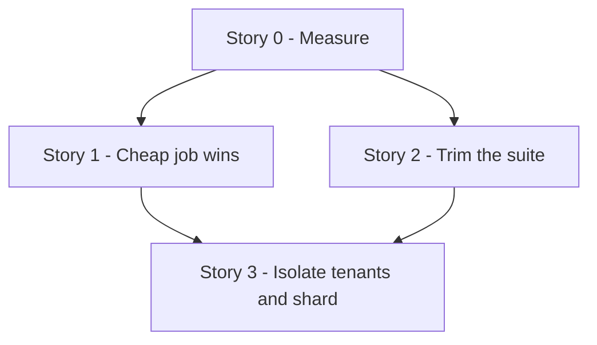

# TD59 — Playwright E2E Suite Duration (CI)

## Status
- **Type**: Technical Debt / CI performance and test-suite hygiene
- **Priority**: Medium (no wrong behavior and no failing spec, but the `Playwright E2E` job outgrew its cap three times and was cancelled on every TD58 PR, each costing a manual re-run and 20+ minutes of wall clock; the cap is already at a stopgap 45 minutes)
- **Context**: `.github/workflows/pr-tests.yml` (job `e2e`), `apps/web/playwright.config.ts`, `apps/web/e2e/**`, `docs/TESTING_STRATEGY.md`, `docs/CI_TRAPS.md`. No product code, backend, BFF or migration change.
- **Created**: 2026-11-06
- **Discovered**: TD58 PRs #721, #722 and #723 (2026-11-05/06). The `Playwright E2E` job was cancelled at the 30-minute cap on a first attempt with every spec that ran passing, and a re-run passed. Earlier the same failure drove the 20 → 30 raise (M23-S13, PR #613).
- **Decision status**: Ready for discovery in the dependency order below; every story still begins with `/story-discovery`. The sequence was confirmed with the user on 2026-11-06. No story-level discovery has run yet, so each story's "Pattern" is a starting decision `/story-discovery` Step 4q may refine.
- **Related**: `docs/CI_TRAPS.md` rows on the Playwright cap (lines ~124-125); `docs/TESTING_STRATEGY.md` § Running Playwright locally and the CI-sequential note (~lines 446, 801-803); TD08 AUD-015 (the original Playwright CI job); TD58 (the PRs that exposed this).

---

## Problem

The `Playwright E2E` job takes 19-23 minutes on a clean run and the whole PR workflow 28-33 minutes. Three TD58 PRs were cancelled at the 30-minute cap on a first attempt with nothing failing, and the cap was raised again to 45 minutes in PR #723 as a stopgap. `docs/CI_TRAPS.md` already says the next step is to shard or trim rather than raise the cap, and nothing tracks that work.

Verified facts (repo read, 2026-11-06):

- **The suite is much larger than documented.** There are 63 spec files and about 546 `test()` calls (15,491 lines of spec). The comment in `pr-tests.yml` and the `docs/CI_TRAPS.md` row still say "~330 tests", and `docs/TESTING_STRATEGY.md:447` still says "maximum 5-8 E2E scenarios for MVP". Largest: `hotsite-editor.spec.ts` (57 tests, 1,795 lines), then `schedule.spec.ts` and `services-resource-config.spec.ts` (19 each), `schedule-resource-columns.spec.ts` and `booking-journey-basket.spec.ts` (17 each).
- **CI runs one test at a time.** `playwright.config.ts` sets `workers: process.env.CI ? 1 : undefined`, `retries: 2` in CI, `fullyParallel: true`, and no sharding anywhere. `docs/TESTING_STRATEGY.md:803` says `workers: 1` is what prevents cross-file races on the shared seeded tenants (for example `hotsite-editor.spec.ts` and `settings.spec.ts` both mutate `autospa-premium`). More workers or shards are therefore unsafe until tenants are isolated.
- **The stack runs in dev mode.** The job starts `next dev` for the web app (no production build), the backend and BFF in dev, then waits with `wait-on`. Only pnpm is cached: there is no Playwright browser cache and no Next.js build cache, so `playwright install chromium --with-deps` and the first-compile of every route happen on every run.
- **Login is per test.** There is no `globalSetup` and no `storageState`. 56 spec files call the dev-login helper (`loginAsStaff`, `customer-login`), a BFF round trip each time.
- **Retries can hide slowness.** With 2 retries, a flaky or slow test can run three times without any signal in the job result.
- **No timing data is kept.** The job prints a list reporter and uploads artifacts only on failure with 1-day retention, so no one can say how the 19-23 minutes split between install, services start, and tests, or which specs dominate.
- **Stale references.** `playwright.config.ts:35` points to a `pr-e2e.yml` that does not exist (the job lives in `pr-tests.yml`).

### Why this matters
Every app-touching PR pays the job's wall clock, and a cancellation costs a manual re-run. As the suite grows (546 tests today against 330 in the last comment) a larger cap only postpones the next cancellation and slows every merge. The 45-minute cap also lets a hung stack burn a runner for 45 minutes before failing.

## Chosen approach (decided in this session, 2026-11-06)
Measure first, then take the cheap job-level wins and trim the suite in parallel, and only then change the concurrency model (tenant isolation, workers or sharding), because that is the invasive step and is cheaper after trimming. The 45-minute cap goes back down once the last story lands.

Target: the `Playwright E2E` job comfortably under 30 minutes in the worst observed case, and the cap lowered back from 45.

---

### Story 0 — Measure: per-phase and per-spec timing baseline

**Agent:** devops
**Complexity:** S
**Docs to load:** `docs/CI_CD_PIPELINE.md`; `docs/GITHUB_WORKFLOWS_GUIDELINES.md`; `docs/CI_TRAPS.md` (the Playwright rows); `docs/TESTING_STRATEGY.md` § Running Playwright locally
**Dependencies:** none
**Pattern:** plain composition — no named pattern applies

**Description:** Nothing in CI says where the 19-23 minutes go. Add the minimum instrumentation to answer it: step durations for the whole `e2e` job (install, infra, migrate, seed, services start, browser install, tests), and Playwright's per-test durations as a JSON report (the `json` reporter alongside `list,html`, or the existing HTML data) published as an artifact on every run, not only on failure, with a short retention. Produce a one-off summary into this TD (a table of phase times and the 15 slowest specs and tests, taken from at least three real runs, not one) so Stories 1-3 work from data. Also record the retry count: how many tests passed only on a retry across those runs. No behavior change to the suite.

New migration / i18n keys / env vars / feature flags: none. Backend HTTP surface: none.

**Files to create/modify:**
- `.github/workflows/pr-tests.yml` (modify: timing output and an always-uploaded timing artifact on the `e2e` job)
- `apps/web/playwright.config.ts` (modify: add the JSON reporter to the CI reporter list, via the `e2e:ci` script in `apps/web/package.json`)
- `apps/web/package.json` (modify: `e2e:ci` reporters)
- `td/TD59-E2E-SUITE-DURATION.md` (modify: the baseline table, in the PR)

**Acceptance criteria — product:**
- [ ] A maintainer can see, for any CI run, how long each phase of the `Playwright E2E` job took and which tests were slowest.

**Acceptance criteria — technical:**
- [ ] The baseline table in this TD covers at least three real runs and names the dominant phase and the 15 slowest tests
- [ ] The number of tests that passed only on retry is recorded for those runs
- [ ] Checkov / Tfsec clean (workflow lint: `actionlint` passes)
- [ ] No spec file changed in the diff

**Live-verification check:** after merge, one real PR run uploads the timing artifact on a green run and the step durations appear in the job log.

---

### Story 1 — Cheap job-level wins: caches, production build, login reuse

**Agent:** devops + web-ts
**Complexity:** M
**Docs to load:** `docs/TESTING_STRATEGY.md` § Mandatory Patterns and § Running Playwright locally; `docs/CI_TRAPS.md` (the Playwright rows and § Stale local state); `docs/GITHUB_WORKFLOWS_GUIDELINES.md`; `docs/ENGINEERING_RULES_TESTING.md` (E2E helper and dev-login conventions)
**Dependencies:** Story 0
**Pattern:** plain composition — no named pattern applies (a global setup plus Playwright's own `storageState`, not a custom abstraction)

**Description:** Take only the wins Story 0's data shows are large, in this order of expected value, and drop any that the data shows are small: (1) cache the Playwright browser download and the Next.js build cache between runs; (2) serve the web app from a production build instead of `next dev` if the first-compile time of routes is a large share of test time, checking that the production build does not change behavior the specs rely on (dev-only login stays enabled through its flag); (3) reuse the login: a `globalSetup` (or per-project setup) that logs each role in once and writes `storageState`, so specs stop doing a dev-login round trip per test, keeping the helpers' API so specs that need a fresh login still work; (4) fix the stale references: `playwright.config.ts:35` (`pr-e2e.yml`), the "~330 tests" comments, and `docs/TESTING_STRATEGY.md:447`. Each change is measured against the Story 0 baseline in the PR description, and a change that does not move the number is not kept.

New migration / i18n keys / env vars / feature flags: none expected (a production build may add a CI-only env value; state it if so). Backend HTTP surface: none.

**Files to create/modify:**
- `.github/workflows/pr-tests.yml` (modify: caches, build step, global setup wiring)
- `apps/web/playwright.config.ts` (modify: `globalSetup`, `storageState`; fix the stale comment)
- `apps/web/e2e/global-setup.ts` (new, if the data supports login reuse)
- `apps/web/e2e/helpers/auth/*` (modify only if needed to read the stored state)
- `docs/TESTING_STRATEGY.md`, `docs/CI_TRAPS.md` (modify: counts, rows, notes — doc gate)

**Acceptance criteria — product:**
- [ ] The `Playwright E2E` job is measurably faster than the Story 0 baseline on the same suite (the PR states before and after for each phase).

**Acceptance criteria — technical:**
- Unit: `none — CI and test-infrastructure change`
- E2E:
  - [ ] the full existing suite passes unchanged in count (546 tests, 0 skipped) on the new setup, on at least two consecutive runs
- [ ] A negative guarantee is pinned: a spec that logs in as a different role than the stored state still gets that role (one named spec or a helper test)
- [ ] `actionlint` clean, `tsc --noEmit` clean, lint clean

**Live-verification check:** two consecutive green real PR runs of the `e2e` job on the new setup, with the timing artifact from Story 0 showing the improvement.

---

### Story 2 — Trim the suite: redundant, overlapping and misplaced scenarios

**Agent:** web-ts
**Complexity:** L
**Docs to load:** `docs/TESTING_STRATEGY.md` § Mandatory Patterns, the web test layers and the E2E rules; `docs/ENGINEERING_RULES_TESTING.md`; `docs/ANTI_PATTERNS.md`
**Dependencies:** Story 0
**Pattern:** plain composition — no named pattern applies

**Description:** From Story 0's data, review the slowest specs and the largest ones (`hotsite-editor.spec.ts` at 57 tests first, then `schedule*.spec.ts`, `services-resource-config.spec.ts`, `booking-journey-basket.spec.ts`) for three things: scenarios that overlap each other (the same path asserted in several tests), scenarios already proved at unit or component level by a Vitest spec (move the assertion down and delete the E2E duplicate, citing the covering spec), and tests that repeat a long setup that one `beforeAll` or a seeded fixture could share. Every removal needs a stated reason and the test that still covers the behavior; no coverage of a user flow's route (the rule in `/story-discovery` 4f: each `page.tsx` keeps at least one scenario) is lost. Also check whether retries are hiding slowness: list tests that pass only on a retry in the Story 0 runs and fix or quarantine each with a reason. The output is a list of removed or merged scenarios in the PR with the covering test for each, not a count target chosen up front.

New migration / i18n keys / env vars / feature flags: none. Backend HTTP surface: none.

**Files to create/modify:**
- `apps/web/e2e/**/*.spec.ts` (modify/delete: the specs the review names; the final list is set in `/story-discovery` from the Story 0 data)
- `apps/web/**/*.spec.tsx` (modify: unit or component specs that absorb a moved assertion)
- `docs/TESTING_STRATEGY.md` (modify: the E2E scenario guidance — doc gate)

**Acceptance criteria — product:**
- [ ] No user flow loses its only E2E coverage; every route that had an E2E scenario still has one.

**Acceptance criteria — technical:**
- Unit:
  - [ ] every assertion moved down from an E2E test exists in a named Vitest spec
- E2E:
  - [ ] a table in the PR maps each removed or merged scenario to the test that still covers it
- [ ] The job's test-phase time is lower than the Story 0 baseline by the amount the PR states
- [ ] Coverage ≥80% on changed code
- [ ] `tsc --noEmit` clean, lint clean

---

### Story 3 — Isolate tenants, then add workers or shards

**Agent:** devops + web-ts
**Complexity:** L
**Docs to load:** `docs/TESTING_STRATEGY.md` § Layer 5 and the CI-sequential note (~lines 801-803); `docs/ENGINEERING_RULES_TESTING.md` (shared-tenant fixtures, an integration test seeding fixtures, a fixed-time-slot booking fixture); `docs/CI_TRAPS.md` (the Playwright rows); `docs/GITHUB_WORKFLOWS_GUIDELINES.md`; `docs/TENANT_ISOLATION_STRATEGY.md`
**Dependencies:** Story 1, Story 2
**Pattern:** plain composition — no named pattern applies (isolation by giving each spec file its own tenant or by tagging the few specs that must stay serial; sharding by Playwright's own `--shard` and a job matrix)

**Description:** `workers: 1` exists because specs share seeded tenants and race on their rows. After Stories 1-2 the remaining suite is smaller, so isolating it is cheaper. Decide from the data which of two routes fits and state the other as rejected: (a) per-file tenant isolation (each spec file or group gets its own seeded tenant, so files can run in parallel workers), or (b) keep the serial model but split the suite into shards across a job matrix, each shard with its own stack and database, so the shared-tenant risk stays inside one runner. In both cases the aggregate gate (`test-suite-passed`) must still require every shard, and a shard that fails or is skipped must fail the gate. Then lower `timeout-minutes` from 45 back to a value with real headroom over the new worst observed time, and update the `docs/CI_TRAPS.md` rows and the `docs/TESTING_STRATEGY.md` note that says CI is sequential.

New migration / i18n keys / env vars / feature flags: none expected (a seed change for new tenants if route (a) is chosen; state it).

**Files to create/modify:**
- `.github/workflows/pr-tests.yml` (modify: matrix or worker settings, the lowered cap, gate wiring)
- `apps/web/playwright.config.ts` (modify: `workers`, shard handling)
- `apps/web/e2e/**` and the seed scripts (modify: tenant isolation, only if route (a))
- `docs/TESTING_STRATEGY.md`, `docs/CI_TRAPS.md` (modify — doc gate)

**Acceptance criteria — product:**
- [ ] The `Playwright E2E` job's worst observed run is well under 30 minutes and the cap is lowered from 45.

**Acceptance criteria — technical:**
- E2E:
  - [ ] the whole suite passes on at least three consecutive real runs with no new flake (retries used stay at or below the Story 0 baseline)
- [ ] Negative guarantee pinned: a shard that fails, is cancelled or is skipped makes `test-suite-passed` fail (shown on a deliberate throwaway failure in the PR, then removed)
- [ ] `actionlint` clean, `tsc --noEmit` clean, lint clean

**Live-verification check:** three consecutive green real PR runs under the new cap, plus the throwaway-failure run described above.

---

## Out of scope
- Rewriting specs to a different test framework, or moving E2E to a different runner.
- Adding new E2E scenarios (this TD only measures, speeds up and trims).
- Backend and BFF integration-test duration (a separate suite with its own job).
