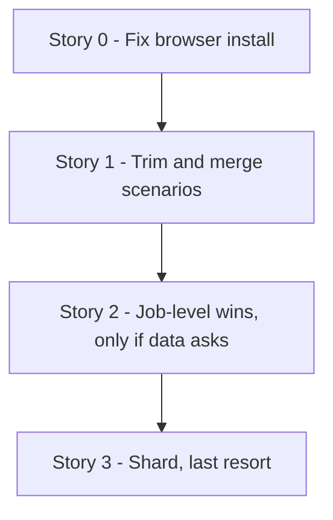

# TD59 — Playwright E2E Suite Duration (CI)

## Status
- **Type**: Technical Debt / CI performance and test-suite hygiene
- **Priority**: Medium (no wrong behavior and no failing spec, but the `Playwright E2E` job outgrew its cap three times and was cancelled on every TD58 PR, each costing a manual re-run and 20+ minutes of wall clock; the cap is already at a stopgap 45 minutes)
- **Context**: `.github/workflows/pr-tests.yml` (job `e2e`), `apps/web/playwright.config.ts`, `apps/web/e2e/**`, `docs/TESTING_STRATEGY.md`, `docs/CI_TRAPS.md`. No product code, backend, BFF or migration change.
- **Created**: 2026-11-06
- **Discovered**: TD58 PRs #721, #722 and #723 (2026-11-05/06). The `Playwright E2E` job was cancelled at the 30-minute cap on a first attempt with every spec that ran passing, and a re-run passed. Earlier the same failure drove the 20 → 30 raise (M23-S13, PR #613).
- **Decision status**: Ready for discovery in the dependency order below; every story still begins with `/story-discovery`. The sequence was confirmed with the user on 2026-11-06 and reordered the same day after the CI-log measurements in "Measured baseline" (install fix, trim, job-level wins, and sharding only as a last resort). No story-level discovery has run yet, so each story's "Pattern" is a starting decision `/story-discovery` Step 4q may refine.
- **Related**: `docs/CI_TRAPS.md` rows on the Playwright cap (lines ~124-125); `docs/TESTING_STRATEGY.md` § Running Playwright locally and the CI-sequential note (~lines 446, 801-803); TD08 AUD-015 (the original Playwright CI job); TD58 (the PRs that exposed this).

---

## Problem

The `Playwright E2E` job takes 19-23 minutes on a clean run and the whole PR workflow 28-33 minutes. Three TD58 PRs were cancelled at the 30-minute cap on a first attempt with nothing failing, and the cap was raised again to 45 minutes in PR #723 as a stopgap. `docs/CI_TRAPS.md` already says the next step is to shard or trim rather than raise the cap, and nothing tracks that work.

Verified facts (repo read, 2026-11-06):

- **The suite is much larger than documented.** There are 63 spec files and about 546 `test()` calls (15,491 lines of spec). The comment in `pr-tests.yml` and the `docs/CI_TRAPS.md` row still say "~330 tests", and `docs/TESTING_STRATEGY.md:447` still says "maximum 5-8 E2E scenarios for MVP". Largest: `hotsite-editor.spec.ts` (57 tests, 1,795 lines), then `schedule.spec.ts` and `services-resource-config.spec.ts` (19 each), `schedule-resource-columns.spec.ts` and `booking-journey-basket.spec.ts` (17 each).
- **CI runs one test at a time.** `playwright.config.ts` sets `workers: process.env.CI ? 1 : undefined`, `retries: 2` in CI, `fullyParallel: true`, and no sharding anywhere. `docs/TESTING_STRATEGY.md:803` says `workers: 1` is what prevents cross-file races on the shared seeded tenants (for example `hotsite-editor.spec.ts` and `settings.spec.ts` both mutate `autospa-premium`). More workers or shards are therefore unsafe until tenants are isolated.
- **The stack runs in dev mode.** The job starts `next dev` for the web app (no production build), the backend and BFF in dev, then waits with `wait-on`. Only pnpm is cached: there is no Playwright browser cache and no Next.js build cache, so `playwright install chromium --with-deps` and the first-compile of every route happen on every run.
- **Login is per test.** There is no `globalSetup` and no `storageState`. 56 spec files call the dev-login helper (`loginAsStaff`, `customer-login`), a BFF round trip each time.
- **Retries can hide slowness.** With 2 retries, a flaky or slow test can run three times without any signal in the job result.
- **No timing data is kept.** The job prints a list reporter and uploads artifacts only on failure with 1-day retention. The split was recovered from raw logs (see "Measured baseline"); the CI logs keep per-test durations for 90 days, which is enough, so no separate instrumentation story is planned. Method: parse the list reporter's `(<duration>)` suffix on each `✓` line.
- **Stale references.** `playwright.config.ts:35` points to a `pr-e2e.yml` that does not exist (the job lives in `pr-tests.yml`).

### Why this matters
Every app-touching PR pays the job's wall clock, and a cancellation costs a manual re-run. As the suite grows (546 tests today against 330 in the last comment) a larger cap only postpones the next cancellation and slows every merge. The 45-minute cap also lets a hung stack burn a runner for 45 minutes before failing.

## Measured baseline (2026-11-06, from CI logs of real runs)

Source: the `Playwright E2E` job logs of PR #723's runs and the 40 most recent `PR — Quality And Security` runs (Nov 3-6). Reproducible with `gh run view <id> --log --job <job-id>`; the list reporter prints every test's duration.

**Job phases, normal run (run 42175124272, 22.8 min total):** checkout + pnpm install 0.7 min, infra start 0.3 min, migrate + seed + GCS upload + services 0.5 min, `playwright install` 0.3 min, **Run Playwright E2E 20.7 min (about 91%)**. Setup is about 2 min and is not the bottleneck.

**The test phase is death by many small serial tests, not a hot spot.**

| | run 42175124272 | run 42139927129 |
|---|---|---|
| Tests executed | 445 passed | 445 passed |
| Test phase | 20.7 min | 20.9 min |
| Sum of per-test durations | 20.3 min | 20.6 min |
| Tests that needed a retry | 0 | 0 |
| Median / p90 test | 2.4 s / 4.9 s | 2.0 s / 6.9 s |
| Tests over 10 s | 3 | 3 |

- Per-test durations add up to the wall clock (about 0.03 s of gap per test): no hidden overhead between tests.
- No dominant spec. `hotsite-editor.spec.ts` (55 tests) takes 2.1-2.5 min (about 11%); the next specs take 1.0-1.5 min each. The slowest single test is 14-18 s.
- 445 tests executed against 546 `test()` calls counted by grep: the 100-test difference is unexplained and must be understood in the trim story's discovery.
- Run-to-run variance of the same suite on a green run is 15-27 min (40 runs sampled), so one serial worker is also what makes the time unpredictable.

**The one real cap timeout was not the tests.** Of the 40 sampled runs, a single one (42092698239, 2026-11-05) hit the 30-minute cap. Most other "cancelled" runs lasted 3-17 minutes and were superseded by a newer push (`cancel-in-progress: true`), not timed out. In that run `playwright install chromium --with-deps` took **9.5 min instead of about 20 s**: apt fetched font packages from `azure.archive.ubuntu.com` at 43 kB/s ("Fetched 21.9 MB in 8min 23s"). The tests then ran their usual 18 min and the job reached 30 min. Raising the cap to 45 hides this; it does not fix it.

**Consequence for the plan.** Trimming alone can cut perhaps 10-20% (no outlier exists) and will not make the time predictable. The first lever is making the install step fast and bounded. After that, merging redundant scenarios into full flows, and only then, if still needed, running the suite in parallel by sharding across jobs (each with its own stack and database, keeping `workers: 1` inside each shard), at the cost of repeating downloads per shard.

## Chosen approach (decided 2026-11-06, reordered the same day after the measurements above)
Fix the install step first (it caused the only observed timeout), then trim and merge redundant scenarios, then take cheap job-level wins only if the data asks. Sharding is the last resort: it multiplies the per-job downloads and runner queueing that GitHub-side slowness already makes unpredictable, so it is attempted only if the job is still over target. Per-file tenant isolation with several workers on one runner is rejected for now (invasive, touches many specs and the seed).

Target: the `Playwright E2E` job under about 20 minutes in the worst observed case with no cap timeout, the cap lowered from 45 to about 35 after Story 0, and sharding taken only if that is not reached. Expected from Stories 1-3 alone: about 22 min down to about 16-19 min with much better predictability.

---

### Story 0 — Make the browser install fast and bounded

**Agent:** devops
**Complexity:** S
**Docs to load:** `docs/CI_TRAPS.md` (the Playwright rows); `docs/GITHUB_WORKFLOWS_GUIDELINES.md`
**Dependencies:** none (do this first)
**Pattern:** plain composition — no named pattern applies

**Description:** `pnpm --filter @ikaro/web exec playwright install chromium --with-deps` runs `apt-get` against the runner's mirror and downloads the browser on every run. In run 42092698239 the apt font download alone took 8 min 23 s at 43 kB/s and caused the only observed cap timeout. Decided in `/story-discovery` (2026-11-06): drop `--with-deps` and run `playwright install chromium` alone, with `timeout-minutes: 3` on the step. In a normal run `--with-deps` installs exactly nine font packages (every library Chromium needs is already on the runner), and the browser download itself takes about 15 s, so the apt call is the only slow part and removing it removes the dependency instead of retrying around it. Rejected: a browser cache (the download is not the slow part) and the `mcr.microsoft.com/playwright` container (it breaks `docker compose` networking to `localhost` and is far more machinery than this needs). Pre-decided fallback: if the first PR run fails on missing system libraries, install just those packages in a bounded step (timeout plus one retry); two layout specs (`booking-journey-basket`, `hotsite-templates`) check for horizontal overflow, not font metrics, and are the ones to watch. Also lower `timeout-minutes` from 45 to about 35 once the install is bounded, so a hung stack fails sooner; revisit the value after Story 1 using the job logs.

New migration / i18n keys / env vars / feature flags: none. Backend HTTP surface: none.

**Files to create/modify:**
- `.github/workflows/pr-tests.yml` (modify: install step without `--with-deps`, step timeout, job cap 35, stale test-count comment)
- `docs/CI_TRAPS.md` (modify: record the apt-mirror stall — doc gate)

**Acceptance criteria — product:**
- [ ] The install step takes well under a minute (about 15 s) and cannot run past its own 3-minute timeout. The timeout is a platform guarantee and no test pins it.

**Acceptance criteria — technical:**
- [ ] `actionlint` clean; the job cap is 35 and the comment above it states 445 tests
- [ ] The step's duration is shown for two consecutive real runs

**Live-verification check:** two consecutive green real PR runs with the install step's duration in the log.

---

### Story 1 — Trim and merge redundant scenarios

**Agent:** web-ts
**Complexity:** L
**Docs to load:** `docs/TESTING_STRATEGY.md` § Mandatory Patterns, the web test layers and the E2E rules; `docs/ENGINEERING_RULES_TESTING.md`; `docs/ANTI_PATTERNS.md`
**Dependencies:** Story 0
**Pattern:** plain composition — no named pattern applies

**Description:** The measurements show no outlier, so this story is about quality and redundancy, not a time target chosen up front: expect a 10-20% gain, not a rescue. Review the families that look overlapping, then prefer one full-flow test over several partial ones where they share a long setup: the recurring-schedule family (`dashboard-recurring-schedule-create`, `my-account-recurring-schedule-*`, `staff-recurring-approval`), `booking-*` / `staff-new-booking` / `booking-journey-basket` (several axe-only and viewport-only tests could be assertions inside the golden-path flow), `schedule*` and `services-resource-config`, and `hotsite-editor.spec.ts`. Also move assertions already proved by a Vitest component spec down and delete the E2E duplicate, citing the covering spec. Resolve the 445-executed versus 546-`test()` discrepancy first. Every removal needs a stated reason and the test that still covers the behavior; no coverage of a user flow's route (the rule in `/story-discovery` 4f: each `page.tsx` keeps at least one scenario) is lost, and quality and coverage must not drop.

New migration / i18n keys / env vars / feature flags: none. Backend HTTP surface: none.

**Files to create/modify:**
- `apps/web/e2e/**/*.spec.ts` (modify/delete: the specs named by the review; final list set in `/story-discovery`)
- `apps/web/**/*.spec.tsx` (modify: specs that absorb a moved assertion)
- `docs/TESTING_STRATEGY.md` (modify: E2E scenario guidance and the stale "5-8 scenarios" line — doc gate)

**Acceptance criteria — product:**
- [ ] No user flow loses its only E2E coverage; every route that had an E2E scenario still has one.

**Acceptance criteria — technical:**
- Unit:
  - [ ] every assertion moved down from an E2E test exists in a named Vitest spec
- E2E:
  - [ ] a table in the PR maps each removed or merged scenario to the test that still covers it
- [ ] The job's test-phase time is lower than the "Measured baseline" (20.7 min) by the amount the PR states
- [ ] Coverage ≥80% on changed code; `tsc --noEmit` clean, lint clean

---

### Story 2 — Job-level wins (only if the data still asks)

**Agent:** devops + web-ts
**Complexity:** M
**Docs to load:** `docs/TESTING_STRATEGY.md` § Mandatory Patterns and § Running Playwright locally; `docs/CI_TRAPS.md` (the Playwright rows and § Stale local state); `docs/GITHUB_WORKFLOWS_GUIDELINES.md`; `docs/ENGINEERING_RULES_TESTING.md` (E2E helper and dev-login conventions)
**Dependencies:** Story 0
**Pattern:** plain composition — no named pattern applies

**Description:** Setup measured about 2 minutes, so these wins are small and kept only if the job logs show they move the number. Take only what the data shows is large, and build them so Story 3's shards can reuse them: Docker image caching for the emulators, a Next.js build cache or a production build instead of `next dev` (only if first-compile of routes is a large share of test time; keep dev-login enabled through its flag), and reusing the login through `globalSetup` + `storageState` (keep the helper API; a spec logging in as a different role must still get that role). Fix the stale references: `playwright.config.ts:35` (`pr-e2e.yml`), the "~330 tests" comments. Each change is measured against the numbers before it, and a change that does not move the number is not kept. If the job is already inside the target, close this story as not needed.

New migration / i18n keys / env vars / feature flags: none expected.

**Files to create/modify:** decided from the data (`pr-tests.yml`, `playwright.config.ts`, `e2e/global-setup.ts`, docs).

**Acceptance criteria — product:**
- [ ] Each kept change is measurably faster than before the change, stated per phase in the PR.

**Acceptance criteria — technical:**
- [ ] The full suite passes unchanged in count on two consecutive runs
- [ ] A negative guarantee is pinned if login reuse is taken: a spec that logs in as a different role than the stored state still gets that role
- [ ] `actionlint`, `tsc --noEmit` and lint clean

---

### Story 3 — Decide on sharding with data, and shard only if it pays (optional)

**Agent:** devops
**Complexity:** M
**Docs to load:** `docs/TESTING_STRATEGY.md` § Layer 5 and the CI-sequential note (~lines 801-803); `docs/CI_TRAPS.md` (the Playwright rows); `docs/GITHUB_WORKFLOWS_GUIDELINES.md`; `docs/ENGINEERING_RULES_TESTING.md` (shared-tenant fixtures, a fixed-time-slot booking fixture)
**Dependencies:** Stories 0-2, and only if the job is still over the target after them
**Pattern:** plain composition — no named pattern applies (Playwright's own `--shard=N/M` plus a job matrix)

**Description:** This story starts with a decision, not with code. After Stories 0-2 have merged, collect the `Playwright E2E` job duration and the setup-phase duration for at least 10 real PR runs and write the numbers into this TD. Shard only if the worst or p90 run is still over the target, or the run time is still unpredictable. If the numbers are inside the target, close this story as not needed. Sharding is only worth it when each shard's setup is cheap, so the caches from Story 2 are a prerequisite and are shared by all shards: the pnpm store (already cached), the Playwright browser directory, the Docker images of the emulators (a cached `docker save` tarball or a mirror in GHCR, whichever is measurably faster than pulling from the public registry), and the Next.js build cache. Each shard restores the same caches by the same key, so nothing is built or downloaded from the internet once per shard when a warm cache exists. If a warm shard's setup is not under about 1.5 minutes, do not shard.

If the decision is to shard: Run the `e2e` job as a matrix of shards, starting with **2** (about 220 tests and 10 minutes of tests per shard) to limit the exposure to GitHub runner queueing and download variance; `/story-discovery` confirms the count from the job logs and the runner-concurrency limit. Each shard is a full job with its own Postgres, Pub/Sub and GCS emulators, backend, BFF, web app and seed, and keeps `workers: 1`, so the shared-tenant race protection stays intact inside each shard (`hotsite-editor.spec.ts` and `settings.spec.ts` both mutate `autospa-premium` and must be checked to land in a shard where the serial order holds). No spec changes. `test-suite-passed` must require every shard: a shard that fails, is cancelled or is skipped fails the gate. Merge or upload per-shard reports with distinct artifact names. Lower `timeout-minutes` from 45 to real headroom over the new worst shard, and update the `docs/CI_TRAPS.md` rows and the `docs/TESTING_STRATEGY.md` CI-sequential note.

Trade-offs to state in the PR: wall clock roughly halves at 2 shards, billed runner minutes rise (the setup of about 2 minutes is repeated per shard), every shard repeats the pnpm, Docker and browser downloads (more exposure to GitHub-side slowness), and the gate time becomes the slowest shard. Rejected for now: per-file tenant isolation with several workers on one runner (invasive, touches many specs and the seed).

New migration / i18n keys / env vars / feature flags: none. Backend HTTP surface: none.

**Files to create/modify:**
- `.github/workflows/pr-tests.yml` (modify: matrix, shard flag, artifact names, gate wiring, lowered cap)
- `docs/TESTING_STRATEGY.md`, `docs/CI_TRAPS.md` (modify — doc gate)

**Acceptance criteria — product:**
- [ ] The decision data (10+ runs) is recorded in this TD before any change
- [ ] A warm shard's setup phase is under about 1.5 minutes
- [ ] The `Playwright E2E` gate's worst observed run is inside the target and the cap is lowered from 45.

**Acceptance criteria — technical:**
- E2E:
  - [ ] every test runs exactly once across the shards (sum of shard counts equals the unsharded count), on three consecutive real runs with no new flake
- [ ] Negative guarantee pinned: a shard that fails, is cancelled or is skipped makes `test-suite-passed` fail (shown on a deliberate throwaway failure in the PR, then removed)
- [ ] `actionlint` clean

**Live-verification check:** three consecutive green real PR runs under the new cap, plus the throwaway-failure run.

---

## Out of scope
- Rewriting specs to a different test framework, or moving E2E to a different runner.
- Adding new E2E scenarios (this TD only measures, speeds up and trims).
- Backend and BFF integration-test duration (a separate suite with its own job).
