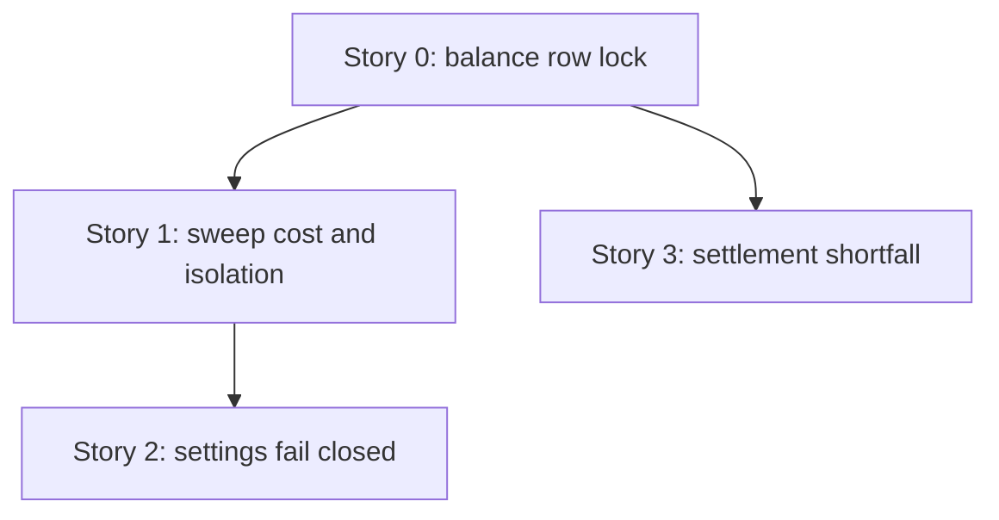

# TD60 — LOYALTY-BALANCE-SWEEP-AND-SETTINGS-HARDENING

## Status

- **Type**: Technical Debt / Correctness and scalability (Loyalty)
- **Priority**: Medium (no production data exists yet, so nothing is visibly wrong today; but the balance can silently drift from the entries ledger, and the daily sweep gets slower every day it runs)
- **Context**: Loyalty bounded context — backend only (`apps/backend/src/contexts/loyalty`), plus one new Loyalty migration. No BFF, web, infra or `@ikaro/types` change.
- **Created**: 2026-11-15
- **Discovered**: M25/M26 docs-audit pass after the M25-S27 decision (points keep expiring while a tenant is suspended, PR #789 / #790). The audit re-read the Loyalty code against its docs and found three real code gaps; the docs now describe them (`docs/LOCK_CATALOG.md` hazard H7, `docs/DATABASE_SCHEMA.md` Loyalty section).
- **Decision status**: Ready for discovery in the dependency order below; each story still begins with `/story-discovery`. Story 3 needs a product decision first (see its Description).
- **Related**: `docs/LOCK_CATALOG.md` § H7; `docs/BUSINESS_LOGIC_REFERENCE.md` (the earn and settle section); `docs/DATABASE_SCHEMA.md` § Schema: `loyalty`; `docs/ENGINEERING_RULES_BACKEND.md` § Choosing a race-condition primitive, § Adding a cron-published event, § Event Handlers; closed PR #788 / branch `feat/m25-s27-loyalty-pause-expiry-while-suspended` (reference for Story 1 only, see below); M25-S27 (product decision O-L1: points keep expiring while a tenant is suspended, so none of this changes expiry semantics).

## Problem

Four independent weaknesses in Loyalty, all verified against `main` at `800c0491a` on 2026-11-15.

**1. The balance row has no lock and no version check.** `LoyaltyBalance` is saved by an unlocked read-modify-write: each writer reads the balance (a plain `findOne`) **outside** its transaction, changes it in memory, and `upsert`s the **absolute** `current_points` inside the transaction (`typeorm-loyalty-balance.repository.ts` `findByCustomer` lines 19-22, `upsert` lines 50-59). There are exactly three writers: the earn and settle in `CompleteBookingLoyaltyEffectsUseCase` (read line 112, write line 258), `RedeemPointsUseCase` (read line 45, write line 61) and `ExpirePointsJob.processGroup` (read line 83, write line 92). None locks, none checks a version, and the table has no version column (`1748000000017` migration: PK `(tenant_id, customer_id)`, `CHECK (current_points >= 0)`). Interleavings the CHECK and the unique keys do not stop:
- **Redeem versus the sweep:** both read 100; the sweep expires 60 and commits 40; the redeem then writes 100 − 50 = 50, so the 60 expired points are resurrected.
- **Two redeems, or a staff redeem against a `BookingCompleted` settlement:** both read 100; one commits 20, the other writes 30, and 150 points are redeemed from a balance of 100.
- **Two `BookingCompleted` events for one customer:** both read N and one earn is lost, so the balance drifts from the sum of entries (the entries ledger stays correct).
- **First earn:** when no balance row exists, `FOR UPDATE` alone locks nothing; two concurrent first earns both see no row and both insert.

**2. The expiry sweep re-reads its whole history on every run.** `ExpirePointsJob` calls `findExpiringBefore(now)` (`typeorm-loyalty-entry.repository.ts` lines 34-39), which is `find({ expiresAt: LessThan(date) })`: no processed filter, no limit. Entries are never pruned, so it loads every entry that ever expired, then runs two awaited queries per entry (`hasBeenProcessed`, a `count` on `balance_expiry_log`, and `existsById`; `expire-points.job.ts` lines 54-65): 2N round trips, with N growing without bound. `loyalty_entries` has no index with `expires_at` as its leading column (only `(tenant_id, customer_id, expires_at)`), so the cross-tenant scans of the sweep and of the weekly `NotifyExpiringPointsJob` (`findExpiringSoon`, `Between(now, to)`) cannot seek. Neither job isolates a failure: one failing customer group aborts the rest of the sweep (`expire-points.job.ts` lines 46-49), and one failing tenant aborts the later tenants of the warning job (`mapSequentially`, no `TenantJobRunner`, breaking rule 8 of `docs/ENGINEERING_RULES_BACKEND.md` § Adding a cron-published event). A re-run is safe (processed marks, a `dedupKey` derived from `runDate`), so this is cost and blast radius, not correctness.

**3. A failed tenant-settings read silently becomes default business values.** `LoyaltyPlatformAdapter.getLoyaltySettings` (`loyalty-platform.adapter.ts` lines 26-28) is a bare `catch { return { ...DEFAULTS } }`: no log, no distinction between `TenantNotFoundError` and a transient database error, no rethrow. Defaults: `expiryDays 180`, `notificationMinPoints 50`, `pointsPerCurrencyUnit 0`. Callers: `CompleteBookingLoyaltyEffectsUseCase` (line 103, outside the transaction) and `NotifyExpiringPointsJob` (line 59). Effect on earn: a transient failure stores entries expiring in 180 days instead of the tenant's configured value, **permanently** (entries are append-only). Effect on settle: the `LoyaltyRedemption` row gets `pointsPerCurrencyUnit = 0`, which reads as "discount disabled". Effect on the warning job: the wrong minimum. Elsewhere the repo either fails closed (`booking-platform.adapter.ts` `getBusinessHoursAndLocale` does not catch) or fails open deliberately and says so (`TenantAccessPort`, `docs/BUSINESS_LOGIC_REFERENCE.md`); only this adapter fails open silently, and it fabricates substantive business values.

**4. A settlement shortfall rolls back the whole `BookingCompleted` effect.** `CompleteBookingLoyaltyEffectsUseCase` adds the earn first (line 113) and then calls `balance.decrement` (line 211), which throws `LoyaltyInsufficientPointsError` when `pointsUsed` is more than balance plus earned (for example after an expiry sweep reduced the balance between booking and completion). The throw happens before `persist`, so the **whole transaction rolls back**: no entries, no redemption, no inbox mark and no `ServicePointsEarned` (the earned points are lost too). The handler logs "will nack for retry" and rethrows; nothing classifies the error as non-retryable. Pub/Sub retries with backoff 10 s to 600 s and `max_delivery_attempts = 5` (`infra/terraform/modules/pubsub/main.tf`), then dead-letters to an alert-only DLQ. The shortfall is deterministic, so every attempt fails. The customer keeps the discount (the booking price was already reduced at completion, which only reconciled `pointsUsed / rate` with `amountDeducted`, never the balance). No spec covers the shortfall, and `docs/BUSINESS_LOGIC_REFERENCE.md` states the intent "settlement is always settled", which the code does not honour. Separately, the sweep's `Math.min(expired, balance)` clamp is not FIFO, so an expiry can consume points a redemption already counted.

### Why this matters

Points are money-like to customers and a discount in the business's books. A silently wrong balance (resurrected, double-spent or lost points), a permanently wrong expiry on an append-only entry, and a discount that is granted but never recorded are all hard to detect and hard to repair later. They cost nothing to fix before the first production tenant, and a data repair after launch would have to reconcile the balance against the entries ledger customer by customer.

## Chosen approach (decided in this session, 2026-11-15)

- **Gap 1: row lock, not an atomic delta.** Primitive 2 of `docs/ENGINEERING_RULES_BACKEND.md` § Choosing a race-condition primitive ("a row exists, must be read-then-written consistently"): a `findByCustomerForUpdate` port method (`SELECT … FOR UPDATE`) taken **inside** `txManager.run()` in all three writers, with the balance read moved inside the transaction. The first-earn case is closed by ensuring the row first (`INSERT … ON CONFLICT DO NOTHING`, query builder, real column names) and then locking it; the lock is a new self-contained Loyalty level taken first in the Loyalty transaction (nothing in Loyalty takes any L0–L6 lock today, so no cross-ladder ordering is needed). `docs/LOCK_CATALOG.md` is updated in the same story (§ 3 entry, § 4 sequence row, close H7), and the story ships a **concurrent integration test** per `docs/ENGINEERING_RULES_TESTING.md`.
- **Gap 2: an unprocessed-only read plus a standalone index plus failure isolation.** Reuse the shape (not the branch) of closed PR #788's `findUnprocessedExpiringUntil(to)` (`expires_at <= :to AND NOT EXISTS (SELECT 1 FROM loyalty.balance_expiry_log l WHERE l.entry_id = e.id)`) and its standalone index `IDX_loyalty_entries_expires_at` on `loyalty.loyalty_entries (expires_at)`, with the same plan-assertion integration test (`SET enable_seqscan = off`, EXPLAIN contains the index name). The branch is **not merged** and also carries the dropped pause design (`tenant_expiry_pauses`, effective expiry, suspend/reactivate handlers); copy only the entry-repository method, the index migration and their tests, and re-timestamp the migration against `main`.
- **Gap 3: fail closed.** The adapter stops swallowing: `TenantNotFoundError` and transient errors propagate. For the earn path this follows `docs/ENGINEERING_RULES_BACKEND.md` § Event Handlers ("rethrow; Pub/Sub nacks and retries; never swallow"), and the inbox makes the retry safe.
- **Gap 4: a product decision, then the fix** (Story 3). The code cannot choose between recording a partial settlement and refusing it; that is a business rule.

## Stories

### Dependency graph

Story 1 builds on Story 0: Story 0 adds the batched, transaction-aware processed re-check (`findProcessedEntryIds`) that the sweep runs under the balance lock, and both stories edit `expire-points.job.ts`, so they are sequenced, not parallel. Story 2 depends on Story 1 only for the warning job's per-tenant failure isolation; Story 3 depends on Story 0 because it changes the same locked settle path.

---

### TD60 Story 0 — Lock the loyalty balance row in all three writers (H7) ✅ Done

**Agent:** backend-ts
**Complexity:** M
**Docs to load:** `docs/LOCK_CATALOG.md` § The order locks are taken in, § 3, § 4, § 5 (H7), § 7; `docs/ENGINEERING_RULES_BACKEND.md` § Choosing a race-condition primitive, § Transactions; `docs/ENGINEERING_RULES_TESTING.md` (concurrency tests); `docs/BUSINESS_LOGIC_REFERENCE.md` (the Loyalty earn and settle section); `docs/DATABASE_SCHEMA.md` § Schema: `loyalty`
**Dependencies:** none
**Pattern:** Pessimistic row lock behind the repository port (`findByCustomerForUpdate`), read inside the transaction; ensure-then-lock for the first earn.

**Discovered:** 2026-11-15, M25/M26 docs-audit.
**Root cause:** `typeorm-loyalty-balance.repository.ts` `findByCustomer` (lines 19-22) is a plain `findOne` called outside the transaction by `complete-booking-loyalty-effects.use-case.ts` (line 112), `redeem-points.use-case.ts` (line 45) and `expire-points.job.ts` (line 83); `upsert` (lines 50-59) writes the absolute value; the entity has no `@VersionColumn` and no migration adds one.

**Description:**
Every writer of `loyalty.loyalty_balances` takes a row lock before it reads the balance and keeps it until its transaction commits, so a second writer waits and then reads the committed value. Add two methods to `ILoyaltyBalanceRepository`, both implemented in `TypeOrmLoyaltyBalanceRepository` with the active transaction's manager from `getActiveEntityManager()` and both throwing outside a transaction, like the sibling `*ForUpdate` methods (`findByIdForUpdate` in `typeorm-future-commitment-exception.repository.ts` is the pattern: `lock: { mode: 'pessimistic_write' }`):
- `findByCustomerForUpdate(tenantId, customerId)`: `SELECT … FOR UPDATE`, returns `null` when there is no row. Used by `RedeemPointsUseCase` (null stays `LoyaltyBalanceNotFoundError` 404) and `ExpirePointsJob`.
- `findOrCreateByCustomerForUpdate(tenantId, customerId)`: `SELECT … FOR UPDATE` first; only on a miss does it run `INSERT … ON CONFLICT DO NOTHING` (query builder with real column names, never `onConflict`, which does not exist on `InsertQueryBuilder`) and re-select with the lock. The common earn path (row exists) is one query, and two concurrent first earns cannot both insert (the second insert waits on the first's unique key, then does nothing, then locks the committed row). Used by `CompleteBookingLoyaltyEffectsUseCase`.

**Re-checks under the lock (decided at discovery, 2026-11-16).** A lock only orders callers who both acquire it, so what was decided before the lock must be re-checked after it, inside the same transaction and on the transaction's own manager (never `this.repo.count`: a second pooled connection while a lock is held can exhaust the pool under load):
- `CompleteBookingLoyaltyEffectsUseCase` re-checks the inbox after the lock and returns `SKIPPED_RESULT` if the event is now processed; the cheap pre-transaction check stays as the fast path. This closes the discount-only duplicate described below. `inboxRepo.hasBeenProcessed` becomes transaction-aware.
- `ExpirePointsJob.processGroup` re-checks its entries after the lock with one batched call, `findProcessedEntryIds(entryIds)` on `IBalanceExpiryLogRepository` (not N per-entry queries, which would lengthen the lock hold), drops entries already processed and does nothing when none remain. Without it two overlapping cron runs (Pub/Sub is at-least-once) would each decrement the same entries, because `markProcessed` is an upsert that never conflicts. Story 1 keeps this method and only removes the per-entry `hasBeenProcessed` call from the read path. Move the balance read inside `txManager.run()` in `CompleteBookingLoyaltyEffectsUseCase`, `RedeemPointsUseCase` and `ExpirePointsJob.processGroup`. The lock is the **first** lock of the Loyalty transaction, before the entries, redemption, inbox and outbox writes; it needs no ordering against the L0–L6 ladder because no Loyalty transaction takes any of those (`BookingCompleted` is handled through the outbox and inbox in its own transaction after the booking commits). The 2-second `lock_timeout` returns a retryable 503 on contention and the inbox makes the redelivery safe (`docs/ENGINEERING_RULES_BACKEND.md` § Transactions).
To be verified at `/story-discovery` and fixed here when real: `inboxRepo.markProcessed` is an upsert that never conflicts (`shared/infrastructure/inbox/typeorm-inbox.repository.ts` lines 43-54), so a concurrent duplicate delivery of a **discount-only** `BookingCompleted` (no earn line, hence no `UQ_loyalty_entries_tenant_booking_line` to fail) could double-decrement; repeating the inbox check after the lock is acquired closes it. Also confirm whether the three writers' reads in the two read-only services (`loyalty-balance-reader.service.ts`, the get-balance use cases) stay lock-free (they should).

**Backend use case steps:**
1. `CompleteBookingLoyaltyEffectsUseCase`: settings and tenant-access reads stay before the transaction; inside `txManager.run`, `findOrCreateByCustomerForUpdate`, re-check the inbox (transaction-aware), apply increment then decrement, save entries, `upsert`, redemption, inbox mark, outbox.
2. `RedeemPointsUseCase`: inside `txManager.run`, `findByCustomerForUpdate` (null → `LoyaltyBalanceNotFoundError` 404), `decrement`, insert the redemption, `upsert`.
3. `ExpirePointsJob.processGroup`: inside the per-customer transaction, `findByCustomerForUpdate`, batched `findProcessedEntryIds` re-check, clamp, decrement, `markProcessed`, `upsert`.

**Backend HTTP surface:** none (no route changes; `POST /loyalty/redeem` behaviour is unchanged apart from serialising with other writers).
**New migration / i18n keys / env vars / feature flags:** none (a row lock needs no schema change).

**Files to create/modify:**
- `apps/backend/src/contexts/loyalty/application/ports/loyalty-balance-repository.port.ts` (modify)
- `apps/backend/src/contexts/loyalty/infrastructure/repositories/typeorm-loyalty-balance.repository.ts` (+ `.spec.ts`, `.integration.spec.ts`) (modify)
- `apps/backend/src/test/repositories/loyalty/in-memory-loyalty-balance.repository.ts` (modify)
- `apps/backend/src/contexts/loyalty/application/use-cases/complete-booking-loyalty-effects/complete-booking-loyalty-effects.use-case.ts` (+ `.spec.ts`, `.integration.spec.ts`) (modify)
- `apps/backend/src/contexts/loyalty/application/use-cases/redeem-points/redeem-points.use-case.ts` (+ `.spec.ts`) (modify)
- `apps/backend/src/contexts/loyalty/application/jobs/expire-points.job.ts` (+ `.spec.ts`) (modify)
- `apps/backend/src/contexts/loyalty/application/ports/balance-expiry-log-repository.port.ts`, `…/infrastructure/repositories/typeorm-balance-expiry-log.repository.ts` (+ `.spec.ts`, `.integration.spec.ts`) and its in-memory double under `apps/backend/src/test/repositories/loyalty/` (modify — batched `findProcessedEntryIds`)
- `apps/backend/src/shared/infrastructure/inbox/typeorm-inbox.repository.ts` (+ `.spec.ts`) (modify — `hasBeenProcessed` reads on the active transaction's manager; the in-memory inbox double needs no change, it has no transaction)
- `apps/backend/src/contexts/loyalty/application/loyalty-balance-lock.integration.spec.ts` (new — all seven concurrent scenarios in one spec with a shared gated-repository helper, instead of one integration spec per writer; they need the same helper and the same cleanup)
- `docs/LOCK_CATALOG.md` (modify — new Loyalty level in § 3 and § 4, name both `*ForUpdate` port methods (the `lock-catalog-coverage` detector requires it), state that the level is self-contained and takes nothing from L0–L6 first, close H7 in § 5), `docs/BUSINESS_LOGIC_REFERENCE.md` (modify — the "unlocked read-modify-write" sentence), `docs/DATABASE_SCHEMA.md` (modify — the known-gap note on the balance upsert)

**Acceptance criteria — product:**
- [ ] A customer's points balance always equals what the entries, redemptions and expiry log imply, however earn, redeem, discount settlement and the expiry sweep interleave.
- [ ] No points are resurrected after an expiry, and a balance is never redeemed past zero by two overlapping redemptions.

**Acceptance criteria — technical:**
- Unit:
  - [ ] Each of the three writers locks before it reads, reads inside `txManager.run`, and writes once.
  - [ ] First earn: with no balance row, the row is ensured and then locked (the `InMemory` double models the ensure).
  - [ ] Common earn path (row exists): `findOrCreateByCustomerForUpdate` issues a single lock query; a miss does insert then re-lock (query-count assertion in the repository spec).
  - [ ] The inbox re-check and the batched expiry-log re-check run on the active transaction's manager, not a second connection.
  - [ ] An event already marked processed after the lock returns `SKIPPED_RESULT` and writes nothing; a sweep whose entries are all processed after the lock writes nothing.
- Integration:
  - [ ] Concurrent redeem versus the sweep for one customer (real Postgres, two transactions): the final balance equals the serial outcome and no expired point is resurrected.
  - [ ] Two concurrent redeems that together exceed the balance: exactly one succeeds, the other gets `LoyaltyInsufficientPointsError`.
  - [ ] Two concurrent `BookingCompleted` earns for one customer, and two concurrent **first** earns with no balance row: both earns are counted, one row exists.
  - [ ] A duplicate discount-only `BookingCompleted` delivered concurrently decrements once.
  - [ ] Two overlapping sweeps for one customer expire the same entries once.
  - [ ] A re-check after the lock sees the other transaction's committed inbox or expiry-log row.
  - [ ] Each concurrent test fails when the lock (or the re-check) is removed (a lock test that passes without the lock is not coverage); the interleave is deterministic (hold writer A open after its lock, assert B is waiting, then commit A), never sleeps.
- Tenant isolation:
  - [ ] A lock held on tenant A's balance row never blocks tenant B's writer for the same customer id.
- E2E: none — covered by integration
- [ ] `architecture-check` passes (the `lock-catalog-coverage` check, the `transactional-save` detector)
- [ ] Coverage ≥80% on changed code
- [ ] `tsc --noEmit` clean, lint clean

---

### TD60 Story 1 — Make the expiry sweep and warning job cost-bounded and failure-isolated

**Agent:** backend-ts
**Complexity:** M
**Docs to load:** `docs/ENGINEERING_RULES_BACKEND.md` § Adding a cron-published event, § Transactions; `docs/ENGINEERING_RULES_TESTING.md` § Standalone index for a cross-tenant system job; `docs/DATABASE_SCHEMA.md` § Schema: `loyalty` (the `balance_expiry_log` and entries sections); `docs/DOMAIN_MODEL.md` § Expiration window; `docs/ENGINEERING_RULES_SHARED.md` § Tenant access enforcement (crons, the system-wide sweep note)
**Dependencies:** TD60 Story 0 (the sweep's balance lock and the batched `findProcessedEntryIds` re-check; both stories edit `expire-points.job.ts`)
**Pattern:** Repository read that excludes processed rows in SQL (`NOT EXISTS`), standalone index for the cross-tenant filter column, per-unit failure isolation inside the job.

**Discovered:** 2026-11-15, M25/M26 docs-audit.
**Root cause:** `typeorm-loyalty-entry.repository.ts` `findExpiringBefore` (lines 34-39) is `find({ expiresAt: LessThan(date) })` with no processed filter and no limit; `expire-points.job.ts` lines 54-65 then awaits `hasBeenProcessed` (`typeorm-balance-expiry-log.repository.ts` lines 15-18) and `existsById` (repository lines 30-32) per entry; `loyalty_entries` has no index leading with `expires_at` (migration `1748000000016`).

**Description:**
Replace `findExpiringBefore` and `findExpiringSoon` with one unprocessed-only read, `findUnprocessedExpiringUntil(to)` (`expires_at <= :to` and `NOT EXISTS` against `loyalty.balance_expiry_log`; the sweep passes `now`, the warning job passes its look-ahead end and filters the lower bound in memory or in SQL, decided at discovery), backed by a new standalone index `IDX_loyalty_entries_expires_at ON loyalty.loyalty_entries (expires_at)` created by a Loyalty migration (`QueryRunner`, expand-only, with `down` dropping it; its file name goes into `PERSISTENCE_BYPASS_IGNORES` in `apps/backend/eslint.config.js`, and the entity gets the matching `@Index`). The reference is closed PR #788's branch (`feat/m25-s27-loyalty-pause-expiry-while-suspended`: the method, the index and the integration tests `findUnprocessedExpiringUntil() › returns unprocessed entries expiring before the bound, across tenants`, `… › seeks the standalone expires_at index instead of scanning the table` (`SET enable_seqscan = off`, EXPLAIN contains the index name) and `… window end › includes an unprocessed entry that expires exactly at the bound`); copy only those pieces, never the pause design, and re-timestamp the migration against `main`. Removing the processed history from the read is not enough: the branch still ran the per-entry `hasBeenProcessed` and `existsById` queries, so this story also removes the per-entry `hasBeenProcessed` call from the read path (the SQL already excludes processed entries; Story 0's batched `findProcessedEntryIds` re-check under the balance lock stays, because it guards overlapping runs) and decides at discovery whether `existsById` (a guard against a row erased between the read and the processing) becomes one batched `IN` check or stays inside the per-customer transaction. Failure isolation: one failing customer group in `ExpirePointsJob.run` no longer aborts the rest (collect failures, finish the pass, then rethrow so the trigger nacks and the run is retried; processed marks make the retry cheap), and `NotifyExpiringPointsJob` isolates each tenant the same way (rule 8 of § Adding a cron-published event; whether through `TenantJobRunner` with `scope: 'includingSuspended'` or a local per-tenant catch that rethrows at the end is decided at discovery, because the job's cross-tenant read must keep using the standalone index). The sweep stays system-wide and keeps expiring suspended tenants' points (M25-S27 decision), and the warning email stays dropped for suspended tenants by the existing `skipWhenSuspended: true` on the points-expiring handler.

**Backend use case steps:**
1. `ExpirePointsJob`: read `findUnprocessedExpiringUntil(now)`, group by customer, process each group in its own transaction (Story 0 adds the lock), isolate failures, rethrow once at the end.
2. `NotifyExpiringPointsJob`: read `findUnprocessedExpiringUntil(to)`, drop entries below `now` or keep them per the discovery decision, group by tenant, isolate each tenant's failure, rethrow at the end.

**Backend HTTP surface:** none (the cron routes `POST /cron/loyalty-expiry` and `/cron/loyalty-expiry-warning` are unchanged).
**New migration / i18n keys / env vars / feature flags:** a Loyalty migration creating `IDX_loyalty_entries_expires_at` (next free timestamp on `main`); no i18n keys, env vars or flags.

**Files to create/modify:**
- `apps/backend/src/contexts/loyalty/application/ports/loyalty-entry-repository.port.ts` (modify)
- `apps/backend/src/contexts/loyalty/infrastructure/repositories/typeorm-loyalty-entry.repository.ts` (+ `.spec.ts`, `.integration.spec.ts`) (modify)
- `apps/backend/src/contexts/loyalty/infrastructure/entities/loyalty-entry.entity.ts` (modify — `@Index`)
- `apps/backend/src/test/repositories/loyalty/in-memory-loyalty-entry.repository.ts` (modify — a `processedIds` model of the new read)
- `apps/backend/src/contexts/loyalty/application/jobs/expire-points.job.ts` (+ `.spec.ts`) (modify) and a new `expire-points.job.integration.spec.ts` (new)
- `apps/backend/src/contexts/loyalty/application/jobs/notify-expiring-points.job.ts` (+ `.spec.ts`, `.integration.spec.ts`) (modify)
- `apps/backend/src/contexts/loyalty/infrastructure/repositories/typeorm-balance-expiry-log.repository.ts` (+ specs) (modify only to drop the per-entry `hasBeenProcessed` if nothing else uses it; keep Story 0's batched `findProcessedEntryIds`)
- `apps/backend/src/contexts/loyalty/infrastructure/migrations/<next-free-timestamp>-AddLoyaltyEntriesExpiresAtIndex.ts` (new); `apps/backend/eslint.config.js` (modify — `PERSISTENCE_BYPASS_IGNORES`)
- `docs/DATABASE_SCHEMA.md` (modify — the index, the real flow), `docs/DOMAIN_MODEL.md` § Expiration window, `docs/ENGINEERING_RULES_SHARED.md` (the note that `NotifyExpiringPointsJob` is not tenant-free) (modify)

**Acceptance criteria — product:**
- [ ] The daily expiry run takes time proportional to the entries that are newly due, not to the whole history.
- [ ] One customer's or one tenant's failure no longer stops the others from being expired or warned in the same run, and the run is still retried.

**Acceptance criteria — technical:**
- Unit:
  - [ ] `ExpirePointsJob` reads only unprocessed entries, makes no per-entry `hasBeenProcessed` call, and a failing group does not stop later groups (the job then rethrows).
  - [ ] `NotifyExpiringPointsJob` isolates a failing tenant and still publishes for the others.
- Integration:
  - [ ] `findUnprocessedExpiringUntil` returns unprocessed entries across tenants, excludes processed ones, and includes an entry that expires exactly at the bound.
  - [ ] The cross-tenant read seeks `IDX_loyalty_entries_expires_at` (`SET enable_seqscan = off`, EXPLAIN contains the index name).
  - [ ] A sweep over a mixed set expires only due unprocessed entries, marks them processed once, and a second run is a no-op.
  - [ ] A suspended tenant's due entries are still expired (M25-S27 regression pin).
- Tenant isolation:
  - [ ] Tenant A's failure leaves tenant B's expiry and warning intact; the processed marks of one tenant never hide another tenant's entries.
- E2E: none — covered by integration
- [ ] `architecture-check` passes (`persistence bypass` registration for the migration)
- [ ] Coverage ≥80% on changed code
- [ ] `tsc --noEmit` clean, lint clean

---

### TD60 Story 2 — Stop the loyalty settings read from fabricating defaults

**Agent:** backend-ts
**Complexity:** S
**Docs to load:** `docs/ENGINEERING_RULES_BACKEND.md` § Event Handlers, § Backend read use cases for cross-context access; `docs/BOUNDED_CONTEXTS.md` § 2. Loyalty Context (the platform adapter); `docs/ENGINEERING_RULES_TESTING.md` (adapter specs); `docs/TENANTS_SETTINGS_SCHEMA.md` § 1. Loyalty Settings
**Dependencies:** TD60 Story 1 (the warning job's per-tenant failure isolation, so a settings failure for one tenant does not abort the others)
**Pattern:** Fail closed at the anti-corruption adapter; let the handler's existing rethrow and the inbox drive the retry.

**Discovered:** 2026-11-15, M25/M26 docs-audit.
**Root cause:** `loyalty-platform.adapter.ts` lines 26-28: a bare `catch { return { ...DEFAULTS } }` around `GetTenantByIdUseCase` (line 25), with `DEFAULTS` at lines 8-12.

**Description:**
`LoyaltyPlatformAdapter.getLoyaltySettings` no longer swallows errors. A transient failure propagates to its caller; `TenantNotFoundError` is handled explicitly (the caller decides: for earn and settle the tenant must exist, so it propagates too). `CompleteBookingLoyaltyEffectsUseCase` reads the settings outside its transaction (line 103) and the handler already rethrows (`booking-completed.handler.ts` lines 54-60), so the message is nacked and retried instead of storing an entry with a wrong, permanent `expiresAt` or a redemption with `pointsPerCurrencyUnit = 0`; the inbox makes the retry safe. `NotifyExpiringPointsJob` (line 59) treats a settings failure as that tenant's failure under Story 1's isolation (that tenant is skipped this run and the failure is reported when the run rethrows; the warning job is weekly and recomputes, so no state is lost). The documented `DEFAULTS` stay as the **tenant-settings schema defaults** applied by the settings VO when a tenant has never set a key, which is a different thing from a read failure; the adapter must not use them to hide an error. `RedeemPointsUseCase` and the controller do not use this adapter (the rate comes from the request's tenant settings), so they are unaffected.

**Backend use case steps:**
1. Adapter: remove the catch; log nothing extra (the caller logs); keep the mapping from tenant settings to `LoyaltyTenantSettings`.
2. `CompleteBookingLoyaltyEffectsUseCase`: no code change expected beyond the spec; verify the failure path nacks before any write.
3. `NotifyExpiringPointsJob`: a settings failure marks that tenant failed (Story 1).

**Backend HTTP surface:** none.
**New migration / i18n keys / env vars / feature flags:** none.

**Files to create/modify:**
- `apps/backend/src/contexts/loyalty/infrastructure/cross-context/loyalty-platform.adapter.ts` (+ `.spec.ts`) (modify)
- `apps/backend/src/contexts/loyalty/application/use-cases/complete-booking-loyalty-effects/complete-booking-loyalty-effects.use-case.spec.ts` and `…/complete-booking-loyalty-effects.use-case.integration.spec.ts` (modify)
- `apps/backend/src/contexts/loyalty/application/jobs/notify-expiring-points.job.spec.ts` (modify)
- `apps/backend/src/contexts/loyalty/infrastructure/events/booking-completed.handler.spec.ts` (modify)
- `docs/BOUNDED_CONTEXTS.md` (modify — the platform adapter is fail-closed), `docs/BUSINESS_LOGIC_REFERENCE.md` (modify — one sentence on the settings read)

**Acceptance criteria — product:**
- [ ] A temporary tenant-read failure never produces a loyalty entry with the wrong expiry date or a redemption recorded with a zero conversion rate; the booking's loyalty effects are applied once the read succeeds.

**Acceptance criteria — technical:**
- Unit:
  - [ ] The adapter propagates a transient error and `TenantNotFoundError` (no defaults returned).
  - [ ] `CompleteBookingLoyaltyEffectsUseCase` writes nothing and the handler rethrows when the settings read fails.
  - [ ] `NotifyExpiringPointsJob` skips only the tenant whose settings read failed and still notifies the others.
- Integration:
  - [ ] `BookingCompleted` with a failing settings read leaves no entry, no redemption and no inbox mark; the redelivery after the read recovers writes the entry with the tenant's configured `expiryDays`.
- Tenant isolation:
  - [ ] One tenant's settings failure never changes another tenant's entries or warnings.
- E2E: none — covered by integration
- [ ] Coverage ≥80% on changed code
- [ ] `tsc --noEmit` clean, lint clean

---

### TD60 Story 3 — Decide and fix what happens when a discount settlement exceeds the balance ⚪

**Agent:** backend-ts
**Complexity:** M
**Docs to load:** `docs/BUSINESS_LOGIC_REFERENCE.md` (the Loyalty earn and settle section, "settlement is always settled"); `docs/DOMAIN_MODEL.md` § Aggregate: LoyaltyBalance, § Aggregate: LoyaltyRedemption; `docs/DOMAIN_EVENTS.md` § `BookingCompleted` consumers; `docs/ENGINEERING_RULES_BACKEND.md` § Event Handlers; `docs/USE_CASES.md` (UC-009, UC-016)
**Dependencies:** TD60 Story 0 (this story changes the same locked settle path)
**Pattern:** Domain rule on the aggregate/use case (a documented shortfall policy), not an error swallowed at the handler.

**Discovered:** 2026-11-15, M25/M26 docs-audit (traced in code, no incident yet).
**Root cause:** `complete-booking-loyalty-effects.use-case.ts` line 211 calls `balance.decrement`, which throws `LoyaltyInsufficientPointsError` (`loyalty-balance.aggregate.ts` line 40) before `persist` (line 132), rolling back the earn, the redemption, the inbox mark and `ServicePointsEarned`; `booking-completed.handler.ts` lines 54-60 rethrow; the booking side never checks the balance (`complete-booking.use-case.ts` lines 119-133 only reconcile `pointsUsed / rate` with `amountDeducted`).

**Description:**
When a `BookingCompleted` carries `discountByPoints` greater than the customer's balance plus what the same event earns (for example the daily sweep expired points between the booking's discount being agreed and its completion), the settlement fails deterministically: five delivery attempts, then the alert-only DLQ, with the discount already granted and nothing recorded, and the customer's earned points lost with it. The code's own documentation promises the opposite ("settlement is always settled"). **This needs a product decision before implementation**, so this story starts with `/story-discovery` asking the owner, and the options are:
- **(a) Settle what is available:** record a redemption for the points the balance can cover (balance goes to 0), still record the earn, and store the uncovered points on the redemption (or log and emit a metric) so the business can see a shortfall happened. The customer keeps the discount, the business absorbs the difference.
- **(b) Settle in full and allow the balance to go negative:** needs a schema change (the `CHECK (current_points >= 0)` would have to change), so it is the most invasive and is listed only for completeness.
- **(c) Keep refusing, but make it recoverable:** treat the shortfall as a non-retryable domain error (ack, do not retry), record nothing but the earn, and raise an operator-visible record so someone resolves the discount manually.
Recommendation to put to the owner: (a), because it matches "settlement is always settled", needs no schema change and loses no earned points. Whatever is chosen, the earn on the same event must not be lost, the retry storm must stop, and the sweep's `Math.min(expired, balance)` non-FIFO clamp is documented as the cause of the possible shortfall (a FIFO redesign is out of scope and is not decided here).

**Backend use case steps:** decided at `/story-discovery` after the product decision (state the chosen option's steps here).
**Backend HTTP surface:** none.
**New migration / i18n keys / env vars / feature flags:** none for option (a) or (c); a migration for option (b).

**Files to create/modify:**
- `apps/backend/src/contexts/loyalty/application/use-cases/complete-booking-loyalty-effects/complete-booking-loyalty-effects.use-case.ts` (+ `.spec.ts`, `.integration.spec.ts`) (modify)
- `apps/backend/src/contexts/loyalty/domain/loyalty-balance.aggregate.ts` and `…/loyalty-redemption.aggregate.ts` (+ specs) (modify — only if the chosen option adds a domain rule or a field)
- `apps/backend/src/contexts/loyalty/infrastructure/events/booking-completed.handler.ts` (+ `.spec.ts`) (modify — only for option (c))
- `docs/BUSINESS_LOGIC_REFERENCE.md`, `docs/DOMAIN_MODEL.md`, `docs/USE_CASES.md` UC-009 (modify — state the chosen shortfall rule)

**Acceptance criteria — product:**
- [ ] A completed booking whose points discount exceeds the balance is settled by the rule the owner chose, never silently dropped, and the customer's earned points from that booking are always recorded.

**Acceptance criteria — technical:**
- Unit:
  - [ ] The shortfall case, the exact-balance case and the surplus case each have a named spec for the chosen rule.
- Integration:
  - [ ] `BookingCompleted` with `discountByPoints` above the balance (the sweep ran in between) produces the chosen outcome in one transaction and no retry storm; a redelivery is a no-op.
- Tenant isolation:
  - [ ] A shortfall for tenant A's customer never reads or changes tenant B's balance.
- E2E: none — covered by integration
- [ ] Coverage ≥80% on changed code
- [ ] `tsc --noEmit` clean, lint clean

---

## Out of scope (noted, not decided here)

- A FIFO consumption model for expiry versus redemption (the sweep clamps with `Math.min(expired, balance)`); only the shortfall consequence is handled, in Story 3.
- Any change to expiry semantics: points keep expiring while a tenant is suspended (M25-S27, O-L1), and the warning email stays dropped for a suspended tenant by the event gate.
- The pause design on closed PR #788: only the entry-repository method, the index and their tests are reusable, and only as a reference for Story 1.
