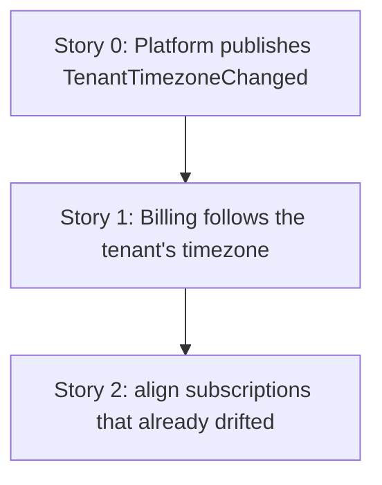

# TD61 — BILLING-TIMEZONE-FOLLOWS-TENANT

## Status

- **Type**: Technical Debt / Cross-context consistency
- **Priority**: Medium (the gap only bites a tenant that changes its timezone after signing up; the effect is a date boundary off by the offset between the two zones, up to several hours, on Billing-derived dates)
- **Context**: Platform (event), Billing (consumer, aggregate, self-heal), infra (Pub/Sub topic and subscription)
- **Created**: 2026-11-26
- **Discovered**: M26-S18b PR #847 review: CodeRabbit's finding on `apps/backend/src/contexts/booking/application/use-cases/update-availability-alert.use-case.ts` (the `bookableUntil` cap date is derived in the subscription's timezone, the alert check reads the tenant's). Declined in that PR with a documented limitation in `docs/BUSINESS_LOGIC_REFERENCE.md` § The billing `bookableUntil` cap.
- **Decision status**: Ready for discovery in the dependency order below; each story still begins with `/story-discovery`. Story 1 carries one open business decision (the re-anchoring policy) that discovery must settle with the user before any code.
- **Related**: `docs/TENANTS_SETTINGS_SCHEMA.md` (`businessHours.timezone`); `docs/BUSINESS_LOGIC_REFERENCE.md` § The billing `bookableUntil` cap; `infra/terraform/README.md` § New-resource PR-sequencing playbook; M26-S18b (PR #847), M26-S05, M26-S06, M26-S09 (the Billing dates this timezone drives)

## Problem

`Subscription.timezone` is copied once, from the `TenantProvisioned` event, when Billing creates the trial subscription (`apps/backend/src/contexts/billing/application/use-cases/create-trial-subscription.use-case.ts`, `tenant-provisioned-billing.handler.ts:38`), and is a `readonly` field of the aggregate (`subscription.aggregate.ts:76`): nothing can change it. The tenant's own timezone, `tenants.settings.businessHours.timezone`, is editable: `packages/validation/src/tenant-settings.ts:45` validates a new IANA value and the dashboard's settings form carries it (`apps/web/features/platform/settings-form.ts:75`). Platform publishes no event when it changes: the `Tenant` aggregate raises only `TenantProvisioned` (`apps/backend/src/contexts/platform/domain/events/`), and `Tenant.updateSettings()` replaces the settings silently.

Billing derives every local date from the subscription's copy: period anchors and `nextDueDate`, the trial end, charge periods and due dates, reminder days, the status sweep's margins, the recovery factory, the plan preview's `effectiveFrom`, and, since M26-S18b, the `bookableUntil` cap date. Booking, Platform, the BFF and the web all read the tenant's **current** timezone. After a timezone change the two sides disagree about where a local day starts, by the offset difference (up to several hours). A manager sees "1 de dezembro" on the Plano tab while the tenant's own calendar flips the day at another instant, and the cap boundary Booking enforces can fall on a different instant than the one Billing meant.

### Why this matters

Money dates and entitlement boundaries must mean the same instant on both sides of a context boundary. Today they do until a tenant moves timezone, and then nothing detects it: no event, no log, no reconcile. The cap was the first place a second context compared a Billing date with its own calendar, which is how it surfaced; every Billing date has the same exposure.

## Chosen approach (decided in this session, 2026-11-26)

Make the subscription's timezone **follow the tenant's**, with the tenant as the single owner of the value:

1. Platform publishes `TenantTimezoneChanged` (`{ previousTimezone, timezone }`) when, and only when, `businessHours.timezone` actually changes (raised by the aggregate, drained through the outbox like `TenantProvisioned`).
2. Billing consumes it and changes the subscription's timezone through one aggregate method, under B-R1, idempotent by `eventId`.
3. A repair step in the existing self-heal job aligns subscriptions that already drifted (tenants that changed timezone before the consumer existed, and any missed event).

Rejected: deriving the cap (and every Billing date) in the tenant's timezone at read time (Billing would read the tenant on every money-date computation and the date the manager sees would differ from the invoice's own date); a Billing-side cache of the tenant timezone (a second copy that can drift the same way); making the cap an instant (changes the `YYYY-MM-DD` contract S18a/S18b/S19 share and still leaves every other Billing date in the old zone).

**Open decision for Story 1's discovery (not decided here):** what a timezone change does to dates and charges already computed in the old zone. Candidates: (a) **apply from the next period**: existing `nextDueDate`, open charges, the trial end and scheduled items keep their instants; only dates computed after the change use the new zone (simplest, no open invoice is touched, a small seam remains until the next period); (b) **re-anchor**: recompute `anchorDay`, `nextDueDate` and the local-day boundaries of scheduled item instants in the new zone (exact, but it rewrites instants a customer may already have been invoiced for). The default recommendation for discovery is (a); the decision is the user's.

## Stories

### Story 0 — Platform publishes `TenantTimezoneChanged` 🟡

**Agent:** backend-ts + devops
**Complexity:** M
**Docs to load:** `docs/DOMAIN_EVENTS.md` § Event Publishing & Consumption (the `TenantProvisioned` entry), `docs/ENGINEERING_RULES_BACKEND.md` § Event Handlers, `docs/ANTI_PATTERNS.md` § A domain event is drained, `docs/TENANTS_SETTINGS_SCHEMA.md` § Settings by Category (`businessHours.timezone`), `infra/terraform/README.md` § New-resource PR-sequencing playbook, `docs/ENGINEERING_RULES_SHARED.md` § architecture-check detectors
**Dependencies:** none
**Pattern:** domain event raised by the aggregate and drained by the outbox (the `Tenant.provision()` / `TenantProvisioned` precedent), published only when the value changed; plain composition otherwise.

**Description:**
`Tenant.updateSettings(settings)` compares the incoming `businessHours.timezone` with the current one and, when they differ, records a `TenantTimezoneChanged` event (`tenantId`, `eventId`, `occurredAt`, `correlationId`, `data: { previousTimezone, timezone }`) that `ITenantRepository.save()` drains into the outbox in the same transaction (the existing `UpdateTenantSettingsUseCase` already saves through the aggregate, so it needs no new publish call). A settings update that does not touch the timezone raises nothing. The event is added to `PlatformAuditLogHandler` (`subscribe(TenantTimezoneChanged.name, …, LogDomainEventUseCase.CONSUMER_NAME)`), which is also what gives it a topic; `docs/DOMAIN_EVENTS.md` gets the entry and its consumer list (Billing, Story 1). The topic and its audit subscription are provisioned by the playbook's "new Pub/Sub topic" row.

**Backend use case steps:**
1. `Tenant.updateSettings()`: read the previous `businessHours.timezone`, replace the settings, `addDomainEvent(new TenantTimezoneChanged(...))` only on a change.
2. `UpdateTenantSettingsUseCase` is unchanged in behavior (the save drains the event); its spec gains the changed / unchanged cases.

**Backend HTTP surface:** none new — the existing tenant settings update route is the trigger.
**New migration / i18n keys / env vars / feature flags:** none. The `pubsub-catalog.json` is regenerated (`pnpm --filter @ikaro/infra-scripts run pubsub-catalog`).

**Files to create/modify:**
- `apps/backend/src/contexts/platform/domain/events/tenant-timezone-changed.event.ts` (+ `.spec.ts`) (new)
- `apps/backend/src/contexts/platform/domain/tenant.aggregate.ts` (+ spec) (modify)
- `apps/backend/src/contexts/platform/application/use-cases/update-tenant-settings.use-case.ts` and its `.spec.ts` (modify: spec only unless a gap appears)
- `apps/backend/src/contexts/platform/infrastructure/events/platform-audit-log.handler.ts` (+ spec) (modify)
- `apps/backend/src/test/builders/platform/tenant-timezone-changed-event.builder.ts`, registered in `apps/backend/src/test/builders/platform/index.ts` (new / modify)
- `apps/backend/src/contexts/platform/infrastructure/controllers/` the settings controller's integration spec (modify: an outbox row appears only when the timezone changes)
- `docs/DOMAIN_EVENTS.md` (modify — the event entry, the consumer list)
- `infra/terraform/pubsub-catalog.json` (regenerated)

**Acceptance criteria — product:**
- [ ] A manager changing the business timezone produces exactly one `TenantTimezoneChanged` carrying the previous and the new value; saving settings without touching the timezone, or with the same value, produces none.

**Acceptance criteria — technical:**
- Unit:
  - [ ] `Tenant.updateSettings`: a changed timezone records one event with both values; an unchanged one records none; an inactive tenant still throws and records none
  - [ ] `PlatformAuditLogHandler` subscribes the new event name (the `domain-event-audit-coverage` detector stays green)
- Integration:
  - [ ] `PATCH` of the tenant settings with a new timezone writes one `TenantTimezoneChanged` outbox row in the same transaction as the settings change; with the same timezone writes none
- Tenant isolation:
  - [ ] a timezone change of tenant A writes an event carrying tenant A's id only and never touches tenant B's settings or outbox
- E2E: none — covered by integration
- [ ] Coverage ≥80% on changed code
- [ ] `tsc --noEmit` clean, lint clean, `pnpm architecture-check` clean
- [ ] Checkov / Tfsec clean

**IAM / permissions:** the topic's publisher and subscriber/DLQ grants are derived from `pubsub-catalog.json` by Foundation; no hand-written binding (the topic is created in this story's PR, the grants resolve at the Foundation apply that follows).
**Live-verification check:** after the Foundation apply, in both projects, `gcloud pubsub topics get-iam-policy <topic>` shows the publisher binding for the backend's service account, and `gcloud pubsub subscriptions describe <audit subscription>` exists; then a settings change in staging that alters the timezone produces one message on the topic (`gcloud pubsub subscriptions pull` against a temporary subscription, or the audit log row).
**PR sequence:** 1 PR + 1 Foundation apply, the playbook's "A new Pub/Sub topic" row.
- PR1: the event, the aggregate change, the audit-log line, the regenerated `pubsub-catalog.json` and the builder (`--label infra-app-mix-ok`, with the playbook's PR-body note)
- After merge: **apply Foundation**: dispatch `foundation-deploy.yml` with `apply=true` from `main`, review the two plans, approve the `staging-foundation` and `production-foundation` Environments, then run the live-verification check above in both projects (a merged Foundation PR applies nothing; no CI fails if this step is skipped)

### Story 1 — Billing follows the tenant's timezone 🟡

**Agent:** backend-ts + devops
**Complexity:** L
**Docs to load:** `docs/DOMAIN_MODEL.md` § Aggregate: Subscription, `docs/BUSINESS_LOGIC_REFERENCE.md` § The billing `bookableUntil` cap and the Billing sections that derive dates from the timezone (period anchors, trial end, charge periods, status sweep), `docs/LOCK_CATALOG.md` § Billing locks (B-R1), `docs/ENGINEERING_RULES_BACKEND.md` § Event Handlers and § Transactions, `infra/terraform/README.md` § New-resource PR-sequencing playbook
**Dependencies:** TD61 Story 0
**Pattern:** command use case under B-R1 with an inbox-idempotent event handler (the `CreateTrialSubscriptionUseCase` / `TenantProvisionedBillingHandler` precedent); the aggregate owns the change through one method.

**Description:**
A new `TenantTimezoneChangedBillingHandler` (a class name unique across the codebase: the Pub/Sub generator keys by bare class name) calls `ChangeSubscriptionTimezoneUseCase`, which loads the subscription with `findByTenantIdForUpdate` (B-R1), calls `Subscription.changeTimezone(newTimezone, now)` and saves in the same transaction; `CachingSubscriptionRepository.save()` evicts the cached access answer after commit, so the cap's date follows at once. The consumer name lives on the use case and is its inbox key. A tenant with no subscription yet (the event raced provisioning) is a no-op that the self-heal job repairs. **`changeTimezone` implements the policy decided at this story's discovery** (see Chosen approach: apply-from-next-period or re-anchor); until it is decided nothing is implemented. The story removes the "known limitation" note S18b added to `docs/BUSINESS_LOGIC_REFERENCE.md`. A new consumer on an existing topic is a new subscription: the playbook's post-merge Foundation apply applies (IAM check on the new subscription and its `-dlq` topic).

**Backend use case steps:**
1. Handler: `subscribe(TenantTimezoneChanged.name, …, ChangeSubscriptionTimezoneUseCase.CONSUMER_NAME, { skipWhenSuspended: false })`, passes `event.correlationId`, rethrows after logging.
2. `ChangeSubscriptionTimezoneUseCase`: no-op when the new value equals the stored one or the subscription does not exist; otherwise B-R1 → `changeTimezone` → save (version-checked, outbox drained) → commit.
3. `Subscription.changeTimezone`: validates the IANA value through the `Timezone` value object and applies the decided policy.

**Backend HTTP surface:** none — event driven.
**New migration / i18n keys / env vars / feature flags:** none expected; if the decided policy stores anything new (for example a "timezone effective from" instant), discovery adds the expand-only migration, the `integration-global-setup.ts` registration and the `docs/DATABASE_SCHEMA.md` row to this story.

**Files to create/modify:**
- `apps/backend/src/contexts/billing/infrastructure/events/tenant-timezone-changed-billing.handler.ts` (+ spec) (new)
- `apps/backend/src/contexts/billing/application/use-cases/change-subscription-timezone.use-case.ts` (+ spec, `.integration.spec.ts`) (new)
- `apps/backend/src/contexts/billing/domain/subscription.aggregate.ts` (+ spec) (modify — `changeTimezone`; `timezone` stops being `readonly`)
- `apps/backend/src/contexts/billing/billing.module.ts` (modify — provide the handler and the use case)
- `apps/backend/src/test/repositories/billing/in-memory-subscription.repository.ts` (modify only if the double needs the new state)
- `docs/DOMAIN_MODEL.md`, `docs/BUSINESS_LOGIC_REFERENCE.md`, `docs/DOMAIN_EVENTS.md`, `docs/LOCK_CATALOG.md` (modify — B-R1 sequence row for the new use case) (modify)
- `infra/terraform/pubsub-catalog.json` (regenerated)

**Acceptance criteria — product:**
- [ ] After a tenant changes its timezone, the subscription follows within the event delivery time; every Billing date computed afterwards, the `bookableUntil` cap included, uses the new zone.
- [ ] Dates and charges computed before the change behave as the policy decided at discovery says (stated here once decided; an open invoice is never silently rewritten).

**Acceptance criteria — technical:**
- Unit:
  - [ ] `Subscription.changeTimezone`: the decided policy over each affected field (anchor, `nextDueDate`, trial end, scheduled items), an unchanged value is a no-op, an invalid IANA value throws the typed error
  - [ ] `ChangeSubscriptionTimezoneUseCase`: no subscription is a no-op; the same value is a no-op; a change saves once under B-R1
  - [ ] the handler passes `event.correlationId`, rethrows on failure, and is idempotent for a redelivered `eventId`
- Integration:
  - [ ] the event moves the stored timezone and bumps the version; the cached access answer is evicted so `bookableUntil` follows; a redelivery changes nothing
  - [ ] a change racing a payment confirmation or a sweep on the same subscription serialises on B-R1 (named test, mutation-checked per `docs/LOCK_CATALOG.md` § 7)
- Tenant isolation:
  - [ ] tenant A's timezone event never changes tenant B's subscription
- E2E: none — covered by integration
- [ ] Coverage ≥80% on changed code
- [ ] `tsc --noEmit` clean, lint clean, `pnpm architecture-check` clean
- [ ] Checkov / Tfsec clean

**IAM / permissions:** the new subscription and its DLQ grants are derived from `pubsub-catalog.json` by Foundation; no hand-written binding.
**Live-verification check:** after the Foundation apply, `gcloud pubsub subscriptions describe` for the new subscription and its `-dlq` topic in both projects; then in staging change a tenant's timezone and confirm the subscription's `timezone` column followed (`SELECT timezone FROM billing.subscriptions WHERE tenant_id = …`).
**PR sequence:** 1 PR + 1 Foundation apply (a new consumer on an existing topic, the playbook's "new subscription" step).
- PR1: handler, use case, aggregate method, docs and the regenerated catalog (`--label infra-app-mix-ok`)
- After merge: apply Foundation and run the live-verification check

### Story 2 — Align subscriptions that already drifted 🟡

**Agent:** backend-ts
**Complexity:** M
**Docs to load:** `docs/BUSINESS_LOGIC_REFERENCE.md` § Billing — Self-heal: repair, provider health and the suspension freeze (M26-S08), `docs/ENGINEERING_RULES_BACKEND.md` § Adding a cron-published event, `docs/LOCK_CATALOG.md` § Billing locks
**Dependencies:** TD61 Story 1
**Pattern:** extend the existing self-heal job's repair step (`SelfHealJob`, `repair-missing-subscriptions.helpers.ts`) instead of adding a new job: it already pages Platform's tenants by keyset and diffs them against Billing's subscriptions.

**Description:**
Tenants that changed their timezone before Story 0 shipped, and any event Story 1's consumer missed, leave a subscription whose timezone differs from its tenant's. The self-heal repair compares `BillingTenantInfo.timezone` (already read through `IBillingPlatformPort.getTenantInfo`) with each existing subscription's and, on a difference, runs the same `ChangeSubscriptionTimezoneUseCase` Story 1 built (one idempotent transaction per subscription, B-R1), with a per-tenant error isolated so one failure never aborts the page. It logs each repair with `tenant_id` and the two zones. No new job, topic or trigger.

**Backend use case steps:**
1. In the repair step, for each tenant page, find subscriptions whose timezone differs from the tenant's (a batched read through the existing Billing port, never a per-tenant query inside a loop).
2. For each, call `ChangeSubscriptionTimezoneUseCase` (the policy of Story 1 applies unchanged); isolate and log a failure per tenant.

**Backend HTTP surface:** none.
**New migration / i18n keys / env vars / feature flags:** none.

**Files to create/modify:**
- `apps/backend/src/contexts/billing/application/jobs/self-heal.job.ts` and `repair-missing-subscriptions.helpers.ts` (+ specs, `self-heal.job.integration.spec.ts`) (modify)
- `apps/backend/src/contexts/billing/application/ports/subscription-repository.port.ts` and its implementations (modify only if the batched drift read needs a new selector)
- `docs/BUSINESS_LOGIC_REFERENCE.md` (modify — the self-heal repair section)

**Acceptance criteria — product:**
- [ ] A subscription whose timezone differs from its tenant's is aligned by the next self-heal run, with no manual step and no effect on a subscription that already agrees.

**Acceptance criteria — technical:**
- Unit:
  - [ ] the drift selection returns only subscriptions whose zone differs; an agreeing one is untouched
  - [ ] a failure on one tenant is logged and does not abort the page (isolated per tenant)
- Integration:
  - [ ] a drifted subscription is aligned by one self-heal run; a second run changes nothing (idempotent)
  - [ ] the repair of an existing subscription takes B-R1 and does not race a payment confirmation
- Tenant isolation:
  - [ ] a drifted tenant A never changes tenant B's subscription
- E2E: none — covered by integration
- [ ] Coverage ≥80% on changed code
- [ ] `tsc --noEmit` clean, lint clean, `pnpm architecture-check` clean

## Sequencing

