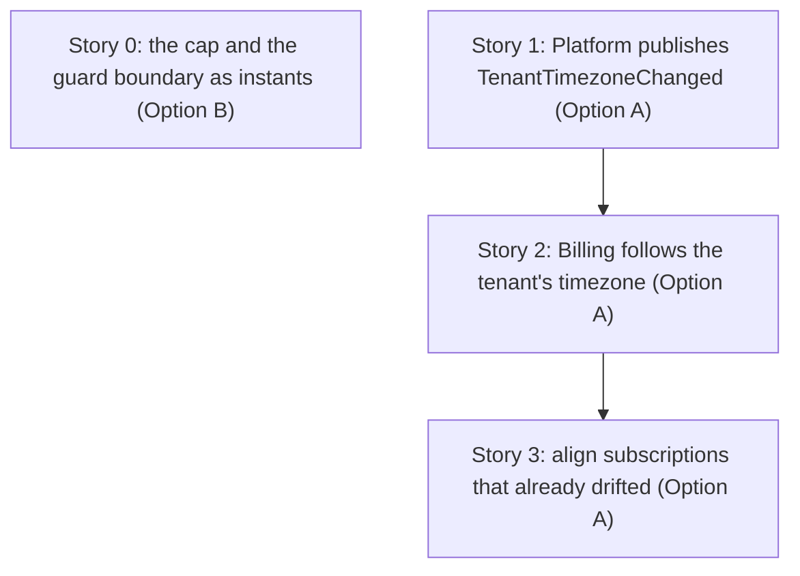

# TD61 — BILLING-TIMEZONE-FOLLOWS-TENANT

## Status

- **Type**: Technical Debt / Cross-context consistency
- **Priority**: Medium (the gap only bites a tenant that changes its timezone after signing up; the effect is a date boundary off by the offset between the two zones, up to several hours, on the one Billing date another context compares today: the BOOKING `bookableUntil` cap)
- **Context**: Billing (cap derivation, removal guard contract), Booking (the cap's consumers), Platform and infra only if Option A is chosen
- **Created**: 2026-11-26 (rewritten the same day: the first draft missed decision 47, see Problem)
- **Discovered**: M26-S18b PR #847 review: CodeRabbit's finding on `apps/backend/src/contexts/booking/application/use-cases/update-availability-alert.use-case.ts` (the `bookableUntil` cap date is derived in the subscription's timezone, the alert check reads the tenant's). Declined in that PR with a documented limitation in `docs/BUSINESS_LOGIC_REFERENCE.md` § The billing `bookableUntil` cap.
- **Decision status**: **Direction not decided.** Story 0's discovery chooses between Option B (the cap travels as an instant, honouring decision 47) and Option A (Billing's timezone follows the tenant, reversing decision 47); Option B is recommended and, because M26-S19 builds on the cap's date contract, ideally lands **before M26-S19 starts**. Stories 1 to 3 exist only if Option A is chosen. Each story still begins with `/story-discovery`.
- **Related**: `docs/discovery/tenant-billing/tenant-billing.md` decision 47 and decision 119; `docs/DOMAIN_MODEL.md` § Aggregate: Subscription (`timezone`: "snapshot of the tenant timezone, IMMUTABLE"); `docs/TENANTS_SETTINGS_SCHEMA.md` (`businessHours.timezone`); `docs/BUSINESS_LOGIC_REFERENCE.md` § The billing `bookableUntil` cap; `infra/terraform/README.md` § New-resource PR-sequencing playbook (Option A only); M26-S18a, M26-S18b (PR #847), M26-S19

## Problem

`Subscription.timezone` is copied once, from the `TenantProvisioned` event, when Billing creates the trial subscription (`create-trial-subscription.use-case.ts`, `tenant-provisioned-billing.handler.ts:38`) and is a `readonly` field of the aggregate (`subscription.aggregate.ts:76`). **This is a documented decision, not an oversight:** decision 47 of the tenant-billing discovery says "`billing.subscriptions.timezone` is copied from `TenantProvisioned` at creation and is immutable; period boundaries are local midnight in it; Billing never reads Platform settings", and `docs/DOMAIN_MODEL.md` § Aggregate: Subscription repeats it ("snapshot of the tenant timezone, IMMUTABLE; every period boundary is local midnight in it"). Billing keeps its own calendar on purpose.

The tenant's own timezone, `tenants.settings.businessHours.timezone`, is editable: `packages/validation/src/tenant-settings.ts:45` validates a new IANA value and the dashboard's settings form carries it. Platform publishes no event when it changes (the `Tenant` aggregate raises only `TenantProvisioned`), and `Tenant.updateSettings()` replaces the settings silently.

Until M26-S18b every Billing date stayed inside Billing, so the two calendars never met. The `bookableUntil` cap is the **first Billing date another context compares in its own calendar**: Billing derives a `YYYY-MM-DD` in the subscription's zone, Booking turns it into a boundary at the local midnight of the tenant's **current** zone. After a timezone change the boundary can sit up to the offset difference away from the instant Billing meant, and a commitment ending in that gap could later block the removal. S18a's removal guard has the same shape (it takes an effective date and converts it with the tenant's timezone).

### Why this matters

An entitlement boundary must mean the same instant on both sides of a context boundary. Today it does until a tenant moves timezone, and then nothing detects it.

## Options (discovery decides; do not implement before it does)

**Option B (recommended): the boundary crosses the context boundary as an instant.** Billing's own item end (`SubscriptionItem.endsAt`, which is local midnight in Billing's zone) is already an instant. The cap and the removal guard carry that instant, Booking compares instants and never converts a Billing date with its own zone, and decision 47 stays true. What the manager reads on the Plano tab stays a date in Billing's calendar, as decision 47 accepted. It needs no event, consumer, migration or infra rollout. Cost: the `bookableUntil` contract (a date today) and S18a's guard input change, so it is far cheaper **before** M26-S19 builds on them.

**Option A: Billing's timezone follows the tenant** (reverses decision 47). Platform publishes `TenantTimezoneChanged`, Billing consumes it and changes the subscription's timezone through one aggregate method, and a repair aligns subscriptions that already drifted. It also fixes every other Billing date, but it needs a policy for dates and charges already computed in the old zone (apply from the next period versus re-anchor: open invoices, `nextDueDate`, the trial end, scheduled item instants), a new Pub/Sub topic and subscription (the playbook's multi-step Foundation rollout), and it overturns a documented decision for a problem that only the cap exposes.

**Rejected:** deriving every Billing date in the tenant's zone at read time (Billing would read Platform settings on every money-date computation, against decision 47, and the manager's date would differ from the invoice's own); a Billing-side cache of the tenant timezone (a second copy that drifts the same way).

## Stories

### Story 0 — The cap and the removal guard boundary travel as instants (Option B) 🟡

**Agent:** backend-ts
**Complexity:** M
**Docs to load:** `docs/BUSINESS_LOGIC_REFERENCE.md` § The billing `bookableUntil` cap and § Booking — Booking Window, `docs/DOMAIN_MODEL.md` § Entry point: `TenantAccessPort` and § Aggregate: Subscription, `docs/USE_CASES.md` UC-136 A11, `docs/LOCK_CATALOG.md` § Billing locks (B-U1), `docs/discovery/tenant-billing/tenant-billing.md` decisions 47 and 119, `docs/ENGINEERING_RULES_SHARED.md` § Re-check a same-file documented invariant
**Dependencies:** none (ideally lands before M26-S19)
**Pattern:** plain composition: the same value object boundary (`Instant`) replaces the `YYYY-MM-DD` at the one contract that crosses Billing to Booking; no new abstraction.

**Description:**
`Subscription.bookableUntil(now)` returns the **instant** the BOOKING entitlement ends (the end of the latest covering item, or the trial end), as an ISO-8601 UTC string, instead of a date derived in the subscription's zone. `TenantAccess.bookableUntil` and `TenantAccessPort.getBookableUntil` carry that instant. Booking's pure rule compares an end instant with it directly (`end > bookableUntil` is refused; an end equal to it is accepted, the same rule as today); the display clamps derive the whole tenant-local days from today to that instant in the tenant's current zone (`daysUntilBookableUntil`); the recurring rule refuses a schedule when the end of its `endsOn` local day, or the end of its last occurrence, is after the instant. S18a's `GetBookingFeatureRemovalImpactUseCase` takes the boundary **instant** (the plan save passes the removal item's `endsAt`) instead of an effective date; its result and the `BILLING_FEATURE_IN_USE` params keep `effectiveFrom` as a date for the manager's display, derived in Billing's zone. The schedule blocker query compares the end of the `endsOn` local day with the instant. The documented limitation note in `docs/BUSINESS_LOGIC_REFERENCE.md` and the `TENANTS_SETTINGS_SCHEMA.md` timezone note are removed, and UC-136 A11, `docs/DOMAIN_MODEL.md` § Entry point and the M26-S19 plan text are updated to the instant contract.

**Backend use case steps:**
1. `Subscription.bookableUntil(now)`: return `entitlementEndsAt('BOOKING', now)` as an ISO instant (no zone conversion).
2. `assertEndsWithinBookableUntil`, `assertTermWithinBookableUntil`, `daysUntilBookableUntil`, `clampAdvanceDaysToBookableUntil`: take the instant; the term rule uses the end of the `endsOn` local day in the tenant's zone.
3. `GetBookingFeatureRemovalImpactUseCase(tenantId, boundary: Date)` and its read model: schedules block when the end of the `endsOn` local day is after the boundary; bookings block when `scheduled_end_at` is after it.

**Backend HTTP surface:** none (internal ports only; no response carries the cap).
**New migration / i18n keys / env vars / feature flags:** none.

**Files to create/modify:**
- `apps/backend/src/contexts/billing/domain/subscription.aggregate.ts` (+ `.booking-cap.spec.ts`) (modify)
- `apps/backend/src/shared/ports/tenant-access.port.ts`, `apps/backend/src/contexts/billing/application/use-cases/get-tenant-access.use-case.ts`, `get-bookable-until.use-case.ts` (+ specs) (modify)
- `apps/backend/src/contexts/booking/application/use-cases/bookable-until.helpers.ts`, `apps/backend/src/shared/utils/bookable-until-days.ts` (+ specs) (modify)
- `apps/backend/src/contexts/booking/application/use-cases/get-booking-feature-removal-impact.use-case.ts`, `apps/backend/src/contexts/booking/application/ports/feature-removal-blockers-repository.port.ts`, `apps/backend/src/contexts/booking/infrastructure/repositories/typeorm-feature-removal-blockers.repository.ts`, `apps/backend/src/contexts/billing/application/ports/billing-booking.port.ts` and its adapter (+ specs, integration specs) (modify)
- every cap consumer's spec that builds a `bookableUntil` date (the booking, reschedule, recurring, alert, manifest, service and reschedule-options specs) (modify)
- `docs/BUSINESS_LOGIC_REFERENCE.md`, `docs/DOMAIN_MODEL.md`, `docs/USE_CASES.md`, `docs/TENANTS_SETTINGS_SCHEMA.md`, `docs/LOCK_CATALOG.md` (modify), `plan/M26-TENANT-BILLING-COLLECTION-LAUNCH.md` S19 text (modify)

**Acceptance criteria — product:**
- [ ] After a tenant edits its timezone, the cap's boundary is still the instant Billing's removal takes effect, and no commitment the cap accepted can block the removal.
- [ ] The date the manager reads for a pending removal is unchanged (Billing's calendar).

**Acceptance criteria — technical:**
- Unit:
  - [ ] the pure rule over instants: an end equal to the boundary is accepted, a millisecond later is refused, whatever the tenant's zone (table over São Paulo, Tokyo and UTC)
  - [ ] the display clamp counts whole tenant-local days from today to the instant, and is 0 once the instant is past
  - [ ] the recurring term and the removal guard agree on the boundary for a tenant whose zone differs from Billing's (a named case that fails on the date contract)
- Integration:
  - [ ] a tenant whose timezone was edited after provisioning: a booking ending after Billing's instant is refused and one ending before it is accepted; the removal guard counts the same set
- Tenant isolation:
  - [ ] one tenant's pending removal never caps another
- E2E: none — covered by integration
- [ ] Coverage ≥80% on changed code
- [ ] `tsc --noEmit` clean, lint clean, `pnpm architecture-check` clean

### Story 1 — Platform publishes `TenantTimezoneChanged` (Option A only) 🟡

**Agent:** backend-ts + devops
**Complexity:** M
**Docs to load:** `docs/DOMAIN_EVENTS.md` § Event Publishing & Consumption (the `TenantProvisioned` entry), `docs/ENGINEERING_RULES_BACKEND.md` § Event Handlers, `docs/ANTI_PATTERNS.md` § A domain event is drained, `docs/TENANTS_SETTINGS_SCHEMA.md` § Settings by Category (`businessHours.timezone`), `infra/terraform/README.md` § New-resource PR-sequencing playbook
**Dependencies:** Story 0's discovery concludes Option A
**Pattern:** domain event raised by the aggregate and drained by the outbox (the `Tenant.provision()` / `TenantProvisioned` precedent), published only when the value changed.

**Description:**
`Tenant.updateSettings(settings)` compares the incoming `businessHours.timezone` with the current one and, when they differ, records a `TenantTimezoneChanged` event (`tenantId`, `eventId`, `occurredAt`, `correlationId`, `data: { previousTimezone, timezone }`) that `ITenantRepository.save()` drains into the outbox in the same transaction. A settings update that does not touch the timezone raises nothing. The event is added to `PlatformAuditLogHandler` (which also gives it a topic); `docs/DOMAIN_EVENTS.md` gets the entry. The topic and its audit subscription are provisioned by the playbook's "new Pub/Sub topic" row.

**Backend HTTP surface:** none new — the existing tenant settings update route is the trigger.
**New migration / i18n keys / env vars / feature flags:** none (`pubsub-catalog.json` regenerated).

**Files to create/modify:**
- `apps/backend/src/contexts/platform/domain/events/tenant-timezone-changed.event.ts` (+ spec) (new)
- `apps/backend/src/contexts/platform/domain/tenant.aggregate.ts` (+ spec) (modify)
- `apps/backend/src/contexts/platform/infrastructure/events/platform-audit-log.handler.ts` (+ spec) (modify)
- `apps/backend/src/test/builders/platform/tenant-timezone-changed-event.builder.ts`, registered in `index.ts` (new / modify)
- the settings controller's integration spec (modify)
- `docs/DOMAIN_EVENTS.md` (modify); `infra/terraform/pubsub-catalog.json` (regenerated)

**Acceptance criteria — product:**
- [ ] A manager changing the business timezone produces exactly one `TenantTimezoneChanged` carrying both values; saving without touching the timezone, or with the same value, produces none.

**Acceptance criteria — technical:**
- Unit:
  - [ ] `Tenant.updateSettings`: a changed timezone records one event with both values; an unchanged one none; an inactive tenant still throws and records none
  - [ ] `PlatformAuditLogHandler` subscribes the new event name (`domain-event-audit-coverage` stays green)
- Integration:
  - [ ] a settings `PATCH` with a new timezone writes one outbox row in the same transaction; with the same timezone none
- Tenant isolation:
  - [ ] a change for tenant A carries tenant A's id only and never touches tenant B
- E2E: none — covered by integration
- [ ] Coverage ≥80% on changed code
- [ ] `tsc --noEmit` clean, lint clean, `pnpm architecture-check` clean
- [ ] Checkov / Tfsec clean

**IAM / permissions:** the topic's publisher and subscriber/DLQ grants are derived from `pubsub-catalog.json` by Foundation; no hand-written binding.
**Live-verification check:** after the Foundation apply, in both projects, `gcloud pubsub topics get-iam-policy <topic>` shows the publisher binding for the backend's service account and the audit subscription exists; then a staging settings change that alters the timezone puts one message on the topic.
**PR sequence:** 1 PR + 1 Foundation apply, the playbook's "A new Pub/Sub topic" row.
- PR1: the event, the aggregate change, the audit-log line, the regenerated `pubsub-catalog.json` and the builder (`--label infra-app-mix-ok`, with the playbook's PR-body note)
- After merge: **apply Foundation** (`foundation-deploy.yml` with `apply=true` from `main`, review the two plans, approve both Environments), then run the live-verification check in both projects

### Story 2 — Billing follows the tenant's timezone (Option A only) 🟡

**Agent:** backend-ts + devops
**Complexity:** L
**Docs to load:** `docs/DOMAIN_MODEL.md` § Aggregate: Subscription (the `IMMUTABLE` line this story reverses), `docs/discovery/tenant-billing/tenant-billing.md` decision 47, `docs/BUSINESS_LOGIC_REFERENCE.md` (the Billing sections that derive dates from the timezone: period anchors, trial end, charge periods, status sweep), `docs/LOCK_CATALOG.md` § Billing locks (B-R1), `docs/ENGINEERING_RULES_BACKEND.md` § Event Handlers and § Transactions, `infra/terraform/README.md` § New-resource PR-sequencing playbook
**Dependencies:** TD61 Story 1
**Pattern:** command use case under B-R1 with an inbox-idempotent event handler (the `CreateTrialSubscriptionUseCase` / `TenantProvisionedBillingHandler` precedent); the aggregate owns the change through one method.

**Description:**
A new `TenantTimezoneChangedBillingHandler` (a class name unique across the codebase) calls `ChangeSubscriptionTimezoneUseCase`: `findByTenantIdForUpdate` (B-R1) → `Subscription.changeTimezone(newTimezone, now)` → save in the same transaction; the caching repository evicts after commit. A tenant with no subscription yet is a no-op that self-heal repairs. **`changeTimezone` implements the policy decided at this story's discovery** (apply from the next period, or re-anchor `anchorDay`, `nextDueDate` and scheduled instants; an open invoice is never silently rewritten). This story reverses decision 47: it rewrites the `IMMUTABLE` line in `docs/DOMAIN_MODEL.md` and records why. A new consumer on an existing topic is a new subscription: the playbook's post-merge Foundation apply applies.

**Backend use case steps:**
1. Handler: `subscribe(TenantTimezoneChanged.name, …, ChangeSubscriptionTimezoneUseCase.CONSUMER_NAME, { skipWhenSuspended: false })`, passes `event.correlationId`, rethrows after logging.
2. `ChangeSubscriptionTimezoneUseCase`: no-op when the value is unchanged or the subscription is absent; otherwise B-R1 → `changeTimezone` → save → commit.
3. `Subscription.changeTimezone`: validates through the `Timezone` value object and applies the decided policy.

**Backend HTTP surface:** none — event driven.
**New migration / i18n keys / env vars / feature flags:** none expected; if the decided policy stores new state, discovery adds the expand-only migration, the `integration-global-setup.ts` registration and the `docs/DATABASE_SCHEMA.md` row.

**Files to create/modify:**
- `apps/backend/src/contexts/billing/infrastructure/events/tenant-timezone-changed-billing.handler.ts` (+ spec) (new)
- `apps/backend/src/contexts/billing/application/use-cases/change-subscription-timezone.use-case.ts` (+ spec, `.integration.spec.ts`) (new)
- `apps/backend/src/contexts/billing/domain/subscription.aggregate.ts` (+ spec) (modify — `timezone` stops being `readonly`)
- `apps/backend/src/contexts/billing/billing.module.ts` (modify)
- `docs/DOMAIN_MODEL.md`, `docs/BUSINESS_LOGIC_REFERENCE.md`, `docs/DOMAIN_EVENTS.md`, `docs/LOCK_CATALOG.md`, `docs/discovery/tenant-billing/tenant-billing.md` (an amendment to decision 47) (modify)
- `infra/terraform/pubsub-catalog.json` (regenerated)

**Acceptance criteria — product:**
- [ ] After a tenant changes its timezone the subscription follows within the event delivery time; every Billing date computed afterwards uses the new zone; dates and charges computed before behave as the policy decided at discovery says.

**Acceptance criteria — technical:**
- Unit:
  - [ ] `Subscription.changeTimezone`: the decided policy per affected field; an unchanged value is a no-op; an invalid IANA value throws the typed error
  - [ ] the use case: no subscription and an unchanged value are no-ops; a change saves once under B-R1
  - [ ] the handler passes `event.correlationId`, rethrows on failure, and is idempotent for a redelivered `eventId`
- Integration:
  - [ ] the event moves the stored timezone and bumps the version; the cached access answer is evicted; a redelivery changes nothing
  - [ ] a change racing a payment confirmation or a sweep on the same subscription serialises on B-R1 (named test, mutation-checked per `docs/LOCK_CATALOG.md` § 7)
- Tenant isolation:
  - [ ] tenant A's event never changes tenant B's subscription
- E2E: none — covered by integration
- [ ] Coverage ≥80% on changed code
- [ ] `tsc --noEmit` clean, lint clean, `pnpm architecture-check` clean
- [ ] Checkov / Tfsec clean

**IAM / permissions:** the new subscription and its DLQ grants are derived from `pubsub-catalog.json` by Foundation; no hand-written binding.
**Live-verification check:** after the Foundation apply, `gcloud pubsub subscriptions describe` for the new subscription and its `-dlq` topic in both projects; then in staging change a tenant's timezone and confirm `SELECT timezone FROM billing.subscriptions WHERE tenant_id = …` followed.
**PR sequence:** 1 PR + 1 Foundation apply (a new consumer on an existing topic).
- PR1: handler, use case, aggregate method, docs and the regenerated catalog (`--label infra-app-mix-ok`)
- After merge: apply Foundation and run the live-verification check

### Story 3 — Align subscriptions that already drifted (Option A only) 🟡

**Agent:** backend-ts
**Complexity:** M
**Docs to load:** `docs/BUSINESS_LOGIC_REFERENCE.md` § Billing — Self-heal: repair, provider health and the suspension freeze (M26-S08), `docs/ENGINEERING_RULES_BACKEND.md` § Adding a cron-published event, `docs/LOCK_CATALOG.md` § Billing locks
**Dependencies:** TD61 Story 2
**Pattern:** extend the existing self-heal job's repair step (`SelfHealJob`, `repair-missing-subscriptions.helpers.ts`) instead of adding a new job: it already pages Platform's tenants by keyset and diffs them against Billing's subscriptions.

**Description:**
Tenants that changed their timezone before Story 1 shipped, and any event Story 2's consumer missed, leave a subscription whose timezone differs from its tenant's. The self-heal repair compares `BillingTenantInfo.timezone` (already read through `IBillingPlatformPort.getTenantInfo`) with each existing subscription's and, on a difference, runs the `ChangeSubscriptionTimezoneUseCase` Story 2 built (one idempotent transaction per subscription, B-R1), isolating a per-tenant failure so one never aborts the page. It logs each repair with `tenant_id` and the two zones. No new job, topic or trigger.

**Backend use case steps:**
1. In the repair step, per tenant page, find subscriptions whose timezone differs from the tenant's (a batched read through the existing Billing port, never a per-tenant query in a loop).
2. For each, call `ChangeSubscriptionTimezoneUseCase` (Story 2's policy applies unchanged); isolate and log a failure per tenant.

**Backend HTTP surface:** none.
**New migration / i18n keys / env vars / feature flags:** none.

**Files to create/modify:**
- `apps/backend/src/contexts/billing/application/jobs/self-heal.job.ts` and `repair-missing-subscriptions.helpers.ts` (+ specs, `self-heal.job.integration.spec.ts`) (modify)
- `apps/backend/src/contexts/billing/application/ports/subscription-repository.port.ts` and its implementations (modify only if the batched drift read needs a new selector)
- `docs/BUSINESS_LOGIC_REFERENCE.md` (modify — the self-heal repair section)

**Acceptance criteria — product:**
- [ ] A subscription whose timezone differs from its tenant's is aligned by the next self-heal run, with no manual step and no effect on a subscription that already agrees.

**Acceptance criteria — technical:**
- Unit:
  - [ ] the drift selection returns only subscriptions whose zone differs; an agreeing one is untouched
  - [ ] a failure on one tenant is logged and does not abort the page
- Integration:
  - [ ] a drifted subscription is aligned by one self-heal run; a second run changes nothing
  - [ ] the repair takes B-R1 and does not race a payment confirmation
- Tenant isolation:
  - [ ] a drifted tenant A never changes tenant B's subscription
- E2E: none — covered by integration
- [ ] Coverage ≥80% on changed code
- [ ] `tsc --noEmit` clean, lint clean, `pnpm architecture-check` clean

## Sequencing

Story 0 and the Option A chain are alternatives: discovery of Story 0 picks one, and the other branch is marked `❌ Cut` with the reason.
