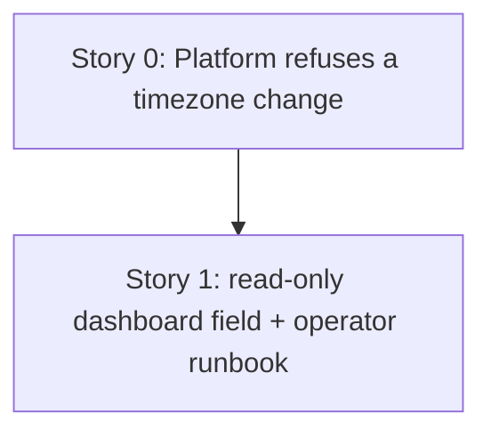

# TD61 — BILLING-TIMEZONE-FOLLOWS-TENANT

## Status

- **Type**: Technical Debt / Invariant not enforced
- **Priority**: Medium (a manager can change the tenant's timezone today, which the product says must not happen; the effect is a Billing date boundary, today only the BOOKING `bookableUntil` cap, off by the offset between the two zones, up to several hours)
- **Context**: Platform (the settings invariant), BFF and web (the settings form), docs (runbook)
- **Created**: 2026-11-26 (rewritten twice the same day: the first draft missed decision 47, the second assumed the timezone is editable by design)
- **Discovered**: M26-S18b PR #847 review: CodeRabbit's finding on `apps/backend/src/contexts/booking/application/use-cases/update-availability-alert.use-case.ts` (the `bookableUntil` cap date is derived in the subscription's timezone, the alert check reads the tenant's). Declined in that PR with a documented limitation in `docs/BUSINESS_LOGIC_REFERENCE.md` § The billing `bookableUntil` cap.
- **Decision status**: Ready for discovery in the order below; each story still begins with `/story-discovery`. The product rule is decided (owner, 2026-11-26): **the tenant's timezone is set at signup and a manager can never change it; only an operator can correct it, as a rare, documented action.**
- **Related**: `docs/discovery/tenant-billing/tenant-billing.md` decision 47 and decision 119; `docs/DOMAIN_MODEL.md` § Aggregate: Subscription (`timezone`: "snapshot of the tenant timezone, IMMUTABLE"); `docs/TENANTS_SETTINGS_SCHEMA.md` ("Timezone is configured once per tenant and applies globally"); `docs/BUSINESS_LOGIC_REFERENCE.md` § The billing `bookableUntil` cap; `docs/RUNBOOKS.md`; M26-S18a, M26-S18b (PR #847)

## Problem

Billing's `Subscription.timezone` is a snapshot of the tenant's timezone taken at provisioning and is immutable on purpose (`subscription.aggregate.ts:76`; decision 47: "copied from `TenantProvisioned` at creation and is immutable; period boundaries are local midnight in it; Billing never reads Platform settings"). That is only safe if the tenant's own timezone never changes. The docs say so (`docs/TENANTS_SETTINGS_SCHEMA.md`: "Timezone is configured once per tenant"), and the owner confirms the rule: a manager can never change it; only an operator can, as a rare correction.

**The code does not enforce it.** The dashboard's settings form has an enabled timezone select (`apps/web/features/platform/components/settings/SettingsHoursSection.tsx:42-47`, `data-testid="settings-timezone-select"`), the settings update sends `businessHours.timezone`, and nothing in the backend rejects a changed value: `Tenant.updateSettings()` (`apps/backend/src/contexts/platform/domain/tenant.aggregate.ts:104`) replaces the whole settings object and the validator only checks that the value is a real IANA zone (`business-hours.validator.ts`). Platform also publishes no event when it changes.

Until M26-S18b every Billing date stayed inside Billing, so the gap was invisible. The `bookableUntil` cap is the first Billing date another context compares in its own calendar: Billing derives a `YYYY-MM-DD` in the subscription's zone, Booking turns it into a boundary at the local midnight of the tenant's **current** zone. After a manager changes the timezone, the boundary sits up to the offset difference away from the instant Billing meant, and a commitment ending in that gap could later block the removal. The same drift would hit every other Billing date the moment another context reads one.

### Why this matters

The invariant that keeps Billing's snapshot correct is documented but not enforced, so it is one settings save away from silent drift on money and entitlement dates. Enforcing it where it is owned (Platform) makes decision 47 true by construction, with no event, consumer, migration or infrastructure rollout.

## Chosen approach (decided in this session, 2026-11-26)

1. **Enforce the invariant in Platform's aggregate.** `Tenant.updateSettings()` refuses a settings object whose `businessHours.timezone` differs from the current one, with a typed domain error (`PLATFORM_TENANT_TIMEZONE_IMMUTABLE`, a `422` through the existing error mapper) and both locale messages. Every path that updates settings goes through the aggregate, so none can bypass it.
2. **Show it read-only in the dashboard** after signup, with a short explanation that an operator corrects it.
3. **The operator correction is a documented runbook, not a feature.** An operator changes the tenant's `businessHours.timezone` and the subscription's `timezone` **together** in one reviewed action (the runbook gives the exact statements, the tenant read-cache eviction and the pre-checks: the tenant should still be in its trial, with no invoice issued, so nothing has to be re-anchored). It is expected to be rare. If it ever stops being rare, `/create-story` adds an operator endpoint that updates both through an event, and that is the point to revisit.
4. **Record the invariant once** in `docs/TENANTS_SETTINGS_SCHEMA.md` and remove the "can drift" notes S18b added (`docs/BUSINESS_LOGIC_REFERENCE.md` § The billing `bookableUntil` cap, `docs/TENANTS_SETTINGS_SCHEMA.md`, `docs/DOMAIN_MODEL.md`).

**Rejected:** a Platform event plus a Billing consumer that re-points the subscription's timezone (reverses decision 47, needs a new Pub/Sub topic and subscription, the playbook's Foundation rollout and a policy for dates and charges already computed, for a case the product says never happens); carrying the cap as an instant (fixes the cap only, and leaves the invariant unenforced for every future cross-context date); deriving Billing dates in the tenant's zone at read time (Billing would read Platform settings on every money-date computation, against decision 47).

**First discovery step (read-only, by someone with database access):** count the tenants in staging and production whose `settings.businessHours.timezone` already differs from their `billing.subscriptions.timezone`. A non-zero count means some tenants already drifted before the guard, and the runbook's correction is applied to them once.

## Stories

### Story 0 — Platform refuses a timezone change from the settings route 🟡

**Agent:** backend-ts + bff-ts
**Complexity:** S
**Docs to load:** `docs/TENANTS_SETTINGS_SCHEMA.md` § 3. Business Hours, `docs/ENGINEERING_RULES_SHARED.md` § Adding a new error — checklist (step 2: both locale files), `docs/ERROR_CATALOG.md` § Code Origins, `docs/CODE_STANDARDS.md`, `docs/API_CONTRACTS.md` § Tenant Settings (Admin — UC-026)
**Dependencies:** none
**Pattern:** aggregate invariant with a typed domain error (the `TenantInactiveError` precedent in the same `updateSettings()`): the rule lives in the aggregate, the controller's `mapPlatformError` maps it.

**Description:**
`Tenant.updateSettings(settings)` compares `settings.businessHours.timezone` with the current value and throws `TenantTimezoneImmutableError` (`PLATFORM_TENANT_TIMEZONE_IMMUTABLE`) when they differ, before replacing anything. A save that keeps the same timezone is unchanged. The error is added to `PlatformErrorCode`, to `platform-error.mapper.ts` (`422`) and to both locale `errors.json` files in the same change (the web's exhaustiveness test fails CI otherwise). The BFF forwards the typed error unchanged. `docs/TENANTS_SETTINGS_SCHEMA.md` states the invariant once and the S18b "can drift" notes are removed.

**Backend use case steps:**
1. `Tenant.updateSettings`: after the inactive check, refuse a changed `businessHours.timezone` with the typed error.
2. `UpdateTenantSettingsUseCase` is unchanged in behavior (it saves through the aggregate); its spec gains the case.

**Backend HTTP surface:** extends the existing tenant settings `PATCH` route: a new `422 PLATFORM_TENANT_TIMEZONE_IMMUTABLE` outcome.
**BFF endpoint spec:** the same route forwards the typed error unchanged; no new route.
**New migration / i18n keys / env vars / feature flags:** one error code (`PLATFORM_TENANT_TIMEZONE_IMMUTABLE`) with its pt-BR and en messages; no migration, env var or flag.

**Files to create/modify:**
- `apps/backend/src/contexts/platform/domain/tenant.aggregate.ts` (+ spec) (modify)
- `apps/backend/src/contexts/platform/domain/errors/platform-domain.error.ts` (+ spec) (modify)
- `apps/backend/src/contexts/platform/infrastructure/http/platform-error.mapper.ts` (+ spec) (modify)
- `apps/backend/src/contexts/platform/infrastructure/controllers/tenant-settings.controller.integration.spec.ts` (modify)
- `packages/types/src/error-codes.ts`, `packages/i18n/locales/en/errors.json`, `packages/i18n/locales/pt-BR/errors.json` (modify)
- `apps/backend/http/platform/tenant-settings.http`, `apps/bff/http/platform/tenant-settings.http` (modify — the new error case)
- `docs/TENANTS_SETTINGS_SCHEMA.md`, `docs/API_CONTRACTS.md`, `docs/ERROR_CATALOG.md`, `docs/BUSINESS_LOGIC_REFERENCE.md`, `docs/DOMAIN_MODEL.md` (modify)

**Acceptance criteria — product:**
- [ ] A manager saving settings with a different timezone is refused with a clear message, and nothing is saved; saving with the same timezone, or changing any other setting, works as before.

**Acceptance criteria — technical:**
- Unit:
  - [ ] `Tenant.updateSettings`: a changed timezone throws `TenantTimezoneImmutableError` and leaves the settings untouched; the same timezone with other changes is accepted; an inactive tenant still throws `TenantInactiveError` first
  - [ ] the error mapper returns `422` with the new code
- Integration:
  - [ ] the settings `PATCH` with a new timezone returns `422 PLATFORM_TENANT_TIMEZONE_IMMUTABLE` and the stored timezone is unchanged; with the same timezone and a changed buffer it succeeds
- Tenant isolation:
  - [ ] tenant A's refused change never touches tenant B's settings
- E2E: none — covered by integration (the web side is Story 1)
- [ ] Negative guarantee pinned: no settings path other than provisioning can change the timezone (a test that updates settings through the use case with a different timezone and expects the refusal)
- [ ] Coverage ≥80% on changed code
- [ ] `tsc --noEmit` clean, lint clean, `pnpm architecture-check` clean

### Story 1 — The dashboard shows the timezone read-only, and the operator runbook 🟡

**Agent:** frontend-ts
**Complexity:** S
**Docs to load:** `docs/ENGINEERING_RULES_FRONTEND.md` § UI layer model and § Reuse the repo's UI primitives, `docs/DASHBOARD_FRONTEND_ARCHITECTURE.md`, `journeys/manager/configuracoes.md`, `journeys/manager/prototypes/configuracoes/dev-notes.md`, `docs/RUNBOOKS.md`
**Dependencies:** TD61 Story 0
**Pattern:** plain composition: the existing settings section renders the value as read-only text (or a disabled field using the existing primitive) instead of the select; no new component.
**Prototype references:** `journeys/manager/prototypes/configuracoes/` (`01-settings-form.html`, `dev-notes.md` § timezone); the journey `journeys/manager/configuracoes.md` and the prototype note change in the same commit (CLAUDE.md §15's light-sync rule applies: a one-sentence factual sync of an existing journey file needs only the normal doc-gate yes).

**Description:**
`SettingsHoursSection` shows the timezone as read-only text with a short helper line ("O fuso horário é definido no cadastro. Para corrigi-lo, fale com o suporte.") instead of the enabled select; the form no longer sends a changed timezone, and a stale client that does gets Story 0's typed error mapped to its locale message. `docs/RUNBOOKS.md` gains an entry, **Correct a tenant's timezone (operator)**: the pre-checks (the tenant is still in its trial and has no issued invoice, otherwise stop and decide with the owner), the two statements that change the tenant's `settings.businessHours.timezone` and `billing.subscriptions.timezone` together in one transaction, the tenant read-cache eviction (or the TTL to wait), and the verification query.

**New migration / i18n keys / env vars / feature flags:** the helper line's two keys in `packages/i18n/locales/{pt-BR,en}/web.json`.

**Files to create/modify:**
- `apps/web/features/platform/components/settings/SettingsHoursSection.tsx` (+ `.spec.tsx`) (modify)
- `apps/web/features/platform/components/settings/SettingsForm.tsx` (+ spec) (modify)
- `apps/web/features/platform/settings-form-validation.ts`, `settings-form.ts` (+ specs) (modify, only if the timezone leaves the editable field set)
- `packages/i18n/locales/en/web.json`, `packages/i18n/locales/pt-BR/web.json` (modify)
- `journeys/manager/configuracoes.md`, `journeys/manager/prototypes/configuracoes/dev-notes.md`, `journeys/manager/prototypes/configuracoes/01-settings-form.html` (modify)
- `docs/RUNBOOKS.md` (modify — the operator correction)
- the settings E2E spec (modify: a `test.step` in the existing settings flow, no new test)

**Acceptance criteria — product:**
- [ ] A manager sees the business timezone as read-only text with the explanation, and cannot change it; every other settings field still saves.
- [ ] An operator has a documented, reviewed way to correct a wrong timezone that updates the tenant and the subscription together.

**Acceptance criteria — technical:**
- Unit:
  - [ ] the section renders the timezone as read-only (no `select`), with the helper text in both locales
  - [ ] the form's payload carries the unchanged timezone and no edit control exists for it
- E2E:
  - [ ] a `test.step` in the existing settings journey: the timezone is displayed and not editable, and saving another field succeeds
- [ ] Negative guarantee pinned: the timezone control is absent (a unit test asserting no element with `data-testid="settings-timezone-select"`)
- [ ] Coverage ≥80% on changed code
- [ ] `tsc --noEmit` clean, lint clean, `pnpm architecture-check` clean

## Sequencing

