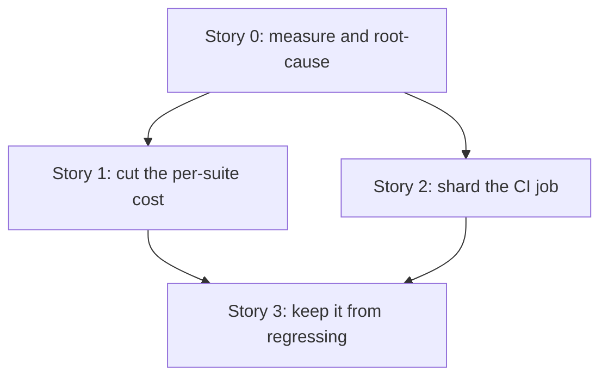

# TD62 — Backend integration suite: memory, time and CI efficiency

## Status

- **Type**: Technical Debt / CI and test-suite efficiency
- **Priority**: High (the heap ceiling has been raised three times as a stopgap and the next added suites reach it again; no production risk, a recurring CI failure and a slow critical path)
- **Context**: `apps/backend` (Jest `integration` project, `src/test/**` helpers and global setup), `.github/workflows/pr-tests.yml`; docs `docs/ENGINEERING_RULES_TESTING.md`, `docs/TESTING_STRATEGY.md`, `docs/CI_TRAPS.md`
- **Created**: 2026-11-28
- **Discovered**: M26-S16, PR #852, round 1: the `Backend Integration Tests` job died with `FATAL ERROR: Ineffective mark-compacts near heap limit` (exit 134) at the 6144 MB ceiling, about 7 minutes into one Jest worker (169 suites). The fix at the time was a third bump, 6144 to 8192.
- **Decision status**: Ready for discovery and implementation in the dependency order below; each story still begins with `/story-discovery`.
- **Related**: `td/TD08-AUDIT-REMEDIATION-BACKLOG.md` (AUD-044, the first heap-ceiling fix), `docs/ENGINEERING_RULES_TESTING.md` § Node's default V8 heap limit, `docs/CI_TRAPS.md` (the local four-shard workaround), `plan/M26-TENANT-BILLING-COLLECTION-LAUNCH.md` (the Playwright shard and time budget)

---

## Problem

The backend integration suite runs as one Jest worker (`--maxWorkers=1`, `apps/backend/package.json`) over 169 `*.integration.spec.ts` files. It has outgrown its memory budget three times, and each time the answer was a bigger ceiling, never a cause:

| When | Change | Trigger |
|---|---|---|
| TD08 AUD-044 (PR #484) | an explicit `--max-old-space-size` on the four Jest scripts | a local OOM at V8's default ~2.2 GB |
| M26-S05 | 5120 to 6144 | two added files; the last suite sat near 4.9 GB of 5120 |
| M26-S16 (PR #852) | 6144 to 8192 | three added files; the CI job crashed at about 5.9 GB (exit 134) |

`docs/ENGINEERING_RULES_TESTING.md` already says that growth past the ceiling "is a case for finding which suites retain memory, not for another bump". This TD does that.

**Evidence gathered while drafting (verified 2026-11-28):**

- **Memory is the proven failure, not time.** The crash was a heap exhaustion in a worker that retains every suite's compiled modules, entity metadata and Nest module graphs until the run ends. Closing is not the leak: every Nest-booting spec has an `app.close()` and every `createTestDataSource` spec a `destroy()` (token grep, 2026-11-28), so the growth is the per-file module registry of one long-lived worker.
- **Where the suites come from.** Of 169 files, 97 boot a full Nest application, each building its own `TypeOrmModule.forRoot` pool and entity list (34 through `createBookingIntegrationApp`, 15 through `createBillingIntegrationApp`, 13 each through the notification and platform helpers, the rest through smaller ones or `Test.createTestingModule`); 71 compose repositories by hand over `createTestDataSource()` (52 entities each time); one talks only to the fake GCS emulator.
- **Time is a long tail, and a secondary cost.** In the log of the crashed run, 168 suites passed and only 22 took more than 5 seconds (141 s in total); the rest are short suites that each pay the same fixed startup. The job takes 8m46s to 10m55s over the last eight runs, about the same as `Web Unit Tests` (7m31s to 13m6s) and each Playwright leg (9 to 15m), so shortening it alone barely shortens a PR's wait. It is on the critical path together with those jobs, and it has no `timeout-minutes`.
- **Type-checking runs in every suite.** `apps/backend/jest.config.ts` sets `ts-jest` with only a `tsconfig` option: no `isolatedModules` and no `diagnostics` setting, so each of the 169 integration files (and the unit suites) is compiled with full type-checking, while CI also runs `tsc --noEmit` as its own gate (`apps/backend` type-check includes the spec files).
- **Container reuse looks inert.** CI sets `TESTCONTAINERS_REUSE_ENABLE: 'true'` (`pr-tests.yml:107`) and `docs/ENGINEERING_RULES_TESTING.md` plus three specs' comments rely on one reused Postgres, but no `.withReuse()` call exists anywhere in `apps` or `packages` (the Testcontainers API needs both). `integration-global-setup.ts` starts a Postgres and a fake GCS container and runs about 80 migrations on every run.
- **No data.** The integration job uploads nothing: no JUnit or JSON report, no `--logHeapUsage`, no `slowTestThreshold`, no per-suite timing. CI also has no Jest cache and no sharding; every test job repeats checkout, `pnpm install` and a cold TypeScript compile.
- **A workaround exists, locally only.** `docs/CI_TRAPS.md` records four sequential Jest processes with `--shard=<i>/4` at 4096 MB each, which passed 164 suites and 2,263 tests when the single process was killed three times in M26-S18b. CI never used it.

---

## Non-negotiable constraint: no loss of test coverage

**Every story below must leave the integration (and unit) suites testing exactly what they test today. This is mandatory, not a goal.** A speed or memory gain that costs a test is a failed story.

- No test is deleted, skipped (`.skip`, `xit`, `todo`), merged away, moved out of the integration project, or weakened (a looser assertion, a removed case, a mock added where a real database ran) to save time or memory.
- **Separate scenarios stay separate tests; only their shared setup may be shared.** Two related tests are never combined into one `it` to save a setup: that hides which scenario broke and puts the assertions at risk. The saving is taken from the setup instead (Story 1's `beforeAll` hoisting), and it is allowed only for an arrange that the tests merely read.
- The **set of suites and tests that run in CI must not shrink.** Story 0 records the baseline (suite count, test count, the sorted list of suite paths) from a green run; every later story proves, with numbers, that the same suites and the same test count run afterwards. A sharded run proves it mechanically: the union of the suites executed by all shards equals the set of `*.integration.spec.ts` files on disk, and CI fails when it does not (Story 2).
- **Type safety of test code must not drop.** If Jest stops type-checking per file (Story 1), `tsc --noEmit` must still type-check every spec and test helper, and a deliberately introduced type error in a spec must fail the CI type-check job (shown once, in the PR, and not committed).
- **SonarCloud's differential coverage is unchanged.** Integration specs feed no coverage report today (they are excluded from `collectCoverageFrom`), and the unit coverage that does feed it (`backend-coverage`) must be produced exactly as before; the quality gate result on the PR is the evidence.
- A change to Jest configuration, transforms or test helpers is accepted only when the **same tests pass with the same count** before and after, in CI and not only locally.

Every story's acceptance criteria repeats this as its own checkable line.

---

## Chosen approach

Decided while drafting (the options and the discovery open points are in each story):

1. **Measure before changing anything** (Story 0). The heap has been raised blind three times; the first story produces per-suite heap and time data in CI and the root cause of retention, so no later story is a guess.
2. **Shard the CI job** (Story 2) because it is the structural memory fix: each shard's worker loads only its share of the suites, so the ceiling stops being a function of the whole suite's size, and wall time falls with it. It is the answer already proven locally in `docs/CI_TRAPS.md`.
3. **Lower the cost of each suite** (Story 1) only where Story 0's numbers show a lever pays, with an adopt-or-drop rule per lever.
4. **Make regression visible** (Story 3) with a budget in the job output instead of another silent bump.

Story 1 and Story 2 are independent once Story 0 has landed and can merge in either order.

---

## Stories

### Story 0 — Measure the integration suite and find what retains memory 🔴

**Agent:** `backend-ts + devops`
**Complexity:** M
**Docs to load:** `docs/ENGINEERING_RULES_TESTING.md` § Node's default V8 heap limit, `docs/TESTING_STRATEGY.md`, `docs/CI_TRAPS.md` (the earlyoom, `/tmp/jest_rs` and local-shard rows), `docs/STORY_SCHEMA.md`
**Dependencies:** none (foundation)
**Pattern:** Plain composition: a reporting script and CI flags over the existing job; no named design pattern applies, and no test code is changed.

**Description:**
Produce the data every later story is judged by, and name the cause of the memory growth. Add `--logHeapUsage` and a JSON report (`--json --outputFile`) to the CI integration run, upload the report as a workflow artifact (and print a short summary in the job log: total suites and tests, the 15 slowest suites, the heap after each of the heaviest 15 and at the last suite). Add `scripts/integration-report.cjs` (with a `.spec.cjs` run by `node --test`, as `pr-round-status.spec.cjs` is) that turns that JSON into the summary, so the same view is available locally.

Then investigate and record, in this TD's `## Findings` section, with numbers:

1. **Baseline** (from a green CI run, not a local run): `Test Suites` and `Tests` totals, the sorted list of suite paths, job duration, peak heap. These are the coverage baseline the whole TD must preserve.
2. **Where the memory goes:** run the suite locally in `--logHeapUsage` mode, and in at least one bisection (for example only the 97 Nest-booting suites against only the 71 hand-composed ones, or each context folder alone) to see which group's retained heap grows per suite; test whether the growth is the ts-jest compile and module registry, entity metadata (52 to 55 entities loaded per DataSource), the Nest module graph, or `TypeOrmModule` pools that outlive `app.close()`. Report the retained MB per suite for each group, and whether `workerIdleMemoryLimit` or running the same suites in separate processes flattens it.
3. **Where the time goes** for a typical short suite: transform and type-check, entity-metadata and DataSource initialisation, Nest `createTestingModule` plus `app.init()`, and the test bodies; one representative of each helper (`createBookingIntegrationApp`, `createBillingIntegrationApp`, `createTestDataSource`, `createSweepWorld`).
4. **Container reuse:** whether `TESTCONTAINERS_REUSE_ENABLE` does anything today (no `.withReuse()` exists), what one run spends on starting the containers and running about 80 migrations, and whether a pre-migrated template database would be safe given the fixed-UUID isolation rule (`docs/ENGINEERING_RULES_TESTING.md` § An integration test seeding fixtures under fixed/hardcoded tenant UUIDs).
5. **Repeated per-test setup (read-only analysis, nothing is changed):** the repository has about 1,793 integration test cases in 169 specs, every spec boots its app or `DataSource` once in `beforeAll`, and 35 specs also use `beforeEach`. List the specs where several tests repeat the same arrange (the same seed or fixture call), and the `beforeEach` blocks that re-seed data the tests only read; count them and estimate the seconds each would save if the arrange ran once (starting from the largest files: `booking.controller`, `recurring-booking-schedule.controller`, `service.controller`). Report overlapping scenarios for the owner to read as findings only: no test is merged, removed or edited under this TD, and a pair of tests that look redundant is listed with its evidence and left alone.
6. A ranked list of levers with their measured gain, which Stories 1 and 2 take as their input.

Fix the documentation drift the investigation proves: the container-reuse statements in `docs/ENGINEERING_RULES_TESTING.md` and `docs/TESTING_STRATEGY.md` say what the code does, and the heap-ceiling paragraph points to this TD.

**Backend use case steps:** none (test infrastructure and CI only).
**Backend HTTP surface:** none.
**BFF endpoint spec:** none.
**New migration / i18n keys / env vars / feature flags:** none.

**Files to create/modify:**
- `.github/workflows/pr-tests.yml` (modify: `--logHeapUsage`, `--json --outputFile`, the artifact upload and the job summary, on the `backend-integration` job only)
- `apps/backend/package.json` (modify: a `test:integration:report` script that adds the same flags locally; `test:integration` itself unchanged)
- `scripts/integration-report.cjs`, `scripts/integration-report.spec.cjs` (new)
- `scripts/integration-heap-reporter.cjs` (new: a Jest reporter passed on the CLI only, `--reporters default --reporters <file>`, writing each suite's path, duration and `memoryUsage`; no Jest config change)
- `package.json` (root, modify: an `integration-report:test` script, `node --test scripts/integration-report.spec.cjs`)
- `.github/workflows/pr-quality.yml` (modify: a step running `pnpm integration-report:test` beside `dep-cruise:test`, so the spec runs in CI)
- `docs/ENGINEERING_RULES_TESTING.md`, `docs/TESTING_STRATEGY.md`, `docs/CI_TRAPS.md` (modify: findings and the corrected reuse statements)
- `td/TD62-INTEGRATION-SUITE-MEMORY-AND-CI-EFFICIENCY.md` (modify: `## Findings`)

**Acceptance criteria — product:**
- [ ] A contributor can see, for any PR, how long each integration suite took and how much heap the worker held after it, without rerunning anything.
- [ ] The cause of the memory growth, and the measured gain of each candidate lever, are written down with numbers before any suite or config change is made.

**Acceptance criteria — technical:**
- [ ] **No test coverage lost:** this story changes no spec, no Jest config and no test helper; the green CI run after it shows the same suite and test totals as the baseline it records.
- Unit:
  - [ ] `integration-report.spec.cjs`: the slowest-suite ranking, the heap-after-suite series, a report with a failing suite, an empty report, and a fixture produced by `integration-heap-reporter.cjs` (the reporter has no spec of its own)
  - [ ] the spec runs in CI (`pr-quality.yml`), not only locally
- Integration: none (no application code changes)
- E2E: none
- [ ] The integration job still passes and its duration is not worse than the baseline by more than the cost of the extra flags (reported)
- [ ] `actionlint` and `zizmor` clean on the workflow change
- [ ] **Live-verification check:** open the PR, then read the job's summary and the uploaded artifact from the PR's own CI run (`gh run view <id> --log` and `gh run download`); pass = the report lists 169 suites and the totals equal the baseline, the heap series is present, and the artifact downloads.

**PR sequence:** 1 PR (a workflow and script change, no Terraform, so `infra/terraform/README.md`'s playbook does not apply).

**Discovery decisions (TD62-S0, 2026-11-28):**
- **Pattern:** plain composition; no named pattern applies.
- **Heap source:** Jest 30.5.2's `--json` output carries no `memoryUsage` (only the console reporter prints it), so per-suite heap and duration come from `integration-heap-reporter.cjs`; `--json --outputFile` stays for totals and test names.
- **Local investigation:** the integration suite may be run locally, one process at a time, as four sequential shards at 4096 MB (`docs/CI_TRAPS.md`), after clearing `/tmp/jest_rs`; stop any container this story starts.
- **Findings in two passes:** the local analysis first; the CI baseline and peak heap as a follow-up commit on the PR branch once the PR's own run is green.
- **Item 5 stays read-only and bounded:** the three named files get a measured saving estimate; the other specs get counts only, gathered by a subagent that returns numbers, not file contents.

---

### Story 1 — Cut the cost of each integration suite where the data says it pays

**Agent:** `backend-ts`
**Complexity:** M
**Docs to load:** `docs/ENGINEERING_RULES_TESTING.md` (§ Node's default V8 heap limit, § An integration test seeding fixtures under fixed/hardcoded tenant UUIDs, § Concurrency tests), `docs/TESTING_STRATEGY.md`, Story 0's `## Findings`
**Dependencies:** Story 0
**Pattern:** Plain composition: configuration and test-helper changes, one lever at a time. No named design pattern applies; a shared test-app factory is introduced only if Story 0 shows the four per-context helpers duplicate the same expensive setup, and then as one function with the context's modules passed in (reuse over a new abstraction).

**Description:**
Take the ranked levers from Story 0 and adopt each one only if its measured gain is worth its risk, otherwise drop it and say so in the PR. Each lever is its own commit so a regression is easy to revert. The candidates, with the open points discovery must settle:

1. **Per-file type-checking in Jest.** Setting `isolatedModules` (or `diagnostics: false`) in the ts-jest options removes a full type-check from every suite. TypeORM and Nest rely on `emitDecoratorMetadata`, which behaves differently under transpile-only compilation for type-only imports, so this is adopted only if all integration and unit suites pass with an identical test count, and only with the type-check gate proved to still cover every spec and helper (see the constraint above).
2. **A Jest cache in CI** (`actions/cache` of Jest's `cacheDirectory`, keyed by the lockfile and the TypeScript config), so a PR does not recompile every file cold.
3. **`workerIdleMemoryLimit`** (recycles the worker when its heap passes a limit) and **recycling the worker between context folders**, if Story 0 shows retention grows per suite and not per module.
4. **Trimming the module graph of the Nest test helpers:** the helpers import whole contexts (for example `BookingModule` and its dependencies) where a spec needs a few providers; load only what the suite uses, without changing what it asserts. Each trimmed helper is verified by its suites passing unchanged.
5. **Entity registration per DataSource:** `createTestDataSource()` registers 52 entities for every suite; a smaller list per suite is acceptable only if no suite loses an entity it uses, enforced by the suites themselves passing.
6. **A pre-migrated template database or reusing the migrated container** (a real `.withReuse()`), only if Story 0 shows the container start and the 80 migrations are a material share of the run and the isolation rule is not weakened.

7. **Hoisting a repeated, read-only arrange from `beforeEach` into `beforeAll`**, for the specs Story 0's analysis lists. Every test stays its own `it`, with the same assertions and the same count; the arrange runs once instead of per test. It applies only where no test mutates what the arrange created (a test that writes shared state keeps its own setup, and the fixed-UUID and concurrency rules in `docs/ENGINEERING_RULES_TESTING.md` still hold), and each hoisted spec is checked to pass in the order Jest runs it and when run alone (`-t` on a single test).

Everything is reversible and measured against Story 0's baseline: peak heap, job duration, suite and test counts.

**Backend use case steps:** none.
**Backend HTTP surface:** none.
**BFF endpoint spec:** none.
**New migration / i18n keys / env vars / feature flags:** none.

**Files to create/modify:**
- `apps/backend/jest.config.ts` (modify: transform options, `workerIdleMemoryLimit`, as the data supports)
- `apps/backend/src/test/test-datasource.ts`, `apps/backend/src/test/integration-global-setup.ts` (modify, only for the levers adopted)
- `apps/backend/src/test/utils/*-integration-app.ts` and the harness files they name (modify, only for the helpers trimmed)
- the `*.integration.spec.ts` files Story 0 lists for hoisting (modify: only the move of a read-only arrange from `beforeEach` into `beforeAll`; exact list fixed at discovery)
- `.github/workflows/pr-tests.yml` (modify: the Jest cache step)
- `docs/ENGINEERING_RULES_TESTING.md`, `docs/TESTING_STRATEGY.md` (modify: the new configuration, the adopted and dropped levers with their numbers)
- `td/TD62-INTEGRATION-SUITE-MEMORY-AND-CI-EFFICIENCY.md` (modify: `## Findings`, the adopt-or-drop table)

**Acceptance criteria — product:**
- [ ] The same integration suite uses measurably less peak memory per worker and less time, with the before and after figures from CI in the PR body.

**Acceptance criteria — technical:**
- [ ] **No test coverage lost:** the suite and test totals and the sorted suite list after the change equal Story 0's baseline exactly; no spec is deleted, skipped, merged or weakened. The PR's diff to `*.spec.ts` files is limited to import changes for a trimmed helper and the move of a read-only arrange into `beforeAll`; the count of `it(`/`test(` cases and of `expect(` calls in the touched specs is the same before and after (the two numbers per spec are in the PR body), and a hoisted spec passes both whole and run alone with `-t`.
- [ ] **Type safety kept:** if any type-check setting changes, a deliberately wrong type in one spec fails the CI type-check job (evidence in the PR; not committed), and `tsc --noEmit` still includes every spec and test helper.
- Unit:
  - [ ] the full backend unit suite passes with the same test count as before the change
- Integration:
  - [ ] the full integration suite passes in CI with the same suite and test count; for a trimmed helper, every suite that uses it passes unchanged
- Tenant isolation: [ ] the fixed-UUID and concurrent-lock specs (`docs/LOCK_CATALOG.md` § 3.1) still pass and still fail without their lock (one mutation check named in the PR)
- E2E: none
- [ ] Peak heap and duration are reported before and after, from CI runs of the same commit range
- [ ] Coverage ≥80% on changed code, `tsc --noEmit` clean, lint clean

---

### Story 2 — Shard the backend integration job in CI

**Agent:** `devops`
**Complexity:** M
**Docs to load:** `docs/GITHUB_WORKFLOWS_GUIDELINES.md`, `docs/CI_TRAPS.md` (the sharding and haste-map rows, § CI workflow configuration traps), `docs/ENGINEERING_RULES_TESTING.md` (§ Node's default V8 heap limit), `docs/TESTING_STRATEGY.md`, Story 0's `## Findings`
**Dependencies:** Story 0
**Pattern:** Matrix fan-out with an aggregator job (a fan-out/fan-in of the same command over disjoint slices); the force it resolves is that one worker's heap grows with the whole suite while a shard's grows with its slice.

**Description:**
Run `backend-integration` as a matrix of `--shard=i/N` jobs, each on its own runner with its own Postgres and fake-GCS container (so the fixed host port 14443 never collides), with `N` chosen from Story 0's timings so the shards finish close together and each fits the heap ceiling with headroom (the ceiling goes back down from 8192 to a value Story 0's numbers justify; `docs/ENGINEERING_RULES_TESTING.md` is updated to say why). Pre-decided design points:

- **The required check name stays `Backend Integration Tests`.** The branch ruleset requires that check by name, and a matrix renames its jobs to `Backend Integration Tests (1/4)`. A final aggregator job named exactly `Backend Integration Tests` (`needs: <the matrix>`, `if: always()`, passing only when every shard succeeded) keeps the required context unchanged, so the ruleset needs no manual edit and no PR is ever blocked by a missing check. `test-suite-passed` keeps depending on it.
- **The union of the shards must equal the whole suite.** Each shard writes its JSON report (Story 0) as an artifact; the aggregator downloads them and a script, `scripts/integration-shard-union-check.cjs` (with a `.spec.cjs`), fails the job unless the set of suite paths executed across all shards equals the set of `*.integration.spec.ts` files on disk and the summed test count is at least the baseline's. A lost or double-run suite, or a shard that silently ran nothing, turns the check red.
- **`fail-fast: false`** on the matrix, so one failing shard does not hide the others' results, and `timeout-minutes` is set (the job has none today).
- Each shard keeps `--maxWorkers=1`, and `TESTCONTAINERS_REUSE_ENABLE` is dropped from the job unless Story 1 made it real.
- Local `pnpm ci:integration` and `scripts/ci-local.sh` keep working unsharded (they stay the single-process path, with the documented four-shard option from `docs/CI_TRAPS.md` kept for low-memory hosts).

**Backend use case steps:** none.
**Backend HTTP surface:** none.
**BFF endpoint spec:** none.
**New migration / i18n keys / env vars / feature flags:** none.

**IAM / permissions:** none (workflow permissions unchanged; the shard job keeps `contents: read`; artifact upload and download use the existing token).

**Files to create/modify:**
- `.github/workflows/pr-tests.yml` (modify: the matrix, the aggregator job named `Backend Integration Tests`, `fail-fast: false`, `timeout-minutes`, artifact upload and download)
- `scripts/integration-shard-union-check.cjs`, `scripts/integration-shard-union-check.spec.cjs` (new)
- `apps/backend/package.json` (modify only if a shard-aware script is needed; `test:integration` stays the whole-suite command)
- `docs/CI_TRAPS.md`, `docs/ENGINEERING_RULES_TESTING.md`, `docs/GITHUB_WORKFLOWS_GUIDELINES.md` (modify: the shard layout, the aggregator's name and why, the new ceiling)
- `td/TD62-INTEGRATION-SUITE-MEMORY-AND-CI-EFFICIENCY.md` (modify: `## Findings`)

**Acceptance criteria — product:**
- [ ] The backend integration check on a PR finishes in about the time of its slowest shard instead of the whole suite, and no longer depends on a single worker's heap.
- [ ] Nothing a contributor or the ruleset relies on changes: the check is still called `Backend Integration Tests`, and `All Checks Passed` still gates on it.

**Acceptance criteria — technical:**
- [ ] **No test coverage lost:** the union check passes on the PR's own CI run (suite set equals the files on disk, test count at least the baseline), and its spec proves it fails on a missing suite, a duplicated suite, an empty shard and a lower test count.
- Unit:
  - [ ] `integration-shard-union-check.spec.cjs`: the four failure cases above and the passing case
- Integration: the job itself is the test (see the live check below)
- E2E: none
- [ ] `actionlint` and `zizmor` clean on the workflow change
- [ ] **Live-verification check, before the merge review:** on the PR's CI run, `gh pr checks <N>` lists `Backend Integration Tests` as a passing check and `gh api repos/lmmoreira/ikaro/rulesets` shows it still among the required contexts; the shard jobs show their own durations and heap (Story 0's report); then break one shard on a throwaway branch (a deliberately failing spec) and confirm the aggregator and `Test Suite Passed` go red; and drop one suite from a throwaway shard run and confirm the union check goes red. Pass = all four observations are in the PR as a comment with the commands and output.

**PR sequence:** 1 PR (workflow, script and docs only; no Terraform, no `infra-app-mix-ok` needed). It lands after Story 0 so the report it consumes exists.

---

### Story 3 — Keep the integration suite from regressing

**Agent:** `devops + backend-ts`
**Complexity:** S
**Docs to load:** `docs/ENGINEERING_RULES_TESTING.md` (§ Node's default V8 heap limit), `docs/CI_TRAPS.md`, `docs/DEFINITION_OF_DONE.md`, `docs/GITHUB_WORKFLOWS_GUIDELINES.md`, Stories 1 and 2's `## Findings`
**Dependencies:** Story 1, Story 2
**Pattern:** Plain composition: a budget check over the report Story 0 produces; no named design pattern applies.

**Description:**
Replace "bump the ceiling" with a visible budget. Each shard's job summary shows its peak heap against the ceiling and its duration, warns when the heap passes a stated share of the ceiling (the share and the slow-suite threshold come from Stories 1 and 2's numbers, written in the doc), and lists suites over the slow threshold (`slowTestThreshold` plus the report). The warning is not a failing check (a red PR for a slow file would block unrelated work) but it is posted in the job summary where a reviewer sees it, and the heap-limit section of `docs/ENGINEERING_RULES_TESTING.md` is rewritten so the next agent's first step is the report and a new shard (raise `N`) or a trimmed helper, with a ceiling bump as the last resort and the evidence it needs. `docs/DEFINITION_OF_DONE.md` and `/story-discovery`'s "a story that adds integration suites" line point to the same budget, and the `/pre-pr` and `/story-discovery` guidance about "the last green run's heap" is replaced by "read the job summary".

**Backend use case steps:** none.
**Backend HTTP surface:** none.
**BFF endpoint spec:** none.
**New migration / i18n keys / env vars / feature flags:** none.

**Files to create/modify:**
- `.github/workflows/pr-tests.yml` (modify: the budget lines in the job summary)
- `scripts/integration-report.cjs`, `scripts/integration-report.spec.cjs` (modify: the budget and threshold output)
- `apps/backend/jest.config.ts` (modify: `slowTestThreshold`)
- `docs/ENGINEERING_RULES_TESTING.md`, `docs/DEFINITION_OF_DONE.md`, `docs/CI_TRAPS.md` (modify)
- `.claude/commands/story-discovery.md`, `.claude/commands/pre-pr.md` (modify: the line that sends an agent to the last green run) and the regenerated Codex mirrors from `bash scripts/codex-skill.sh`

**Acceptance criteria — product:**
- [ ] A contributor who adds integration suites sees, in the PR's job summary, how close each shard is to its heap budget and which suites are slow, before it becomes a failing job.

**Acceptance criteria — technical:**
- [ ] **No test coverage lost:** no spec changes; totals and the union check from Story 2 are unchanged on the story's own CI run.
- Unit:
  - [ ] `integration-report.spec.cjs`: a heap over the budget share warns, one under it does not, a suite over the slow threshold is listed, and a report with no heap data degrades to a message instead of failing
- Integration: none
- E2E: none
- [ ] `architecture-check`, `actionlint` and `zizmor` clean; the Codex mirrors regenerated in the same commit
- [ ] **Live-verification check:** the PR's own CI run shows the budget lines in each shard's summary; pass = a warning is visible when run against a report fixture over the budget (shown in the PR) and absent on the real green run.

**PR sequence:** 1 PR.

---

## Findings

*(Written by Story 0 and appended to by Stories 1 and 2: the baseline, the retention analysis, the ranked levers, the adopt-or-drop table and the shard layout, each with numbers.)*
